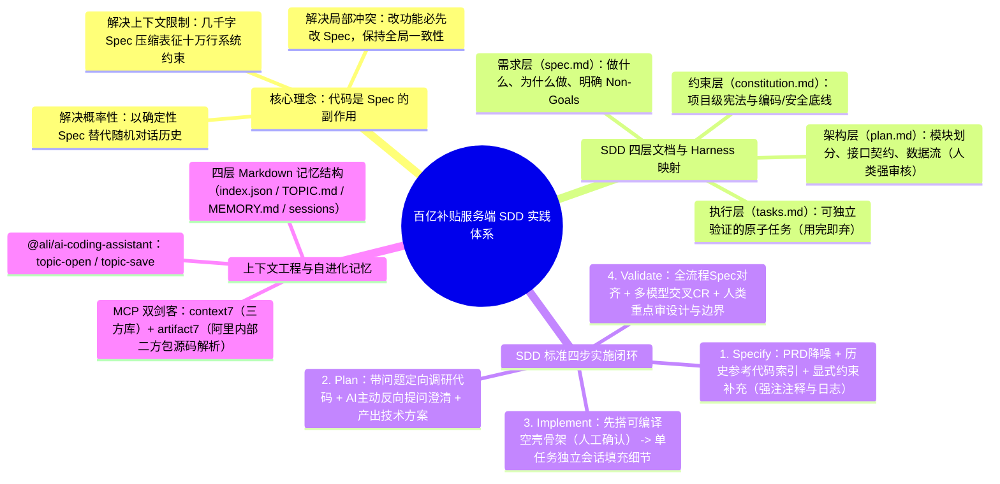

# 百亿补贴 C 端 AI Coding 实战：基于 SDD 的服务端 AI Coding 实践

> [!abstract] 导读
> **一句话总结**：淘天集团天猫技术团队（作者：码一）针对复杂存量服务端业务中“Vibe Coding 不可控、全自动多 Agent P2C 流水线误差层层放大”的真实教训，确立了**“Aone Copilot + 开发者深度参与的 SDD（Spec-Driven Development，规格驱动开发）”**新范式——将分层 Spec 作为唯一真相源（Single Source of Truth），配合 `context7` / `artifact7`（阿里内部二方包源码上下文解析）与四层自进化记忆体（`topic-open` / `topic-save`），在 1 年前历史互动玩法项目中实现 **4 天交付 4000+ 行生产代码、0 手写代码**。
> **阅读价值**：坦诚复盘了“为什么全自动多 Agent P2C 工作流在生产级复杂 Java 项目中走不通”，并给出了极度务实、可落地的 **SDD 四步法（Specify → Plan → Implement → Validate）** 与 **Git 版本化 Markdown 自进化记忆架构**。

## 1. TL;DR

- **标杆实战战果**：在百亿补贴 1 年前历史玩法项目（新增分享回流等复杂交互）迭代中，通过 SDD 方法论实现 **0 手写代码、4 天完成开发（不含联调）**，累计产出 **5000+ 行 Spec、200+ 条长期记忆、500+ 条任务记录、4000+ 行生产级 Java 代码**。
- **核心认知跃迁**：
  1. **为什么 Vibe Coding 在生产级业务必败？** 受制于大模型**概率性输出、上下文限制（Lost in the Middle / 多轮失忆）、局部视野**三大固有约束，纯自然语言自由发挥必然导致风格漂移、上下文坍塌与全局架构冲突。
  2. **为什么放弃“全自动多 Agent P2C 流水线”？** 团队早期自建的多 Agent 全自动 PRD-to-Code（P2C）工作流虽能达到约 70% 采纳率，但因步骤冗长反馈慢、上游 Spec 微小误差逐级放大、CLI 环境对阿里大型 Java 应用缺乏成熟索引（LSP 易 OOM）而无法满足严苛生产要求。
  3. **终极解法：开发者坐回驾驶座 + SDD 唯一真相源**：**“代码只是 Spec 的副作用”**。放弃信任 AI 的长链路自主决策，转为**信任 AI 在明确 Spec 约束下的单步执行能力**，由人类开发者精确把控每一步 Spec 的演进与架构审核。
- **三大关键技术抓手**：
  1. **SDD 分层文档与四步闭环**：构建“需求层 + 架构层 + 执行层 + 约束层（宪法）”四层文档，严格执行 `Specify → Plan → Implement（先搭空壳框架再填细节） → Validate（多模型交叉 CR）`。
  2. **精准上下文工具链**：用 **`context7`** 查开源库精确版本文档，用 **`artifact7`** 解析内部无文档二方包 SDK 源码与 API，遵循“恰好足够（Just Enough）”与渐进式披露原则。
  3. **四层自进化记忆体（`@ali/ai-coding-assistant`）**：基于“Markdown 文件即知识”理念，通过 `topic-open` 与 `topic-save` 两个轻量级 Skill 维护 Git 版本化的四层话题记忆库，彻底解决跨会话失忆与多人协作记忆同步难题。

## 2. 问题定义与背景

### 2.1 AI Coding 的三大天然硬约束
任何不针对大模型固有特性设计的研发方法论，在大型复杂存量项目中都会撞墙：
1. **概率性输出**：同样的提示词跑两次结果可能截然不同；没有确定性基线文档锚定，多次迭代后代码风格与架构决策会被随意推翻。
2. **上下文窗口与注意力限制**：对话轮次拉长或经历自动压缩后，早期约定的安全红线与业务边界极易丢失（上下文坍塌）。
3. **局部视野盲区**：面对十万行级存量代码库，AI 每次只能看到局部切片，基于局部最优做的“优化”极易破坏全局一致性。

### 2.2 三代 AI Coding 范式演进对比

| 演进阶段 | 核心模式 | 实测表现 / 采纳率 | 核心瓶颈与教训 |
| :--- | :--- | :--- | :--- |
| **1. Vibe Coding** | 自然语言随聊随改，AI 自由发挥 | 原型期可用，复杂业务不可用 | 无标准无约束，多轮对话后失忆，局部修改破坏全局架构。 |
| **2. 全自动多 Agent P2C** | `知识库 -> 需求改写 -> 方案生成 -> 生码 -> 测试` 全自动多 Agent 流水线（iFlow CLI / Claude Code） | 采纳率约 **70%** | 链路过长耗时久；上游 Spec 不准向后层层放大；大型 Java 项目 CLI 跑 LSP 极易 OOM。 |
| **3. Aone Copilot + 人工深度参与 SDD** | IDE 原生 Linter/索引 + 开发者逐级审核 Spec + 单任务独立会话 + 自进化记忆 | **0 手写代码交付 4000+ 行生产代码** | 将人置于“架构决策与 Spec 审核”核心控制点，用单步确定性消除长链路累积误差。 |

## 3. 知识框架



## 4. 核心内容拆解

### 4.1 SDD 与 Harness Engineering 的四层映射及四步工作流

作者指出：**SDD 本质上就是 Harness Engineering（驾驭工程）在 AI Coding 领域的具体落地**，旨在防止强能力 AI 失控。

```mermaid
flowchart LR
    subgraph S1["1. Specify (规格定义)"]
        A1["PRD结构化降噪 + 明确Non-Goals"]
        A2["提供存量参考代码入口索引"]
        A3["补充项目宪法约束 (强制注释/日志齐全)"]
    end

    subgraph S2["2. Plan (方案规划)"]
        B1["带着明确问题定向调研存量代码"]
        B2["AI 反向提问暴露需求矛盾与冲突"]
        B3["生成模块/接口/数据流方案 (开发者强审核)"]
    end

    subgraph S3["3. Implement (代码实现)"]
        C1["Step 3.1 先生成可编译空壳骨架 (人工确认)"]
        C2["Step 3.2 按原子任务开独立会话 (topic-open)"]
        C3["Step 3.3 填充单模块实现并保存记忆 (topic-save)"]
    end

    subgraph S4["4. Validate (持续验证)"]
        D1["AI 辅助比对 Spec-方案-代码 一致性"]
        D2["多模型交叉 Code Review 抓盲点"]
        D3["开发者逐行审架构/边界 + 针对性手工回归"]
    end

    S1 --> S2 --> S3 --> S4
```



#### 1. Specify（规格定义）：把隐含假设全部显性化
- **明确 Non-Goals（不做什么）**：如果不写清楚边界，AI 一定会擅自发散过度设计。
- **缩小代码搜索空间**：面对 1 年前的历史玩法项目，先由人工指出核心参考入口类，再让 AI 顺藤摸瓜梳理模块职责写入 `spec.md`，避免全库盲搜。
- **强制写死“日志与注释”约束**：在 `constitution.md` 中额外规定生成代码必须具备**对人和 AI 均友好的完备注释**与**全链路排查日志**，极大降低联调与线上排障成本。

#### 2. Plan（方案规划）：让 AI 先提问，人来审架构
- **定向资产调研**：禁止让 AI 漫无目的地“通读项目”，而是带着具体问题去查（如*“现有任务系统是否支持单日助力上限？扩展点在哪？”*）。
- **AI 反向提问澄清**：要求 AI 主动挑刺，找出 PRD 遗漏或与存量代码冲突的设计，将问题消灭在编码前。
- **人类把关架构优雅度**：AI 给出的方案往往“能跑但过度复杂”，开发者在此阶段砍掉冗余抽象、对齐既有架构风格。

#### 3. Implement（代码实现）：先搭骨架，再单话题逐个击破
- **两阶段编码法**：
  1. **第一阶段（搭骨架）**：只生成目录结构、接口签名、DTO 类型定义与基础管道，产出**“能通过编译但无具体实现”的空壳框架**，由开发者审核签字（因为改框架成本远高于改实现）。
  2. **第二阶段（填血肉）**：按 `tasks.md` 拆解的原子任务，**每个任务开启一个全新独立会话**，会话初执行 `topic-open` 加载精准记忆，完成后执行 `topic-save` 沉淀关键决策，做到“一次只做一件事”。

#### 4. Validate（验证确认）：多模型交叉 CR + 人类审设计
- 在实际交付中，技术方案与 PRD 对齐迭代了 **3+2 次**，代码与方案对齐迭代了 **5+5 次以上**。
- **多模型交叉 CR**：利用不同大模型之间的“认知差异”互相挑刺代码；而人类 Reviewer 不必纠结基础语法逻辑，重点审查**“设计是否过度抽象、异常是否被静默吞掉、边界条件是否健壮”**。

### 4.2 上下文工程与四层自进化记忆体（`topic-open` / `topic-save`）

#### 1. 破解内部二方包幻觉：`context7` + `artifact7`
阿里内部 Java 应用依赖大量集团二方包，这些包既不在公网大模型预训练语料中，又普遍缺乏完善文档。团队仅用 2 个核心 MCP 工具破局：
- **`context7`**：精准拉取第三方开源库对应版本的官方文档与示例。
- **`artifact7`**：专门面向阿里内部二方包的代码上下文治理工具，直接从二方包 SDK 源码中解析接口签名、注释与调用示例并做精确版本绑定，彻底根治 AI 瞎编内部 API 的顽疾。

#### 2. 轻量级四层自进化记忆库（`@ali/ai-coding-assistant`）
为了解决跨会话“失忆”、不同模块记忆互相污染以及团队多人协作共享记忆的难题，团队摒弃了沉重的 Multi-Agent 记忆网络，借鉴“Markdown 文件即知识”范式，在项目仓库内设计了四层目录结构：

```text
topics/                           # 话题记忆根目录（随 Git 仓库版本化同步）
├── index.json                    # 第1层：全局话题索引，用于粗筛路由
└── <话题名>/
    ├── TOPIC.md                  # 第2层：话题范围与边界定义，用于精确定位
    ├── MEMORY.md                 # 第3层：跨会话技术决策、代码参考与踩坑总结（核心按需加载层）
    └── sessions/                 # 第4层：历史会话原始存档（平时不加载，仅追溯时查阅）
        └── <时间戳>-<描述>.md
```

- **按需渐进式加载**：新开会话调用 `topic-open` 时，经第 1、2 层定位后**仅将第 3 层 `MEMORY.md` 注入上下文**，第 4 层历史明细平时完全不占 Token。
- **话题严格隔离**：将大项目拆分为独立业务话题（如“支付模块”与“红包模块”），每次对话仅加载 1~2 个相关话题，杜绝跨模块上下文污染。
- **天然支持多人协同**：因为所有记忆都是项目内的 `.md` 文件，A 同学踩坑后 `topic-save` 并 `git push`，B 同学 `git pull` 后其 AI 助手自动继承全部历史记忆。

## 5. 数据速查表

| 指标 / 组件 | 数值 / 机制详情 | 工程意义 |
| :--- | :--- | :--- |
| **实战项目规模** | 百亿补贴 1 年前历史互动玩法迭代（新增分享回流） | 典型高复杂度存量 Brownfield 场景 |
| **代码与文档产出对比** | **0 手写代码**、**4 天开发**、产出 **4000+ 行代码** vs **5000+ 行 Spec** | 印证“把写代码的精力转移到写 Spec 与做决策上” |
| **过程记忆沉淀规模** | **200+ 条长期记忆**、**500+ 条任务记录** | 支撑跨十余个独立会话的上下文连续性 |
| **二方包上下文工具** | `artifact7`（内部二方包源码解析）+ `context7`（三方库） | 消除内部私有 SDK 接口调用幻觉 |
| **自进化记忆四层架构** | `index.json` (L1) $\rightarrow$ `TOPIC.md` (L2) $\rightarrow$ `MEMORY.md` (L3) $\rightarrow$ `sessions/` (L4) | 兼顾省 Token（仅加载 L3）、防污染（话题隔离）与 Git 多人共享 |

## 6. 踩坑与教训 / 可迁移的设计原则

- **核心踩坑：警惕“Spec 膨胀症”（在 Spec 里写满伪代码）**
  - **现象**：随着深入使用 SDD，团队发现技术方案 Spec 膨胀到了数千行（甚至超过了最终生成的 4000 行代码），里面充斥着大段具体伪代码，很快塞满上下文窗口。
  - **反思与检验标准**：这违背了 SDD **“人定义 WHAT，AI 实现 HOW”** 的核心铁律。检验一份 Spec 抽象度是否合格的黄金试金石是：**“如果换一种编程语言或技术栈实现，这份 Spec 的主体内容是否仍然有效？”** 如果答案为否，说明 Spec 里混入了过多实现细节（HOW），必须立即拆分模块并禁止在 Spec 中堆砌完整伪代码。
- **可迁移原则 1：从“信任 AI 的全流程判断”转向“信任 AI 的单步执行”**
  - 不要试图用一套复杂的全自动 Multi-Agent 工作流一键从 PRD 生成最终上线代码；在每个阶段转换处保留人类审核卡点，并优先选用与 IDE 深度集成（自带 Linter、AST 索引与实时 Diff 视图）的工具链。
- **可迁移原则 2：先生成“可编译空壳骨架”，人工确认后再填逻辑**
  - 这是防止 AI 在几十个文件里跑偏的最强工程技巧——只要包结构、接口签名、入参出参 DTO 和调用链路骨架经人工确认锁死，后续在单个方法内填充业务逻辑几乎不会偏离架构轨道。

## 7. 记忆锚点

- **一句核心哲学**：**代码只是 Spec 的副作用**；AI Coding 的上限不取决于模型有多强，而取决于开发者的软件工程素养有多高。
- **SDD 四步法**：**Specify（定边界与 Non-Goals） $\rightarrow$ Plan（AI 反向提问 + 人审架构） $\rightarrow$ Implement（先空壳骨架后单任务填充） $\rightarrow$ Validate（多模型交叉 CR）**。
- **上下文三剑客**：**`context7`（开源库） + `artifact7`（阿里二方包） + `topic-open/save`（四层 Markdown 记忆体）**。
- **一个 Spec 抽象度试金石**：**“换个技术栈，这份 Spec 还成不成立？”**（人定 WHAT，莫在 Spec 里写满 HOW 伪代码）。

## 8. 复习卡片

Why did the Billion-Subsidy backend team move away from their fully automated Multi-Agent P2C (PRD-to-Code) pipeline toward developer-in-the-loop SDD?::Because in the fully automated pipeline, small specification errors in early stages cascaded and amplified downstream, execution latency was too long for interactive feedback, and CLI tools lacked mature IDE indexing/linting (often causing LSP OOMs on large Java apps).
How does Spec-Driven Development (SDD) directly address the three inherent limitations of LLMs in coding (probabilistic output, context limits, and local vision)?::1. Spec serves as a deterministic Single Source of Truth to counter probabilistic drift; 2. Spec acts as a compact semantic compression of a massive codebase to fit context limits; 3. Updating Spec before coding ensures global architectural consistency against local tunnel vision.
What is the two-stage strategy used during the `Implement` phase of SDD to prevent architectural drift?::First, instruct the AI to generate a compilable skeleton (directory structure, module interfaces, DTO types, data pipelines) without concrete business logic for human approval; second, implement each module in isolated sessions using `topic-open` and `topic-save`.
How does the 4-layer file structure of the `@ali/ai-coding-assistant` self-evolving memory system work?::It stores Git-versioned Markdown files under `topics/`: Layer 1 (`index.json`) for coarse routing, Layer 2 (`TOPIC.md`) for topic boundary definition, Layer 3 (`MEMORY.md`) for cross-session technical decisions loaded into context, and Layer 4 (`sessions/`) for raw history archives kept out of active context.
What role does `artifact7` play in Alibaba's internal Java AI Coding environment?::Since internal second-party (2P) libraries often lack documentation and are absent from public LLM training data, `artifact7` parses SDK source code directly to extract version-bound interface definitions and usage examples for the AI context.
What is the litmus test to detect whether a technical Spec has suffered from "Spec Bloat" by mixing `HOW` into `WHAT`?::Ask: "If we switched to a completely different tech stack to implement this system, would this Spec still be valid?" If not, too much low-level pseudocode and implementation detail has leaked into the Spec.

## 9. 知识关联

- **本批同主题精读**：
  - [百亿补贴 C 端 AI Coding 实战：端到端 CodingAgent 设计与实践](../百补C端CodingAgent+26.8.2/AI_百补C端CodingAgent.md)：同团队前端姊妹篇，前后端分别从“规范驱动 + 垂直知识库”与“SDD + 自进化记忆”给出了完备实践。
  - [复杂业务团队的 AI Coding 交付实践：知识库、RD 流程和质量门禁](../复杂业务AI Coding交付+26.8.4/AI_复杂业务AI Coding交付.md)：物流技术团队的四层知识库与五步 RD 流程，与本文的 SDD 四步法高度呼应。
  - [重构协同：关于AI Native团队的思考](../重构协同AI Native团队+26.8.13/AI_重构协同AI Native团队.md)：从组织与协同理论解释了为何结构化 Spec 与工程底盘是 AI Native 团队的必由之路。
- **主题索引（`20_topics`）**：
  - [AI研发协同](../../20_topics/AI研发协同.md)
  - [Skill设计与治理](../../20_topics/Skill设计与治理.md)
  - [Harness与模型协同](../../20_topics/Harness与模型协同.md)
- **本目录归档文件**：[原始 PDF](RAW.pdf) · [逐页转写文本](MD.md)
- **候选概念双链**：[[规约驱动开发]] · [[唯一真相源]] · [[自进化记忆]] · [[上下文工程]] · [[artifact7]] · [[多模型交叉CR]]

## 10. 原文参考资料

- **原文出处**：大淘宝技术公众号，《百亿补贴 C 端 AI Coding 实战：基于 SDD 的服务端 AI Coding 实践》（作者：码一，淘天集团-天猫技术团队，发布日期：2026-07-27）

> [!note]- 校对报告
> - **页码溯源（1-based 物理页码）**：
>   - 篇首标题、作者（码一，淘天集团-天猫技术团队）、百亿补贴分享回流玩法实战结果（4000+ 行代码、0 手写、5000+ 行 Spec、4 天完成）与 AI Coding 三大天然瓶颈：源自 `RAW.pdf` `p.1–3`（对应 `MD.md` 第 1–3 页）。
>   - SDD 核心理念、四层文档体系与 Harness Engineering 映射、早期多 Agent P2C 工作流得失复盘及转向 Aone Copilot + 人工深度参与的原因：源自 `RAW.pdf` `p.3–6`（对应 `MD.md` 第 3–6 页）。
>   - SDD 四步具体实践（Specify / Plan / Implement 先搭骨架再填细节 / Validate 多模型交叉 CR）与上下文工程（`context7` + `artifact7`）：源自 `RAW.pdf` `p.6–10`（对应 `MD.md` 第 6–10 页）。
>   - 四层自进化记忆体（`topic-open` / `topic-save` 目录结构与话题隔离）、质量保证策略及“Spec 膨胀”反思总结：源自 `RAW.pdf` `p.10–15`（对应 `MD.md` 第 10–15 页）。
> - **一致性核验**：原文共 15 页（含 6 页架构与流程图），文中提及的 `spec.md`、`MEMORY.md` 为目录结构展示，无完整独立的外部 Prompt/Skill 源码需剥离。全部量化指标（70% P2C 采纳率、4000+ 代码行、5000+ Spec 行、200+ 长期记忆、500+ 任务记录）均严格对齐 `MD.md`。
