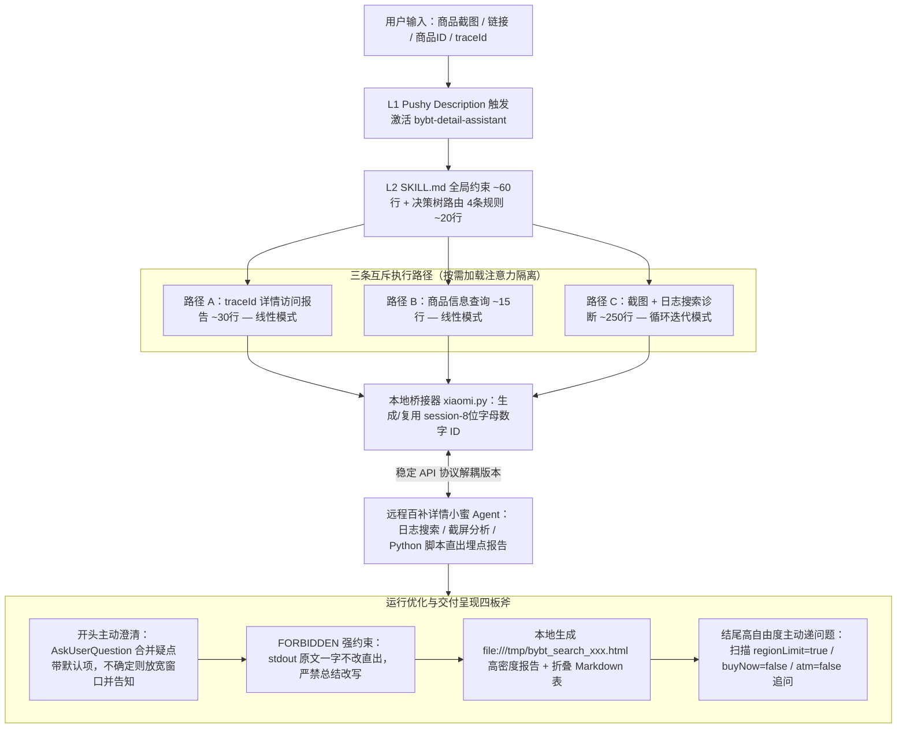

# 浅谈 SKILL 研发的最佳实践——以百补详情助手为例

## 1. TL;DR

本文结合天猫技术团队开发 `50+` 个生产级 Skill 的经验，以历经 `50+ commit` 迭代的 **`bybt-detail-assistant`（百亿补贴商品详情助手）** 为样本，系统梳理了从“怎么写好静态 `SKILL.md`”到“如何持续研发与迭代 Skill”的工程方法论。在吸收 Anthropic **三级渐进式披露（L1/L2/L3）与控制调优（Control Tuning）**、MiniMax **工业化仓库规范（One PR, one purpose）** 及 **6 种工作流结构模式**基础上，团队在架构设计、研发效能、运行优化与呈现方式四个维度沉淀了十项核心实践：用 **`xiaomi.py` 桥接器**物理隔离稳定的本地薄客户端与高频迭代的远程小蜜 Agent；在单文件内用 **4 条规则的决策树**隔离三条互斥路径（总长约 `375 行`，预留 500 行阈值拆分能力）；用 **Python 脚本固化上百条埋点解析规则**（比 LLM 处理最多**快 `7 倍`**且格式 `100%` 统一）；采用**最强模型一步到位自写自改 Skill**、**按任务动态切换单侧/Monorepo 共享工作区视角**、**打包“错误堆栈 + 源码 + 真实热点商品输入数据”运行时快照**驱动 Agent 自闭环 Debug；并在运行期通过 **`FORBIDDEN actions` 强制 `stdout` 原文直出**、**`session-<8位>` 会话 ID 复用**、**本地生成 `file:///tmp/*.html` 高密度报告**及**一头一尾主动澄清与异常追问**，大幅提升诊断效率与用户体验。

## 2. 问题定义与背景

### 2.1 为什么“只讲 SKILL.md 编写规范”救不了生产级 Skill

业界大量资料聚焦于静态 `SKILL.md` 的格式标准，但在真实电商业务（如百亿补贴补贴查询/创建、频道巡检、商品详情诊断等 `50+` 个场景）中，**不能持续迭代的 Skill 只是高成本的一次性 Demo**。在持续演进中，团队面临四大工程痛点：
1. **高频迭代与本地分发冲突**：后端埋点字段与排查规则每周都在新增，若全部塞在本地 `SKILL.md`，每次升级都要用户同步更新本地文件，极易出现版本分裂且缺乏灰度回滚能力。
2. **上下文膨胀与注意力走神**：将上百条埋点解读规则与多条互不相干的功能路径混写在同一个 `SKILL.md` 中，低端模型极易顾此失彼，甚至在只需搜日志时自作主张去分析埋点。
3. **跨边界接口失配与调试失明**：本地桥接脚本与远程 Agent 协议脱节；用虚构普通商品测试正常，一遇 iPhone 17 等百补爆款（1 分钟上千条访问日志，默认 5 分钟窗口直接爆表）或深层 JSON 嵌套异常就频繁崩溃，仅丢一行 `ErrorMessage` 给 Agent 根本改不对。
4. **LLM 的“总结冲动”与多轮失忆**：模型拿到脚本生成的标准 Markdown 报告后总爱擅自改写、截断表格或编造结论；跨轮追问时远程 Agent 丢失前序截图与日志上下文。

### 2.2 业界核心概念基石（Claude Skills & MiniMax Skills）

- **三级渐进式披露（Progressive Disclosure）**：
  - **L1 元信息（`name` + `description`）**：每次会话启动必加载，决定是否激活 Skill；`description` 必须写得“有侵略性（pushy）”，明确列出触发词（如“截图/链接/ID/traceId/找日志”）与排除条件。
  - **L2 `SKILL.md` 正文**：确认激活后加载的主指令集，官方建议控制在 **`500 行`以内**（超出则拆分为独立子文件）。
  - **L3 附件资源（`references/`、`scripts/`）**：执行中按需读取，不占用 L2 Token 预算。
- **控制调优（Control Tuning / 自由度匹配）**：让指令自由度与任务脆弱性（Fragility）相匹配——对有成熟解析展示规则的任务（如埋点报告生成）采用**低自由度**（用确定性脚本锁死输出）；对需结合上下文临场追问的任务（如报告末尾异常引导）采用**高自由度**（只定目标不写死话术）。
- **复合工作流模式**：在 6 种核心工作流结构模式中，`bybt-detail-assistant` 采用**模式 2（决策树）为主干，路径 A/B 内部采用模式 1（线性），路径 C（截图+日志排查）内部混入模式 3（循环迭代）**的复合架构。

## 3. 知识框架



## 4. 核心内容拆解

### 4.1 架构设计：桥接器物理隔离、决策树路由与脚本替代 Prompt

**核心主张**：用物理边界隔离“高频演进的远程分析逻辑”与“追求稳定的本地薄客户端”，并用决策树和确定性 Python 脚本把 L2 注意力开销降到最低。

- **桥接器 `xiaomi.py`：在“跨系统脆弱性”与“高频迭代速度”间的主动取舍**：
  - **代价坦诚分析**：引入本地 Skill 文件 + `xiaomi.py` + 远程小蜜 Agent API，比单体架构多出一段网络通信和一层协议契约，任一端故障都会阻塞链路，且跨双环境排障归因成本更高。
  - **为什么仍然坚决拆分**：两端的**变化节奏与迭代成本**完全不同。远程 Agent 承载埋点解读与问题排查，每周随新埋点高频更新，且具备成熟的灰度发布、可观测与一键回滚能力（用户完全无感）；本地 Skill 只做信息收集、商品查询与结果呈现的**“薄客户端”**，协议稳定后无需用户频繁升级本地文件。
- **单文件内的决策树逻辑隔离（为 500 行物理拆分预留演进路径）**：
  - 早期把所有功能交织在一起导致低端模型频繁迷失；重构后按“全局约束（`~60 行`）$\to$ 决策树（4 条规则，`~20 行`）$\to$ 路径 A `traceId` 分析（`~30 行`，线性）/ 路径 B 商品查询（`~15 行`，线性）/ 路径 C 截图+日志（`~250 行`，循环迭代）”组织，总计约 `375 行`，执行路径 A 时完全无需理会路径 C 的细节；未来突破 500 行阈值时可直接按路径拆分为 `path-a.md`、`path-b.md` 等独立文件。
- **注意力聚焦与 Context Budget 意识**：
  - 早期将上百条远程埋点解读规则写进本地 `SKILL.md`，导致模型搜日志时常“走神”去分析埋点。
  - **解法**：本地 `SKILL.md` 只保留“何时调 `xiaomi.py`、怎么传参、怎么输出”的调用协议；同时将埋点解读固化为 **Python 脚本**，实测比让 LLM 生成报告**最多快 `7 倍`**且格式 `100%` 统一。每次向接近 500 行的 `SKILL.md` 新增内容前必须自问：**“删掉这句话会不会导致 Agent 出错？如果不会，就不应该加。”**

### 4.2 研发效能：最强模型元能力、动态工作区视角与运行时三维快照

**核心主张**：写 Skill 和改 Skill 本身应交给最强模型完成，人类开发者退居“上下文提供者与审查者”，通过动态控制可见代码范围与提供真实流量运行时快照实现极速迭代。

| 研发效能实践 | 解决的具体踩坑 | 工程操作方法 |
| :--- | :--- | :--- |
| **1. 直接用最强模型开发 Skill（元能力）** | 为省 Token 用中端模型写路径 C 循环逻辑，结果改三四轮仍支离破碎，总消耗 Token 反而远超强模型 | 开发阶段直接用最强模型一步到位：将**官方最佳实践 + 真实案例数据（含报错）+ 现有 `SKILL.md`** 一并喂给 Agent，让其解决问题后反思总结并自己输出/修改 `SKILL.md`；验证阶段再测弱模型兼容性 |
| **2. 动态切换单侧与 Monorepo 共享视角** | 物理隔离导致本地桥接器与远程 workflow 的 JSON schema 不同步；但若把远程代码（FC 节点 + LLM 节点 Prompt）常驻同一工作区，又会导致**上下文污染分散注意力**和**越界顺手修改远程逻辑** | **按任务动态切换工作区范围**：① **常规迭代（只改本地或只改远程）**另起独立会话只加载单侧代码；② **协议设计/边界调整（两侧同改）**才切换为 Monorepo 共享视角执行跨边界原子修改 |
| **3. Git 小步提交（One PR, one purpose）** | 一口气改完多个路径逻辑，出现回归问题时难以定位根因、回滚成本极高 | 用 Git 管理 `skills/` 目录，每次迭代只改一个维度（如只调时间窗口或只修一个术语），验证通过立即 commit，让小 diff 助力精准 AI Review |
| **4. 提供“真实热点数据 + 完整运行时快照”** | 用普通商品调试正常，遇到百补爆款（如 iPhone 17 系列 **1 分钟上千条访问记录**，默认 5 分钟窗口直接爆表）或 JSON 嵌套异常就报错；只给一行 `ErrorMessage` 几轮都修不好 | ① 端到端验证一律使用包含热点商品的真实流量日志，并将暴露出的极端长尾 case 固化为 `SKILL.md` 中的 `gotcha`；② `search_detail_logs.py` 报错时，将**错误堆栈 + 源码 + 触发异常的具体输入数据**三合一打包交给 Agent，使其在“修改 $\to$ 同输入回放 $\to$ 再改” Loop 中自主收敛 |

### 4.3 运行优化与呈现：对抗总结冲动、会话复用、HTML 报告与主动引导

**核心主张**：在确定性报告输出上用强禁令剥夺 LLM 的改写自由度，在长报告消费上用本地 HTML 兼顾浏览器交互与上下文保留，在头尾交互上用高信息密度澄清与追问替代机械填表。

1. 🔥 **强制“原文直出”对抗 LLM 总结冲动**：
   - 针对本地模型拿到远程标准 Markdown 报告后擅自加标题、改措辞、截断表格甚至编造结论的问题，在 `SKILL.md` 中使用极强语气的禁止列表：
   ```text
   FORBIDDEN actions:
   - ❌ 不要对 stdout 内容进行总结或改写
   - ❌ 不要重新排版或调整 Markdown 格式
   - ❌ 不要在 stdout 前后添加标题、解释或上下文
   ✅ CORRECT: 直接输出 stdout，一字不改
   ❌ INCORRECT: "根据分析结果，该商品..."
   ```
2. **`sessionId` 会话复用消除跨轮失忆**：
   - 在 `SKILL.md` 中仅增加约 **`10 行`**规则：每个会话首次调用 `xiaomi.py` 前生成格式为 **`session-<8位字母数字>`** 的随机 `sessionId`，该会话内后续所有调用强制复用同一 ID，使远程 Agent 在用户追问“刚才截图里的详情页为什么无法加购”时能无缝找回前序日志上下文。
3. **本地生成 HTML 报告提升信息密度（严禁交由远程生成链接）**：
   - 面对动辄几十条记录的日志搜索（路径 C）或满屏详情报告（路径 A），由**本地 Skill 脚本**直接转换为 HTML 文件并优先输出本地可点击路径（如 `file:///tmp/bybt_search_xxx.html`）配折叠 Markdown 表格。
   - **关键架构约束**：HTML 转换**必须在本地 Agent 侧执行**；若让远程 Agent 直接返回报告 URL 链接，本地 Agent 会丢失报告正文的实质内容，导致后续轮次对话丧失关键上下文。
4. **一头一尾的主动引导（先问清再动手 + 命中异常主动递问题）**：
   - **执行前（合并澄清）**：用户仅发截图未说明日期或预发/线上环境时，调用 `AskUserQuestion` 将多个疑点合并为一轮提问并配好选项与默认值；若用户选“不确定”则自动放宽搜索范围（跨天、上下午全覆盖）并如实告知；若能从截图推断（如 24 小时制 `20:11` 必为晚上）则绝不多问。
   - **执行后（高自由度追问）**：Agent 扫描分析结果中的异常信号（如 `regionLimit=true` 区域限售、`buyNow=false` 无法立即购买、`atm=false` 未命中百补氛围），不把所有分析一股脑倾倒给用户淹没重点，而是在报告末尾主动追问一句（如“检测到该商品区域限售（`regionLimit=true`），要不要看看具体限售区域？”）。

## 5. 数据速查表

| 指标 / 配置项 | 原文数值 / 表达式 | 语境 / 条件 |
| :--- | :--- | :--- |
| 团队已开发 Skill 数量与本例迭代次数 | 团队累计 `50+` Skill；`bybt-detail-assistant` 历经 `50+ commit` | 覆盖补贴查询/创建/分析、舆情、巡检、圈品、商品诊断等 |
| Anthropic 官方建议 `SKILL.md` 行数上限 | `<= 500 行` | L2 正文阈值，超过建议拆分为独立 L3 附件按需读取 |
| MiniMax 开源工业化仓库规模 | `16+` 生产级 Skill | 含 `frontend-dev`、`fullstack-dev`、`android-native-dev` 等，遵循 `One PR, one purpose` |
| 核心工作流结构模式总数 | `6` 种核心工作流结构模式（外加 `14` 种社区拆解设计模式） | 百补详情助手采用模式 2（决策树）为主干 + 模式 1（线性）+ 模式 3（循环迭代） |
| `bybt-detail-assistant` 行数结构拆解 | 全局约束 `~60 行` + 决策树（`4` 条规则）`~20 行` + 路径 A `~30 行` + 路径 B `~15 行` + 路径 C `~250 行`（合计约 `375 行`） | 单文件内通过层级标题实现逻辑隔离 |
| Python 脚本固化埋点解读提速倍数 | 相比 LLM 处理**最多快 `7 倍`**，且格式 **`100%` 统一** | 对应 Control Tuning 中的“低自由度”实践 |
| 爆款商品实时日志流量密度示例 | `1 分钟`内上千条访问记录（默认 `5 分钟` 搜索窗口直接数据量爆炸） | 以百亿补贴热门商品 iPhone 17 系列为例 |
| 远程会话复用 ID 格式与规则行数 | 格式 `session-<8位字母数字>`；在 `SKILL.md` 中仅增加 `~10 行` | 解决跨轮调用远程 `xiaomi.py` 失忆问题 |
| 报告尾端重点监控的典型异常字段 | `regionLimit=true`（区域限售）、`buyNow=false`（无法立即购买）、`atm=false`（未命中百补氛围） | 命中后触发高自由度主动引导追问 |

## 6. 踩坑与教训 / 可迁移的设计原则

| 错误做法 | 失败表现或原因 | 原文应对（可迁移的设计原则） |
| :--- | :--- | :--- |
| **把每周高频变化的后端埋点解析规则全塞在本地 `SKILL.md` 中** | 每次新增埋点都要改 `SKILL.md` 并催用户更新本地版本，既无灰度回滚能力，又导致本地模型搜日志时被上百条规则干扰走神 | **薄客户端桥接解耦 + 脚本固化低自由度任务**：本地只留薄客户端与 `xiaomi.py` 调用协议，高频分析放远程 Agent；成熟格式解析用 Python 脚本直出（快 7 倍） |
| **为节省 Token 用中端模型编写或修改复杂 `SKILL.md`** | 中端模型对循环迭代逻辑理解偏差大，反复修改三四轮仍支离破碎，总消耗 Token 反而远超强模型 | **用最强模型一步到位写/改 Skill，用弱模型测兼容性**：把官方规范+真实报错+现有 Skill 喂给最强模型自省输出，验证阶段再测低端模型兼容性 |
| **把本地 Skill 与远程 Agent 代码无差别常驻在同一上下文窗口** | 虽解决了接口 schema 同步问题，但引发严重的上下文污染（改本地搜索时混入远程埋点规则）和越界修改（顺手改坏远程节点） | **按任务动态切换工作区视角**：常规单侧修改另起独立会话只加载单侧代码；仅在跨边界协议调整时切换为 Monorepo 共享视角做原子修改 |
| **用虚构普通商品测试 Skill，或在脚本报错时只给 Agent 丢一行 `ErrorMessage`** | 虚构数据测不出爆款商品 1 分钟上千条日志的窗口爆炸问题；缺上下文时 Agent 盲猜多轮也修不好脚本 | **真实热点流量验证 + 三维运行时快照**：一律用含热点的真实日志验证并将极端 case 记入 `gotcha`；报错时打包“错误堆栈 + 源码 + 触发异常的具体输入数据”交 Agent 回放收敛 |
| **放任本地 LLM 转述标准分析报告，或让远程 Agent 直接生成 HTML 报告链接** | LLM 的“总结冲动”会截断表格、篡改措辞或编造结论；若由远程生成 HTML 链接，本地 Agent 会丢失报告正文内容导致后续追问失明 | **`FORBIDDEN` 原文直出禁令 + 本地侧转换 HTML**：用强禁令强制一字不改直出 `stdout`；长报告由本地脚本转为 `file:///tmp/*.html` 兼顾浏览器检索与本地上下文保留 |

## 7. 记忆锚点

- **Skill 核心竞争力金句**：“Skill 的质量上限由‘上下文工程’能力决定，而非写作技巧——在对的时机，把对的信息（真实案例、错误堆栈、API 结构），以对的粒度递到模型面前。”
- **架构与运行六字诀**：“桥接隔快慢，决策树分流；脚本快七倍，强模写 Skill；三维快照修 Bug，`FORBIDDEN` 保直出。”

## 8. 复习卡片

`bybt-detail-assistant` 为什么要通过 `xiaomi.py` 将本地 Skill 与远程小蜜 Agent 拆开，尽管跨系统桥接会增加链路脆弱性？::因为两者的变化节奏与迭代成本完全不同：远程 Agent 负责每周随新增埋点和排查场景高频迭代的深度分析，且具备成熟的灰度发布、可观测与一键回滚能力；本地 Skill 则只保留改动极少的信息收集、商品查询与结果呈现（薄客户端），从而避免用户频繁升级本地文件并实现版本解耦。
什么是 Skill 的“三级渐进式披露（L1/L2/L3）”与“控制调优（Control Tuning）”？::三级渐进式披露指会话启动仅加载 L1 元信息（带强触发词的 pushy `description`），确认激活才加载控制在 500 行以内的 L2 `SKILL.md` 正文，执行中按需读取 L3 附件（`references/`、`scripts/`）；控制调优指让指令自由度匹配任务脆弱性——成熟规则用 Python 脚本锁死低自由度输出（快 7 倍且 100% 统一），开放异常引导则用高自由度让模型临场发挥。
在借鉴 Monorepo 将本地 Skill 与远程 Agent 代码纳入同一可见范围时，遇到了什么副作用，团队如何平衡？::常驻全局代码会导致“上下文污染分散注意力”和“Agent 越界顺手修改远程节点逻辑”；平衡策略是按任务动态切换工作区——常规单侧迭代另起独立会话只加载单侧代码，仅在跨边界协议修改时才切换为共享视角执行原子修改。
当 `search_detail_logs.py` 等脚本在真实数据上报错时，为什么要把“错误堆栈 + 源码 + 触发异常的具体输入数据”打包交给 Agent？::只丢一行 `ErrorMessage` 会让 Agent 缺乏进程上下文而反复盲猜；源码提供业务逻辑上下文、堆栈定位报错点、具体输入数据提供复现现场，三者凑齐构成完整运行时快照，使 Agent 能在“改一版 $\to$ 用同一份输入回放 $\to$ 再改”的循环中自主收敛。
为什么 HTML 格式的长篇日志分析报告必须在本地 Agent 侧转换生成，而不能由远程 Agent 生成后只返回一个报告链接？::如果由远程 Agent 产出报告链接，本地 Agent 只拿到一个 URL 而丢失了报告本身的高密度数据内容，导致后续轮次用户追问细节时本地 Agent 缺乏上下文支撑；由本地脚本生成 `file:///tmp/*.html` 并提取关键信息展示，才能兼顾浏览器交互体验与本地上下文连续性。
百补详情助手如何解决本地模型对标准报告“添油加醋总结改写”以及跨轮调用远程 Agent“失忆”的问题？::针对总结冲动，在 `SKILL.md` 中用 `FORBIDDEN actions` 强语气列表严禁总结、重排或加前后文，要求一字不改直出 `stdout`；针对跨轮失忆，规定会话首次调用 `xiaomi.py` 时生成 `session-<8位字母数字>` 的随机 `sessionId` 并在同会话后续调用中全程复用。

## 9. 知识关联

- **本库通用主题**：[Skill设计与治理](../../20_topics/Skill设计与治理.md) · [Agent成本与上下文预算](../../20_topics/Agent成本与上下文预算.md) · [AI研发协同](../../20_topics/AI研发协同.md) · [问题澄清](../../20_topics/问题澄清.md)
- **本篇原始与转写材料**：[原始 PDF](RAW.pdf) · [逐页转写文本](MD.md)
- **候选双链**：[[渐进式披露与Context-Budget]] · [[Control-Tuning控制调优]] · [[本地Skill与远程Agent桥接模式]] · [[运行时三维快照自愈Loop]]

## 10. 原文参考资料

- **原文信息**：《浅谈 SKILL 研发的最佳实践——以百补详情助手为例》，作者：曲士（淘天集团-天猫技术团队），公众号：大淘宝技术，发布时间：`2026-08-20 19:47`（浙江）。
- **文内引用文献与开源仓库**（仅作原文记录，未在本地联网访问核验）：
  1. Anthropic, *Skill authoring best practices*: `https://platform.claude.com/docs/en/agents-and-tools/agent-skills/best-practices`
  2. MiniMax-AI, *MiniMax Skills - Official Open-Source Skills for AI Coding Agents*: `https://github.com/MiniMax-AI/skills`
  3. Agent Skills, *Open Standard for Agent Skills*: `https://agentskills.io`
  4. Generative Programmer, *Skill Authoring Patterns from Anthropic’s Best Practices*: `https://generativeprogrammer.com/p/skill-authoring-patterns-from-anthropics`
  5. Rachel Potvin & Josh Levenberg, *Why Google Stores Billions of Lines of Code in a Single Repository*, Communications of the ACM, 2016: `https://cacm.acm.org/research/why-google-stores-billions-of-lines-of-code-in-a-single-repository/`
  6. Anthropic, *Claude Code: Best practices for agentic coding*: `https://www.anthropic.com/engineering/claude-code-best-practices`

> [!note]- 校对报告
> 1. **页码溯源汇总**：
>    - `p.1–2`：团队 `50+` Skill 背景、`bybt-detail-assistant`（`50+ commit`）定位与“本地 Skill + `xiaomi.py` 桥接脚本 + 远程百补详情小蜜 Agent”架构。
>    - `p.2–6`：Claude Skills 渐进式披露（L1/L2/L3，500 行上限与 pushy `description`）、控制调优（Control Tuning）、MiniMax Skills（`16+` 生产级 Skill 与 `One PR, one purpose`）、6 种工作流结构模式（决策树为主干混合线性与循环迭代）及高频编写实践模式。
>    - `p.6–8`：架构设计三实践——`xiaomi.py` 桥接器解耦本地稳定薄客户端与远程高频迭代能力、单文件内决策树路由隔离（全局约束 `~60行` + 决策树 4 条规则 `~20行` + 路径 A `~30行` / B `~15行` / C `~250行`）、用 Python 脚本固化埋点解读（比 LLM 最多快 `7 倍`、格式 `100%` 统一）与 Context Budget 500 行自检问句。
>    - `p.8–11`：研发效能四实践——直接用最强模型写/改 Skill 再测弱模型兼容性、按任务动态切换单侧会话与 Monorepo 共享视角、Git 小步提交、用真实热点流量（iPhone 17 系列 1 分钟上千条记录）验证并打包“错误堆栈 + 源码 + 具体输入数据”三维快照驱动 Loop 收敛。
>    - `p.11–15`：运行优化四实践——`FORBIDDEN actions` 强制 `stdout` 原文直出、`session-<8位字母数字>` 会话复用（约 10 行规则）、本地生成 `file:///tmp/bybt_search_xxx.html` 高密度报告、一头一尾主动引导（开头 `AskUserQuestion` 合并澄清，结尾扫描 `regionLimit=true` / `buyNow=false` / `atm=false` 主动递出问题）及 6 条参考文献。
> 2. **勘误与质量边界说明**：
>    - `p.8` 正文存在一处原文叠字笔误（`开发者的核心责任从从"手写文档"变成...` 多出一“从”字），笔记已按正常表述整理。
>    - `p.3, p.4, p.5` 中的部分对照表（控制调优三档表、MiniMax 工业化规范表、6 种工作流结构模式表与高频实践模式表）在 PDF 中为内嵌图像，正文与图注已点明核心模式名称及百补详情助手选用的模式 1/2/3 复合结构与高低自由度实例。
> 3. **核验结论**：全文满足单 H1、10 大编号章节、正文零内联页码、6 条单行 `::` 复习卡片，所有数值、文件名与引用链接均与原文逐页核对一致。
