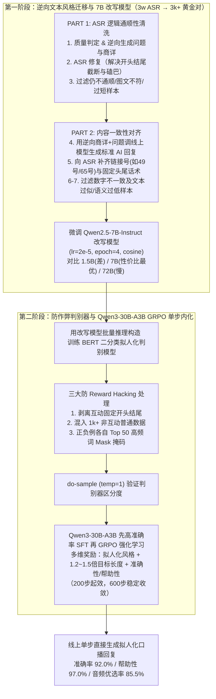

# 【淘宝直播数字人互动LLM】告别AI感：基于真人ASR数据的拟人化探索

## 1. TL;DR

1. **核心痛点**：数字人直播互动中，经过 RAG/SFT 的大模型虽能答对商品信息，但回复文本普遍书面化、“AI 感”重（一眼假），送入 TTS 合成语音后缺乏真人主播的口语节奏；单纯靠提示词工程（PE）或用 Gemini / DeepSeek-R1 合成数据微调仍无法消除模型自带的 AI 腔调。
2. **为什么不直接用真人直播 ASR 端到端 SFT 互动模型**：① 从真人直播间流中逆向定位具体商品并获取完整商详难度极大；② 线上互动模型是带思考过程（CoT）的推理模型，而 ASR 仅有最终口播结果、缺失中间思考过程，无法直接构造推理 SFT 数据。
3. **阶段一：逆向文本风格迁移 + 七步清洗构建拟人化改写模型**：从 **3 万条**真人直播 ASR 出发，通过“ASR 逆向生成商详与问题 $\to$ 调用线上模型生成标准 AI 回复 $\to$ 补齐链接号与头尾话术 $\to$ 数字与语义相似度过滤”，提炼出 **3000+ 条**“内容严格一致、风格一书面一口语”的高质量 $\langle\text{AI 感回复}, \text{拟人化回复}\rangle$ 对，基于 **`Qwen2.5-7B-Instruct`** 微调出拟人化改写模型（体现为语序优化、卖点重复强调、书面语去除）。
4. **阶段二：防作弊 BERT 拟人化判别器 + 多目标 GRPO 一步生成**：为砍掉“先生成再改写”的两阶段二次请求延迟，用改写模型推理构造正负样本并施加**三大防作弊处理（去除固定头尾、混入 1000+ 非互动普通数据、对正负例各自 Top 50 高频词做 Mask 掩码）**训练 BERT 二分类奖励模型；结合准确性、帮助性与 **1.2–1.5 倍目标长度奖励**，在 **`Qwen3-30B-A3B`** 上通过 **GRPO**（约 200 步起效、600 步收敛）训出单步直接生成拟人化回复的模型。
5. **实测业务指标**：测试集准确率达 **92.0%**、帮助性达 **97.0%**，人工盲测评估中 **85.5%** 的测试用例音频自然度优于原线上版本。

## 2. 问题定义与背景

### 2.1 传统拟人化方案 vs 本文“ASR 逆向构造 + GRPO 内化”对比

| 方案路径 | 核心做法 | 核心瓶颈或本文突破 |
|---|---|---|
| **提示词工程（PE）+ 大模型合成微调** | 在 Prompt 中设定主播人设，或用 Gemini / DeepSeek-R1 生成带风格回复后做 SFT | 存在明显天花板，强模型自身固有的书面化句式与“AI 感”依然残留 |
| **直接用真人 ASR 端到端微调线上生成模型** | 直接拿主播 ASR 文本做生成模型 SFT | **不可行**：① 难以从野生直播流精确匹配真实商详；② 线上推理模型需 CoT 思考过程，ASR 只有结果无思考链 |
| **两阶段“线上模型生成 $\to$ 7B 改写模型”** | 用 3w 条 ASR 逆向清洗出 3k+ 对齐数据微调 `Qwen2.5-7B-Instruct` | 拟人化效果极佳（去 AI 感显著），但**多一次模型请求导致互动延迟增加** |
| **单阶段“BERT 风格奖励 + 30B GRPO”** | 用防作弊 BERT 判别器 + 1.2–1.5x 长度奖励 + 准确性奖励对 `Qwen3-30B-A3B` 做 GRPO | **无需改写二次请求**，单步直接输出高准确率（92%）、高帮助性（97%）、强口语感回复 |

## 3. 知识框架

## 4. 核心内容拆解

### 4.1 阶段一：从 3 万条噪声 ASR 逆向构造 3000+ 对齐训练对

1. **拟人化口语的三大核心特征**：
   - **① 语序优化**：打破“看到有宝宝问……这款……建议……”的机械模板，改为“对，就是按照说明书来啊，7 号链接的这个叶黄素片呢，您就每天吃两颗就可以了”；
   - **② 重点卖点重复强调**：如四件套被套面料回答中反复强调“全部都是用的是百分百的棉做的，所以大家放心去拍就可以了……它的被里被面全部都是百分百棉的”；
   - **③ 书面化用语去除**：将“适用年龄里都有 1 岁哈”转化为“从 10 个月开始一直到三岁都能吃的”。
2. **两阶段七步自动化数据清洗流水线**：
   - **PART 1（保障 ASR 逻辑通顺）**：
     - *Step 1（质量判定与逆向合成）*：过滤过短、语意模糊的原始 ASR，并根据 ASR 逆向生成对应的**虚拟商品详情（商详）与用户提问 Query**；
     - *Step 2（ASR 修复）*：修复真人说话的磕巴、重复及“开头结尾截断不自然”问题；
     - *Step 3（二次过滤）*：剔除修复后仍不通顺、长度过短或问题/商详与 ASR 不对应的样本。
   - **PART 2（保障 $\langle\text{AI 回复}, \text{ASR}\rangle$ 内容严格一致）**：
     - *Step 4（生成线上 AI 回复）*：将逆向构造的商详与问题输入当前线上模型，获取原版“AI 感回复”；
     - *Step 5（ASR 事实补齐）*：由于逆向商详与真实情况可能存在细微出入且线上回复含固定动作，向 ASR 中**补齐商品链接号（`a. 链接号补充`）与开头结尾固定话术（`b. 固定话术补充`）**；
     - *Step 6–7（数字与双相似度卡口）*：**严格过滤线上回复与 ASR 中数字不一致（防尺码/价格/年份幻觉）的样本**，并过滤文本字面相似度过高（未改写）或语义相似度过低（改偏了，保留如 `sim_score = 0.9187`、`0.9293`）的样本，最终从 **30,000 条**原始 ASR 中精选出 **3,000+ 条**高质量训练对。
3. **改写模型选型与训练（`Qwen2.5-7B-Instruct`）**：
   - 对比 `Qwen2.5` 的 `1.5B`（学不会拟人风格）、`7B` 与 `72B`（仅略好于 7B 但推理延迟高），选定 **`Qwen2.5-7B-Instruct`**，以 `learning_rate = 2e-5`、`epoch = 4`、`lr_scheduler_type = 'cosine'` 微调。Loss 曲线证实：经七步清洗对齐后的数据训练初始 Loss 与收敛 Loss 均显著低于未清洗数据。

### 4.2 阶段二：防作弊 BERT 判别器与 `Qwen3-30B-A3B` GRPO 训练

1. **为什么需要训练 BERT 拟人化判别器并做“Top 50 掩码”**：
   - 若直接用未处理的 $\langle\text{AI 回复}, \text{改写后拟人回复}\rangle$ 训练 BERT 二分类模型，判别器会迅速学会**走捷径作弊（Reward Hacking）**——只看头尾固定套话或某几个高频口头禅就给高分。
   - **三项去偏防作弊设计**：
     1. **剥离固定头尾**：去除互动回复固定的开头（如“看到有宝宝问”）与结尾；
     2. **混入通用负例**：引入 **1,000+ 条**非互动类型的普通正式文本数据；
     3. **高频词掩码（Top-50 Masking）**：对正例与负例中各自出现频率最高的 **前 50 个高频词（Top 50）做掩码处理**，迫使 BERT 学习深层句式节奏与口语语序特征。
   - **前置 `do-sample` 验证**：在正式 RL 前，对基座模型设 `temperature = 1` 多次采样并用 BERT 打分，确认其能精准区分同样包含“有宝宝问……哈”但句式更自然的真拟人回复与正式回复。
2. **多目标 GRPO 强化学习框架（`Qwen3-30B-A3B`）**：
   - **训练策略**：先用高准确率问答数据对 `Qwen3-30B-A3B` 做 SFT 保底（因 ASR 无思考链，故不拿 ASR 做 SFT），再进入 GRPO 阶段。
   - **复合奖励函数**：融合 **拟人化风格判定奖励（BERT）+ 修改后的长度奖励（拟人化口语通常更舒展，将目标回复长度设为原回复的 `1.2–1.5 倍`）+ 准确性与帮助性奖励**。
   - **收敛表现**：GRPO 训练约 **200 步**时拟人化分与长度奖励即显著拉升，迭代 **600 步**后全面趋于稳定，模型不仅学会了“哎呀，问得好！”等语气词，更内化了自然短句切分与卖点热情推介。

## 5. 数据速查表

| 维度 / 指标 | 原文数值 / 配置 | 语境与说明 |
|---|---|---|
| **原始 ASR 与精选数据规模** | **30,000 条原始 ASR $\to$ 3,000+ 条高质量训练对** | 保留率约 10%，示例语义相似度 `sim_score` 达 `0.9187`、`0.9293` |
| **改写模型选型与超参** | **`Qwen2.5-7B-Instruct`**（对比 `1.5B / 7B / 72B`） | `learning_rate = 2e-5`, `epoch = 4`, `lr_scheduler_type = 'cosine'` |
| **拟人化判别器防作弊策略** | **BERT 二分类**；混入 **1k+** 非互动数据；**正负例各 Top 50 高频词掩码** | 配合去除固定头尾，并在 `temperature = 1` 下做 `do-sample` 验证 |
| **直接生成模型与 RL 算法** | **`Qwen/Qwen3-30B-A3B` + GRPO** | **200 步**获得较高拟人化与长度奖励，**600 步**趋于稳定收敛 |
| **GRPO 目标回复长度奖励** | 原长度的 **1.2–1.5 倍** | 匹配真人直播口语表达比书面语更舒展、强调卖点的特性 |
| **最终线上评测三大指标** | **准确率 92.0% / 帮助性 97.0% / 音频人工优选率 85.5%** | 85.5% 的测试用例经 TTS 合成后的音频效果优于原线上模型 |

## 6. 踩坑与教训 / 可迁移的设计原则

| 错误做法 | 失败表现或原因 | 原文应对（可迁移的设计原则） |
|---|---|---|
| **用 Gemini 或 DeepSeek-R1 靠提示词生成“口语风”数据做微调** | 大模型预训练语料以书面语为主，吐出的数据仍带浓重的机械排比与 AI 腔 | **从真人直播 ASR 逆向构造**：以真实人类口播为靶标，反向合成商详与线上标准回复配对 |
| **直接拿原始 ASR 或仅简单配对的 ASR 训练改写模型** | 原始 ASR 含磕巴、截断，且与线上回复存在链接号缺失或数字出入，训出模型会胡编数字与磕巴 | **七步清洗对齐流水线**：先修复 ASR 通顺度，再补齐链接号与头尾，最后严卡**数字完全一致**与语义/字面相似度区间 |
| **线上直接串联“互动生成模型 + 7B 拟人改写模型”两阶段服务** | 虽然去除了 AI 感，但多一次 LLM 推理请求导致直播实时互动延迟明显增加 | **改写模型蒸馏为判别器 + GRPO 内化**：用 7B 改写模型造数据训轻量 BERT Reward Model，通过 GRPO 让 30B 主模型单步直出拟人回复 |
| **直接用改写前后文本对训练 BERT 风格分类器做 RL 奖励** | 判别器靠识别固定头尾或前几个高频语气词“作弊”，导致 GRPO 陷入高频词堆砌（Reward Hacking） | **去固定头尾 + 混入 1k+ 通用样本 + 正负例 Top 50 高频词 Mask 掩码**，逼迫判别器学习句式与语序特征 |
| **在拟人化 GRPO 中沿用严苛的短文本长度惩罚** | 真人主播口语解释与卖点重复强调天然比干瘪书面语长，限制过短会扼杀口语自然度 | 将长度奖励模型的目标回复长度放宽至 **1.2–1.5 倍** |

## 7. 记忆锚点

- **数据与内化两步走**：「**3 万 ASR 经七步清洗（逆向商详+补链接号+卡数字一致）炼 3 千对训 7B 改写；Top50 掩码防作弊训 BERT 奖励，配 1.2–1.5x 长度奖励用 GRPO 内化进 30B 主模**」。
- **核心交付数字**：「**准确率 92.0%、帮助性 97.0%、85.5% 音频胜出，600 步 GRPO 砍掉二次改写延迟**」。

## 8. 复习卡片

在淘宝直播数字人互动场景中，为什么不能直接拿真人主播的 ASR 数据去端到端微调（SFT）线上互动生成模型？::① 很难从野生真人直播流中反向定位到具体商品的完整真实商详；② 线上互动模型是带思考过程（CoT）的推理模型，而 ASR 只有最终口播结果、缺失中间思考过程，无法直接构造推理 SFT 样本。
如何从带噪声的真人直播 ASR 构建出“内容严格一致、仅风格不同”的 <AI感回复, 拟人化回复> 训练对？::分两阶段七步：① 对 ASR 做质量过滤、逆向生成商详与问题、修复截断磕巴；② 将逆向商详与问题输入线上模型生成标准 AI 回复，再向 ASR 补齐商品链接号与固定头尾话术，最后严格过滤数字不一致、字面相似度过高或语义相似度过低的样本（从 3w 条筛出 3k+ 条）。
在构建拟人化改写模型时，为什么在 1.5B / 7B / 72B 中选择了 Qwen2.5-7B-Instruct？::因为实验发现 1.5B 模型无法很好地学习拟人化风格，72B 模型效果仅略好于 7B 但推理延迟过高，综合效果与成本选择 7B（lr=2e-5, epoch=4, cosine）。
既然 7B 拟人化改写模型效果已经很好，为什么还要训练 BERT 判别模型并做 GRPO 强化学习？::因为“先生成回复 → 再调用改写模型”的两阶段串行链路多了一次模型请求，耗时过长；通过训练 BERT 拟人化奖励模型融入 GRPO，可让 Qwen3-30B-A3B 生成模型单步直接输出拟人化回复。
训练 BERT 拟人化判别模型时，为了防止模型沦为“高频词作弊分类器（Reward Hacking）”，采取了哪三项关键处理？::① 去除互动回复固定的开头和结尾；② 引入 1000+ 条非互动类型的普通正式文本数据；③ 对正负例各自前 Top 50 的高频词做 Mask 掩码。
在 Qwen3-30B-A3B 的 GRPO 训练中，奖励函数包含哪些维度？为什么要把目标长度设为 1.2–1.5 倍？::包含拟人化风格奖励、长度奖励与准确性/帮助性奖励；因为真人主播口语化表达（含语序舒展与卖点重复强调）天然比干瘪的书面语略长，将目标长度设为 1.2–1.5 倍更契合真实口播听感。

## 9. 知识关联

- **本库主题索引**：[模型架构与训练](../../20_topics/模型架构与训练.md)、[推荐系统与多模态评测](../../20_topics/推荐系统与多模态评测.md)、[跨端开发与性能](../../20_topics/跨端开发与性能.md)
- **本库关联文章**：[直播数字人HAT+26.10.8](../直播数字人HAT+26.10.8/AI_直播数字人HAT.md)、[数字人语音对话性能优化+26.2.25](../数字人语音对话性能优化+26.2.25/AI_数字人语音对话性能优化.md)、[淘宝主播Agent Harness+26.8.6](<../淘宝主播Agent Harness+26.8.6/AI_淘宝主播Agent Harness.md>)
- **候选双链**：[[文本风格迁移]]、[[GRPO强化学习]]、[[Reward Hacking防护]]、[[数字人直播拟人化]]

## 10. 原文参考资料

- **原文信息**：《【淘宝直播数字人互动LLM】告别AI感：基于真人ASR数据的拟人化探索》，作者：易得（淘天集团-直播AIGC团队），发布日期：2026-01-30。
- **文内引用参考文献（7 篇）**：
  1. *Distilling Text Style Transfer With Self-Explanation From LLMs*
  2. *StyleTunedLM: Customizing Large Language Model Generation Style using Parameter-Efficient Finetuning*
  3. *Steering Large Language Models with Register Analysis for Arbitrary Style Transfer*
  4. *Style Vectors for Steering Generative Large Language Model*
  5. *Style-Specific Neurons for Steering LLMs in Text Style Transfer*
  6. *SynDec: A Synthesize-then-Decode Approach for Arbitrary Textual Style Transfer via Large Language Models*
  7. *Steerable Chatbots: Personalizing LLMs with Preference Based Activation Steering*

> [!note]- 校对报告
> - **页码溯源汇总**：
>   - `## 1. TL;DR` & `## 2. 问题定义与背景`：源自 p.1–5（书面化“一眼假”痛点、准确率 `92.0%` / 帮助性 `97.0%` / 音频人工优选率 `85.5%`、语序优化/卖点强调/书面语去除 4 组对比示例、不直接端到端 SFT 的两大原因）。
>   - `## 4.1 阶段一：逆向构造与 7B 改写模型`：源自 p.4–7（3w 条 ASR 清洗出 3k+ 对、表 2-1 披萨 `0.9187` 与软糖四千万质检 `0.9293` 示例、表 2-2 七步清洗目的、`Qwen2.5` `1.5B/7B/72B` 对比、`lr=2e-5, epoch=4, cosine`）。
>   - `## 4.2 阶段二：防作弊判别器与 GRPO 训练`：源自 p.8–12（BERT 二分类判别器、去头尾 + 1k+ 非互动数据 + 正负例 Top 50 掩码、`temperature=1` `do-sample` 表 2-3、`Qwen/Qwen3-30B-A3B`、1.2–1.5 倍长度奖励、200 步起效与 600 步收敛、表 2-4 可穿浴巾与锅铲价格对比、白盒打分与激活旋转因子展望）。
> - **材料质量说明**：p.6 图 2-1、p.7 图 2-2、p.9–10 图 2-3~2-5 为流程图与训练曲线截图，其配套表格（表 2-1 至表 2-4）及核心超参结论均在文本层完整转写并核对一致。
