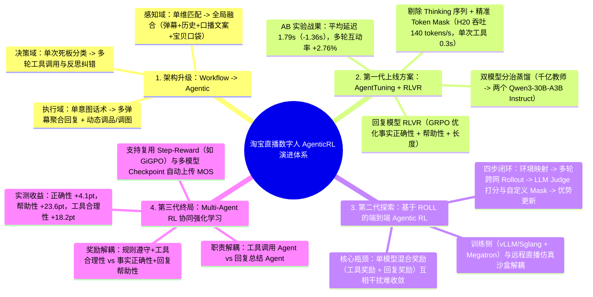
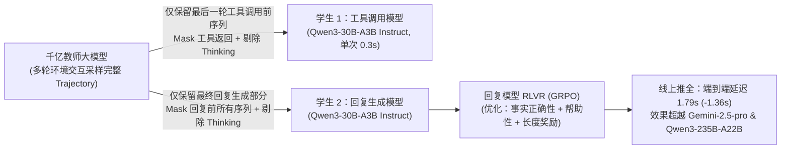
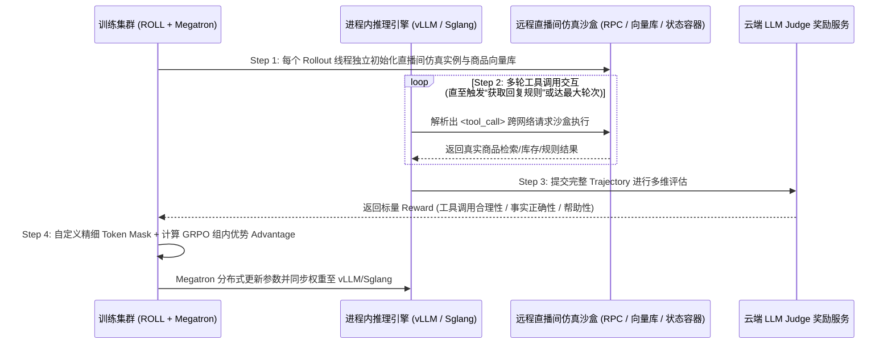

# 淘宝直播数字人 AgenticRL 实践：从 RLVR 到 MultiAgent RL

> [!abstract] 导读
> **一句话总结**：淘天集团直播 AIGC 团队（作者：语瀚）针对数字人直播间静态 Workflow 架构“灵活性差、上下文感知弱、多弹幕并发卡壳”的局限，分三阶段完成了向动态 **Agentic 架构与强化学习（Agentic RL）** 的全面演进：（1）通过 **AgentTuning 蒸馏**（千亿教师轨迹蒸馏至两个 Qwen3-30B-A3B Instruct 模型并剥离 Thinking 序列）+ **回复模型 RLVR（GRPO）**，将端到端平均延迟降低 **1.36 秒至 1.79 秒**，多轮对话用户比例提升 **2.76%**；（2）基于阿里自研 **ROLL 框架**搭建训练集群与远程直播沙盒分离的端到端 Agentic RL 训练管线；（3）针对单 Agent 混合奖励互相干扰难以收敛的痛点，首创 **“工具调用 Agent + 回复生成 Agent”分离协同的 Multi-Agent RL 算法**，相比 SFT 基线实现**事实正确性 +4.1pt、帮助性 +23.6pt、工具调用合理性 +18.2pt** 的全面突破。
> **阅读价值**：工业界罕见的将 **AgentTuning 蒸馏、RLVR、端到端 Agentic RL 与 Multi-Agent RL** 在同一真实高并发业务（淘宝直播数字人）中完整跑通并给出详实消融实验的硬核报告。

## 1. TL;DR

- **架构范式跃迁（从静态 Workflow 到动态 Agentic）**：
  - 旧版“意图识别—检索—生成”静态工作流新增 1 个意图需耗时 **2 个月**，预置 FAQ 利用率不足 **2%**，且无法联动“宝贝口袋/当前口播文案/历史弹幕”。
  - 升级后的 Agentic 架构实现全局上下文感知、多轮按需工具调用与自我反思纠错，并支持**多弹幕刷屏聚合回复**与**融合当前口播文案回复**。
- **阶段一（上线基线：AgentTuning 蒸馏 + 回复模型 RLVR）**：
  - **攻克高延迟（AgentTuning 双模型分治蒸馏）**：用千亿教师模型采样完整 Trajectory，分别蒸馏至**工具调用模型**与**回复生成模型**（均为 **Qwen3-30B-A3B Instruct**，剔除 Thinking 序列以极致压降延迟），单卡 H20 解码吞吐达 **140 tokens/s**，单次工具调用仅 **0.3s**。
  - **攻克带货幻觉（RLVR）**：基于 **ROLL 框架**对回复模型做 GRPO 强化学习（联合优化事实正确性、帮助性与长度奖励），线上 A/B 实验平均端到端延迟降至 **1.79s（下降 1.36s）**，多轮对话用户比例 **+2.76%**。
- **阶段二 & 三（突破教师上限：从单模型 Agentic RL 到 Multi-Agent RL）**：
  - **为什么单模型端到端 Agentic RL 难以收敛？** 工具调用（看重意图理解、参数准确、观察反思）与最终回复（看重零幻觉、话术自然、满足需求）所需能力截然不同；将 LLM Judge 工具奖励与回复奖励简单加权塞给单模型 GRPO，会导致信度分配（Credit Assignment）混杂、梯度互相拉扯。
  - **Multi-Agent RL 破局**：在训练与推理中显式拆分为**工具调用 Agent**（优化规则遵守 + 工具调用合理性奖励）与**回复总结 Agent**（优化事实正确性 + 回复帮助性奖励），在远程仿真直播间沙盒中在线协同 Rollout 与各自 Mask 更新，相比 SFT 模型实现 **事实正确性 +4.1pt、帮助性 +23.6pt、工具调用合理性 +18.2pt**（对比固定工具模型仅训练回复模型的消融基线，正确性仍净增 **+5.6pt**、帮助性 **+6.6pt**）。

## 2. 问题定义与背景

### 2.1 传统静态 Workflow 在数字人直播间的三大死穴
在淘宝数字人直播间中，观众实时发送弹幕提问（尺码、优惠机制、发货时间、求切品讲解），数字人需实时驱动弹幕与口播回复，甚至动态调整讲品顺序。旧版静态 Workflow 暴露三大瓶颈：
1. **迭代极慢且僵化**：强依赖人工标注训练意图分类器，每新增 1 个业务意图耗时约 **2 个月**，商家预置 FAQ 命中利用率不足 **2%**。
2. **上下文割裂无反思**：无法将当前正在口播的讲解文案、宝贝口袋商品列表与多轮弹幕结合，一旦前序意图分类误判便一条路走到黑，只能生硬转人工客服。
3. **高并发弹幕失能**：面对直播间刷屏提问只能逐条机械排队，无法将多个用户的关联问题（补贴政策 + 赠品 + 物流）一次性逻辑聚合口播。

### 2.2 引入 Agent 后的两大新挑战：多跳延迟与承诺幻觉
直接上千亿参数通用 Thinking 大模型跑 ReAct 循环虽然聪明，但多轮思考+工具调用的延迟高达数秒，观众早已离开直播间；同时监督微调（SFT）模型在面对未检索到的商品属性时容易“顺嘴胡编优惠承诺”，触发电商资损与合规红线。

## 3. 知识框架

## 4. 核心内容拆解

### 4.1 阶段一：AgentTuning 双模型蒸馏 + 回复模型 RLVR（攻克 1.79s 低延迟上线）

为了让 Agent 既有千亿大模型的规划能力，又能达到亚秒/秒级直播实时性，团队没有用一个大模型包打天下，而是设计了**“工具调用模型 + 回复生成模型”双 Qwen3-30B-A3B Instruct 架构**：

1. **为什么全链路采用 Instruct 模型而非 Thinking 模型？**
   - 原静态 Workflow 因为前置检索粗糙，最后一步生成必须靠慢速 Thinking 模型苦思冥想兜底；而新 Agentic 架构前置已通过多次快速工具调用（单次仅 **0.3s**，H20 单卡解码吞吐 **140 tokens/s**）拿到了精准信息，因此全链路使用去掉思考冗余的 Instruct 模型，使平均延迟与 P99 长尾延迟双双大幅下降。
2. **为什么 RLVR 必须同时约束“事实正确性”与“回复帮助性”？**
   - 如果只惩罚幻觉（只看事实正确性），模型会学成“滑头”——遇到任何问题都保守回答“具体以商品详情页为准”，虽然零幻觉但毫无导购价值。因此必须引入**帮助性（Helpfulness）奖励**与**长度奖励**構成对抗平衡，逼迫模型在严格忠于工具返回事实的前提下充分解答观众关切。

### 4.2 阶段二：基于阿里 ROLL 框架的远程沙盒 Agentic RL 工程架构

由于纯 SFT 蒸馏出来的工具调用模型天花板被教师模型锁死，团队基于阿里自研强化学习框架 **ROLL** 搭建了连接真实业务逻辑的 **训练侧—远程沙盒分离架构**：

- **核心工程经验（Takeaways）**：
  1. **绝不能盲信 `tokenizer.apply_chat_template` 的默认 Mask**：在多轮工具交互轨迹中，必须手写精细的自定义 Token Mask，严格屏蔽系统提示词、用户输入以及**环境返回的工具结果 Token**，确保梯度仅作用于策略模型自己生成的 Token。
  2. **环境稳定性与 Reward 区分度占 80% 成败**：早期阻碍 RL 收敛的头号杀手不是算法超参，而是远程仿真沙盒偶发抖动超时，以及 LLM Judge 奖励区分度不足（无法拉开优质 Rollout 与劣质 Rollout 的差距）。

### 4.3 阶段三：为什么必须从单模型 Agentic RL 走向 Multi-Agent RL？

在端到端单模型 Agentic RL 实验中，团队发现将 4 项奖励（规则遵守、工具调用合理性、事实正确性、回复帮助性）加权求和训练同一个模型时，训练曲线震荡且难以收敛：
- **根本矛盾（奖励错配与能力异质性）**：
  - 当最终回复出现幻觉（低正确性）时，如果用这个负奖励去惩罚前半段的“工具调用动作”，是极不合理的（工具明明调对了，是最后总结胡说了）；
  - 反之，用“工具调用合理性”奖励去更新最后一步“口播回复生成”的 Token 梯度，同样是无意义的噪声。
- **Multi-Agent RL 协同训练机制**：
  1. **显式拆分双智能体**：**Agent 1（工具调用模型）** 负责在仿真直播间多轮交互检索，直到调用 `获取回复规则` 工具作为终止符（若未获取规则则截断不生成回复）；**Agent 2（回复总结模型）** 以完整工具调用链为前缀生成最终口播回复。
  2. **专属奖励与独立掩码更新**：
     - **工具调用模型**：仅截取最终回复前最后一轮工具调用的 Trajectory（Mask 掉工具返回结果），专门使用 **（规则遵守 + 工具调用合理性）加权奖励** 计算组内优势与 KL 散度更新。
     - **回复总结模型**：取完整 Trajectory 但 **Mask 掉最终回复前的所有前置序列**，专门使用 **（事实正确性 + 回复帮助性）加权奖励** 计算组内优势更新。
  3. **工程实现巧思**：在 ROLL 框架中，该架构与 **Step-Reward（如 GiGPO 算法）** 高度同构；针对两个模型同时训练产生的多套权重，通过 `cluster_name` 与 `ckpt_id` 维度隔离并复用 ROLL 的 **OPENLM MOS 自动上传机制**实现多模型自动 Checkpointing。

## 5. 数据速查表

| 评估维度 / 实验阶段 | 对比基线 | 核心量化结果 | 关键技术归因 |
| :--- | :--- | :--- | :--- |
| **旧版静态 Workflow 痛点** | 人工标注分类器 + 静态检索 | 新增 1 个意图需 **2 个月**，FAQ 利用率 **< 2%** | 无法感知全局上下文与并发刷屏 |
| **硬件推理性能** | Qwen3-30B-A3B Instruct (单卡 H20) | 解码吞吐 **140 tokens/s**，单次工具调用耗时 **0.3s** | 蒸馏剔除 Thinking 序列 + MoE 稀疏激活 |
| **阶段一线上 A/B 实验** | AgentTuning + RLVR vs 原 Workflow | 平均端到端延迟降至 **1.79s（下降 1.36s）**，多轮对话用户比例 **+2.76%** | 评测集上正确性与帮助性超越 Gemini-2.5-pro 与 Qwen3-235B-A22B |
| **阶段三 Multi-Agent RL（vs SFT）** | 双 Agent 协同 GRPO vs SFT 基线（GLM-4.7 教师蒸馏） | 事实正确性 **+4.1pt**、帮助性 **+23.6pt**、工具调用合理性 **+18.2pt** | 彻底消除单模型混合奖励的梯度串扰，分解为类 RLVR 子任务 |
| **阶段三消融实验（vs 单训回复）** | Multi-Agent RL vs 固定工具模型仅 RLVR 训回复 | 事实正确性净提升 **+5.6pt**、帮助性净提升 **+6.6pt**（工具合理性保持 **+18.2pt**） | 证明前置工具调用质量的跃升直接拔高了下游回复的上限 |

## 6. 踩坑与教训 / 可迁移的设计原则

- **核心教训 1：不要用最终回复的成败去连坐惩罚前置正确的工具调用（Credit Assignment 陷阱）**
  - **现象**：单模型跑端到端 Agentic RL 时，把工具奖励和回复奖励混成一个标量，模型要么工具调用退化，要么回复质量原地踏步。
  - **可迁移原则**：当 Agent 链路包含**“多步信息搜集（Tool Use）”**与**“最终内容生成（Synthesis）”**两类认知截然不同的阶段时，采用 **Multi-Agent RL（或基于 GiGPO 的分段 Step-Reward）** 进行职责与奖励解耦，相当于把一个极难收敛的长程 RL 问题降维成两个极易收敛的短程 RLVR 问题。
- **核心教训 2：低延迟实时场景下，“前置精准工具调用 + Instruct 模型”远优于“单次粗糙检索 + Thinking 模型”**
  - 把算力花在刀刃上：用 0.3s 的轻量级工具调用直接拿到确定性的商品规格与营销规则，远比让 Thinking 模型输出上千个推理 Token 去猜规则要快得多、准得多。
- **未来演进方向**：当前训练出的工具调用模型仍是 Task-Specific 的（新增工具需重训）；团队下一步计划引入 **Agent Skill 渐进式披露机制**，让模型具备零样本/少样本泛化接入新直播工具的能力，并从串行双 Agent 迈向并行 Sub-Agent Swarm。

## 7. 记忆锚点

- **三条演进主线**：**静态 Workflow $\rightarrow$ AgentTuning 蒸馏 + 回复 RLVR（1.79s 上线） $\rightarrow$ 基于 ROLL 的 Multi-Agent RL（工具与回复双智能体协同强化）**。
- **双模型解耦黄金法则**：**工具调用归工具（看规则遵守 + 调用合理性），最终回复归回复（看事实正确性 + 帮助性）**，各自 Mask、各自算优势，破解单 Agent 混合奖励不收敛难题。
- **两组关键数字**：线上延迟 **1.79s（-1.36s）**、多轮互动用户 **+2.76%**；Multi-Agent RL 相比 SFT **正确性 +4.1pt、帮助性 +23.6pt、工具合理性 +18.2pt**。

## 8. 复习卡片

What were the three major limitations of the legacy static Workflow architecture in Taobao Live digital human broadcasting?::1. Poor flexibility (onboarding a single new intent took 2 months of manual labeling, and preset FAQ utilization was under 2%); 2. Weak context awareness (unable to link live script copy, product bag, and chat history, with no self-correction on misclassified intents); 3. Inability to aggregate concurrent viewer comment bursts.
How did the team achieve a 1.79-second end-to-end latency (1.36s reduction) during the initial Agentic upgrade?::By applying AgentTuning to distill trajectories from a 100B+ teacher model into two separate Qwen3-30B-A3B Instruct student models (one for tool calling at 0.3s/call and 140 tokens/s on H20, one for response generation) while stripping out intermediate Thinking token sequences.
Why did the team include both "Factual Correctness" and "Helpfulness" rewards during Response Model RLVR training?::Optimizing solely for Factual Correctness (anti-hallucination) causes the model to become overly conservative and evasive; pairing it with a Helpfulness reward forces the model to actively satisfy viewer inquiries while remaining grounded in tool outputs.
In the ROLL-based Agentic RL pipeline, why is custom Token Masking critical before computing policy gradients?::Because multi-turn trajectories contain system prompts, user queries, and environment-returned tool execution results; custom masking ensures gradients are computed strictly on tokens generated by the policy model itself rather than external environment feedback.
Why did single-agent end-to-end Agentic RL struggle to converge when optimizing a weighted sum of tool-calling and response-quality rewards?::Due to credit assignment interference and capability mismatch: penalizing tool-calling tokens for a hallucination in the final response (or rewarding response tokens for good tool selection) introduces noisy gradients across two fundamentally different cognitive tasks.
How does the proposed Multi-Agent RL algorithm solve the convergence bottleneck of single-agent Agentic RL?::It decouples the system into a Tool-Calling Agent (trained only on tool-call tokens using rule-adherence and tool-reasonableness rewards) and a Response Agent (trained only on final response tokens using factual-correctness and helpfulness rewards), co-evolving them online in the simulated live room environment.

## 9. 知识关联

- **本批同主题精读**：
  - [淘宝主播Agent的Harness工程实战](../淘宝主播Agent Harness+26.8.6/AI_淘宝主播Agent Harness.md)：强烈推荐对照阅读！该文从外围确定性 **Harness 工程（抢占调度、三层滑窗快照、流式护栏）** 拆解主播 Agent，本文则从底层模型 **AgentTuning 蒸馏与 Multi-Agent RL 强化学习** 揭秘主播大脑如何炼成。
  - [Agent Skill 系统设计：从概念到工程落地](../Agent Skill系统设计+26.7.1/AI_Agent Skill系统设计.md)：直接对应本文第 5 章展望中提出的“通过 Skill 渐进式披露机制解决 Task-Specific 模型新增工具泛化难题”。
  - [LocalDPO：基于局部时空偏好优化的视频生成对齐方法](../LocalDPO视频偏好优化+26.7.3/AI_LocalDPO视频偏好优化.md)：同样体现了强化学习/偏好对齐思想——当全局粗粒度 Reward/Preference 存在信度分配模糊时，通过**局部化/阶段化解耦（Multi-Agent 分段奖励 vs 视频局部时空 DPO）**实现精准对齐。
- **主题索引（`20_topics`）**：
  - [模型架构与训练](../../20_topics/模型架构与训练.md)
  - [Skill设计与治理](../../20_topics/Skill设计与治理.md)
  - [跨端开发与性能](../../20_topics/跨端开发与性能.md)
- **本目录归档文件**：[原始 PDF](RAW.pdf) · [逐页转写文本](MD.md)
- **候选概念双链**：[[Agentic-RL]] · [[RLVR]] · [[Multi-Agent-RL]] · [[GRPO]] · [[AgentTuning]] · [[ROLL框架]] · [[GiGPO]]

## 10. 原文参考资料

- **原文出处**：大淘宝技术公众号，《淘宝直播数字人 AgenticRL 实践：从 RLVR 到 MultiAgent RL》（作者：语瀚，淘天集团-直播AIGC团队，发布日期：2026-07-13）
- **核心技术栈与基座引用**：
  - 阿里自研强化学习框架 **ROLL**（支持 GRPO / PPO / GiGPO 及 OPENLM MOS 多模型 Checkpoint 管理）
  - 基座与对比模型：`Qwen3-30B-A3B`、`Qwen3-235B-A22B`、`GLM-4.7`、`Gemini-2.5-pro`

> [!note]- 校对报告
> - **页码溯源（1-based 物理页码）**：
>   - 篇首标题、作者（语瀚，直播AIGC团队）、全文摘要与核心量化指标概览：源自 `RAW.pdf` `p.1–2`（对应 `MD.md` 第 1–2 页）。
>   - 第二章：从静态 Workflow（新增意图 2 个月、FAQ 利用率 <2%）升级为 Agentic 架构、AgentTuning 双 Qwen3-30B-A3B Instruct 蒸馏（单卡 H20 140 tokens/s、单次工具 0.3s）、回复模型 RLVR 及线上 A/B 效果（延迟 1.79s、下降 1.36s，多轮对话用户 +2.76%）：源自 `RAW.pdf` `p.2–10`（对应 `MD.md` 第 2–10 页）。
>   - 第三章：基于阿里 ROLL 框架的端到端 Agentic RL 方法、训练集群与远程沙盒分离四步流程、自定义 Token Mask 与业务落地收敛瓶颈：源自 `RAW.pdf` `p.10–13`（对应 `MD.md` 第 10–13 页）。
>   - 第四章 & 第五章：Multi-Agent RL 双智能体协同强化学习机制、奖励解耦设计、对比实验（正确性 +4.1pt、帮助性 +23.6pt、工具调用合理性 +18.2pt）与消融实验（+5.6pt / +6.6pt）及未来 Skill 化展望：源自 `RAW.pdf` `p.13–18`（对应 `MD.md` 第 13–18 页，`p.19` 为空白尾页）。
> - **一致性核验**：原文共 19 页（含 14 页架构图与实验曲线），第 5 页脱敏 Trajectory 示例仅为 19 行截断示意，无完整长 Prompt/Skill 需额外剥离。所有实验数据与算法细节均严格对齐 `MD.md`。
