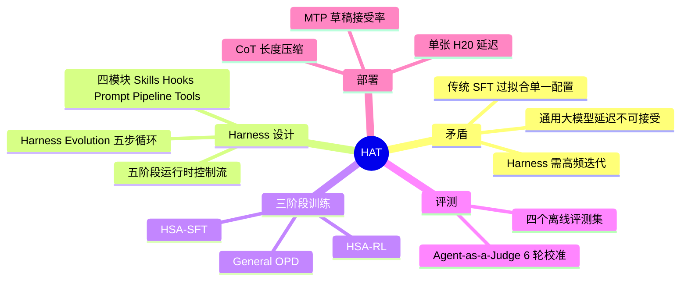
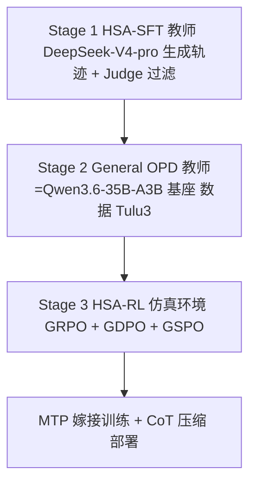

# 淘宝直播数字人：Harness-Aware Training（HAT）

> [!note] 读者假设
> 你未填写读者背景，这里按「有 RAG / LangGraph 经验的 LLM 应用工程师」处理：Agent loop、工具调用、SFT、RL 基础概念一笔带过。需要改请告诉我。

## 1. TL;DR

- **问题**：直播数字人 Agent 要低延迟（小模型），但业务规则（Skills / Hooks / Prompt / Tools = **Harness**）高频变化；固定 Harness 做 SFT 会过拟合当前配置，通用指令能力也会掉。
- **方法**：**Harness-Aware Training (HAT)**——把 Harness 状态显式纳入训练分布，三阶段：**HSA-SFT → General OPD → HSA-RL**。
- **结果**：Qwen3.6-35B-A3B 在 Live-Stream QA 94.8、Harness-Variant QA 94.6、IFEval Prompt 83.5；单张 H20 + MTP，端到端延迟 P50 3.407s / P95 8.114s。
- **结论**：模型学会"读懂当前 Harness"而非"背某一版 Harness"，Harness 迭代后无需重训即可适应。

---

## 2. 核心概念

| 概念 | 一句话定义 | 解决的痛点 |
|---|---|---|
| **Harness** | Agent 的执行环境状态，由 4 个独立可更新模块组成：Skills、Hooks、System Prompt Pipeline、Tools | 把易变能力从模型权重中拆出，改配置即可迭代，不等重训 |
| **Harness Evolution** | 权重完全固定，通过修改 Skills / Prompts / Hooks / Tools 改善表现；**人机协同**，非全自动 | 缩短业务策略迭代周期 |
| **Harness-Aware Training (HAT)** | 训练时故意暴露多种 Harness 配置，三阶段训练 | Harness 变成"移动靶"，模型不能过拟合某一版 |
| **Harness-State Augmentation (HSA)** | 沿**五个维度**扰动 Harness，每个维度针对一种表层依赖 | 防止模型靠字符串匹配"走捷径" |
| **Fixed-Harness SFT** | 只在单一 Harness 配置上做监督微调 | （作为对照）产生**表层过拟合** |
| **General OPD** | 在通用指令数据上做 On-Policy Distillation，教师为 HSA-SFT 之前的基座模型 | 恢复领域训练中灾难性遗忘的通用能力 |
| **HSA-RL** | 在仿真环境 + 增强 Harness 下做 RL | 学会处理教师轨迹中没有的异常、重试、选错 Skill 恢复 |
| **MTP** | Multi-Token Prediction：NextN 头预测多个 token 作草稿，推理引擎用 EAGLE-style 猜测解码 + 验证 | 低并发下加速解码 |

### 易混概念对比

| 对比 | A | B |
|---|---|---|
| Fixed-Harness SFT vs HSA-SFT | 单一 Harness，业务指标升但通用指令/Prompt 鲁棒性显著受损 | 多种 Harness 变体，学相同任务语义，保留更多通用能力 |
| HSA vs OPD | **预防**损失（训练数据层面） | **修复**残余损失（蒸馏层面） |
| HSA-SFT vs HSA-RL | 离线，只学教师最优轨迹 | 在线，亲历失败/恢复，学真实鲁棒性 |
| Harness Evolution vs HAT | 改 Harness，不动权重 | 改权重，使模型能跟随 Harness 变化 |
| 训练 reward judge vs 评测 judge | 训练用 | 最终评测用；**不能是同一个模型** |

> [!important] 重点：表层过拟合的三种表现（原文）
> ① 记住特定 Skill 名称而非理解 Skill 语义；② 按熟悉的 schema 字符串选工具而非读工具描述；③ 只在特定 Prompt 格式下遵守规则。

---

## 3. 知识框架



### 运行时控制流（3.2）


### Harness Evolution 五步循环（3.4）


### HAT 三阶段流水线（4.3）



> [!warning] 图表缺失
> PDF 中的图 1–10 与所有数据表格均为加载占位，无法读取（详见校对报告）。以上框架仅依据正文文字复原，未对图中结构做任何猜测。

---

## 4. 关键要点

### 1. Harness 设计（3.1–3.2）

- Harness 的 4 个模块**独立于模型权重版本化管理**：改一个 Skill 或加一个 Hook 无需重训。
- 每个 **Skill** = 带描述 + **渐进式披露**完整内容的 Markdown 模块。
- 运行时规则：产生最终回复前**必须加载至少一个 Reply Skill**；**Strategy Skill 可选**，用于组合专门的工具调用链。
- Hook 覆盖六类检查：输入校验、工具参数、Skill 加载要求、回复格式、事实风险、重试控制。
- Agent Loop 在**可配置轮次限制**下运行：加载 Skill、发起工具调用、处理返回、提出最终回复。
- 第 5 步：移除内部推理字段，保留结构化轨迹，路由到下游通道。
- 业务约束：回复经 TTS 公开口播，一次错误（虚假承诺、价格错误）可引发客诉，准确性要求极高。多条弹幕在同一时间段内合并为同一请求。

典型轨迹（原文示例）：

```text
input.danmaku = "3号链接多少钱？"
context.current_link_id = 1
call[1] = get_product_info_by_link_id(link_id=3)
result[1] = {name: "防晒霜SPF50", price: 89}
call[2] = load_skill(skill="item_qa")
reply = "3号链接是防晒霜SPF50，现在券后价89元哈。"
```

> [!tip] 这个例子的细节
> 用户问 3 号链接，而当前讲解链接是 1 号——工具参数取的是用户问的 `link_id=3`，不是 `current_link_id`。

> ⚠️[原文疑点] 示例中工具返回只有 `price: 89`，回复却说"券后价 89 元"，"券后"在返回里没有依据；与文中强调的"无依据声明"准确性规则有张力。

### 2. Harness Evolution（3.4–3.5）

- 五步：Diagnose（聚类失败原因 + 代表性 bad case + 根因假设）→ Confirm（开发者接受/修改/拒绝）→ Edit（保留版本化配置快照）→ Evaluate（dev-set）→ Regression Check（人决定发布/回滚/继续/停止）。
- **停止规则**：剩余错误是稀疏长尾 case，且局部加规则更可能引发跨类别回归而非系统性改善时，停止迭代。
- 效果：Baseline 82.40% 准确性 / 87.16 有效性 → Evolution 2 的 92.55 / 92.75。
- Evolution 3–4 的长尾修复在 Skills、Hooks、全局指令间产生**交互效应**，双指标回归。

> ⚠️[原文疑点] 原文写提升 "+12.15/+5.59"；92.55 − 82.40 = 10.15，而 92.75 − 87.16 = 5.59。准确性提升幅度的 12.15 与原文自己给的两端数字不一致，已如实保留。

> [!important] 四条教训（原文 TAKEAWAY）
> 非单调（更多规则 ≠ 更好）；早停；人机协同（全自动尚不成熟）；版本绑定（每次发布绑定 Harness commit，否则走错方向后无法恢复）。

### 3. 问题定义：Fixed-Harness SFT 的代价（4.1）

- Fixed-Harness SFT 提高业务指标，但**显著损害通用指令遵循和 Prompt 鲁棒性**——恰恰是适应新 Harness 所需的能力。
- 原文引 Kimi-K3 技术报告也 highlight 了 harness 过拟合问题。

> ⚠️[原文疑点] 正文称"图3中所示的 Kimi K3 原文"，但 Kimi-K3 对应的是图 4，图 3 是 Harness 自进化流程图。

### 4. HSA 与 HAT 三阶段（4.2–4.3）

**HSA 核心假设**：训练数据只含一个固定 Harness 时，模型靠字符串匹配走捷径；扰动 Harness 使其无法靠背 pattern 做决策。沿**五个维度**扰动。

> ⚠️[图中无法辨认] 五个维度具体是什么（图 5 左侧）正文未列出，图未加载。

**Stage 1 HSA-SFT**
1. 数据准备：观众问题 + 直播间/商品上下文 + Harness 配置（来自真实直播日志）；
2. HSA 增强：强模型 **DeepSeek-V4-pro** 在原始和增强 Harness 下分别生成候选轨迹标签；
3. 质量过滤：Judge 按准确性、有效性过滤；
4. SFT：学生在多种 Harness 变体下学相同任务语义。

- **Hook 重试轨迹处理**：绝大多数重试轨迹删除中间失败和 Hook 交互、只留最终正确行为（不让模型学成"先出错再靠重试"）；**少量**完整重试轨迹保留，让模型具备理解 Hook 提醒并恢复的能力。
- 数据规模：万级 RFT 执行轨迹。

**Stage 2 General OPD**
- 教师 = HSA-SFT 之前的基座（Qwen3.6-35B-A3B）；数据 = Tulu3 通用指令集；学生 on-policy 采样，最小化与基座分布的 KL。
- 直觉：让学生在通用任务上"回忆"基座时的能力。
- **关键发现**：OPD 在 Fixed-Harness SFT 后带来 **+8.5** IFEval 恢复（损失大），在 HSA-SFT 后仅 **+0.2**（HSA-SFT 本身保留更多通用能力）→ HSA 预防，OPD 修复，**互补**。

**Stage 3 HSA-RL**
- base = HSA-SFT + General OPD 的模型。动机：HSA-SFT 是离线的，教师轨迹里没有工具异常、Hook 拦截重试、选错 Skill 中途恢复。
- 算法：基于 **GRPO**，整合 **GDPO** 的 reward normalization 与 **GSPO** 的 sequence-level 重要性采样。
- **四维奖励**：Accuracy、Effectiveness、Tool Rationality、Skill Selection。
- 工具调用段与回复段作为**两个独立 state group** 分别算 advantage。
- 辅助 **CoT 长度惩罚**；HSA 应用于 rollout 前（部分 rollout 用原始 Harness，部分用增强 Harness）。
- 数据规模：千级交互任务。

### 5. 仿真环境（4.4）

| 组件 | 内容 |
|---|---|
| 输入仿真 | 合规处理后的日志池采样真实输入（商品问询、闲聊、购买意图、售后、多意图弹幕），配模拟直播间状态 |
| Harness Agent 调度 | 完整控制流：Skill 路由、Hook 检查点（输入校验、参数检查、回复格式、Skill 加载强制）、多轮循环 |
| 工具执行仿真 | 沙盒服务器，返回日志还原的真实商品/价格/库存；**注入受控故障**（超时、格式错误、权限拒绝） |
| 增强 Harness 配置 | 环境在增强的 Harness 状态下运行，模拟 Harness 变化 |

### 6. 评测体系（5.1–5.2）

- 四个互补离线评测集 + **Judge 校准集**（真实直播交互 + 人工标注；同时用于 Harness 非训练优化）+ **部署回放集**（测端到端延迟）。
- **Accuracy**：二值，惩罚事实错误、无依据商品声明、虚假承诺。**Effectiveness**：0 / 0.5 / 1 三档，衡量是否满足意图并提供有用信息。
- Judge 本身是 Harness Agent（自己的 Skills=评分规则、Tools=商品信息验证、Hooks），**3 个模型共同投票**，与人工标注做分歧分析迭代校准，共 **6 轮**。
- 与人工一致率：Accuracy 81.54% → 90.46%；Effectiveness 63.70% → 82.2%。
- T3 评测集是 AI 生成的多样化场景。

### 7. 实验结果（6.1–6.3）

- T1：HAT 94.8 > 最强 Top 模型 GLM-5.2 的 93.0。
- T2：HAT 94.6，与 T1 仅差 0.2 → 对 Harness 变化鲁棒。
- IFEval：Fixed-Harness SFT 下降 7.7，HAT 上升 2.0。
- T3 的 Prompt Robustness 子集：Fixed-Harness SFT 下降 4.6。
- 消融结论：固定环境微调过拟合；HSA 兼顾任务性能与泛化；OPD + HSA 组合最好；**RL 在固定环境下严重掉泛化，必须配 HSA**。
- 进化适应性：线上流量抽 1,500 条（500 开发 + 1,000 测试），在开发集上用此前相同策略进化 Harness，再用进化后 Harness 测两个模型 → HAT 错误减少率约为 Fixed-Harness SFT 的**近 3 倍**。

> ⚠️[图中无法辨认] 主结果表、消融表、进化适应性表的具体数值（含各模型/各阶段得分）均在图中，未加载。

> [!note] [推断]
> T1 ≈ Live-Stream QA（94.8），T2 ≈ Harness-Variant QA（94.6）——由摘要数字与 6.1 数字对应推出，原文未明说 T1/T2 名称映射。

### 8. 部署：MTP 与 CoT 压缩（6.4–6.5）

- MTP 训练：RL 阶段基于 stage1+stage2 的 checkpoint，从 Qwen3.6-35B-A3B 的 MTP **直接初始化（嫁接）**，**standalone** 模式训练；训练中 MTP 与主模型输出分布逐渐拟合。
- 加速（Concurrency=1，单 H20）：HAT checkpoint **1.69×** vs Base checkpoint **1.11×**；原因是垂域训练后接受率更高（平均接受率 0.780 vs 0.735，平均接受长度 3.12 vs 2.94）。
- **MTP 是低并发优化**：并发线程 1–2 效果显著；4–8 时加速降到 1.27× / 1.19×。
- 开启 MTP 后质量无损失（略升属波动）。
- CoT 压缩：工具调用 CoT 290.6 → 171.2 token；回复 CoT 93.6 → 37.0。
- 延迟：单 H20 中位数 3.4s、P95 8.1s；百炼 API 的 DeepSeek-V4 系列有 29%–39% 请求超过 15s。解码速度 271 vs 216 tokens/s（部署模型 vs 原生）。

> [!warning] 易错
> MTP 草稿接受率：部署模型 78%（0.780），原生 73.5%（0.735）。**如果主模训练了而 MTP 没跟着训，接受率为 0，MTP 无法使用。**

---

### 方法对比表

| 方法 | 适用场景 | 解决的问题 | 局限 |
|---|---|---|---|
| 直接用通用大模型（如 DeepSeek-V4） | 对延迟不敏感 | 泛化好，能应对 Harness 变化 | 直播延迟不可接受（百炼 API 29%–39% 请求 >15s） |
| 未经领域训练的小模型 | — | 低延迟 | 能力不足以达到工业上线要求 |
| Harness Evolution | 修线上问题、迭代业务策略 | 不改权重即可改行为 | 非单调、长尾 fix 引发跨类别回归；需人机协同 |
| Fixed-Harness SFT | 单一固定配置 | 提升业务指标 | 表层过拟合；通用指令遵循、Prompt 鲁棒性显著下降 |
| HSA-SFT | Harness 会变的领域 SFT | 业务提升 + 保留泛化 | 离线，只学教师最优轨迹；仍可能侵蚀通用能力 |
| General OPD | SFT 之后 | 恢复灾难性遗忘的通用能力 | 在 HSA-SFT 后收益很小（+0.2） |
| HSA-RL | 需要异常/重试鲁棒性 | 亲历失败与恢复 | 固定环境下 RL 严重掉泛化，必须配 HSA；依赖仿真环境构建 |

## 5. 数据速查表

| 指标 | 数值 | 出处 |
|---|---|---|
| Live-Stream QA（HAT） | 94.8 | 摘要 / 6.1（T1 [推断]） |
| Harness-Variant QA（HAT） | 94.6 | 摘要 / 6.1（T2 [推断]） |
| GLM-5.2（最强 Top 模型） | 93.0 | 6.1 |
| IFEval Prompt（HAT） | 83.5 | 导读 |
| IFEval 变化：Fixed-Harness SFT / HAT | −7.7 / +2.0 | 6.1 |
| Prompt Robustness 变化（Fixed-Harness SFT） | −4.6 | 6.1 |
| OPD 的 IFEval 恢复：Fixed-Harness SFT 后 / HSA-SFT 后 | +8.5 / +0.2 | 4.3 |
| Harness Evolution：Baseline → Evolution 2 | 82.40 / 87.16 → 92.55 / 92.75 | 3.5 |
| Judge 与人工一致率：Accuracy | 81.54% → 90.46% | 5.2 |
| Judge 与人工一致率：Effectiveness | 63.70% → 82.2% | 5.2 |
| Judge 迭代轮数 / 投票模型数 | 6 / 3 | 5.2 |
| 进化适应性数据量 | 1,500（500 开发 + 1,000 测试） | 6.3 |
| HAT 错误减少率 vs Fixed-Harness SFT | 近 3 倍 | 6.3 |
| MTP 加速（HAT vs Base，并发 1） | 1.69× vs 1.11× | 6.4 |
| MTP 加速（并发 4–8） | 1.27× / 1.19× | 6.4 |
| MTP 平均接受率 / 平均接受长度（HAT vs Base） | 0.780 vs 0.735 / 3.12 vs 2.94 | 6.4 |
| 工具调用 CoT 长度 | 290.6 → 171.2 token | 6.4 |
| 回复 CoT 长度 | 93.6 → 37.0 | 6.4 |
| 端到端延迟（单 H20 + MTP） | P50 3.407s / P95 8.114s | 导读 / 6.5 |
| 解码速度（部署 vs 原生） | 271 vs 216 tokens/s | 6.5 |
| 训练数据规模：HSA-SFT / HSA-RL | 万级 RFT 轨迹 / 千级交互任务 | 4.3 |

### 论文型速览

| 项 | 内容 |
|---|---|
| 问题 | 低延迟小模型 + 高频变化的 Harness，Fixed-Harness SFT 过拟合并损伤通用能力 |
| 方法 | HAT：HSA-SFT → General OPD → HSA-RL；Harness 状态增强贯穿始终 |
| 实验设置 | 基座 Qwen3.6-35B-A3B；教师 DeepSeek-V4-pro；OPD 数据 Tulu3；评测含 T1/T2/T3 等四个离线集 + Judge 校准集 + 部署回放集；单张 H20，MTP |
| 结论 | 94.8 / 94.6，超越 GLM-5.2（93.0）；IFEval 不降反升 2.0；延迟 P50 3.407s |
| 局限 | 原文无单列局限。[推断] 依赖强教师与 Judge 的质量；Harness 变化范围受 HSA 五个维度限定；Evolution 仍需人参与 |

---

## 6. 踩坑与教训

> [!warning] 易错与教训
> - **"更多规则 ≠ 更好"**：长尾 fix 在 Skills/Hooks/全局指令间产生交互效应，导致双指标回归 → 设早停规则。
> - **未绑定 Harness commit**：往错误方向自进化后无法恢复。
> - **固定环境 SFT / RL**：业务指标涨，泛化和 Prompt 鲁棒性掉。
> - **没有错误恢复经验的模型**：线上遇到工具超时就崩 → 仿真环境必须注入故障。
> - **不加 CoT 长度惩罚**：思维链越来越长，直接推高线上延迟。
> - **主模训练后 MTP 没同步训练**：接受率为 0。
> - **MTP 在高并发下收益衰减**（4–8 线程降到 1.27× / 1.19×）。
> - **Judge 与 reward judge 用同一模型、校准集混入测试集**：都被原文列为必须避免。
> - **Hook 重试轨迹全保留**：会让模型学成"先出错再靠重试"。

### 可迁移的设计原则

1. **易变逻辑外置**：把会变的业务能力放进可版本化的 Harness，而非塞进权重。
2. **训练分布覆盖部署变化轴**：想让模型适应什么会变的东西，就在训练里让它变。
3. **域训练后监控并恢复通用能力**：预防（数据多样化）+ 修复（OPD）互补。
4. **SFT 解决覆盖，RL 解决鲁棒**：RL 里要有故障注入和失败恢复。
5. **分段奖励 / 分段优势**：工具调用段与回复段各自算 advantage、各自压缩 CoT。
6. **Judge 当 Harness 来迭代**：与人工标注做分歧分析；训练用与评测用 Judge 分离；校准集与测试集分离。
7. **投机解码要随主模一起训**：MTP 在垂域数据上训练后接受率更高。
8. **自进化要有刹车**：早停 + 人在环 + 版本绑定。

---

## 7. 记忆锚点

- **"读版本，不背版本"**：HAT = 让模型学会读 Harness，而不是背某一版 Harness。
- **"预防—修复—实战"**：HSA 预防损失，OPD 修复损失，RL 在仿真里实战。

## 8. 复习卡片

HAT 的三个阶段分别是什么？::HSA-SFT（增强 Harness 下监督微调）→ General OPD（通用能力蒸馏恢复）→ HSA-RL（仿真环境强化学习）
Harness 由哪四个模块组成？::Skills、Hooks、System Prompt Pipeline、Tools，独立于模型权重版本化管理
Fixed-Harness SFT 的"表层过拟合"有哪三种表现？::记 Skill 名称不懂语义；按熟悉 schema 字符串选工具而非读描述；只在特定 Prompt 格式下遵守规则
Harness Evolution 的五步循环？::Diagnose → Confirm → Edit Harness → Evaluate → Regression Check（人机协同）
Harness Evolution 什么时候停止？::剩余错误是稀疏长尾 case，且局部加规则更可能引发跨类别回归而非系统性改善时
General OPD 的教师模型和数据是什么？::教师是 HSA-SFT 之前的基座 Qwen3.6-35B-A3B；数据是 Tulu3 通用指令集；学生 on-policy 采样，最小化与基座分布的 KL
OPD 在 Fixed-Harness SFT 后和 HSA-SFT 后分别带来多少 IFEval 恢复？::+8.5 和 +0.2，说明 HSA 预防、OPD 修复，二者互补
HSA-RL 的四维奖励与 advantage 分组？::Accuracy、Effectiveness、Tool Rationality、Skill Selection；工具调用段与回复段作为两个独立 state group 分别计算 advantage
HSA-SFT 如何处理 Hook 重试轨迹？::绝大多数删除中间失败和 Hook 交互，只留最终正确行为；少量完整重试轨迹保留，使模型能理解 Hook 提醒并恢复
MTP 在什么条件下收益最大、什么情况下失效？::低并发（1–2 线程）收益显著，4–8 降到 1.27×/1.19×；主模训练过而 MTP 没跟训时接受率为 0

## 9. 知识关联（候选双链，请自行取舍）

- [[Agent Harness]] / [[Skills 渐进式披露]] / [[Agent Hooks]]
- [[SFT]] / [[灾难性遗忘]] / [[On-Policy Distillation]]
- [[GRPO]] / [[强化学习 Reward 设计]]
- [[LLM-as-a-Judge]] / [[Agent 评测体系]]
- [[Speculative Decoding]] / [[MTP]]
- [[LangGraph]]（对照其 Agent 控制流）/ [[RAG]]（对照其检索上下文组装）
- [[Prompt Robustness]] / [[IFEval]]

---

## 10. 原文参考资料

- 原文提及 Qwen3.6-35B-A3B、Tulu3、IFEval、GRPO、On-Policy Distillation (OPD)、Multi-Token Prediction (MTP) 等基准与方法。

> [!note]- 校对报告
> **1. 覆盖度**
> - 正文章节全部覆盖：摘要、业务背景、3.1/3.2/3.4/3.5、4.1–4.4、5.1–5.2、6.1–6.5、总结。团队介绍与拓展阅读未收录（非学习内容）。
> - **无法覆盖：图 1–10 及所有表格均为未加载占位**，包括：图 2 与其后"每个模块的职责"表、5.1 四个评测集的构成表、6.1 两张主结果表、6.2 消融表、6.3 进化适应性表、6.4 加速表、6.5 延迟表、图 5 的五个扰动维度、图 6 HSA-RL 伪代码、图 7 Judge 自进化曲线。涉及这些的内容仅采用正文文字。
> - 未添加 [扩展] 内容，因此无「扩展阅读」。
>
> **2. 一致性（抽查 5 项，与原文一致）**
> - 94.8 / 94.6 / IFEval Prompt 83.5（导读 ↔ 6.1）✔
> - P50 3.407s / P95 8.114s（导读）↔ 3.4s / 8.1s（6.5）✔
> - Baseline 82.40 / 87.16 → Evolution 2 的 92.55 / 92.75（3.5）✔
> - Judge 一致率 81.54%→90.46%、63.70%→82.2%（5.2 正文 ↔ 校准过程列表）✔
> - MTP 接受率 0.780 / 0.735（6.4）↔ 78% / 73.5%（6.5）✔
>
> **3. [推断] 与 ⚠️ 汇总**
> - [推断] T1 = Live-Stream QA、T2 = Harness-Variant QA。
> - [推断] Hook 检查不通过后回到 Agent Loop 重试（Mermaid 虚线，由"重试控制"与重试轨迹处理推出）。
> - [推断] 论文型表格「局限」栏的三点。
> - [推断] IFEval 的 −7.7 / +2.0 以基座为参照（原文未写明参照）。
> - ⚠️[原文疑点] 3.5：+12.15 与 92.55 − 82.40 = 10.15 不一致（有效性 +5.59 正确）。
> - ⚠️[原文疑点] 4.1：称"图3中所示的 Kimi K3"，实为图 4。
> - ⚠️[原文疑点] 编号：导读列"第一章–第五章"，正文小节号为 3.1、3.2、3.4、3.5、4.x、5.x、6.x，且缺 3.3。
> - ⚠️[原文疑点] 评测集规模：导读称"超过 4500 条"，5.1 称"总计数千条"，具体构成表未加载。
> - ⚠️[原文疑点] 5.2 takeaway 称"达到 90%+ 一致率"，但 Effectiveness 一致率仅 82.2%。
> - ⚠️[原文疑点] 校准集：5.1 称同时用于 Harness 非训练优化；5.2 takeaway 称"校准集只用于 Judge 校准"，表述有张力（后半句限定"不用于模型评测"）。
> - ⚠️[原文疑点] OPD 恢复 +8.5 大于 Fixed-Harness SFT 的 IFEval 下降 7.7，两处口径文中未说明。
> - ⚠️[原文疑点] 3.2 轨迹示例：返回只有 price 89，回复写"券后价"。
> - ⚠️[图中无法辨认] HSA 五个维度；各表数值；图 6 伪代码。
> - 日期取自文章发布日期 2026年10月8日；文件名标题因超 20 字限制已压缩为"淘宝直播数字人HAT实践"（"HAT"为原文缩写）。
