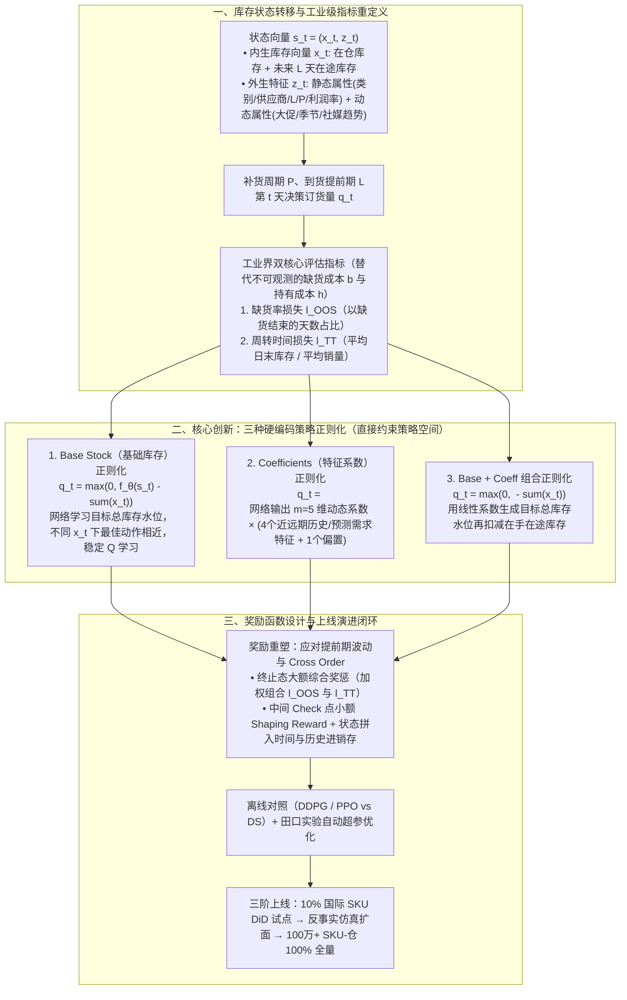

# 淘天集团自营技术运营算法团队4年2次荣膺INFORMS“杰出实践奖”决选荣誉：以策略正则化突破DRL在库存管理中的落地瓶颈

## 1. TL;DR

1. **核心突破与荣誉**：淘天自营技术运营算法团队凭《DeepStock: Reinforcement Learning with Policy Regularizations for Inventory Management》荣获 2025 年 INFORMS **“Daniel H. Wagner 杰出实践奖”决选荣誉**（继 2022 年后 4 年内第 2 次入选），实现单一通用补货模型在淘天自营（天猫超市、国际直营等）**100% 全量部署，覆盖超 100 万个 SKU-仓库组合**。
2. **传统两阶段与裸 DRL 的四大落地瓶颈**：“先销量预测、再运筹规划”受限于预测上限；而直接用深度强化学习（DRL）或亚马逊主推的可微分仿真器（DS）面临**黑箱不可解释、历史数据因经营策略快变而效用低、超参极度敏感、学术界单步成本累加奖励与工业界全局指标（缺货率 OOS + 周转天数 Turnover Time）错配**四大难题。
3. **核心创新（策略正则化 Policy Regularization）**：不同于在奖励/目标函数中加软惩罚项，DeepStock 直接将经典库存理论结构**硬编码限制在策略输出空间**：提出 **Base Stock（基础库存）正则化**（网络输出目标总库存再减去在手与在途库存）、**Coefficients（特征系数）正则化**（网络输出 $m=5$ 维系数与近远期历史/预测需求特征线性组合）及两者的**组合正则化**；配合**终止态全局综合奖惩 + 中间 Check 点 Shaping Reward** 解决跨期交错到货（Cross Order）与全局周转指标不可加难题。
4. **理论与实验新发现（为什么带正则化的 DRL 击败 DS）**：通过公平超参调优实验首次揭示**可微分仿真器（DS）直接对整条训练轨迹求梯度，缺乏从 $(s, a, r, s')$ 转移中跨时间步学习的能力，在轨迹样本量有限（如长尾 SKU，$N_{\text{train}}=5$）时严重过拟合**（即使 $T=129$ 测试损失仍落后约 8%）；而结合策略正则化的传统 DRL（DDPG / PPO）样本效率与泛化显著优于 DS。
5. **全量业务帕累托收益**：2024 年 7 月 10% 国际 SKU 试点（DiD 双重差分）实现**缺货率降低 0.83%、周转天数减少 9.53 天**；2025 年全量推广后，在有货率（Service Rate）不恶化前提下**整体库存周转天数优化 7%（国际 SKU 2025 年 7–8 月同比减少 20%）**，每 **50 亿元**库存规模年化减少库存货值 **3.5 亿元**、降低持有成本约 **1500 万元**。

## 2. 问题定义与背景

### 2.1 库存控制范式对比：两阶段 vs 可微分仿真器（DS） vs 策略正则化 DRL

| 范式 / 方法 | 核心机制 | 工业落地核心痛点或本文突破 |
|---|---|---|
| **传统“先预测、再决策”两阶段** | 先预测未来销量分布，再调运筹优化/报童模型求补货量 | 预测精度锁死决策上限；大促、社媒趋势与供应链波动下需求分布假设失效 |
| **无正则化通用 DRL（DDPG / PPO）** | 单一黑箱神经网络直接映射状态 $s_t \to$ 订货量 $q_t$ | 策略搜索空间过大、超参极度敏感、业务方难以信任，且早期需按畅销/长尾分组训练多个独立模型 |
| **可微分仿真器（DS，如 Amazon 方案）** | 不算单步状态转移价值，直接对仿真环境下多周期总成本求轨迹梯度 | **本文首次实证揭示缺陷**：缺乏 $(s,a,r,s')$ 跨时间学习能力，在并行轨迹数少时严重过拟合训练集 |
| **DeepStock（策略正则化 DRL）** | 将 Base Stock 与需求线性系数结构硬编码进策略函数空间 + 终止态全局指标奖励 + 田口实验超参调优 | **一套通用大模型 100% 覆盖 100 万+ SKU-仓**，兼顾高样本效率、业务可解释性与全局周转率帕累托改进 |

## 3. 知识框架

## 4. 核心内容拆解

### 4.1 离散库存动态建模与工业界双指标奖励重构

1. **库存动态方程（Lost Sales 缺货损失制）**：
   - 设离散时间范围 $t = 1, \dots, T$ 天，补货周期为 $P$，供应商送货到仓提前期（Lead Time）为 $L$。
   - 第 $t$ 天开始时的库存状态向量 $x_t = (x_{t,0}, x_{t,1}, \dots, x_{t,L-1})$，其中 $x_{t,0}$ 为当前在仓库存，$x_{t,k}$ 为未来第 $k$ 天将到达的在途库存。
   - 若第 $t$ 天处于订货点则决定订货量 $q_t \ge 0$（否则 $q_t = 0$）；当日真实需求为 $d_t$，实际销售量为 $\min(x_{t,0}, d_t)$，未满足需求直接流失（Lost Sales）。
2. **为什么抛弃学术界标准线性成本目标 $l_{\text{std}}$**：
   - 学术界常最小化每日缺货惩罚 $b \cdot (d_t - x_{t,0})^+$ 与持有成本 $h \cdot (x_{t,0} - d_t)^+$ 之和，虽然在时间上天然可加，但在真实电商中**缺货期间的真实潜在需求 $d_t$ 无法直接观测**，且单位缺货成本 $b$ 与持有成本 $h$ 极难准确量化。
   - **阿里工业界双评估指标**：
     - **缺货率损失（$l_{\text{OOS}}$，Out-of-Stock / 对应有货率 Service Rate）**：以期末缺货结束的天数百分比，惩罚库存过少。
     - **周转时间损失（$l_{\text{TT}}$，Turnover Time）**：$\frac{\text{平均日末库存}}{\text{平均销售量}}$，衡量一单位库存在手的平均持续天数，惩罚库存积压。
3. **终止态全局 Reward + Check 点 Shaping Reward**：
   - 由于 $l_{\text{TT}}$ 是整个周期的比值指标（不可按天简单相加），且提前期 $L$ 波动大甚至引发后单先到的**跨期交错订单（Cross Order）**，按单次补货区间切分即时奖励会失真。
   - DeepStock 设计：**在轨迹终止态按整段周期统计的 $(l_{\text{OOS}}, l_{\text{TT}})$ 加权组合给予大额终局奖惩，其余步基础 reward 为 0；同时在中间挑选若干 Check 点施加小额 Shaping Reward**，并在状态向量中拼入时间步与历史进销存统计特征以辅助信用分配。

### 4.2 核心武器：硬编码进策略空间的三种“策略正则化”

不同于前人工作（De Moor 2022 / Qi 2023 / Maggiar 2025）仅在目标函数或奖励中加入软惩罚项，DeepStock 直接限制神经网络策略 $\pi_\theta(s_t)$ 的函数输出结构：

1. **Base Stock（基础库存）正则化**：
   $$q_t = \max\left(0,\; f_\theta(s_t) - \|x_t\|_1\right)$$
   - 其中 $f_\theta(s_t)$ 为神经网络输出的**目标总库存水平（Target Inventory Position）**，$\|x_t\|_1$ 为当前在库与所有在途库存之和。
   - **为什么有效**：最优目标库存水平 $f_\theta(s_t)$ 在不同当前库存状态 $x_t$ 之间是相同或相近的（注：在 Lost Sales 制下仍受 $x_t$ 一定影响，故保留 $s_t$ 输入），这极大压缩了动作搜索空间，使 Q 函数目标的学习更加平稳。
2. **Coefficients（特征系数）正则化**：
   $$q_t = \left\langle f_\theta(s_t),\; \phi(z_t) \right\rangle$$
   - 神经网络 $f_\theta(s_t)$ 输出 $m$ 维非负权重系数，与从外生状态 $z_t$ 提取的 $m$ 维关键特征向量 $\phi(z_t)$ 做内积线性组合。
   - **阿里线上配置**：设 **$m = 5$**，其中 $\phi(z_t)$ 由 **近期与远期周期内的 4 个历史和预测需求特征 + 1 个常数偏置项** 组成，强制订货量与需求规模保持符合业务直觉的正相关关系。
3. **Base + Coeff 组合正则化**：
   $$q_t = \max\left(0,\; \left\langle f_\theta(s_t),\; \phi(z_t) \right\rangle - \|x_t\|_1\right)$$
   - 用 $m$ 维需求特征线性组合生成动态的目标总库存水位，再减去当前在手与在途总库存。

### 4.3 深度实验对决：为什么可微分仿真器（DS）在少样本下会过拟合？

在固定 $P=2, L=1, m=1, T=29, b=0.9, h=0.1$ 的多组合成分布（`INDEP`、`AR(1)`、`IID`）上，团队对 **DDPG、PPO、DS（可微分仿真器）** 结合不同正则化进行了严格超参网格对比，揭示了三大关键结论：
1. **策略正则化普惠所有算法**：加上 `Base` 正则化后，DDPG、PPO 与 DS 的测试集损失均大幅下降，且降低了传统 DRL 调参击败 DS 的难度。
2. **DS 的致命短板——缺乏跨时间步学习导致样本内过拟合**：
   - 在 `AR(1)` 少样本设置下，带 Base 正则化的 DS **验证集损失优于 DDPG，但测试集损失反而劣于 DDPG**。
   - **根因剖析**：DS 直接对整条训练轨迹求路径梯度，强制最小化样本内轨迹损失，但**不从单步状态转移四元组 $(s, a, r, s')$ 中学习价值函数，缺乏传统 DRL 核心的跨时间步（Cross-Time）学习能力**。
   - **实验铁证**：当训练轨迹数较少（$N_{\text{train}} = 5$，模拟新品或长尾 SKU）时，即便把单条轨迹时间长度拉长到 $T = 129$，DS 的测试损失仍存在约 **8%** 的顽固差距；只有当跨 SKU 并行轨迹数从 5 增加到 10、20 时 DS 才能靠跨轨迹元学习改善。因此**在真实电商有限历史数据下，带策略正则化的 DRL 泛化能力显著优于 DS**。

## 5. 数据速查表

| 阶段 / 维度 | 原文数值 / 实验参数 | 语境与业务含义 |
|---|---|---|
| **全量部署覆盖规模** | **100% 全量部署，超 100 万个 SKU-仓库组合** | 覆盖天猫超市、国际直营等淘天自营全品类（单一通用补货模型） |
| **整体核心业务收益** | 有货率稳定下，**库存周转天数优化 7%** | 每 **50 亿元**库存规模，年化减少库存货值 **3.5 亿元**，降低持有成本约 **1500 万元** |
| **阶段 1：小规模试点（2024 年 7 月）** | **缺货率降低 0.83%，周转天数减少 9.53 天** | 在 **10%** 高潜力国际 SKU 上试点，采用 **双重差分（DiD）** 严谨因果评估 |
| **阶段 2：大规模推广（2025 年 4 月）** | **100% 国际 SKU + 87% 国内 SKU**，周转降低 **1–2 天** | 因覆盖率高无法用 DiD，改用工业级仿真环境做**反事实（Counterfactual）分析** |
| **阶段 3：全量稳定运行（2025 年 7–10 月）** | 2025 年 7–8 月国际 SKU 平均周转时间**同比 2024 年减少 20%** | 涵盖模型重训练周期，缺货率无恶化，2025 年 10 月达 100% 全量 |
| **Coefficients 正则化特征维数** | **$m = 5$** | 包含 **4 个**近远期历史与预测需求特征 + **1 个**常数偏置项 |
| **离线对照实验超参数** | $P=2, L=1, m=1, T=29$（长序列 $T=129$），$b=0.9, h=0.1$ | 在 $N_{\text{train}}=5, T=129$ 下 DS 测试损失仍落后约 **8%** |

## 6. 踩坑与教训 / 可迁移的设计原则

| 错误做法 | 失败表现或原因 | 原文应对（可迁移的设计原则） |
|---|---|---|
| **直接把学术界“单步缺货成本 $b$ + 持有成本 $h$”当作工业界 DRL 奖励函数** | 缺货期间真实未满足需求不可观测，$b$ 与 $h$ 无法定价，且与业务考核的周转天数/有货率脱节 | **终止态全局业务指标奖惩 + 中间 Check 点 Shaping Reward**，直接对齐周转时间 $l_{\text{TT}}$ 与缺货率 $l_{\text{OOS}}$ |
| **用每次补货到货区间内的局部指标偏差近似单步即时 Reward** | 供应商送货提前期 $L$ 波动大、甚至发生后单先到的 Cross Order，局部归因完全失真 | 放弃强行按单次订单切分奖励，改看整段周期的综合表现并在状态中注入历史进销存轨迹 |
| **用无约束黑箱神经网络直接输出订货量 $q_t$，或仅在 Loss 里加软惩罚** | 策略搜索空间巨大、超参极度敏感，且不同库存水位下动作抖动剧烈 | **硬编码策略空间正则化（Base Stock + Coefficients）**：让网络输出目标水位或需求线性组合系数，把领域常识变成架构硬约束 |
| **在历史有效轨迹有限（经营节奏快变/长尾 SKU）的场景盲目迷信可微分仿真器（DS）** | DS 直接对整条轨迹求导而不学 $(s,a,r,s')$ 状态转移，缺乏跨时间步学习能力，样本少时严重过拟合 | 在有限轨迹场景优先采用 **带策略正则化的传统 DRL（DDPG / PPO）** + **田口实验（Taguchi）自动化超参优化** |
| **按畅销品、长尾品、不同供应商分组训练几十个独立 RL 模型** | 特征工程与重训练运维成本随分组数爆炸，无法扩展至百万级 SKU | 依托策略正则化与统一状态特征工程构建**单一通用补货大模型**，通过调节 $(l_{\text{OOS}}, l_{\text{TT}})$ 权重灵活适配各业务线目标 |

## 7. 记忆锚点

- **DeepStock 核心公式**：「**$q_t = \max(0, \langle f_\theta(s_t), \phi(z_t) \rangle - \|x_t\|_1)$ —— 5 维需求系数定目标水位，扣减在手在途得补货量**」。
- **DRL vs DS 决胜洞察**：「**DS 沿整轨求导缺跨时间学习，少样本必过拟合；策略正则化护航 DDPG/PPO，一套模型统管百万 SKU-仓省 3.5 亿货值**」。

## 8. 复习卡片

为什么传统的“先预测销量、再运筹优化”两阶段库存方法在电商场景容易触顶？::因为需求预测的精度直接锁死了下游补货策略的性能上限，而电商场景受大促、季节性、社交媒体趋势与供应链波动等高维动态因素影响，难以精准预测需求分布。
在工业界库存强化学习中，为什么不能直接使用学术界标准的每日缺货与持有成本之和作为奖励？DeepStock 如何设计奖励函数？::因为缺货期间的未满足需求无法直接观测，且单位缺货成本 b 与持有成本 h 难以量化；DeepStock 改用业务真实的“缺货率损失 l_OOS”与“周转时间损失 l_TT”加权组合，在轨迹终止态给予大额综合奖惩，并在中间 Check 点辅以小额 Shaping Reward。
DeepStock 的“策略正则化（Policy Regularization）”与前人在奖励/目标函数中加惩罚项的做法有什么本质区别？::前人做法只是在训练目标中加入软性惩罚项，而 DeepStock 直接将库存理论的经典函数结构（Base Stock 与需求特征线性系数）硬编码进神经网络策略的输出空间，直接大幅压缩策略搜索空间。
Base Stock 正则化与 Coefficients 正则化的数学形式分别是什么？阿里线上是如何配置 Coefficients 特征的？::Base Stock 正则化为 q_t = max(0, f_θ(s_t) - ||x_t||_1)，即目标总库存减去在手与在途库存之和；Coefficients 正则化为 q_t = <f_θ(s_t), φ(z_t)>，线上设 m=5，由近期与远期周期内的 4 个历史/预测需求特征加 1 个常数偏置项组成。
本文通过严格对照实验发现了可微分仿真器（DS）的什么新缺陷？为什么带策略正则化的 DDPG/PPO 能击败 DS？::发现 DS 直接对整条训练轨迹求梯度而不从 (s,a,r,s') 状态转移中学习，缺乏“跨时间步学习（cross-time learning）”能力；当并行训练轨迹较少（如 N_train=5）时，即使拉长轨迹长度 T=129，DS 仍严重过拟合训练轨迹，而带正则化的 DDPG/PPO 样本效率与泛化显著更优。
DeepStock 在淘天自营落地的三个阶段分别采用了什么评估方法？取得了哪些核心量化收益？::① 2024 年 7 月 10% 国际 SKU 试点采用双重差分（DiD），缺货率降 0.83%、周转减 9.53 天；② 2025 年 4 月扩面采用工业级仿真反事实分析，周转降 1–2 天；③ 2025 年 10 月 100% 覆盖超 100 万 SKU-仓组合，整体周转天数优化 7%（国际 SKU 同比降 20%），每 50 亿库存规模年化减少货值 3.5 亿元、降持有成本约 1500 万元。

## 9. 知识关联

- **本库主题索引**：[模型架构与训练](../../20_topics/模型架构与训练.md)、[决策知识结构化](../../20_topics/决策知识结构化.md)、[因果推断与评测归因](../../20_topics/因果推断与评测归因.md)
- **本库关联文章**：[淘宝主播Agent Harness+26.8.6](<../淘宝主播Agent Harness+26.8.6/AI_淘宝主播Agent Harness.md>)
- **候选双链**：[[深度强化学习库存管理]]、[[Policy Regularization]]、[[Base Stock策略]]、[[可微分仿真器DS]]、[[双重差分DiD与反事实评估]]

## 10. 原文参考资料

- **原文信息**：《淘天集团自营技术运营算法团队4年2次荣膺INFORMS“杰出实践奖”决选荣誉：以策略正则化突破DRL在库存管理中的落地瓶颈》，作者：淘天集团自营技术团队，发布日期：2026-02-02。
- **论文与文献链接**：
  - 核心论文（SSRN, 2025-11-21）：Xie, Yaqi et al., [*DeepStock: Reinforcement Learning with Policy Regularizations for Inventory Management*](http://dx.doi.org/10.2139/ssrn.5784782)
  - 前序研究（INFORMS Journal on Applied Analytics, 2023）：Liu, Jiaxi et al., [*AI vs. Human Buyers: A Study of Alibaba's Inventory Replenishment System*](https://pubsonline.informs.org/doi/10.1287/inte.2023.1160)

> [!note]- 校对报告
> - **页码溯源汇总**：
>   - `## 1. TL;DR` & `## 2. 问题定义与背景`：源自 p.1–3（2025 年 10 月 INFORMS Daniel H. Wagner 杰出实践奖决选、继 2022 年第二次入选、100% 全量覆盖 100 万+ SKU-仓、周转天数优化 7%、每 50 亿库存年化减货值 3.5 亿、降持有成本 1500 万、DRL 四大挑战、DS 与 DRL 文献对比）。
>   - `## 4.1 库存动态与奖励设计` & `## 4.2 策略正则化`：源自 p.4–7（离散时间 $T/P/L$、缺货率损失 $l_{\text{OOS}}$ 与周转时间损失 $l_{\text{TT}}$、Cross Order 与终止态+Shaping Reward、Base Stock 正则化、Coefficients 正则化 $m=5$ 含 4 个需求特征+1 个偏置、组合正则化）。
>   - `## 4.3 离线实验与线上三阶段效果`：源自 p.7–11（$P=2, L=1, m=1, T=29/129, b=0.9, h=0.1$ 实验、DS 缺乏 $(s,a,r,s')$ 跨时间学习导致在 $N_{\text{train}}=5$ 时差距约 8%、2024-07 10% 国际 SKU DiD 缺货率 -0.83% / 周转 -9.53 天、2025-04 100% 国际 + 87% 国内反事实仿真周转 -1~2 天、2025-07~08 同比周转 -20%、田口实验超参调优）。
> - **材料质量说明**：p.4–6 部分行内数学符号在原公众号排版中为行内公式小图（文本层体现为空格），本笔记已严格依据上下文符号定义（$T, P, L, x_t, z_t, q_t, d_t, b, h, m=5, l_{\text{OOS}}, l_{\text{TT}}$）完整还原其数学表达式，所有实验数值与业务指标均与原文 100% 一致。
