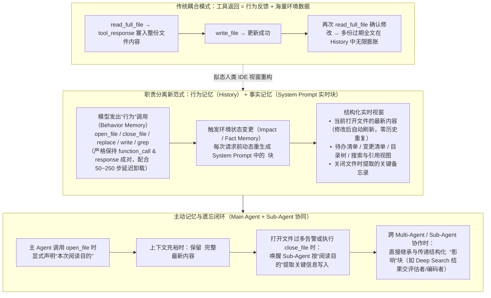

# Agentic Coding场景下基于职责分离的上下文管理思路分享

## 1. TL;DR

1. **核心问题**：在长周期 Agentic Coding 任务中，传统的 `read_full_file`（大文件撑爆上下文，且 `write` 后旧 `read` 响应沦为过期重复垃圾）与 `read_block_file`（不知关键代码位置导致多轮盲读，最坏读到文件末尾比全读更贵）均无法根治**注意力稀释、位置编码失真、信息过载与过期噪声干扰**；而写后立即删掉旧读记录的“实时按需卸载”又会抹除行为反馈，诱发模型无限重复操作幻觉。
2. **核心洞见（工具的“行为”与“影响”职责分离）**：模仿人类程序员看固定大小 IDE 屏幕编程的拟态思维，将传统耦合在 Tool Response 里的两个职责彻底拆开——**“行为（Action）”**（如调用 `open_file` / `close_file`，只返回“成功打开某文件”的轻量动作结果）与**“影响（Impact / 环境事实）”**（在 System Prompt 中维护一个每次请求前实时重渲染的 `<ide>` 结构化状态块，展示当前打开的文件、目录、搜索结果、Diff 与 `<todo>`）。
3. **主从协同的“记忆与遗忘”机制**：当上下文吃紧需要关闭文件（`close_file`）时，不再直接丢弃内容，而是由**主 Agent 在打开文件时声明“阅读目的”，在关闭时触发 Sub-Agent 基于该“目的”提取关键信息写入 `<note_book>`（备忘录）**，实现从“记住全文”到“记住关键结论”的无损降维。
4. **事实记忆 vs 行为记忆双轨制**：针对 Instruct 模型在微调时要求 `function_call` 与 `function_response` 必须成对且按特定格式出现（否则陷入无限循环调用）的约束，将记忆拆为**行为记忆（保留最近 N 步成对的 `function_call/response` 轨迹，如延迟卸载保留最近 50–250 次操作）**与**事实记忆（顶部 `<ide>` 块中的 `<open_file>`、`<todo>`、`<note_book>`、Diff 等实时状态）**，并支持在 Multi-Agent / Sub-Agent 间按任务维度继承与传递“影响”块。

## 2. 问题定义与背景

### 2.1 为什么上下文“越长反而越笨”（Long-Context Degradation 五大机理）

在 Agent 应用中，上下文包含 **用户输入、工具调用与返回、历史对话、工具定义（含 MCP）** 四部分（开发者可控后三者）。当输入 Token 序列随工具调用急剧膨胀时，会触发五重退化：
1. **注意力稀释**：Self-Attention 权重被迫在海量无关或冗余历史 Token 上分摊，冲淡核心指令与关键代码特征。
2. **位置编码失真**：当推理长度远超训练窗口（如 4K 训练外推至 32K），RoPE / ALiBi 等位置编码对远距离相对时序刻画失真。
3. **信息过载与过期矛盾干扰**：同一文件修改前后的多份旧内容并存，模型难以分辨哪份是最新事实。
4. **训练-推理分布失配**：即便用 YaRN、NTK-aware scaling 扩窗，超长样本在训练集占比仍极低。
5. **底层近似妥协**：为压降 $O(n^2)$ 算力开销采用的滑动窗口或稀疏注意力可能静默丢弃关键前置条件。

### 2.2 传统文件读写工具的三种探索与碰壁

| 方案演进 | 核心做法 | 暴露的工程缺陷与模型行为异常 |
|---|---|---|
| **1. 全量读取 `read_full_file`** | 每次直接将整个文件内容塞入 `tool_response` | ① 大文件瞬间撑爆上下文；② `write_file` 修改后需再次 `read_full_file` 确认“影响”，导致新旧多份完整文件内容在历史记录中重复堆积 |
| **2. 分块读取 `read_block_file(path, startLine, lineCount)`** | 让模型指定起始行与行数分段读取 | ① 模型事先不知道关键逻辑在哪，被迫分多次调用把全文读完，每次请求都重付前缀输入 Token 费（**最坏情况读文件末尾比全读更贵且上下文更长**）；② 只看局部块易忽略后文依赖 |
| **3. 写后实时按需卸载（Immediate Unload）** | 检测到对同一文件执行 `write` 后，立即从历史消息中删掉上一次 `read` 的返回值 | **加剧模型幻觉与死循环**：模型丢失了“上次读过什么”的行为反馈，误以为还没读过或没改成，陷入反复读写；必须改为**延迟卸载（保留最近 50 次操作；Aone Copilot 约保留最近 250 次）**，且难以推广到 `grep / getDependency` 等工具 |

## 3. 知识框架



## 4. 核心内容拆解

### 4.1 编码工具的细节防坑（`read` 与 `write` 的底层魔鬼）

在改造上下文架构前，基础文件读写工具本身必须解决四类与模型/环境强相关的工程坑：
1. **老项目文件编码混用（UTF-8 vs GBK）**：若未按正确编码读取，中文注释与非英文常量会乱码，导致模型丧失对“代码之外业务含义”的理解。Java 环境推荐用 **`juniversalchardet`** 或 **`cpdetector`** 探测字节流编码（最佳实践是统一迁移为 UTF-8）。
2. **路径找不到严禁返回空字符串 `""`**：找不到文件时必须显式返回 `"xx路径不存在"`；若返回空串 `""`，**Qwen 系列等模型极易陷入无限循环重复调用该工具**。
3. **模糊路径两阶段容错（先搜后读）**：模型常传入类限定名、缺失前缀路径或漏掉后缀名；工具层应先用关键词搜索匹配，**唯一命中则直接读取，命中多个候选则明确返回候选列表让模型重选**。
4. **`write / replace` 的转义与换行符陷阱**：
   - 模型几乎从不主动输出 `\r` 字符，在 Windows 项目下执行块替换（`search -> replace`）时必须兼容 `\r\n`；
   - 受 JSON 格式约束工具参数影响，模型输出制表符 `\t` 时常多转义一次变成 `\\t`，工具执行层需做反转义兼容。

### 4.2 核心创新：工具的“行为（Action）”与“影响（Impact）”职责分离

1. **人类 IDE 拟态思维**：
   - 人类写代码时并不是把读过的每一版文件快照都贴在一条无限变长的聊天记录里，而是面对一块**尺寸固定、内容实时刷新**的 IDE 屏幕。
   - 人类点击“打开文件”是一个**行为**，而屏幕展示出该文件的最新代码是该行为产生的**影响（当前环境事实）**。
2. **用 `open_file / close_file` + `<ide>` 实时块替代 `read_file`**：
   - **废弃直接返回全文的 `read_file`**，改为 `open_file(path)` 与 `close_file(path)`。
   - 当模型调用 `open_file(path)` 时，`function_response` 仅返回短短一句 `"已成功打开文件 xxx"`（或失败原因）；
   - 而在每次组装请求发送给模型前，宿主程序动态刷新 **System Prompt 中的 `<ide>` XML 结构化块**（⚠️注意：必须放在 System Prompt 中，若放在普通 Chat 消息流中极易被模型遗忘）：
     ```xml
     <ide>
       <open_file>当前打开文件的实时最新内容</open_file>
       <todo>待办事项清单</todo>
       <note_book>已关闭文件的关键信息备忘录</note_book>
     </ide>
     ```
   - **天然消除重复与过期**：无论模型对某个打开的文件执行了多少次 `replace / write`，历史记录里只有轻量的修改动作，而 `<open_file>` 里永远只存**唯一一份最新代码**；同理，目录树、搜索结果、引用关系、变更清单均可作为 `<ide>` 内的可开关模块由模型自主管理（打开文件过多时系统可在上下文中注入警告提示模型主动 `close_file`）。

### 4.3 记忆与遗忘：主从目的驱动摘要 + 事实/行为记忆双轨制

1. **关闭文件时的“目的驱动”备忘录提炼**：
   - 人类关掉一个刚看过的代码文件后，脑中留存的是“与当前任务相关的关键结论”而非逐行背诵全文。
   - **工程实现**：要求主 Agent 在调用 `open_file` 时**同步传入本次打开文件的“目的（Purpose）”**；当上下文捉襟见肘触发主动或被动 `close_file` 时，系统调用一个 **Sub-Agent**，依据主 Agent 当初声明的“目的”从即将关闭的文件中提取高密度关键信息，写入 `<ide>` 的 `<note_book>` 备忘录块中；当备忘录也逼近上限时，再由模型自主裁决或按 FIFO 淘汰。
2. **为什么要严格区分“事实记忆”与“行为记忆”**：
   - 支持 Function Calling 的 Instruct 模型在训练时有强格式先验：**`function_call` 与 `function_response` 必须成对且按特定角色序列出现**，若破坏该配对格式，模型极易陷入重复调用同一个方法的死循环。
   - 因此将记忆一分为二：
     - **行为记忆（Behavior Memory）**：告诉你“已经做过什么”，严格以成对的 `function_call / function_response` 形式保存在对话历史中（因已剥离大块文件内容，体积很小，可配合保留最近 50–250 步的延迟卸载）；
     - **事实记忆（Fact Memory）**：告诉你“当前环境是什么样”，以 `<ide>` XML 块（打开文件内容、操作文件列表、Diff、`<note_book>`、`<todo>`）的形式驻留在 System Prompt 中，并可在 Multi-Agent（如 Deep Search 收集员 $\to$ 评估者 $\to$ 代码生成者）之间直接继承传递。

## 5. 数据速查表

| 维度 / 机制 | 原文披露设定与工具 | 语境与解决的具体问题 |
|---|---|---|
| **上下文四大组成部分** | 用户输入、工具调用与返回、历史对话、工具定义（含 MCP） | 开发者可控后三项；核心是“在正确时间以正确结构传递正确信息” |
| **Java 文件编码探测库** | **`juniversalchardet`**、**`cpdetector`** | 解决老项目 UTF-8 与 GBK 混用导致中文注释/常量乱码、模型漏解业务语义问题 |
| **`write` 常见转义与换行坑** | Windows 缺失 **`\r`**；JSON 约束下 **`\t` 变成 `\\t`** | 工具执行层需做换行符兼容与多余反斜杠反转义 |
| **延迟卸载保留窗口** | 作者实践保留最近 **50 次**操作；`Aone Copilot` 约保留最近 **250 次** | 解决“写后立即删除旧读记录”引发的模型丢失行为反馈与重复操作幻觉 |
| **结构化 `<ide>` 核心子标签** | `<open_file>`、`<todo>`、`<note_book>`（及目录/搜索/引用/Diff 块） | 必须注入 **System Prompt**（防遗忘），每次请求前实时重渲染最新状态 |

## 6. 踩坑与教训 / 可迁移的设计原则

| 错误做法 | 失败表现或原因 | 原文应对（可迁移的设计原则） |
|---|---|---|
| **将 `read_file` 返回的完整文件内容直接塞进历史对话 `tool_response`** | 多次编辑同一文件后，历史消息中堆积多份过期且重复的完整文件代码，迅速引发注意力稀释与长上下文退化 | **行为与影响职责分离**：工具调用只返回“已打开/已修改”的行为状态，文件实时内容统一放入 System Prompt 的 `<ide><open_file>` 动态块中 |
| **盲目用 `read_block_file` 分块读取代替全文件读取** | 模型不知道目标代码在哪儿，被迫连调十几次把全文读完；每次请求重复计费前缀 Token，最坏情况（目标在文件末尾）比全读更贵 | 优先在 `<ide>` 块中展示打开文件，若文件过大再提示模型聚焦特定块，不用盲目分块请求考验模型运气 |
| **在 `write` 修改文件后立即从历史记录中实时删掉上一次 `read` 的返回** | 模型看不到上次读取的行为反馈，产生严重幻觉并陷入反复读取/修改同一位置的死循环 | **延迟卸载（Delayed Unloading）+ 职责分离**：保留最近 50–250 步轻量行为轨迹，将实时文件内容交由 `<ide>` 事实块刷新 |
| **文件找不到时工具返回空字符串 `""`** | Qwen 系列等模型会把空返回值当成未执行成功，陷入无限循环调用同一路径 | 明确返回可读错误文本 `"xx路径不存在"`，并在路径不准时先按关键词搜索（唯一命中则读，多命中则返回候选列表） |
| **直接关掉文件丢弃内容，或破坏 `function_call/response` 成对结构做压缩** | 关文件后模型彻底失忆又去重开；破坏 `function_call/response` 配对导致 Instruct 模型陷入无限调用循环 | **行为记忆保成对格式，事实记忆走目的驱动摘要**：打开时主 Agent 声明目的，关闭时 Sub-Agent 按目的提炼要点存入 `<note_book>` |

## 7. 记忆锚点

- **核心范式反转**：「**别把文件塞进聊天记录！工具只记“行为”（`open/close/write` 成对留痕），`<ide>` 实时块只展“影响”（最新文件 + `<todo>` + `<note_book>`）**」。
- **关闭即摘要机制**：「**主 Agent 开文件先立 Purpose，关文件由 Sub-Agent 按 Purpose 提炼进 `<note_book>`**」。

## 8. 复习卡片

大型语言模型在长上下文下“变笨”（Long-Context Degradation）的五个主要技术原因是什么？::① 注意力稀释（关键信息被海量无关 Token 分摊权重）；② 位置编码失真（超出训练窗口后 RoPE/ALiBi 时序感知退化）；③ 信息过载与过期矛盾内容干扰；④ 训练-推理长样本分布不匹配；⑤ 滑动窗口/稀疏注意力等近似计算丢弃关键信息。
为什么在 Coding Agent 中用 read_block_file（按行分块读取）替代 read_full_file 往往反而更贵？::因为模型事先不知道关键逻辑在哪一行，往往需要多次调用分块读取直至读完整份文件（最坏情况关键逻辑在文件末尾），而每次交互都要为全部历史输入 Token 重复计费，总 Token 消耗与交互轮次反而高于直接全读。
在 write 工具修改文件后，如果立即从历史消息中卸载（删除）之前 read 该文件的返回值，会发生什么问题？如何解决？::会导致模型丢失行为反馈、感知不到上次操作，从而引发严重幻觉与重复操作死循环；应采用“延迟卸载”（保留最近 50–250 次操作，如 Aone Copilot 保留约 250 次）或改用“行为与影响分离”架构。
在实现文件读写工具时，有哪些容易踩坑的编码细节？::① 老项目 UTF-8/GBK 混用需用 juniversalchardet 或 cpdetector 探测编码；② 路径不存在时严禁返回空串 ""（否则 Qwen 等模型会无限循环），应先关键词模糊搜索，唯一则读、多选则提示；③ Windows 下需注意模型不产出 \r，且 JSON 参数中 \t 常被多转义为 \\t。
什么是工具的“行为（Action）”与“影响（Impact）”职责分离？在 Coding 场景如何具体实现？::将工具职责拆为“执行动作”与“环境状态展示”：取消直接返回文件全文的 read_file，改为 open_file 和 close_file（行为只返回“成功打开/关闭”），而在 System Prompt 中维护一个每次请求前实时重生成的 `<ide>` XML 块（内含 `<open_file>`、`<todo>`、`<note_book>` 等），使文件修改后自动展示最新内容且零历史重复。
当上下文接近上限需要关闭 `<open_file>` 时，如何防止模型遗忘刚才读过的关键内容？为什么要区分“事实记忆”和“行为记忆”？::主 Agent 在调用 open_file 时须声明“本次阅读目的”，关闭文件时由 Sub-Agent 根据该“目的”提取关键信息写入 `<note_book>` 备忘录；区分两类记忆是因为 Instruct 模型要求行为记忆（function_call/response）必须成对出现否则会死循环，而事实记忆（`<ide>` 状态块）则可按模块独立裁剪、压缩与跨 Agent 继承。

## 9. 知识关联

- **本库主题索引**：[Skill设计与治理](../../20_topics/Skill设计与治理.md)、[AI研发协同](../../20_topics/AI研发协同.md)、[Prompt优化](../../20_topics/Prompt优化.md)、[Agent工程循环](../../20_topics/Agent工程循环.md)
- **本库关联文章**：[Agent-Memory评测全景+26.6.3](../Agent-Memory评测全景+26.6.3/AI_Agent-Memory评测全景.md)、[HL-Mem长期记忆+26.9.11](../HL-Mem长期记忆+26.9.11/AI_HL-Mem长期记忆.md)、[长程任务断点续传+26.9.9](../长程任务断点续传+26.9.9/AI_长程任务断点续传.md)
- **候选双链**：[[Context Engineering]]、[[行为与影响职责分离]]、[[Long-Context Degradation]]、[[Sub-Agent目的驱动摘要]]

## 10. 原文参考资料

- **原文信息**：《Agentic Coding场景下基于职责分离的上下文管理思路分享》，作者：时兮（淘天集团-物流解决方案&电子面单团队），发布日期：2026-01-28。
- **文内提及工具、算法与库**：`RoPE`、`ALiBi`、`YaRN`、`NTK-aware scaling`、`juniversalchardet`、`cpdetector`、`Aone Copilot`、`MCP`。

> [!note]- 校对报告
> - **页码溯源汇总**：
>   - `## 1. TL;DR` & `## 2. 问题定义与背景`：源自 p.1–4（上下文四要素、Context Engineering 五项核心活动、长上下文退化五大机理：注意力稀释、RoPE/ALiBi 位置编码失真、信息过载、YaRN/NTK 训练推理失配、$O(n^2)$ 近似截断）。
>   - `## 4.1 编码工具细节防坑`：源自 p.5–8（`read_full_file` vs `read_block_file`、UTF-8/GBK 与 `juniversalchardet / cpdetector`、路径不存在返回 `""` 致 Qwen 无限循环、模糊路径先搜后读、Windows `\r` 与 `\t -> \\t` 多重转义、写后立即卸载致幻觉 vs 保留最近 50 次 / Aone Copilot 250 次延迟卸载）。
>   - `## 4.2 行为与影响分离` & `## 4.3 记忆与遗忘`：源自 p.8–11（拟态人类 IDE 屏幕、`open_file / close_file`、System Prompt 中的 `<ide>` / `<open_file>` / `<todo>` / `<note_book>` XML 结构、主 Agent 声明目的 + Sub-Agent 关文件提取备忘录、Instruct 模型 `function_call/response` 成对约束、事实记忆 vs 行为记忆、Multi-Agent 影响继承）。
> - **材料质量说明**：全文代码与架构要点均在文本层完整转写（p.4、p.9 含上下文与 IDE 拟态概念示意图）；无独立长篇 Prompt/Skill 文件需拆分。
