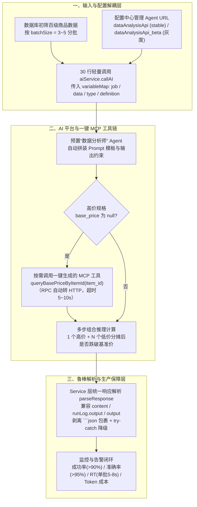

# 用自然语言替代复杂代码

## 1. TL;DR

1. **核心问题**：电商大促“多规格商品（高价规格 ¥600+ 与低价规格 ¥100+）组合购买按件数叠加优惠、按比例分摊后高价规格到手价跌破基准价”的凑单破价资损巡检，传统硬编码需 **150–200 行**多层嵌套循环，新人理解难且每次改公式都要走“改代码 → 测试 → 发布（1–2 天）”。
2. **核心方案（预置 Agent + 参数化填空 + 配置中心灰度）**：将多步组合推理交给 AI 平台的“数据分析师”预置 Agent，业务代码仅需 **30 行**传入 `${job}`（自然语言步骤）、`${data}`（每批 3–5 个商品 JSON）、`${type}` 与 `${definition}`（输出 JSON Schema），Agent URL 由配置中心管理以支持秒级灰度与回滚。
3. **RPC 一键转 MCP 按需补全数据**：针对商品 `base_price`（基准价）常为空的痛点，放弃提前多表 `JOIN` 或手写 JSON Schema，利用接口平台 **“圈选 RPC 接口 → 5 分钟一键生成并注册 MCP 工具”**，让 AI 在检测到 `base_price == null` 时自主调用 `queryBasePriceByItemId` 补齐数据。
4. **工程鲁棒性与批量策略**：采用 **数据库初筛百级数据 + 每批 3–5 个分批并发（单批 5–8s，总耗时分钟级）** 控制单次上下文与失败爆炸半径；Service 层统一剥离 Markdown 代码块并兼容多版本响应字段。
5. **量化业务收益**：开发周期从 **3–5 天缩短至 1–2 天（提效 5 倍）**，规则调整从 **1–2 天降至 1–2 小时（维护成本降低 10 倍）**，代码量减少 **75%（150 行 $\to$ 30 行）**，线上巡检成功率 **90%+**、抽查准确率 **95%+**，人力节省 **90%+**。

## 2. 问题定义与背景

### 2.1 业务痛点：多 SKU 凑单分摊破价资损检测

在每件减固定金额的促销活动中，若同一商品下包含高价规格（如 `¥600+`）与低价规格（如 `¥100+`），用户采用 **“1 个高价规格 + $n$ 个低价规格”** 组合凑单时：
$$\text{totalPrice} = P_{\text{high}} + n \cdot P_{\text{low}}, \quad \text{totalDiscount} = d \cdot (1 + n)$$
$$\text{finalPrice}_{\text{high}} = P_{\text{high}} - \text{totalDiscount} \cdot \frac{P_{\text{high}}}{\text{totalPrice}}$$
当 $\text{finalPrice}_{\text{high}} < \text{basePrice}_{\text{high}}$ 时即触发破价资损风险，需在活动前自动巡检出首次破价件数 `low_sku_num_min`、最小损失 `loss_amount_min` 及最大件数 `low_sku_num_max`、最大损失 `loss_amount_max`。

### 2.2 三种实现路径对比

| 维度 | 传统硬编码方案 | 业务直接裸调 LLM API | AI 平台“预置 Agent + 参数化 + 一键 MCP” |
|---|---|---|---|
| **代码规模与复杂度** | 150–200 行多层循环嵌套 + 边界处理 | 需自行调优 `model/temperature/max_tokens` 与长 Prompt | 仅 **30 行**调用代码，把复杂逻辑变为“填空题” |
| **缺失数据补全** | 需提前多表 `JOIN` 或在循环内写 RPC 调用 | 需手写 JSON Schema、手动封装 HTTP 与参数映射（半天起步） | 接口平台圈选 RPC **5 分钟一键生成 MCP**，AI 按需调用 |
| **规则变更迭代** | 改代码 + 测试 + 发布（**1–2 天**） | Prompt 写死在代码里，仍需改代码发布 | 改 `job` 描述或配置中心切换 Agent URL（**1–2 小时，秒级回滚**） |

## 3. 知识框架



## 4. 核心内容拆解

### 4.1 预置 Agent 参数化调用与四要素契约

业务系统不再直接管理底层大模型超参与系统提示词，而是通过 `variableMap` 传入四个结构化槽位：
1. **`${job}`（分析任务自然语言步骤）**：
   - 步骤 1：筛选有效规格（`sellable_quantity > 0` 且 `sku_status === '正常'`）。
   - 步骤 2：找出 `page_price` 最高价与最低价规格。
   - 步骤 3：获取高价规格基准价 `base_price`（若为 `null` 则调用 MCP 工具 `queryBasePriceByItemId`）。
   - 步骤 4：循环计算 `1 个高价 + N 个低价`（$1 \le N \le \text{lowSku.sellable\_quantity}$）组合分摊优惠后的高价规格到手价。
   - 步骤 5–6：判断是否低于基准价，记录首次风险件数/最小损失与最大风险件数/最大损失。
2. **`${data}`（当前批次待分析商品 JSON）**：每批控制在 **3–5 个商品**（避免单批过大引发 LLM 漏算或上下文截断，单批失败不影响全局）。
3. **`${type}` 与 `${definition}`（输出结构契约）**：指定 `'JSON'` 及字段级 Schema（`has_risk`、`item_id`、`high_sku_id`、`low_sku_id`、`low_sku_num_min`、`loss_amount_min`、`low_sku_num_max`、`loss_amount_max`）。

### 4.2 接口平台“RPC 一键转 MCP”机制

传统手动注册 MCP 需手写 JSON Schema、手动把内部 RPC 包装为 HTTP、手动维护参数映射且缺少监控（耗时半天起步）。平台化三步曲将接入压缩至 **5 分钟**：
1. **抓取 RPC 接口**：平台底层自动将内部 RPC 接口转换为 HTTP 接口。
2. **圈选接口一键生成**：在平台圈选目标接口点击“一键生成 MCP”，自动生成 Schema 并注册至 Agent 工具箱（同时向 Cursor、Windsurf 等 AI IDE 开放）。
3. **运行时按需触发**：AI 发现输入 JSON 中 `base_price: null` 时，自动读取 `queryBasePriceByItemId` 定义并传入必填 `item_id`，拿到 `{ base_price: 380 }` 后继续后续分摊计算（工程上建议设置 **5–10 秒** 超时防止卡死）。

### 4.3 生产级工程护栏：响应兼容、配置灰度与适用边界

1. **多版本响应格式鲁棒解析（`parseResponse`）**：
   - 不同版本 Agent 返回结构可能落在 `response.data?.content`、`response.data?.runLog?.output` 或 `response.output`。
   - 在 Service 层统一提取文本、用正则剥离 ```` ```json ```` 代码块包裹，并用 `try { return JSON.parse(output); } catch (e) { return {}; }` 兜底降级。
2. **配置中心灰度与秒级回滚**：
   - 在配置中心并列维护 `dataAnalysisApi`（稳定版）与 `dataAnalysisApi_beta`（灰度版），按 `shouldUseBeta(userId)` 比例分流；线上异常时直接改配置切回旧版，无需重发代码。
3. **何时该用 AI 替代代码（四条量化判据）**：
   - **适合场景**：传统代码行数 **$> 100$ 行**、业务规则变化频率 **$> 2\text{ 次/月}$**、需多步推理组合计算、数据源分散需通过 MCP 动态补齐。
   - **不适合场景**：**毫秒级强实时响应**、简单 `if-else` 阈值判断、高频调用且极端成本敏感、要求 **100% 绝对精确（如金融核心核算）** 的场景。

## 5. 数据速查表

| 对比维度 / 指标 | 传统硬编码 / 手动方案 | 本文 AI 平台方案 | 备注与上下文条件 |
|---|---|---|---|
| **开发周期** | 3–5 天 | **1–2 天** | 开发效率提升约 **5 倍**（如 5 天 $\to$ 1 天） |
| **业务侧代码量** | 150–200 行（多层嵌套循环） | **30 行**（参数化调用代码） | 代码量减少 **75%** |
| **规则变更耗时** | 1–2 天（改代码+测试+发布） | **1–2 小时**（改参数+配置切换） | 维护成本降低 **10 倍** |
| **MCP 工具接入耗时** | 半天起步（手写 Schema + RPC 包装） | **5 分钟**（平台圈选 RPC 一键生成） | 建议设置 MCP 工具超时 **5–10 秒** |
| **百级数据巡检分批与耗时** | 人工排查需数人 × 数天 | **每批 3–5 个商品，单批 5–8 秒，总耗时分钟级** | 人力成本节省 **90%+** |
| **线上运行成功率与准确率** | — | **成功率 90%+，抽查准确率 95%+** | 数据库初筛百级商品后分十余批执行 |
| **AI 替代代码准入阈值** | 代码 $\le 100$ 行或强实时/金融核算用代码 | **代码 $> 100$ 行、规则变更 $> 2\text{ 次/月}$** | 适合活动前巡检、舆情归类等非毫秒级分析 |

## 6. 踩坑与教训 / 可迁移的设计原则

| 错误做法 | 失败表现或原因 | 原文应对（可迁移的设计原则） |
|---|---|---|
| **一次把几百个商品全塞进单次 AI 请求** | 超出上下文限制、单次耗时过长，且模型在长列表中极易漏算或算错 | **数据库初筛 + 小批次切分（`batchSize = 3~5`）**：单批耗时控制在 5–8 秒，单批失败不影响全局 |
| **将 Agent URL 和 Prompt 硬编码在业务代码中** | 每次微调提示词或切换模型版本都要走完整代码发布流程 | **预置 Agent 参数化 + 配置中心管理 URL**：支持 `stable / beta` 按比例灰度与秒级无感回滚 |
| **`job` 参数写得过于简略（如“提取标题”）或大段啰嗦无格式约束** | 模型理解偏差、输出字段缺失或格式漂移 | **步骤化数字指令 + 显式 `definition` Schema**：小样本迭代打磨并沉淀典型测试集 |
| **直接对 AI 返回字符串做裸 `JSON.parse()`** | 不同版本 Agent 字段路径不同或带有 ```` ```json ```` 标记导致解析抛错中断 | **Service 层统一防腐解析**：兼容多候选字段路径、正则清洗代码块包裹并加 `try-catch` 降级 |
| **在毫秒级核心交易链路或 100% 金融核算场景强行用自然语言替代代码** | LLM 存在秒级延迟（单批 5–8s）与约 5% 概率误差 | **严守能力边界**：仅在规则多变（$>2\text{次/月}$）、代码复杂（$>100\text{行}$）、容许分钟级离在线巡检的场景替代硬编码 |

## 7. 记忆锚点

- **填空式 AI 接入公式**：「**30 行调用 = 预置 Agent + 四槽位填空（`job / data / type / definition`）+ 5 分钟 RPC 一键转 MCP + 配置中心灰度**」。
- **场景准入四问**：「**代码超百行？月改超两次？多步组合算？非毫秒金融？——四条皆是再用自然语言替代码**」。

## 8. 复习卡片

多规格商品凑单破价资损风险的计算逻辑是什么？::当商品同时存在高价规格（如 600 元）与低价规格（如 100 元）且活动按件数叠加固定优惠时，用户买“1 高 + N 低”并按售价比例分摊优惠后，高价规格实际到手价可能跌破其基准价（base_price）。
业务系统直接调用底层 LLM API 面临哪三大痛点？AI 平台如何解决？::三大痛点是底层参数复杂、高质量 Prompt 难写、Prompt 写死在代码里难维护；AI 平台通过“预置专业 Agent + 参数化填空（job/data/type/definition）+ 配置中心管理 Agent URL”解决。
为什么批量巡检时每批只传 3–5 个商品（batchSize = 3~5）？::因为单批数据过大容易导致 LLM 漏算、算错或超出上下文限制；控制在 3–5 个可将单批耗时稳定在 5–8 秒、准确率达 95%+，且单批失败不影响全局并控制单次 Token 消耗。
当待检测商品数据中的 base_price（基准价）为空时，新旧方案分别如何处理？::传统方案需在数据库提前多表 JOIN 或在代码里手写 RPC 调用；新方案利用接口平台将内部 RPC 接口 5 分钟一键生成并注册为 MCP 工具（queryBasePriceByItemId），由 AI 按需自主调用补齐。
在 Service 层解析 AI 平台返回结果时，为什么要做专门的兼容封装？::因为不同版本 Agent 的输出可能位于 data.content、data.runLog.output 或 output 字段，且常被 ```json 代码块包裹，需统一提取、清洗标签并用 try-catch 兜底 JSON.parse。
判断一个业务规则场景是否适合“用自然语言替代复杂代码”的四条量化标准是什么？::① 传统代码行数 > 100 行；② 规则每月变化 > 2 次；③ 需要多步推理与组合计算；④ 非毫秒级实时响应且非 100% 零容错金融核算场景。

## 9. 知识关联

- **本库主题索引**：[AI研发协同](../../20_topics/AI研发协同.md)、[Skill设计与治理](../../20_topics/Skill设计与治理.md)、[决策知识结构化](../../20_topics/决策知识结构化.md)、[Prompt优化](../../20_topics/Prompt优化.md)
- **本库关联文章**：[AI工作流交易舆情巡检+26.3.6](../AI工作流交易舆情巡检+26.3.6/AI_AI工作流交易舆情巡检.md)、[Ontology决策结构化+26.9.27](../Ontology决策结构化+26.9.27/AI_Ontology决策结构化.md)
- **候选双链**：[[自然语言编程]]、[[RPC转MCP]]、[[凑单破价风控]]、[[Agent灰度发布]]

## 10. 原文参考资料

- **原文信息**：《用自然语言替代复杂代码》，作者：影子（淘天集团-天猫技术团队），发布日期：2026-03-13。
- **文内提及协议与工具**：MCP (Model Context Protocol)、Cursor、Windsurf。

> [!note]- 校对报告
> - **页码溯源汇总**：
>   - `## 1. TL;DR` & `## 2. 问题定义与背景`：源自 p.1–3（多规格商品 ¥600+ / ¥100+ 凑单分摊破价场景、`checkPriceRisk` 150–200 行伪代码、裸调 LLM API 三大痛点与 AI 平台填空模式）。
>   - `## 4.1 预置 Agent 参数化调用`：源自 p.3–6（`${job}` / `${data}` / `${type}` / `${definition}` 四参数契约、`batchSize = 3`～`5` 分批策略）。
>   - `## 4.2 RPC 一键转 MCP`：源自 p.7–9（`base_price: null` 按需补全、手动注册半天 vs 平台一键生成 5 分钟对比表、超时建议 5–10 秒）。
>   - `## 4.3 生产级工程护栏与量化收益`：源自 p.9–14（开发周期 3–5 天 $\to$ 1–2 天提效 5 倍、代码量 150–200 行 $\to$ 30 行减少 75%、维护成本 1–2 天 $\to$ 1–2 小时降低 10 倍、单批 5–8 秒、成功率 90%+、准确率 95%+、人力节省 90%+、`parseResponse` 兼容解析、代码 $>100$ 行且月变 $>2$ 次准入判据）。
> - **关键数值核对**：`¥600+` / `¥100+`（p.1）、`150-200` 行 $\to$ `30` 行 / `-75%`（p.2, 9, 13）、`3-5` 个/批（p.6, 9）、`5` 分钟 vs 半天（p.8–9）、超时 `5-10` 秒（p.9）、`3-5` 天 $\to$ `1-2` 天 / `5` 倍（p.9, 13）、`1-2` 天 $\to$ `1-2` 小时 / `10` 倍（p.9, 13）、单批 `5-8` 秒 / 成功率 `90%+` / 准确率 `95%+` / 人力节省 `90%+`（p.10）、`>100` 行 / `>2` 次/月（p.13）全部核对一致。
> - **材料质量说明**：全文代码与架构树均为文本层可提取内容（仅 p.14 含团队宣传尾图）；无独立长篇系统 Prompt 需额外拆出单文件。
