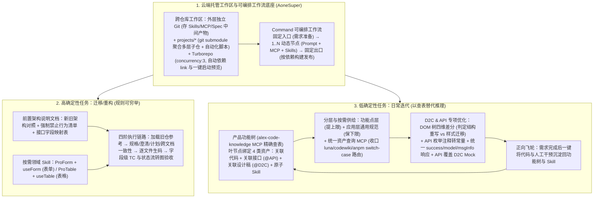

# 淘天营销中后台生码工作流最佳实践

## 1. TL;DR

1. **统一收敛至云端托管生码（AoneSuper）**：放弃“简单需求走云端 Alex、复杂需求走本地 IDE”的割裂双轨制以及高维护成本的自建 LangGraph 多 Agent 基建，全面收敛至 **AoneSuper 云端沙箱**（常规场景全云端闭环，复杂强干预场景支持本地 IDE 直连远程沙箱），彻底解决本地环境差异排查难、生态用工明文 AK 管控风险与电脑息屏断网中断长任务三大痛点。
2. **跨仓库工作区（`git submodule + turborepo`）与 Command 可编排工作流**：通过外层独立 Git 工作区存放 Agent 配置与 Spec 中间产物，并用 `git submodule` 软链聚合多层依赖仓库（业务仓 $\leftarrow$ 业务组件仓 $\leftarrow$ 基础组件仓），结合 **Turborepo**（`workspaces: ["projects/*"]`）实现一键启动与免手动 `npm link` 实时联调；以 CodeAgent CLI 的 **Command（Prompt + MCP + Skills）** 串联“固定入口（需求准备）$\rightarrow$ 动态节点（1–N 个场景定制）$\rightarrow$ 固定出口（按依赖顺序构建部署）”。
3. **高确定性任务（迁移/重构） vs 低确定性任务（日常迭代）差异化策略**：
   - **迁移/重构（规则可穷举）**：采用“**前置架构说明文档（新旧对照 + 禁止行为清单 + 接口字段映射表）+ 按需加载领域 Skill（`ProForm` / `ProTable`）**”，在商家营销工具 N 合一迁移（赠品重构）中实现**功能点完成率 `66.7%`、TC 通过+部分通过率 `79.1%`、效率提升 `58.13%`**；在营销资金设置端 21 个页面迁移中实现**功能完成率 `71.43%`、TC 通过率 `100%`、整体迁移时间降低 `62.73%`**。
   - **日常迭代（需求不可穷举）**：摒弃导致信息过载与多源冲突的大而全文档，首创**「产品功能树」（以查表替代推理）+ 分层研发指引（功能点层提上限、应用层保下限）+ 统一资产查询 MCP**，使功能树覆盖点的生码完成度从 **`40%–50%` 跃升至 `80%–90%`**（10+ 需求平均采纳率 `> 50%`，部分达 `80%+`）。
4. **D2C DOM 树差分、API 结构化对齐与功能树自动沉淀飞轮**：对 `@D2C` 执行“提取新旧 DOM 层级树 $\rightarrow$ 逐层对比输出删/增/移/布局差异清单 $\rightarrow$ 判定结构重写 vs 样式迁移”；对 `@API` 自动解析枚举注释转常量并以 API `response` 为准覆盖 D2C Mock 字段；每次迭代完成后一键将新增代码与人工纠偏回流至功能树与 Skill。

## 2. 问题定义与背景

### 2.1 为什么放弃“本地 AI 辅助”并停止自建 LangGraph？

营销中后台在 FY26 S1 曾采取简单需求走云端、复杂需求走本地 Cursor/CLI 的双路径，且早期自建了基于 LangGraph 的多 Agent 架构，但在规模化推广中遭遇四大瓶颈：
1. **本地环境碎片化与排障高成本**：Node 版本、系统环境、网络代理差异导致同一套插件/MCP 频繁报错，往往只能“到工位上看一眼”。
2. **生态用工（外包）AK 安全隐患**：本地研发需在个人设备明文存储 AccessKey（AK），缺乏分发、轮换与回收管控。
3. **本地长任务极易因息屏/断网中断**：严重拖慢端到端耗时并占用开发者注意力。
4. **自建 LangGraph 边际收益递减**：随着 CodeAgent CLI 原生支持 Skills、MCP、SubAgent，继续自建底层编排框架维护成本高昂；因此团队果断切换至集团 **AoneSuper 云端沙箱**（支持本地 IDE 直连远程沙箱），将精力全面聚焦于业务工程与上下文供给优化。

## 3. 知识框架

## 4. 核心内容拆解

### 4.1 跨仓库工作区（`git submodule + turborepo`）与场景化工作流

1. **为什么用“外层 Git + `git submodule` + Turborepo”管理跨仓协同？**
   - 营销中后台普遍存在“前端业务仓 $\leftarrow$ 业务组件仓 $\leftarrow$ 基础组件仓”的多层依赖及跨仓迁移参考诉求。
   - 若仅建普通空文件夹聚合仓库，Agent 消费的 `Skills / MCP / SubAgent` 配置及 Spec 中间产物（需求理解、方案设计、任务清单）将脱离 Git 版本控制；因此将外层文件夹建为独立 Git 工作区，内部 `projects/*` 通过 **`git submodule`** 软链挂载各业务子仓，并编写自动化脚本屏蔽复杂的 `submodule` 命令。
   - 进一步将该结构视为标准 Monorepo，引入 **Turborepo**（配置 `"dependsOn": ["^build"]`、`"concurrency": 3` 及 `"start:workspace"`），彻底告别繁琐易失效的手动 `npm link`，实现修改底层基础组件后前端业务预览页实时热更新。
2. **基于 CodeAgent CLI Command 的“固定 + 动态”工作流**：
   - **固定入口（需求准备）**：选择多仓库、匹配业务场景（决定动态节点序列）并填入场景模板。
   - **动态节点（1–N 个，由场景定义）**：每个节点对应一个 `Command`（本质为声明了所需 MCP 如 `aone-km`/`Imgcook D2C` 与垂直 `Skills` 的结构化 Prompt），覆盖 ToB 商家营销工具迭代、ToC POP 弹窗迭代、营销资金设置端迁移、N 合一迁移等场景。
   - **固定出口（构建部署）**：自动解析多仓依赖拓扑，按序执行构建与一键发布。

### 4.2 高确定性任务（迁移/重构） vs 低确定性任务（日常迭代）

1. **高确定性任务（迁移/重构）：前置穷举规则 + 按需挂载 `ProForm`/`ProTable` Skill**：
   - **架构说明文档三大核心要素**：① **新旧架构对照**（如将声明式配置逐一映射为纯源码原子组件，规定组件层仅做渲染、业务逻辑全部内聚至 `hooks` 层）；② **强制禁止行为清单**（如“禁止在组件层写业务逻辑”）；③ **接口字段映射表**。
   - **按需加载领域 Skill**：将 `ProForm + useForm`（解决表单项模式、显隐联动、全局与表单数据隔离）与 `ProTable + useTable`（解决数据查询链路、搜索区与列配置）拆为独立 Skill 按需加载，避免同时灌入造成上下文稀释。
2. **低确定性任务（日常迭代）：从“6+ 步长链推理”到“产品功能树一次查表”**：
   - **早期踩坑**：照搬迁移场景的“大而全架构规范 + 多领域 Skills + CodeBase 搜索”导致**信息过载、多源规则冲突（如 Formily 用法描述不一致）及 6+ 步链路误差指数级放大**。
   - **核心破局 —— 产品功能树（`alex-code-knowledge` MCP）**：将业务应用（如“优惠券 $\rightarrow$ 首页/券管理列表 $\rightarrow$ 筛选表单/单元格展示/列表操作”）预先梳理为树状结构，每个**叶节点显式绑定 4 类资产**：
     1. **关联代码**：精确文件路径 + 文件职责概要；
     2. **关联接口（`@API`）**：接口路径、方法、出入参定义；
     3. **关联设计稿（`@D2C`）**：设计稿 ID + 截图；
     4. **关联原子 Skill**：如新增表单项、表单校验的具体规范。
   - **提上限与保下限分层 + 确定性路由交还工程**：匹配到功能树节点时直接返回精确指引（**提上限**），未匹配到的新功能由应用层通用规范兜底（**保下限**）；针对组件 Props 查询，放弃让 Agent 在 Skill 里自己跑 `switch-case` 决定调 `luna`/`codewiki`/`anpm`（Agent 常选错接口，如同“让米其林主厨去翻纸质台账核对配料编号”），改为**封装统一的“营销中后台资产查询 MCP”，把确定性的 `switch-case` 路由收口到工程代码**。

### 4.3 `@D2C` 与 `@API` 协同还原优化

1. **D2C 四步 DOM 层级树差分策略（解决“样式迁移 vs 结构重写”盲猜）**：
   - ① 提取 Imgcook D2C 产物的 DOM 层级树（标注 Flex 方向、嵌套层级、元素顺序）；
   - ② 若项目中已存在对应组件，同步绘制存量组件 DOM 层级树并逐层对比；
   - ③ 输出包含**【删除】、【新增】、【移动】、【布局变更】**的差异清单；
   - ④ **决策准则**：差异涉及布局重构 $\rightarrow$ **结构重写**；差异仅为样式数值 $\rightarrow$ **样式迁移**。
2. **`@API` 三步结构化处理与 `@D2C + @API` 联合对齐**：
   - 解析 JSON 字符串生成请求 `interface` 与响应 `VO`，**自动提取响应注释中的状态枚举（如 `1-草稿, 2-审核中, 3-生效`）转化为状态映射常量**而非硬编码数字；
   - 对齐统一响应包结构（检查 `success`、提取 `model` 业务数据与分页字段 `curPage/pageSize/totalCount`、展示 `msgInfo` 错误提示），并在后端接口未就绪时自动生成带真实调用注释的内部 Mock；
   - 当需求同时包含 `@D2C` 与 `@API` 时，并行调用两个 MCP，**强制以 `@API` 的 `response` 为准定义 VO 类型，并将 D2C Mock 字段映射至真实 API 字段**，严防 D2C 假数据结构混入生产代码。

## 5. 数据速查表

| 业务场景 / 评估维度 | 关键量化指标 | 核心技术驱动力 |
| :--- | :--- | :--- |
| **商家营销工具 N 合一迁移（赠品重构）** | 功能点完成率 **`66.7%`**，TC 通过+部分通过率 **`79.1%`**，**提效 `58.13%`** | 前置架构说明文档 + `ProForm`/`ProTable` Skill + 四阶工作流 |
| **营销资金设置端迁移（21 个页面）** | 功能完成率 **`71.43%`**，TC 通过率 **`100%`**，**迁移耗时降低 `62.73%`** | 主要由外包同学在 AoneSuper 云端工作流下完成 |
| **日常迭代功能树覆盖节点生码完成度** | 从 **`40%–50%` 提升至 `80%–90%`** | `alex-code-knowledge` 产品功能树将 6+ 步推理压缩为 1 次查表 |
| **日常迭代 AI 生码采纳率（10+ 需求）** | 平均采纳率 **`> 50%`**，部分需求类型达 **`80%+`** | 功能树四维资产绑定 + D2C DOM 树差分 + API 结构化对齐 + 自动回流飞轮 |

## 6. 踩坑与教训 / 可迁移的设计原则

1. **给恰好够用的精确知识，而非大而全的抽象文档（以“功能树查表”替代“长链搜码推理”）**：在存量复杂应用中做日常迭代，把整本架构规范和全量 Skills 塞给 Agent 只会导致信息过载与多源规则打架；建立“产品功能树”将叶节点直接绑定到具体文件路径、接口 ID、设计稿 ID 与原子 Skill，生码完成度可立竿见影从 40%–50% 翻倍至 80%–90%。
2. **确定性逻辑交还工程，不确定性决策留给 Agent（米其林主厨隐喻）**：不要在 Skill 里用自然语言写复杂的 `if-else / switch-case` 让大模型去判断该调 `luna`、`codewiki` 还是 `anpm` 接口；凡是可枚举的路由、字段映射与格式转换，一律下沉封装为确定性的工程 MCP。
3. **存量组件接入 D2C 必须先做“新旧 DOM 层级树 Diff”再定策略**：拿到 D2C 代码直接覆盖会破坏存量业务状态，盲目局部改样式又无法应对布局调整；先对比新旧 DOM 树输出【删/增/移/布局变更】清单，再决定“结构重写”还是“样式迁移”。

## 7. 记忆锚点

- **一套跨仓云端底座**：**AoneSuper 云端沙箱** + **外层独立 Git 工作区** + **`git submodule` 聚合子仓** + **Turborepo 实时联调**。
- **两类任务差异化打法**：高确定性迁移重构用**“前置穷举架构说明 + `ProForm/ProTable` Skill”**（提效 `58%–62%`）；低确定性日常迭代用**“产品功能树四维查表 + 分层指引 + 统一资产查询 MCP”**（完成度 `40%–50% → 80%–90%`）。
- **三条黄金工程法则**：给恰好够用的精确知识 + 确定性逻辑交还工程 + 每次迭代自动回流功能树形成正向飞轮。

## 8. 复习卡片

1. 营销中后台为什么要放弃“本地 AI 辅助研发”和“自建 LangGraph”，全面收敛至基于 AoneSuper 的云端托管生码？::本地研发存在环境差异排查成本高、生态用工明文存储 AK 安全管控难、以及电脑息屏或断网导致长任务频繁中断三大痛点；同时随着 CodeAgent CLI 原生支持 Skills/MCP/SubAgent，自建 LangGraph 边际收益递减，接入 AoneSuper 可支持云端全流程与本地 IDE 直连远程沙箱。
2. 团队是如何利用 `git submodule` 和 `turborepo` 解决跨仓库（业务仓 $\leftarrow$ 业务组件仓 $\leftarrow$ 基础组件仓）AI 研发与实时联调难题的？::将外层文件夹建为独立 Git 仓库存放 Agent 配置（Skills/MCP）和 Spec 中间产物，内部 `projects/*` 用 `git submodule` 软链聚合各业务子仓并配自动化脚本；再利用 `turborepo` 将其作为 Monorepo 管理，自动建立子仓间依赖 Link 并一键启动实时预览。
3. 为什么“大而全架构文档 + 领域 Skills”在迁移/重构场景有效，但在日常迭代场景却导致效果大幅下滑？::迁移重构规则可前置穷举（新旧写法固定对照）；而日常迭代改动跨模块且不可穷举，灌入大而全文档会导致上下文信息过载、多知识源规则冲突（如 Formily 用法打架）、以及 6+ 步检索推理链路的误差指数级放大。
4. 什么是“产品功能树”？它的每个叶节点绑定了哪四类资产？取得了什么量化效果？::产品功能树将应用功能预先整理为树状结构，在生码前通过 `alex-code-knowledge` MCP 将“理解架构→搜代码→推方案”压缩为一次精确查表；每个叶节点绑定关联代码（路径+职责）、关联接口（`@API`）、关联设计稿（`@D2C`）和关联原子 Skill，使覆盖点的生码完成度从 40%–50% 提升至 80%–90%。
5. 为什么团队将“资产使用指引 Skill”改造为了“统一的营销中后台资产查询 MCP”？::因为原 Skill 让 Agent 自行根据 npm 包类型做 `switch-case` 路由选择调用 `luna`、`codewiki` 或 `anpm` 接口，Agent 指令遵循度差常选错接口；将确定性的 `switch-case` 路由逻辑下沉收口到工程 MCP 中，践行了“确定性逻辑交还工程，不确定性决策留给 Agent”。
6. 在日常迭代中，当同时引入 `@D2C`（设计稿）和 `@API`（接口）时，Agent 如何决策 UI 实现策略并避免 Mock 数据污染？::针对 `@D2C`，先提取新旧组件的 DOM 层级树逐层对比【删除/新增/移动/布局变更】，涉及布局重构则“结构重写”、仅数值差异则“样式迁移”；针对 `@API`，将注释中的枚举转为常量，并强制以 API 的 `response` 为准定义 VO 类型、将 D2C Mock 字段映射至真实 API 字段。

## 9. 知识关联

- **所属主题**：
  - [AI研发协同](../../20_topics/AI研发协同.md)
  - [Skill设计与治理](../../20_topics/Skill设计与治理.md)
  - [Harness与模型协同](../../20_topics/Harness与模型协同.md)
  - [Agent成本与上下文预算](../../20_topics/Agent成本与上下文预算.md)
- **本地跃迁**：[原始 PDF](RAW.pdf) · [逐页转写文本](MD.md)
- **候选双链**：[[天猫新品AI编码实战指南上]] · [[天猫新品AI编码实战指南下]] · [[场景营销前端AI Coding方案]] · [[企业购面向Skills编程]] · [[淘系交易Spec范式编程]]

## 10. 原文参考资料

1. **云端沙箱与研发基建**：阿里内部 `AoneSuper` 云端生码沙箱、`Alex` 平台、`aone-km`、`alex-code-knowledge` MCP、`Imgcook D2C` MCP、`luna` 资产中心、`CodeWiki`、`anpm`
2. **前端工程与组件体系**：`git submodule`、`Turborepo` (`https://turbo.build/schema.json`)、`ProForm + useForm`、`ProTable + useTable`、`Formily`、`spec-kit`

> [!note]- 校对报告
> - **页码溯源**：p.1–3（S1 双路径痛点、本地研发环境差异/生态用工 AK 管控/息屏中断三大问题、放弃自建 LangGraph 转向 AoneSuper 云端托管 + 本地 IDE 直连沙箱）；p.4–8（跨仓库工作区设计：外层独立 Git + `git submodule` 软链 + 自动化脚本 + `turborepo` 配置实现自动 link 与一键启动）；p.8–10（受 spec-kit 启发的可编排场景化工作流：固定入口需求准备 → 1~N 个动态 Command 节点 → 固定出口按依赖构建部署，及四大 ToB/ToC 落地工作流示例）；p.11–14（高确定性迁移/重构策略：前置架构说明文档、禁止行为清单、接口映射、`ProForm`/`ProTable` Skill、四阶段执行链路；N 合一赠品重构完成率 66.7%/TC 79.1%/提效 58.13%，资金设置端 21 页面完成率 71.43%/TC 100%/耗时降低 62.73%）；p.14–20（低确定性日常迭代策略：信息过载/多源冲突/6+ 步衰减痛点、产品功能树四类资产绑定与 `alex-code-knowledge` 查表、功能点层+应用层分层、米其林主厨比喻与统一资产查询 MCP、D2C 四步 DOM 树差分、API 枚举常量与 VO 映射、功能树自动沉淀飞轮使完成度从 40%–50% 升至 80%–90%）。
> - **一致性核验**：作者（棣棠，淘天集团-营销前台技术团队）、发布时间（2026-04-27）、全部量化指标、JSON 配置与方法论总结均逐页核对一致；正文中无任何内联页码引用。
> - **质量边界**：全文结构清晰，核心配置与树状图均在 PDF 文本层完整呈现。
