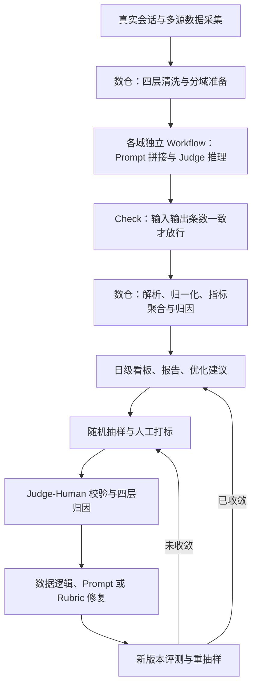
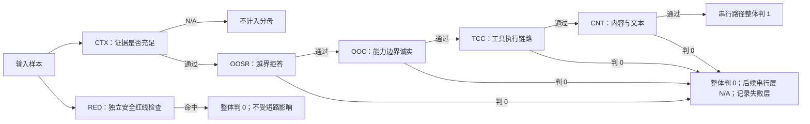

# 淘宝AI购物助手在线评测落地实践

## 1. TL;DR

淘宝购物助手的购后服务涉及路由、工具和回复等多个环节，离线回归与业务 AB 指标无法持续回答线上回复究竟错在哪里，因此本文以逐轮 LLM-as-a-Judge 构建日级执行成功率观测。方案把数据清洗与结果聚合放在数仓，把各域推理拆成独立 Workflow，并以统一的 CNT 六层漏斗加分域子项明确判定、短路、剔除及安全检查规则。Judge 的可信度主要通过事实锚定、时间锚点、跨轮信息隔离，以及人工打标驱动的数据、Prompt、Rubric 校准来提高；通过率变高不能直接解释成 Agent 变好。真正的业务优化来自失败归因和修复前后可复跑的检测规则，目前修复仍依赖人工排期，坏样本自动进入训练链路与系统性偏差治理尚未完成。

原始材料：[RAW.pdf](RAW.pdf)；逐页转写：[MD.md](MD.md)；身份与处理记录：[META.json](META.json)。本笔记的页码均指 PDF 物理页序。

## 2. 核心概念：先区分“产品质量”与“测量质量”

**LLM-as-a-Judge** 在本文中是给模型会话上下文、工具证据与评测标准，让它输出通过、不通过及理由；它不是自由评价一段回复好不好。对多轮会话，评测单元落到每轮对话，判断当前用户诉求是否被有效推进，再按域汇总。**Rubric** 是 Judge 必须遵循的判定标准，包含各层职责、判分边界、域特异子项和证据限制。标准不清晰，即使输出格式稳定，分数也不能获得可信含义。

**执行成功率** 是对每条线上 query 的端到端判定：是否正确路由到对应 skill，并且被合理回应。作者给出的关系为：

$$
\text{路由准确率}\times\text{回复正确率}=\text{执行成功率}
$$

原文称之为“三层漏斗”：前两层分别观测路由与回复，执行成功率是综合结果。这里的三层指标与 CNT 六层判定标准承担不同任务，不能按层数合并。原文没有进一步展开各率的完整条件分母公式，笔记保留其原始关系，不补算。

| 概念或机制 | 实际回答的问题 | 不能替代的部分 |
|---|---|---|
| 离线回归 | 构造好的 query、可控工具返回下，版本能否通过上线前检查？ | 真实用户表达、异常工具返回与持续漂移的线上分布 |
| 业务 AB 指标 | 转化率、留存等整体业务表现是否变化？ | 具体哪个域、路由、工具或回复环节出了问题 |
| 日级在线执行成功率 | 真实 query 是否正确路由并合理回应，失败集中在哪里？ | 尚未完成与离线通过率、业务 KPI 的三方对齐验证 |
| Judge-Human 校验 | Judge 与人工对样本的判定是否一致？ | Rubric 本身是否符合产品预期，标准有偏时两者可以一起偏 |

来源：原文第 1–2、原文对应处、原文对应处 页。**Judge-Human 一致性** 在本文中是持续校准的一环，不是一次通过后永久有效的认证。

## 3. 知识框架：一条运行链路，加一个校准回路

按正文整理，保留 原文对应处 的五阶段主线与 原文对应处 的反馈方向；各域 Workflow 并行执行，不画成域间串行依赖。



来源：原文第 3、原文对应处、原文对应处 页；“按正文整理”，未把 原文对应处 架构图中并列的层内职责改成严格执行顺序。Check 的实际放行位置以 原文对应处 流程图和 原文对应处 正文为依据，在推理完成之后。

## 4. 关键要点：在线评测链路与校准机制

### 4.1 业务背景与问题定义：评测要能指导“改哪一环”

### 为什么购后服务需要线上评测

购物助手用自然语言帮助用户查物流、办退款等，本文重点覆盖下单后的购后链路。每条 query 要经过路由决策、skill 执行、工具调用、回复生成，相关系统又包含主框架、意图模型、工具接口和卡片渲染。用户拿到错误回复时，单看最终文本不足以判断是哪一环出错。

离线用例通常经过精心构造，工具返回完整可控；线上用户会模糊表达、带情绪，工具返回可能缺失或异常，分布也会漂移。因此“离线达标”只能说明那组用例下的表现，无法消除线上质量观测需求。AB 指标可以反映业务变化，但其粒度无法直接区分某域路由出错或回复编造信息。作者希望用日级自动观测替代月度、季度人工抽检，让技术团队能够持续看到低在哪个域、哪个环节。

### 学术背景与本文贡献的边界

作者用 MT-Bench、Chatbot Arena、AlpacaEval、Arena-Hard、JudgeLM，以及美团分层 Agent 评测说明已有方法基础；本文的区别在于日均海量、多域异构的生产场景，需要处理脏日志、持续口径迭代、推理成本与按时产出。这里对既有工作的描述属于原文背景引用，并未由本笔记重新核验，也不是本项目实测结果。

“日均百万条会话”出现在业务场景介绍；架构图和工程实测描述的单域评测数据则是数千至数万条/天。两者分别是业务背景与分域链路规模，不能将前者改写成该链路已公开验证每日百万条推理，也不能把图中示意域量相加外推全站覆盖率。

### 4.2 数据清洗与加工：把生产日志变成可消费的证据

### 原始日志的问题不仅是格式脏

线上日志并不是专为评测设计的：query、回复、工具链、卡片素材分散在不同数仓表；主框架没有记录卡片结构化内容，部分域还缺少下单时间、商品标题、金额；工具返回夹带内部生产提示词；用户状态用语又与系统枚举不同。这些问题会分别造成证据不可见、信息被误归属和语义误判。Judge 再强也不能从未记录的数据中获得事实。

原文对应处 架构图给出了多源输入：主框架日志包含 query、回复、`tool_calls` 与会话上下文；意图标签提供购后二、三级意图及离线 T+1 打标；业务数据包含订单、物流、skill 路由表和离线用例参考。多源拼接按域写入 staging，再经过清洗。图中表名、平台名是该团队的实现实例，原文没有交付可在其他环境运行的脚本或访问配置。

### 四层清洗逐一解决不同的误差

**第一层：格式修复要对标数据定义，而不是直接复用离线 Prompt。** 各 skill 卡片协议和字段解析方式独立；离线字段完整并不意味着线上日志也有同样结构。直接套用离线 Prompt 会出现大量空解析。做法是逐域修复解析、补齐字段映射，并处理超长文本。某域卡片常达数千字，拼接后导致上下文超长、推理超时或输出空值，需要合理截断。这里截断是工程处理，但后续 case 归因又明确指出截断可能损失关键信息，所以不能把截断写成无损清洗。

**第二层：语义对齐把用户表达和系统含义的关系写清。** 原文以“已揽收”、系统英文枚举及“已发货”为例，说明字面不同和业务含义不同需要根据实际状态映射处理。做法是在 Prompt 中显式建立映射，减少 Judge 因不理解状态关系而判错。文章没有提供完整状态映射表，因此不能据这段例子自行建立三个词之间的通用等价规则。

**第三层：屏蔽干扰信号，保留工具参数与返回。** `tool_calls_json` 会透传系统指令、开发注释等生产链路提示词，这些并非 Agent 的回复，却可能被 Judge 当成它输出了无关内容。团队用正则剔除内部提示词，只保留实际工具调用参数和返回值；作者报告这一处理对所有域生效，准确率均有明显提升，但没有公布精确提升幅度。关键在于纠正证据归属，而不是简单缩短文本。

**第四层：过滤精化决定哪些 query 应进入当前域的评测。** 早期入口太宽，咨询政策、没有真正发起操作甚至无关的 query 都被纳入某流程类域，使通过率极低。团队增加基于 skill 标识的精确过滤后，数据才更可信，并进一步暴露出 Prompt 不适配线上数据的问题。清洗和入口口径可以改变通过率；变化首先需要解释“测量对象改了什么”，不能直接判断产品能力变化。

四层不是一次设计完成的理想分层，而是随着各域落地不断暴露、定位、修复之后沉淀的工程结构。原文对应处 原图从多源异构字段出发，依次经过逐域字段映射、卡片协议适配、超长文本截断；用户表达经状态映射到系统语义；工具链经过提示词剔除；宽泛过滤收紧成 skill 精确匹配，最后形成域内纯净数据。这个顺序强调：数据完整性、含义与样本归属共同构成 Judge 输入质量。

### 4.3 平台使用与工作流设计：数仓与推理平台解耦

### 解耦的是责任，保留的是可追溯性

作者把预处理和后处理放在数仓 SQL：多源拼接、清洗、过滤、解析、标签归一化、指标聚合；推理平台只负责 Prompt 拼接、模型调用和结构化结果。这样推理 Workflow 保持轻量，数据逻辑可以复用、追溯和单独调试。文章概括其收益为“改 Prompt 不需要改数据逻辑，改过滤规则不需要重跑推理”。后一句是该架构的迭代收益描述，不代表任何改变都能跳过推理；原文没有给出新增输入样本时如何复用结果的完整条件。

最初考虑一个大 Workflow 跑全域，但最慢域会拖住其他域，单域失败会阻塞全链路，改一个域的 Prompt 还要重跑所有域。最终各域独立配置队列、并发度和重试策略，避免故障和迭代耦合。原文报告单域单分区数千至数万条，LLM 运行时间为 2–3h；资源竞争、回刷和高峰排队可能使耗时成倍延长，因此采用错峰调度并为关键域申请独占资源。

### Check 节点是指标计算的放行条件

🔥 推理完成后先比较 `input` 表与 `output` 表条数，只有一致才进入结果解析。公共池高峰可能超时丢数据，回刷又可能把数据重复追加；不校验就直接聚合，会让输入输出不完整或重复的结果进入指标。原文对应处 图中的不一致分支进入告警与阻断，明确提示没有 Check 时下游通过率会算错。

本文公开的是“条数一致”的 Check，并没有展示按唯一标识逐条对账的实现。保持这一验证边界，不能把它转述成已经完成所有样本的一对一完整性校验。

### 两个会静默污染数据的工程坑

**上下文超长可能没有显式报错。** 多轮对话加完整 `tool_calls` 会使 token 数超窗，平台可能静默返回空结果。团队在数据准备阶段预检 token，超长时截断或摘要。原文未提供上下文窗口大小、具体阈值和摘要算法，不能补成通用参数配置。

**历史回刷是 append，不是覆盖分区。** 不先清空目标分区，新旧结果会叠加，重复计算并使通过率失真。作者的操作约束是先清空目标分区，再执行推理任务；这是该生产管线的回刷语义，不是要求读者对任何数据表照做。原文没有提供可执行 SQL，也没有交付异常恢复脚本。

### 4.4 模型选型：先校准效果天花板，再规划小 Judge

### 判定任务需要遵循规则和复杂推理

当前团队选择指令遵循能力强、结构化输出好、支持长上下文的大模型。Judge 的任务是基于 Rubric 分类与给理由，并不以创造性生成为目标。较轻模型在多条件组合、模糊 query 或部分正确的边界 case、跨轮整体逻辑上明显落后；因此作者认为难点在“按照规则做复杂判断”。

第一阶段已经完成：大模型加 Prompt 工程验证效果上限，并通过多轮打标使各域结果与人工一致性达到作者认为可接受的水平。这一过程同时提供后续小模型的对齐目标与标注来源。第二阶段仍是规划：用沉淀的人标样本构建 SFT 训练集，微调垂直小模型。团队内部另一个方向已有蒸馏先例，RT 下降、目标准确率接近大模型，但不能把该先例写成本在线评测系统已完成小模型替代。原文没有披露该先例的模型规模、RT 数值或准确率。

原文对应处 架构图的推理层标签为 `Qwen3.7-max T=0.1`，并写有“7 独立 Workflow”；正文选型段则不直接写模型名，称一款指令遵循强的大模型。图中名称是材料记录，不是本笔记对该模型现行能力或版本有效性的外部验证。

### Temperature 是项目实验结论

团队做了梯度实验后设为 `temperature = 0.1`，目标是保持同输入判定一致，又保留极少随机性。作者观察到温度高时同 case 多次结果不一致，温度为 0 偶发输出“僵死”。原文没有公开梯度范围、重复次数和稳定性统计，因此 0.1 只能作为该项目经验参数，不能提升为所有 Judge 的默认值，也不意味着完全确定性。

### 4.5 Rubric 设计：统一漏斗结构，保留分域业务标准

### 六层框架各自判什么

初期不同团队的规则、粒度和门禁不同，有的证据不足仍判失败，有的直接跳过，导致跨域通过率口径不可比。重构统一的是功能分层与取值口径；时效、检索、服务规则的内容标准仍然需要各域定义。头部模板 query 可以细化标准，长尾和模糊诉求则需要符合产品边界的底线规则。

| 层 | 判定职责 | 对归因的作用 |
|---|---|---|
| **CTX**：上下文门控 | 证据是否足够评测；不足则整条不可评、不计通过率分母 | 先区分无法判断与真实失败 |
| **OOSR**：越界拒答 | 不该由当前 skill 承接时，是否正确拒答或交回上层 | 定位承接范围处理错误 |
| **OOC**：能力边界诚实 | 属于 skill 范围但超出当前能力时，是否诚实说明而非编造 | 定位能力边界表达错误 |
| **TCC**：工具执行链路 | 工具是否正确、参数是否匹配意图、链路是否自洽 | 定位调用和参数错误 |
| **CNT**：内容与文本 | 回复是否正确、完整、表达合理 | 定位最接近用户感知、域差异最大的内容问题 |
| **RED**：安全红线 | 内部信息外泄、隐私泄露、敏感词、违规引导、编造政策 | 独立安全检查，不被普通层短路跳过 |

原文没有给出这些缩写的英文全称，保留缩写与原文中文职责。

### 短路用于主因定位，RED 独立恒评

常规串行路径为 CTX → OOSR → OOC → TCC → CNT。任一串行层判 0，整体判 0，后续串行层记 N/A，同时记录失败层。这样能说明主要失败发生在哪里，而不让后面的判断覆盖前面的缺陷。RED 从输入样本另开并联分支，即使前面已判 0，仍独立检查安全问题；命中红线也判整体 0。

按 原文对应处 原图复现，简化布局；没有把 RED 接在 CNT 之后，也没有替原图补出 RED 未命中与最终通过节点的汇合逻辑。



> [!important] 三种 N/A 的语义要分开
> CTX 因证据不足使**整条样本不可评并剔除分母**；某层失败后的 N/A 是**后续层未执行**；看不到卡片结构化内容的子项 N/A 是**特定证据不可用**。原文“CTX 是唯一产生 N/A 的层”应结合样本门控语境理解，不能据此删除后两种明确写出的 N/A。

### 域特异子项与产品预期怎样进入框架

每个域有独立前缀和子项码，数量在十几个上下浮动，差异主要集中在 CNT。时效类域看时效是否编造；检索域逐项校验时间、商品、属性、状态、店铺及逻辑组合的召回匹配；服务规则域看规则是否被反向弱化或编造。统一层名让失败分布能按同一骨架观察，子项保留实际业务含义。

**查无结果不自动等于失败。** 有些域增加“空态硬退出”：系统如实返回空态时直接判通过，“查不到”本身就是正确答案。这个通过态退出放在 CTX 的域扩展中，而不是要求 Judge 强行寻找回复里的具体内容。

**同一 query 的正确回答取决于工具返回模式。** 模式 A 有数据，应给具体规则；模式 B 无数据，忠实兜底并引导看详情符合产品预期。Rubric 用返回是否为空明确分模式，模式 B 不因没有具体规则而扣分。若规则仍要求所有回复包含具体说明，Judge 即使忠实执行，也会错误惩罚正常兜底。

**意图码决定走哪条标准。** 某知识问答域有多个二级意图，各自关注要素不同，Rubric 通过意图码变量分流；其中一种“正向场景”意图命中即 CTX 硬退出通过。该例只说明存在这类域规则，原文未公开码值和完整判断条件，不能直接复用到其他意图。

**卡片盲区通过取证边界处理。** 主框架不返回结构化卡片内容，却有子项理论上依赖这些内容；处理方式是该子项留空、恒 N/A，并明确禁止假设能读取、禁止因为看不到就判 0。作者承认这不是理想方案。这里的盲区是生产评测日志的数据限制，不是本文 PDF 的图未加载。

### Rubric 版本化避免文档与 Prompt 分叉

各域 Rubric 是仓库里的 Markdown，包含 YAML 版本元数据和 changelog，记录日期、版本、改动、预估判分影响，某域经历数十次迭代。测试可以 review 和追溯，离线、在线快照同步；在线 Prompt 直接从 Rubric 文件生成，避免标准文档与执行指令各写一套。Rubric 改动影响面大，因此 case 归因确认是标准问题时，必须同步修改 Prompt 和离在线快照。

### 4.6 Prompt 设计：把证据、判定边界和输出位置约束清楚

### 声明字段，逐维度绑定输出

开头定义 `user_query`、`agent_reply`、`tool_calls_json`、`session_context` 等输入含义和格式；输出明确 JSON schema、字段类型、枚举与必填/可选。评分字段只允许 `0/1/剔除`，理由为字符串；多维度 `S1~S6` 分别定义判定标准和输出位置。这样减少字段歧义和把 S1 理由混入 S2 的“串维度”问题。原文没有给完整 JSON schema、维度配置和评测 Prompt，只有设计要求与指令片段。

### 幻觉压制的四项实践各自堵住一个缺口

1. **事实锚定**：只基于输入判断，禁止引入外部知识或假设未提供上下文，避免将模糊 query 补成明确意图。
2. **反向验证**：判定前先摘录输入中的相关 Agent 回复，再用具体证据支持评分，减少对不存在内容的判断。
3. **边界 Few-shot**：为模糊诉求、部分正确等高频误判给 2–3 组标注示例，让模型知道通过与失败的实际分界。
4. **禁止猜测性打分**：信息不足输出“剔除”，避免强制给出 0/1。

下面仅保留原文提供的三个指令片段，**不是完整可直接替换的生产 Prompt**，每个片段只完整出现一次：

```text
仅基于以下输入信息进行判断，不得引入外部知识或假设未提供的上下文

请先摘录Agent 回复中与用户 query 直接相关的原文片段，再据此判断

若输入信息不足以做出判断，请输出'剔除'而非猜测性打分
```

这四项措施约束的是模型使用证据和应用标准的方法；它们不能补足真实缺失的输入，也不能纠正错误 Rubric 本身。

### 时间锚点必须是提问时刻

“明天到达”“3 个工作日到账”“近一年订单”都依赖参考时间，Judge 不能仅凭字面知道当前基准。团队把用户提问的精确时间戳拼入输入，再要求据它评估时间表述；作者报告修复时效类误判与检索时间锚点异常。原文未给时区、工作日计算规则或时间字段名，笔记不补配置，也不把文章发布时间用作会话的时间锚点。

### 分域适配与跨轮隔离是信息范围控制

时效类侧重状态与时效，流程类侧重合规与参数，知识问答侧重知识与完整性；例如同一流程域按提交申请、确认、撤销拆标准，而不是给所有 query 相同要求。Prompt 的业务路径必须与 Rubric 中的意图、模式分流一致。

最初给 Judge 全部历史及工具链，以为上下文越多越充分；某流程域却出现前一轮金额被当成当前轮事实的错误，导致通过率偏低。改成只给当条调用的 `tool_calls` 后通过率显著跃升。作者将原因解释为多轮证据干扰模型注意力，强调精准投喂；该案例验证的是工具证据隔离，不能直接概括成所有评测都应删除全部会话历史。模型选型仍提到理解跨轮整体逻辑的需要，两者要同时保留。

### 解析侧有三层防线

Prompt 格式约束无法完全消除非标输出。团队首先约束结构化格式，然后用输出校验器把非标输出标成解析失败，最后对评分字段做标签归一化，分级处理新旧格式、空值与非标准值，正文提到 `CASE WHEN`。这是解析容错流程，不能将“归一化”解释成所有异常标签都可无条件修复成有效分数。文章也提醒数仓正则反斜杠会被逐层解析，长文本提取规则需要反复调试；没有提供可复制运行的 SQL。

### 4.7 多轮打标优化：让通过率更可信

### 为什么一次人工一致性校验不够

线上没有可直接对照的“真实水位”：离线数据形态不同，人工样本有限且可能有标注偏差，业务指标又不对齐逐轮评测。即使 Judge-Human 一致性很好，Rubric 也可能偏离产品标准；模型、业务变动后原来的校验也可能失效。因此作者的目标是通过多轮打标逼近认知中的真实水位，而不是仅仅提高分数。

原文对应处 原图的回路是：随机抽样打标 → Judge-Human 校验（CI 精度反推样本量）→ 数据/Prompt/Rubric/Agent 四层归因 → 优化并修数据逻辑 → 新版本全量评测 → 重抽样。未收敛回到抽样，已收敛进入日级观测。各域产品、开发、测试与数科协同，标准执行包含外包标注，不能只靠负责 Prompt 的人单独判断。

### 三类域的改善来自不同修复

| 域 | 初期错误机制 | 迭代动作与观察 |
|---|---|---|
| 时效类 | 内部超长提示词被误认成 Agent 无关输出；另有意图边界 case | 清洗后提升；修意图边界后又略降，但原先错误放行被纠正，结果更准确 |
| 流程类 | 前轮工具结果用于判当前轮回复 | 工具链退回当条调用，通过率显著跃升 |
| 知识问答类 | Judge 缺少二级意图与完整路由信息 | 修改 Prompt、补意图码、切换更完整数据源，通过率显著跃升 |

表只给趋势，正文给机制；没有精确通过率，不从“显著”估算百分比。

### 随机抽样与 CI 是观测口径，不是万能样本预算

每轮都与外包人工抽检做一致性校验，采用纯随机 `HASH%` 采样。作者给出 CI 精度反推样本量的经验量级：±1pp 约 4k 样本，±0.5pp 约 15k。波动远超 CI 宽度时应排查 Rubric、模型等实质变化。原文没有交代置信水平、基准通过率和完整计算公式，保留“约”和适用语境，不将它们写成不依赖分布的精确通用预算。

### 四层归因决定修哪一层

| 根因层 | 典型证据 | 应对及影响范围 |
|---|---|---|
| 数据 | 提示词污染、卡片截断、字段映射错误 | 改清洗 SQL 或解析逻辑，影响该域同类数据 |
| Prompt | 边界示例不足、子项边界模糊，Judge 理解错标准 | 补规则或 Few-shot，影响该域同类 case |
| Rubric | 标准本身违背产品预期，如模式 B 诚实兜底仍判 0 | 改标准并同步 Prompt、离在线快照，影响面最大 |
| Agent 真缺陷 | 排除前三层后确认编造事实、传错参数或触红线 | 交开发团队修模型或逻辑 |

来源：原文对应处。早期一见通过率下降就调 Prompt，有时反而更差，因为根因在数据或标准。正确的闭环先用 case 定位，再决定修复层；评测误差与 Agent 缺陷不能混合成同一个坏样本标签。

### 4.8 评测归因：从水位到可验证修复

### 宏观分布和微观检测相互配合

宏观按六层与子项码拆失败分布，给业务说明低在哪层、集中在哪类。微观针对具体问题构造 SQL 可复跑检测规则，在修复前后日期分区比较命中数。最终目标不是“报出执行成功率”，而是形成可排期、可修复、可回测的问题证据。

### 路由通过率骤跌：先拆分子分母

某域指标骤跌，直觉认为 skill 回归；拆开后，匹配到 skill 的 trace 分子平稳，base trace 分母却两天内先翻倍再接近三倍。全站 query 总量稳定，所以继续拆域意图与子 label：真实业务动作平稳，暴涨集中于一个 label，几乎翻一个数量级。实际 query 是使用咨询；另一个 skill 放量后，上游意图模型误标为该域投诉 label，被入口条件收入分母，而真正进入该 skill 的比例极低。

团队剔除这个不属于真实动作的 label 后，五天跌幅消失。这个例子的因果定位有三步：先检查分子分母，再检查全站流量与域意图占比，最后阅读异常 label 的 query 并核实是否实际路由。它展示的是上游变化污染评测人口，不能理解成“为了提高通过率任意删低分 label”。删除依据是其不属于本域真实评测动作。

### 定点修复核验：按原表保留结果与疑点

时效域三轮 Prompt 迭代后整体稳定，团队把五类问题交服务端修复，以评分理由正则规则检测前后命中数。原表如下，数值只有方向与判断，没有公布具体样本数：

| 问题类型 | 修复前后变化 | 原表判定 |
|---|---|---|
| 时效篡改·矛盾 | 小幅下降 | 部分好转 |
| 某类措辞问题 | 小幅上升 | 未收敛 |
| 状态边界/数量/时效/语言 | 大幅下降 | 大幅收敛 |
| 无兜底 + 张冠李戴 | 基本持平 | 占失败池比反升 |
| 卡片状态 vs 文案不统一 | 显著下降 | 显著修复 |

⚠️[原文疑点] 同页正文总结为“5 类问题中 2 类显著修复、1 类大幅收敛、1 类部分好转、1 类未收敛”，但表只列 1 类显著修复，“无兜底 + 张冠李戴”则基本持平且占失败池比反升。原文没有给出第二类显著修复的对应对象，本笔记不统一两种表述，不把该计数用于复习答案。

作者把检测规则 → 修复前后分区比较 → 判断收敛 → 未收敛进入下一轮作为可复用核验模式，并明确它不是干净的 A/B 实验。笔记保留这种工程证据的限度，不宣称它已隔离全部同期变化。

### 收益要分为“评测校准”和“产品修复”

已跑通的业务闭环是发现问题、定位根因、排入排期、技术或业务修复、再评测收敛；各域看板按日监测。作者特别说明报表数字的校准主要来自多轮评测方法迭代，不是 Agent 能力提升；实际由业务侧修复并验证的结果集中于定点问题。自动化的是评测 Pipeline 和报告，修复推动仍人工，坏样本尚未回流 SFT/GRPO 训练。

⚠️[图中无法辨认] 原文对应处 看板截图已实际加载，按域和日期观测的结构可见，但数值区域被打码/模糊，不能恢复各域真实通过率或趋势幅度。因此本文“较高、稳定”等结论保持作者定性判断，不附伪造数值。

### 4.9 现存局限与未来规划：运行稳定只是第一部分

### 五级成熟度的工作状态

作者认为日级链路最不可缺的是指标定义、Pipeline 工程化和观测能力；精度虽通过打标推进了一部分，系统性偏差治理仍未开始。原文对应处 全景图把指标、精度、成本覆盖、工程闭环、观测运营落到 L1–L5，原文对应处 正文给出具体状态：

| 层级与原文状态 | 已做的主要工作 | 尚未完成的关键项 |
|---|---|---|
| L1 能评：已完成 | 三层执行指标、六层框架、分域子项、版本化和离在线同步 | 在线/离线/KPI 三方对齐、确定性规则与 Judge 判断系统分离 |
| L2 评得准：进行中 | 人工校验、幻觉约束、时间与轮次锚定、输出防线、温度实验 | 位置/冗长/宽松偏差系统治理、多 Judge、元评测 |
| L3 省又全：部分自动 | 大模型验证、错峰、分域日级全量、意图分流 | 小 Judge、科学采样、级联、Batch/缓存、扩域、长尾难例与 Slice 分层 |
| L4 自动闭环：部分完成 | Pipeline 自动化、独立 Workflow、四层归因、定点回测、打标迭代 | Release Gate、坏样本自动回流训练 |
| L5 自运营：部分完成 | BI 双视角、日级观测与异动归因、报告自动生成 | Drift 告警、7×24 数字员工推送 |

“L1 已完成”指该层核心能评能力，原文同时列其扩展待办；不能据标签声称所有指标对齐都已完成。全景图还列实验追踪可重现、平台自助评测与价值度量等空心待办项，原文没有展开实施方案，不将其写成已有成果。

### 下一步围绕成本、精度和训练闭环

**降本与扩域**：主路径是 SFT 微调小 Judge，另配科学采样、级联 Judge、Batch API、Prompt Caching，覆盖另一大场景。文章既说明现阶段成本可承受，也说明月级压力影响继续扩域；这是阶段规模条件不同，不自动构成矛盾。公开材料没有成本预算、缓存命中率或小模型效果数值。

**补精度地基**：规划用交换双评处理位置偏差，length-controlled 校正冗长偏差，pairwise 替代绝对判定处理宽松偏差；同时考虑多 Judge 投票或分维度小 Judge，以及把 Judge 准确率做成上线监控的元评测。这些在本系统尚未启动，不能因为文章引用过研究就当作已验证的部署能力。

**连接后训练**：规划将坏样本回流 SFT/GRPO，构建模型变更后的 Release Gate 与 Drift 触发深评，形成评测发现、训练修复、评测验证的自动循环；还计划融合跳出率、差评、负反馈与执行成功率，并建设 Rubric/Judge 灰度对比的评测 AB 平台。当前证据停留在计划与人工推动的业务闭环。

## 5. 数据速查表

| 指标 / 参数 | 原文披露值或状态 | 口径与上下文说明 |
|---|---|---|
| 在线评测运行频率 | T+1 日级例行运行 | 数仓清洗加工后触发批量推理与结果回流 |
| Judge 模型与温度设置 | `Qwen3.7-max`（架构图标签），`temperature = 0.1` | 先用强模型对齐人类判断天花板，低温度降低随机抖动 |
| Rubric 漏斗层级 | 6 层（`CTX` / `INT` / `ACT` / `FAC` / `CNT` / `RED`） | `CTX` 不可评剔除分母；常规层失败串行短路；`RED` 独立恒评 |
| 校验放行条件 | Check 节点核对 `input` 与 `output` 条数一致 | 防止超时丢数或回刷追加重复污染下游通过率 |
| 成熟度演进规划 | L1–L5 五级全景规划 | 当前已完成日级稳定运行与多轮打标校准，小模型蒸馏与训练回流在规划中 |

## 6. 踩坑与教训及可迁移设计原则

- **一见低分就修 Agent**：脏日志、跨轮工具证据、错误标准都能制造失败；本文先做数据/Prompt/Rubric/Agent 四层归因，再将真缺陷交开发。
- **把信息越多当作证据越充分**：前轮工具值会污染当前轮判定；本文针对流程域隔离当条调用工具证据，保留多轮逻辑理解与工具归属的区别。
- **信息不足也要求二元打分**：把无法评估强制算失败会污染口径；本文用 CTX 剔除，同时保留短路 N/A 和卡片子项 N/A 的不同含义。
- **只看总通过率**：分母污染可造成骤跌，稳定总分也不能证明所有问题收敛；本文分别拆分子分母与按理由字段跟踪问题类别。
- **一个 Workflow 承载全域及全部逻辑**：慢域拖延、故障扩散、迭代耦合；本文按域并行，把数据与推理解耦。
- **结构化格式约束当作解析可靠性保证**：非标输出仍会出现；本文配输出校验与标签归一化，并处理 SQL 正则转义。

这些原则来自购物助手在线评测实践；本文没有提供其他行业迁移实验，也没有为读者补成可安装 Skill 或可运行仓库。

## 7. 记忆锚点

“多轮打标优化的目标不是‘让通过率变高’，而是‘让通过率更可信’。”这是理解校准与业务改进边界的主锚点：时效域最后一次更准确的修正，甚至让通过率略降。

“成本是入场券，精度是护城河，闭环是复利。”作者用这一表达安排下一步优先级；成本、偏差治理、后训练闭环在当前系统的完成度不同，不能只记口诀而忽略状态。

## 8. 复习卡片

为什么离线回归和 AB 指标无法替代本文的日级在线评测？::离线使用构造数据和可控工具返回，不能代表真实用户与异常日志；AB 反映业务结果但难定位域和链路环节。在线评测用真实逐轮证据给出执行成功率与失败归因。
数仓与推理平台为什么要解耦？::清洗、过滤、解析和聚合交数仓，平台只做 Prompt 与模型推理，使业务数据逻辑可独立追溯调试，并减少 Prompt 或过滤迭代的耦合。
Check 节点什么时候允许下游计算？::推理结束后 input 与 output 条数一致才进入解析；超时丢失与回刷追加重复都可能让指标失真。原文公开的是条数校验。
CTX 剔除与串行短路后的 N/A 有何区别？::CTX 因证据不足使整条样本不可评、不进入分母；串行层判 0 后整体失败，后续层 N/A 表示未执行，不能混成样本剔除。
RED 为什么独立于常规串行层？::常规层失败会短路后续，但内部信息外泄、隐私泄露等红线仍须检查。RED 恒评且不受短路影响，命中会判整体失败。
模式 B 的诚实兜底为什么可以判通过？::模式 B 是工具没有数据的情形，忠实兜底并引导查看详情符合产品预期；要求此时也给具体规则会让 Rubric 错误惩罚正常行为。
为什么给 Judge 全会话工具链可能降低可信度？::某流程域中前轮返回被当成当前轮事实，造成跨轮误判；改成当条调用的 tool_calls 后显著改善。该案例针对工具证据归属，不意味着删除所有历史。
Judge-Human 一致性为什么不能一次性证明评测可信？::标准本身可能偏离产品预期，即使人和 Judge 一致仍会一起偏；业务与模型变化也会使原有校验失效，所以需要持续抽样并校准 Rubric。
可疑 case 的四层归因怎样决定修复对象？::输入有误修数据，模型误解标准修 Prompt，标准违背产品预期修 Rubric 并同步快照；排除三者后的事实编造、错参或红线问题才交 Agent 开发。
路由通过率骤跌为何先拆分子分母？::本文案例中 skill 匹配分子稳定，错误意图 label 扩大分母才造成下跌。核对 query 与真实动作后修过滤条件，避免把测量人口变化误认为 skill 回归。

## 9. 知识关联

候选导航，不表示这些笔记已存在，也不引入文章外结论。

- 评测定义：[[Agent执行成功率]]、[[LLM-as-a-Judge]]、[[Rubric设计]]、[[评测证据与N-A]]。
- 工程链路：[[评测数据清洗]]、[[分布式批量推理]]、[[跨轮信息隔离]]、[[结构化输出校验]]。
- 校准与闭环：[[Judge-Human一致性]]、[[评测四层归因]]、[[指标异动归因]]、[[评测坏样本回流]]。

## 10. 原文参考资料

原文背景提到 MT-Bench / Chatbot Arena、AlpacaEval 及 length-controlled 版本、Arena-Hard、JudgeLM、Auto-J、美团 Agent 分层评测、EvEye；分别涉及偏差、评测区分度、Judge 蒸馏和分层设计。

这里只保留原文名称与引用语境，未访问核验外部资料；不补原文未呈现的参考链接。原文对应处 的公众号技术频道推广与 原文对应处 留言区有意省略。> [!note]- 校对报告
> **覆盖度**：实际通读 PDF 全部 20 页文本，并浏览全部 20 页缩略图；正文 p.1–19 的业务背景、方案、3.1–3.6、归因案例、成熟度与规划均有机制讲解。放大核对 p.1 日期、p.3 架构与分工、p.4 四层清洗、p.5 推理与 Check、p.9 六层漏斗、p.14 校准回路/趋势表、p.16 修复表、p.17 看板与成熟度图。图均实际加载；未见正文或关键图裁切。看板数值部分可读性受打码限制，未转写。推广与留言有意省略。文章没有完整生产 Prompt、SQL、schema 或 Skill 交付。
>
> **一致性抽查**：
>
> | 核对项 | 笔记值 | 原文值与位置 | 结果 |
> |---|---|---|---|
> | 单分区推理时间 | 2–3h | 2-3h，p.6；p.3 图 | 一致，保留规模语境 |
> | temperature | 0.1 | 0.1，p.8 | 一致，未推广为默认值 |
> | 边界示例数量 | 2–3 组 | 2-3 组，p.12 | 一致 |
> | CI 精度与样本量 | ±1pp 约 4k | ±1pp 需要约 4k，p.14 | 一致；置信水平原文未给 |
> | CI 精度与样本量 | ±0.5pp 约 15k | ±0.5pp 需要约 15k，p.14 | 一致；不补计算公式 |
>
> **异常汇总**：p.16 表与正文对“2 类显著修复”的计数不一致，已在定点修复小节警示并保留原表；p.17 看板数值打码/模糊，已标图中无法辨认，不估数。全文没有外部扩展和新增跨场景推断。CTX 的样本 N/A、短路 N/A 与卡片子项 N/A 按各自语境解释，没有制造冲突；业务百万级背景与分域数千至数万规模没有拼接为总推理量。
>
> **日期与格式**：日期来自 p.1 `Oct 11, 2026, 7:59 PM`，仅记录日精度，时区未说明；作者盈衣及机构来自 p.19，页首“营销&交易技术”是另一署名显示，未冒充作者姓名。本次结合知识库归档约定，实际文件名为 `AI_购物助手在线评测.md`；文章目录日期及 frontmatter 均为 2026-10-11，未以生成日期替代发布日期。一个 H1、闭合代码块、10 条复习卡片已静态检查；Mermaid 未实际渲染，指令片段未执行，不宣称运行验证。
