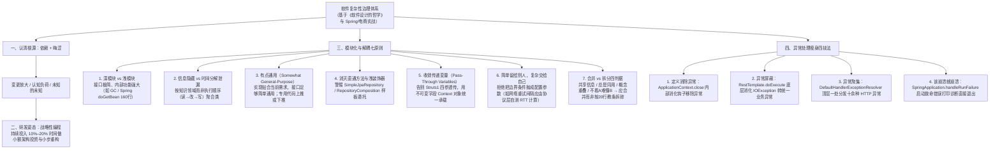

# 软件为何越做越乱？万字长文讲透软件的“复杂性”

## 1. TL;DR

1. **核心论点**：软件系统的腐化并非源于某次致命的大错误，而是由“战术快枪手”无数次看似合理的短期捷径（加开关、复制分支、打午夜 5 分钟临时补丁、套适配器）层层堆叠而成。真正的长期开发速度来自良好设计，而非侥幸“跑起来”。
2. **复杂性的三大表象与两大根因**：复杂性表现为 **变更放大（Change Amplification）、认知负荷加重（Cognitive Load）、未知的未知（Unknown Unknowns）**；其底层根因只有两个——**依赖（Dependencies）**与**晦涩（Obscurity）**。
3. **战略性编程的 10%–20% 投资法则**：摒弃只求眼前跑通的“战术性编程”，将总开发时间的 **10%–20%** 持续做小额架构投资与迭代型重构，几个月内即可收回成本并反超战术编程 **10%–20%** 以上的开发速度。
4. **模块化与解耦核心技法**：追求**深模块（Deep Modules，接口极简而内部功能强大，如 GC 或 160 行的 `AbstractBeanFactory.doGetBean`）**而非盲目按行数拆碎浅方法；坚持**信息隐藏**（警惕按执行顺序拆分的“时间分解”引发信息泄漏）、**“有点通用”（Somewhat General-Purpose）**、消除**直通方法（Pass-Through Methods）与浅装饰器**、用**上下文对象（Context）**收敛传递变量、恪守**“简单留给调用方，复杂交给模块内部”**（避免滥抛配置参数）。
5. **异常治理四板斧与性能观**：通过 **定义消除异常（如优雅 `close` 忽略关闭期钩子异常）、异常屏蔽（如 `RestTemplate.doExecute` 吞掉底层 IO 统一转 `RestClientException`）、异常聚集（如 `DefaultHandlerExceptionResolver` 顶层集中分发）、该崩溃就崩溃（如 `SpringApplication.handleRunFailure` 启动失败果断退出）** 砍断异常级联；性能上拒绝无测量的过早优化，除非有明确硬指标（如全链路含外调 $\le 5\text{ms}$）。

## 2. 问题定义与背景

### 2.1 《限时折扣到“补丁风暴”的一年》演进账单

作者以一个电商促销模块 12 个月的真实演进缩影，揭示了“战术快枪手”如何一步步锁死团队生产力：

| 时间节点 | 需求与战术捷径 | 累积的系统熵增后果 |
|---|---|---|
| **第 1 周** | 两周上线“限时折扣”：在订单服务直接加全局大开关按时段打折，仅 2 条冒烟测试 | 无独立领域模型，管理层表扬“效率高” |
| **第 3 周** | 新增“团购 + 会员价”：复制折扣代码叠 2 个 `if` 与 2 个 Feature Flag；同步调用户服务查等级，超时默认普通会员 | 跨服务强耦合，埋下静默降级资损隐患 |
| **第 2–6 个月** | 会员价与满减多打折 $\to$ 加前置短路条件与保护开关；新人礼金/跨品类满减 $\to$ 膨胀至十几个文件、方法名充满 `and/or/byGroup/byMember`；东八区与 UTC 跨天算重 $\to$ 午夜前后 5 分钟双算取最小值 | 临时补丁叠补丁，“待重构”卡片永远被新排期覆盖 |
| **第 9–12 个月** | “跨店合并优惠 + 热更新”：排期不给 2 个月建规则引擎，只能在旧分支上套“适配器”强行翻译 | 改一处牵动三处，回归用例从 **20 条涨到 200 条**；新人 1 周才敢改 1 行代码，跨 4 个服务 5 条业务线彻底沦为黑箱 |

### 2.2 复杂性的根因—表象映射

| 维度 | 核心分类 | 工程定义与典型案例 |
|---|---|---|
| **三大表象** | **1. 变更放大** | 看似简单的需求变更需要跨多个模块/文件同步修改 |
| **三大表象** | **2. 认知负荷** | 开发者理解并安全修改代码所需装入脑中的前置知识量（阅读者比编写者更有发言权） |
| **三大表象** | **3. 未知的未知** | 最危险的表象：不知道必须改哪里、不知道受哪几个隐式开关影响，直到线上爆雷才暴露 |
| **两大根因** | **1. 依赖（Dependencies）** | 一段代码无法孤立理解和修改；直接导致**变更放大 + 高认知负荷** |
| **两大根因** | **2. 晦涩（Obscurity）** | 重要信息不明显（如变量未注明单位是秒还是毫秒、`Fastjson` 反序列化隐式调用非字段 `getXXX` 方法）；直接导致**未知的未知 + 高认知负荷** |

## 3. 知识框架

## 4. 核心内容拆解

### 4.1 模块化核心：深模块、信息隐藏与反“时间分解”

1. **深模块（Deep Modules）的成本收益观**：
   - **收益 = 模块功能（矩形面积）**，**成本 = 模块接口复杂度（矩形顶边长度）**。接口不仅包括编译器可检查的**正式接口**（方法签名、参数类型、声明异常），还包括往往更庞大且只能靠注释说明的**非正式接口**（前置调用顺序约束、文件删除副作用等）。
   - **经典范例**：Java/Go 的**垃圾回收器（GC）**实现了“零接口”（甚至缩小了系统原有手动释放内存的接口），是极致深模块；Spring 的 `AbstractBeanFactory.doGetBean()` 虽长达约 **160 行**，但签名简洁、内部各步骤（查单例缓存 $\to$ 检原型循环依赖 $\to$ 委派父工厂 $\to$ 处理 `dependsOn` $\to$ 分 Scope 创建 $\to$ 类型转换）紧密交互且顺序内聚，强行按“超过 20 行就拆方法”的教条拆碎反而迫使读者在多个浅方法间来回跳转。
2. **警惕“时间分解（Temporal Decomposition）”引发的信息泄漏**：
   - 开发者常按执行时间顺序把“读文件 $\to$ 改内容 $\to$ 写文件”拆成三个类，导致“文件格式知识”同时泄漏在读类和写类中，一旦格式变更需多处同改。正确做法是**按知识归属聚合**，将读写同一格式的核心机制封装在同一个类中。
3. **“有点通用”（Somewhat General-Purpose）与三问检验法**：
   - 功能实现只做当前需求，但接口设计保持通用简洁：
     1. *满足当前所有需求的最简单接口是什么？*（减少方法数但绝不能靠塞入大量额外参数来凑）
     2. *这个接口会在多少情况下使用？*
     3. *这个接口是否直接满足当前需求？*（若调用方仍需写大量胶水代码，说明抽象错了）
   - 无法消除的专用代码：要么**向上推**到应用最顶层特性类，要么**向下推**到底层设备驱动层，严禁污染中间核心层。

### 4.2 层间解耦：直通方法、传递变量与配置参数

1. **直通方法（Pass-Through Methods）与浅装饰器反模式**：
   - 相邻两层抽象高度重叠时，会出现除了转发调用几乎不做实事的直通方法（如 `SimpleJpaRepository` 中直接委托给 `EntityManager` 的 `findAll`），或像 `RepositoryComposition` / `Fragments` 那样引入大量样板包装的浅层装饰器。应通过合并相邻类、重划职责或让上层直接依赖底层来消除。
2. **传递变量（Pass-Through Variables）治理**：
   - 反例：Apache Struts 1.x 的 `UserAction.execute` 一路向下透传 `(mapping, form, request, response)` 四个参数，中间方法不用也得背着，新增一个全局参数需改穿整条调用链。
   - 正解：引入**上下文对象（Context）**集中存放全局状态（配置项、计数器等），既消除签名污染又方便单测注入；为防止 Context 沦为“大泥球”和引发线程安全问题，应让其中的关键变量保持**不可变（Immutable）**。
3. **“简单留给别人，复杂交给自己”——克制配置参数**：
   - 把不确定如何处理的策略甩成配置参数（如网络丢包重试间隔）看似给了调用方自由，实则把复杂性复制给了每一个调用方。若模块内部能通过测量成功请求 RTT 自动算出合理重试间隔，就绝不暴露配置；必须暴露时也应自动计算合理的动态默认值（自问：*调用方真能算出比模块内部更准的值吗？*）。

### 4.3 异常处理瘦身四技法（结合 Spring 源码剖析）

异常处理代码天生比正常流难写、难测（如模拟磁盘 I/O 故障），且重试或副本恢复极易引发“重复包、次要异常级联”。与其信奉“防御式到处抛异常”，不如从源头减少异常处理器数量：

| 技法 | 核心机制 | 文中 Spring 源码实例 |
|---|---|---|
| **1. 定义消除异常** | 重新设计 API 或生命周期语义，把异常情况在模块内部静默/优雅消化 | `AbstractApplicationContext.close()` 移除 JVM ShutdownHook 时捕获 `IllegalStateException`（JVM 已在关闭中）直接忽略，不抛给调用方；`refresh()` 异常时先 `destroyBeans()` + `resetCommonCaches()` 再抛出 |
| **2. 异常屏蔽（Masking）** | 在底层检测并处理/转换异常，上层无需感知底层技术细节 | `RestTemplate.doExecute()` 捕获底层 `IOException`，拼接脱敏 URL 后统一包装为 `ResourceAccessException`（`RestClientException` 子类），并确保 `finally` 关闭 `response` |
| **3. 异常聚集（Aggregation）** | 让多层堆栈的异常向上冒泡，在请求循环顶部的单一入口集中处理 | Spring MVC `HandlerExceptionResolverComposite` 与 `DefaultHandlerExceptionResolver.doResolveException()` 在一处集中把 15+ 种 HTTP/绑定/参数异常转为对应响应视图 |
| **4. 该崩溃就崩溃（Crash Fast）** | 对罕见且不可恢复的致命错误，放弃复杂恢复逻辑，打印完整诊断后立即中止 | `SpringApplication.run()` 启动失败进入 `handleRunFailure()`，处理退出码、通知监听器、调用 `SpringBootExceptionReporter` 打印诊断并关闭上下文后，直接 `rethrowRuntimeException` 让进程崩溃（注：分布式副本存储系统的 I/O 错误不适用此条） |

### 4.4 设计两次（Design It Twice）、一致性与可读性

1. **准备 Plan B（设计两次）**：哪怕觉得当前只有一种写法，也强迫自己构思一个截然不同的备选方案并对比优缺点；在框架层花费 1–2 小时做二次设计，远比直接写代码后返工划算。
2. **系统一致性**：通过编码规范文档 + **自动化静态检查工具**（光有文档记不住）+ Code Review，让“相似的事情始终用相似的方式完成”。
3. **消除反直觉与模糊容器**：
   - 避免用 `Pair` 等通用容器返回多值（字段名 `first/second` 抹杀了业务语义），在 **JDK 17+** 中优先用 **`record` 类型**显式命名字段。
   - 警惕框架反直觉约定：如 **Fastjson** 序列化/反序列化时会反射执行类中所有 `getXXX()` 方法，若业务类写了非字段属性的 `getXXX()` 方法会触发隐式执行甚至线上故障，必须加显式注释或规避命名。

## 5. 数据速查表

| 维度 / 案例 | 原文数值 / 源码定位 | 语境与设计含义 |
|---|---|---|
| **“限时折扣”腐化账单** | 回归用例 **20 条 $\to$ 200 条**；新人 **1 周**才敢改 1 行代码 | 经历 12 个月战术补丁叠加后，跨 4 个服务、5 条业务线无法重构 |
| **战略性编程投资比例** | 总开发时间的 **10%–20%** | 持续做小额设计优化，几个月后开发速度反超战术编程 **10%–20%** 以上 |
| **长方法深模块反例教条** | 破除“超过 **20 行**就必须拆方法”的机械教条 | 以 Spring `AbstractBeanFactory.doGetBean()`（约 **160 行**）为例说明内聚长方法优于碎片化浅方法 |
| **传递变量反面教材** | Apache Struts 1.x `UserAction` 透传 **4 个参数** | `mapping, form, request, response` 穿透整条调用链，改用 `Context` 对象收敛 |
| **异常聚集源码案例** | Spring MVC `DefaultHandlerExceptionResolver` | 单方法集中分发 `HttpRequestMethodNotSupported` 等 **15 种**标准 Web 异常 |
| **性能劣化与硬指标边界** | 完全忽略性能可能慢 **5–10 倍**；极端场景要求 **$\le 5\text{ms}$** | 常规场景先求设计简单再基于测量优化；唯有明确硬指标（如含外调 $\le 5\text{ms}$ 投放逻辑）才从源头选高性能复杂方案 |

## 6. 踩坑与教训 / 可迁移的设计原则

| 错误做法 / 战术短视 | 失败表现或原因 | 原文应对（可迁移的设计原则） |
|---|---|---|
| **推迟重构，每次只做“最小改动”（加开关/加短路/套适配器）** | 成千上万个小依赖与晦涩层层堆叠，形成变更放大与未知的未知 | **战略性编程 + 小步快跑**：每次改代码至少顺手改好一点设计，把 10%–20% 时间作为架构投资 |
| **按操作执行时间顺序拆分模块（时间分解：读类 → 改类 → 写类）** | 文件格式等核心领域知识泄漏到多个类中，改一处格式需改所有类 | **信息隐藏优先**：按“知识归属”而非“执行时序”组织类，将读写同一格式的逻辑收进同一深模块 |
| **机械执行“方法超过 20 行就拆分”或滥用装饰器模式** | 制造大量浅方法、直通方法（Pass-Through）和样板代码，迫使读者跨方法跳读 | **追求深模块（简单接口 + 强大实现）**：代码块若存在复杂交互与强内聚（如 `doGetBean`），保持在同一方法内更易读 |
| **遇到不确定的策略就暴露配置参数或直接抛异常给调用方** | “把简单留给自己，把复杂甩给所有调用方”，导致配置误配与异常级联 | **复杂内聚**：能内部自适应计算（如测 RTT 算重试间隔）就不暴露配置；用定义消除、底层屏蔽、顶层聚集缩减异常分支 |
| **用 `Pair/Map` 返回多值或在 POJO 中随意写非属性 `getXXX()`** | 通用容器抹杀字段含义；Fastjson 等框架反射调用 `getXXX()` 引发线上故障 | 使用 **JDK 17 `record`** 定义强语义返回结构；严格遵守框架惯例并对反直觉行为加注释警示 |

## 7. 记忆锚点

- **复杂性公式**：「**$\text{复杂性} = \text{依赖（变更放大 + 认知负荷）} + \text{晦涩（未知的未知 + 认知负荷）}$**」。
- **深模块与异常治理口诀**：「**接口要窄实现要深，复杂留己简单予人；时间分解必漏信息，异常四招（消除/屏蔽/聚集/速崩）斩断级联**」。

## 8. 复习卡片

软件复杂性的三大外在表现和两大根本原因分别是什么？::三大表现为变更放大、认知负荷加重、未知的未知（最危险）；两大根因为依赖（导致变更放大与认知负荷）和晦涩（导致未知的未知与认知负荷）。
什么是“战略性编程”？推荐的时间投资比例是多少？::不把“最快跑通眼前需求”当唯一目标，而是以长期卓越架构为目标；建议持续将总开发时间的 10%–20% 用于小额设计优化，几个月后开发速度即可反超战术编程 10%–20% 以上。
什么是“深模块（Deep Module）”？为什么垃圾回收器（GC）是极致深模块？::深模块是在极简接口（低成本）背后隐藏强大功能与复杂实现（高收益）的模块；GC 不仅没有增加新接口，反而消除了手动释放内存的接口，缩小了系统总体接口复杂度。
什么是“时间分解（Temporal Decomposition）”？它为什么会导致信息泄漏？::按操作发生的时间顺序（如读文件、修改、写文件）拆分模块；因为同一设计决策（如文件格式）在生命周期不同阶段都会用到，按时序拆分会导致格式知识泄漏在多个类中。
为什么 Spring 的 AbstractBeanFactory.doGetBean() 长达 160 行却不拆分成十几个小方法？::因为其中各代码块（缓存检查、循环依赖检测、父工厂委派、dependsOn 初始化、分 Scope 创建、类型转换）交互紧密且顺序强相关，保持在同一深方法内可让读者一次看清全貌，盲目拆碎反而增加接口与跳转负担。
什么是“直通方法（Pass-Through Method）”和“传递变量（Pass-Through Variable）”？各自如何治理？::直通方法是除了把相同签名委托给下层外几乎不做实事的方法（使类变浅），应合并类或重划职责；传递变量是穿透多层中间方法的参数（如 Struts1 四参数），应用含不可变字段的 Context 对象收敛。
减少异常处理复杂性的四种技术及其 Spring 源码代表分别是什么？::① 定义消除异常（AbstractApplicationContext.close 忽略关闭钩子异常）；② 异常屏蔽（RestTemplate.doExecute 吞掉 IOException 转 RestClientException）；③ 异常聚集（DefaultHandlerExceptionResolver 顶层集中处理十余种异常）；④ 该崩溃就崩溃（SpringApplication.handleRunFailure 启动致命错误打印诊断后直接退出）。
为什么作者反对随意暴露配置参数？遇到不确定策略时应先问什么问题？::配置参数把策略决策负担转嫁给每一个调用方，导致方案不完整；应先问“调用方真的能确定比模块内部自动测量/计算的更好的值吗？”，尽量内部自适应或提供合理动态默认值。

## 9. 知识关联

- **本库主题索引**：[Agent工程循环](../../20_topics/Agent工程循环.md)、[解决问题](../../20_topics/解决问题.md)、[分布式计算与数据管道](../../20_topics/分布式计算与数据管道.md)
- **本库关联文章**：[复杂业务AI Coding交付+26.8.4](<../复杂业务AI Coding交付+26.8.4/AI_复杂业务AI Coding交付.md>)、[面向LLM的AI Friendly架构+26.6.1](<../面向LLM的AI Friendly架构+26.6.1/AI_面向LLM的AI Friendly架构.md>)
- **候选双链**：[[软件设计的哲学]]、[[深模块与浅模块]]、[[信息隐藏]]、[[战略性编程]]、[[Spring源码设计模式]]

## 10. 原文参考资料

- **原文信息**：《软件为何越做越乱？万字长文讲透软件的“复杂性”》，作者：思诚（淘天集团-营销&交易技术），发布日期：2026-03-16。
- **文内引用参考书籍**：
  - John Ousterhout：《软件设计的哲学》（*A Philosophy of Software Design*）
  - Robert C. Martin：《架构整洁之道》（*Clean Architecture*）
  - Titus Winters 等：《Google软件工程》（*Software Engineering at Google*）
  - Bruce Eckel：《On Java 中文版》
  - 周志明：《凤凰架构》
  - 《软件架构设计：大型网站技术架构与业务架构融合之道》
  - 《系统架构：复杂系统的产品设计与开发》
  - 《架构师修炼之道》

> [!note]- 校对报告
> - **页码溯源汇总**：
>   - `## 1. TL;DR` & `## 2. 问题定义与背景`：源自 p.1–5（《限时折扣到“补丁风暴”的一年》12 个月演进故事、回归测试 20 条 $\to$ 200 条、复杂性三大表现与两大原因、战术编程 vs 战略编程 10%–20% 投资比例）。
>   - `## 4.1 深模块、信息隐藏与有点通用`：源自 p.5–11、p.17–22（正式与非正式接口、GC 零接口深模块、信息隐藏 vs 时间分解信息泄漏、“有点通用”三问检验、专用代码上推与下推、合并与拆分四判据、Spring `AbstractBeanFactory.doGetBean()` 160 行源码剖析）。
>   - `## 4.2 直通方法、传递变量与配置参数`：源自 p.11–17（`SimpleJpaRepository` 直通方法、`RepositoryComposition` 浅装饰器、Struts 1.x `UserAction` 4 参数传递变量、Context 对象、网络丢包重试间隔自适应计算 vs 配置参数）。
>   - `## 4.3 异常处理四技法`：源自 p.22–32（`AbstractApplicationContext.close` 定义消除异常、`RestTemplate.doExecute` 异常屏蔽、`DefaultHandlerExceptionResolver` 异常聚集、`SpringApplication.handleRunFailure` 该崩溃就崩溃）。
>   - `## 4.4 设计两次、一致性与过早优化`：源自 p.32–38（Plan B 设计两次、一致性文档+自动化工具、JDK 17 `record` 替代 `Pair`、Fastjson `getXXX` 反直觉故障、5–10 倍性能劣化与 5ms 硬指标边界）。
> - **材料质量说明**：p.12–15、p.19–22、p.25–32 中的 Spring 源码片段在原公众号排版中部分长行右侧略有截断（如注释或长类名尾部），正文文本层已完整保留其核心方法结构与中文注释说明。
