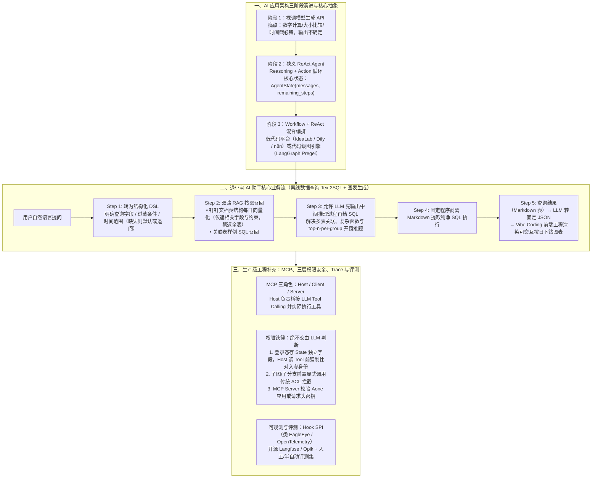

# 从应用架构的视角看退小宝AI助手落地现状

## 1. TL;DR

1. **核心架构论断（为什么必须做 AI 原生应用）**：传统对客 Web 应用要求 **RT $< 500\text{ ms}$（异步 $< 1\text{ s}$）、可用性 99.999%、结果近 100% 幂等准确、单次 API 成本极低**；而 LLM 应用最快首字响应约 **3 秒**、采纳率 **70%–90%**、单次带工具问答成本可达 **1.4 元**（千问 Plus 500 in / 500 out）。因此除异步后台任务（如日报生成、工单监听）外，**很难在老 Web 同步链路中硬塞 AI 节点，必须以 AI 为主体、将 Web 接口改造为 Tool 构建独立的 AI 原生应用（AI Native Application）**。
2. **落地架构范式收敛（狭义 ReAct Agent + Workflow 图编排）**：纯调 LLM API 连基础数值比较与时间戳计算都会出错；工业级落地最常见且稳健的形态是 **以低代码 Workflow（如阿里内部 IdeaLab / Dify / n8n）或基于 Pregel 图计算的 `LangGraph`（`StateGraph`）为骨架，内嵌狭义 ReAct Agent 节点**。
3. **退小宝 Text2SQL 与图表生成实战**：初期将全量表结构塞进 Prompt 在 Qwen-Max 上人工评测准确率刚过 **50%**，但面临表描述撑爆 `messages`、多表关联/开窗函数（`top n per group`）直出 SQL 失败、同义问法抖动三大痛点；升级为 **“钉钉文档维护表结构每日同步向量分片召回（不返全表字段）+ 样例 SQL RAG + 用户输入转 DSL（明确字段/条件/时间）+ 允许输出中间推理过程后用程序正则提取 SQL + Markdown 表转 JSON 驱动 Vibe Coding 前端交互图表”**。
4. **MCP 本质辨析与三层权限铁律**：阐明 MCP 的核心增量是**跨平台工具注册与发现协议**（甚至可用于非 AI 的纯 Python C/S 程序），而实际调用永远由 **Host 程序（而非 LLM 自身）** 执行；提出**“权限管控绝不能交给 LLM（零不确定性容忍）”**铁律——身份态必须存于 `State` 的非 `messages` 字段，在 Host 调用 Tool 前强制由程序比对 `State` 登录态与工具入参身份，子图/子分支用传统 `ACL` 显式拦截。

## 2. 问题定义与背景

### 2.1 传统 Web 业务架构 vs AI 应用六维对比

| 对比维度 | 传统 Web 业务架构（MVC / 分布式服务） | AI 应用（基于 LLM） | 架构融合启示 |
|---|---|---|---|
| **对客响应时间（RT）** | 同步 API **$< 500\text{ ms}$**；异步实时任务 **$< 1\text{ s}$**；后台批处理数分钟 | 最快 **3 秒**才开始流式输出第一个字符 | 同步对客 API 无法直接内嵌 AI 节点；仅异步任务（日报、工单自动处理）可在老系统中内嵌 AI |
| **输入灵活性与输出幂等性** | 输入固定格式语义；输出严格幂等一致 | 输入极灵活（支持多轮上下文）；输出非严格一致但围绕主旨 | 需将传统 Web 接口包装为语义清晰的 AI 友好型 Tool |
| **系统可用性** | 全年 **99.999%** | 依赖算力与模型服务，未达 99% 以上 | 业务链路必须容忍流式传输与一定时间的推理卡顿 |
| **结果准确性 / 可靠性** | 天内最终一致，**近 100%** | 满足目标的采纳率约 **70%–90%** | 目标场景必须**容忍正确率 $< 100\%$**，且结果须支持人工检查验证或小幅修正 |
| **单次调用成本** | 常规内部 API 成本可忽略（外部实名银行卡核验约 **0.5 元/次**） | 以百炼千问 Plus 为例，500 token 输入 + 500 token 输出含工具调用约 **1.4 元/次** | 低频高价值场景（数据洞察、工单汇总）不能单纯用访问量衡量 ROI |

## 3. 知识框架

## 4. 核心内容拆解

### 4.1 从狭义 ReAct Agent 到 Workflow 图编排的本质

1. **LLM 的第一性原理认知**：生成式大语言模型的本质是**对带角色（`system / user / assistant / tool`）的 `messages` 列表做不断续写**。不同 AI 应用落地效果的最大差异，本质上就在于 **`messages` 列表的组装方式与 `Tools` 的设计质量**。
2. **各框架中“节点”的概念对齐**：
   - 在 **Dify** 中，`LLM 节点`（单次调用模型 API）与 `Agent 节点`（内部执行 ReAct 多轮推理+工具调用循环）是分开的；
   - 在阿里内部 **IdeaLab（AI Studio）** 中，单个 `LLM 节点` 本身就实现了狭义 ReAct Agent 的多轮工具循环；
   - 在 **LangGraph** 中，底层基于图论七桥问题发源地命名的 **Pregel 大规模图计算框架**，以 `StateGraph` 维护全局 `AgentState(messages, remaining_steps)`（注：旧版 `langchain` 的 Agent API 已标记 `deprecated` 并指向 `langgraph`）。
3. **为什么低代码 Workflow + 局部代码扩展成为主流**：
   - 图（Graph）结构能够表达包含分支、循环与责任链的任意复杂逻辑（NP 完全问题均可规约），且天然契合 LLM 的 **Stream 流式输出对接**；
   - 当需要**时间回溯（Time Travel）、隐式跳转、上下文改写压缩、大批量并行或自定义存储介质**时，则在 `LangGraph` 中通过 Python/Java 编码扩展。

### 4.2 退小宝实战：Text2SQL 四步破局与业务瓶颈反思

1. **初版“全表塞 Prompt”的三大死穴（Qwen-Max 人工评测仅 ~50%+）**：
   - **上下文雪崩**：数据表 Schema 描述比普通文本膨胀快得多，迅速撑爆 Prompt 与多轮 `messages` 列表，导致模型推理质量断崖下降。
   - **无中间推理直出 SQL 必挂**：LLM 是续写模型，若禁止输出中间思考文字而要求直接吐出 SQL，一旦遇到**多表 JOIN（$>1$ 张表）、复杂列筛选函数、分组开窗（`top n per group`）**就会失败。
   - **问法同义漂移**：换词序或同义词导致生成结果剧烈波动。
2. **退小宝四步优化链路**：
   - **① 输入侧转 DSL**：先将用户口语转化为易于 LLM 理解的固定 DSL 描述（显式锁定查询字段、查询条件、时间范围，缺失则填默认值或反问用户）。
   - **② 钉钉文档驱动的字段级 Schema RAG + 样例 SQL RAG**：在钉钉文档中维护表结构并每日自动同步更新向量库；检索时**严禁返回整张大表的完整 Schema，仅有限返回相关字段及约束**，并召回关联表的黄金样例 SQL。
   - **③ 放开 CoT 推理 + 程序后置提纯**：允许 LLM 先输出文字推理步骤再给出 SQL，最后用确定性程序剥离多余 Markdown 标记提取合法 SQL。
   - **④ 图表生成联动**：利用 LLM 极擅长的“非结构化转固定格式”能力，将查询出的 Markdown 表格转为标准 JSON，交由后端同学用 Vibe Coding 生成的前端工程渲染可交互图表（初版用 HTTP GET URL 转码传参，长期走后端存储）。
3. **真实业务瓶颈的冷静复盘**：
   - 高频刚需取数很快会被固化成标准固定报表；而极低频的临时取数，专业数据同学手写 SQL 往往比调教 AI 更快。因此退小宝主动做减法：**不盲目上高延迟的 Plan + Sub-Agent 多智能体、不做过重的提示词多意图识别（$<5$ 个意图前曾多次碰壁）、不搞高成本微调**。

### 4.3 MCP 协议祛魅与 AI 权限安全三道防线

#### （1）MCP vs Function Calling 的精准解耦
- **MCP（Model Context Protocol）** 包含三角色：**`Host 程序`（如 Claude Desktop 或自研 AI 应用）、`MCP Client`、`MCP Server`**。MCP 本身甚至可以完全脱离 LLM 当作普通 Python RPC/工具发现协议使用；它的真正价值是**标准化跨平台工具的注册与发现**（阿里内部已有将 `HSF` 服务封装为 MCP Server 的成熟方案）。
- **工具到底是谁调的**：LLM 通过 `Function Calling / Tool Calling`（或将 Tool Schema 拼入普通文本标签）**只负责决策“该调哪个工具及参数”**，绝不会自己发起网络调用；真正执行工具调用并将返回结果塞回 `messages` 列表的永远是 **Host 程序**。

#### （2）权限安全铁律：为什么权限绝不能交给 LLM
LLM 存在概率不确定性，而权限控制要求 **100% 零差错**，因此权限必须由确定性代码管控：
1. **个体/商家隐私数据查询（State 隔离 + Host 强制验签）**：
   - 用户登录态身份标识**绝不依赖 `messages` 列表传递**，而是存放在 `State` 上下文的独立受保护字段中。
   - 规定所有隐私数据只能通过 Tool/RAG 获取；虽然工具入参由 LLM 生成，但 **Host 程序在真正调用 Tool 前，必须用确定性代码强制取出 `State` 中的真实登录态身份，与工具入参中的身份标识做比对校验（或直接覆盖注入）**。
2. **子分支 / 子 Agent 权限控制（前置显式 ACL）**：
   - 在进入敏感子图（如 `sub_common_agent`）前，**由程序显式固定调用传统 `ACL` 权限系统接口拦截校验**，绝不能把 ACL 当成可选 Tool 让 LLM 自己决定调不调（注：在 `LangGraph` 中需注意 `sync` 与 `async` 双入口的固定节点编排）。
3. **MCP Server 级鉴权**：通过限制调用方 `Aone` 应用名或在 HTTP Header 中注入密钥管控工具访问权。

## 5. 数据速查表

| 指标 / 维度 | 原文数值 / 工具选型 | 语境与对比说明 |
|---|---|---|
| **响应延迟对比（Web vs AI）** | Web API **$< 500\text{ ms}$**（异步 **$< 1\text{ s}$**）vs AI 首字 **$\ge 3\text{ s}$** | 决定了对客同步链路难以直接内嵌 AI 节点 |
| **可用性与准确率对比** | Web **99.999% 可用 / 近 100% 准确** vs AI **70%–90% 采纳率** | AI 落地场景必须容忍非 100% 准确率且支持人工核验修正 |
| **单次调用成本对比** | 实名银行卡校验 API **0.5 元/次** vs 千问 Plus **1.4 元/次** | 千问 Plus 按 500 token 输入 + 500 token 输出（含工具调用）测算 |
| **初版 Text2SQL 基线准确率** | **50% 以上**（人工评测） | 在 Qwen-Max 等大模型上直接用 Prompt 塞表结构与业务知识的基线 |
| **微调与可观测/评测推荐栈** | 微调：`Unsloth`、`LLaMA-Factory`、内部 `星云 / OpenLM` 可观测与评测：`Langfuse`、`Opik`、`OpenTelemetry`、`EagleEye` | 强调专业领域微调与评测最大的瓶颈均在于“缺乏高质量专有数据集” |

## 6. 踩坑与教训 / 可迁移的设计原则

| 错误做法 | 失败表现或原因 | 原文应对（可迁移的设计原则） |
|---|---|---|
| **在传统对客高并发 Web 同步接口里直接嵌入 LLM 调用节点** | 3 秒以上的首字耗时与 70%–90% 的概率性输出直接击穿 Web 接口 SLA 与幂等契约 | **坚持 AI Native 反向整合**：除日报、异步工单监听外，以独立 AI 应用为主体，将 Web 接口改造为 AI 友好的 Tool |
| **用纯 LLM 直接做数值计算、大小比较或时间戳换算（如日报分析）** | 即便海外顶尖大模型在具体数字计算上也频繁算错 | 凡涉及精确数值计算、大小比较与时间换算，必须剥离给确定性 **Tool** 执行 |
| **Text2SQL 把整库完整表结构塞入 Prompt，并要求模型直接只输出 SQL** | 表结构迅速撑爆 `messages` 拖垮性能；缺少中间文字推理过程导致多表关联与 `top n per group` 开窗必挂 | **字段级分片 RAG（钉钉文档日更同步）+ 样例 SQL RAG + 输入转 DSL + 先输出文字推理再由程序提取 SQL** |
| **把用户身份权限校验交给 Prompt 约束或让 LLM 自主决定是否调 ACL 工具** | LLM 存在幻觉与注入风险，权限控制不能容忍哪怕 0.01% 的不确定性 | **State 独立字段存登录态 + Host 调 Tool 前硬编码比对身份入参 + 子分支前显式固定调用 ACL** |
| **一上来就堆砌 Multi-Agent（Plan + Sub-Agent）与模型微调** | Multi-Agent 显著拉长用户等待时间；微调缺乏符合 Workflow `messages` 形态的高质量专有数据，容易把模型“训偏” | 问答类助手优先用 **低代码 Workflow + 狭义 ReAct Agent + 高质量上下文/工具组装** 快速闭环 |

## 7. 记忆锚点

- **架构主从铁律**：「**500ms Web 塞不下 3s AI；异步任务可内嵌，同步交互必做 AI 原生（AI 为主、Web 作 Tool）**」。
- **安全与上下文铁律**：「**Prompt 即带角色 messages 续写；LLM 只做工具决策不执行，Host 掐住 State 登录态做硬鉴权**」。

## 8. 复习卡片

为什么不能简单地在传统对客 Web 应用的同步链路中嵌入 AI 节点，而必须提倡“AI 原生应用”？::因为传统对客 Web API 要求响应 <500ms、可用性 99.999%、结果近 100% 幂等且成本极低；而 AI 应用最快 3 秒才出首字、采纳率仅 70%–90%、单次成本可达 1.4 元且需流式兼容，因此只能以 AI 应用为主体并将 Web 接口封装为 Tool（异步批处理或工单监听除外）。
Dify、IdeaLab（AI Studio）与 LangGraph 中的“LLM/Agent 节点”在实现狭义 ReAct Agent 时有何区别？::Dify 将普通单次调用的 LLM 节点与多轮循环的 Agent 节点分开；IdeaLab 的单个 LLM 节点直接内置了 ReAct 多轮工具调用循环；LangGraph 则基于 Pregel 图计算框架用 StateGraph（维护 messages 与 remaining_steps）显式编排推理节点与工具节点。
退小宝在离线数据查询（Text2SQL）中遇到哪三大问题？是如何通过四步 Workflow 解决的？::三大问题是表结构撑爆上下文、无中间推理直出复杂 SQL（多表/开窗）失败、同义问法结果不稳；解法是：① 将用户输入转为固定 DSL；② 钉钉文档日更同步向量库，按需召回部分相关字段与样例 SQL；③ 允许 LLM 先输出推理文字再给 SQL；④ 用固定程序剥离标记提取 SQL。
MCP 协议中的 Host、Client、Server 各自扮演什么角色？LLM 会自己调用 MCP 工具吗？::Server 暴露工具，Client 连接 Server，Host 是承载 AI 应用与连接 LLM 的宿主程序（如 Claude Desktop 或自研应用）；LLM 绝不会自己执行工具，它只返回调用指示，由 Host 负责实际调用工具并将结果追加回 messages 列表。
在面向公网商家查询隐私信息的 AI 应用中，如何设计零漏洞的权限管控？::① 绝不让 LLM 控制权限，将用户登录态存于 State 上下文的非 messages 独立字段中；② 限制隐私数据只能通过 Tool/RAG 获取；③ 在 Host 程序调用 Tool 前，用确定性代码强制比对 State 中的真实身份与 LLM 生成的工具入参身份；④ 敏感子分支前显式固定调用传统 ACL 接口拦截。
什么样的业务场景适合落地 AI 应用？作者总结了哪三条业务准入经验？::① 业务场景必须容忍结果正确率不为 100%（若错一次负面影响极大则不可行）；② AI 输出结果必须支持人工检查验证或小幅修正；③ 对数据洞察、工单汇总等低频高价值场景，不应以访问量作为唯一衡量标准。

## 9. 知识关联

- **本库主题索引**：[Skill设计与治理](../../20_topics/Skill设计与治理.md)、[Agent工程循环](../../20_topics/Agent工程循环.md)、[检索与文档解析](../../20_topics/检索与文档解析.md)、[Agent数据分析](../../20_topics/Agent数据分析.md)
- **本库关联文章**：[百亿补贴数据分析Agent+26.9.3](../百亿补贴数据分析Agent+26.9.3/AI_百亿补贴数据分析Agent.md)、[面向LLM的AI Friendly架构+26.6.1](<../面向LLM的AI Friendly架构+26.6.1/AI_面向LLM的AI Friendly架构.md>)、[如何设计AIAgent系统+26.1.26](../如何设计AIAgent系统+26.1.26/AI_如何设计AIAgent系统.md)
- **候选双链**：[[AI原生应用架构]]、[[LangGraph与Pregel]]、[[Text2SQL工程化]]、[[MCP权限安全管控]]

## 10. 原文参考资料

- **原文信息**：《从应用架构的视角看退小宝AI助手落地现状》，作者：牧让（淘天集团-场景金融技术团队），发布日期：2026-02-11。
- **文内提及框架与工具**：`LangChain`、`LangGraph`（Pregel 图计算）、`Dify`、`n8n`、阿里内部 `IdeaLab (AI Studio)`、`SmartEngine`、`MCP (Model Context Protocol)`、`Unsloth`、`LLaMA-Factory`、`星云`、`OpenLM`、`OpenTelemetry`、`EagleEye`、`Langfuse`、`Opik`。

> [!note]- 校对报告
> - **页码溯源汇总**：
>   - `## 1. TL;DR` & `## 2. 问题定义与背景`：源自 p.1–6（MVC 与分布式服务回顾、Web 业务架构 vs AI 应用 6 维对比表：`<500ms / <1s` vs `3s`、`99.999%` vs 未达 `99%`、`近100%` vs `70%-90%`、实名核验 `0.5元` vs 千问 Plus 500+500 token `1.4元`、工单自动处理异步监听案例）。
>   - `## 4.1 从 ReAct 到 Workflow`：源自 p.6–13（日报纯 LLM 数字计算缺陷、`messages` 列表续写本质、`Dify / IdeaLab / LangGraph` 节点差异、`AgentState` 代码定义、Pregel 七桥问题彩蛋、`SmartEngine`、图结构与 NP 完全问题规约）。
>   - `## 4.2 退小宝 Text2SQL 与图表生成`：源自 p.13–17（Qwen-Max `50%+` 基线、三大痛点与四项改进、钉钉文档日更同步向量库、Markdown 表转 JSON + Vibe Coding 前端交互图表、退小宝不做 6 件事与分布式部署分析）。
>   - `## 4.3 MCP、权限安全、微调、Trace 与评测`：源自 p.17–24（MCP 三角色 Host/Client/Server、非 AI Python C/S 用法、State 登录态与 Host 调用前硬比对、ACL 显式调用、`Unsloth / LLaMA-Factory / 星云 / OpenLM`、`EagleEye / OpenTelemetry / Langfuse / Opik`）。
> - **材料质量说明**：p.2–4、p.7–11、p.13、p.15–16、p.20–21 含架构流程图截图，正文已对所有关键模块、代码与设计取舍做了详尽文字阐述；无独立长篇 Prompt/Skill 文件需拆分。
