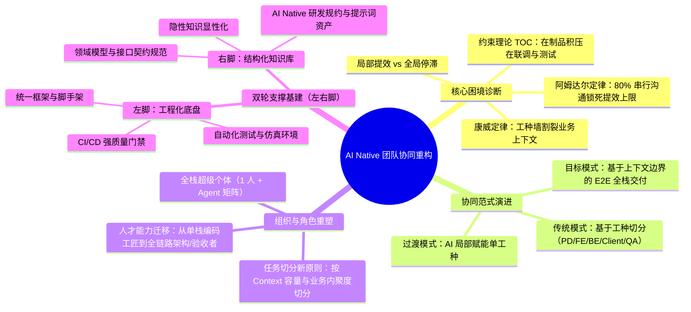
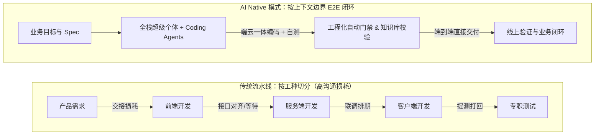

# 重构协同：关于AI Native团队的思考

> [!abstract] 导读
> **一句话总结**：大淘宝天猫技术团队剖析了为什么单点引入 AI Coding 工具难以自动转化为整体研发效能跃升，指出研发流程受制于约束理论（TOC）与阿姆达尔定律，必须从“基于工种的流水线分工”重构为“基于上下文边界的端到端（E2E）交付”，通过打造“工程化底盘（左脚）+ 知识库大脑（右脚）”支撑全栈超级个体与小团队闭环。
> **阅读价值**：为技术管理者与架构师提供一套从“个人局部提效”迈向“组织全局提效”的诊断框架与三阶段演进路线图。

## 1. TL;DR

- **核心判断**：引入 AI 编码工具只是生产力变革的起点；若继续沿用工业时代的“需求→设计→前端→后端→测试”长链路流水线，局部编码提速只会导致库存积压与协同损耗，无法缩短业务整体的端到端交付周期（Lead Time）。
- **三大底层法则**：
  - **高德拉特约束理论（TOC）**：局部优化不等于全局优化；非瓶颈环节（如单纯写代码）提速，只会在下游瓶颈（联调、测试、评审）前制造更多在制品（WIP）积压。
  - **阿姆达尔定律（Amdahl's Law）**：系统整体加速比受限于“不可被 AI 加速的串行协同与沟通占比”；当跨角色沟通与排期等待占主导时，单点编码提效对全局交付速度的边际贡献趋近于零。
  - **康威定律（Conway's Law）**：过去的系统边界是按“人脑认知负荷与工种技能”切分的，而 AI 大幅拓宽了单兵认知与技能边界，倒逼组织架构与系统边界向“高内聚、少切分”收敛。
- **核心解法**：走向**端到端（E2E）全栈闭环**——打破前后端、客户端与测试的硬性工种墙，按**上下文边界（Context Boundary）**而非工种切分任务，由“全栈超级个体（1 人 + 多 Agent）”承接完整业务闭环。
- **双轮基建（左右脚）**：
  - **左脚（工程化底盘）**：标准化脚手架、自动化测试、CI/CD 质量门禁与可观测性，确保 AI 生成代码“跑得稳、兜得住”。
  - **右脚（结构化知识库）**：将散落在人脑、群聊与口口相传中的隐性知识（Tacit Knowledge）显性化为 AI 可读的领域知识库与 Spec 规范。

## 2. 问题定义与背景

### 2.1 痛点与破局动因：为什么“人人用 AI”不等于“团队提效”？
在普遍引入 AI Coding 助手后，许多研发团队面临一个共性困惑：开发者的单点编码速度明显变快、代码生成率屡创新高，但业务方感知的**需求交付周期（Lead Time）**却几乎没有缩短，甚至在联调、Code Review 与测试阶段出现了更严重的拥堵。

其根本原因在于**用工业时代的流水线组织方式去套用 AI 时代的生产力工具**：
1. **协同摩擦吃掉编码红利**：一次普通需求往往跨越产品、交互、前端、客户端、服务端、测试等多个角色，每一次跨工种交接都伴随“上下文序列化→沟通对齐→排期等待→反序列化理解”的信息衰减。
2. **认知负荷与角色错位**：传统分工是为了应对人类有限的栈深度（前端不懂服务端分布式事务、服务端不熟悉端侧渲染），但大模型恰好抹平了跨技术栈的语法与框架门槛，使得“跨工种沟通成本”首次高于“单兵跨栈实现成本”。
3. **隐性知识黑洞**：团队大量业务规则存在于老员工脑中或历史聊天记录里，AI 缺乏结构化上下文，只能在局部函数级别打辅助，无法独立承担业务级交付。

### 2.2 核心定律拆解

| 理论模型 | 在传统研发流水线中的表现 | 对 AI Native 团队的启示 |
| :--- | :--- | :--- |
| **高德拉特约束理论（TOC）** | 编码环节只是长链路中的一环；编码提速 50% 后，代码堆积在联调与测试网关，下游成为新瓶颈，全局吞吐量不变。 | 必须识别并消除链路中的交接与验证瓶颈，通过自动化门禁与端到端闭环削平在制品积压。 |
| **阿姆达尔定律（Amdahl's Law）** | 若纯编码时间仅占需求全生命周期的 20%，即便 AI 将编码耗时压缩至趋近于 0，整体交付提速上限也仅为 $1/(1-0.2) = 1.25$ 倍。 | 提效主战场必须从“压缩 20% 的编码时间”转向“消灭 80% 的跨角色串行等待与沟通损耗”。 |
| **康威定律（Conway's Law）** | 组织按前端/后端/客户端/QA 设组，导致同一业务特性被切碎为多个跨仓库 PR 与接口协议对齐。 | 当 AI 赋能个体具备全栈交付能力时，组织应重组为围绕业务域的 E2E 特战队，系统架构随之向高内聚演进。 |

## 3. 知识框架

## 4. 核心内容拆解

### 4.1 从“按工种分工”走向“按上下文边界端到端（E2E）交付”

1. **打破工种墙，收敛交接面**：
   - 在 AI 辅助下，一名前端或服务端工程师完全有能力借助 Coding Agent 同时完成端侧页面、BFF 层聚合、服务端逻辑及配套自动化单测。
   - 将原本需要 3~4 个工种排期对齐、反复拉群联调的中小型需求，收敛由 **1 名工程师端到端（End-to-End）独立闭环**，直接将跨人沟通复杂度从 $O(N^2)$ 降为 $0$。
2. **重新定义任务切分维度——基于上下文边界（Context Boundary）**：
   - 过去切分任务看“这是前端活还是后端活”；AI Native 团队切分任务看“**这段业务逻辑的上下文是否高内聚、能否装进同一个认知与 Context 窗口**”。
   - 只要一个业务特性的上下文边界清晰、领域模型内聚，就应当作为一个完整的 E2E 交付单元交给同一个“人 + Agent”组合去穿透实现。

### 4.2 迈向 AI Native 团队的“左右脚”双轮基建

要让单兵具备端到端全栈交付能力，而不在跨栈开发时写出大量线上故障，团队必须为其配备坚实的“左右脚”基础设施：

#### 1. 左脚：工程化底盘（守住质量下限）
当开发者跨入自己不够熟悉的领域（如后端写前端、前端改服务端）并大量依赖 AI 生成代码时，靠人工肉眼 Code Review 已无法兜底。必须依靠强工程化底座：
- **收敛与标准化技术栈**：减少奇技淫巧与碎片化框架，提供统一的工程模板、脚手架与标准组件，降低 AI 理解与生成的方差。
- **自动化验证与防御体系**：构建完备的单元测试、集成测试、契约测试与灰度监控门禁。AI 写出的跨栈代码必须先通过自动化流水线的严苛检验，用确定性的工程护栏对冲大模型的不确定性。

#### 2. 右脚：结构化知识库（拔高认知上限）
AI 之所以在复杂存量业务中“胡言乱语”，根本原因是企业内部存在海量的**隐性知识（Tacit Knowledge）**——历史包袱、潜规则、特殊业务分支往往只存在于资深员工的脑海或零散的钉钉群聊中。
- **隐性知识显性化与结构化**：将业务领域模型、架构设计约束、接口规范、常见踩坑指南沉淀为结构化、版本化的文档资产（如仓库内的 Markdown 规范、领域词典）。
- **构建 AI 友好的上下文底座**：文档不再只是写给人看的应付式归档，而是作为 Coding Agent 的直接输入源（Context），做到“代码变动即文档更新，知识沉淀即 AI 能力升级”。

### 4.3 团队演进与人才转型路径
1. **第一阶段（工具普及期）**：全员接入 AI Coding 工具，消灭样板代码与低级语法检索耗时，建立对 AI 能力边界的体感。
2. **第二阶段（知识与工程筑基期）**：梳理存量系统，补齐自动化测试与 CI/CD 门禁（左脚），系统性开展业务知识盘点与文档结构化改造（右脚）。
3. **第三阶段（协同重构与 E2E 闭环期）**：在小步快跑的业务模块试点打破前后端/端云分工，推行“全栈超级个体”端到端承接需求，按业务域与上下文边界重组敏捷小队。

## 5. 数据速查表

| 维度 | 传统研发协同模式 | AI Native 研发协同模式 | 核心演进指标/抓手 |
| :--- | :--- | :--- | :--- |
| **分工基准** | 按技术工种切分（FE / BE / Client / QA） | 按业务上下文边界（Context Boundary）切分 | 跨角色交接次数趋近于 0 |
| **提效瓶颈法则** | 受制于阿姆达尔定律，80% 串行协同锁死上限 | 压缩非编码串行等待，释放全局端到端加速比 | 需求端到端交付周期（Lead Time） |
| **在制品流转（TOC）** | 编码局部提速导致联调、评审、测试积压 | 端到端单兵闭环 + 自动化验证消除下游堰塞湖 | 联调等待时长、提测打回率 |
| **基础设施重心** | 偏向人工评审、排期管理、跨部门 PMO 协调 | **左脚**（工程化门禁）+ **右脚**（结构化知识库） | 自动化覆盖率、知识库显性化覆盖度 |
| **工程师核心能力** | 单一技术栈纵深熟练度、手写代码速度 | 业务抽象与拆解、Spec 定义、跨栈架构审美与验收 | 单人 E2E 独立交付需求占比 |

## 6. 踩坑与教训 / 可迁移的设计原则

- **反模式 1：只发工具不改流程（“新瓶装旧酒”）**
  - **现象**：管理层采购并强制要求全员使用 AI 编程工具，考核“AI 代码采纳率”，但需求评审、前后端切分、排期联调流程原封不动。
  - **后果**：开发者为了凑采纳率生成大量未充分验证的代码，下游联调与测试负担反而加重，团队陷入“局部忙死、全局不快”的假性提效。
- **反模式 2：在缺乏工程护栏的存量泥潭上盲目推行全栈 E2E**
  - **现象**：没有自动化测试和统一脚手架，就直接让前端用 AI 改核心服务端逻辑。
  - **后果**：AI 缺乏隐性业务约束与自动化回归保护，极易引入隐蔽的资损或稳定性事故，一次线上故障就会摧毁团队对全栈协同改革的信任。
- **可迁移原则 1：用“减少一次跨人交接”替代“节省十分钟写代码”**
  - 评估 AI 提效项目的 ROI 时，优先寻找那些能够彻底砍掉一个交接环节（例如：前端借助 AI 自己写完 BFF 聚合接口、开发借助 AI 自动生成完整回归用例）的场景。
- **可迁移原则 2：把文档当作生产代码一样维护**
  - 凡是不能被 AI 直接检索和理解的口头约定，在 AI Native 团队中都视为技术债；每次踩坑修复不仅要改代码，还必须同步更新到仓库的知识库规约中。

## 7. 记忆锚点

- **一个核心悖论**：单点写代码变快 $\neq$ 需求上线变快；**流水线上的局部加速只会制造下游库存**。
- **三大支柱理论**：**TOC 约束理论**看瓶颈转移、**阿姆达尔定律**看串行协同占比、**康威定律**看组织与系统边界重塑。
- **一个协同转向**：从**按工种切分（Skill-based）**转向**按上下文边界切分（Context-based E2E）**。
- **一双基建左右脚**：**左脚工程化**（自动测试 + 门禁兜底），**右脚知识库**（隐性知识显性化喂给 AI）。

## 8. 复习卡片

Why does increasing individual coding speed with AI fail to shorten overall feature delivery Lead Time according to Amdahl's Law?::Because pure coding accounts for only a small fraction of total delivery time, while serial cross-role communication, alignment, and handoff waiting dominate the critical path and cap the maximum overall speedup.
How does Goldratt's Theory of Constraints (TOC) explain the bottleneck shift after introducing AI Coding tools?::Accelerating a non-bottleneck step (coding) without upgrading downstream verification and integration merely piles up Work-In-Progress (WIP) inventory at joint debugging, code review, and QA stages.
How should task decomposition shift in an AI Native engineering team?::Shift from splitting tasks by technical job roles (frontend, backend, client, QA) to splitting by self-contained business Context Boundaries delivered end-to-end (E2E) by a single full-stack developer with AI agents.
What are the "Left Foot" and "Right Foot" infrastructures required to support AI Native E2E delivery?::The "Left Foot" is a solid engineering foundation (standardized scaffolds, automated testing, CI/CD quality gates) to guarantee safety; the "Right Foot" is a structured knowledge base that converts tacit human knowledge into explicit context for AI.
Why does Conway's Law drive system architecture toward higher cohesion in the AI era?::Traditional fine-grained role splits mirrored human cognitive limits across tech stacks; AI expands an individual's cross-stack cognitive boundary, enabling smaller E2E teams and more cohesive, less fragmented system modules.
What is the biggest hidden obstacle preventing Coding Agents from succeeding in legacy enterprise codebases?::Tacit knowledge—undocumented business rules, historical workarounds, and domain constraints trapped in senior engineers' minds or chat histories rather than explicit, structured repository docs.

## 9. 知识关联

- **本批同主题精读**：
  - [复杂业务团队的 AI Coding 交付实践：知识库、RD 流程和质量门禁](../复杂业务AI Coding交付+26.8.4/AI_复杂业务AI Coding交付.md)：完美对应本文提出的“左右脚”理论，详细展示了物流技术团队如何落地四层企业级知识库、5 步标准研发流程与 3 道刚性质量门禁。
  - [天猫AI助手：调度框架重构与AI Coding工程化实践](../天猫AI助手调度重构+26.8.11/AI_天猫AI助手调度重构.md)：同属天猫技术体系的实战印证，展示了如何通过架构解耦与工程规约文档（CLAUDE.md）实现近百需求 100% AI 生成代码交付。
  - [淘宝百亿补贴服务端 SDD（规约驱动开发）实践](../百补服务端SDD实践+26.7.27/AI_百补服务端SDD实践.md)：将“隐性知识显性化”落地为可执行、可演进的 Spec 规约驱动开发闭环。
  - [迈向 AI 原生组织：AINMM 五级成熟度模型解析](../AINMM五级成熟度模型+26.7.14/AI_AINMM五级成熟度模型.md)：从组织成熟度演进视角系统刻画了从工具辅助（L1/L2）走向全栈 Agent 协同与组织重构（L3-L5）的完整阶梯。
- **主题索引（`20_topics`）**：
  - [AI研发协同](../../20_topics/AI研发协同.md)
  - [Harness与模型协同](../../20_topics/Harness与模型协同.md)
- **本目录归档文件**：[原始 PDF](RAW.pdf) · [逐页转写文本](MD.md)
- **候选概念双链**：[[约束理论]] · [[阿姆达尔定律]] · [[康威定律]] · [[端到端交付]] · [[隐性知识显性化]] · [[超级个体]]

## 10. 原文参考资料

- **原文出处**：大淘宝技术公众号，《重构协同：关于AI Native团队的思考》（作者：书牧，淘天集团-天猫技术团队，发布日期：2026-08-13）
- **理论参考**：
  - Eliyahu M. Goldratt，《The Goal》（高德拉特约束理论 TOC）
  - Gene Amdahl，*Validity of the single processor approach to achieving large scale computing capabilities*（阿姆达尔定律）
  - Melvin E. Conway，*How Do Committees Invent?*（康威定律）

> [!note]- 校对报告
> - **页码溯源（1-based 物理页码）**：
>   - 篇首标题、作者（书牧，淘天集团-天猫技术团队）与引言痛点：源自 `RAW.pdf` `p.1–2`（对应 `MD.md` 第 1–2 页）。
>   - 三大底层定律分析（高德拉特约束理论 TOC、阿姆达尔定律、康威定律）与局部提效陷阱：源自 `RAW.pdf` `p.2–5`（对应 `MD.md` 第 2–5 页）。
>   - 端到端（E2E）交付范式、打破工种墙与基于上下文边界（Context Boundary）的任务切分：源自 `RAW.pdf` `p.5–7`（对应 `MD.md` 第 5–7 页）。
>   - 迈向 AI Native 的“左脚（工程化底盘）”与“右脚（隐性知识显性化的结构化知识库）”建设路径：源自 `RAW.pdf` `p.7–10`（对应 `MD.md` 第 7–10 页）。
> - **一致性核验**：原文共 10 页（含 5 页配图），属于团队协同与研发组织演进的深度方法论思考，无代码级算子公式或独立可复用的长 Prompt/Skill 附件（故无需生成 `PROMPT.md`/`SKILL.md`）。全部核心论点与比喻（左右脚、三大定律、上下文边界）均严格忠实于原文转写层。
