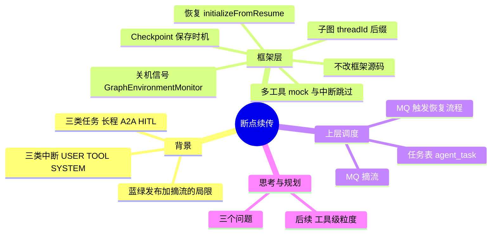
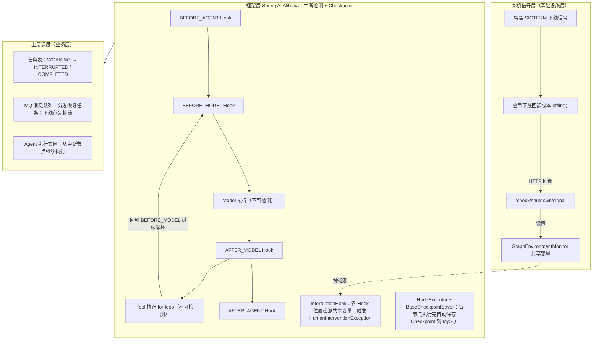
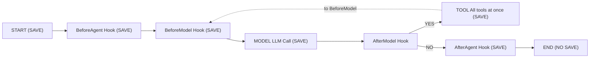
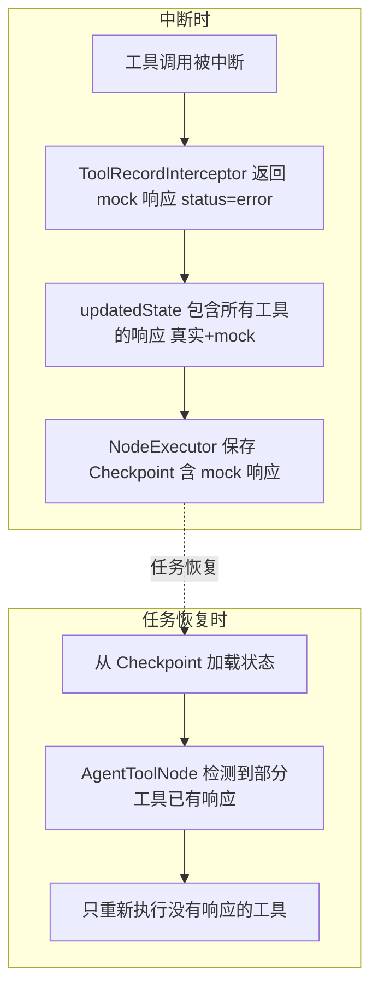
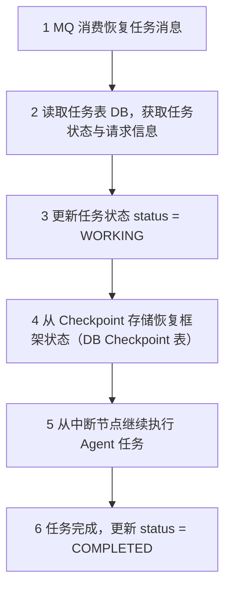

# Agent 长程任务断点续传

> 标记约定：无标记 = 原文内容；`[推断]` = 从原文推出但原文未明说；`⚠️` = 图中无法辨认 / 原文疑点。
> 读者背景（原提示词中为占位符，按"有 LangGraph / ReAct Agent 经验的 LLM 应用工程师"处理）：基础概念一笔带过。

## 1. TL;DR

- 要解决的问题：**长程任务**执行时间不可控、上下文状态庞大，遇到用户中断、工具中断、系统级中断后无法靠简单重试恢复，必须从断点续传。
- 方案是"**框架层 Checkpoint + 上层任务调度**"两层架构，**不修改 Spring AI Alibaba（SAA）框架源码**。
- 框架层：扩展 `InterruptableAction`，用 Hook / Interceptor 注入关机信号检测、消息顺序修正、多工具调用 mock 返回、子图会话 ID 记录，实现进程内状态保存与恢复。
- 上层：先 MQ 摘流再停机，配合任务表与 MQ 消息协调跨进程恢复，覆盖人机协作、多 Agent 协同、系统重启。
- 未解决的限制：多工具调用的 for 循环中间无法保存 Checkpoint，彻底解决需要框架侧改动。

## 2. 核心概念

- **长程任务中断**：长程任务（多步骤、时长不可控）被用户、工具或系统打断，需要从断点而非从头恢复。
- **Checkpoint**：SAA 在每个节点正常执行完毕后自动保存的执行状态，经 `BaseCheckpointSaver` 持久化到 MySQL。
- **协作式 / 非协作式中断**：前者框架能通过 Hook 在节点前后检测并保存 Checkpoint，后者（强制终止）需要上层调度配合 MQ 协调恢复。
- **摘流**：下线前把本机从流量（RPC / MQ 消费组）中摘除，使其不再接收新请求或新消息。

| 易混概念 | A | B |
|---|---|---|
| 解决思路 | 蓝绿发布 + 摘流等待：**避免中断发生** | 本方案断点续传：**中断后恢复** |
| 中断类型 | 协作式（USER、TOOL）：Hook 检测并保存 Checkpoint | 非协作式（SYSTEM）：上层调度 + MQ 协调恢复 |
| 职责分层 | 框架层：进程内状态保存与恢复 | 上层调度：跨进程任务状态管理与恢复协调 |
| 任务表 | 复杂长程任务（如 A2A）需要 `agent_task` 表 | 简单单轮 Agent 交互不需要，直接依赖框架 Checkpoint |

## 3. 知识框架



### 整体架构（复现图 1）

文字：最上方是关机信号层，向下触发框架层的中断检测；框架层负责检测与 Checkpoint；上层调度负责任务状态与恢复协调；三类中断（USER / TOOL / SYSTEM）对应图底部标注。



> [!warning] 图 1 辨认说明
> 图中小字较多，上图只收录可读部分。⚠️[图中无法辨认：框架层与上层之间的一个小标签]；⚠️[原文疑点：图 1 任务表内出现 INTERRUPTED，正文从未提及该状态，见"踩坑"节]。

## 4. 关键要点

### 1. 三类中断与恢复策略

| 中断类型 | 触发场景 | 说明 | 分类 |
|---|---|---|---|
| 用户主动中断（USER） | 用户手动停止任务 | 用户在页面点击暂停或取消 | 协作式 |
| 工具执行中断（TOOL） | 权限校验、Human-in-the-loop（HITL） | 工具执行过程中需要人工确认或权限审批，触发暂停 | 协作式 |
| 系统级中断（SYSTEM） | 应用发布重启、机器下线 | Agent 即将被强制终止 | 非协作式 |

- 人机交互场景由用户触发恢复，过程可见可控。
- 多 Agent 协同场景无法依赖人工干预，需要系统自动恢复。

> [!important] 重点
> **稳定的中断机制本身也是前提**：若没有在合适的拦截点把任务稳定中断，状态会不一致，恢复时无法判断已完成与待重试的步骤边界。

### 2. 方法对比

| 方法 | 核心思路 | 适用场景 | 解决的问题 | 局限 |
|---|---|---|---|---|
| 蓝绿发布 + 摘流等待 | 旧机器停止接收新流量但保持运行，等其上长程任务全部结束再回收 | 发布场景 | 避免发布时的中断 | 长程任务时长不可控，发布周期受限、旧机器长时间占用，资源成本高；非发布场景的中断无法覆盖 |
| 框架层 Checkpoint + 上层任务调度（本方案） | 应用层实现断点续传 | 人机协作、多 Agent 协同、系统重启等多种中断 | 以更低成本覆盖更多中断场景 | 多工具调用 for 循环中间无法保存 Checkpoint，彻底解决需框架侧改动 |

### 3. 框架层：不改源码，复用扩展点

> [!important] 核心约束
> 完全基于框架已有能力，不修改任何框架源码——框架是公共依赖，改源码意味着维护私有 fork，后续升级成本极高。

| 能力 | 用途 | 扩展 |
|---|---|---|
| `InterruptableAction` | 框架底层通过 `InterruptionHook` 实现中断检测，在 Hook 中触发中断 | 新增 `GraphEnvironmentMonitor` 检测应用内共享变量（由应用下线脚本 HTTP 回调设置） |
| `BaseCheckpointSaver` | 持久化 Checkpoint 到 MySQL | 直接复用，无需改动 |
| `Hook` 机制 | 在节点执行前后注入自定义逻辑 | 新增 `ResumeMessageOrderHook` 处理恢复时消息顺序（旧版本 workaround，新版已修复） |
| `ModelInterceptor` | 在模型执行前增加中断检查点，检测关机信号 | 利用框架已有能力，在模型推理前后检测中断信号 |
| `ToolInterceptor` | 工具执行拦截，支持中断时跳过工具执行并返回 mock 响应 | 配合异常机制，如 `HumanInterventionException`，实现工具执行循环的快速跳过 |
| `ObservationInterceptor` | 模型输出拦截，捕获中断异常并设置中断标记 | 捕获 `HumanInterventionException`，发送中断通知并返回 mock 响应 |

> [!warning] 易错 ⚠️[原文疑点]
> 上表把"中断时跳过工具并返回 mock"归给 `ToolInterceptor`，但 3.5 正文里执行"检测标记→跳过→返回 mock"的是 `ToolRecordInterceptor`，`ToolInterceptor` 只负责抛 `HumanInterventionException`。表中未列 `ToolRecordInterceptor`，两个类名的职责边界请回查源码。

### 4. Checkpoint 保存时机（SAA 1.1.2.0）

- 每个节点正常执行完毕后自动保存 Checkpoint，这是最频繁的触发点。
- 唯一不保存的是 `__END__` 节点和异常场景。
- 图 2 中 InterruptAfter 触发时 SAVE + STOP；其在回路上的精确位置 ⚠️[图中无法辨认]。
- Tool 节点内部 for 循环顺序执行所有工具，期间不保存（见第 7 点）。



⚠️[图中无法辨认：AfterModel 节点下方的标注；图 2 底部 Key Insight 文字被截断，仅可读到"The key exception is the tool-call for-loop — no checkpoint betwe…"]。

### 5. 关机信号检测链路

1. 应用执行下线脚本（调用到应用的下线脚本文件）。
2. 下线脚本在停止应用前，通过 HTTP 请求调用应用内的关机信号接口（如 `/check/shutdown/signal`）。
3. 应用收到请求后，把内存中的共享变量置为下线状态。
4. `GraphEnvironmentMonitor.isShutdownSignalDetected()` 检测到变量被设置，返回 true。

- 正在执行的 Agent 任务在**当前节点完成后**检测到关机信号，触发中断并保存 Checkpoint。

> [!warning] 易错 ⚠️[原文疑点]
> 图 1 把 Model 执行和 Tool 执行标为"不可检测"，正文只说"当前节点完成后检测"。原文没有说明一个耗时很长的工具在执行中如何感知关机信号。
> `[推断]` 对系统级中断，若有关机信号窗口则可以优雅中断并存 Checkpoint；强杀或信号未送达时没有 Checkpoint，只能靠上层 MQ 重新消费兜底。

### 6. 恢复时消息顺序 bug（已修复）

- 现象：恢复执行时，用户新发消息被插入消息列表**第一条**而非最后一条，导致模型上下文错乱。
- 来源：SAA 框架 bug，issue 4662。已在社区修复；⚠️[原文疑点：未给出修复所在的版本号]。
- 旧版本 workaround：`ResumeMessageOrderHook` 在 `BEFORE_MODEL` 阶段拦截，把 pending 用户消息追加到末尾。

> [!tip] 技巧
> 优先升级框架版本，避免引入额外的 Hook 组件。

```java
@HookPositions({HookPosition.BEFORE_MODEL})
@Component
public class ResumeMessageOrderHook extends MessagesModelHook {
    @Override
    public AgentCommand beforeModel(List<Message> previousMessages, Ru… // ⚠️[图中无法辨认：右侧被截断]
        // 检测是否是恢复请求
        Optional<Map<String, Object>> customInfoMap = ITool.getCustomI… // ⚠️[截断]
        if (customInfoMap.isEmpty()) {
            return new AgentCommand(previousMessages, UpdatePolicy.REP… // ⚠️[截断]
        }
        Object pendingUserMsgObj = customInfoMap.get().get("pendingUse… // ⚠️[截断]
        if (!(pendingUserMsgObj instanceof String pendingUserMsg) || p… // ⚠️[截断]
            return new AgentCommand(previousMessages, UpdatePolicy.REP… // ⚠️[截断]
        }
        // 构造新消息列表：原有消息 + 追加用户消息到末尾
        List<Message> newMessages = new ArrayList<>(previousMessages);
        newMessages.add(new UserMessage(pendingUserMsg));
        customInfoMap.get().remove("pendingUserMessage");
        return new AgentCommand(newMessages, UpdatePolicy.REPLACE);
    }
}
```

### 7. 多工具调用的 Checkpoint 限制与 mock 折中方案

- 模型一次返回多个工具调用（toolA、toolB、toolC）时，框架在一个 for 循环中顺序执行，**中间不保存 Checkpoint**。
- toolA 执行完、toolB 执行中崩溃，恢复时三个工具全部重新执行。
- 框架 `AgentToolNode` 已内置"检测已执行工具、只执行剩余"的恢复能力，但因 for 循环中间无法存 Checkpoint，该能力暂时用不上。

**折中方案**：`ToolRecordInterceptor` 在检测到任务被中断时，让未执行的工具返回 mock 响应（status="error"），该响应通过 Checkpoint 机制保存到状态中。



**工具执行循环的中断跳过机制**（借助 `HumanInterventionException` + `ToolInterceptor`）：

1. 某工具执行中需要中断（权限校验失败、HITL 需要人工确认），`ToolInterceptor` 抛出 `HumanInterventionException`。
2. `ObservationInterceptor` 捕获后：调用 `agentInterruptManager.interrupt()` 设置中断标记 → 通过 SSE 发送中断通知（对话框弹窗或表单页面）→ 返回 mock 的工具响应（status="error"）。
3. 中断标记设置后，后续工具的 `ToolRecordInterceptor` 执行前检测到该标记，直接跳过工具并返回 mock 响应。

`HumanInterventionException` 支持三类场景：权限不足（携带权限申请链接）、表单填写（携带表单协议信息，前端渲染表单页面）、对话框确认（携带对话框协议信息，前端渲染确认弹窗）。

> [!important] 重点
> 价值：通过异常快速跳出工具执行循环，用中断标记让后续工具自动跳过，最终经 Checkpoint 保存完整的工具响应状态，恢复时据此识别哪些需要重试。

> [!warning] 易错
> ⚠️[原文疑点] 原文写"已有结果（包括 mock 响应）"和"只重新执行没有响应的工具"，同时又说"mock 的工具会在恢复时重新执行"，没有解释框架如何把 status="error" 的 mock 与真实结果区分开来决定重跑。
> `[推断]` mock 方案只在**能检测到中断**时生效（让循环"跑完"后再存）；工具执行中进程被强杀仍然是三个全部重跑。

### 8. 框架层恢复机制

- 恢复由 `GraphRunnerContext` 构造函数自动触发：运行时 metadata 检测到 `checkPointId` 或 `HUMAN_FEEDBACK` 标记，进入 `initializeFromResume` 分支。
- 恢复通过 `RunnableConfig.threadId` 关联 Checkpoint，无需额外传递 Checkpoint ID。
- 框架按 threadId 从 `BaseCheckpointSaver` 查最新 Checkpoint，恢复 state、消息历史、当前节点 ID 和下一节点 ID。

```text
GraphRunnerContext(initialState, config, compiledGraph)
  │
  ├── config 有 checkPointId 或 HUMAN_FEEDBACK ?
  │     ├── 是 → initializeFromResume()
  │     │         ├── 从 BaseCheckpointSaver.get(config) 获取 Checkpoint
  │     │         ├── 恢复 overallState = initialState.input(checkpoint. … ⚠️[图中无法辨认：右侧被截断]
  │     │         ├── 设置 nextNodeId = checkpoint.getNextNodeId()
  │     │         └── 设置 resumeFrom = checkpoint.getNodeId()
  │     └── 否 → initializeFromStart()
```

### 9. 子图会话 ID 后缀问题

- 现象：多 Agent 嵌套编排中，父 Agent 以嵌套子图调用子 Agent 时，子图里的 `RunnableConfig.threadId()` 被框架自动拼接后缀：`plugin_xxx` → `plugin_xxx_subgraph_SUB_AGENT_A`。
- 根因：SAA 为保证状态隔离和可恢复性，在 `ReactAgent.AgentToSubCompiledGraphNodeAdapter` 中自动加后缀。
- **触发条件**：父图和子图注册了**同一个** `CheckpointSaver` 实例。
- 影响：① 中断处理：`AgentInterruptManager` 用带后缀的 threadId 构建 `RunnableConfig` 调 `reactAgent.interrupt()` 可能失效；② 状态恢复：按 `conversationId` 查缓存/DB，key 不匹配则无法恢复；③ 日志追踪：日志中的会话 ID 与业务会话 ID 不一致。

```java
// 当父图和子图使用同一个 CheckpointSaver 实例时触发
if (parentSaver.get() == subGraphSaver.get()) {
    subGraphRunnableConfig = RunnableConfig.builder(config)
        .threadId(config.threadId()
            .map(threadId -> format("%s_%s", threadId, subGraphId(nodeI… // ⚠️[截断]
            .orElseGet(() -> subGraphId(nodeId)))
        .nextNode(null)
        .checkPointId(null)
        .addMetadata("_AGENT_", subGraphId(nodeId))
        .build();
}
```

| 方案 | 原理 | 优点 | 缺点 |
|---|---|---|---|
| 移除子图 Saver | 不给子图注册 saver，使触发条件不成立 | 简单直接 | 子图失去多 Turn 间的状态恢复能力 |
| 记录原始 ThreadId 到 Metadata（推荐，**选择方案二**） | 通过 Hook 在子图执行前将原始 threadId 记录到 metadata | 保留子图状态管理能力，兼容所有场景 | 需要统一封装获取逻辑 |
| 业务层直接使用 ConversationId | 不依赖 `RunnableConfig.threadId()`，从业务上下文获取 | 简单 | 仅在特定方法中适用 |

```java
// 在 Hook 中记录原始 threadId
@Override
public CompletableFuture<Map<String, Object>> beforeAgent(OverAllState s… // ⚠️[截断]
    config.threadId().ifPresent(threadId ->
        config.metadata().ifPresent(metadata ->
            metadata.put(AgentConstants.ACTUAL_THREAD_ID, threadId)
        )
    );
    // ... 其他逻辑
}

// 统一获取实际 threadId 的工具方法
static Optional<String> getActualThreadId(RunnableConfig config) {
    if (config == null) return Optional.empty();
    return config.metadata(AgentConstants.ACTUAL_THREAD_ID).map(String… // ⚠️[截断]
}
```

- 落点：`CheckpointAgentHook.beforeAgent()` 写入，`ITool.getActualThreadId()` 读取。
- 优先级链路：`ACTUAL_THREAD_ID` → 请求对象中的 `conversationId`。
- 统一封装避免各处重复实现，并加 try-catch 兜底，避免获取失败导致中断等功能异常。

> [!warning] 易错
> `[推断]` 该 Hook 记录的是它所在位置看到的 `config.threadId()`。若 Hook 在父层执行，记录的是原始 ID；若它在子图内也被注册并执行，读到的已是带后缀的值，可能覆盖。原文未说明挂载层级，落地时需验证。

### 10. 上层调度：跨进程恢复

框架层 Checkpoint 解决进程内状态保存，处理不了应用重启、机器下线导致的强制终止；上层调度负责记录被中断的任务并协调恢复。

**任务表**：复杂长程任务（如 A2A 多 Agent 协同）用 `agent_task` 记录关键请求信息（Agent 类型、业务关联键、会话 ID 等）和过程中的关键用户侧数据；图 1 标注为 3 态状态机：WORKING → INTERRUPTED / COMPLETED。

**MQ 摘流**：关键问题是"如何保证即将关机的机器不会消费到新的 MQ 消息"，否则正在下线的机器消费了恢复任务却未执行就关机，任务再次成为"孤儿"。做法：在应用回调的下线脚本里**先摘流 MQ，再停止应用**。

```bash
offline_mq() {
# 检查本地 MQ 客户端管理端口是否在监听
    check_mq=`(/usr/sbin/ss -ln4 sport = :${MQ_ADMIN_PORT}; /usr/sbin/… # ⚠️[图中无法辨认：右侧被截断]
    echo "try to offline mq..."
    if [ $check_mq -ne 0 ]; then
        echo "start to offline mq...."
        # 调用 MQ 客户端本地管理接口，将本实例所有消费者下线
        ret_str=`curl --max-time ${MQ_ONLINE_TIMEOUT} -s "http://local… # ⚠️[截断]
        if echo "$ret_str" | grep "all clients in instance" &>/dev/null; then
            echo "mq offline success."
            return 0
        else
            echo "mq offline failed."
        fi
    fi
}
offline() {
    echo "INFO: ${APP_NAME} try to offline..."
    rm -f $STATUSROOT_HOME/status.ok   # 摘除负载均衡流量
    offline_rpc                        # 摘流 RPC 服务
    offline_mq                         # 摘流消息队列
    echo "INFO: ${APP_NAME} offline success"
    return $?
}
```

工作原理：

1. 应用收到下线信号后调用 `offline()`。
2. 先调 `offline_mq()`，通过 MQ 客户端的 `allConsumersOffline` 接口。
3. MQ Broker 把该消费者从消费组移除，后续消息不再分发到这台机器。
4. 摘流成功后，再执行后续应用停止逻辑。

效果：即将关机的机器不再消费新消息，由其他健康机器消费；摘流后、关机前**已消费但未来得及执行**的消息，因任务状态仍为 `WORKING`，新实例启动后会通过 MQ 重新消费，触发恢复流程。

> [!warning] 易错 `[推断]`
> 按可见代码：`offline_mq` 失败分支只打印日志，没有非零返回；`offline()` 末尾的 `return $?` 取到的是上一条 `echo` 的退出码（恒为 0），"摘流失败"不会向上传播。代码右侧被截断，以上仅基于可见部分，落地前请对照完整脚本。
> `[推断]` 原文未讨论同一任务被重复消费时的幂等处理。

**恢复流程**（由外部 MQ 消息队列触发，图 5）：



- 核心思路：读 DB 状态 → 从 Checkpoint 恢复框架状态 → 从中断节点继续执行；框架层 Checkpoint 提供节点级恢复，上层调度提供任务级恢复。

> [!warning] 易错 ⚠️[原文疑点]
> 正文只出现 WORKING 与 COMPLETED；INTERRUPTED 只在图 1 出现，原文没有说明何时、由谁写入。
> `[推断]` 优雅中断（协作式）与强杀（状态仍为 WORKING、靠 MQ 重新消费）可能走两条不同的状态路径。

## 5. 数据速查表

| 指标 | 数值 | 出处 |
|---|---|---|
| SAA 当前使用版本 | 1.1.2.0 | 3.1 |
| 消息顺序 bug issue | 4662 | 3.4 / 5.2 / 参考资料 |
| HITL 扩展机制 issue | 4091 | 5.3 / 参考资料 |
| 中断类型数 | 3（USER / TOOL / SYSTEM） | 1.2 |
| 多工具示例 | 3 个工具，第 2 个时崩溃，恢复后 3 个全部重跑 | 3.5 / 5.2 |
| mock 响应状态 | status="error" | 3.5 |
| 子图 threadId 示例 | `plugin_xxx` → `plugin_xxx_subgraph_SUB_AGENT_A` | 3.7 |
| 关机信号接口示例 | `/check/shutdown/signal` | 3.3 |
| MQ 摘流接口 / 成功判定 | `allConsumersOffline` / 返回含 "all clients in instance" | 4.2 |
| 任务状态 | WORKING / INTERRUPTED / COMPLETED | 图 1、图 5 |

## 6. 踩坑与教训

| 问题 | 现象与原因 | 解决 / 现状 |
|---|---|---|
| 1 恢复时消息顺序错乱（框架 bug，已修复） | Checkpoint 恢复后用户新消息被插到列表第一条，模型上下文完全错乱 | 升级框架；暂不能升级用 `ResumeMessageOrderHook`（BEFORE_MODEL）workaround |
| 2 多工具调用中间无法保存 Checkpoint | 3 个工具执行到第 2 个崩溃，恢复后 3 个全部重跑 | 用 `ToolRecordInterceptor` 在执行前检查中断标记来缓解（已执行结果保留，未执行的跳过）；彻底解决需框架侧改动 |
| 3 子图会话 ID 后缀导致中断失效 | 框架给子图 threadId 拼接 `_subgraph_{agentName}`，用原始 conversationId 查询中断状态时找不到记录 | Hook 在子图执行前把原始 threadId 记录到 metadata，后续统一从 metadata 获取 |

> [!warning] 易错 ⚠️[原文疑点]
> 5.2 问题 3 写"详见 3.6 节"，但子图会话 ID 后缀问题在 **3.7 节**（3.6 是框架层恢复机制）。笔记按内容归到上文第 9 点。

### 可迁移的设计原则

- 不改框架源码，只用 Hook / Interceptor / 异常机制等已有扩展点，避免维护私有 fork，升级成本可控。
- 把中断拆成协作式与非协作式，前者在框架内处理，后者交给上层调度加 MQ 兜底。
- 先摘流、再停机，保证即将关机的机器不再领取新任务。
- ID 这类易被框架改写的上下文，统一封装读取入口并加 try-catch 兜底，避免各处重复实现。
- 框架已修复的问题优先升级，不长期保留 workaround。
- `[推断]` 无法在循环中间存档时，可以让"未完成的部分"以 mock 响应的形式落进 state，借框架自带的恢复判定复用已有能力。

### 后续规划（原文 5.3）

- 跟进框架侧多工具调用中间的 Checkpoint 保存问题，实现工具级粒度的断点续传（可能与 Agent scope 结合）。
- 框架层 HITL 扩展机制仍有完善空间（issue 4091）。
- ⚠️[原文疑点] 5.1 中写作"React Agent"，上下文应是 ReAct Agent，疑为笔误，笔记保留原文。

## 7. 记忆锚点

> 以下为助记用语，非原文。

- **存档 + 叫醒**：框架层负责"存档"（Checkpoint），上层调度负责"叫醒"（MQ 触发恢复）。
- **先摘流再停机；用 mock 把循环跑完，存档才完整。**

## 8. 复习卡片

两层架构分别负责什么？::框架层 Checkpoint 负责进程内状态保存与恢复；上层任务调度（任务表 + MQ）负责跨进程任务状态追踪与恢复协调
三类中断各属协作式还是非协作式？::USER、TOOL 属协作式，框架 Hook 在节点前后检测并保存 Checkpoint；SYSTEM 属非协作式，需上层调度配合 MQ 协调恢复
蓝绿发布 + 摘流等待的思路与局限？::思路是避免中断而非中断后恢复；局限是长程任务时长不可控，旧机器长期占资源，且覆盖不了非发布场景的中断
关机信号的触发链路？::下线脚本 HTTP 调用 /check/shutdown/signal → 应用内共享变量置位 → isShutdownSignalDetected() 返回 true → 当前节点完成后中断并保存 Checkpoint
多工具调用为什么恢复时三个全部重跑？::框架在一个 for 循环中顺序执行所有工具，中间不保存 Checkpoint，AgentToolNode 内置的"跳过已执行工具"能力因此用不上
工具中断时 mock 机制怎么走？::ToolInterceptor 抛 HumanInterventionException → ObservationInterceptor 捕获，设中断标记、发 SSE 通知、返回 mock（status="error"）→ 后续工具的 ToolRecordInterceptor 见标记直接跳过并返回 mock → 响应随 Checkpoint 保存
子图 threadId 后缀何时出现、怎么解？::父图和子图注册同一个 CheckpointSaver 实例时出现；CheckpointAgentHook.beforeAgent() 把原始 threadId 记进 metadata，用 ITool.getActualThreadId() 统一读取（ACTUAL_THREAD_ID → conversationId，try-catch 兜底）
为什么先摘 MQ 再停应用？::避免即将关机的机器消费了恢复任务却来不及执行，让任务再次成为"孤儿"
框架如何识别并进入恢复流程？::GraphRunnerContext 构造时检测 metadata 中的 checkPointId 或 HUMAN_FEEDBACK，进入 initializeFromResume，凭 RunnableConfig.threadId 从 BaseCheckpointSaver 查最新 Checkpoint

## 9. 知识关联

候选双链（是否已有对应笔记由你决定）：

- [[LangGraph Checkpointer]]、[[Durable Execution]]
- [[Human-in-the-loop]]、[[ReAct 循环]]
- [[Hook 与 Interceptor 扩展点]]
- [[优雅停机与摘流]]、[[蓝绿发布]]
- [[MQ 消费与幂等]]、[[A2A 多 Agent 协同]]
- [[Spring AI Alibaba]]

## 10. 原文参考资料

- Spring AI Alibaba 源码（`github.com/alibaba/spring-ai-alibaba`）、社区文档（`java2ai.com`）、消息顺序 bug issue 4662、HITL 扩展机制 issue 4091。

> [!note]- 校对报告
> **1. 覆盖度**
> - 已覆盖：背景（1.1–1.3）、整体架构（图 1）、框架层 3.1–3.7（图 2、3、4 及三段代码）、上层调度 4.1–4.3（图 5 及脚本）、思考与规划 5.1–5.3、参考资料。
> - 未收录：文首摘要的重复内容、团队介绍、拓展阅读、公众号信息与阅读数留言（非技术内容）。
> - 图 1 小字较多，仅收录可读部分；代码块右侧均有截断，已逐处标注；为便于阅读，已按语法补回代码中因排版丢失的空格。
> - 日期取自原文发布时间 Sep 9, 2026；文件名与 frontmatter 的 date 一致。
> - 未写"扩展阅读"：尝试联网核实 issue 4662 的修复版本，未检索到可靠来源，按规则不写。
>
> **2. 一致性（抽查 5 项，均与原文一致）**
> - SAA 版本 1.1.2.0（3.1）。
> - issue 4662（3.4、5.2、参考资料）与 issue 4091（5.3、参考资料）。
> - 多工具示例：3 个工具，第 2 个崩溃，恢复后 3 个全部重跑（3.5 图 3、5.2）。
> - 子图后缀：`plugin_xxx_subgraph_SUB_AGENT_A`（3.7）与 `_subgraph_{agentName}`（5.2）格式一致。
> - 恢复流程 6 步及 WORKING / COMPLETED 状态（图 5、4.2）。
>
> **3. [推断] 与 ⚠️ 汇总**
> - [推断] 系统级中断在有关机信号窗口时可优雅中断，强杀时无 Checkpoint（第 5 点）。
> - [推断] mock 方案仅在能检测到中断时生效，工具执行中强杀仍全部重跑（第 7 点）。
> - [推断] 子图 Hook 若也在子图内执行，可能覆盖为带后缀的 threadId（第 9 点）。
> - [推断] 下线脚本的返回码不传播摘流失败；未讨论重复消费的幂等（第 10 点）。
> - [推断] 优雅中断与强杀可能走不同的任务状态路径；"用 mock 落进 state 复用恢复能力"的迁移原则。
> - ⚠️ 原文疑点：5.2 问题 3 "详见 3.6 节"应为 3.7。
> - ⚠️ 原文疑点：3.2 表中 `ToolInterceptor` 与 3.5 的 `ToolRecordInterceptor` 职责边界不清。
> - ⚠️ 原文疑点：mock 响应"算已有结果"与"恢复时重新执行"表述不一，未说明如何区分。
> - ⚠️ 原文疑点：图 1 标注 Model / Tool 执行"不可检测"，未说明长耗时工具如何感知关机信号。
> - ⚠️ 原文疑点：INTERRUPTED 状态仅见图 1，写入时机未说明。
> - ⚠️ 原文疑点：消息顺序 bug 的修复版本号未给出。
> - ⚠️ 原文疑点：5.1 "React Agent" 疑为 ReAct 笔误。
> - ⚠️ 图中无法辨认：图 1 的小标签与部分小字；图 2 的 AfterModel 标注、InterruptAfter 精确位置、Key Insight 截断句；各代码块右侧截断处。
