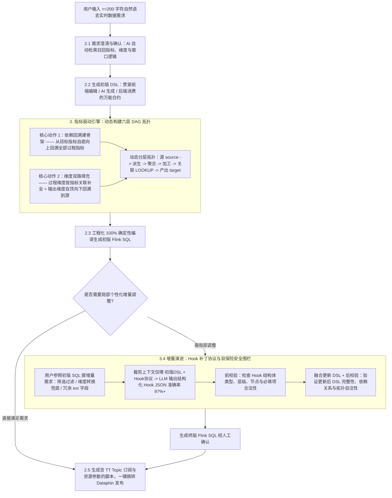

# AI理解、引擎驱动：零代码搭建实时数据链路

## 1. TL;DR

针对直播实时数据开发中流式窗口设计、双流关联、状态生命周期管理与乱序处理门槛极高、人工开发周期动辄按天计算的问题，淘天直播数据团队提出了**“AI 理解、指标驱动引擎构建”**的零代码实时数据研发范式。用户仅需输入 **`200 字符`以内**的自然语言需求，系统即可通过**“理解与正确性分离”**架构自动召回指标与维度并生成贯穿前后端与 AI 的共识契约 **DSL**；后端**指标驱动引擎**通过“依赖回溯建 DAG 骨架 + 维度双路填充”动态构建出“源 $\to$ 派生 $\to$ 聚合 $\to$ 加工 $\to$ 关联 $\to$ 产出”六层流式拓扑并 100% 确定性地编译为可一键发布至 Dataphin 的 **Flink SQL** 任务，将开发周期**从天级缩短至分钟级**。针对初版 SQL 后的个性化微调，系统设计了正交三要素 **Hook 增量补丁协议**（模型生成准确率达 **`97%+`**）与**前后双道安全围栏校验**，在不破坏拓扑自洽性的前提下消除了剩余 `3%` 的不确定性，并在实时数仓普遍缺失 DWS 公共层的背景下开创了“以指标资产沉淀替代传统 DWS 中间层”的复用路径。

## 2. 问题定义与背景

### 2.1 为什么实时数据开发比离线数仓“重”得多

在直播 360 大促分析、主播实时大屏、实时榜单及实时算法特征/策略调控等场景中，离线数据开发只需关注业务逻辑表达，而实时流式计算（Flink SQL）还必须额外应对四大底层复杂性：
1. **窗口设计（Windowing）**：滚动、滑动或会话窗口的边界与触发语义。
2. **双流关联语义（Stream-Stream / Lookup Join）**：多条无限动态流与维表的关联方式。
3. **状态生命周期管理（State TTL）**：无限流下的状态膨胀控制与清理。
4. **时间属性与乱序处理（Watermark & Late Data）**：事件时间、处理时间与迟到数据兜底。

### 2.2 切入洞察：将流式计算归约为声明式的“维度 + 指标”

作者指出，无论底层流式机制多复杂，数据链路的业务逻辑核心都可以抽象为**“在哪个维度上计算出什么指标（维度 + 指标）”**；指标之间的计算依赖天然构成一张有向无环图（DAG）。只要让用户只需“声明要什么指标”，将窗口、状态、乱序等工程复杂度封装进确定性的**指标驱动引擎**，就能实现零代码构建实时链路。

## 3. 知识框架



## 4. 核心内容拆解

### 4.1 指标驱动引擎：双核心动作、动态六层拓扑与四大链路机制

**核心主张**：整条流式链路不是预先写死的静态模板，而是由引擎根据目标指标的计算依赖自底向上回溯、动态生长出的 DAG 拓扑。

- **引擎的两大核心构建动作**：
  1. **依赖回溯建骨架**：从用户声明的“最终产出指标”出发，沿指标间的计算依赖关系自主回溯所有中间过程指标，自动构建出整个 Flink 任务的 DAG 拓扑骨架（决定需要哪些物理 `source`、生成多少个 `tmp_view`、各视图承担什么职责以及如何汇合到 `target`）。
  2. **维度双路填充（分治互不干扰）**：
     - **被指标引用的过程维度**：通过与指标的绑定关联关系就地补全。
     - **作为聚合粒度的输出维度**：从最终产出结果一路向上（向源表方向）回溯传导至源头。
- **动态六层流式拓扑与三种自适应形态**：
  - 在同时依赖心跳日志、消费日志和主播维表的实战案例中，引擎识别出行级派生、窗口聚合、封顶修正、维表关联与复合条件加工，自动拆解为**「源（Source） $\to$ 派生 $\to$ 聚合 $\to$ 加工 $\to$ 关联 $\to$ 产出（Target）」**六层结构。
  - **按需伸缩形态**：简单指标直接生成 `source → target`；窗口类指标生成 `source → tmp_view → target`；跨源复合指标则自动扩展出多条 `source` 支路、多个 `tmp_view` 与维表关联层。
- **典型案例中的四大链路工程机制**：
  1. **直通型 vs 复合型分流**：`xxx_pv/time/uv_10wmr` 三个基础指标自聚合层产出后层层直通不加工；而 `xxx_time_10wmr_cap_xxx` 是多数据源 + 维表的复合指标，在 `tmp_view_003` 完成三路依赖汇合（多级派生 + 跨源条件筛选）。
  2. **扇出复用（一次聚合、多路消费）**：中间过程指标 `xxx_time_period` 既直接向下游直通产出基础指标，又同时向上参与封顶修正与复合加工，避免重复窗口聚合计算。
  3. **维表旁路增强（Lookup Join）**：主播维表 `ldm_xxx_info` 仅在 `tmp_view_003` 通过 `LOOKUP` 横向“贴”入以补充 `xxx_level` 字段，作为旁路增强而不污染主链路聚合状态。
  4. **单向确定性全链路血缘**：任意产出指标均可单向回溯至确定的物理源表与原始字段（如 `xxx_time_10wmr_cap_xxx` $\leftarrow$ `dwd_{source_a}_.xxx_time` + `dwd_{source_b}_di.type` + `ldm_xxx_info.xxx_level`）。

### 4.2 链路的增量演进：为什么在初版 SQL 后通过 Hook 协议打补丁

**核心主张**：不要让 LLM 直接重写数百行的完整 DSL JSON，而是通过裁剪上下文仅输出正交三要素的“增量补丁指令（Hook）”，配合前后双道安全围栏将 `97%+` 的模型准确率补齐为 `100%` 可信的终版 SQL。

- **为什么将增量调整交互点设计在“初版 SQL 生成之后”**：
  1. **人机交互友好（Human-Friendly）**：若在最初提需求时让用户用自然语言凭空描述“在某个中间过程指标生成后注入过滤条件”，用户极难说清注入点位；而在看到初版 SQL 结构后，用户可直接指明“在 `tmp_view_xxx` 中增加 xx 指标大于 0 的过滤”。
  2. **架构复用边界清晰**：初始澄清阶段聚焦**高复用性的核心指标、维度资产召回与制式化窗口方案**；而增量调整解决的是面向具体应用（ADS 层）**一次性、高度个性化的局部诉求**（如局部口径过滤、输出时间格式转换或维度空值兜底、增加 `ext` 调试字段），不应污染公共指标资产库。
- **Hook 结构化协议的三要素正交设计与上下文裁剪**：
  - **严格裁剪上下文**：在增量分析时，只向 LLM 输入**“初版 DSL + Hook 增量协议”**，完全剔除初始需求分析、指标口径详情与冗长 SQL 文本，大幅压降幻觉。
  - **正交三要素 JSON Schema**：

```json
{
  "hooks": [
    {
      "hookType": "FILTER | DIMENSION_TRANSFORM",
      "layerType": "SOURCE | VIEW | TARGET",
      "nodeId": "source_001 | tmp_view_001 | target_001",
      "mergeStrategy": "REPLACE | APPEND_AND | APPEND_OR",
      "filterExpression": "仅 FILTER 类型时填写",
      "dimensionName": "仅 DIMENSION_TRANSFORM 类型时填写",
      "expression": "仅 DIMENSION_TRANSFORM 类型时填写",
      "reason": "简要说明为什么这样做"
    }
  ]
}
```

- 🔥 **双保险安全围栏校验（消除剩余 3% 不确定性）**：
  - **前校验（Pre-Validation）**：在应用 Hook 补丁前，校验 Hook 结构体自身的合法性与完整性（`hookType`、`layerType`、`nodeId` 是否存在及条件必填字段是否齐备）。
  - **后校验（Post-Validation）**：在将 Hook 按 `mergeStrategy` 融合进初版 DSL 后，校验新 DSL 的结构完整性、字段依赖关系与 DAG 拓扑自洽性。当前大模型生成 Hook 的准确率约为 **`97%+`**，前后双围栏将剩余 `3%` 的模型失误彻底拦截。

### 4.3 五大可迁移方法论与实时数仓资产沉淀路径

**核心主张**：通过“理解与正确性分离”“DSL 三方万能合约”以及“做厚指标资产层替代传统实时 DWS 层”，实现 AI 在高可靠流式计算生产环境的可持续落地。

| 方法论原则 | 核心设计机制 | 解决的工程矛盾 |
| :--- | :--- | :--- |
| **1. 指标驱动范式** | 将流式业务逻辑归约为“维度+指标”，沿指标依赖 DAG 自动回溯拓扑 | 把命令式的“怎么写 Flink SQL”转化为声明式的“要什么指标” |
| **2. 理解与正确性分离架构** | **AI Agent 只做翻译**（自然语言 $\to$ 结构化意图，不为合法性背书）；**后端引擎做执行与围栏校验**；**前端做 Human-in-the-Loop 确认** | 将 LLM 幻觉严格封锁在“理解层”，绝不允许穿透到“正确性层”污染生产 SQL |
| **3. DSL 作为多系统“万能合约”** | 同一份 DSL 同时作为 AI 生成目标、前端编辑对象与后端消费协议（字段贴近业务保人可读、枚举收敛保 AI 低幻觉、层级依赖显式保机器可校验） | 让前端、AI 与后端引擎三个异构系统低耦合对齐语义 |
| **4. Hook 三段式安全接入** | `LLM 输出结构化增量指令` $\to$ `确定性引擎执行合并` $\to$ `前后双围栏校验兜底` | 避免让 LLM 直接全量重写数百行复杂 JSON 导致结构损坏或全局不一致 |
| **5. 实时指标资产沉淀路径** | 直播实时数仓因时间窗口特性通常**只有 DWD 明细层而几乎没有公共 DWS 层**（传统 DWS 复用率极低）；改为将散落在各任务中的指标显式化、标准化沉淀为**“指标资产层”** | 破解实时数仓无法走离线“做厚 DWS 中间层”的老路，形成“用得越多、指标沉淀越厚、新任务组装越快”的正循环 |

## 5. 数据速查表

| 指标 / 配置项 | 原文数值 / 表达式 | 语境 / 条件 |
| :--- | :--- | :--- |
| 用户自然语言需求输入长度 | **`<= 200` 个字符** | 贯穿初版需求与增量调整的手动输入总量 |
| 实时数据任务端到端开发周期 | 从**天级**缩短至**分钟级** | 从自然语言描述到生成可发布 Dataphin 的 Flink SQL 任务脚本 |
| 案例动态生成的拓扑分层 | `6` 层：源（`source`） $\to$ 派生 $\to$ 聚合 $\to$ 加工 $\to$ 关联（`LOOKUP`） $\to$ 产出（`target`） | 跨心跳日志、消费日志与主播维表的复合指标实时链路 |
| Hook 协议核心枚举维度 | `hookType`（`FILTER` / `DIMENSION_TRANSFORM`）、`layerType`（`SOURCE` / `VIEW` / `TARGET`）、`mergeStrategy`（`REPLACE` / `APPEND_AND` / `APPEND_OR`） | 正交组合覆盖局部筛选过滤与维度转换/兜底场景 |
| 增量分析输入上下文范围 | 仅包含 **`初版 DSL + Hook 增量协议`** | 剔除初始需求分析、指标口径详情与完整 SQL 以降低幻觉 |
| 大模型生成 Hook 的准确率与兜底 | 模型直接生成准确率约 **`97%+`**，配合前后双围栏校验消除剩余 **`3%`** 不确定性 | 保障终版生产 Flink SQL 100% 可信 |

## 6. 踩坑与教训 / 可迁移的设计原则

| 错误做法 | 失败表现或原因 | 原文应对（可迁移的设计原则） |
| :--- | :--- | :--- |
| **让概率性的大模型直接生成或修改最终生产 Flink SQL 代码** | 流式 SQL 涉及复杂窗口、双流关联与多级临时视图，模型直接写 SQL 极易产生隐蔽语法或语义错误 | **“理解与正确性分离”架构**：让 AI 只负责将自然语言翻译为结构化意图（DSL / Hook），由确定性引擎负责拓扑回溯与 100% 准确的 SQL 编译 |
| **在局部增量修改时，把初始需求、指标口径、完整 SQL 全塞给 LLM 并让其输出完整新版 DSL** | 完整 DSL 动辄数百行且字段间存在严格关联约束，上下文过长分散注意力，模型全量重写极易改坏无关节点且难以增量校验 | **上下文裁剪 + Hook 增量补丁三段式**：只喂“初版 DSL + Hook 协议”，让 LLM 仅输出定位到 `layerType + nodeId` 的增量 Patch，经前后双道安全围栏校验后由引擎合并 |
| **在最初提需求阶段就要求用户一次性用自然语言说清所有中间过程过滤点位** | 用户在未看到链路结构前很难用简洁语言准确描述条件注入位置，且一次性个性化逻辑会污染公共高复用指标召回 | **两阶段交互分离**：首阶段聚焦高复用核心指标与制式窗口召回生成初版 SQL；二阶段让用户对照初版 SQL 的 `tmp_view` 提出局部增量微调 |
| **在实时数仓中照搬离线数仓“靠预聚合 DWS 层做厚中间层”的资产沉淀模式** | 实时流式数据受限于各种特异的时间窗口与状态属性，预聚合 DWS 表的跨任务复用效率极低 | **做厚声明式“指标资产层”**：物理公共层仅保留 DWD 明细层，将计算逻辑沉淀为标准化、可依赖回溯的指标资产，由引擎在创建新任务时按 DAG 动态生成并扇出复用 |

## 7. 记忆锚点

- **架构分离核心金句**：“不要让概率模型直接产出需要确定性保证的结果，而要让它产出‘意图’，再由确定性系统兑现‘结果’——让 LLM 负责‘理解’，让确定性代码负责‘正确性’。”
- **链路与补丁口诀**：“两百字符声明指标，依赖回溯建六层 DAG，维度双路分治填；增量不改全量 DSL，三要素 Hook 加双围栏，九七精度补成百。”

## 8. 复习卡片

指标驱动引擎是如何通过“两个核心动作”将一句“维度+指标”声明自动构建为完整 Flink 流式拓扑的？::一是“依赖回溯建骨架”，从最终要产出的目标指标出发，沿指标间的计算依赖关系自底向上回溯所有中间过程指标，动态生成 DAG 拓扑骨架；二是“维度双路填充”，被指标引用的过程维度通过与指标的关联关系就地补全，而作为聚合粒度的输出维度则从产出结果一路向上回溯传导至源表。
为什么系统将局部增量调整放在“初版 SQL 生成之后”，且只让 LLM 输出 `Hook` 结构体而不是直接修改完整 DSL？::放在初版 SQL 之后既便于用户直接参照 `tmp_view` 节点名准确描述注入位置，又能将一次性个性化逻辑（ADS 层）与高复用核心指标资产隔离开；而完整 DSL 动辄数百行且含跨字段约束，让 LLM 直接重写极不可靠，改为仅输入“初版 DSL + Hook 协议”并输出包含 `hookType`、`layerType + nodeId`、`mergeStrategy` 的增量补丁，配合前后双道安全围栏校验，可将 97%+ 的模型生成率转化为 100% 可信的终版 SQL。
在指标驱动引擎生成的六层链路（源 $\to$ 派生 $\to$ 聚合 $\to$ 加工 $\to$ 关联 $\to$ 产出）中，“扇出复用”和“维表旁路增强”是如何工作的？::“扇出复用”指中间聚合产出的过程指标（如 `xxx_time_period`）既直接直通输出为基础指标，又同时向上参与封顶与复合加工，实现一次聚合多路消费；“维表旁路增强”指主播维表仅在特定临时视图（如 `tmp_view_003`）通过 `LOOKUP` 横向贴入补充属性字段，不侵入主链路聚合状态。
作为贯穿前端、AI 与后端引擎的“万能合约”，DSL 的设计如何同时满足“人可读、AI 可生成、机器可执行”三重约束？::通过将字段语义贴近业务概念实现“人可读”，通过结构规整与枚举值严格收敛降低模型幻觉实现“AI 可生成”，并通过将层级结构与计算依赖关系显式化实现“机器可执行与可校验”。
为什么传统离线数仓“靠 DWS 预聚合表做厚中间层”的路径在直播实时数仓中失效，本文提出了什么替代沉淀路径？::因为实时流式计算受限于多样化的时间窗口属性，预聚合 DWS 表的跨任务复用率极低，公共层通常只有 DWD 明细层；团队改为将散落在各任务中的计算逻辑标准化为可依赖回溯的“指标资产层”，靠声明式指标复用加引擎动态拓扑生成替代物理 DWS 表沉淀。
当前这套指标驱动的零代码实时链路还有哪些明确的设计边界（待演进规划）？::当前 Hook 协议仅支持不改变任务逻辑拓扑结构的局部调整（筛选过滤、维度转换），尚未支持会改变拓扑结构的复杂增量需求（如多路输出），也暂不支持“生成逻辑反过来依赖某个过程指标数量级”的特殊派生维度。

## 9. 知识关联

- **本库通用主题**：[分布式计算与数据管道](../../20_topics/分布式计算与数据管道.md) · [Agent数据分析](../../20_topics/Agent数据分析.md) · [Harness与模型协同](../../20_topics/Harness与模型协同.md) · [决策知识结构化](../../20_topics/决策知识结构化.md)
- **本篇原始与转写材料**：[原始 PDF](RAW.pdf) · [逐页转写文本](MD.md)
- **候选双链**：[[指标驱动实时数仓引擎]] · [[理解与正确性分离架构]] · [[Hook增量补丁协议与双围栏校验]] · [[Flink-SQL动态DAG拓扑回溯]]

## 10. 原文参考资料

- **原文信息**：《AI理解、引擎驱动：零代码搭建实时数据链路》，作者：曦溪（淘天集团-直播技术数据团队），公众号：大淘宝技术，发布时间：`2026-08-18 23:31`（浙江）。
- **文内提及平台与组件**：`Apache Flink`（Flink SQL）、阿里 `Dataphin` 智能数据建设与治理平台、消息队列 `TT Topic`（内部系统未对外开源）。

> [!note]- 校对报告
> 1. **页码溯源汇总**：
>    - `p.1–2`：直播实时数据应用场景、流式计算相比离线的四大复杂特性（窗口设计、双流关联、状态生命周期、时间属性与乱序处理）及“维度+指标”声明式切入点。
>    - `p.2–6`：五步用户操作闭环（`2.1` 需求描述与澄清 $\to$ `2.2` DSL 确认 $\to$ `2.3` 初版 SQL 生成 $\to$ `2.4` 可选增量调整 $\to$ `2.5` 生成含 TT Topic 订阅与资源参数的 Dataphin 脚本一键发布）及 `200 字符`以内输入将周期从天级缩至分钟级的小结。
>    - `p.7–9`：指标驱动引擎两大核心动作（依赖回溯建骨架 + 维度双路填充）、动态六层拓扑（源 $\to$ 派生 $\to$ 聚合 $\to$ 加工 $\to$ 关联 $\to$ 产出）、三种自适应链路形态及案例四大机制（直通型 vs 复合型、扇出复用、维表 `LOOKUP` 旁路增强、单向确定性血缘树）。
>    - `p.9–11`：增量演进 Hook 机制——为何放在初版 SQL 生成后交互、三类适用场景（精炼口径/维度调整/输出 `ext` 冗余字段）、上下文裁剪（仅喂初版 DSL + Hook 协议）、14 行 Hook JSON Schema 原文及前后双保险安全围栏校验。
>    - `p.11–13`：五大可迁移方法论（指标驱动范式、理解与正确性分离架构、DSL 万能合约、Hook 协议 `97%+` 准确率加双校验消除 `3%` 不确定性、以指标资产层替代实时数仓缺失的 DWS 层）与五项未来规划。
> 2. **勘误与质量边界说明**：
>    - `p.10` 正文存在一处原文笔误（`从体检来看：在与用户的人工交互环节...` 中“体检”应为“体验”），笔记已按准确语境表述。
>    - `p.2–8, p.11, p.13` 包含前端交互截图、生成的 DSL/SQL 代码截图与链路拓扑图（位于 PDF 图像层），核心拓扑分层、血缘树与 Hook JSON Schema 均已在文本层完整提供。
> 3. **核验结论**：全文满足单 H1、10 大编号章节、正文零内联页码、6 条单行 `::` 复习卡片，所有数值、字段名与架构原则均与原文逐页对齐。
