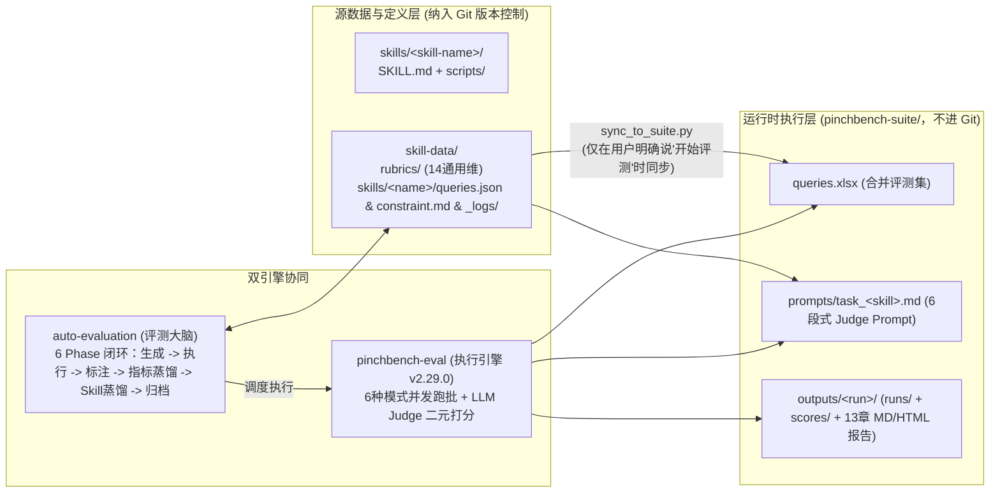

# 高价率运营 AI 工作台：约定驱动与 AI 编排的评测优化实践

> [!abstract] 导读
> **一句话总结**：淘天集团营销&交易技术团队针对“高价率运营 AI 工作台”（16 个业务 Skill、216 条评测用例）中传统测试失效、改一处崩一片的难题，将评测体系作为一等公民来建设——采用 **“约定驱动（目录固化规范）+ AI 编排（Claude Code 自然语言触发）”** 架构，构建了 **真实数据驱动的评测集生成、14 个通用维度 + 专项 `severe_violation` 钳制的 Rubric 体系、强制 0/1 二元评分的 LLM Judge，以及 `auto-evaluation`（6 阶段评测大脑）与 `pinchbench-eval`（项目无关执行引擎 v2.29.0）双引擎架构**；同时坦诚复盘了金标设计的四大陷阱以及评测飞轮跑通后在**入口（线上异常回流）、出口（修改建议精准归因）和记忆（四类 JSONL 决策日志）**上的三大深水区硬骨头。
> **阅读价值**：全文长达 41 页，是工业界关于 **Agent Skill 评测工程化与自进化飞轮反思** 最坦诚、最深刻的一线实战报告，堪称搭建生产级 Agent 评测系统的避坑百科全书。

## 1. TL;DR

- **为什么 Agent Skill 必须把评测当“一等公民”？** LLM Agent 没有确定性输入输出、失败模式皆为语义错误（流程跳步、参数臆造、把内部 `code` 直接抛给用户）、且 `SKILL.md` 改一行约束可能导致 10 个存量 Case 挂掉 3 个。
- **核心工程架构（约定驱动 + 双引擎解耦 + 二元评分）**：
  1. **约定驱动目录隔离**：源码与评测源数据 `skill-data/`（纳入 Git）与运行时执行环境 `pinchbench-suite/`（不入 Git）物理分离，仅当用户明确下达“开始评测”指令时才通过 `sync_to_suite.py` 单向同步，彻底杜绝并发污染与覆盖。
  2. **双引擎协同**：**`auto-evaluation`（6 Phase 评测大脑）**负责用例生成、指标蒸馏、Skill 蒸馏与闭环控制（最多 10 次迭代、问题识别率阈值 `0.95`、禁止 AI 自动落盘修改）；**`pinchbench-eval`（v2.29.0 纯执行引擎）**项目无关、支持整包迁移，负责跑批、6 段式 Prompt 调 LLM Judge 用 `Write` 工具直写评分 JSON 并生成 13 章诊断报告（含 Auto 规则分与 LLM 语义分差距 $\ge 0.2$ 的自检通道）。
  3. **Rubric 14 维体系 + 二元评分 + 严重违规钳制**：强制 LLM Judge 只能打 **`0.0` 或 `1.0` 二元分**（消除 `0.5` 和稀泥，提升跨评测者一致性与可解释性）；对核心红线维度标记 `severe_violation: true`，一旦得 `0.0` 分则整体得分直接钳制为 `0.0`，防止被其他维度高分稀释。
- **金标（`reference_data`）四大踩坑与飞轮三大深水区瓶颈**：
  - **金标四坑**：被测 Agent 偷看金标（需在 `evaluator.py` 用独立 `dataclass` 做类型级物理隔离）、`expected_flow` 粒度过细误判步骤合并、LLM 用旧 Agent 输出生成金标导致“自己批自己满分”、多轮追问只测最后一轮漏掉中间无效绕圈。
  - **飞轮三难（入口 > 记忆 > 出口 > 指标自动迭代）**：线上真实问题难回流（入口）、LLM 修改建议 80% 改不对层（出口）、缺少决策痕迹日志导致每圈从零空转（记忆，为此设计了按月分片的 4 类 JSONL 因果链日志与借鉴 Karpathy `autoresearch` 的 `SkillResearch` 原型）。

## 2. 问题定义与背景

### 2.1 高价率运营业务背景与 Agent 评测痛点
电商行业小二每日需高频处理高价播报、数据分发、同款校验、价格跟进与归因日报，单行业每天耗时数小时，新人需 2–3 个月才能熟练掌握。团队将其沉淀为“高价率运营 AI 工作台”的 **16 个业务 Skill**。然而上线初期“开发自己跑跑、产品看一眼就上”，导致线上故障频发且反馈周期长达数周。

### 2.2 为什么选择“0/1 二元评分”而非“0–1 连续打分”？

团队在同一批 30 个用例上由 3 个评测者（2 名人类专家 + 1 个 LLM Judge）对比了连续评分（允许 0.3、0.5、0.8）与二元评分（仅允许 `0.0` 或 `1.0`）：

| 评分机制 | 跨评测者一致性 | 可解释性与演进价值 | 对 Rubric 编写的倒逼作用 |
| :--- | :--- | :--- | :--- |
| **0–1 连续评分** | 低（0.6 算不算及格各执一词） | 模糊地带多，无法直接驱动修改决策 | 容忍含糊不清的评分描述 |
| **0.0 / 1.0 二元评分** | **极高**（逼迫做出非黑即白判断） | **可复现、可累计**（0 分必须给出违反哪条规则，直接转化为新 Checkpoint）、**可优化** | 倒逼团队将每条 Rubric 的合格/不合格边界划得刀锋般清晰 |

## 3. 知识框架

```mermaid
mindmap
  root((高价率AI工作台评测优化体系))
    1. 约定驱动与三层目录隔离
      skills/<name>/：SKILL.md (含 YAML triggers) + scripts/ + references/
      skill-data/ (进 Git)：rubrics/ (14通用维) + skills/<name>/ (queries/rubric/constraint/logs)
      pinchbench-suite/ (不进 Git)：queries.xlsx + prompts/ + outputs/
      同步桥：sync_to_suite.py (严禁提前同步，仅在明确开始评测时触发)
    2. 双引擎架构与 6 段式 Judge
      auto-evaluation (评测大脑)：6 Phase 闭环 (上限10轮 / 识别率≥0.95 / 人工Review落盘)
      pinchbench-eval (执行引擎 v2.29.0)：项目无关可迁移 / 6种运行模式 / 13章报告
      LLM Judge 设计：0/1 二元评分 + severe_violation 零分钳制 + Write 工具直写 JSON 防解析失败
    3. 金标 (reference_data) 四大工程陷阱
      坑1 信息泄漏：被测 Agent 看到金标开卷考试 -> dataclass 类型级硬隔离
      坑2 粒度过细：6步内部函数合并被判0分 -> 粗化为4个语义大阶段
      坑3 答案污染：LLM 抄旧 Agent 输出当金标 -> 严禁引用历史输出，人工入库把关
      坑4 多轮失真：只看最后一轮忽略中间绕圈 -> 新增 followup_expectation 逐轮打分
    4. 自动优化飞轮的三大硬骨头与演进
      难点零 (自指陷阱)：指标自动迭代等于自己改尺子量自己 -> 只加严不放宽 + 历史排序回归 + 换人Review
      难点一 (入口)：产研想象Case vs 用户真实问法 -> IdeaWork异常信号采集 + 半自动抽取脱敏
      难点二 (出口)：LLM 修改建议 80% 改不对层 -> 冻结对照评测集 + 单建议拆单 PR + N=3 复评
      难点三 (记忆)：模板齐全实例为零 -> Skill级按月 4 类 JSONL 决策日志 + SkillResearch 原型
```

## 4. 核心内容拆解

### 4.1 约定驱动目录结构与双引擎协同流水线



1. **三者联动单一事实源**：将 `SKILL.md` 作为单一事实源——评测集由 LLM 读取 `SKILL.md` 结合 MCP 实时查询的三类真实业务数据（员工岗位数据、高价率目标数据、高价商品汇总数据）自动生成 6 大类用例（典型、边界、追问、格式、触发词、真实 Case）；截止 2026 年 5 月初，16 个 Skill 共沉淀 **216 条用例（平均 13.5 条/Skill）**。
2. **14 个通用维度与专项 `severe_violation` 钳制**：
   - 14 个通用维度全是“线上出过一次事就补一条”踩出来的（例如：Agent 把内部字段 `curPrice` 直接展示给小二催生了 `name_code_distinction`；私调非白名单 API 催生了 `tool_compliance`；输出夹带 SQL 催生了 `output_compliance`）。
   - 在 16 个业务 Skill 中，**15 个定制了专项 `rubric_config.json`**，仅 1 个走通用配置（`pass_threshold: 0.7`）。当 `flow_adherence` 或 `param_correctness` 被标记为 `"severe_violation": true` 时，只要该项得 `0.0` 分，总分不再按权重加权，直接钳制为 `0.0`。
3. **LLM Judge 6 段式 Prompt 与 `Write` 工具落盘巧思**：
   - `pinchbench-suite/prompts/task_<skill>.md` 包含：`1. YAML frontmatter（喂给 LLM 前剥离，仅作标注页 Schema） → 2. 维度判定条件与违规示例 → 3. 评估输入占位符 → 4. 输出 JSON Schema → 5. 显式加权与钳制公式 → 6. 框架接入说明`。
   - **第 6 段关键设计**：要求 LLM Judge **直接调用 `Write` 工具将评分 JSON 写入 `{{OUTPUT_PATH}}` 文件**，而非返回文本字符串让外层正则解析，一举消除了“LLM 多说一句客套话导致 JSON 解析崩溃”的顽疾（针对偶发写半截导致 `final_score: None` 的情况，在 `reporter` 层增加降级标记使之可观测）。

### 4.2 金标（`reference_data`）演进 5 版踩过的四大工程陷阱

| 陷阱名称 | 真实故障现场 | 根因诊断 | 终极工程解法 |
| :--- | :--- | :--- | :--- |
| **坑一：被测 Agent 偷看金标（开卷考试）** | 某 Skill 在所有 Case 上输出与金标一字不差，甚至包含不可能知道的内部商家 ID。 | 早期 `runner` 与 `evaluator` 未拆净，`reference_data` 被拼进了被测 Agent 的输入 Prompt。 | 在 `evaluator.py` 中将 `RunnerInput` 与 `JudgeInput` 定义为**两个完全独立的 `dataclass`**，从类型系统层面彻底物理隔离金标（绝不能靠 Prompt 写“请勿偷看”）。 |
| **坑二：`expected_flow` 粒度过细误杀** | 6 步细粒度流程中，Agent 将“参数校验”与“查岗位权限”合并为一次调用，被 Judge 判少一步得 0 分。 | 把内部函数调用级细节写进了金标，限制了合理合并。 | **粗化金标粒度**：将 6 步合并为 4 个“语义大阶段”，并在 Rubric 中明文规定“允许步骤合并，只要业务语义等价”。 |
| **坑三：LLM 自动生成金标造成“答案污染”** | 人工抽查发现金标里的 `expected_output` 与 Agent 错误输出（含错别字和格式 Bug）一模一样，永远得满分。 | LLM 生成金标时偷懒参考了存量 Agent 的历史运行输出，变成“自己出题自己批卷”。 | 硬性规定 Phase 1 生成金标时**严禁读取任何已有 Agent 输出**（只能依据 `SKILL.md` 与真实数据推导），且入库前必须人工审核。 |
| **坑四：多轮追问金标只看“最后一轮”** | 用户第 1 轮已给商家名，Agent 在第 2–4 轮反复白痴追问“请问商家是？”，第 5 轮凑对答案竟得满分。 | 金标只约束了终态输出，未约束中间多轮交互过程。 | 在 `reference_data` 中新增 **`followup_expectation`** 字段，并将 Judge 改为**逐轮独立打分再聚合**，任一轮重复追问已知信息即整体降级。 |

### 4.3 评测飞轮跑通后的三大深水区瓶颈与 `SkillResearch` 探索

作者极具洞察力地指出：**搭起评测飞轮（Phase 0–3）不到 3 个月就能跑通，但飞轮“转得动”不等于“转得对”**。当前从半自动（5 小时人肉缩至 40 分钟跑批 + 10% 人工抽检）迈向全自动面临四大挑战：

1. **为什么“指标（Rubric）自动迭代”必须排在最后？（测量系统的自指悖论）**
   - Skill 是“学生答题”，Rubric 是“判卷尺子”。让 LLM 同时自动改 Skill 和改 Rubric，一旦分数上涨，根本无法区分是能力真提升了，还是 LLM 把判卷标准改松了、抑或过拟合了当前测试集。
   - **当前防御**：Rubric 只许加严不许放宽、每次改动必须跑过去 3 次评测全量历史 Case 验证**相对排序稳定性**、且 **PR Reviewer 必须换人（严禁提出建议者自己审，引入独立怀疑）**。
2. **难点一（入口）：线上真实问题如何进入飞轮？**
   - 产研脑补的 6 类模板贴近真实数据但贴不近小二千奇百怪的口语问法与跨 Skill 混问；目前 5% 的“真实 Case”靠人工每周扫群截图，制作 1 条耗时 10–20 分钟且存在幸存者偏差。
   - **演进主线**：从 IdeaWork 平台日志基于组合异常信号（连续追问、显式点踩、会话超长）自动捞取片段 $\rightarrow$ LLM 半自动切分与脱敏 $\rightarrow$ 人工二选一入库。
3. **难点二（出口）：为什么 LLM 给出的修改建议 80% 不合格？**
   - 低分根因可能出在 **`SKILL.md`、底层 `scripts/` 脚本 Bug、Rubric 歧义、或评测集金标错误** 四个不同层次，但 LLM 看不全脚本运行时细节，永远默认“往 `SKILL.md` 里狂加 `【强制】`”，且喜欢一次性重写半篇文档导致无法归因。
   - **演进主线**：将“被测 Skill 修改”与“评测集修改”拆分为独立 PR、设立永不修改的**冻结对照评测集**防自评成功、将 N 条建议自动拆分为 N 个独立小步 PR，并强制跑 **$N=3$ 次评测**抵消 Judge 5%–10% 的语义漂移。
4. **难点三（记忆）：消灭“模板齐全、实例为零”的失忆空转**
   - 团队发现此前设计的 Markdown 迭代日志模板全仓实例为 0，导致每次优化都从零猜起，失去了被拒建议的**负样本**。
   - **全新四类 JSONL 决策日志体系**：在 `skill-data/skills/<skill>/_logs/` 下按月维护 `annotation/`（人工标注）、`rubric_change/`（指标修改）、`skill_change/`（Skill修改）、`ai_suggestion/`（AI 建议及 `adopted/rejected` 结局）四个 JSONL 流，遵循**“只记不可逆决策、不记调试过程，JSONL 为事实层、`render_log.py` 渲染 Markdown 为阅读层，通过 Git Hooks 强制校验”**。
   - **借鉴 Karpathy `autoresearch` 构建 `SkillResearch` 原型**：基于 `run_n3.sh`（$N=3$ 采样 + 沙箱安全栓）与 `aggregate.py`（总分提升且无单维跌超阈值才 `keep`，否则 `git reset`），在真实 0508 评测集（基线 `pass_rate = 0.8307`）上跑通干跑闭环。

## 5. 数据速查表

| 维度 / 资产 | 核心数值 / 路径 / 阈值 | 关键工程规则说明 |
| :--- | :--- | :--- |
| **工作台规模** | **16 个**业务 Skill（15 个专项 Rubric + 1 个通用兜底）、**14 个**通用评测维度、**216 条**评测用例（均 **13.5 条/Skill**） | 单次全量评测从 **5 小时纯人工** 压缩至 **40 分钟自动跑批**（保留 **10%** 人工抽检） |
| **通用配置阈值** | `pass_threshold: 0.7`，5 维权重（路由 `0.4`、性能 `0.3`、意图 `0.1`、异常 `0.1`、表达 `0.1`） | 专项配置启用 `severe_violation: true` 时，任一严重项得 `0.0` 则总分直接钳制为 `0.0` |
| **`auto-evaluation` 约束** | **6 个 Phase**；最大迭代 **10 次**；问题识别率阈值 **`0.95`** | 严禁 AI 自动落盘修改 `SKILL.md` 或 Rubric，必须经人工 Review |
| **0504 路由倒退事故** | 总分倒退 **`-0.1007`**，**34 个**用例从满分跌至 0 分 | 根因：`price360-item-history-compare` 与 `query-high-price-rate` 触发词重叠 |
| **自检与漂移容忍度** | 13 章报告单列 **Auto 评分与 LLM 评分差距 $\ge 0.2$** 的 Case；Judge 语义漂移约 **5%–10%** | 单次波动 $\pm 0.05$ 不下结论，关键改动强制跑 **$N=3$ 次**取均值（`SkillResearch` 基线 `0.8307`） |
| **演进投入优先级** | **入口（线上回流） > 记忆（4类 JSONL 日志） > 出口（精准归因） > 指标自动迭代** | 在缺乏独立真值与历史决策负样本前，强推指标全自动迭代必然陷入“自评成功”陷阱 |

## 6. 踩坑与教训 / 可迁移的设计原则

- **铁律 1：大模型不会按字面意思“自律”，软约束必须套上代码级硬壳**
  - **教训**：在 Prompt 里写“请勿查看 `reference_data`”，Agent 照看无误；在 `SKILL.md` 里写“建议先调用 X 再调用 Y”，Agent 频繁跳步；让 LLM 返回 JSON 字符串，它总会多吐几句解释把解析器搞崩。
  - **可迁移解法**：信息隔离靠独立 `dataclass` 物理拆开；流程顺序靠 `【强制】/【禁止】` 字眼 + `severe_violation` 零分钳制；结构化评分输出靠让 Judge 直接调 `Write` 工具落盘文件 + `reporter` 空值兜底；触发条件靠状态机 + 兄弟 Skill 触发词互斥扫描。
- **铁律 2：警惕优化过程中的“按下葫芦浮起瓢”与“自评成功”**
  - **三问评审清单**：所有 Skill 优化 PR 合并前必须自答：（1）把当前指标推向极致是否伤害了其他有张力的指标？（2）是否滥用了“绝对禁止 X”导致边界场景误伤（应优先用分场景规则）？（3）是否同步补充了防止约束被滥用的**反向 Case（Negative Case）**？
- **铁律 3：被拒绝的 AI 修改建议（Rejected Suggestions）是最宝贵的负样本**
  - 日志系统切忌只记“最终改了什么”，必须把 AI 提议但被人类 Reviewer 否决的方案记录进 `ai_suggestion/*.jsonl`，否则自进化蒸馏器永远会在下一轮重复提出同样愚蠢的修改建议。

## 7. 记忆锚点

- **一个架构定式**：**约定驱动（`skills/` + `skill-data/` + `pinchbench-suite/` 三层分离） + 双引擎（`auto-evaluation` 大脑 + `pinchbench-eval` 执行器） + 0/1 二元评分**。
- **金标设计四防线**：**`dataclass` 类型隔离防偷看 $\rightarrow$ 语义大阶段防误判合并 $\rightarrow$ 禁读旧输出防答案污染 $\rightarrow$ `followup_expectation` 逐轮打分防多轮绕圈**。
- **飞轮演进四重奏（严格优先级）**：**入口（线上日志回流） > 记忆（4 类 JSONL 因果日志） > 出口（分层归因与单点拆 PR） > 指标自动迭代（防范自指陷阱）**。

## 8. 复习卡片

Why did the High-Price-Rate AI Workbench team adopt binary scoring (`0.0` or `1.0` only) instead of continuous scoring (`0.0` to `1.0`) for their LLM Judge?::Binary scoring forces the evaluator to make a decisive pass/fail judgment, which drastically improves inter-rater consistency, makes every `0.0` score actionable by requiring a specific rule-violation reason, and forces authors to write crystal-clear, unambiguous Rubric boundaries.
How does the `severe_violation` mechanism work in `rubric_config.json`, and what problem does it solve?::When a core dimension (such as `flow_adherence` or `param_correctness`) is marked with `severe_violation: true`, scoring `0.0` on that dimension clamps the entire case's final score to `0.0` instead of computing a weighted average, preventing critical safety or workflow failures from being masked by high scores on minor dimensions.
What were the four major pitfalls encountered when designing the `reference_data` golden labels, and how was each resolved?::1. Data leakage (Agent saw golden labels in prompt -> fixed via separate `dataclass` types for runner vs. judge inputs); 2. Overly granular `expected_flow` (penalized valid step merging -> coarsened into 4 high-level semantic stages); 3. Answer contamination (LLM copied buggy Agent outputs as golden labels -> banned reading past outputs during generation + mandatory human review); 4. Single-turn bias in multi-turn cases (ignored repetitive intermediate nagging -> added `followup_expectation` and per-turn scoring).
Why is automated iteration of evaluation Rubrics ("distilling metrics") considered dangerous and intentionally deprioritized?::Because of self-reference in the measurement system: if an LLM modifies both the Skill ("student's answer") and the Rubric ("grading scale") simultaneously, a higher score becomes meaningless—you cannot tell if the Agent genuinely improved or if the LLM simply loosened or overfitted the grading criteria.
Why do roughly 80% of LLM-generated Skill modification suggestions fail in Phase 5, and how does the team mitigate this?::Because low scores can stem from 4 distinct layers (`SKILL.md`, underlying `scripts/` bugs, Rubric ambiguity, or golden label errors), yet the LLM defaults to blindly adding `【强制】` rules to `SKILL.md` and rewriting large blocks at once; the team mitigates this via human review, splitting suggestions into atomic PRs, separating Skill PRs from test-set PRs, maintaining a frozen control test set, and running $N=3$ evaluations.
What are the four JSONL log streams designed under `skill-data/skills/<skill>/_logs/`, and why must rejected AI suggestions also be logged?::`annotation/`, `rubric_change/`, `skill_change/`, and `ai_suggestion/` (partitioned monthly per Skill and linked by IDs); logging rejected AI suggestions provides essential negative samples so future distillation phases learn which types of modifications fail or get vetoed by human reviewers.

## 9. 知识关联

- **本批同主题精读**：
  - [AI Agent 的 Skill 系统设计](../Agent Skill系统设计+26.7.1/AI_Agent Skill系统设计.md)：从单个 Skill 的内部结构（`description` 路由、`<HARD-GATE>`、前向测试）出发，与本文多 Skill 工作台的规模化评测飞轮互为上下游。
  - [AI 评测还在看准确率？数据科学早就用因果推断做归因分析了](../AI评测因果推断归因+26.8.10/AI_AI评测因果推断归因.md)：本文第 5.5 节指出的“出口难：LLM 分不清低分根因到底在哪一层模块”，恰好可以结合因果推断（SCM + DML + Causal Shapley）做定量的子模块责任归因。
  - [AINMM：存量生产级工程向 AI Native 演进的五级成熟度模型](../AINMM五级成熟度模型+26.7.14/AI_AINMM五级成熟度模型.md)：本文所攻克的“线上问题回流（入口）+ 决策日志（记忆）+ 受控蒸馏（出口）”，正是 AINMM 从 ML3 迈向 ML4（已量化管理与受控自进化）最核心的过程域基建。
- **主题索引（`20_topics`）**：
  - [Skill设计与治理](../../20_topics/Skill设计与治理.md)
  - [Harness与模型协同](../../20_topics/Harness与模型协同.md)
  - [AI研发协同](../../20_topics/AI研发协同.md)
- **本目录归档文件**：[原始 PDF](RAW.pdf) · [逐页转写文本](MD.md)
- **候选概念双链**：[[LLM-as-a-Judge]] · [[二元评分]] · [[金标设计]] · [[约定优于配置]] · [[自进化飞轮]] · [[评测信息隔离]]

## 10. 原文参考资料

- **原文出处**：大淘宝技术公众号，《高价率运营 AI 工作台：约定驱动与 AI 编排的评测优化实践》（作者：淘天集团-营销&交易技术团队，发布日期：2026-07-16）
- **文中提及的外部参考框架**：
  - Andrej Karpathy，`autoresearch`（2026 年 3 月开源的自主实验循环最小骨架，本文据此改造出面向语义评测的 `SkillResearch` 原型）

> [!note]- 校对报告
> - **页码溯源（1-based 物理页码）**：
>   - 篇首标题、高价率运营业务背景、LLM Agent 评测三大痛点与“约定驱动 + AI 编排”三层总体架构（16 个 Skill、14 个通用维度、216 条评测用例）：源自 `RAW.pdf` `p.1–5`（对应 `MD.md` 第 1–5 页）。
>   - 三者联动单一事实源、基于 MCP 真实业务数据的 6 类评测用例生成、14 个通用维度来历、专项 `severe_violation` 钳制与 0.0/1.0 二元评分机制：源自 `RAW.pdf` `p.5–13`（对应 `MD.md` 第 5–13 页）。
>   - `auto-evaluation`（6 Phase 大脑）与 `pinchbench-eval`（v2.29.0 执行引擎）双引擎架构、`sync_to_suite.py` 同步桥、13 章报告自检通道、金标 `reference_data` 四大踩坑与 6 段式 Judge Prompt 及评测四大工程坑（0504 评测 `-0.1007` 分触发词重叠事故等）：源自 `RAW.pdf` `p.13–24`（对应 `MD.md` 第 13–24 页）。
>   - 半自动演进（5h $\rightarrow$ 40min + 10% 人工抽检）、指标自动迭代的自指危险、飞轮三大硬骨头（5.4 入口线上问题回流、5.5 出口 80% 建议改不对层、5.6 记忆四类按月 JSONL 决策日志体系）及 `SkillResearch`（基线 `0.8307`）演进路线：源自 `RAW.pdf` `p.24–41`（对应 `MD.md` 第 24–41 页）。
> - **一致性核验**：原文共 41 页（含 18 页架构图与表格），文中展示的 JSON/YAML 片段均为简短配置与日志结构示例，无独立长篇外部 Prompt/Skill 全文需额外剥离。全文零正文内页码引用，全部数据指标与 `MD.md` 完全一致。
