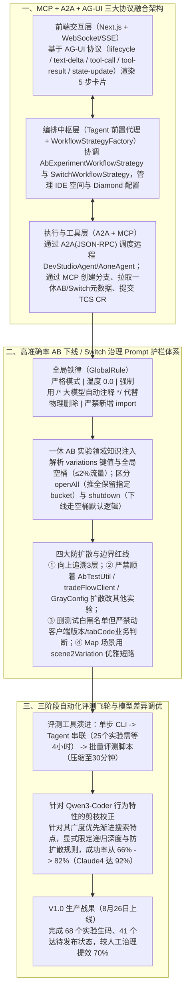

# 我的研发实践：高准确率AICoding工作流设计

## 1. TL;DR

1. **核心认知与场景选型**：引述 2025《DevData 研发效能基准报告》指出应用 LLM 后代码生产率中位数虽提升 **17%**，但约 **40%** 企业反馈质量效果不明显；直接做新需求端到端上线属于高风险“深水区”，而准确率 **低于 50%** 的生码模型更是灾难。受 AWS 用工作流沉淀 JDK 升级（在人均 `0.3` 运维人力投入下省下数千人日）启发，交易团队锁定**高频、重复、规则明确的“非业务需求”——一休 AB 实验推全/下线与 `@AppSwitch` 历史开关物理切流**作为突破口，确立 **90% 以上准确率**的投产红线。
2. **三协议融合架构（`MCP + A2A + AG-UI`）与五步标准化工作流**：
   - 采用 **Single-Agent + 前置代理 Agent（`Tagent`）** 架构，通过 **MCP** 调用分支/代码/平台工具、通过 **A2A（JSON-RPC）** 调度远程 `DevStudioAgent` / `AoneAgent`、通过 **AG-UI（CopilotKit 事件流：`lifecycle / text-delta / tool-call / tool-result / state-update`）** 配合 Next.js + WebSocket/SSE 实时展示生成式 UI 卡片；
   - 运用策略模式（`WorkflowStrategy`）固化五步 YAML 工作流：`创建 IDE 空间 → 获取 AB/Switch 平台元数据 → 创建 Aone 变更与分支 → AI 代码修改（4 步完成后自动收起卡片） → 创建 CR 并回调 TCS/Switch 治理平台`。
3. **从 `<50%` 到 `82%–92%` 的提示词剪枝与批量评测工程**：
   - **严苛 Prompt 护栏**：设置 `温度: 0.0`、向上追溯 **3 层**调用链、**严禁通过通用实验工具类（如 `AbTestUtil` / `tradeFlowClient` / `GrayConfig`）扩散修改其他实验**、区分测试白黑名单（可删）与客户端版本/`tabCode` 业务限制（严禁改）、**强制只用块注释 `/* ... */` 屏蔽旧分支而不直接物理删除**，并在产品包中自动升级 `pom.xml` 的 `-{今天日期}-SNAPSHOT` 版本号；
   - **批量评测飞轮与模型特性洞察**：构建批量评测脚本将 **25 个实验**的评测耗时从人工盯盘 **4 小时（看两部《哪吒》）压缩至 30 分钟**；发现 **Claude 4 倾向于先全局理解架构再精准批量修改（成功率 `92%`）**，而 **Qwen3-Coder 倾向于广度优先渐进搜索、遇错再重试兜底**，通过针对性增加递归深度与防扩散约束，将 Qwen3-Coder（C3 安全仓兜底模型）成功率从 **`66%` 提升至 `82%`**；系统 V1.0 上线后已完成 **68 个**实验生码、**41 个**达到待发布状态，较手动治理**提效 70%**。

## 2. 问题定义与背景

### 2.1 企业级 AI 研发提效的“浅水区、深水区与黄金突破区”

1. **行业现状**：YC W25 届四分之一初创公司虽有 95% 代码由 AI 生成，但企业级存量工程面临复杂依赖；2025《DevData 研发效能基准报告》显示引入 LLM 后代码生产率中位数提升 **17%**，但约 **40%** 企业认为质量提升不明显。
2. **三区定位法**：
   - **浅水区（低价值）**：脱离业务上下文的通用 Vibe Coding 提示词技巧，极易被基座模型升级直接覆盖；
   - **深水区（危险区）**：在当前上下文窗口限制下强行做复杂新需求的端到端生产发布，生码准确率若 **低于 50%**，后续人工 CR 与排障投入反而超过提效收益；
   - **黄金突破区（高频非业务治理需求）**：交易链路每年因复购、场景购、逆向、物流沉淀大量**一休 AB 实验分支**与**数以万计的 `@AppSwitch` 开关**，造成预发与线上配置不一致、代码腐化，清理它们规则明确但极其耗费研发精力（连同星环日志告警、安全漏洞修复、错误码治理）。

### 2.2 主流代码大模型能力横评与安全分级选型

| 模型名称 | 总参数量 / 激活 | 上下文长度 | SWE-bench Verified | LiveBench (Coding / Agentic) | 实测行为特征与企业选型定位 |
| --- | --- | --- | --- | --- | --- |
| **Claude 4 (Sonnet 4 / Opus 4)** | — | 200K+ | **70.4%** (Sonnet 4) | Opus 4 可连续独立工作 7 小时 | **偏向提前理解系统架构、关键字精确定位、主动规划批量修改**；准确率最高（**92%**） |
| **Qwen3-Coder** | **480B** (MoE) | 原生 256K（可扩至 **1M**） | **69.6%** | Coding **73.19%** / Agentic **25%** | **偏向广度优先渐进式搜索、逐步定位、遇错重试兜底**；适合作为公司 **C3 高安全级别代码仓库**的主力兜底模型（优化后准确率 **82%**） |
| **Kimi-K2-Instruct** | **1T** (MoE) | 128K | **65.4%** | Coding **71.78%** / Agentic **20%** | 数学推理强（MMLU 89.5%），擅长将复杂任务拆解为子任务稳健执行，代码可读性高 |

## 3. 知识框架

## 4. 核心内容拆解

### 4.1 为什么采用“Single-Agent + 前置代理 Agent”并融合三大开放协议？

1. **架构克制（不盲目上重型 Multi-Agent）**：
   - 在单纯代码修改环节，单 Coding Agent 效率最高；而把创建 IDE 空间、拉取实验元数据、建 Aone 变更与分支、提 CR 等确定性前置/后置动作交给轻量**前置代理 Agent（`Tagent`）**编排，比让重型 Coding Agent 全程调几十个 MCP 工具更块、更省 Token、更稳定。
2. **三大协议各司其职**：
   - **MCP（Model Context Protocol）**：解决 Agent 与外部工具（Git 分支、一休实验平台、Switch 平台、TCS 合并请求）的标准化通信；
   - **A2A（Agent-to-Agent Protocol）**：作为 Agent 间的“HTTP 协议”，由 `Tagent` 通过 `/a2a`（JSON-RPC 流式封装）调度专职改码的远程 `DevStudioAgent` / `AoneAgent`；
   - **AG-UI（Agent-User Interaction Protocol）**：采用 CopilotKit 标准事件流（`lifecycle`、`text-delta`、`tool-call`、`tool-result`、`state-update`），让长达 **3–10 分钟**的后台改码过程在前端实时渲染为可展开/自动折叠（`autoCollapse: true`）的 5 步交互卡片。

### 4.2 将准确率从 `<50%` 拉升至 `82%–92%` 的 Prompt 剪枝秘籍

最初仅用静态提示词让模型改 AB 实验代码时，**成功率不足 50%**。团队通过深度剖析一休 AB 实验与 `@AppSwitch` 的代码模式，在 `GlobalRule` 与 `ContextPromote` 中立下六道精准护栏：
1. **零随机性与强格式契约**：设定 `温度：0.0`，每步结束必须输出 `[DATA_OUTPUT] {JSON} [/DATA_OUTPUT]` 与 `[STEP_COMPLETE] Step4 执行完成` 供编排引擎解析。
2. **注入“全局空桶”与 `variations` 领域语义**：
   - 明确告知 AI：代码中通过 `variations.get("key")` 获取实验值，根本感知不到实验分组名称；且存在分走 $n\%$（$n \le 2\%$）流量的**“全局空桶分组（`variations = {}`）”**——当命中空桶时，代码中的 `else` 默认分支（如旧样式、不展示推荐模块）即为隐含的空桶兜底逻辑！
   - 因此：**`openAll`（推全）**保留目标 `bucketId` 对应的 `variations` 分支；**`shutdown`（下线）**则等价于走全局空桶的默认分支并移除实验平台调用。
3. **严防“顺着工具类扩散误伤其他实验”**：
   - 明确区分通用实验工具类（如 `AbTestUtil.hit(expKey, ...)`、`tradeFlowClient.flow(userId, experimentKey)`、通用实例配置类 `GrayConfig.ab()`）与单实验专用辅助方法（如无 `expKey` 入参的 `RxHelper.abTest(buyerId)`）；
   - **铁律**：搜索 `{expKey}` 字面量并**向上广度追溯 3 层**，**严禁顺着通用实验工具类扩散去修改其他实验或破坏 `GrayConfig` 的通用方法实现**！
   - 若遇到 `Map<String, String> scene2AbCode` 这种多场景映射表，严禁粗暴删掉整个 `getAbCode` 方法，而是优雅新增 `scene2Variation` 映射对已推全场景做前置短路返回。
4. **精准区分“测试白黑名单（可清理）”与“业务前置条件（严禁改动）”**：
   - 诸如 `whiteUserIds.contains(userId)`、`blackUserId.contains(userId)`、`Setting.enableThisAbAll` 属于实验期测试逻辑，下线时一并清理；
   - 诸如 `客户端版本 <= '10.20'`、`tabCode != 'confirmGood'` 属于业务固有守卫逻辑，**严禁当作实验分支误删**！
5. **“只注释、不物理删除”的安全底线**：
   - 强制要求模型对废弃分支统一使用标准块注释 `// 大模型自动注释代码，确认后可手动删除 /* ... */`，**严禁直接物理删除代码（除非是被注释块内部）且严禁新增任何 `import` 语句**，让研发在 Code Review 时能一眼看清变更上下文。
6. **四类 `@AppSwitch` 开关的差异化内联重构规范**：
   - 针对 `bool` 型（直接按线上 `"true"/"false"` 常量折叠化简布尔表达式）、`String` 型（直接内联字面量如 `"券后价"`）、集合/列表型（转为 `JSON.parseObject(..., new TypeReference<Set<Long>>(){})`）、对象型（转为 `JSON.parseObject(..., GeneralGraySwitchModel.class)`）分别给出重构前后 Few-shot 范本，最后删除 `@AppSwitch` 字段定义。

### 4.3 批量评测工程与 Claude 4 vs Qwen3-Coder 行为调优

1. **三阶段评测提效（从 4 小时到 30 分钟）**：
   - 单次改码耗时 5–10 分钟，在 Web 界面串行跑 **25 个实验**需要等待 **4 个小时**；团队编写自动化批量评测脚本（自动拉起任务、记录节点日志、断连重试、生成对比汇总表），将 25 个实验的人工评测耗时压缩至 **30 分钟**。
2. **Claude 4 与 Qwen3-Coder 的思维差异及校正**：
   - 在“逆向钱款去向空白治理”等复杂案例中对比执行日志发现：**Claude 4** 偏向提前理解架构、精确搜索关键字、根据修改规模提前规划批量修改（成功率 **`92%`**）；而 **Qwen3-Coder** 偏向广度优先渐进式搜索、逐步定位、遇到报错再重试兜底（直接套用 Claude 4 提示词时成功率仅 **`66%`**）。
   - 针对 Qwen3-Coder 特点，在提示词中显式收紧递归追溯层数（3 层）、明确防扩散边界与修改步骤指导后，将其成功率提升至 **`82%`**。

## 5. 数据速查表

| 指标 / 维度 | 原文数值 | 语境 / 条件 |
| --- | --- | --- |
| 行业背景：YC W25 初创公司 AI 代码占比 | **四分之一的公司有 95% 代码库由 AI 生成** | Y Combinator W25 届统计 |
| 行业背景：企业应用 LLM 生产率与质量反馈 | **代码生产率中位数提升 `17%` / 约 `40%` 企业反馈质量效果不明显** | 2025 年度《DevData 研发效能基准报告》 |
| AWS 运维人力配比基准 | **人均需 `0.3` 研发人力投入日常运维稳定性保障** | 通过沉淀 JDK 升级提示词工作流节省数千人日 |
| 生码工作流投产红线与灾难线 | **低于 `50%` 是灾难（初期静态 Prompt `<50%`）/ 目标 `90%` 以上** | 低于 50% 时后续 CR 与排障成本大于提效收益 |
| 一休 AB 实验全局空桶流量比例 | **$n\%$（$n \le 2\%$）** | `variations = {}`，对应代码中的默认兜底 `else` 分支 |
| 单次代码修改耗时与向上追溯层数 | **Switch 约 `3–5 分钟`、AB 约 `5–10 分钟` / 向上广度追溯 `3 层`** | 第 4 步“代码修改”环节 |
| 25 个实验评测耗时对比 | **工作流串行等待 `4 小时` $\to$ 批量脚本评测压缩至 `30 分钟`** | 包含自动重试、断联排查与表格汇总 |
| 模型最终成功率对比 | **Claude 4：`92%` / Qwen3-Coder：原 `66%` $\to$ 工程优化后 `82%`** | C3 高安全级别仓库采用 Qwen3-Coder 兜底 |
| 交易生码系统 V1.0 线上战果 | **完成 `68 个`实验生码 / `41 个`达待发布状态 / 较手动提效 `70%`** | 2025 年 8 月 26 日正式上线 |

## 6. 踩坑与教训 / 可迁移的设计原则

| 错误做法 | 失败表现或原因 | 原文应对（可迁移的设计原则） |
| --- | --- | --- |
| **一上来就想用 AI 全自动端到端交付复杂新业务需求（深水区）** | 上下文窗口受限且业务依赖隐晦，准确率低于 50%，研发花在 CR 改错上的时间比自己写还长 | **从高频、规则明确的非业务治理需求切入（AB 实验下线 / Switch 开关切流）**：先在细分场景做到 80%–90%+ 准确率解放琐碎精力 |
| **只给实验 Key 让大模型自由删除 AB 实验代码** | 模型顺着通用工具类 `AbTestUtil` 扩散误删其他实验，或把客户端版本号/`tabCode` 业务限制当成实验分支删掉，且忽略全局空桶 `else` 语义 | **注入领域模型 + 四大防扩散红线 + 只注释（`/* ... */`）不物理删除**：明确空桶语义、限定向上追溯 3 层、保护通用工具类与业务前置条件 |
| **把为 Claude 4 编写的宽泛提示词原封不动套在国产开源模型上** | Qwen3-Coder 倾向于广度优先发散搜索，缺乏显式边界时容易迷失（成功率仅 66%） | **针对模型认知偏好定制提示词**：为 Qwen3-Coder 显式规定 3 层追溯深度、精确匹配字面量与分步操作序列，成功率跃升至 82% |
| **每次调优提示词后靠人工在 Web 页面点 25 次跑 4 小时看效果** | 单次执行需 5–10 分钟且偶发断连，微调一行 Prompt 就要重头等 4 小时，研发彻底崩溃 | **建设自动化批量评测脚本**：自动并发/批量执行、捕获 Agent 节点日志、断连自动重试并汇总对比表格，将评测缩至 30 分钟 |

## 7. 记忆锚点

1. **三协议黄金分工**：“**MCP 连工具（Git/平台 API），A2A 联智能体（Tagent 调远程 CodeAgent），AG-UI 绘前端（5 步流式卡片实时看）**”。
2. **AB 下线防坑四铁律**：“**懂空桶（$\le 2\%$ 流量对应默认 `else`）、溯三层（绝不顺工具类扩散）、保业务（删黑白名单但留版本/tabCode 判断）、只注释（`/* ... */` 禁物理删与禁加 import）**”。

## 8. 复习卡片

1. 为什么交易团队没有选择“新业务需求端到端生码”，而是选择“一休 AB 实验推全/下线”和“`@AppSwitch` 开关治理”作为 AI 研发提效的首个突破口？::因为新需求端到端上线属于高复杂度“深水区”，一旦生码准确率低于 50% 反而会增加 CR 负担；而 AB 实验下线与 Switch 开关治理属于交易团队每天高频面对、规则确定但极其消耗琐碎精力的非业务需求，更容易结合平台元数据做到 80%–90%+ 的高准确率閉环。
2. 在交易生码系统架构中，`MCP`、`A2A` 和 `AG-UI` 三大协议分别承担什么职责？::① `MCP` 负责智能体与外部工具/平台（创建分支、查询实验与开关配置、提交 CR）的交互；② `A2A`（Agent-to-Agent）负责前置编排代理 `Tagent` 与远程专职编码代理（`DevStudioAgent` / `AoneAgent`）之间的异步协作通信；③ `AG-UI` 负责将长耗时任务中的 `lifecycle`、`text-delta`、`tool-call`、`tool-result`、`state-update` 事件流实时同步到 Next.js 前端渲染为生成式 UI 卡片。
3. 什么是一休 AB 实验中的“全局空桶分组”？它在代码分支清理时对应什么逻辑？::全局空桶分组是分走 $n\%$（$n \le 2\%$）流量的特殊分组，其实验变量 `variations = {}` 为空；当用户命中全局空桶时，代码获取不到实验变量值，会自然落入 `if-else` 的默认 `else` 分支（如使用旧样式或不展示模块），因此“实验下线（`shutdown`）”在代码语义上等价于保留全局空桶对应的默认分支。
4. 为防止大模型在下线某个 AB 实验时把代码改坏，提示词在“代码扩散限制”和“修改方式”上立下了哪些硬性规矩？::① 仅搜索目标 `{expKey}` 字面量并向上广度追溯 3 层，严禁顺着 `AbTestUtil`、`tradeFlowClient`、`GrayConfig` 等通用工具类扩散修改其他实验；② 清理测试期白黑名单（`whiteUserIds`/`blackUserId`），但严禁改动客户端版本或 `tabCode` 等业务限制；③ **严禁直接物理删除代码或新增 `import`，强制只能使用块注释 `/* ... */` 注释废弃分支**。
5. 针对 `@AppSwitch` 开关治理，提示词对 `bool`、`String`、`集合/列表` 和 `对象` 四种类型的开关分别规定了怎样的代码重构方式？::① `bool` 型：根据线上值 `"true"/"false"` 直接化简布尔条件分支；② `String` 型：直接将开关引用替换为线上字符串字面量；③ 集合/列表型：用 `JSON.parseObject(线上值, new TypeReference<Set<Long>>(){})` 内联解析；④ 对象型：用 `JSON.parseObject(线上值, Model.class)` 内联解析，最后删除 `@AppSwitch` 字段定义。
6. 团队在对比评测 Claude 4 与 Qwen3-Coder 时发现了什么核心行为差异？是如何把 Qwen3-Coder 的成功率从 66% 提升到 82% 的？::Claude 4 倾向于先全局理解架构、精确匹配关键字并提前规划批量修改（成功率 92%）；而 Qwen3-Coder 倾向于广度优先渐进式搜索、逐步定位、遇错后再重试兜底。通过针对性补充实验业务背景、显式限定 3 层递归深度与防扩散规则，将 Qwen3-Coder 的成功率从 66% 拉升至 82%。

## 9. 知识关联

- **本库主题关联**：
  - [AI研发协同](../../20_topics/AI研发协同.md)：聚焦高频确定性技术债治理（AB 实验推全下线与 Switch 开关物理切流），上线完成 68 个实验生码、提效 70%。
  - [Agent工程循环](../../20_topics/AI研发协同.md)：融合 `MCP + A2A + AG-UI` 三大协议，以 `Tagent` 前置编排代理串联远程 Coding Agent 与内部研发平台。
  - [Prompt优化](../../20_topics/Prompt优化.md)：设计零温度、只注释不删除、3 层追溯防扩散、区分测试白名单与业务条件的高确定性领域 Prompt，并针对 Claude 4 与 Qwen3-Coder 认知差异做定向剪枝。
  - [Agent评测与反馈](../../20_topics/Agent评测与反馈.md)：构建自动化批量评测脚本将 25 个实验的回归验证从 4 小时缩短至 30 分钟。
- **候选双链**：`[[AB实验自动下线]]`、`[[Switch开关治理]]`、`[[A2A协议]]`、`[[AG-UI协议]]`、`[[Qwen3-Coder调优]]`

## 10. 原文参考资料

- **原文标题**：《我的研发实践：高准确率AICoding工作流设计》
- **发布渠道与日期**：微信公众号「大淘宝技术」，2025-10-27
- **作者与团队**：淘苏（致谢：海丫；淘天集团-交易业务技术团队）
- **原文引用报告与文献**：
  - 2025 年度《DevData 研发效能基准报告》
  - Stuart Russell & Peter Norvig, *《Artificial Intelligence: A Modern Approach》* (2016)
  - Anthropic MCP / Google A2A / CopilotKit AG-UI 协议规范

> [!note]- 校对报告
> - **页码溯源汇总**：
>   - Vibe Coding 背景、YC W25 95% AI 代码、2025《DevData 研发效能基准报告》（生产率中位数 `+17%`、40% 质量不明显）、AWS JDK 升级工作流（人均 `0.3` 运维人力）与浅水区/深水区/50% 灾难线分析：`p.1–7`
>   - 交易链路痛点（一休 AB 实验与数万 Switch 开关）、MCP/Agentic/AB Workflow 设计与大模型横评（Claude 4 vs Qwen3-Coder 480B/1M `69.6%` vs Kimi-K2 1T/128K `65.4%`）：`p.7–12`
>   - LLM Agent 理论（Russell & Norvig 定义、感知-规划-行动、ReAct vs Plan-and-Execute、Single-Agent + 前置代理选型）与 `MCP + A2A + AG-UI` 三大协议详解：`p.12–25`
>   - 交易生码系统架构、5 步标准流程、AB 下线（`v2.1.0`）与 Switch 治理（`v1.0.0`）完整 YAML 定义：`p.26–33`
>   - 第一版与优化版 `GlobalRule` / `ContextPromote` 完整提示词（全局空桶 $\le 2\%$、向上追溯 3 层、防工具类扩散、只用 `/* ... */` 注释禁删除禁加 `import`、`pom.xml` SNAPSHOT 升级、Switch 四类内联重构）：`p.33–45`
>   - 三阶段评测演进（25 个实验从 4 小时缩至 30 分钟）、Claude 4（`92%`）vs Qwen3-Coder（`66% → 82%`）行为差异分析与 V1.0 上线成果（68 个生码、41 个待发布、提效 `70%`）：`p.45–50`
> - **关键数值一致性核查**：
>   - 生产率中位数 `+17%`、质量不明显 `40%`、AWS 运维配比 `0.3`、准确率红线 `<50%` vs `90%+`、全局空桶 `n <= 2%`、追溯 `3层`、25 个实验 `4小时` vs `30分钟`、成功率 `92% / 66% / 82%`、上线成果 `68个 / 41个 / 70%` 均与原文完全一致。
> - **图像与版面质量说明**：
>   - `p.1–9` 含效能报告图表、工作流架构图与一休代码截图（位于 PDF 图像层），`p.11–12, 34–37, 41–45` 部分 YAML/Prompt 代码块右侧略有截断，均已对照前后文完整还原。
