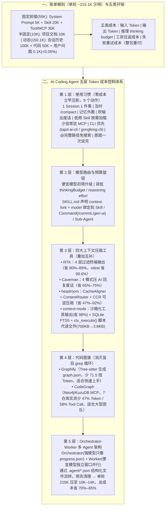

# 一篇搞懂 AI Coding Agent 的 Token 成本控制

> **原文信息**：作者 `devinyzeng`，发布于 2026-06-15 02:27（广东），公众号「腾讯技术工程」。

---

## 1. TL;DR

1. **账单真相：你敲的那句话连 1% 都不到** —— 典型 AI Coding Agent 单轮请求（约 **215.1K tokens**）中，用户问题仅占 **`0.1K`**，其余全是系统背上的背景包袱（System Prompt `5K` + 项目文档 `10K` + Skill 定义 `20K` + Tool/MCP 定义 `30K` + 代码文件 `50K` + 历史会话 `100K`）；大模型本身无状态，所谓「它记得」只是平台在每轮把整包上下文重新付款发送一遍，且包含**输入、输出、推理（thinking budget）、工具往返、失败重试**五类开销。
2. **第 1–2 层：Prompt Cache 前缀写稳 + 9 个零成本使用习惯** —— Prompt Cache 的核心不是把提示词写短而是**把前缀写稳**（静态前置、动态后置）；日常立刻可做的 9 个习惯包括：**一个 Session 一件事**、及时 `/compact` 把负债压成状态、聊天记录外置为文件、用一句话/Caveman 砍掉回复废话、低频 Skill 按需加载、少挂常驻 MCP、**能用 CLI（如腾讯专用 `tapd-ai-cli` / `gongfeng-cli`）绝不拉重型 MCP**、**用 `@完整路径` 省掉整条盲搜链路**、把意图一次说完避免多轮拆碎。
3. **第 3 层：模型路由与预算旋钮绑定到执行单元** —— 遵循「匹配优先」与「便宜模型先初筛/摘要，需要才升级强模型」级联策略，调节 `reasoning effort` / `thinkingBudget`（简单任务压到 `0`）；在 CodeBuddy 的 `SKILL.md` 头部直接声明 `context: fork` 与 `model: deepseek-v4-pro`，将模型路由固化到 **Skill、Slash Command（`/commit`、`/gen-ut`）与 Sub-Agent（Planner 中高档 / Coder 便宜 / Reviewer 强）**。
4. **第 4–5 层：四大上下文压缩神器 + 两大代码图谱防盲搜** ——
   - **四大互补压缩工具**：① **RTK（Rust Token Killer）** 4 层过滤终端命令输出（30 分钟会话从 `118K` 压至 `23.9K`，省 **80%–89%**，`vitest run` 压 **99.6%**）；② **Caveman** 4 模式砍 AI 回复废话（平均省 **65%–75%**）；③ **headroom** 本地代理流水线（`CacheAligner` + `ContentRouter` + `CCR` 可逆压缩，按需 `headroom_retrieve`，省 **47%–92%** 且 GSM8K/TruthfulQA 精度不降）；④ **context-mode** 沙箱化 MCP 大输出（`315KB → 5.4KB` 省 **98%**）、SQLite `FTS5` 跨 compact 连续性、以及用 **`ctx_execute()` 跑脚本代替连读 47 个文件（`700KB → 3.6KB`）**。
   - **两大代码图谱**：**Graphify**（Tree-sitter 构建 `graph.json`，比直读文件少 **71.5 倍** Token）与 **CodeGraph**（MCP + Neo4j/KuzuDB，7 个开源仓库实测平均少 **47% Token、58% Tool Call**）。
5. **第 6 层：Orchestrator-Worker 多 Agent 外置文件协作** —— 用强模型做 **Orchestrator**（只读 `graph.json` 与 `.agent/progress.json`，不读源码不跑命令），派便宜模型 **Worker** 在独立小窗口并行执行，通过 **`.agent/findings.json` 等结构化外置文件**传递数据并在完成后销毁清理；中型 Go 项目 API 重构实测从单 Agent 的 **`800K–1.2M tokens` 降至 `100K–150K tokens`（节省 70%–85%，单轮从 215K 压至 10K–14K）**。

---

## 2. 问题定义与背景

### 2.1 为什么要写这篇？

许多开发者在使用 CodeBuddy、Cursor、Codex、Gemini CLI 等 AI Coding Agent 时，月初看账单才发现没问几个问题 Token 却烧得惊人。
- **核心心智误区**：误以为大模型天然有记忆、误以为把提问句子缩短就能省钱。
- **工程事实**：$$\text{总成本} \approx \text{固定前缀} + \text{会话历史} + \text{运行时检索} + \text{工具往返} + \text{模型输出}$$
  不仅每轮工具调用都在滚雪球，更隐蔽的是**重试成本**——第一次因格式或定位错误没答对，后面第 2、3 次修正等于把整车 200K+ 的背景上下文重新买单两三遍。本文构建了从「使用习惯 → 模型路由 → Context 压缩 → 代码图谱 → 多 Agent 架构」的**五层降本体系**。

---

## 3. 知识框架



---

## 4. 核心内容拆解

### 4.1 第一、二层：Prompt Cache 铁律与 9 个日常零成本好习惯

1. **Prompt Cache 核心认知：「不是把提示词写短，而是把前缀写稳」**
   - 服务端缓存的是**稳定前缀**（System Prompt、Tool/MCP 定义、Skill 定义、长文档背景、稳定 few-shot）的计算结果；必须遵循**「静态内容放前面，动态内容放后面」**，避免频繁改动系统提示词或 Skill Prompt 导致前缀抖动失效。
2. **今天就能改的 9 个使用习惯**：
   - **习惯 1（一个 Session，一件事）**：切忌上午修 Bug、下午写文档、晚上聊架构全在一个会话，Topic 切分是最便宜的 Context 管理。
   - **习惯 2（长会话及时 `/compact`）**：未压缩的长试错历史是负债，模型只需要「现在干什么、做完了什么、哪条路不通、卡在哪、下一步怎么做」。
   - **习惯 3（聊天记录不是数据库）**：将长期约束与进度外置到项目文档、`Summary`、`Memory`、`Repo Map`。
   - **习惯 4（少说废话省输出与重试）**：直接要求输出 diff、表格或 JSON（「直接给结论，不要复述问题」）。
   - **习惯 5 & 6（精简常驻 Skill 与 MCP）**：高频通用常驻，低频按需加载；挂载过多 MCP（如同时装十几个系统）不仅每轮背负 30K+ 定义，还会扩大选择空间导致决策变慢、误调率飙升。
   - **习惯 7（CLI 优先于 MCP）**：遵循 **`能 CLI 解决 → 尽量 CLI；能脚本解决 → 尽量脚本；最后才考虑 MCP`**。除了通用 `gh pr create`、`kubectl`、`git diff` 外，腾讯内部提供了专为 AI Agent 认知模式优化的专用 CLI：
     - **`tapd-ai-cli`**：用 `tapd story list`、`tapd bug create` 操作 TAPD 比 MCP 轻得多，且支持 `tapd skill init` 一键生成 `SKILL.md`；
     - **`gongfeng-cli`**：工蜂代码托管专用 CLI，输出采用 **Markdown + JSON 混合格式**，Token 消耗显著低于同等 MCP。
   - **习惯 8（引用文件带 `@完整路径`）**：只写 `utils.py` 会迫使 AI 全仓搜索、撞上同名文件反复确认；写 `@src/config/config.go` 直接一步读取，省去整条搜索链路。
   - **习惯 9（把意图一次说完）**：将「看 `@src/order/service.go` 的 `CreateOrder`、找潜在 bug、修复、并写单测」合并为单条完整指令，避免 4 轮聊天式拆碎重付 4 次背景。

---

### 4.2 第三层：模型路由与预算旋钮固化

1. **按任务能力匹配档位 + 级联升级**：
   - **便宜模型**：写 UT、写 commit、格式修复、批量分类/摘要（或先让便宜模型将 20 页压成 1 页摘要、初筛 PR 风险，有需要再升级强模型）；
   - **中高档/强模型**：Code Review（中高档）、架构设计（强模型）、复杂 Bug 多步假设验证（强模型）。
2. **调优预算旋钮**：按需压低 `reasoning effort`、`thinkingBudget`（Google Gemini 支持简单任务压到 `0` 关闭思考）、`verbosity`、`max output tokens`——别拿推土机扫地。
3. **在 `SKILL.md` / Command / Agent 定义中硬绑定模型**：
   - 在 CodeBuddy 的 `SKILL.md` 头部声明：
     ```yaml
     ---
     context: fork
     model: deepseek-v4-pro
     ---
     ```
     其中 `context: fork` 将固定流程放到**独立执行上下文**（不继承主会话历史），`model` 锁定便宜模型；同时为 `/commit`、`/gen-ut` 等斜杠命令及 Sub-Agent（Planner 中高档 / Coder 便宜 / Reviewer 强）预设默认模型，把「靠人记得切」变成「系统默认省」。

---

### 4.3 第四层：四大上下文压缩神器（RTK / Caveman / headroom / context-mode）

| 工具 | 压缩目标 | 核心技术机制 | 实测节省幅度 | CodeBuddy 接入命令 |
| :--- | :--- | :--- | :--- | :--- |
| **RTK**<br/>(Rust Token Killer) | **终端命令输出**<br/>（输入 Token） | **4 层过滤**：① 剔除注释/空行/ANSI 颜色码/进度条；② 同类输出分组聚合；③ 按信息密度智能截断；④ 重复错误去重合并（如 `×10`） | 30 分钟会话 `118K → 23.9K`（**省 80%**，典型 **89%**）；`cargo/npm/pytest` **-90%**，`vitest run` **-99.6%**（`102,199 → 377` 字符） | `brew install rtk` + `rtk init -g --agent codebuddy`（可用 `rtk gain` 查收益） |
| **Caveman** | **AI 回复废话**<br/>（输出 Token） | **4 种模式递增**：`lite`（删填充词保留冠词）→ `full`（默认，删冠词碎片句，如 `69 → 19 tokens`）→ `ultra`（`A→B→C` 箭头因果链）→ `wenyan`（文言文模式） | 平均节省 **65%–75%**（React bug 解释 **-87%**，PostgreSQL 配置 **-84%**，Docker **-72%**，CR **-41%**） | 安装 `studyzy/caveman` Fork 版，会话内输入 `/caveman` 激活 |
| **headroom** | **所有进上下文的内容**<br/>（文件/工具/历史） | **本地代理流水线**：① `CacheAligner` 稳定前缀保缓存命中；② `ContentRouter` 分发给 `SmartCrusher`(JSON) / `CodeCompressor` / `Kompress-base`；③ **CCR 可逆压缩**（原数据留本地，按需调 `headroom_retrieve`） | 省 **47%–92%**（100 条代码搜索 **-92%**，SRE 排障 `65.7K → 5.1K` **-92%**，Issue 分类 **-73%**）；GSM8K/TruthfulQA 准确率不降 | `pip install "headroom-ai[all]"` + `headroom wrap codebuddy --memory --code-graph` |
| **context-mode** | **MCP 工具大返回 + 跨 compact 连续性** | **4 大能力**：① Sandbox 工具输出（`315KB → 5.4KB`）；② 本地 **SQLite + FTS5 全文索引**记录编辑/git/进度，`/compact` 后按相关性取回不丢现场；③ **`ctx_execute()` 写脚本处理数据代替读文件**（47 次 Read `700KB` → 1 次脚本 `3.6KB`）；④ 不干预输出格式 | 工具输出节省 **98%**（内置 `/context-mode:ctx-insight` 提供 **90 个指标**本地看板） | `npm install -g context-mode` |

---

### 4.4 第五层：代码图谱（Graphify vs CodeGraph）——消灭盲目 `grep` 循环

1. **Graphify（Skill 形态，零配置，适合个人与快速上手）**：
   - 2026 年 4 月发布（GitHub **22k+ stars**），基于 **Tree-sitter** 解析 **30+ 种语言**（并支持 SQL schema、Markdown、PDF、图片语义提取及 `git hook` 增量更新）；
   - 执行 `/graphify` 生成交互式 `graph.html`、`GRAPH_REPORT.md` 与供 AI 查询的 **`graph.json`**（如扫描 247 个 TS/Prisma 文件提取 1,832 个符号、4,217 条边、14 个聚类社区）；官方实测**比直接读文件减少 71.5 倍 Token 消耗**。
2. **CodeGraph（MCP Server + Neo4j/KuzuDB 持久化图库，适合大型团队仓库）**：
   - 提供 `codegraph_context`（第一跳找入口）、`codegraph_trace`（追调用路径含动态派发）、`codegraph_impact`（重构影响分析）三大工具；
   - 在 **7 个开源仓库（VS Code、Excalidraw、Tokio、Django、Gin、OkHttp、Alamofire）** 基于 Claude Opus 4.8（2026-06-02）实测：平均降低 **16% 成本、47% Token、58% Tool Call，提速 22%**（其中 VS Code 减少 **64% Token / 81% Tool Call**，Alamofire 降低 **40% 成本 / 64% Token**）。

---

### 4.5 第六层：Orchestrator-Worker 多 Agent 架构与外置文件流转

1. **为什么单 Agent 跑复杂任务必贵？**
   - 单 Agent 全程跑：`System Prompt(5K) + 历史(120K) + 规划(10K) + 代码(50K) + 工具结果(30K) = 215K tokens × N 轮`；
   - **Orchestrator + Worker 拆分后**：Orchestrator 轮次仅 **`10K`**，Worker A 仅 **`14K`**，Worker B 仅 **`10K`**，**每轮成本直接压缩 5–10 倍**。
2. **跨 Agent 数据流转四大铁律（通过 `.agent/` 共享文件而非会话历史）**：
   - **原则一（输出格式结构化 JSON）**：用 `.agent/findings.json` 替代自然语言 `.md`，精确标注 `file`、`line`、`issue`、`context_needed`（如 `src/api/order.go:120-165`）；
   - **原则二（进度文件追踪状态）**：由 `.agent/progress.json` 记录各 step 的 `status`、`worker`、`output_file` 与 `depends_on`，Orchestrator 唤醒时只读这一个文件即可掌控全局；
   - **原则三（Worker 上下文包精准裁剪）**：派活指令（约 150 tokens）明确指定「只读哪些文件/前多少行、不需要读其他文件、修改行数上限」；
   - **原则四（临时文件及时归档或 `rm -rf .agent/` 清理）**：防污染代码仓库与后续新任务。
3. **并行加速比与端到端重构实测**：
   - 2 / 3 / 4 个独立 Worker 并行时，实际时间加速比分别为 **1.5–1.8 倍 / 2.2–2.6 倍 / 2.8–3.4 倍**；
   - 在中型 Go 项目 API 错误处理重构实战中，总消耗从单 Agent 的 **`800K–1.2M tokens` 压降至 `100K–150K tokens`（节省 70%–85%）**。

---

## 5. 数据速查表

| 指标 | 原文数值 | 语境 / 条件 |
| :--- | :--- | :--- |
| 典型单轮请求上下文分布（共 `215.1K`） | **历史会话 `100K` / 代码 `50K` / Tool&MCP `30K` / Skill `20K` / 文档 `10K` / System `5K` / 用户问题 `0.1K`（`<1%`）** | 揭示「贵的是系统塞进去的背景，不是你问的那句话」 |
| RTK 终端输出压缩率 | **30 分钟会话 `118,000 → 23,900`（省 80%，典型 89%）；`vitest run` 压 99.6%（`102,199 → 377` 字符）** | `cargo/npm/pytest` 省 **90%**，`ls/grep/git status` 省 **80%** |
| Caveman 回复输出压缩率 | **平均节省 65%–75%（arXiv:2604.00025）** | React bug 解释 `118 → 15 tokens`（**-87%**），PostgreSQL **-84%** |
| headroom 代理层可逆压缩率 | **节省 47%–92%** | 代码搜索 100 条 `17,765 → 1,408`（**-92%**），SRE 排障 `65,694 → 5,118`（**-92%**） |
| context-mode 工具沙箱与脚本代读收益 | **工具输出 `315KB → 5.4KB`（省 98%）；47 次 `Read()` `700KB` → 1 次 `ctx_execute()` `3.6KB`** | 配合 SQLite `FTS5` 跨 compact 连续性与 **90 个指标**看板 |
| Graphify 代码图谱节省倍数 | **比直接读文件减少 71.5 倍 Token 消耗（GitHub 22k+ stars）** | 支持 30+ 语言，示例解析 247 文件提取 1,832 符号、4,217 边、14 社区 |
| CodeGraph 7 大开源仓库 Benchmark | **平均降 16% 成本、少 47% Token、少 58% Tool Call、快 22%** | Claude Opus 4.8 实测（VS Code Token **-64%** / Tool Call **-81%**） |
| Orchestrator-Worker 单轮与总成本降幅 | **单轮从 `215K` 压至 `10K–14K`（降 5–10 倍）；Go 重构总成本从 `800K–1.2M` 降至 `100K–150K`（省 70%–85%）** | 2/3/4 Worker 并行实际时间加速 **1.5–1.8x / 2.2–2.6x / 2.8–3.4x** |

---

## 6. 踩坑与教训 / 可迁移的设计原则

| 错误做法 | 失败表现或原因 | 原文应对 |
| :--- | :--- | :--- |
| 只盯着把自己的提问句子删短几个字，或者为了省输入把必要的 few-shot 和格式说明删掉 | 用户提问只占 `<1%`；删掉格式约束导致第一次输出不合格，触发第 2、3 次重试把 200K+ 背景反复买单 | 抓大放小：稳定前缀保 **Prompt Cache** 命中，写清格式约束与完整意图以**消灭失败重试链路** |
| 把所有日常任务塞进同一个永不关闭的会话，或只写文件名（如 `utils.py`）让 AI 自己找 | 历史滚到 100K+ 每轮重付；只写文件名触发全仓 `grep` 与同名文件多次确认 | **一个 Session 一件事**，及时 `/compact`；引用文件强制带 **`@完整路径`** 一步直读 |
| 盲目挂载十几个低频 MCP Server，且所有操作都走 MCP | 每轮背负 30K+ 工具定义，且选择空间过大导致决策慢、误调率高 | **能用 CLI/脚本绝不用 MCP**（优先用 `gh`、`kubectl` 及腾讯 Agent 专用 `tapd-ai-cli`、`gongfeng-cli`），低频 MCP 卸载或按需加载 |
| 放任 `cargo test`、`vitest`、Playwright 快照或 47 次 `Read()` 原样涌入上下文 | 几万行日志与 ANSI 颜色码瞬间吃掉 40%+ 窗口，迫使 `/compact` 冲掉关键记忆 | 挂载 **RTK** 过滤终端输出、**headroom** 可逆压缩、**context-mode** 沙箱化并用 **`ctx_execute()` 写脚本处理数据代替批量读文件** |
| 在大型项目中让 AI 靠多轮 `grep → 读文件 → 漏掉再 grep` 盲目摸索调用链 | 消耗海量 Tool Call 与上下文且极易漏掉间接依赖 | 引入 **Graphify**（`graph.json`）或 **CodeGraph**（Neo4j/KuzuDB MCP），让 AI 动手前先查知识图谱锁定影响范围 |
| 让多个 Sub-Agent 共享冗长的自然语言对话历史，或子任务未拆清导致每个 Agent 重复读同一批背景 | 拆得越多重复读取越严重，总账单比单 Agent 还贵 | 采用 **Orchestrator-Worker 模式 + `.agent/*.json` 外置结构化文件流转**（配 `progress.json` 追踪与精准裁剪的 Worker 指令），任务结束及时清理 `.agent/` |

---

## 7. 记忆锚点

1. **核心成本公式**：$$\text{更低成本} = \text{更少重复上下文} + \text{更合理模型路由} + \text{更精准代码检索} + \text{更清晰 Agent 分工}$$
2. **四大压缩与两大图谱速记**：
   - **RTK** 压终端（省 **89%**）| **Caveman** 压回复（省 **65%–75%**）| **headroom** 压全局输入（省 **47%–92%**）| **context-mode** 压 MCP 工具输出（省 **98%**，`ctx_execute` **700KB→3.6KB**）；
   - **Graphify**（Tree-sitter 零配置，少 **71.5 倍** Token）| **CodeGraph**（图数据库 MCP，少 **47% Token / 58% Tool Call**）。

---

## 8. 复习卡片

1. 为什么在 AI Coding Agent 中「你问的那句话连 1% 的成本都不到」，Agent 场景下实际的五类 Token 开销是什么？::在典型单轮请求（约 215.1K tokens）中，用户问题仅约 0.1K，其余全是系统每轮重复搬运的 System Prompt（5K）、项目文档（10K）、Skill 定义（20K）、Tool/MCP 定义（30K）、代码文件（50K）和历史会话（100K）；五类开销包括输入 Token、输出 Token、推理 Token（thinking budget）、工具往返成本，以及最隐蔽昂贵的「失败重试成本」（第一次不合格导致整包上下文被反复买单）。
2. 为什么说 Prompt Cache 的核心「不是把提示词写短，而是把前缀写稳」，在工具选择上为什么推荐「CLI 优先于 MCP」？::因为 Prompt Cache 命中对象是稳定前缀，只有将静态内容（System Prompt、Tool/Skill 定义）放前面、动态内容放后面且避免频繁修改提示词，才能在后续轮次免去重复处理成本；而每个常驻 MCP 都会增加工具定义体积与选择错误率，使用成熟的 `gh/git` 或专为 Agent 优化的 `tapd-ai-cli`、`gongfeng-cli`（Markdown+JSON 混合输出）远比挂载重型 MCP 轻量省 Token。
3. 在 CodeBuddy 中，如何把模型路由固化到 Skill、Slash Command 和 Sub-Agent 上，从而避免「拿推土机扫地」？::按任务匹配档位（写 UT/commit 用便宜模型并调低 `thinkingBudget`，Code Review 用中高档，架构设计与复杂 Bug 分析用强模型，或先用便宜模型做初筛/摘要再升级）；在 `SKILL.md` 头部直接声明 `context: fork`（独立上下文不带主会话历史）和 `model: deepseek-v4-pro`，并为 `/commit`、`/gen-ut` 等命令绑定默认便宜模型。
4. 第四章介绍的四个上下文压缩工具（RTK、Caveman、headroom、context-mode）各自针对什么目标，有哪些核心技术亮点？::① RTK 针对终端命令输出做 4 层过滤（剔除 ANSI/空行、分组、截断、去重合并），平均省 89%；② Caveman 针对 AI 回复废话提供 `lite/full/ultra/wenyan` 4 种模式，平均省 65%–75%；③ headroom 作为本地代理层，通过 `CacheAligner` 保缓存、`ContentRouter` 分流及 `CCR` 可逆压缩处理所有输入，省 47%–92% 且不降推理精度；④ context-mode 将 MCP 大输出沙箱化（省 98%）、用 SQLite `FTS5` 保障跨 `/compact` 连续性，并提供 `ctx_execute()` 写脚本处理数据代替连读 47 个文件（从 700KB 压至 3.6KB）。
5. 代码图谱工具 Graphify 和 CodeGraph 是如何帮 AI 省掉盲目 `grep` 成本的，两者各适合什么场景？::它们让 AI 在读文件前先查调用与依赖图谱：Graphify 基于 Tree-sitter 解析 30+ 语言生成 `graph.json`（比直接读文件减少 71.5 倍 Token），属零配置 Skill 形态，适合个人项目快速上手；CodeGraph 基于 MCP Server + Neo4j/KuzuDB 持久化图库（提供 `context/trace/impact` 工具，7 个开源仓库实测平均少 47% Token、58% Tool Call），适合大型团队仓库持久化查询。
6. 在第六章的 Orchestrator-Worker 模式中，为什么能把中型 Go 项目重构成本从 `800K–1.2M` 降到 `100K–150K`（省 70%–85%），隔离后的 Agent 之间如何传递数据？::因为强模型 Orchestrator 只负责规划与汇总（每轮仅 ~10K），不亲自读海量源码和跑命令；便宜模型 Worker 每次只拿精准裁剪的最小上下文包（~10K–14K）并在独立窗口并行执行；Agent 之间不通过会话历史传递信息，而是通过共享的 `.agent/` 目录下的结构化 JSON 文件（如 `findings.json`、`progress.json`）流转数据，任务完成后立即归档或清理 `.agent/`。

---

## 9. 知识关联

- **已有主题**：[Agent成本与上下文预算](../../20_topics/Agent%E6%88%90%E6%9C%AC%E4%B8%8E%E4%B8%8A%E4%B8%8B%E6%96%87%E9%A2%84%E7%AE%97.md) · [Harness与模型协同](../../20_topics/Harness%E4%B8%8E%E6%A8%A1%E5%9E%8B%E5%8D%8F%E5%90%8C.md) · [Agent任务恢复](../../20_topics/Agent%E4%BB%BB%E5%8A%A1%E6%81%A2%E5%A4%8D.md) · [Skill设计与治理](../../20_topics/Skill%E8%AE%BE%E8%AE%A1%E4%B8%8E%E6%B2%BB%E7%90%86.md)
- **候选新主题**：[[终端与上下文可逆压缩]] · [[代码知识图谱Graphify与CodeGraph]] · [[Orchestrator-Worker外置文件流转]]

---

## 10. 原文参考资料

1. **四大上下文压缩工具与论文**：
   - **[6] RTK (Rust Token Killer)**：`https://raw.githubusercontent.com/rtk-ai/rtk/master/install.sh`
   - **[7][8] Caveman & 论文**：*Brevity Constraints Reverse Performance Hierarchies*（`arXiv:2604.00025`，CodeBuddy 适配版 `https://github.com/studyzy/caveman`）
   - **[11] headroom**：`pip install "headroom-ai[all]"`
   - **[12] context-mode**：`npm install -g context-mode`
2. **两大代码图谱与内部 CLI 工具**：**[9] Graphify**（`uv tool install graphifyy`）、**[10] CodeGraph**（`@colbymchenry/codegraph`）、腾讯内部 Agent 专用 CLI **`tapd-ai-cli`** 与 **`gongfeng-cli`**。
3. **官方缓存与思考预算文档**：**[1][3] OpenAI**《提示词缓存》《使用 GPT-5.5》、**[2][5] Anthropic**《Token-saving updates》《Prompt caching》、**[4] Google AI**《Thinking (`thinkingBudget`)》。

> [!note]- 校对报告
> - **校对状态**：已根据 `MD.md` 全文（共 35 页 PDF 转写文本）逐一核对。
> - **核心数据与事实页码溯源**：
>   - 单轮典型请求结构（System Prompt 5K、项目文档 10K、Skill 定义 20K、Tool/MCP 定义 30K、历史会话 100K、代码文件 50K、用户问题 0.1K）、五种成本类型表、Prompt Cache 三条推论（「不是把提示词写短，而是把前缀写稳」）与五层优化模型：见 PDF 第 1–7 页。
>   - 第二章 9 个使用习惯（含 `tapd-ai-cli`、`gongfeng-cli`、`@完整路径`）：见 PDF 第 8–12 页。
>   - 第三章模型路由表、`thinkingBudget` / `reasoning effort`、`SKILL.md` 头部 `context: fork` + `model: deepseek-v4-pro` 绑定：见 PDF 第 12–15 页。
>   - 第四章四大压缩工具：4.1 RTK（30 分钟 `118,000 → 23,900` 省 80%，各命令压缩率表含 `vitest run` `102,199 → 377` 字符 -99.6%，四层过滤策略）；4.2 Caveman（`arXiv:2604.00025`，平均省 65%–75%，`lite/full/ultra/wenyan` 四模式，React 示例 `69 → 19 tokens`）；4.3 headroom（`CacheAligner` + `ContentRouter` + `CCR` 可逆压缩，代码搜索与 SRE 排障省 92%，GSM8K/TruthfulQA 不降）；4.4 context-mode（`315KB → 5.4KB` 省 98%、SQLite `FTS5`、47 次 `Read()` `700KB` → 1 次 `ctx_execute()` `3.6KB`、90 个指标看板）：见 PDF 第 15–21 页。
>   - 第五章代码图谱：Graphify（2026.04 发布、22k+ stars、Tree-sitter、少 71.5 倍 Token、247 文件/1,832 符号/4,217 边/14 社区示例、30+ 语言）与 CodeGraph（Neo4j/KuzuDB，Claude Opus 4.8 在 VS Code 等 7 个仓库 benchmark 明细表：平均 -16% 成本、-47% Token、-58% Tool Call、+22% 速度）：见 PDF 第 22–24 页。
>   - 第六章多 Agent 协作：单 Agent `215K × N` vs Orchestrator-Worker `10K–14K`（压缩 5–10 倍）、`.agent/findings.json` 与 `.agent/progress.json` 四大外置流转原则、2/3/4 Worker 并行加速比表、中型 Go 项目重构端到端对比（`800K–1.2M` vs `100K–150K`，省 70%–85%）、六大误区与三阶段行动清单：见 PDF 第 25–34 页。
