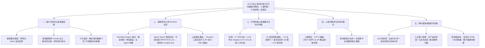
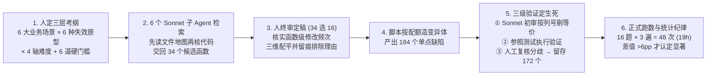

# 两万字长文｜手把手带你趟过 AI Coding 深水区：编码让位，人退到哪里

## 1. TL;DR

本文基于 PUBGMobile 后台团队三个月用 AI 端到端交付内部平台（7 个服务、1800+ 次提交、16 万行生产代码 + 11 万行测试代码 + 8 万多行前端，人工零手写代码）及在百万行自研 Lua 老项目中落地 AI Coding 的实战复盘，回答了“当 AI 接管写代码后，工程体系怎么搭、人退到哪里”。核心结论浓缩为一句话：**机器提供事实，人做判断；不信声明，信事实；不信自觉，信机制**。全文沿五层递进链展开：① **提示词的尽头是基础设施**（提示词堆注意点会让模型变笨，沉进框架才能“取消错误的存在”，且硬门禁只认确定性事实、不认代理指标）；② **编排的尽头是 Runtime 主权**（通过两次 Agent Teams 实验与三起黑盒 CLI 事故证明，上下文压缩、参数拼接、限额与遥测必须可审计、可替换）；③ **评测的核心是题集而非平台**（对比 17 万行废平台与 16 次跑数 A/B 实验，将主指标从失效的“挖空回填”落到五道闸门 + **变异击杀率**）；④ **人退到需求与验收决策点**（放弃逐行读实现，改守变异测试与容器独立重跑）；⑤ **把判据变成大小嵌套环研发流程**（生产者不是写者、失败必须有名字、事实源唯一且可由路径推导）。

## 2. 核心概念

### 核心方法论原语与边界区分

- **动手前 Spec（对齐载体） vs. 事后设计说明（心智模型资产）**：
  - **动手前 Spec**：价值在于逼人在动手前通过 Brainstorming 把问题定义清楚；一旦想清楚并落地，文档本身可丢弃（作者删掉海量初期 Spec 后项目照跑无损）。
  - **事后沉淀的设计说明**：照着已落地实现反推重写、跟着代码走，留给下一个改代码的人建立心智模型。
- **两种“厚”的本质区分（提示词/SOP 之厚 vs. 框架基础设施之厚）**：
  - **写在提示词/Skill 里的厚**：注意点越堆越多，占满模型工作记忆、切碎注意力，导致主任务变差（这才是“Harness 越厚，Agent 越笨”成立的地方）。
  - **写进底层框架的厚**：如声明式 Mock 自动还原、超时链路反向探测分析包，把叮嘱从模型脑子里挪走、直接“取消这类错误的存在”，越厚模型越省心。
- **确定性事实（Fact） vs. 代理指标（Proxy Metric）**：
  - **确定性事实**：如“目标路径是否在 `protocols` 目录下”“测试覆盖率是否为 `0/0` 行”“产物是否含 `U+FFFD` 乱码”，可做**硬门禁（阻断）**。
  - **代理指标**：如“编辑 `.lua` 前会话记录里是否 Read 过编码规范”（读过不等于遵守，且主会话历史 Read 会污染后续子 Agent），最多只能做**提醒（警告）**。
- **变异击杀率（Mutation Score）**：故意在业务代码中植入符合真实缺陷分类学的单点 Bug（变异体，如比较符翻转、`and/or` 互换、删掉 `or 0` 兜底、注释掉状态写入），运行 AI 写的测试：测试报错失败算“杀死（Killed）”，照常通过说明断言漏杀（Survived）。

### 五大演进阶段认知对照表

| 阶段维度 | 曾经信奉的做法（流 / 易踩坑） | 实战撞墙后的认知升级（常 / 核心机制） |
|---|---|---|
| **1. 约束与提示词** | 再强调一遍、措辞更严厉，AI 就能记住成对 `setup/teardown` | 注意点堆在提示词里模型会变笨；沉进框架自动还原、借报错通道精准注入现场代码行才有效 |
| **2. 多 Agent 编排** | 官方黑盒 CLI + `agent-teams skill` 提示词补丁就够用 | Skill 补不动机制残缺；三起黑盒事故证明上下文压缩、参数拼接、遥测必须具备 Runtime 主权 |
| **3. 评测体系建设** | 搭一套 17 万行代码、6 个容器、LLM 打分的重型评测平台 | 评测的核心是**题集**而非平台（凡能脚本化都不值得当工程建）；判据必须是执行结果（变异击杀率）而非合成挖空清单 |
| **4. 人类代码审查** | 人努力加快速度逐行 Review 每天数千行 AI 代码 | 有些错误（如 UTF-8 字节截断、空覆盖率假测试）人眼在原理上就看不出；人退到决策点，放掉实现、握住判据 |
| **5. 研发交付流程** | 指望单次长会话做到位，采信 AI 自跑通过的测试报告 | AI 单次产出与人单次注意力都不可靠；用大小嵌套环独立重跑，环接口只传事实（生产者非写者、失败必有名、路径推导归属） |

## 3. 知识框架

## 4. 关键要点与机制详解

### 4.1 提示词的尽头是基础设施：用框架“取消错误”，借报错通道注入高信噪比上下文

**核心主张：提示词只能“叮嘱”，底层框架才能“取消错误的存在”；报错通道是最精准的动态提示词注入通道，但低信噪比告警或误报门禁会反噬代码质量。**

- **遇到什么问题**：
  1. 在 `ut-tester` Skill（400 多行 `SKILL.md` + 十几份排坑文档）中反复强调“`setup/teardown` 必须成对出现”，AI 仍有约 `50%` 概率漏掉 `teardown`，污染后续用例。
  2. 测试遇链路超时时，裸报错只显示“没等到回包”，AI 去翻海量代码追调用链极易上下文过载、注意力涣散。
  3. 曾写下死规则“严禁 mock ss，只有一种正确写法”，8 天后核对仓库存量 `529` 个单测才发现该规则从落笔起就与事实相反。
- **采用什么机制**：
  1. **声明式 Mock 与自动 GC 还原**：在测试框架层提供声明式 Mock，用例结束由框架自动还原，彻底废除“改脏环境的用例排最后跑并重启服务”的人肉纪律。
  2. **超时反向探测与源码行定位分析包（报错即 Prompt 注入）**：框架在超时瞬间反向探测各服务队列与限频登记表，将超时精准分为四类：**① 还在排队、② 出队了但业务代码没回包、③ 在分发层被限频丢掉、④ 回包到了但当时没人接**；每类附具体下一步动作（指明检查哪个配置字段），并自动打开业务源码把链路最后执行到的几行原样贴进报错、末行标箭头。
  3. **剔除低信噪比告警**：删掉“协议名不在协议表就告警”的逻辑（因协议表按线上流量生成，冷门协议与登录窗口期协议均不在表内，误报会把 AI 带偏）。
  4. **外部事实硬门禁防“抄逻辑假单测”**：AI 有时会把被测函数内部逻辑抄出来用本地变量重算断言——断言全绿但真实函数行覆盖率为 `0/0`。通过外部脚本硬判“覆盖率为 `0/0` 行直接失败”一举戳穿。
  5. **将 `ut-lint` 下沉到测试执行脚本**：因 Claude Code / CodeBuddy 的 `SubagentStop` Hook 只支持“阻断并给理由”而不支持向模型上下文注入提示内容，且两条易误报规则若做成硬阻断会逼人和 AI“为了过 lint 把 helper 拆开内联”，故将确定性触发塞进测试执行脚本本身。

### 4.2 编排的尽头是 Runtime 主权：两次 Agent Teams 实验与三起黑盒事故

**核心主张：Skill 只能缓解机制的不完善，无法修补闭源/半黑盒 Runtime 的残缺；上下文压缩、参数拼接、限额与多 Agent 通信协议必须掌握可审计、可替换的 Runtime 主权。**

- **背景痛点（`workflow-engine` 状态机的三个遗留问题）**：① 子 Agent 每次从干净上下文出发，Review 打回三轮就把代码重复读三遍，Token 消耗大；② 过程黑盒，用户无掌控感；③ 最擅长与人交互的主 Agent 闲置。为此推进两条改进路线：
  - **路线一（已落入 `/dev` 流程）**：主 Agent 亲自做需求分析与架构设计；拉子 Agent 时优先 `resume` 续接上一轮实例而非重新 `spawn`。
  - **路线二（Claude Code `agent teams` 网状常驻通信实验）**：先后开展全流程与收窄测试流程两轮实验。
- **实验一（全流程搬上 Team，7 角色 + 产物驱动）踩出的四类深坑与 `PROTOCOL-A` 铁律**：
  1. **模型未经训练认识该机制**：不建 Team 直接开聊、目录命名摇摆、把 shell 命令 `tracesift` 当内置工具找。
  2. 🔥 **中断活锁（Live-lock）**：一次 2.5 小时真实需求实跑中，`planner` 单轮热身（重载方法论 Skill、读 `arch.md`、补做验证）需超过 1 分钟，而主 Agent 每分钟发消息催促一次；每次催促都打断 `planner` 在途工具调用，导致其单轮输出从 `580 token → 278 → 1` 原地死循环，主 Agent 误判失效又重建团队继续催。由此提炼三条铁律写入 `agent-teams skill`：**① `PROTOCOL-A`（绝不催正在工作的 Agent，只认显式 `DONE/BLOCKED` 信号，`idle` 是正常态）；② `planner` 改为一次性 `spawn` 自包含干完；③ 测试断言从架构文档验收标准提前冻结，防止有偏差的实现反过来污染测试**。
  3. **进程内生命周期不可靠**：会话续接后活体成员全丢，主 Agent 仍向幽灵发消息 → 对策：**一切以磁盘产物（`arch.md` / `test-plan.md`）为准无损重建**。
  4. **底层机制反直觉**：强杀工具要 `taskId` 而 `spawn` 返回 `agentId` 互不相通；成员不配合关停时只能手动改 `~/.claude/teams/` 下的 `config.json`；任务指派归属后任务窃取即关闭。
- **实验二（收窄至 `/module-test` 双人互审）**：主 Agent 亲自写带协议锚点与验证点矩阵的 `spec`；Team 内仅留 `test-engineer` 与 `reviewer` 点对点直连互审（三轮不收敛升级给用户）。虽跑稳且保留了随时插话干预的掌控感，但常驻 `reviewer` 复审时易受自己上一轮意见牵引而审不全。
- **三起黑盒事故与 Runtime 选型尺子**：

| 黑盒事故 | 事故表现与损失 | 暴露的底层根因 | 对应的 Runtime 主权要求 |
|---|---|---|---|
| **1. 隐蔽遥测投毒事件** | 检测到使用者来自特定区域后，在提示词与工具调用中隐蔽投毒 | 闭源 CLI 黑盒行为不可见 | **审计底线**：模型看到的每一项注入、发出的每一条遥测必须按来源可回看 |
| **2. 长中文 UTF-8 字节截断** | 41 条任务产出 37 份中文文档，**36 份损坏、累计 370 处 `U+FFFD`**（单汉字 3 字节各变 1 个 `U+FFFD`） | CLI 拼接工具调用参数时按字节切断了 UTF-8 多字节字符 | **外层参数接管**：工具参数拼接与序列化代码必须可自行接管修复 |
| **3. 压缩 Bug 致 11 小时空转** | 只读探索任务空转 **11 小时、6556 次工具调用、消耗 1.23 亿 input token** 一无所获 | ① `max_turns` 未生效；② 200K 窗口卡在 100K 触发压缩；③ 压缩把“生成摘要”当用户请求，关键“当前进度/待办事项”只剩标题，**203 轮压缩即 203 次失忆重头 Grep** | **内核 Loop 可替换**：长在 Agent Loop 内部的上下文压缩阈值与摘要策略必须能整块替换 |

- **Runtime 选型结论**：Codex 新版多 Agent 将子 Agent 任务载荷加密且仅 OpenAI 服务端可解（锁死单一 Provider，属“假开源”）；团队确立 **“Pi Agent 先行（MIT 开源、系统提示词 `< 1000 token`、上下文治理门槛低，撞到 core 边界记入需求账单）→ DeepSeek Harness 跟进（基于 Cordis 一切皆插件，连 Loop 与压缩都能换，待验证稳定后承接）”** 的演进路线。

### 4.3 评测：为什么 17 万行平台作废，而 16 道题的变异测试 V2 成为核心资产？

**核心主张：评测的核心工作是构建题集而非搭平台，凡能脚本化的环节都不值得当工程建；主指标必须落在确定性执行结果（变异击杀率）而非 LLM 打分或合成挖空清单上。**

- **三次评测实践的惨痛对比**：
  1. **撞墙的 17 万行重平台（107 天投入，仅跑 2 次即废弃）**：搭了六阶段流水线、Web 平台、6 个容器（Langfuse + PG/CK/MinIO/Redis），题集为 25 道真实需求。失败在四点：① **判据不可执行**（25 题中 22 题缺冻结单测，确定性判分占比从 `65%` 掉到 `40%`，主指标交给 `Cohen's Kappa` 仅 `0.10～0.21` 的 LLM Checklist 裁判）；② **判分器自身格式解析 Bug**（同一份日志修格式前 `0 分`、修后 `98 分`）；③ **流水线自身运维占满精力**（日志死锁、`SIGTTIN` 卡死 23 分钟等）；④ **卷子追不上考生**（107 天搬家三次、换三套判分，被测命令早已合并）。
  2. **高投产比的轻量 A/B 实验（1 天跑完，沉淀生产提交）**：为验证知识库检索方式，用 `8` 道题 × 2 种方案跑 `16` 次，直接证明“去掉路由文档跳转、直接 grep 知识库”可将寻路步数从 **`12 步` 降至 `2 步`**。
  3. **测试线评测 V1（挖空回填）的塌陷**：在模块审计中故意删 5 个条目看召回率，结果卡在 `40%` 改不动。复盘发现：① 评分器按文件名死板核对，把 Agent“写进同模块另一文件”判为未找回；② 单模块仅挖 5 条（每条占 `20%`），单次跑数纯属追逐随机噪声；③ 业界调研 50 多篇论文证实，自研“挖空回填”属于人造合成任务（全量上报即可刷满且无惩罚），而有顶会论文支撑的三个方法全部站得住。
- **测试线评测 V2（五道闸门 + 变异击杀率）的工程设计**：
  - **五道闸门漏斗**：有产出 → `lint` 干净 → 能跑 → 连跑三次稳定 → **杀死多少变异体**（引用 TestGenEval 数据：GPT-4o 测试覆盖率 `35.2%` 但变异分数仅 `18.8%`，无断言测试能刷覆盖率却杀不死变异体）。
  - **三层考纲与六道硬门槛**：覆盖 **6 大业务场景**（发奖、任务、活动、成就、排行榜、聊天）× **6 种失效原型**（校验闸门、资源结算、时间窗口、状态机、兼容兜底、遍历聚合）× **4 轴难度配平**；硬门槛要求函数体 **`15～80 行`**、**分支密度 `≥ 3`**、**依赖可 mock**、**可变异点 `≥ 6` 个**（明确排除单测考不了的并发与性能维度）。
  - **等价变异的两条人工价值定义**：① **日志差异不算可观测**（防逼出断言日志的劣质单测）；② **可杀性以自然构造为准**（需将环境常量 mock 成非法类型或传荒谬值才能杀死的判为等价）。
  - **三级验证防裁判出错**：LLM 初审（强制按**列号**指认变异点）→ 参照测试执行验证（曾抓出 `pcall` 闭包内局部变量导致闭包外恒读 `nil` 的 5 个假 PASS 漏杀）→ 人工复核终裁，最终从 `184` 个变异体中确立 **`172` 个可杀变异体**（剔除 `12` 个等价变异），经 `deepseek-v4-pro` 校准击杀率跨度 `12%～100%`、宏平均 `61%`。
  - **跑数统计纪律与两个核心发现**：`16` 题默认跑 `3` 遍（共 `48` 次、约 `19` 小时），差距 `< 3pp` 不下结论、`3～6pp` 标“可能显著”、**`> 6pp` 才作为改 Skill 依据**。通过对存活变异体聚类抓出 **AI 写测试的五类通病（不测缺省兜底 `x or default`、不测边界相等值、只断言返回值不查状态写入、不踩非法入参、不枚举模式常量）**；更意外发现**预先设计的“失效原型标签”完全预测不了成绩**（同属“校验闸门”两题为 `91% vs 14%`，同属“时间窗口”为 `91% vs 12%`），真正决定难度的是**输入构造复杂度（是否需构造缺省值、边界值、状态型输入）**。

### 4.4 人退到决策点，把判据织成“大小嵌套环”研发体系

**核心主张：AI 单次产出与人单次注意力都不可靠，必须用会话内小环 + 会话外独立大环叠加可靠性，并在环接口强制执行“生产者非写者、失败必有名、事实源唯一可推导”。**

- **为什么人不能靠“更快地逐行看代码”验收？**
  - 引用 Redis 之父 antirez《控制想法，不控制代码》与 Robert C. Martin（Uncle Bob）观点：人类应放掉实现、握住判据（验收测试、变异测试与质量闸门）。
  - 更根本的原因是**有些错误人类感官在原理上就取不到事实**（如前文 `U+FFFD` 字节截断、覆盖率 `0/0` 假单测、悄悄放宽断言）——必须靠会话外的独立流水线门禁拦截。
- **嵌套环接口的三大工程机制**：
  1. **生产者不是写者**：AI 只提交候选，平台是唯一写者（每个受治理仓库一条串行入库队列），入库执行自动合并、裁剪未引用公共代码，仅真冲突交人介入。
  2. **失败必须有名字（七态状态机）**：曾因底层“有无实际改动”能力未透传、默认有改动反复提交空 commit，且恢复逻辑无限重投“正在合并”任务导致死锁四次（替身测试因直接实现该可选方法而假绿）。修复后确立七态状态机：**`待审`、`正在合并`、`已入库`、`已丢弃`、`冲突`、`推送失败`、`合并失败`**，无差异直接跳过收口，恢复逻辑不再自动盲目重试失败态。
  3. **事实源唯一且由路径推导**：不信 AI 在元数据里的归属声明，强制按文件路径 `ucases/<被测文件路径>/<被测函数名>_unit.lua` 推导被测函数归属；覆盖率合并按行取并集，且严格区分**“没跑过”与“跑了没覆盖”**（分母只含实际跑到的函数，绝不把采集失败混显为 `0%`）。
- **环入口独立重跑与降低人类判断成本的三个抓手**：
  - **容器池独立重跑**：不信 AI 自报的测试报告，平台用管理员贡献的开发容器池（槽位内串行、槽位间并行，手动触发跑私有池、自动验证跑公共池）独立重跑，将结果摆上审批页。
  - **降低人类判断成本**：① **产物从 Markdown 走向自包含 HTML**（支持表格、SVG、折叠与末尾 `copy as JSON / copy as prompt` 一键回灌 AI）；② **划词批注直接转结构化输入回灌**；③ **Trace 语义视图严禁模型碰数字**（LLM 只负责命名、归组与文字解释，所有数字由确定性脚本从原始证据重算，守恒校验不过立即退回原始全量视图）。
- **环向研发最前段延伸与“自建重平台”的本体边界**：
  - 前置三环：**需求预分析**（核心价值是“待澄清清单”，必须标注方案只是 AI 的一种自洽而非推荐）、**Bug 预分析**（修复后真值免费回流校准判对率）、**评审预分析**。
  - **为什么不怕被中台替代？** 算力、AnyDev 容器、通用 CLI、TAPD 同步等“壳”直接复用现成；业务团队自建的只是**判据（变异算子、Patch 期纪律）、资产模型（跨在研/上线双版本的活上下文）与环的接线**——**凡是本体都不通用，凡是通用的都不是本体**。

## 5. 数据速查表

| 指标 | 原文数值 | 语境 / 条件 |
|---|---|---|
| 对照组纯 AI 交付平台规模 | `3 个月`、`7 个服务`、`1,800+` 次提交，`16 万行`生产代码 + `11 万行`测试代码 + `8 万多行`前端、`70 多篇`留存设计文档 | Go + TypeScript 全新项目，人工手写代码为 0 行；同期业务侧为百万行自研框架 Lua 老项目 |
| 对照组初期真实事故数 | 资产入库卡死空 commit `4 次`；需求提取首晚积压 `4,000+ 条` | 证明 AI 出错绝对数量由累积量决定，模型变强不会让 Harness 变薄 |
| 提示词时期漏写 `teardown` 概率 | 约 `50%`（一半概率） | 在 `ut-tester` 提示词中反复强调成对出现时的失败率；后靠框架层声明式 Mock 自动还原根治 |
| Agent Teams 活锁单轮输出衰减 | `580 token → 278 → 1`（耗时约 `2.5 小时`） | 主 Agent 每分钟催促一次打断 `planner` 热身（需 >1 分钟）引发的中断活锁 |
| 黑盒 CLI 事故二：UTF-8 截断损坏 | `41` 条任务产出 `37` 份文档，`36 份`损坏、累计 `370 处` `U+FFFD` | CLI 拼接工具参数时按字节切断中文 UTF-8 多字节字符 |
| 黑盒 CLI 事故三：压缩失忆空转 | 空转 `11 小时`、`6,556 次`工具调用、`1.23 亿` input token、`203 轮`压缩 | 200K 窗口卡在 100K 压缩、`max_turns` 失效、压缩摘要丢失进度与待办导致每轮重头 Grep |
| 重型评测平台 vs 轻量检索 A/B | 重平台：`107 天`、`17 万行`代码（含 3 万多行参考实现）、`25 道`题、仅跑 `2 次`（得分 `69.9` 与 `51.9`）；轻量 A/B：`8 道`题、`16 次`跑数、`1 天`跑完，寻路从 `12 步` 降至 `2 步` | 重平台因缺冻结单测（22/25 缺失）导致确定性判分从 `65%` 掉至 `40%`，LLM 裁判 Kappa 仅 `0.10～0.21`，且格式 Bug 曾致同一日志差 `98 分` |
| 测试评测 V2 题集与变异体规模 | `6` 类场景 × `6` 种原型；函数体 `15～80 行`、分支 `≥ 3`、变异点 `≥ 6`；`34` 候选选 `16` 题；`184` 个变异体终裁留 `172` 个（剔除 `12` 个等价） | 校准跑数宏平均击杀率 `61%`（跨度 `12%～100%`）；正式跑数 `16 题 × 3 遍 = 48 次`（约 `19 小时`机时），显著性门槛 `> 6 个百分点` |

## 6. 踩坑与教训 / 可迁移的设计原则

### 踩坑与教训（错误做法 → 失败表现或原因 → 原文应对）

1. **每分钟轮询催促正在热身的常驻子 Agent**：
   - **错误做法**：主 Agent 每隔 1 分钟向 `planner` 发送消息询问进度。
   - **失败表现或原因**：子 Agent 单轮加载 Skill 与读取文档超过 1 分钟，每条催促消息都会打断其在途工具调用，导致输出逐轮暴跌至 1 token 并触发主 Agent 误判重建团队，形成自我喂养的活锁（Live-lock）。
   - **原文应对**：制定 `PROTOCOL-A` 通信铁律——绝不催促正在工作的 Agent，将 `idle` 视为正常态，只认显式 `DONE / BLOCKED` 信号；将 `planner` 改为一次性自包含 `spawn`。
2. **用合成“挖空回填”或低一致性 LLM Checklist 作为代码/测试主评测指标**：
   - **错误做法**：让 LLM 按自然语言评分表给代码打分，或故意删掉 5 条现有测试看 Agent 能否原样填回原文件。
   - **失败表现或原因**：LLM 打分的 Cohen's Kappa 仅 `0.10～0.21`（误差大于信号）；挖空回填把“写进同模块另一文件”误判为 0 分，且每模块 5 条导致 `±20%` 随机波动掩盖真实表现。
   - **原文应对**：坚持“一行评测平台代码都不写”，主指标全部采用确定性代码执行结果——用五道闸门 + 真实缺陷分类学派生的**变异击杀率（Mutation Score）**定生死。
3. **测试替身（Mock/Stub）直接实现可选接口，掩盖生产环境漏接线**：
   - **错误做法**：底层仓库对象有一个可选的“探测是否有实际改动”方法，生产实现漏接了该方法（默认返回“有改动”并提交空 commit），而单元测试的替身对象却顺手实现了该方法。
   - **失败表现或原因**：测试永远全绿，生产环境却因空 commit + 无“合并失败”状态 + 重启自动重投“正在合并”任务而连续四次死锁。
   - **原文应对**：将该能力改为接口必需方法（漏接即编译报错），无实际差异直接跳过提交，并在状态机中显式补齐可重试的`合并失败`态（共七态）。
4. **让大模型在可视化报告里直接计算和输出统计数字**：
   - **错误做法**：生成 HTML Trace 报告时，让 LLM 一并统计耗时、调用次数和覆盖率数字。
   - **失败表现或原因**：模型会在统计数字上产生幻觉或加总不守恒，误导人类审批判断。
   - **原文应对**：在 Trace 语义视图中强制执行“LLM 只负责命名、归组和写文字解释，所有数字由确定性脚本从原始证据重算，守恒校验不过立即退回原始全量视图”。

### 可迁移的设计原则

- **下沉三问（决定一条规则写进 Prompt、Hook 还是底层框架）**：
  1. 能否在底层框架通过自动机制（如自动 GC 还原 Mock）直接“取消这类错误的存在”？能则沉入框架。
  2. 若做拦截门禁，判据是**100% 确定的外部事实**还是**代理指标**？确定事实才做硬阻断，代理指标或高误报规则最多做提醒（防止逼人和 AI 把代码改丑）。
  3. 报错信息能否顺带附上**反向探测的现场分类 + 源码最后执行行号**？把报错通道当成时机最准的动态 Prompt 注入通道。
- **评测立项的“保值（常） vs. 投产比（流）”权衡准则**：题集、变异算子和等价判定政策是跨模型保值的“常”，评测平台代码和流水线是易腐的“流”。日常迭代优先用真实需求 + 会话分析（如 `tracesift`）或 8 题 16 次的轻量 A/B；仅在做高成本方案取舍或需向外证明改进有效时，才投入构建重型题集，且严禁用同一批校准题反哺改完的具体函数名规则自嗨（防测试集泄漏过拟合）。

## 7. 记忆锚点

1. **核心铁律锚点**：「机器提供事实，人做判断；不信声明，信事实；不信自觉，信机制——提供事实的机器自己也要被验证。」
2. **五层深水区口诀（助记改写）**：「提示词尽头是框架（取消错误），编排尽头是主权（Loop 可换），评测本体在题集（变异击杀），人退决策抓判据（放掉实现），大小嵌套转双环（唯一写者、失败有名、路径推导）。」

## 8. 复习卡片

为什么作者认为“模型越强，Harness 就该越薄”和“Harness 越厚，Agent 越笨”需要拆开看？::因为 AI 出错的绝对数量由累积产出量决定，模型越强产出越快，人类审查上限不变，兜底必须更厚；但“厚”分两种——写在提示词/SOP 里的注意点越厚，模型工作记忆越碎、越笨；沉进底层框架（如自动还原 Mock、超时反向探测）越厚，模型越省心、主任务越强。
在将约束下沉为自动化门禁时，如何区分何时用“硬拦截（阻断）”、何时只能用“提醒（警告）”？::判据是外部可验证的确定性事实（如路径前缀是否在禁读目录、覆盖率是否为 `0/0` 行、是否含 `U+FFFD` 字符）才做硬拦截；判据若只是代理指标（如会话里是否 Read 过规范文件）或存在较高误报率，最多只做提醒，否则会污染状态或逼迫 AI 为了过检把代码写得更差。
作者在 Agent Teams 全流程实验中遭遇的“中断活锁（Live-lock）”是怎么发生的？提炼出了什么通信纪律？::`planner` 单轮热身需超过 1 分钟，而主 Agent 每分钟发消息催促一次，每次催促都打断其在途工具调用，导致输出从 580 token 跌至 1 token 并触发无限重建团队；由此提炼出 `PROTOCOL-A` 铁律——绝不催促正在工作的 Agent，`idle` 是正常态，只认显式 `DONE/BLOCKED` 信号，且中断恢复一切以磁盘产物为准。
文中哪三起真实黑盒事故促使团队决定自建/掌控 Agent Runtime？它们分别对应哪三层可替换边界？::① 隐蔽遥测投毒事件（要求审计底线：所有上下文注入与遥测可按来源回看）；② CLI 写中文文档按字节切断 UTF-8 导致 36/37 份文档出现 370 处 `U+FFFD`（要求外层工具参数拼接代码可接管）；③ 上下文压缩丢失进度与待办导致 11 小时、203 轮压缩空转消耗 1.23 亿 token（要求内核 Agent Loop 与压缩策略可整块替换）。
为什么 17 万行代码的重型评测平台和 V1“挖空回填”方案双双失败，而 V2 选择“五道闸门 + 变异击杀率”？::重平台因缺冻结单测将主指标交给 Kappa 仅 `0.10～0.21` 的 LLM 裁判且维护流水线耗尽精力；V1 挖空回填属于合成任务，把“写进同模块另一文件”误判为未找回且受 5 条样本的随机噪声主导；V2 改用“有产出 → lint 干净 → 能跑 → 连跑三次稳定 → 杀死真实缺陷分类学变异体”，因为无断言测试能刷覆盖率却杀不死变异体。
在 V2 变异测试题集构建中，哪两项关于“等价变异”的判定必须由人做价值拍板，且三级验证顺序为何不能颠倒？::人必须定义两条政策：① 日志差异不算可观测缺陷；② 可杀性以自然入参构造为准（需把环境常量 mock 成非法类型才杀得死的判等价）。三级验证依次为 Sonnet 按列号初审（省机时）→ 参照测试执行验证（定生死，曾抓出 `pcall` 闭包局部变量导致的 5 处假 PASS）→ 人工复核终裁。
V2 评测对存活变异体聚类发现了 AI 写测试的哪五类通病？数据推翻了作者最初的什么假设？::五类通病是不测缺省兜底（`x or default`）、不测边界相等值、只断言返回值不查状态写入、不踩非法入参、不枚举模式常量；数据同时推翻了“按失效原型标签（如校验闸门、时间窗口）能预测得分难度”的假设，真正决定难度的是杀死变异体所需的输入构造复杂度。
第五部分提出的“大小嵌套环”研发体系中，环与环接口的三大铁律是什么？::① 生产者不是写者（AI 只提候选，平台作为唯一写者串行合并入库，容器池独立重跑验证）；② 失败必须有名字（用包含`合并失败`的七态状态机消灭无名卡死）；③ 事实源唯一且可由文件路径推导（如从 `ucases/<被测文件路径>/<被测函数名>_unit.lua` 推导归属，严禁采信 AI 元数据自述，且严格区分“没跑过”与“跑了没覆盖”）。

## 9. 知识关联

### 本库主题入口与已有关联笔记

- [AI研发协同](../../20_topics/AI%E7%A0%94%E5%8F%91%E5%8D%8F%E5%90%8C.md)：AI Coding 深水区人机职责边界、大小嵌套环与测试验收体系。
- [Harness与模型协同](../../20_topics/Harness%E4%B8%8E%E6%A8%A1%E5%9E%8B%E5%8D%8F%E5%90%8C.md)：提示词/框架/Runtime 三层下沉边界与 Pi / DeepSeek Harness 选型对照。
- [Agent评测与反馈](../../20_topics/Agent%E8%AF%84%E6%B5%8B%E4%B8%8E%E5%8F%8D%E9%A6%88.md)：变异击杀率（Mutation Score）、三层考纲、三级验证与防评测集污染。

### 候选双链（供 Obsidian 知识库导航）

- **本库同系列与高度关联文章**：[[AI端到端研发流]]、[[LLM到Harness]]、[[Cordis与DSH运行时]]、[[Agent自进化飞轮]]、[[AGENTS规则]]
- **核心工程概念**：[[变异测试 Mutation Testing]]、[[Meta TestGen-LLM]]、[[TestGenEval]]、[[协议活锁 Live-lock]]

## 10. 原文参考资料

- **本目录归档文件**：[RAW.pdf](RAW.pdf)｜[MD.md](MD.md)
- **原文提及的论文、文章与开源工具**：
  - 业界评测与基准：*SWE-Bench*、*Meta TestGen-LLM*、*TestGenEval*、*SWT-Bench*、Anthropic *Demystifying evals for AI agents*、姚顺雨 *The Second Half*
  - 工程观点引用：antirez（Salvatore Sanfilippo）《控制想法，不控制代码》、Robert C. Martin（Uncle Bob）关于不读 Agent 代码与变异测试/Gherkin 验收闸门的讨论、Anthropic Claude Code 团队关于自包含 HTML 交互界面的实践
  - 开源 Runtime 与自研工具：`pi agent`、`DeepSeek Harness`（Cordis）、`codex CLI / SDK`、`trpc-agent-go`、团队自研会话分析工具 `tracesift` 与静态检查 `ut-lint`

> [!note]- 校对报告
> - **覆盖度核验**：已完整通读 `MD.md`（共 27 页，p.1–25 为前言与五大部分技术正文及结语，p.26 为公众号阅读量与留言区，p.27 为空白尾页）并核对 `META.json` 记录。完整覆盖前言三大发现、第一部分（提示词下沉框架、Mock 自动还原、超时四分类分析包、硬门禁 vs 提醒）、第二部分（`workflow-engine` 痛点、两次 Agent Teams 实验、`PROTOCOL-A`、三起黑盒事故、Runtime 选型）、第三部分（17 万行平台复盘、16 次跑数 A/B、V1 挖空回填塌陷、V2 变异击杀率与三级验证、五类短板與分类学推翻）、第四部分（antirez 与 Uncle Bob 观点、机器取事实、离线+在线双重测试验收）、第五部分（大小嵌套环、接口三机制、七态状态机、容器池独立重跑、HTML 降判断成本、前置三环与自建本体论）。
> - **关键数据逐项核对**：
>   1. **项目与事故数据**（p.1–2, p.5, p.8–9, p.19）：对照组 `7` 个服务、`3` 个月、`1800+` 次提交、`16 万`行生产代码、`11 万`行测试代码、`8 万+`行前端、`70+` 篇设计文档；业务侧百万行 `Lua`；存量单测 `529` 个；入库卡死空 commit `4` 次，需求提取首晚积压 `4000+` 条；活锁实跑 `2.5` 小时，输出 `580 → 278 → 1` token；中文文档 `41` 任务、`37` 份产出中 `36` 份损坏、累计 `370` 处 `U+FFFD`；压缩 Bug 空转 `11` 小时、`6556` 次工具调用、`1.23 亿` input token、`203` 轮压缩（窗口 `200K` 卡在 `100K`）。
>   2. **评测对比数据**（p.12–17）：重平台 `107` 天、`17 万`行代码（含 `3 万+`行参考实现）、`6` 个容器、`25` 道题（`22` 道缺冻结单测，确定性占比从 `65%` 掉至 `40%`，LLM Kappa `0.10～0.21`），仅跑 `2` 次（`69.9` 与 `51.9` 分），格式 Bug 致同一日志差 `98` 分；轻量 A/B 为 `8` 题、`16` 次跑数，寻路从 `12` 步降至 `2` 步；TestGenEval 引用值为 GPT-4o 覆盖率 `35.2%` vs 变异分数 `18.8%`；V2 含 `6` 类场景、`6` 种原型，函数体 `15～80` 行、分支 `≥ 3`、可变异点 `≥ 6`，`34` 候选选 `16` 题，`184` 变异体终裁留 `172` 个（剔 `12` 个等价，其中参照测试 `pcall` Bug 修好 5 个、真等价 3 个），校准跨度 `12%～100%`、宏平均 `61%`，正式跑数 `48` 次、约 `19` 小时，显著性阈值 `3pp / 6pp`；同标签跨度 `91% vs 14%`（校验闸门）、`91% vs 12%`（时间窗口）。
> - **事实边界与局限说明**：所有实验数据与事故复盘均忠实保留作者团队特定项目背景，未外推为通用行业常数；平台部分在原文中明确说明“仍在建设中”，笔记已如实保留。
> - **格式自检**：全文仅 1 个 H1 标题；正文、表格、Mermaid 图与复习卡片均无页码/章节出处标注；复习卡片共 8 条，严格采用单行 `问题::答案` 格式。
