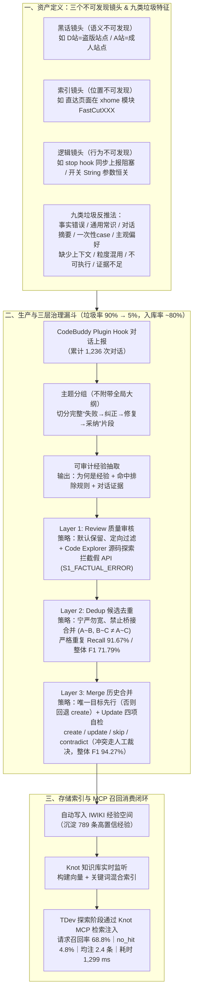

# AI Coding 的下一站，不是更会写代码，而是更懂团队

## 1. TL;DR — 核心结论速览

1. **个人 AI Coding 提效之后，真正的瓶颈是“会话级经验归零”导致的团队级重复踩坑**：一次 Session 中开发者耗费精力纠正 AI 的隐性工程约束（如 `stop hook` 必须异步上报否则阻塞超时、模块间开关引用不能直接传字符串参数），在 Session 结束后即烟消云散；换个同事、换个会话，AI 依然以“零项目语境的新手”身份重犯完全相同的错误。
2. **初版“对话直抽入库”高达 90% 是废料，倒逼出“先研究垃圾、从 Agent 行为变更定义资产”的范式反转**：早期仅靠一句 Prompt 自动抽取对话，产出中约 **90%** 因高噪声（把过程录像当经验）、脱离上下文、错误引导（头痛医头调大超时）和空洞正确的废话而不可用；同时直接套用 `ClaudeCode AutoDream`、`Hermes Agent` 或 `Mem0` 等个人记忆方案均无法应对编程对话的高噪声。团队将合格经验严格锚定为**“被召回后能使 Agent 产生正向行为变更、且 Agent 自身不易直接发现的信息”**，并拆解出**黑话镜头（语义不可发现）、索引镜头（位置不可发现）、逻辑镜头（行为不可发现）**三大客观认知障碍维度。
3. **打磨出“主题分组（不带全局大纲）+ 抽取 + Review / Dedup / Merge 三层治理”漏斗，将有效率从 10% 拉升至 95%**：
   - **Review（默认保留、定向过滤 + 源码探索校验）**：宁可放行边缘经验也不误杀高价值资产，并引入 **Code Explorer 源码定向检索**拦截模型编造的假 API（如揪出不存在的 `FastScrollBar.attachToQBListView()`）。
   - **Dedup（宁严勿宽、禁止桥接合并）**：严格保护适用边界（`When`），严禁由 $A \sim B, B \sim C$ 传递合并 $A \sim C$；严格重复场景下 Recall 达 **`91.67%`**（整体 `F1 = 71.79%`）。
   - **Merge（唯一目标先行、保护历史边界、冲突交人工裁决）**：无唯一历史目标时默认回退 `create`，对 `update` 强制执行四项 `quality_check`，对 `contradict` 移交人工裁决；157 样本实测整体 **`F1 = 94.27%`**（其中 `Create F1 = 96.46%`，`Skip Precision = 100%`）。
4. **复用 `IWIKI + Knot + MCP` 基建规模化落地**：在 QQ 浏览器团队 **6 个仓库、50+ 研发人员、1,236 次对话**中沉淀出 **789 条高置信经验**（最终入库率约 **80%**）；真实开发检索请求级召回率达 **`68.8%`**（`no_hit` 仅 `4.8%`），平均每次注入 `2.4` 条经验、耗时 `1,299 ms`。

---

## 2. 背景与痛点：为什么“更强的模型”解决不了团队重复踩坑？

### 2.1 一场由 `stop hook` 同步上报引发的“经验断层”事故
- **第一次会话（被人工纠偏）**：研发人员在 `CodeBuddy` 中开发 `stop hook` 上报功能，AI 按常规直觉写出**同步上报**代码；原始开发者在 Code Review 时指出**必须改为异步**，否则 `stop hook` 会阻塞进程导致后续操作连锁超时。AI 当场修复，Session 结束。
- **一周后的第二次会话（故障重演）**：另一位并非该模块原作者的同事触发了相同场景，没有上次会话记忆的 AI 再次给出**同步上报**实现，同事 Review 未察觉陷阱直接合入，结果在测试环境引发进程阻塞与大面积超时。

### 2.2 团队规模化使用 AI Coding 的四大结构性短板

| 痛点类型 | 真实工程表现 | 根因剖析 |
| :--- | :--- | :--- |
| **1. 经验即抛** | 单次 Session 反复纠偏趟出的正确路径，会话一关全部清零 | 经验只留在发起当次对话的开发者脑子里，未沉淀为跨会话公共资产 |
| **2. 重复踩坑** | 诸如“某目录访问第三方服务必须走特殊代理”、“模块间开关引用不能直接传 String 参数（因初始化时机问题会永远默认关闭）”等潜规则反复被踩 | 隐性约束只散落在历史 `git blame` 里，从未进入显式文档 |
| **3. 知识碎片化** | 老员工脑子里的正确 Pattern 没人有动力写文档，文档永远滞后于代码 | AI 能否写对完全靠运气（取决于当次上下文是否碰巧覆盖了历史代码） |
| **4. AI 永远是“新同事”** | AI 不缺通用编码能力，但每次进新模块都不知道架构边界与历史包袱 | 缺乏一套能持续捕获、提纯并带着“团队项目语境”进场的工程管道 |

---

## 3. 知识框架 — 团队经验捕获、三层治理与消费全链路

---

## 4. 核心工程设计拆解

### 4.1 初版翻车复盘（90% 废料率）与业界方案对比

#### （1）为什么“对话上报 → 模型直抽 → 入库”会产生 90% 废料？
初版仅用一句 Prompt *“提取你认为有价值的内容”* 让大模型自由发挥，结果陷入了四层结构性泥潭（**过程录像 $\neq$ 经验**）：
1. **第一层：噪声极高**——原始对话充斥着“继续”、“重试一下”、“换个方式”等试错录像，模型竟抽出诸如 *“多试几次就好了”* 的碰运气废话。
2. **第二层：上下文脱离**——抽出 *“stop hook 需要异步处理”* 却丢掉了适用前提，误导后续 Agent 在所有 hook 场景下无差别改成异步，引发新 Bug。
3. **第三层：错误引导**——把临时打补丁的动作当成经验（如抽出 *“超时就调大超时参数”*），导致后续 Agent 遇到超时不再排查死锁或慢操作根因，而是盲目调大阈值。
4. **第四层：价值难定义（空洞正确的废话）**——如 *“遇到复杂问题多收集上下文”*，字面永远正确，但 Agent 读完根本不知道下一步该执行什么具体动作。

#### （2）为什么不能直接照搬业界现有的 Agent Memory 方案？

| 业界方案 | 核心机制与定位 | 在“团队研发经验”场景下的致命局限 |
| :--- | :--- | :--- |
| **`ClaudeCode AutoDream`** | 单会话内 `ExtractMemories` 抽取实体/偏好/状态 + `Auto Dream` 异步合并 | 定位“延续单 Agent 个人上下文”，无团队边界意识，把临时状态当永久记忆 |
| **`Hermes Agent`** | Prompt 驱动的回顾机制，在任务成功或踩坑解决时触发记录 | 只解决了“何时记（When）”，没解决“记的内容有没有工程价值”，缺系统级去重与溯源 |
| **`Mem0`** | 完整的 `ADD / UPDATE / DELETE / NONE` 生命周期与混合检索基础设施 | **底层假设是“输入对话大体有价值”**——这一假设在充斥大量报错与试错噪声的编程对话中完全不成立 |
| **本文团队经验系统** | **聚焦“团队经验质量”，追求“留下更少但更可信”** | 强制要求附带适用场景（`When`）、约束边界、可执行动作（`What`）与源码/对话证据 |

---

### 4.2 重新定义“团队经验”：三个不可发现镜头与九类垃圾特征

#### （1）判定团队经验的唯一金标准与“三个认知镜头”
- **核心判据**：经验系统的服务对象是 Agent 而非人，因此唯一验证标准是——**被召回注入后，能否让 Agent 产生正向的行为变更？**
- **核心前提（“不容易被 Agent 直接发现”）**：如果某条信息 Agent 自己读一眼当前文件就能推出来，召回它毫无增益。团队按 Agent 理解需求的认知障碍将其拆为客观可判定的三类镜头：

| 镜头类型 | 认知障碍本质 | 原文典型工程场景 | 填补的信息缺口 |
| :--- | :--- | :--- | :--- |
| **1. 黑话镜头** | **语义不可发现** | 项目内部简称 `"D 站"` 指代盗版站点、`"A 站"` 指代成人站点 | 字面仅为一个字母，AI 靠预训练常识永远猜不对，必须显式建立语义映射 |
| **2. 索引镜头** | **位置不可发现** | *“直达页面功能在 `xhome` 模块，关键类是 `FastCutXXX`”* | 入口不在直觉目录路径上，单靠局部搜代码极难定位，需直接指明模块与核心类坐标 |
| **3. 逻辑镜头** | **行为不可发现** | ① `stop hook` 同步上报会阻塞进程引发超时 ② 模块间开关引用直接传 `String` 参数会因初始化时机问题导致永远默认关闭 | AI 按常规逻辑推理绝对想不到的反直觉副作用与跨模块时序陷阱 |

#### （2）“先研究垃圾，再反推好经验”：九类垃圾特征与双路径迭代
由于好经验难以一蹴而就定义，团队通过大量人工标注率先归纳出 **9 类典型垃圾特征**：
`① 事实性错误`、`② 通用常识`、`③ 对话摘要`、`④ 一次性 case`、`⑤ 用户主观偏好`、`⑥ 缺少上下文`、`⑦ 粒度混用`、`⑧ 不可执行`、`⑨ 证据不足`。
并基于此构建了两条工程化闭环路径：
- **标注评测路径**：对候选经验做三级价值标注（`高价值 / 低价值 / 垃圾`）并归因，沉淀为固定基准评测集；每次修改 Prompt 后必须同时对齐 **`Recall`（防漏提）、`Precision`（防误提）、`Garbage Rate`（防垃圾穿透）** 三大指标。
- **可审计输出路径**：强制抽取模型为每条候选经验输出三项白盒解释——**① 为什么这是经验（解决什么可复用问题、是否项目特有）、② 通过了 Prompt 中的哪些垃圾排除规则、③ 支撑该结论的具体对话轮次证据**。

> **主题分组环节的反直觉实验发现**：在抽取前需先将长对话按主题切分为包含“失败 → 纠正 → 修复 → 采纳”的完整片段。团队做过严格对照实验：一组给分组片段**额外附上全局 Session 大纲**，另一组**不给大纲**。结果**带全局大纲的那组反而产出了更多垃圾！** 原因在于全局大纲会诱导大模型做宏观泛化推断，从而偏离了局部片段里真实发生的具体踩坑细节。

---

### 4.3 三层治理漏斗：Review、Dedup 与 Merge 的差异化风险设计

三层治理的目标、默认倾向与否决规则截然不同，体现了极高水准的工程权衡：

#### （1）第一层：`Review`（默认保留、定向过滤 + 源码探索做事实校验）
- **风险哲学**：在入口审核阶段，“误杀一条高价值经验”的损失大于“多放行两条边缘经验”，因此采取 **默认保留、定向过滤**，按四步裁决：`事实性错误/偏好检查 → 缺上下文检查 → 粒度混用检查 → 无经验类别兜底`。
- **精确区分“修改清单”与“隐藏技术事实”**：
  - 拦截案例：*“ForbiddenController 新增禁用能力须同步改三处”* 被精准拦截，因为这只是罗列操作清单，而非揭示隐藏技术机制；
  - 放行案例：*“Chromium 源代码层只能通过 hooks 层访问 UBA 功能”* 则因揭示了不易察觉的架构边界事实而获准入库。
- **杀手锏：引入 `Code Explorer` 源码探索拦截幻觉 API（`S1_FACTUAL_ERROR`）**：
  - **真实案例**：模型从对话中抽出一句看似天衣无缝的经验——*“Android 列表开发中对接 `FastScrollBar` 应使用 `attachToQBListView()` 方法”*。纯文本审核必放行。
  - **源码核验闭环**：Review Agent 自动提取代码线索（`FastScrollBar`、`attachToQBListView`），调用 `Code Explorer` 在 `QQBrowser` 源码库中定向检索类定义，发现 `FastScrollBar` 类下**只有 `attachToRecyclerView()` 和 `attach()` 两个方法，根本不存在 `attachToQBListView()`**（正确方法实为 `FastScrollBarCompat.attachToQBRecyclerView()`）！系统当即触发 `S1_FACTUAL_ERROR` 将其拦截，避免了后续 Agent 调用不存在的方法导致编译失败并陷入自我怀疑的死循环。

#### （2）第二层：`Dedup`（宁严勿宽，严禁桥接式合并）
- **风险哲学**：候选集内部去重的头号风险是**“误去重”**——一旦把两条适用边界不同的经验强行捏合，造成的边界污染是永久且不可逆的。因此策略定为 **宁严勿宽**。
- **五条铁律（重点：禁止桥接合并）**：
  1. `When`（适用场景）不同不能合；
  2. 主结论类型不同（操作建议 vs 风险规避 vs 排查方法）不能合；
  3. 局部子机制与完整系统级经验（粒度不一致）不能合；
  4. 同一技术事实但用途不同（如同一 API 用于性能优化 vs 兼容处理）不能合；
  5. **严禁桥接式合并（No Transitive Bridge Merging）**：即便经验 $A$ 与 $B$ 有重叠、$B$ 与 $C$ 也相关，绝不允许据此推导合并 $A$ 与 $C$！
- **评测表现**：在 `260` 条经验（分 `4` 个独立 Batch）评测中，整体 `F1 = 71.79%`，而在核心目标“严格重复（`What` 与 `When` 均一致）”场景下 **`Recall` 高达 `91.67%`**（注：`batch_004` 仅识别出 6 个正例中的 1 个，因为该批正例全落在非“双强一致”的模糊交叉区，系统按保护差异原则拒绝贸然合并）。

#### （3）第三层：`Merge`（唯一目标先行，保护历史资产边界）
将候选经验合入历史库时，需在四种动作中做出裁决：`create`（新建）、`update`（同向补充更新）、`skip`（完全可替代跳过）、`contradict`（核心结论冲突，转人工裁决）：
1. **唯一目标判定前置**：先从历史库召回相关子集，判断是否存在**“唯一最合适的经验目标”**；若新经验与几条历史经验都沾边但无唯一归属，**默认强制回退到 `create`**，杜绝强行匹配污染老经验。
2. **`Update` 四项强制自检（`quality_check`）**：检查合并后的 `When` 是否过度泛化丢失原约束、`What` 是否保留了最具体安全的操作建议、`Why` 是否保留核心机制、是否夹带了无原始证据支持的新结论（评测显示模型仍有“积极合并”倾向，`Update` 的 `Recall` 达 `96.30%`，但 `Precision` 为 `78.79%`）。
3. **`Contradict` 不自动压制、不自动决断**：新旧经验冲突往往意味着架构演进或认知迭代，系统仅打标并移交人工裁决通道。
- **评测表现**：历经 `6` 轮实验、`157` 个样本，Merge 层整体 **`F1` 高达 `94.27%`**；其中 `Create` 最稳（`F1 = 96.46%`），`Skip` 的 **`Precision` 达 `100%`**（`Recall = 85.71%`）。

---

### 4.4 线上规模化运行与 `IWIKI + Knot + MCP` 消费闭环

1. **漏斗转化实效**：
   - 从初版 **90% 垃圾率** 蜕变为治理后 **95% 有效率（垃圾率降至约 5%）**、平均 **80% 最终入库率**。
   - 已在 QQ 浏览器团队 **`6` 个核心代码仓**常态化运行，覆盖 **`50+` 名研发人员**，累计采集 **`1,236` 次独立对话** $\to$ 初提 **`1,022` 条候选** $\to$ 最终入库 **`789` 条高置信经验**，Pipeline 稳定运行 **`30+` 次**（例如 `2026/05/27` 单日批次：处理 `39` 条对话 $\to$ 初提 `34` 条 $\to$ Review 拦截 `3` 条 $\to$ 历史合并 `1` 条 $\to$ 最终入库 `30` 条）。
2. **零造轮子的检索消费基建**：
   - **存储落库**：治理通过后自动写入腾讯内部 **`IWIKI` 经验空间**；
   - **自动索引**：**`Knot` 知识库系统**实时监听 IWIKI 并自动构建向量 + 关键词双路索引；
   - **MCP 检索注入**：通过 **`Knot MCP` 接口**接入 `TDev` 研发流程，在需求探索阶段自动检索并注入上下文；
   - **线上召回指标（125 次真实开发检索）**：请求级召回率 **`68.8%`**，未命中率（`no_hit`）仅 **`4.8%`**，平均每次注入 **`2.4` 条经验**，平均检索耗时 **`1,299 ms`**。

---

## 5. 数据速查表

| 指标 | 原文数值 | 语境 / 条件 |
| :--- | :--- | :--- |
| **初版直抽垃圾率 vs 三层治理后有效率** | **初版约 `90%` 废经验 $\to$ 治理后 `95%` 有效率（垃圾率 `~5%`）** | 最终候选经验平均入库率约为 **`80%`** |
| **Dedup 层评测表现（260 条 / 4 批）** | **整体 `F1 = 71.79%`；严格重复（What+When 均同）`Recall = 91.67%`** | `batch_004` 因正例全在模糊相交区仅命中 `1/6`，体现“宁严勿宽”保护策略 |
| **Merge 层评测表现（157 样本 / 6 轮）** | **整体 `F1 = 94.27%`；`Create F1 = 96.46%`；`Skip Precision = 100%`** | `Skip Recall = 85.71%`；`Update Recall = 96.30%`、`Precision = 78.79%` |
| **QQ 浏览器团队常态化运行规模** | **`6` 个代码仓 / `50+` 名研发 / Pipeline 运行 `30+` 次** | 腾讯 CSIG QQ 浏览器平台技术团队（服务超 `4 亿` 用户） |
| **累计对话采集与经验沉淀漏斗** | **`1,236` 次独立对话 $\to$ `1,022` 条候选 $\to$ `789` 条入库** | `2026/05/27` 单次示例：`39` 对话 $\to$ `34` 候选 $\to$ 拦 `3` 合 `1` $\to$ 入库 `30` 条 |
| **真实开发检索召回表现（125 次请求）** | **请求级召回率 `68.8%` / `no_hit` 仅 `4.8%`** | 平均每次注入 **`2.4` 条**经验，平均检索耗时 **`1,299 ms`** |

---

## 6. 踩坑与教训 / 可迁移的设计原则

1. **未定义资产边界就用一句通用 Prompt 自动抽取对话入库 → 过程试错录像、空洞废话与头痛医头的错误补丁充斥知识库（90% 废料率） → 先归纳“九类垃圾特征”，并以“召回后能否正向改变 Agent 行为 + 三个不可发现镜头（黑话/索引/逻辑）”严格定义资产准入边界**
   - **可迁移原则**：过程录像绝不等于工程经验；而且不能让同一个抽取模型既当运动员又当裁判，必须建立白盒可审计输出（要求模型自证为何是经验、过了哪些排除规则、证据在哪几轮）。
2. **在主题分组提取时好心给局部对话片段附加上全局 Session 大纲 → 模型受全局大纲诱导做过度泛化推断，反而产出了更多偏离具体排障细节的垃圾 → 主题分组仅保留局部完整闭环片段（失败→纠正→修复→采纳），剔除全局大纲干扰**
   - **可迁移原则**：给信息抽取模型喂上下文时，“多给宏观背景”未必是好事——当任务目标是提取高保真局部工程细节时，宏观摘要反而会激活模型的“总结泛化本能”而稀释具体约束。
3. **仅靠纯文本语义审核（Pure-Text Review）校验技术经验 → 模型编造出语法逼真但源码中根本不存在的假方法（如 `FastScrollBar.attachToQBListView()`）并顺利放行 → 在 Review 层引入 `Code Explorer` 源码探索工具，对经验中提及的类名与方法做代码库级事实核验（`S1_FACTUAL_ERROR`）**
   - **可迁移原则**：凡涉及代码符号、API 名称、配置项路径的工程记忆，入库前必须经过 AST 或源码检索工具的静态存在性校验（Grounding Verification against Repo）。
4. **用同一套“宁可错杀”或“宁可放过”策略贯穿所有治理环节，或把 Review/Dedup/Merge 塞进同一个大 Prompt → 各层目标互相牵制，要么误杀好经验，要么因桥接合并（$A \sim B, B \sim C \implies A \sim C$）永久污染适用边界 → 按业务风险代价分层定制默认倾向**
   - **可迁移原则**：
     - **Review（防漏优先）**：默认保留、定向过滤；
     - **Dedup（防污染优先）**：宁严勿宽、严禁传递桥接合并；
     - **Merge（护老资产优先）**：唯一目标先行（无唯一目标即回退 `create`），冲突（`contradict`）强制交人工裁决。

---

## 7. 记忆锚点 — 一句话 / 一张图记住全文

- **一句话锚点**：**AI Coding 的团队经验系统不是把聊天记录塞进向量库，而是用 `黑话/索引/逻辑三镜头 + 九类垃圾反推` 定标准，再用 `Review（带源码验真）→ Dedup（禁桥接合并）→ Merge（唯一目标先行）` 三层漏斗把垃圾率从 `90%` 压到 `5%`，最终通过 `IWIKI + Knot MCP` 让 AI 每次进场都带着团队踩过的 `789` 条真实教训。**
- **浓缩漏斗公式**：
  $$\text{1,236 次研发对话} \xrightarrow[\text{局部闭环片段}]{\text{主题分组 (去大纲)}} \text{1,022 候选} \xrightarrow[\text{2. Dedup (宁严勿宽/禁桥接)}]{\text{1. Review (源码验真)}} \xrightarrow[\text{唯一目标先行}]{\text{3. Merge (F1 94.27\%)}} \text{789 条高置信经验} \xrightarrow{\text{Knot MCP}} \text{68.8\% 召回赋能}$$

---

## 8. 复习卡片（Spaced Repetition）

1. 为什么作者团队初版用“对话上报 → 模型自动提取 → 入库”构建经验系统时，高达 90% 的产出都是废料？表现为哪四层结构性问题？::因为把“过程录像”当成了“工程经验”，且让模型既当运动员又当裁判。四层问题：① 噪声极高（把试错过程当经验，如“多试几次就好了”）；② 上下文脱离（丢掉适用前提导致泛化误导）；③ 错误引导（把调大超时参数等临时补丁当根因解法）；④ 价值难定义（产出“多收集上下文”等无法指导具体行动的空洞正确的废话）。
2. 从 Agent 视角出发，判定一条信息算不算合格“团队经验”的核心标准是什么？哪三类“不容易直接发现”的认知镜头最具提取价值？::核心标准是“被召回后能否让 Agent 产生正向的行为变更”。三大镜头：① 黑话镜头（语义不可发现，如内部代称“D站/A站”）；② 索引镜头（位置不可发现，如某功能在 `xhome` 模块的 `FastCutXXX` 类）；③ 逻辑镜头（行为不可发现，如 `stop hook` 同步上报会阻塞超时、开关传字符串参数会因时机问题永远默认关）。
3. 在对话“主题分组”阶段，为什么给分组片段额外附上全局 Session 大纲反而会产生更多垃圾？::因为全局大纲会诱导大模型开启宏观泛化推断，从而偏离了局部片段中“失败 → 纠正 → 修复 → 采纳”真实发生的具体技术细节；仅保留分组片段本身的粒度效果最好。
4. Review、Dedup、Merge 三层治理的默认风险策略分别是什么？为什么各不相同？::① Review 采取“默认保留、定向过滤”（因为误杀高价值经验的代价大于放行边缘经验），并结合 Code Explorer 源码检索拦截假 API；② Dedup 采取“宁严勿宽、禁止桥接合并”（因为把不同场景边界的经验误合并会造成永久性边界污染）；③ Merge 采取“唯一目标先行、保护历史边界、冲突交人工裁决”（无唯一历史目标时默认回退 `create`，避免强行合并污染已验证的老资产）。
5. 文中 Review 阶段是如何拦截 `FastScrollBar.attachToQBListView()` 这条虚假经验的？::纯文本看该经验逻辑自洽，但系统通过 Code Explorer 在 `QQBrowser` 源码库中定向检索 `FastScrollBar` 类定义，发现该类只有 `attachToRecyclerView()` 和 `attach()`，根本不存在 `attachToQBListView()`（正确方法在 `FastScrollBarCompat` 中），从而触发 `S1_FACTUAL_ERROR` 精准拦截。
6. 什么是 Dedup 阶段的“桥接式合并（Bridge Merging）”？为什么要严格禁止它？::桥接式合并指因为经验 A 与 B 有重叠、B 与 C 也相关，就传递推断 A 与 C 重复并将其合并。必须禁止是因为经验的核心价值在于适用场景（`When`）的约束边界，语义相近不等于等价，串联归并会导致各自的约束边界永久丢失。
7. 这套团队经验系统在 QQ 浏览器团队落地的核心消费链路与关键指标是什么？::治理后的经验自动写入 `IWIKI` 经验空间 → `Knot` 知识库实时监听生成向量与关键词索引 → Agent 在 `TDev` 探索阶段通过 `Knot MCP` 检索注入。已在 6 个仓库、50+ 研发的 1,236 次对话中沉淀 789 条高置信经验；125 次真实检索中请求级召回率达 `68.8%`、`no_hit` 仅 `4.8%`、平均注入 `2.4` 条、耗时 `1,299 ms`。

---

## 9. 知识关联

- **对应知识库主题笔记**：[Agent长期记忆](../../20_topics/Agent%E9%95%BF%E6%9C%9F%E8%AE%B0%E5%BF%86.md)
- **同批相关文章双链**：
  - [[AI_团队记忆实践]]（可对比 TencentDB 团队记忆中的五维检索打分、四阶段衰减与错题本闭环）
  - [[AI_Agent团队知识底座]]（可对比显式静态文档底座与从动态对话中提纯团队隐性经验的互补关系）
  - [[AI_Agent自进化飞轮]]（可对比 Episodic / Semantic / Procedural 记忆分层与评测驱动迭代）

---

## 10. 原文参考资料

- **原文标题**：《AI Coding 的下一站，不是更会写代码，而是更懂团队》
- **作者与团队**：linjangyang、lypeerluo、kehawang、yansycao（腾讯 CSIG QQ 浏览器平台技术团队）
- **发布时间**：2026-07-30
- **提及工具与对比框架**：
  - **内部研发与知识基建**：`CodeBuddy`（及 Plugin Hook）、`Code Explorer`、`TDev`、`IWIKI`、`Knot`（及 `Knot MCP`）
  - **业界对比方案**：`ClaudeCode AutoDream`（`ExtractMemories`）、`Hermes Agent`、`Mem0`

> [!note]- 校对报告
> - **原文页数核对**：全文共 13 页（第 12 页为公众号尾页，第 13 页为空白页），核心正文位于 p.1–11。
> - **关键事实与页码映射**：
>   - `stop hook` 同步上报引发进程阻塞与超时案例、四大痛点（经验即抛、重复踩坑如第三方服务特殊代理与模块开关字符串参数永远默认关、知识碎片化、AI 永远是新同事）（p.1–2）。
>   - 初版两步链路约 `90%` 废经验与四层结构性问题（噪声极高、上下文脱离、错误引导、价值难定义）（p.2）。
>   - 对比 `ClaudeCode AutoDream`、`Hermes Agent`、`Mem0` 的局限（p.3）。
>   - 团队经验定义（被召回后能否产生正向行为变更）与三个镜头（黑话镜头 D站/A站、索引镜头 `xhome` 模块 `FastCutXXX`、逻辑镜头 `stop hook` 与开关参数）（p.3–4）。
>   - 完整八步链路演化及“主题分组附上全局大纲反而产出更多垃圾”的对照实验（p.4）。
>   - 九类垃圾特征、标注路径与可审计路径（三维度解释）、`Recall / Precision / Garbage Rate` 联合评测（p.5–6）。
>   - Review 层默认保留定向过滤 + `Code Explorer` 源码检索 `QQBrowser` 拦截 `FastScrollBar.attachToQBListView()`（正确为 `FastScrollBarCompat.attachToQBRecyclerView()`，触发 `S1_FACTUAL_ERROR`）（p.6–7）。
>   - Dedup 层宁严勿宽与禁止桥接合并、`260` 条经验 `4` 个分组评测（整体 `F1 = 71.79%`，严格重复 `Recall = 91.67%`，`batch_004` 1/6 分析）（p.7）。
>   - Merge 层四种动作（`create / update / skip / contradict`）、唯一目标先行、Update 四项 `quality_check`（`Recall 96.30% / Precision 78.79%`）、`6` 轮 `157` 样本评测（整体 `F1 = 94.27%`、`Create F1 = 96.46%`、`Skip Precision = 100% / Recall = 85.71%`）（p.7–8）。
>   - 线上落地数据：垃圾率从 `90%` 降至 `~5%`（`95%` 有效率）、`80%` 入库率；QQ 浏览器 `6` 个仓库、`50+` 研发、`1,236` 次对话、`1,022` 条候选、`789` 条入库、运行 `30+` 次；`2026/05/27` 单次案例（`39 -> 34 -> 拦3合1 -> 30`）及 `ForbiddenController` vs `Chromium hooks UBA` 对比（p.8–9）。
>   - `IWIKI + Knot + Knot MCP` 召回架构及 `125` 次真实开发检索数据（请求级召回率 `68.8%`、`no_hit 4.8%`、均注 `2.4` 条、平均耗时 `1,299 ms`）、四条方法论与未来三方向总结（p.10–11）。
> - **纠偏与自检说明**：正文、表格、Mermaid 图及复习卡片已严格剔除所有页码标注（`p.X` / `第X页`），所有指标数值与案例细节均 100% 忠实于原文。
