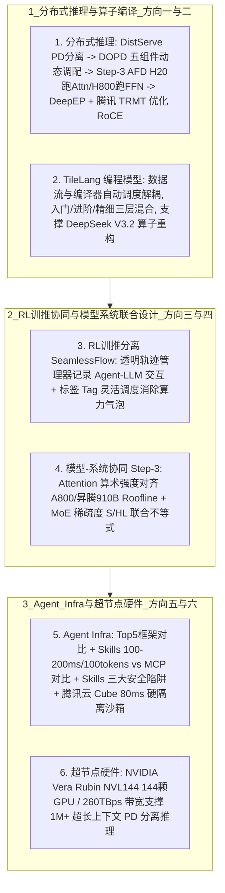

# AI Infra 六个方向

## 1. TL;DR

本文结合朱亦博老师的行业总结与腾讯内部实践，全景式梳理了 2025–2026 年 **AI Infra 的六个核心演进方向**：
1. **分布式推理（PD 分离 $\to$ DOPD 动态调节 $\to$ AFD 注意力-FFN 分离 $\to$ 跨机 EP 通信 DeepEP + 腾讯 TRMT）**：解决 Prefill（算力密集/优化 TTFT）与 Decode（访存密集/优化 TPOT）的强干扰，进一步在 Decode 内部将 Attention（部署于 H20）与 FFN（部署于 H800 或国产卡）解耦，并通过腾讯网络团队贡献的 **TRMT** 补齐 DeepEP 在 RoCE 网络下的短板。
2. **面向 Tile 的开发语言（TileLang）**：将数据流逻辑与底层线程/缓存调度解耦交由编译器自动完成，提供入门、进阶、精细三层编程范式（已被 `DeepSeek V3.2` 用于重构部分核心算子）。
3. **RL 训推分离（SeamlessFlow）**：通过介于 Agent 与 LLM 之间的透明**“轨迹管理器”数据交互平面**保证多轮状态一致性，并用**按标签（Tag）灵活资源调度**消除训推时序依赖带来的算力“气泡”。
4. **模型-系统协同设计（Step-3 算术强度与 MoE 联合公式）**：使模型 Attention 的**算术强度**对齐目标硬件（如 A800、昇腾 910B）的 Roofline 拐点，并通过公式 $\frac{S}{H \cdot L} \ge \frac{\text{FLOPs}}{\text{Net} \cdot \text{Bandwidth} \cdot \beta}$ 联合约束模型稀疏度 $S$、隐层 $H$、层数 $L$ 与硬件网络带宽及目标 TPOT。
5. **Agent Infra（框架、MCP vs Skills 安全剖析、Cube 80ms 微虚机沙箱）**：对比 Top 5 Agent 框架，深度拆解 **Skills vs MCP** 的性能与安全陷阱（语义劫持、幽灵指令、`allowed-tools: Bash` 零点击 RCE），并针对容器共享内核不安全、传统 VM 启动慢、Serverless 丢状态的痛点，推出腾讯云 **Cube 沙箱（80ms 交付、独立 Guest Kernel 硬隔离、MVM 快照预热）**。
6. **超节点形态硬件基础设施（Vera Rubin NVL144）**：单域集成 **144 颗 Rubin GPU**、支持 FP4、单域互联带宽高达 **260 TB/s**，结合 PD 分离支撑未来 **1M+ 超长上下文**推理。

## 2. 问题定义与背景

### 2.1 从“暴力堆卡”到“软硬协同精细化压榨”
自 2025 年初 DeepSeek 爆火以来，行业深刻意识到：同等参数规模的模型之所以能在一年内实现逾十倍的能力与成本跃升，工程与系统层面的精细化压榨功不可没。面对 MoE 超大稀疏模型（如 DeepSeek V3 系列包含约 **1.4 万个专家**）、强化学习后训练（RL）以及长程自主执行代码的 Agent 浪潮，传统单机混部推理、手工手写 PTX/CUDA 算子、中心化 NCCL 全量通信以及传统 Docker/VM/FaaS 底座均已触及天花板，亟需在六大维度重构 AI Infra。

## 3. 知识框架

## 4. 核心内容拆解

### 4.1 方向一：分布式推理（PD 分离 $\to$ DOPD $\to$ AFD $\to$ 跨机 EP）
1. **从 DistServe PD 分离到 DOPD 动态调节**：
   - **为什么要 PD 分离？** Prefill 阶段将输入 Prompt 转为 Q/K/V 并生成首 Token（只存 K/V Cache 而不存 Q Cache，因为后续解码每步只用当前最新 Token 的 Q 去查询历史所有的 K 和 V），属**计算密集型（优化目标为 TTFT）**；Decode 阶段逐词自回归生成，属**访存密集型（优化目标为 TPOT）**。混合部署会导致严重相互干扰与并行策略耦合；`DistServe` 通过 IB/RoCE 网络将 P、D 部署在不同设备/GPU 上实现解耦。
   - **DOPD 解决生产者-消费者失衡**：在混合长度请求下，固定配比的 P、D 实例极易出现负载失衡。`DOPD` 论文设计了包含**资源监控器、请求路由器、KV 通信连接器、P&D 实例管理器、请求调度器**的五组件系统，通过短期负载预测、低开销配比计算、混合长度请求分组批处理与自动扩缩容（含实时调整 TP 度），最大化系统有效吞吐（Goodput）。
2. **AFD（Attention-FFN Disaggregation，注意力与前馈网络分离）**：
   - `Step-3` 论文指出：即便在单一的 Decode 阶段内部，Attention 模块（参数少、高频 KV 访存，属**访存密集型**）与 FFN 模块（参数量大，属**计算密集型**）的资源需求依然截然不同。
   - **异构混部实践**：将 Decode 阶段的 **Attention 实例部署在显存带宽性价比高的 H20 上，将 FFN 实例部署在算力强的 H800（或国产化算力卡）上**，打破对高端 GPU 的单一依赖并显著降低总硬件成本。
3. **跨机专家并行（EP）通信：DeepEP + 腾讯 TRMT**：
   - 主流 MoE 专家数量庞大（如 DeepSeek V3 系列有约 **1.4 万个专家**），单机显存无法承载且每次仅稀疏激活少量专家；传统 NCCL 擅长密集全量通信，用于稀疏 `All-to-All` 会浪费大量带宽。
   - **DeepEP** 专为 MoE 稀疏按需通信设计，支持原生 FP8 通信、NVLink-RDMA 非对称带宽域转发与通信-计算重叠；而针对 DeepEP 原生仅在 IB 网络表现好、在 **RoCE 网络性能大打折扣**的痛点，**腾讯网络平台部门结合自研 TRMT 技术对其进行专项优化并回馈开源社区**，获 DeepSeek 官方公开致谢。

### 4.2 方向二与方向三：TileLang 编译语言与 SeamlessFlow RL 训推分离
1. **面向 Tile 的开发语言（TileLang）**：
   - 将“数据流逻辑”与“底层硬件 Thread/Block/Grid 及多级缓存调度”彻底解耦，调度交由编译器自动寻优；提供**入门版**（仅写数据块与计算逻辑）、**进阶版**（可调用封装算子）、**精细版**（精细线程级开发）三级可混合编程模型。**DeepSeek V3.2 官方文档已明确采用 TileLang 重构了部分核心算子**。
2. **RL 训推分离（SeamlessFlow）**：
   - 强化学习（RL）若将训练与采样推理解耦部署，虽然能各自采用异构硬件并隔离故障，但面临“Agent 多步复杂交互（含记忆）导致轨迹不一致”与“训推时序依赖产生算力气泡”两大难题。
   - `SeamlessFlow` 提出两项核心机制：（1）**数据交互平面（核心为“轨迹管理器”）**：透明介入 Agent 与 LLM 之间，精准记录全部调用输入输出以保障训练轨迹一致性；（2）**标签（Tag）资源调度机制**：跳出“非分即合”的二元对立，通过给计算资源打标签，使部分机器可按需在推理与训练任务间动态切换，彻底消除流水线气泡。

### 4.3 方向四：模型-系统协同设计（Step-3 算术强度与联合公式）
`Step-3` 论文展示了在模型设计之初就向高性价比硬件对齐的方法论：
1. **Attention 算术强度对齐硬件 Roofline**：定义“算术强度”为与显存交互平均每字节所需的浮点运算次数（仅与 Attention 模块结构及 MTP/KV 量化精度有关，**与 Batch Size 和上下文长度无关**）。Step-3 将 Attention 的算术强度精准设计在接近 **A800 或昇腾 910B** 的硬件算力-带宽比（Roofline）拐点附近。
2. **MoE 与 AFD 系统的联合设计不等式**：
   - 要让 MoE 的 FFN 吃满算力，需满足 $\text{BatchSize}_{\text{MoE}} \ge \frac{\text{FLOPs}}{2 \cdot S \cdot \text{Bandwidth}}$（要么增大 Batch，要么提高稀疏度 $S$）；
   - 但在 AFD 架构下，Batch 过大会增加跨网传输耗时从而劣化 TPOT。联立推导得出核心协同设计公式：
     $$\frac{S}{H \cdot L} \ge \frac{\text{FLOPs}}{\text{Net} \cdot \text{Bandwidth} \cdot \beta}$$
     其中公式左侧为**模型架构参数**（稀疏度 $S$、隐状态维度 $H$、层数 $L$），右侧为**硬件与服务 SLO 参数**（卡型算力 $\text{FLOPs}$、网络带宽 $\text{Net}$、显存带宽 $\text{Bandwidth}$ 及由 FFN 量化精度、AFD 流水线级数和目标 TPOT 决定的常数 $\beta$），指导模型架构与集群硬件实现定量匹配。

### 4.4 方向五与方向六：Agent Infra（Skills 安全与 Cube 沙箱）与 NVL144 超节点
1. **主流 Agent 框架与 Skills vs MCP 深度对比**：
   - 对比了 GitHub Top 5 框架（`AutoGPT`、`LangGraph`、`Dify`、`CrewAI`、`AutoGen`）及确定性 `Workflow` 与动态决策 `Agent` 的边界。
   - **Skills（教方法 How-to） vs MCP（给工具 With-what）**：Skills 采用渐进式披露（`Index -> Retrieve -> Load`），元数据仅约 **100 tokens**，首次激活延迟仅 **100–200ms**，支持纯离线与 Copy-Paste 极简部署；MCP 采用 C/S 架构（`Connect -> List All -> Choose`），连接即加载全量工具描述，存在远程网络 RTT 与多轮工具输出挤爆上下文窗口的风险，但支持 OAuth 与工具级细粒度鉴权。
   - **Skills 的三大“信任陷阱”**：（1）按需激活阶段的**语义劫持**（恶意描述抢占模糊指令）与**幽灵指令**（在 `SKILL.md` 植入隐藏恶意提示词）；（2）`scripts/` 目录下的恶意脚本直接继承宿主 Shell 权限窃取 SSH 密钥或弹反向 Shell；（3）**`allowed-tools: Bash` 隐秘后门**——一旦单次授权激活该 Skill，后续同一对话中执行任意 Bash 命令均不再二次确认，被腾讯朱雀实验室证实可被滥用实现**零点击 RCE（远程代码执行）**。
2. **为什么传统 Docker / VM / Serverless 均不适合承载 Agent 沙箱？**
   - **Docker 容器（败于安全性）**：共享宿主机 Linux 内核，而 Agent 的核心是执行 LLM 生成的不可信代码，多租户下极易发生容器逃逸搞垮集群。
   - **传统虚拟机 VM（败于启动时延）**：分钟级冷启动无法匹配 Agent“思考-写码-运行-看结果-修正”的毫秒级高频交互诉求。
   - **Serverless FaaS（败于无状态）**：Agent 任务具有强状态连续性（如第一轮加载 100MB CSV 到内存，第二轮继续分析），无状态 FaaS 被迫频繁从 S3/Redis 反复序列化加载卸载，I/O 延迟不可接受。
   - **腾讯云最佳实践（Cube 沙箱）**：采用 **独立 Guest Kernel 硬隔离** + **MVM 快照与镜像预热**，实现 **80ms 极速服务交付**、支持暂停/恢复零闲置成本，并兼容 E2B 协议与元宝“业务逻辑与执行环境物理分离”架构。
3. **超节点硬件基础设施（Vera Rubin NVL144）**：
   推理上下文长度增长对算力需求呈**平方级增长**、对显存呈**线性增长**。NVIDIA 规划的 **Vera Rubin NVL144 超节点**在单域内通过专有高带宽通道集成 **144 颗 Rubin GPU**（支持 FP4，单域带宽高达 **260 TB/s**），结合 PD 分离成为应对未来 **1M+ Token 超长上下文**推理的标杆基建。

## 5. 数据速查表

| 指标 / 维度 | 原文数值 / 公式 | 语境 / 条件 |
| :--- | :--- | :--- |
| **DeepSeek V3 系列专家规模** | 约 **1.4 万个**专家模型 | 说明单机显存无法承载，必须依赖跨机专家并行（EP）与按需稀疏通信 |
| **Step-3 模型-系统联合设计公式** | $\frac{S}{H \cdot L} \ge \frac{\text{FLOPs}}{\text{Net} \cdot \text{Bandwidth} \cdot \beta}$ | 联合匹配稀疏度 $S$、隐层 $H$、层数 $L$ 与网卡带宽 $\text{Net}$、显存带宽及目标 TPOT |
| **Agent Skills 激活延迟与 Token 开销** | 首次激活 **100–200ms** / 元数据约 **100 tokens** | 基于 `Index -> Retrieve -> Load` 渐进式披露架构，后续无额外延迟 |
| **腾讯云 Cube 沙箱交付延迟** | **80ms** 服务交付 | 结合独立 Guest Kernel 硬隔离、MVM 快照与镜像预热技术消除冷启动 |
| **NVIDIA Vera Rubin NVL144 规格** | 单域 **144 颗** Rubin GPU / 单域带宽 **260 TB/s** | 支持 FP4 精度，面向 **1M+** 超长上下文模型 PD 分离推理 |
| **2025 vs 2024 同参数模型能力跃升** | 能力提升 **超过 10 倍** | 归因于模型、系统（AI Infra）与数据的协同演进 |

## 6. 踩坑与教训 / 可迁移的设计原则

| 错误做法 | 失败表现或原因 | 原文应对（可迁移的设计原则） |
| :--- | :--- | :--- |
| **直接把基于 IB 网络开发的 DeepEP 通信库原样搬到 RoCE 以太网集群上跑跨机 MoE** | RoCE 网络下的流控与拥塞特性同 IB 存在显著差异，导致 DeepEP 在 RoCE 下跨机通信性能大打折扣 | **网络协议栈针对性协同调优（TRMT）原则**：结合腾讯网络平台团队开源回馈至 DeepEP 社区的 TRMT 技术优化 RoCE 转发效率 |
| **用普通共享内核的 Docker 容器、传统慢启动 VM 或无状态 Serverless 承载 Agent 代码沙箱** | Docker 易被不可信代码逃逸；VM 分钟级启动打断思维链；Serverless 每轮从 S3/Redis 搬运 100MB 内存状态导致 I/O 爆炸 | **微虚机快照硬隔离有状态沙箱（Cube/MVM）原则**：采用独立 Guest Kernel 防逃逸 + MVM 内存快照预热实现 80ms 极速唤醒与跨轮次内存状态保持 |
| **在 Agent 中盲目信任第三方 `SKILL.md` 并开启 `allowed-tools: Bash` 免确认配置** | 传统代码扫描查不出自然语言“幽灵指令”，且单次激活后任意后续 Bash 命令均免确认，直接招致零点击 RCE 与 SSH 密钥被窃 | **A.I.G 语义级安全审计 + Bash 细粒度二次确认原则**：使用 A.I.G 等支持自然语言提示注入检测的工具扫描 Skill，严禁对外部 Skill 放开无限制免确认 Shell 权限 |
| **先拍脑袋定好大模型 Attention 与 MoE 超参数，训练完再去市面上找推理卡硬跑** | 模型算术强度偏离硬件 Roofline 拐点，或在 AFD 分离下因大 Batch 跨网通信拖垮 TPOT | **Model-System Co-Design（模型-系统前置协同）原则**：设计模型时即令 Attention 算术强度对齐 A800/910B/H20，并按 $\frac{S}{H \cdot L}$ 联合不等式匹配网络与显存带宽 |

## 7. 记忆锚点

- **AI Infra 六大关键词口诀**：“**一拆分布式推理（PD/DOPD/AFD/DeepEP+TRMT），二写 TileLang 自动调度，三用 SeamlessFlow 训推消气泡，四靠 Step-3 算术强度协同硬件，五建 Cube 80ms 安全沙箱防 Skill 投毒，六上 Rubin NVL144 超节点（260TB/s 战 1M 上下文）。**”
- **为什么只存 KV Cache 不存 Q Cache？** ——“**历史 Token 的 K 和 V 在生成后续每个新词时都要被反复查询复用，而每个解码步只需用当前最新那个 Token 的 Q，算完即弃无需缓存。**”

## 8. 复习卡片

在大模型 Decode-Only 推理的 Prefill 和 Decode 阶段中，为什么我们只缓存 K、V（KV Cache）而不缓存 Q（Q Cache）？::因为在自回归生成（Decode）每一步新 Token 时，只需要拿当前最新 Token 的 Query（Q）向量去和前序所有历史 Token 的 Key（K）、Value（V）向量做注意力交互；历史 Token 的 Q 在计算完自身位置后不再被后续步骤使用，因此只需持久化存储 K 和 V。
什么是 Step-3 提出的 AFD（Attention-FFN Disaggregation）架构，它如何利用异构 GPU 降低推理成本？::AFD 在 PD 分离的基础上，进一步将 Decode 阶段内部“参数少但 KV 访存密集的 Attention 模块”与“参数量大且计算密集的 FFN 模块”解耦部署在不同设备上；例如用显存带宽性价比高的 H20 部署 Attention 实例，用算力强的 H800（或国产芯片）部署 FFN 实例，从而大幅提升资源利用率并降低硬件成本。
SeamlessFlow 框架是如何解决 RL（强化学习）训推分离架构下的“多轮 Agent 状态一致性”与“算力气泡”两大难题的？::1. 针对一致性：在 Agent 与 LLM 之间设计了透明的“数据交互平面（核心为轨迹管理器）”，精准记录全过程输入输出；2. 针对算力气泡：提出“按标签（Tag）资源调度机制”，让部分计算资源能按需在推理采样与模型训练任务之间动态切换，消除时序等待气泡。
Agent Skills 与 MCP 在上下文开销、延迟以及安全风险上有何核心差异？::Skills 采用渐进式披露（元数据仅约 100 tokens，首次激活 100–200ms，支持纯离线），但所有 Skills 共享沙盒权限，易遭“语义劫持”、“幽灵指令”及 `allowed-tools: Bash` 带来的零点击 RCE 攻击；MCP 采用 C/S 架构（连接即加载全部工具描述，有网络 RTT 且多轮输出易挤爆上下文），但支持 OAuth 与工具级细粒度访问控制。
为什么传统的 Docker 容器、传统虚拟机（VM）和无状态 Serverless（FaaS）都不适合直接作为 Agent 代码执行沙箱？腾讯云是如何解决的？::1. Docker 共享宿主机内核，运行 LLM 生成的不可信代码极易发生逃逸；2. 传统 VM 分钟级启动太慢，无法满足高频交互；3. Serverless 无状态，跨轮次分析大文件（如 100MB CSV）需频繁从外部存储加载卸载，I/O 开销极大。腾讯云通过 Cube 沙箱（独立 Guest Kernel 硬隔离 + MVM 快照与镜像预热 + 暂停/恢复机制）实现了 80ms 极速交付与零闲置成本。
NVIDIA Vera Rubin NVL144 超节点的核心硬件规格是什么，它主要为了应对什么趋势？::单域集成 144 颗 Rubin GPU、支持 FP4 精度、单域专有互联带宽高达 260 TB/s；主要为了配合 PD 分离与 AFD 架构，应对未来 1M+ Token 超长上下文模型推理带来的平方级算力增长与海量跨卡通信需求。

## 9. 知识关联

- **本库通用主题**：[Agent成本与上下文预算](../../20_topics/Agent%E6%88%90%E6%9C%AC%E4%B8%8E%E4%B8%8A%E4%B8%8B%E6%96%87%E9%A2%84%E7%AE%97.md)
- **候选双链**：[[MoE推理与Agent算子优化]] · [[英伟达GPU选型科普]] · [[OpenClaw安全体检]] · [[Agent技能与生产交付]]

## 10. 原文参考资料

- 原文标题：《读懂 AI Infra，看这六个关键词就够了》（作者：dorianbian，larrylyyu，发布于 2026-01-23）
- 核心引用论文与项目：
  1. *DistServe*（`arXiv:2401.09670`）
  2. *DOPD: A Dynamic PD-Disaggregation Architecture*（`arXiv:2511.20982`）
  3. *Step-3 is Large yet Affordable: Model-system Co-design for Cost-effective Decoding*（`arXiv:2507.19427`）
  4. *DeepEP*（`deepseek-ai/DeepEP`）及腾讯网络平台部门 **TRMT** RoCE 优化方案
  5. *TileLang*（`arXiv:2504.17577`）
  6. *SeamlessFlow*（`arXiv:2508.11553`）
  7. *NVIDIA Rubin CPX / Vera Rubin NVL144 Technical Blog*

> [!note]- 校对报告
> - **页码溯源汇总**：
>   - `p.1–5`：方向一分布式推理——MoE 与 Decoder-Only 前置概念、DistServe PD 分离、DOPD 动态五组件系统、Step-3 AFD（H20 部署 Attention + H800 部署 FFN）、跨机 EP（DeepSeek V3 约 1.4 万专家、DeepEP 四大特性、腾讯网络平台部门 TRMT 优化 RoCE 获 DeepSeek 官方致谢）。
>   - `p.5–8`：方向二 TileLang（数据流与调度解耦、入门/进阶/精细三层模型、DeepSeek V3.2 重构部分算子）与方向三 RL 训推分离 SeamlessFlow（轨迹管理器数据交互平面 + 标签 Tag 资源调度消除气泡）。
>   - `p.8–9`：方向四模型-系统协同设计（Step-3 Attention 算术强度对齐 A800/昇腾 910B Roofline，以及 $\frac{S}{H \cdot L} \ge \frac{\text{FLOPs}}{\text{Net} \cdot \text{Bandwidth} \cdot \beta}$ 联合设计不等式）。
>   - `p.10–15`：方向五 Agent Infra——GitHub Top 5 框架对比表、Workflow vs Agent、MCP 三组件、Agent Skills vs MCP 全维度对比表（100–200ms 激活、100 tokens 元数据）、Skills 三大安全陷阱（语义劫持、幽灵指令、恶意脚本、`allowed-tools: Bash` 零点击 RCE）、Docker/VM/Serverless 三大局限及腾讯云 Cube 沙箱（80ms 交付、MVM 快照预热、独立 Guest Kernel 硬隔离、兼容 E2B）。
>   - `p.15–17`：方向六超节点硬件基础设施（Vera Rubin NVL144，144 颗 Rubin GPU、支持 FP4、260TBps 带宽、1M+ 上下文 PD 分离最佳实践）及 7 篇核心参考文献。
> - **核验结论**：全文六大方向的所有论文结论、公式、表格对比项及量化指标均与原文逐页核对一致。
