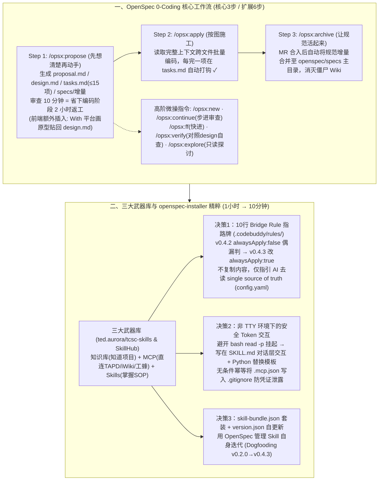

# 当整个团队开始0人工Coding：一份万字AI Native研发实战手册

## 1. TL;DR

1. **核心转变：全员 0 人工手写代码（0-Coding），开发者角色浓缩为“决策、审批、把关”**：针对人机协作无标准、文档与 IDE 割裂、缺乏项目上下文三大痛点，团队基于 **OpenSpec（`@fission-ai/openspec`）+ CodeBuddy** 构建了统一的 AI Native 研发体系——**严禁直接让 AI 写大段业务代码**，强制先花 10 分钟审查规划文档以省下编码阶段 **2 小时** 的返工。
2. **OpenSpec 核心三步走（扩展六步流）与文档永不腐烂机制**：① **`/opsx:propose`** 在 `openspec/changes/[变更名]/` 下生成 `proposal.md`（做什么）、`design.md`（怎么做）、`tasks.md`（**严格控制在 `≤ 15 项` 以内防长上下文幻觉**）与 `specs/`（规范增量），前端变更额外插入 **With 平台原型截图审查**；② **`/opsx:apply`** 让 AI 按图施工批量改代码并自动打钩；③ **`/opsx:archive`** 在 MR 合入后将规范增量自动合并回 `openspec/specs` 主目录，彻底消灭“僵尸 Wiki”。
3. **三大武器库（知识库 + MCP + Skills）与 `openspec-installer` 一键装机实践**：将原本需新人折腾 **1 小时至半天** 的 8 步环境搭建封装为 `openspec-installer` Skill（**10 分钟** 一句话搞定），内含三大精妙设计——① 生成仅 **10 行**、设置 **`alwaysApply: true`** 的 **Bridge Rule**（`.codebuddy/rules/openspec-config-awareness.md`）作为指向 `config.yaml` 单一数据源的指路牌；② 针对非 TTY 环境 `read -p` 挂起痛点，将 **PAT Token 交互上移至 `SKILL.md` 对话层** 并无条件幂等写入 `.gitignore`；③ 用 `skill-bundle.json` 与 `version.json` 实现团队技能套装一键拉齐与热更新。
4. **Dogfooding 自举演进与全栈协同范式**：`openspec-installer` 自身的每一次迭代（`v0.2.0 → v0.4.3`）完全采用 OpenSpec 的 `propose → apply → archive` 管理；日常采取 **“CodeBuddy CLI 主攻跨项目生成（父目录启动同时搞定前后端）+ IDE 辅助审改文档与解冲突”** 的黄金组合。

## 2. 问题定义与背景

### 2.1 传统“对话框式 AI 写代码”的四大痛点
在没有统一工程体系前，团队成员各自用对话框调 AI 写代码普遍陷入四个泥潭：
- **人机协作无标准**：产出质量全凭个人 Prompt 功力，老手提效明显，新手陷入“对话—报错—调试—再对话”反而更慢；
- **流程断点沦为“人肉翻译器”**：在 TAPD 需求、iWiki 方案与 IDE 之间来回复制粘贴；
- **项目上下文缺失**：AI 不懂内部组件库与编码规范，频繁重复造轮子；
- **新项目/新人环境配置繁琐**：手动安装 Node.js、`openspec init`、配 `config.yaml`、拿工蜂/iWiki Token 配 MCP、挑 Skills、建 `docs/` 目录共 **8 个步骤**，动辄耗时 **1 小时到半天** 且极易出错。

### 2.2 角色重定义：人类只做三件事——决策、审批、把关
| 研发阶段 | AI 负责（自主执行） | 人类负责（指挥与守门） |
| :--- | :--- | :--- |
| **1. 需求分析** | 通过 MCP 直读 TAPD 提炼需求、发现遗漏、输出结构化文档 | 业务优先级判断、审批需求边界 |
| **2. 方案设计** | 生成技术方案、架构图、接口定义与风险清单 | 技术选型拍板、安全架构审查（前端加 With 原型确认） |
| **3. 代码开发** | 按 `design.md` 与 `tasks.md` 跨文件批量编码、补注释与单测 | 评审关键代码 Diff、控制合并门禁 |
| **4. 测试与上线** | 生成测试脚本、跑回归测试、校验实现一致性并出发布清单 | 审核高风险场景、审批发布窗口与事故升级处理 |

## 3. 知识框架

## 4. 核心内容拆解

### 4.1 OpenSpec 核心工作流与高阶操控指令

1. **核心三步指令（`propose → apply → archive`）**：
   - **`/opsx:propose [变更描述]`**：在 `openspec/changes/[变更名]/` 下自动生成四类文件：`proposal.md`（为什么做与做什么）、`design.md`（技术方案与架构决策）、`tasks.md`（带复选框的 AI 施工单，**强制控制在 `15 项` 以内**以防上下文过长引发幻觉）、`specs/`（本次规范增量差异记录）。*注：若涉及前端页面，在 propose 与 apply 之间强制增加一步——在 **With 平台** 确认原型并将截图/链接贴回 `design.md`*。
   - **`/opsx:apply [变更名]`**：AI 读取完整规划上下文跨文件生成代码并在 `tasks.md` 逐项打钩，人类只需做 Code Review。
   - **`/opsx:archive [变更名]`**：MR 合入后执行（`v0.3.0` 起强制检查 MR 状态，`v0.4.0` 起归档后自动更新索引），将规范增量合入 `openspec/specs/` 主目录并清空草稿，确保项目文档永远与代码 100% 同步。
2. **高阶扩展指令（`openspec config profile` 开启）**：
   - `/opsx:new`（仅建空脚手架）、`/opsx:continue`（步进式生成：先审完 Proposal 再生成 Design，适合复杂需求）、`/opsx:ff`（需求明确时快进一次性生成）、`/opsx:verify`（写完代码后让 AI 比对 `design.md` 做代码审计）、`/opsx:explore`（纯探讨模式，只输出文档绝不动代码）。
3. **CLI + IDE 双剑合璧与全栈父目录联动**：
   - 推荐 **“CodeBuddy CLI 主攻 + IDE 辅助”**：在包含 `web-frontend/` 与 `api-backend/` 的父目录 `my-fullstack-workspace/` 下启动 CLI，使 AI 具备全局视角，一条 `/opsx:propose` 指令即可同时完成后端 API 与前端表格渲染的联动规划与编码；IDE 则用于审改 Markdown 规划文档与解决 Git 冲突。

### 4.2 `openspec-installer` Skill 的三大工程设计巧思

为了把新人搭环境的 8 个繁琐步骤从 **1 小时~半天压缩到 10 分钟（一句话自动搞定）**，团队在 `ted.aurora/tcsc-skills` 沉淀了 `openspec-installer`，其核心架构解决了三个共性工程难题：
1. **巧思一：用 10 行 `Bridge Rule` 解决工具链“指路”与单一数据源问题**
   - `openspec/config.yaml` 存放着项目的技术栈、代码规范与核心业务背景，但 CodeBuddy 默认只自动加载 `.codebuddy/rules/` 下的规则。若把配置复制两份，后续修改极易脱节。
   - **解法**：安装时向 `.codebuddy/rules/openspec-config-awareness.md` 写入一个仅 **10 行** 的 **Bridge Rule**（指路牌），告诉 AI“执行 OpenSpec 操作时先去读 `openspec/config.yaml`”。
   - **踩坑迭代**：`v0.4.2` 首次引入时设为 `alwaysApply: false`（由 AI 自行判断是否加载），实测偶尔漏判；`v0.4.3` 改为 **`alwaysApply: true`**（因仅 10 行，常驻 Token 开销可忽略不计），彻底根治链路断裂。
2. **巧思二：非 TTY 环境下的 Token 对话式注入与无条件 `.gitignore` 防护**
   - **痛点**：CodeBuddy 执行 Bash 脚本处于**非交互式（Non-TTY）环境**，如果在 Shell 脚本里写 `read -p "请输入 PAT Token"` 会直接导致进程永久挂起。
   - **解法**：将 Token 引导交互写在 `SKILL.md` 的自然语言 SOP 层（支持用户回复“跳过”），AI 在对话中拿到 Token 后调用 Python 脚本替换 `mcp-servers.json` 模板生成 `.mcp.json`；且在交互前**无条件幂等执行 `grep -qxF '.mcp.json' .gitignore || echo '.mcp.json' >> .gitignore`**，哪怕用户当时跳过、事后手填 Token 也绝不会误提交泄露。
3. **巧思三：`skill-bundle.json` 套装化与“用 OpenSpec 管理 OpenSpec Skill（Dogfooding）”**
   - 项目根目录维护 `skill-bundle.json`（声明需安装的 `atomic`、`operation-template`、`bug-fix` 等技能清单），新人跑一次 Installer 即全量配齐；通过 `version.json` 与 `self_update.sh` 对比远端版本实现热更新；且 `openspec-installer` 自身的每次升级（如 `v0.3.0 → v0.4.3`）全部留有完整的 `proposal + design + spec + tasks` 归档记录。

## 5. 数据速查表

| 指标 | 原文数值 | 语境 / 条件 |
| :--- | :--- | :--- |
| **规划文档审查的投入产出比** | 审查多花 `10 分钟`，编码阶段省 `2 小时` 返工 | `/opsx:propose` 阶段人工把关 `proposal.md` 与 `design.md` 的收益 |
| **`tasks.md` 施工单条目上限建议** | 控制在 `15 项以内` | 遵循原子化变更原则（一次 Change 解决一个需求），防止长上下文幻觉 |
| **项目环境搭建耗时对比** | 手动 8 步需 `1 小时 ~ 半天` → `openspec-installer` 仅需 `10 分钟` | 自动完成 Node.js 检测、`@fission-ai/openspec` 安装、MCP 与 Skills 配置 |
| **`Bridge Rule` 指路牌文件体积** | 仅 `10 行`（`alwaysApply: true`） | 位于 `.codebuddy/rules/openspec-config-awareness.md`，指向 `config.yaml` |
| **`openspec-installer` 一周密集迭代次数** | `5 个` 版本（`v0.2.0` → `v0.3.0` → `v0.4.0` → `v0.4.1` → `v0.4.2` → `v0.4.3`） | 3 月 19 日至 3 月 20 日完全使用 OpenSpec 自身流程 Dogfooding 演进 |

## 6. 踩坑与教训 / 可迁移的设计原则

| 错误做法 | 失败表现或原因 | 原文应对（可迁移的设计原则） |
| :--- | :--- | :--- |
| **打开 IDE 对话框直接让 AI 写大段复杂业务代码，或单次 `tasks.md` 塞入几十个子任务** | 缺乏架构边界约束导致反复返工调试，且任务项过多导致后半程上下文注意力崩溃与幻觉 | **强制先跑 `/opsx:propose` + 原子化限制 `tasks.md ≤ 15 项`**：花 10 分钟审好规划再执行 `/opsx:apply`，前端变更必先在 With 平台确认原型 |
| **项目上线后把设计文档丢在外部 Wiki 不管，任由文档与代码脱节变成“僵尸 Wiki”** | 几个月后后续需求迭代时，AI 读到过期的 Wiki 架构文档写出错误代码 | **MR 合入后强制执行 `/opsx:archive`**：将每次变更的 `specs/` 规范增量自动合入主目录并更新索引（`v0.4.0`），让活文档随代码仓库同步演进 |
| **在配置文件（`config.yaml`）与 IDE 规则目录（`.codebuddy/rules/`）之间复制粘贴同一套规范文本** | 后续修改 `config.yaml` 时忘了同步更新 Rules 目录，造成双源冲突 | **10 行 `Bridge Rule` 指路牌模式（`alwaysApply: true`）**：Rules 文件不存具体规则，只写一句“请先读取 `openspec/config.yaml`”，守住 Single Source of Truth |
| **在 Agent 调用的自动化 Shell 脚本中使用 `read -p` 等待用户输入密钥或参数** | CodeBuddy 等 Agent 的 Shell 执行器属于非 TTY 环境，`read -p` 会导致子进程死锁挂起 | **将人机交互上移至 `SKILL.md` 指令层 + 脚本纯非交互化**：由 AI 在聊天窗口引导用户粘贴 Token（或回复跳过），再调脚本替换占位符，且前置无条件将 `.mcp.json` 加入 `.gitignore` |

## 7. 记忆锚点

- **“Propose（想清楚，≤15 项）→ Apply（按图施工）→ Archive（合入规范消灭僵尸 Wiki）”**：OpenSpec 三步走把团队带入全员 0-Coding 时代，审查 10 分钟省下返工 2 小时。
- **“10 行 Bridge Rule 指路牌（`alwaysApply: true`）+ 非 TTY 禁 `read -p` 改对话层收 Token + 无条件 `.gitignore`”**：编写企业级环境初始化 Skill（`openspec-installer`）最具复用价值的三个工程Trick。

## 8. 复习卡片

1. 在全员“0 人工 Coding”模式下，人类研发人员的核心职责被浓缩为哪三件事？OpenSpec 的核心三步工作流是什么？::人类核心职责浓缩为“决策、审批、把关”（需求边界审批、技术选型拍板、关键代码 Review 与发布放行）；OpenSpec 核心三步流为：① `/opsx:propose`（生成 `proposal.md`、`design.md`、`tasks.md` 与 `specs/` 增量）；② `/opsx:apply`（AI 按清单跨文件施工并自动打钩）；③ `/opsx:archive`（MR 合入后将规范增量合并回主目录，消灭僵尸 Wiki）。
2. 为什么作者建议将 `tasks.md` 控制在 15 项以内，且对前端页面开发增加了什么额外卡点？::控制在 `15 项以内`（配合“一次变更只解决一个需求”的原子化原则）是为了避免上下文过长导致 AI 产生幻觉或遗漏步骤；对前端页面开发，在设计阶段后额外增加了“在 With 平台上画好原型 → 团队确认 → 将截图/链接贴回 `design.md` → 再执行 `/opsx:apply`”的视觉对齐卡点。
3. 什么是 `Bridge Rule`（指路牌规则），为什么在 `v0.4.3` 中将其从 `alwaysApply: false` 改为了 `alwaysApply: true`？::为了保持 `openspec/config.yaml` 作为唯一数据源（Single Source of Truth）且能被 CodeBuddy 感知，安装器在 `.codebuddy/rules/` 下生成了一个仅 `10 行` 的 Bridge Rule 文件指引 AI 去读 `config.yaml`；`v0.4.2` 用 `alwaysApply: false` 让 AI 自行判断是否加载时偶发漏判，改为 `alwaysApply: true` 后因仅 10 行几乎不占 Token 且 100% 稳定生效。
4. 为什么在编写 CodeBuddy 的 Skill 脚本时不能使用 `read -p` 让用户输入 Token，正确的安全交互做法是什么？::因为 CodeBuddy 的 Bash 执行环境是非 TTY 的，调用 `read -p` 会导致脚本直接挂起；正确做法是将 Token 索取交互写在 `SKILL.md` 的 SOP 指令层由 AI 在对话框中完成（支持跳过），获取后再用脚本替换模板生成 `.mcp.json`，并在交互前无条件幂等地将 `.mcp.json` 写入 `.gitignore` 防止凭证泄露。
5. 如何利用 CodeBuddy CLI 与 IDE 的分工来实现前后端多项目联动开发？::采用“CLI 主攻、IDE 辅助”策略：在包含前端仓库（`web-frontend/`）和后端仓库（`api-backend/`）的父工作区目录下启动 CodeBuddy CLI，让 AI 拥有全局视角，用一条 `/opsx:propose` 指令同时规划和生成前后端代码；再用 CodeBuddy IDE 审查修改规划文档、解决 Git 冲突与微调单行逻辑。

## 9. 知识关联

- **本仓库主题索引**：[AI研发协同](../../20_topics/AI%E7%A0%94%E5%8F%91%E5%8D%8F%E5%90%8C.md) · [Agent工程循环](../../20_topics/Agent%E5%B7%A5%E7%A8%8B%E5%BE%AA%E7%8E%AF.md) · [Harness与模型协同](../../20_topics/Harness%E4%B8%8E%E6%A8%A1%E5%9E%8B%E5%8D%8F%E5%90%8C.md)
- **候选双链概念**：[[OpenSpec规范驱动流]] · [[Bridge-Rule指路牌模式]] · [[非TTY环境交互设计]] · [[零人工Coding实战]] · [[Dogfooding自举演进]]

## 10. 原文参考资料

1. OpenSpec CLI 工具包：`@fission-ai/openspec`（含 `/opsx:propose`、`apply`、`archive`、`new`、`continue`、`ff`、`verify`、`explore` 指令集）。
2. 腾讯内部技能与工具生态：`ted.aurora/tcsc-skills`（`openspec-installer`、`skill-bundle.json`）、CodeBuddy CLI / IDE、TAPD、iWiki、工蜂、With 原型平台、SkillHub。

> [!note]- 校对报告
> - **校对状态**：已按原文逐页核对通过（共 18 页 PDF）。
> - **核心数据与页码溯源**：
>   - 四大痛点、研发人员角色转变为“决策、审批、把关”五阶段分工表：见 `p.1–3`。
>   - 核心三步走（`/opsx:propose` 生成 `proposal.md / design.md / tasks.md / specs/`，多花 `10 分钟` 审查省 `2 小时` 返工；`/opsx:apply`；`/opsx:archive`）、`tasks.md` 控制在 `15 项以内`、前端 With 平台原型审查：见 `p.3–5`。
>   - 三大武器库（知识库、MCP、Skills `ted.aurora/tcsc-skills`）、手动搭建环境 8 步耗时 `至少 1 小时，踩坑半天` vs `openspec-installer`：见 `p.6–9`。
>   - 决策一 `Bridge Rule`（`.codebuddy/rules/openspec-config-awareness.md`，仅 `10 行`，`v0.4.2 alwaysApply: false` → `v0.4.3 alwaysApply: true`）与决策二非 TTY 环境 Token 交互 + `.gitignore` 幂等防护：见 `p.10–11`。
>   - `version.json`、`skill-bundle.json`、`v0.2.0 ~ v0.4.3` Dogfooding 迭代记录表、`10 分钟` 上手指南、CLI 主攻 + IDE 辅助、父目录前后端多项目联动及扩展指令（`new / continue / ff / verify / explore`）：见 `p.12–16`。
