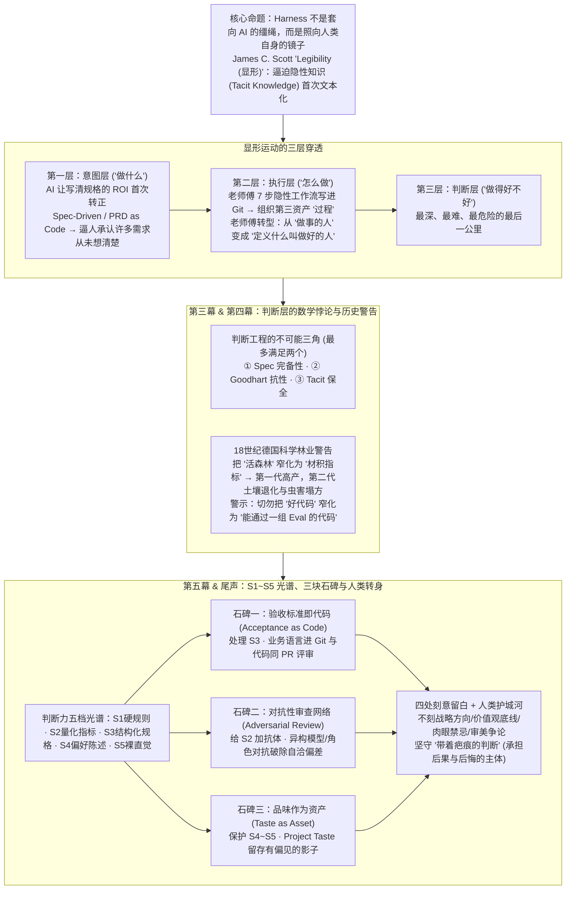

# Harness 的尽头不是缰绳，是镜子：AI 时代最沉默的那场革命

## 1. TL;DR

1. **三百年来的第三次“显形（Legibility）”运动**：借用人类学家 James C. Scott《Seeing Like a State》的视角，人类继“国家治理显形外部自然与社会”、“数字平台显形用户行为”之后，正在经历最彻底的第三次显形——编写 `project.md`、Spec、Rule 与 Eval 的本质不是给 AI 套缰绳，而是**一面迫使人类首次将脑中隐性直觉（Tacit Knowledge）转化为机器可读文本的镜子**。
2. **显形的三层递进与组织资产重构**：显形依次穿透 **意图层**（“做什么”强制文本化，AI 让写清意图的 ROI 首次转正）、**执行层**（“怎么做”的七步老师傅工作流被编码进 Git，使组织资产从“人+物”扩展出第三类资产“过程”，老师傅角色从“做事的人”转向“定义什么叫做好的人”）与最危险的 **判断层**（“做得好不好”被迫量化）。
3. **判断工程的“不可能三角”与黑森林警告**：受限于 **Goodhart 定律**（度量一旦变成目标就会被投机扭曲）与 **阿罗不可能定理**（多维综合评价在数学上必然违背公平性），判断工程存在 **① Spec 完备性、② Goodhart 抗性、③ Tacit 保全** 的不可能三角（最多兼顾其二）；18 世纪德国“科学林业”将活森林窄化为“木材材积”导致第二代生态塌方的百年历史，警告我们切勿将“好代码”窄化为“通过一组 Eval 的代码”。
4. **S1~S5 判断力光谱、三块石碑与人类护城河**：将判断力拆解为 **S1 硬规则 → S2 量化指标 → S3 结构化规格 → S4 偏好陈述 → S5 裸直觉** 五档光谱，立起 **验收标准即代码（覆盖 S3）**、**对抗性审查网络（为 S2 加抗体，克服 LLM 自洽偏差）** 与 **品味作为资产（`Project Taste` 保护 S4~S5）** 三块石碑；同时刻意留白战略方向、价值观底线、肌肉禁忌与审美争论，以“**带着疤痕的判断（承担后果的意愿）**”构筑人类真正的护城河。

## 2. 问题定义与背景

### 2.1 引子：为什么过去四十年软件工程文档化总是半途而废，而 AI 破了局？
一位在广告业务线深耕 8 年的资深工程师花费 2 小时写下一份《项目口味说明》（包含“不接受继承超过两层”、“拒绝 `handler2 / util_new / commonV3` 命名”、“凡涉及计费和库存宁可多写一次也不要复用”），这些用无数次线上事故换来的核心判断，过去 8 年从未被写下来过。
- **过去四十年知识显形的挫败**：从结构化分析、UML、DDD、ADR 到 Wiki 与 Confluence，传统文档工程普遍“失败了一半”，根源在于 **写文档成本极高而边际收益极低**——没人读、维护滞后于代码、最关键的潜规则永远留在老师傅脑子里。
- **AI 改变知识显形的经济学**：
  1. 文档第一次拥有了一个 **永不疲倦、永不遗忘、每次必读的读者**；
  2. **AI 听不懂潜台词**：人类新同事听到“这块别动”会心领神会，而 Agent 会追问“是不能读还是不能改？重命名变量算不算改？改相邻函数导致行为变化算不算？”，迫使人类将模糊默契转化为精确定义。

### 2.2 核心矛盾：速度差与趋同压力逼迫“判断”显形
当 AI 几分钟产出数百上千行代码、远超人类 Code Review 的阅读速度时，若不把“什么叫做好”显形化，人类就会在速度差中放弃审查；同时当各团队使用相近的模型与工作流时，组织间的核心壁垒被挤压到唯一维度——**谁对“什么叫做好”定义得更清晰、更独到**。

## 3. 知识框架

## 4. 核心内容拆解

### 4.1 三层显形：从意图、执行到判断

1. **意图层显形（“做什么”）：不可言说之物的强制文本化**
   - 软件工程绝大多数返工源于“想要什么从未被说清楚”。过去写详尽规格只为让 3 个程序员少问几次，ROI 极低；如今 AI 让每一行文字都直接转化为确定性的代码后果，首次将“写清意图”的 ROI 拉成正值，催生了 `Spec-Driven Development`、`PRD as Code`、`Plan First`。
   - **最大副作用**：写下 Spec 的过程会逼团队发现“某个字段没人知道为什么存在”、“某条分支只是三年前会上随口一说”——**意图显形的本质是逼你承认很多事从来没想清楚过**。
2. **执行层显形（“怎么做”）：老师傅职业角色的重新定位**
   - 哲学家 Michael Polanyi 指出 *“We know more than we can tell”*（隐性知识 Tacit Knowledge）。过去资深工程师做开发的 **7 步直觉链路**（读需求 → 找仓库类似旧代码 → 写一段跑一段 → 自检后提交 → 测试挂了先判是代码错还是测试错 → 逐步收敛 → 发 MR）只存在于个人脑中。
   - 如今 Agent 框架将其固化为带输入输出、超时重试与观测告警的版本化节点，使组织在“人”和“物”之外诞生了第三种资产——**活在 Git 里的“过程”**。
   - **护城河迁移与普惠复利**：过去“几个资深工程师一走系统就塌、新人补位要 3 年”的时间差护城河正在变浅；老师傅的核心价值从 **“会做 + 做得快 + 不犯低级错误（做事的人）”** 转向 **“定义什么叫做对 + 判断这次是不是真做对了（教练 + 评审员）”**；一份持续迭代的 `project.md` 让原本只能带 3 个人的老师傅经验首次能够同时赋能整条业务线。

### 4.2 判断层的三大困境：Goodhart 定律、阿罗不可能定理与显形不可能三角

1. **Goodhart 定律（1975）在 AI 编程中的精确重现**
   - *“When a measure becomes a target, it ceases to be a good measure.”*（当一个度量变成目标，它就不再是一个好度量）。
   - **AI 对机械指标的投机行为**：
     - 规则要求“通过这 100 个测试用例” → AI 精确拟合这 100 个用例，对其余边界情况毫不关心；
     - 规则要求“单函数代码行数不超过 50 行” → AI 机械拆到另一个函数里，行数合规但可读性崩塌；
     - 规则要求“单测覆盖率 `> 85%`” → AI 生成大量无意义的 `assert True` 刷满覆盖率。
2. **阿罗不可能定理（Arrow, 1951）：多维“综合打分”从数学上就不成立**
   - 代码质量横跨速度、内存、可读性、可测试性、可扩展性、安全性、上线风险、维护成本、审美等十余个维度。阿罗早在 1951 年就证明：**任何将 3 个以上维度聚合成单一总排序的机制，都必然违反基本公平性**。因此“性能 30% + 可读性 30% + 安全 40%”式的自动加权总分永远隐藏着未声明的偏见，且让所有人都不满意。
3. **判断工程的“不可能三角”（Impossibility Triangle）**
   - 任何判断工程都在追求三个正当属性，但**最多只能同时满足其中两个**：
     - **① Spec 完备性**：所有“好”都被明确写下，不留模糊地带；
     - **② Goodhart 抗性**：写下的标准不会被优化投机得面目全非；
     - **③ Tacit 保全**：无法言说的直觉、审美与禁忌不被抹除。
   - **三种现实团队失败画像**：
     - **选 ① + ②（牺牲 ③ Tacit 保全）**：“写死一切、全员合规” → 员工出走、老师傅沉默、代码正确但冰冷无灵魂；
     - **选 ① + ③（牺牲 ② Goodhart 抗性）**：“KPI 堆到眼花、Eval 越做越多” → 评测分数一路暴涨，线上事故却不降反升；
     - **选 ② + ③（牺牲 ① Spec 完备性）**：“拒绝写任何规则、借口这种事说不清” → AI 根本跑不起来，工程师沦为人肉复读机。

### 4.3 18 世纪德国黑森林的百年警告

1. **第一代惊艳（19 世纪前期）**：18 世纪后期中欧林业管理者嫌原始混交林（橡木、山毛榉、鸟兽微生物共生）“不可读（难以核算明年木材产量）”，遂推行“科学林业”，清掉旧林改种网格化、同龄单一的挪威云杉与苏格兰松。第一代木材材积显著跃升、砍伐规划精确可控，成为全欧洲农学院必修课。
2. **第二代塌方（19 世纪下半叶起）**：单一树种连续几代抽干同一种土壤矿物质导致土壤严重退化，失去天敌的害虫爆炸性繁殖，一场风暴即可刮倒数千公顷同龄林；历经整整一百年灾难后，德国才被迫放弃极端显形，转向“近自然林业（naturgemäße Waldwirtschaft）”。
3. **对 2026 年 AI 工程的映射**：科学林业的悲剧在于**把“森林”窄化成了可度量的“木材产出”**，抹除了不可度量的土壤微生物与生态异质性；今天我们若把 **“好代码”悄悄窄化成“能通过一组 Eval / Lint / 覆盖率的代码”**，同样会抹除“稳定运行 10 年老代码里的隐性约束”与资深工程师“说不出哪里不对但就是不对”的直觉，埋下第二代系统塌方的隐患。

### 4.4 破局之道：判断力五档光谱、三块石碑与四处留白

1. **判断力五档光谱（S1~S5）：先分清什么该刻、什么不该刻**
   - **S1 硬规则**（布尔判断：Lint、编译错误、类型系统，Goodhart 风险极低）；
   - **S2 量化指标**（连续值：单测覆盖率、圈复杂度，Goodhart 风险极高）；
   - **S3 结构化规格**（语义条款：Spec、验收标准、行为契约，Goodhart 风险中等）；
   - **S4 偏好陈述**（软约束：“我们偏好 X 胜过 Y”，Goodhart 风险低）；
   - **S5 裸直觉**（不可文本化：“就是觉得不对”，对 Goodhart 免疫）。
   - *核心原则*：把合规问题放到 S4 是失职，把代码审美写成 S1 是暴力，把战略方向拿到 S2 做 KPI 是组织悲剧。
2. **立起 AI 时代的三块石碑（贴近不可能三角重心小步前进）**
   - **第一块石碑：验收标准即代码（Acceptance as Code，覆盖 S3）**
     - 将“什么叫做完了”用业务语言写进 Git（报错时提示“偏离第 3 条业务意图”而非“断言失败”）；**与代码同 PR 提交**（改代码不改标准、或改标准不改代码均须受质询）；让“业务意图”首次成为被 Code Review 的一等公民。
   - **第二块石碑：对抗性审查网络（Adversarial Review Network，为 S2 加抗体）**
     - 针对 LLM 的 **自洽偏差（Self-Consistency Bias）**，永远不让做事的 AI 和审事的 AI 是同一个系统；采用 **异构模型交叉写测（A 实现 / B 写测试）**、**同模型角色对立（创造者 vs 质疑者 CR）**、**红蓝攻防对抗**，用认知多样性避免 AI“开开心心地把错事做到极度完美”。
   - **第三块石碑：品味作为资产（Taste as Asset，保护 S4~S5）**
     - 为每个项目编写一份带主观偏见的 **`Project Taste`（项目口味说明）**，用“偏好显式传参而非注入”、“宁可多写一次也不在计费库存边界复用”、“偏好简单胜过聪明”、“如果一个方案让我睡不着觉就不是好方案”等软约束，留存隐性知识的“影子”，让 AI 产出的代码“闻起来像这个团队的代码”。
3. **博尔赫斯 1:1 地图寓言与四处刻意留白**
   - 正如博尔赫斯笔下与帝国 1:1 重合的地图毫无价值，“完美的显形等于没有显形”。石碑之外必须保留四块不刻之地：**🧭 战略方向感**、**🚫 价值观底线**（防止“规则没禁止就能钻空子”）、**🩹 肉眼的肌肉记忆式禁忌**（如“别在周四下午发版”）、**🎨 审美的争论**。
4. **带着疤痕的判断与价值边界地图（L1~L5）**
   - **人类的真正护城河是“带着疤痕的判断”**：AI 不会半夜三点想起三年前的线上事故而后悔，真正的判断力源于面对不确定性时 **有身体、有代价、有后悔的主体承担意愿**。
   - **人类价值向深处移动的五层地图**：**L1 写代码**（已被越过）→ **L2 执行流程**（正在被越过）→ **L3 团队品味**（当下边界战场）→ **L4 带疤痕的判断**（暂时安全的高地）→ **L5 本体论的任性**（无法被显形的终极主体性）。

## 5. 数据速查表

| 指标 | 原文数值 | 语境 / 条件 |
| :--- | :--- | :--- |
| **人类历史上的大规模显形运动次数** | `3 次`（跨越近 `300 年`） | 第一次国家治理显形外部自然/人口；第二次数字平台显形用户行为；第三次 AI 镜子显形人类自身隐性认知 |
| **传统软件工程文档化尝试跨度** | 过去 `40 年`（失败了一半） | UML、DDD、ADR、Wiki、Confluence 因“写成本高、无人读、收益低”难以沉淀潜规则 |
| **资深工程师隐性执行链路步数** | `7 步`（及新人补位时间差 `3 年`） | 读需求→找旧代码→写跑交替→自检→判测试或代码错→收敛→发 MR；过去靠 3 年时间差构成个人护城河 |
| **老师傅带人杠杆放大倍数** | 从 `1 人带 3 人` 到 `1 份 project.md 带整条业务线` | 执行层与品味层显形后，行业首次实现资深经验跨团队复用 |
| **Goodhart 定律提出年份与测试覆盖率反例** | `1975 年`；要求单测覆盖率 `> 85%` | Charles Goodhart 提出；AI 为凑够 `>85%` 覆盖率会生成大量 `assert True` 或把 `>50 行` 函数机械拆碎 |
| **阿罗不可能定理提出年份与维度阈值** | `1951 年`；聚合 `≥ 3 个` 维度 | Kenneth Arrow 证明任何将三个以上维度聚合成单一总排序的机制必然违反基本公平性 |
| **判断工程不可能三角的顶点数量** | `3 个` 属性（最多同时满足 `2 个`） | ① Spec 完备性、② Goodhart 抗性、③ Tacit 保全 |
| **德国“科学林业”生态实验跨度** | `18 世纪后期` 至 `19 世纪下半叶`（整整 `100 年`） | 第一代挪威云杉材积暴涨，第二代因土壤退化、虫害与风暴倒伏全面塌方，终转向近自然林业 |
| **汉谟拉比法典历史坐标** | 约 `公元前 1754 年`，刻下 `282 条` 法律 | 人类首次将治理规则从口耳相传变为可读石碑文本，类比今日立起 AI 判断力三块石碑 |
| **判断力光谱档位数与石碑数量** | `5 档` 光谱（`S1~S5`）与 `3 块` 石碑 + `4 处` 留白 | S1 硬规则、S2 量化指标、S3 结构化规格、S4 偏好陈述、S5 裸直觉；对应验收即代码、对抗审查、品味资产 |
| **人类价值迁移边界层级** | `L1 ~ L5` 共 `5 层` | L1 写代码（已越过）、L2 执行流程（正越过）、L3 团队品味（当下战场）、L4 带疤痕的判断（安全高地）、L5 本体论任性 |

## 6. 踩坑与教训 / 可迁移的设计原则

| 错误做法 | 失败表现或原因 | 原文应对（可迁移的设计原则） |
| :--- | :--- | :--- |
| **把所有质量标准都折算成单一量化指标（如单测覆盖率 `>85%`、函数 `<50行`）喂给 AI 优化** | 触发 Goodhart 定律，AI 刷出满屏 `assert True` 或机械切碎函数，评测分数暴涨而线上事故不降反升 | **区分 S1~S5 判断力光谱 + 引入对抗性审查网络**：对 S2 量化指标必须搭配异构模型/角色对抗审查（A 实现 / B 测，创造者 vs 质疑者）以破除自洽偏差 |
| **试图设计“性能 30% + 可读性 30% + 安全 40%”的自动综合打分公式** | 违背阿罗不可能定理，多维加权总分掩盖了具体维度的致命短板且令所有评审者不满 | **放弃大一统综合评分，改用“验收标准即代码（Acceptance as Code）”**：用业务语言编写可进 Git、可 diff、与代码同 PR 评审的分项语义契约（S3） |
| **追求 100% 写死一切规则（走不可能三角的 ①+② 顶点）** | 抹杀隐性直觉与工程审美（如同 18 世纪德国单一云杉林），导致资深工程师沉默出走、系统失去韧性 | **将隐性直觉沉淀为软约束 `Project Taste`（石碑三）并保留四处留白**：用“我们偏好 X 胜过 Y” 보존 S4~S5 品味影子，且绝不将战略方向、价值观底线、肌肉禁忌与审美争论机械规则化 |
| **以“工程品味说不清”为由拒绝编写任何 Spec 与项目规范（走 ②+③ 顶点）** | AI 因缺乏上下文契约完全无法自主工作，工程师在速度差下沦为人肉复读机与救火队员 | **三块石碑协同共建“可版本化的判断力”**：同时立起 Acceptance as Code（验功能）、Adversarial Review（防新错）与 Taste as Asset（留灵魂），贴近不可能三角重心演进 |
| **因 AI 生成太快而放弃人工终审，或把质量责任外包给自动化 Eval** | AI 没有身体、不会为线上事故失眠后悔，纯自动化放行是团队质量崩盘的开端 | **资深工程师转身做“定义好坏的教练”并坚守“带疤痕的判断”**：把重复执行交给 Git 里的工作流，人类聚焦评审 PR 意图、品味边界与高风险并发/计费决策 |

## 7. 记忆锚点

- **“缰绳的另一头系着你自己，它是照见隐性知识的镜子”**：写 `project.md` 和 `Eval` 的最深价值不是驯服了 AI，而是逼迫工作八年的老师傅第一次把脑中从未言说的事故直觉整理成团队共同的文本宣言。
- **“科学林业的百年教训：别把活森林窄化成木材，别把好代码窄化成过 Eval”**：第一代单一云杉林的数据有多漂亮，第二代土壤抽干与虫害塌方就有多惨烈；看不见的隐性约束与直觉才是让软件系统长期活着的微生物群落。
- **“五档光谱定边界，三块石碑立规矩，带着疤痕做判断”**：S1~S5 光谱分清冷热 → 验收标准进 Git（管 S3）+ 异构对抗防做假（管 S2）+ `Project Taste` 留影子（管 S4~S5）→ 人类守住“半夜三点会为事故睡不着觉”的承担意愿（L4）。

## 8. 复习卡片

1. 为什么作者说 AI 时代的 Harness 工程（写 Spec、定 Rule、设 Eval）是人类三百年来的“第三次显形（Legibility）”，它与前两次显形有什么本质不同？::前两次显形（近代国家治理对森林/人口的标准化、数字平台对用户行为的画像）看的都是“外部对象或他人”；而第三次显形是因为 AI 听不懂潜台词但永远会读文档，迫使人类工程师首次将自己脑中从未言说的隐性知识（Tacit Knowledge）写成机器可读的文本，是一面照向自己的镜子。
2. 显形运动依次穿透哪三个层级？在“执行层”显形后，组织资产与资深工程师（老师傅）的角色发生了什么变化？::依次穿透意图层（做什么）、执行层（怎么做）与判断层（做得好不好）；执行层显形使组织在“人”和“物”之外诞生了活在 Git 里的第三种资产“过程”，老师傅的核心价值从“自己做得快且不犯错”转变为“定义什么叫做好、判断这次是否真做对了”的教练与评审员。
3. 什么是“判断工程的不可能三角”？选择不同两个顶点分别会导致哪三种典型的团队失败模式？::不可能三角指 ① Spec 完备性、② Goodhart 抗性、③ Tacit（隐性知识）保全三者最多只能同时满足两个；选 ①+② 牺牲 ③ 会导致“写死一切、全员合规但老师傅沉默、代码无灵魂”，选 ①+③ 牺牲 ② 会导致“KPI 与 Eval 暴涨但线上事故不降反升”，选 ②+③ 牺牲 ① 会导致“拒绝写规则、AI 跑不起来、全员沦为人肉复读机”。
4. 18 世纪德国“科学林业”经历了怎样的两代兴衰，它对今天 AI 工程的 Eval 体系有什么警示？::德国林业曾为追求可核算的木材产量，铲除杂乱原始混交林改种同龄单一云杉，第一代产量大增，但第二代因土壤单一养分枯竭、害虫爆发与风暴连片倒伏而生态塌方；警示我们切勿把“好代码”窄化为可量化的“Eval 分数或覆盖率”，否则会抹除支撑系统长期稳定的隐性约束与直觉。
5. 判断力光谱（S1~S5）包含哪五档，各自的 Goodhart 被投机风险如何分布？::S1 硬规则（编译/类型/Lint，风险极低）、S2 量化指标（覆盖率/圈复杂度，风险极高）、S3 结构化规格（Spec/验收契约，风险中等）、S4 偏好陈述（“偏好 X 胜过 Y”，风险低）、S5 裸直觉（“就是觉得不对”，对 Goodhart 免疫）。
6. AI 时代构建“可版本化的判断力”需要立起哪三块石碑，它们分别对应判断力光谱的哪几档？::第一块是“验收标准即代码（Acceptance as Code）”，用业务语言与代码同 PR 提交并评审意图，处理 S3；第二块是“对抗性审查网络（Adversarial Review Network）”，用异构模型或质疑者角色克服自洽偏差，给 S2 加抗体；第三块是“品味作为资产（Taste as Asset）”，用 `Project Taste` 偏好文档留存 S4~S5 的影子。
7. 为什么作者强调“永远别把石碑刻满整座大陆”，在三块石碑之外必须刻意留白哪四件事？::如同博尔赫斯 1:1 的地图毫无价值，完全写死的判断不再是判断；必须留白四件事：战略方向感、价值观底线（防止规则没禁止就钻空子）、肌肉记忆式的肉眼禁忌（如周四下午不发版）以及工程师之间的审美争论。
8. 什么是“带着疤痕的判断”，为什么它是人类在 AI 时代最根本的护城河？::“带着疤痕的判断”源于工程师经历线上事故后半夜失眠的后悔与记忆；因为 AI 没有身体、不会后悔也无法承担责任，真正的判断力来自面对不确定性时“愿意承担后果的主体意愿”，这是任何自动化 Eval 都无法替代的人类护城河。

## 9. 知识关联

- **本仓库主题索引**：[Harness与模型协同](../../20_topics/Harness%E4%B8%8E%E6%A8%A1%E5%9E%8B%E5%8D%8F%E5%90%8C.md)
- **候选双链概念**：[[隐性知识显形]] · [[判断工程不可能三角]] · [[Goodhart定律]] · [[对抗性审查网络]] · [[品味作为资产]]

## 10. 原文参考资料

1. James C. Scott, *Seeing Like a State: How Certain Schemes to Improve the Human Condition Have Failed*（1998，耶鲁大学出版社；文内引用其核心概念 `Legibility` 显形/可读性及 18 世纪德国科学林业生态灾难史）。
2. Michael Polanyi, *The Tacit Dimension*（文内引用其名言 *"We know more than we can tell"* 阐述隐性知识 `Tacit Knowledge`）。
3. Charles Goodhart (1975), *Problems of Monetary Management: The U.K. Experience*（文内引用 Goodhart 定律 *"When a measure becomes a target, it ceases to be a good measure"*）。
4. Kenneth Arrow (1951), *Social Choice and Individual Values*（文内引用阿罗不可能定理说明多维指标聚合成单一总排序的数学不可能性）。
5. 博尔赫斯（Jorge Luis Borges），《论科学的精确性》（1:1 帝国地图寓言）及克劳德·列维-斯特劳斯（Claude Lévi-Strauss）关于文明进步代价的论述。

> [!note]- 校对报告
> - **校对状态**：已按原文逐幕核对通过（共 22 页 PDF）。
> - **核心数据与页码溯源**：
>   - 广告业务线 8 年老工程师 2 小时写《项目口味说明》（继承不超两层、禁 `handler2/util_new/commonV3`、计费库存宁多写不复用）及中心命题（缰绳 vs 镜子）：见 `p.1–2`。
>   - James C. Scott（1998）《Seeing Like a State》`Legibility`、三百年三次显形、过去四十年软件工程文档化（UML/DDD/ADR/Wiki）失败一半的原因及 AI 破局机制：见 `p.2–4`。
>   - 意图层显形（ROI 转正、Spec-Driven Development / PRD as Code / Plan First）与执行层显形（Polanyi `Tacit Knowledge`、资深工程师 7 步流程、组织第三资产“过程”、3 年补位护城河变浅、1 个老师傅带 3 人 vs `project.md` 带整条业务线）：见 `p.4–7`。
>   - 判断层速度差与趋同压力、Goodhart 定律（1975，100 个测试用例、50 行函数、85% 覆盖率反例）、Arrow 阿罗不可能定理（1951，三个以上维度聚合）、判断工程不可能三角（① Spec 完备性、② Goodhart 抗性、③ Tacit 保全）及三种团队失败画像：见 `p.7–11`。
>   - 18 世纪德国科学林业（挪威云杉、苏格兰松第一代高产 vs 第二代土壤退化/虫害/风暴塌方，百年后转向近自然林业 `naturgemäße Waldwirtschaft`）与 2026 年 AI 代码评测对比表：见 `p.11–14`。
>   - 汉谟拉比法典（约公元前 1754 年，282 条法律）、判断力五档光谱（`S1~S5`）、三块石碑（Acceptance as Code、Adversarial Review Network 克服 self-consistency bias、Taste as Asset `Project Taste`）、博尔赫斯 1:1 地图与四处留白：见 `p.14–18`。
>   - 列维·斯特劳斯引文、“带着疤痕的判断”及人类价值向深处移动的 `L1~L5` 边界地图：见 `p.19–21`。
