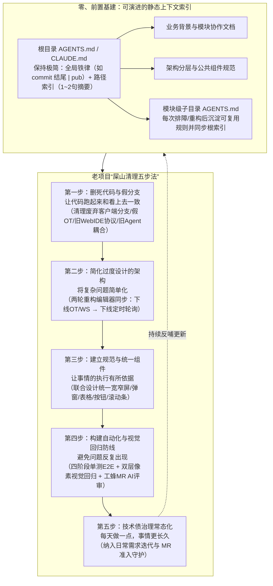

# 从胡言乱语到精准改代码：我是如何让 AI 读懂老项目的

## 1. TL;DR — 核心结论速览

1. **AI 在老项目里“胡言乱语”的根源不是模型笨，而是隐性上下文缺失与代码表里不一**：老项目往往缺失四类关键信息——**业务历史与跨模块协作背景、散落在文档或人脑中的隐性规则、代码里大量残留却早已不生效的兼容/废弃分支、以及只做到一半的架构迁移**。当“代码看上去的样子”与“实际跑起来的样子”不一致时，AI 必然顺着死代码给出错误方案。
2. **破局起点是维护“薄索引 + 模块下沉”的静态上下文（`AGENTS.md`）**：根目录 `AGENTS.md` / `CLAUDE.md` 只保留精简全局规则与 **1～2 句话的路径索引**（指向业务背景、架构规范、公共组件、第三方系统等子文档），并在每次排障或重构后把可复用规则沉淀到模块级 `AGENTS.md`，防止主文件膨胀失真。
3. **老项目“屎山清理五步法”**：**① 清理死代码与无效兼容分支（让代码跑起来和看上去一致）→ ② 简化过度设计的架构（如两轮重构下线冗余 OT 与轮询，将复杂同步化繁为简）→ ③ 联合设计建立统一组件与布局规范（让执行有所依据）→ ④ 耗时 1～2 个月建设四阶段单测/E2E 与双层视觉回归 + 工蜂 MR AI 审查（避免问题反复出现）→ ⑤ 将运动式治理转为日常增量偿还（每天做一点）**。
4. **最直观的复利验证**：在代码编辑器同步逻辑的**第一轮重构**（下线 OT 与 WebSocket）中，AI 还只能打下手、频频需要人工纠偏；而在**第二轮重构**（下线定时轮询、改为 AI 改码后推送拉取）中，得益于前序清理与上下文沉淀，AI 已经能**独立主导重构方案设计并精准落地执行**。

---

## 2. 背景与核心痛点：为什么老项目会让 AI 彻底迷失？

### 2.1 业务与系统复杂度画像
作者负责的是一个历经多年迭代、横跨多端能力的**小程序教育平台**，其复杂度体现在：
- **业务面广**：同时涵盖“项目创作 + 课程教学 + 小程序体验与发布”三大核心板块。
- **前端与交互重**：需同时适配宽屏与窄屏布局，包含大量拖拽编排、复杂动画效果与自定义弹窗/表格。
- **底层链路长**：涉及模拟器编译运行、Node 服务端模块、AI Agent 协同改码能力，以及与云开发（CloudBase）、混元大模型等内外部平台的深度耦合。

### 2.2 老项目阻碍 AI 理解的四座大山

| 缺失/干扰维度 | 老项目真实乱象 | 对 AI Coding 的直接破坏 |
| :--- | :--- | :--- |
| **1. 业务演进与协作上下文缺失** | 为什么要这样拆模块？哪些接口是为了兼容历史课程？代码里只看得到结果，看不到原因 | AI 改动某处逻辑时极易破坏隐式业务契约，牵一发而动全身 |
| **2. 知识散落在外或仅存于人脑** | 核心设计文档散落在不同时期的 Wiki，甚至只有老员工脑子里清楚“某几个字段早就不用了” | AI 只读代码仓库，无法获知仓库之外的潜规则 |
| **3. 死代码与无效兼容分支泛滥** | 纯 Web 项目里还留着早年客户端嵌入的 `if/else` 分支；表面引了 OT 协同库但实际根本没跑 | AI 把死代码当成现行核心逻辑，沿着废弃链路越改越错 |
| **4. 半拉子工程与多套方案并存** | 历史重构只做了一半，老通信协议与新协议、老组件与新组件在同一目录共存 | AI 在模仿代码风格（Few-shot）时随机学到老旧反模式，持续制造新债 |

---

## 3. 知识框架 — 老项目 AI 友好化治理与“屎山清理五步法”

---

## 4. 核心实践拆解

### 4.1 破局起点：用“薄索引 + 模块下沉”重构 `AGENTS.md`

想让 AI 不胡言乱语，第一步不是直接让它改业务代码，而是先把“人脑里的隐性上下文”显式化到代码仓库中：
1. **根目录 `AGENTS.md` / `CLAUDE.md` 绝不写成大杂烩**：
   - 根目录主文件只放全仓通用的强约束（例如团队规范要求 AI 生成的 Commit Message 必须以 `| pub` 结尾）以及**目录导航索引**。
   - 每条索引只写 **文档路径 + 1～2 句话的内容摘要**，涵盖：业务背景介绍、整体架构说明、公共组件清单、第三方关联系统说明。
2. **上下文的复利演进机制**：
   - 每当人工排查完一个隐蔽 Bug 或完成一次模块重构，都要求将提炼出的避坑规则写入对应模块子目录的 `AGENTS.md` 中，并同步更新根目录的索引表——让每次踩坑都变成 AI 下一次正确推理的护栏。

---

### 4.2 第一步：删掉不生效的代码——“让代码跑起来和看上去一致”

老项目里最容易误导 AI 的，是那些“看起来写得头头是道、实际上线上根本不会走到”的僵尸代码。作者团队集中清理了四类典型历史包袱：
1. **清理纯 Web 项目中的伪客户端兼容分支**：早期项目曾考虑内嵌客户端，代码里到处散落着判断客户端环境的 `if/else`；如今早已是纯 Web 形态，这些分支不仅永远不会触发，还会误导 AI 在改功能时去维护两套逻辑。
2. **剥离名存实亡的 OT（Operational Transformation）协同代码**：代码库里引入了极其复杂的 OT 实时协同算法与相关状态维护，但排查实际运行链路发现，线上真正生效的早就退化成了简单的纯 HTTP 保存——大段 OT 代码纯属干扰视听。
3. **收敛 WebIDE 多套废弃通信协议**：历史演进中为适配不同运行环境攒下了多套 postMessage/通信封装，清理后只保留唯一现行有效的通信通道。
4. **解耦前端直连 Node 的旧版 AI Agent 耦合链路**：将早年硬编码在前端与 Node 层之间的过渡态 Agent 胶水代码彻底剥离。

> **核心收益**：删掉死代码后，不仅仓库体积骤减，更重要的是**消除了代码中的“虚假线索”**，AI 检索上下文时不再被废弃分支带偏。

---

### 4.3 第二步：简化过度设计的架构——“将复杂问题简单化”

在清理死代码的基础上，作者以**代码编辑器的文件同步机制**为例，展示了如何通过**两轮渐进式重构**把过度复杂的历史架构拉回简单可控的轨道，并见证了 AI 角色质变的过程：

| 重构阶段 | 改造前状态 | 改造动作与目标 | AI 在其中的角色与表现 |
| :--- | :--- | :--- | :--- |
| **第一轮重构（去伪协同）** | 代码里混杂着复杂的 **OT 算法 + WebSocket 长连接 + HTTP 接口**，链路脆弱且难以维护 | 结合业务真实并发场景，彻底**下线 OT 与 WebSocket**，收敛为 **“HTTP 提交保存 + 定时轮询拉取”** | **辅助执行者**：由于旧架构耦合深、噪音大，AI 经常理解偏差，需要人密集介入指导、拆解步骤并修正错误 |
| **第二轮重构（去冗余轮询）** | 虽然去掉了 OT/WS，但常驻的“定时轮询”仍带来不必要的无效请求与状态竞争 | 进一步**下线定时轮询**，改为 **“手动/自动 HTTP 提交 + 当 AI 修改代码后主动触发推送与拉取”** 的按需事件驱动模型 | **方案主导者**：因为第一轮重构已将代码理顺并沉淀了清晰的 `AGENTS.md` 文档，本轮由 **AI 独立给出重构方案并精准完成代码修改** |

---

### 4.4 第三步：建立规范与统一组件——“让事情的执行有所依据”

如果项目里弹窗有 5 种写法、表格有 3 套样式、宽窄屏断点各自为政，AI 写新需求时就会随机挑一个老页面照猫画虎，导致风格越来越乱。
- **跨角色对齐规范**：研发主动拉齐设计师，共同梳理并冻结全局 UI 与交互准则——包括整体页面布局骨架、宽屏与窄屏响应式切换规则、通用弹窗/表格/按钮规范、以及容器滚动条处理准则。
- **代码化沉淀与统一收敛**：将上述设计规范封装为统一的公共基础组件，逐步替换历史页面中的散装实现，并把组件调用规范写入架构文档供 AI 查阅。

---

### 4.5 第四步：构建自动化测试与视觉回归防线——“避免问题反复出现”

当 AI 改代码的速度越来越快，人工回归测试很快成为瓶颈；更棘手的是，**AI 有时会为了“让功能测试通过”而在无意间破坏页面样式或挤歪布局**。作者团队投入 **1～2 个月** 搭建了完整的自动化守护网：

#### （1）自动化测试建设的四个演进阶段
1. **第一阶段（底座搭建）**：跑通基于 Mock 数据的单元测试框架与端到端（E2E）自动化测试框架。
2. **第二阶段（流水线卡点）**：将测试接入**蓝盾 CI 流水线**，基于**自定义 Docker 镜像**在每次提交 Merge Request（MR）时自动触发回归测试。
3. **第三阶段（分级治理）**：按业务重要度将测试用例拆分为 **P0 / P1 / P2** 三个等级，平衡 MR 卡点速度与全量覆盖率。
4. **第四阶段（复杂链路与脏数据治理）**：补齐跨模块复杂业务链路 E2E 用例，并专门增加了**测试账号数据自动清理机制**——解决自动化测试高频创建空项目导致测试账号触发项目数量上限而报错的工程痛点。

#### （2）双层像素级视觉回归测试（Visual Regression）
针对前端 UI 极易被 AI 改乱样式的痛点，团队将基准截图直接纳入代码仓库管理，并在自定义 Docker 容器（保证字体与渲染环境一致）中运行**两层视觉比对**：
- **第一层：整页宏观截图比对（放宽像素容忍度）**——用于捕捉大块布局错位、侧边栏消失或整体页面崩溃，容忍微小的动态元素差异。
- **第二层：组件级多状态小图比对（严格像素容忍度）**——针对核心公共组件在不同交互状态下的局部渲染做高精度像素比对，精准拦截 AI 改码导致的按钮变形、间距错乱或配色丢失。

#### （3）工蜂（Gongfeng）MR 自定义 AI 审查规则
- 在代码合入阶段，利用**工蜂 MR 的自定义 AI Code Review 规则**，让 AI 审查官自动对照团队编码与组件规范检查新增代码（发文时刚上线处于持续验证调优阶段）。

---

### 4.6 第五步：让技术债治理成为日常——“每天做一点，事情更长久”

- 专项重构战役不能一劳永逸。只有把“清理死代码、收敛公共组件、补齐单测与视觉快照、更新 `AGENTS.md`”变成日常需求开发与 MR 合入的标准顺手动作，老项目才能从“越改越烂的负向循环”真正转入“越用 AI 越顺手的正向飞轮”。

---

## 5. 数据速查表

| 指标 / 事项 | 原文数值 / 设定 | 语境 / 条件 |
| :--- | :--- | :--- |
| **根目录 `AGENTS.md` 索引颗粒度** | **每个子文档路径 + `1～2 句话`摘要** | 控制根文件体积，引导 AI 按需读取业务背景、架构、组件与第三方系统文档 |
| **AI 提交规范标识** | **Commit Message 结尾加 `\| pub`** | 写在根目录 `AGENTS.md` 中的团队仓库提交规范示例 |
| **编辑器同步逻辑重构轮数** | **`2` 轮演进** | 第一轮下线 OT + WebSocket 改轮询（AI 打下手）；第二轮下线轮询改事件推送拉取（AI 主导） |
| **自动化测试建设周期** | **`1～2 个月`** | 历经框架搭建、蓝盾 Docker 流水线、P0/P1/P2 分级、复杂链路与测试账号清理四个阶段 |
| **测试用例分级体系** | **`P0 / P1 / P2` 三级** | 第三阶段按重要度拆分自动化回归用例 |
| **视觉回归测试分层数** | **`2` 层（整页宽容比对 + 组件严格比对）** | 基准图存代码仓，在蓝盾自定义 Docker 镜像中执行像素比对 |

---

## 6. 踩坑与教训 / 可迁移的设计原则

1. **直接让 AI 在充满死代码和废弃分支的老项目里改需求 → AI 把早已停用的兼容分支（如假 OT、旧客户端判断）当成核心逻辑，越改越乱 → 先执行“第一步：删掉不生效的代码”，让代码跑起来和看上去完全一致**
   - **可迁移原则**：对 AI 而言，**死代码不是“无害的注释”，而是高权重的“错误上下文噪音”**；老项目引入 AI Coding 的第一刀永远是做减法（Delete Dead Code）。
2. **把所有项目说明、历史背景、组件规范全塞进根目录一个超长 `AGENTS.md` → 上下文噪音大、维护困难且极易过期 → 采用“根目录薄索引（路径 + 1～2 句摘要）+ 模块级 `AGENTS.md` 就近沉淀”的分层结构**
   - **可迁移原则**：遵循渐进式披露（Progressive Disclosure）管理仓库级知识库，并且坚持“每次排障/重构完顺手把规则写进模块 `AGENTS.md`”。
3. **面对过度设计的历史架构试图一次性推倒重来 → 改动半径过大、AI 上下文理解跟不上、线上风险失控 → 拆成多轮小步降维（先去 OT/WS 退回轮询，再由 AI 主导去掉轮询改按需拉取）**
   - **可迁移原则**：先用第一轮人工主导的“架构降维”为 AI 扫清迷雾并沉淀文档，第二轮深化改造就能享受到 AI 独立主导方案的复利。
4. **只靠功能单测/E2E 防护前端 AI 改码 → AI 为了让逻辑测试通过，无意间改坏 CSS 样式或破坏组件布局，测试却全绿通过 → 引入“整页放宽像素 + 组件多状态严格像素”的双层 Docker 视觉回归测试**
   - **可迁移原则**：在前端 AI Coding 中，**功能正确性（DOM/逻辑）与视觉一致性（Pixel/样式）必须双重卡点**，且视觉快照必须在固定 Docker 镜像中运行以消除宿主机渲染差异。
5. **E2E 自动化测试只管创建测试项目、不管清理 → 跑久了测试专用账号下的空项目堆满触发系统配额上限，导致 CI 流水线全线假红 → 在第四阶段专门补齐测试账号数据自动清理闭环**
   - **可迁移原则**：常态化运行的 E2E 测试必须具备“自清洁（Teardown Idempotency）”能力，防止状态泄漏搞挂 CI 卡点。

---

## 7. 记忆锚点 — 一句话 / 一张图记住全文

- **一句话锚点**：**让 AI 读懂老项目没有魔法咒语，靠的是用 `薄索引 AGENTS.md` 补齐隐性上下文，再按 `删死代码 → 简架构 → 立规范 → 建双层视觉/E2E守护 → 日常化偿债` 五步法把“表里不一的屎山”改造成“所见即所得的净土”。**
- **五步演进记忆链**：
  $$\text{薄索引 } \texttt{AGENTS.md} \longrightarrow \text{① 删死代码（表里合一）} \longrightarrow \text{② 简架构（两轮去OT/轮询）} \longrightarrow \text{③ 立UI/组件规范} \longrightarrow \text{④ 四阶段E2E + 双层视觉回归} \longrightarrow \text{⑤ 日常增量治债}$$

---

## 8. 复习卡片（Spaced Repetition）

1. 为什么 AI 在老项目里写代码容易“胡言乱语”？核心缺失或受干扰的四类信息是什么？::① 缺乏业务历史演进与模块协作背景；② 关键规则散落在外部文档或仅存于老员工脑中；③ 代码里残留大量早已不生效的死代码与兼容分支；④ 存在只做到一半的历史架构迁移（多套方案并存）。
2. 作者在老项目中是如何组织 `AGENTS.md` / `CLAUDE.md` 文件结构的？::根目录主文件保持极简，只写全局通用规则（如提交信息结尾带 `| pub`）和“文档路径 + 1～2 句话摘要”的导航索引；具体规则下沉到业务背景、架构、公共组件、第三方系统等子文档及各模块级 `AGENTS.md` 中。
3. 老项目“屎山清理五步法”依次是哪五个步骤？::① 删掉不生效的死代码（让代码跑起来和看上去一致）→ ② 简化过度设计的架构（将复杂问题简单化）→ ③ 建立规范与统一组件（让执行有所依据）→ ④ 构建自动化测试与视觉回归防线（避免问题反复出现）→ ⑤ 让技术债治理成为日常（每天做一点）。
4. 在代码编辑器同步机制的“两轮重构”中，架构和 AI 的角色分别发生了怎样的变化？::第一轮从“OT + WebSocket + HTTP”简化为“HTTP 提交 + 定时轮询”，此时 AI 只能打下手、需人工频繁指导；第二轮进一步下线定时轮询改为“HTTP 提交 + AI 改码后触发推送拉取”，得益于第一轮清理与文档沉淀，AI 能够独立主导方案并精准完成修改。
5. 作者团队耗时 1～2 个月建设的自动化测试体系分为哪四个阶段？::① 搭建基于 Mock 的单测与 E2E 测试框架 → ② 接入蓝盾流水线与自定义 Docker 镜像实现 MR 自动回归 → ③ 将测试用例按 P0/P1/P2 分级 → ④ 补齐复杂链路 E2E 用例并实现测试账号脏数据自动清理（防触发空项目数量上限）。
6. 针对 AI 改代码容易无意间破坏页面样式的问题，文中设计了怎样的双层视觉回归测试方案？::将基准截图存入代码仓并在自定义 Docker 镜像中比对：① 第一层是整页截图比对（放宽像素容忍度，抓宏观布局错位）；② 第二层是组件级多状态小图比对（严格像素容忍度，抓局部样式细节劣化）。

---

## 9. 知识关联

- **对应知识库主题笔记**：[AI研发协同](../../20_topics/AI%E7%A0%94%E5%8F%91%E5%8D%8F%E5%90%8C.md)
- **同批相关文章双链**：
  - [[AI_AI Coding 深水区]]（可对比“软件工程 12 项黄金法则”与人类在架构契约、验证防线上的职责演进）
  - [[AI_Agent团队知识底座]]（两篇均独立验证了“薄根目录 `AGENTS.md` 索引 + 子模块渐进式披露 + 排障后回写沉淀”的最佳实践）
  - [[AI_团队记忆实践]]（可对比如何将散落在人脑中的排障经验转化为 Agent 可检索消费的结构化记忆）

---

## 10. 原文参考资料

- **原文标题**：《从胡言乱语到精准改代码：我是如何让 AI 读懂老项目的》
- **作者**：被删（腾讯技术工程）
- **发布时间**：2026-08-07
- **提及工具与内部平台**：
  - `AGENTS.md` / `CLAUDE.md`
  - **蓝盾（BK-CI）**（持续集成流水线与自定义 Docker 镜像执行环境）
  - **工蜂（Gongfeng）**（代码托管与 MR 自定义 AI Code Review 规则）
  - **腾讯云开发（CloudBase）**、**腾讯混元大模型**

> [!note]- 校对报告
> - **原文页数核对**：全文共 12 页（第 12 页为公众号底部栏），核心正文位于 p.1–11。
> - **关键事实与页码映射**：
>   - 小程序教育平台背景（项目创作+课程教学+小程序体验/发布，宽窄屏、拖拽、动画、模拟器编译、Node 模块、AI Agent、云开发与混元资源）及老项目缺失的四类信息（p.1–3）。
>   - 静态上下文 `AGENTS.md` / `CLAUDE.md` 设计：根目录只保留精简规则（如 Commit Message 结尾带 `| pub`）与 `1～2 句话` 路径索引（业务背景、架构、公共组件、第三方系统），排障后沉淀至模块级 `AGENTS.md`（p.3–5）。
>   - 第一步删死代码：清理纯 Web 项目的伪客户端兼容 `if/else`、名存实亡的 OT 协同代码（实际是纯 HTTP）、WebIDE 多套废弃通信协议、前端到 Node 的旧 AI Agent 耦合链路（p.5–6）。
>   - 第二步简化架构：代码编辑器同步逻辑两轮重构——第一轮下线 OT 和 WebSocket 改为 HTTP 提交 + 定时轮询（AI 辅助，常需人指导）；第二轮下线定时轮询改为 HTTP 提交 + AI 更新代码后推送拉取（AI 主导方案与精准执行）（p.6–8）。
>   - 第三步建立规范：联合设计师对齐页面布局、宽窄屏、统一弹窗/表格/按钮组件、滚动条规范（p.8）。
>   - 第四步构建自动化防线：耗时 1～2 个月建设四阶段单测/E2E（Mock 单测与 E2E 框架 → 蓝盾自定义 Docker 镜像 MR 回归 → P0/P1/P2 分级 → 复杂链路与测试账号空项目自动清理）；双层视觉回归测试（整页截图高容忍度 + 组件多状态小图严格容忍度，基准图存代码仓）；工蜂 MR 自定义 AI 审查规则（p.9–10）。
>   - 第五步日常化技术债治理总结（p.10–11）。
> - **纠偏与自检说明**：正文、表格、Mermaid 图及复习卡片已严格剔除所有页码引用（`p.X` / `第X页`），所有事实与数字均与原文完全一致。
