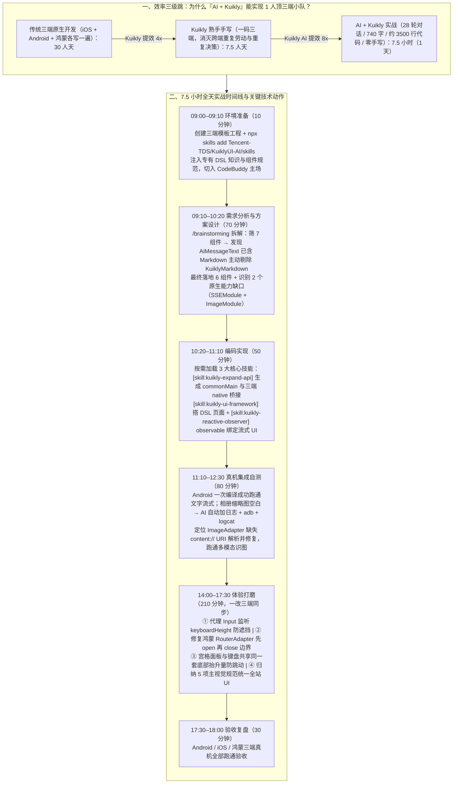

# AI + Kuikly：7.5 小时落地三端「多模态聊天 App」实战

> **原文信息**：发布于 2026-06-30 02:44（贵州），公众号「腾讯技术工程」原创。

---

## 1. TL;DR

1. **核心战果：从 30 人天 → 7.5 人天 → 7.5 小时** —— 仅用 **28 轮对话、740 字自然语言**，全程零手写代码、不看代码，在 **1 天（约 7.5 小时）**内生成约 **3500 行代码**，交付一套同时在 **Android、iOS、鸿蒙（HarmonyOS）**三端真机跑通的多模态 AI 聊天 App（支持流式 Markdown、拍照识图、相册选图、SSE 长连接、网页打开、本地会话管理）；而同类需求用传统三端原生开发需 **30 人天**，就算用 Kuikly 手写也需 **7.5 人天**。
2. **核心秘诀：Kuikly 跨端底座 + Kuikly AI Skills/Rules 缰绳** —— **Kuikly** 是腾讯开源的基于 Kotlin Multiplatform（KMP）的高性能跨端框架（覆盖 6 大平台，支撑业务 DAU 超 **5 亿**）；由于 Kuikly DSL 相对专有，通用大模型语料覆盖不足，通过 `npx skills add Tencent-TDS/KuiklyUI-AI/skills` 注入官方 **Skills 与 Rules**，让 AI 从「凭记忆瞎猜私有 API」变成「懂什么时候复用组件、什么时候扩展原生 Module 的资深 Kuikly 开发」。
3. **组件精准复用与原生 Module 规范扩展** —— 在 CodeBuddy 中使用 `/brainstorming` 拆解方案时，AI 检索出 7 个候选组件，发现 `KuiklyChatUI` 内的 `AiMessageText` 已覆盖 Markdown 渲染后主动剔除冗余的 `KuiklyMarkdown`（最终落地 **6 个官方/社区组件**）；并调用 `[skill:kuikly-expand-api]` 自动生成三端桥接的 **`SSEModule`**（补齐 SSE 流式长连接）和 **`ImageModule`**（图片统一压缩与 Base64 编码），调用 `[skill:kuikly-ui-framework]` 与 `[skill:kuikly-reactive-observer]`（`observable` 响应式状态绑定）完成页面实现。
4. **真机自测与日志闭环排障（`adb` + `logcat`）** —— Android 真机首次编译即跑通文字流式链路；针对相册缩略图宫格全空白缺陷，仅向 CodeBuddy 发送一句指令，AI 自主加日志、调 `adb` 复现并抓 `logcat`，定位到相册返回 `content://...` URI 而模板默认 `ImageAdapter` 仅支持 `base64 / http / assets / file`，补齐 `content URI` 识别后一举跑通多模态图文链路。
5. **三端同步体验打磨（只折腾一次而非三次）** —— 在下午 3.5 小时的细节打磨中，AI 通过挂载零尺寸**代理 `Input`** 巧妙绕过 `ChatSession` 内部不暴露 `keyboardHeight` 事件的限制解决键盘遮挡；秒级修复鸿蒙端 `RouterAdapter` 未考虑「先 `openPage` 再 `closePage`」导致新建会话不生效的边界 Bug；将快捷面板与键盘收敛到同一套底部抬升逻辑解决输入框双重跳动；并自动归纳主页面 5 项视觉规范对齐全站 UI。

---

## 2. 核心问题与文章定位

### 2.1 为什么要写这篇？

过去用 AI 写客户端代码，最容易翻车的就是跨端一致性与专有框架幻觉——模型往往把所有需求包装成「没问题，我来实现」，凭记忆瞎猜私有 API、重复造轮子，最后一路写到编译报错。
本文通过一份精确到分钟的**全天实战日记（09:00–18:00）**，验证了 **「AI（CodeBuddy）+ 腾讯开源跨端框架 Kuikly + KuiklyUI-AI Skills/Rules」** 的化学反应：
- **行业提效对标**：此前搜狗输入法用 Spec Coding 将新页面开发从 **3 天压到 1 天**，QQ 音乐用 AI 智能转码实现 **90%+ 代码采用率**；
- **本次极限验证**：纯靠自然语言对话（28 轮、740 字），零手写代码，能否在 1 天内交付一个非 Demo 级、三端真机可用、包含原生桥接扩展的多模态 AI 聊天 App？

---

## 3. 知识框架

---

## 4. 核心内容拆解

### 4.1 环境准备与方案设计（09:00–10:20）：让 AI 学会「什么时候不该写」

1. **10 分钟环境搭建与 Skills 注入（09:00–09:10）**：
   - 基于 **Kuikly**（基于 Kotlin Multiplatform，覆盖 Android、iOS、HarmonyOS、H5、微信小程序、Mac **6 大平台**，支撑业务 DAU **超 5 亿**）向导一键生成三端工程模板。
   - 执行 `npx skills add Tencent-TDS/KuiklyUI-AI/skills` 安装 Kuikly AI 的 Skills 和 Rules，弥补通用大模型对专有 Kuikly DSL 语料不足的短板，随后切入 **CodeBuddy**。
2. **`/brainstorming` 方案拆解与组件去重（09:10–10:20）**：
   - 首条 Prompt 核心强调两点：**「一码三端（支持 Android、iOS、鸿蒙）」**与**「优先使用 Kuikly 官方和社区已有组件」**。
   - **克制造轮子的细节**：AI 最初筛出 7 个组件（`KuiklyChatUI`、`KuiklyMarkdown`、`KuiklyAlbum`、`KuiklyCamera`、`KuiklySQLite`、`KuiklyWebview`、`KuiklyToast`），在并行调研 GitHub 用法后，发现 `KuiklyChatUI` 内部的 **`AiMessageText`** 已覆盖 AI 消息的 Markdown 渲染，于是**主动放弃引入 `KuiklyMarkdown`**，最终精准落地 **6 个组件**。
   - **主动识别两个需通过 Module 机制扩展的原生缺口**：
     1. 现有 `Network` 不支持 SSE 长连接 → 需自研补齐 **`SSEModule`**；
     2. 图片发给多模态模型前需统一压缩和 Base64 编码 → 需自研补齐 **`ImageModule`**。

---

### 4.2 编码实现与真机排障（10:20–12:30）：技能驱动编码与 `adb + logcat` 自主捉虫

1. **三大核心技能驱动 50 分钟编码（10:20–11:10）**：
   - **`[skill:kuikly-expand-api]`**（扩展原生 API / 自定义 Module 技能）：指导 AI 从 `commonMain` 接口定义到 Android/iOS/鸿蒙三端 native 桥接实现规范生成 `SSEModule` 和 `ImageModule`，结构与官方 Module 如出一辙。
   - **`[skill:kuikly-ui-framework]`**：负责聊天主页与历史会话列表页的 Kuikly DSL 页面结构和组件用法。
   - **`[skill:kuikly-reactive-observer]`**：负责响应式状态管理，用 **`observable`** 将消息列表、流式回复数据与 UI 自动重渲染绑定。
2. **真机自测与 `content://` 缩略图空白排障（11:10–12:30）**：
   - **文字链路一次跑通**：在 Android 真机上**一次编译即成功**，首条文字消息的 SSE 流式回复与 Markdown 渲染直接跑通。
   - **图片链路空白宫格自主排障**：点开相册后缩略图宫格全部显示空白；作者未翻一行代码，仅输入指令：`@ImagePickerPage.kt 的图片加载不出来，请添加日志，用 adb 自行分析原因`。
   - **排障闭环**：AI 自动添加日志 → 调用 `adb` 注入操作复现 → 用 `logcat` 抓取日志逐层排查，迅速定位根因：**相册组件 `KuiklyAlbum` 返回的缩略图地址为 `content provider` 格式（`content://...`），而模板工程默认的 `ImageAdapter` 仅处理了 `base64`、`http`、`assets`、`file` 四种来源**；AI 在 `ImageAdapter` 中补齐对 `content URI` 的识别后，选图、发送与多模态画面理解全面跑通。

---

### 4.3 迭代优化（14:00–17:30）：把「能用」磨成「好用」的四场实战

在跨端 `shared` 层一次修改即可三端同步生效，省去了「同一件事在三端做三遍」的乘数效应：
1. **问题 1：键盘弹起遮挡输入框（代理 `Input` 巧解）**
   - 要求 AI 监听 `keyboardHeight` 并用外层容器 `paddingBottom` 顶起输入区；AI 发现 `ChatSession` 内部输入框不对外暴露键盘事件，于是**自己主动在页面内挂载了一个零尺寸的「代理 `Input`」**承接 Kuikly 键盘事件回调，写法极其地道。
2. **问题 2：鸿蒙端新建会话不生效（`RouterAdapter` 边界修复）**
   - 鸿蒙真机验证发现新建会话后历史列表始终只有旧会话；AI 顺着路由链路定位到鸿蒙端默认的 **`RouterAdapter`** 未处理**「先 `openPage` 再 `closePage`」**的边界场景，依托知识库仅**一轮对话**即修复。
3. **问题 3：拍照/相册入口从 `ActionSheet` 改为微信式底部宫格面板（最折腾的一处交互）**
   - 改为输入框下方展开宫格面板后，从面板切到键盘瞬间输入框会叠加「面板 + 键盘」双重高度跳动一下；经多轮澄清，AI 将面板和键盘**收敛到同一套底部抬升逻辑、共享同一个抬升量**，彻底稳住输入框位置（印证了「AI 从 0 到 1 很快，但从能用到细腻仍需人盯着调」）。
4. **问题 4：全站多页面 UI 风格自动归纳对齐**
   - 让 AI 将后加的 `ImagePickerPage`、`WebViewPage` 对齐到 `ChatPage`、`SessionListPage`；AI 自动读取主页面并提炼出 **5 项设计规范（紫色渐变背景、`44dp` 透明导航栏、`‹` 返回按钮、`17sp` 白色居中标题、浅色内容区）**，逐项套用到新页面。

---

## 5. 数据速查表

| 指标 | 原文数值 | 语境 / 条件 |
| :--- | :--- | :--- |
| 全程自然语言交互轮次与字数 | **28 轮对话 / 740 字自然语言** | 全程零手写代码、不看代码完成三端多模态聊天 App |
| 最终生成代码规模 | **约 3500 行代码** | 覆盖 `commonMain` 共享层及 Android、iOS、鸿蒙三端桥接 |
| 三种开发模式工时对比 | **传统原生 30 人天 → Kuikly 手写 7.5 人天 → AI + Kuikly 7.5 小时（1 天）** | 交付同等功能的 Android + iOS + 鸿蒙三端多模态聊天 App |
| 内部兄弟团队 AI Coding 提效参照 | **搜狗输入法 Spec Coding 3 天压到 1 天 / QQ 音乐 AI 转码 90%+ 代码采用率** | 开篇引用的腾讯内部客户端 AI 提效验证数据 |
| Kuikly 跨端框架覆盖平台与业务规模 | **6 大平台（Android/iOS/HarmonyOS/H5/微信小程序/Mac），支撑 DAU 超 5 亿** | 基于 Kotlin Multiplatform（KMP）的腾讯开源高性能跨端框架 |
| 组件筛选与自研扩展 Module 数量 | **筛 7 留 6 个组件 + 自研 2 个跨端 Module（`SSEModule` / `ImageModule`）** | 因 `AiMessageText` 已含 Markdown 渲染故剔除 `KuiklyMarkdown` |
| 全天各阶段耗时分布 | **环境准备 10m / 方案设计 70m / 编码实现 50m / 真机自测 80m / 迭代打磨 210m / 验收复盘 30m** | 09:00–12:30 与 14:00–18:00 合计 **7.5 小时（450 分钟）** |
| 自动提炼的页面 UI 对齐规范参数 | **紫色渐变背景、`44dp` 透明导航栏、`‹` 返回按钮、`17sp` 白色居中标题、浅色内容区** | AI 从 `ChatPage` 与 `SessionListPage` 归纳并应用到选图页和网页页 |

---

## 6. 踩坑与教训 / 可迁移的设计原则

| 错误做法 | 失败表现或原因 | 原文应对 |
| :--- | :--- | :--- |
| 让通用大模型在没有任何专有框架知识约束下直接硬写 Kuikly DSL 代码 | Kuikly DSL 相对专有，通用模型训练语料覆盖不充分，极易凭记忆瞎猜私有 API、重复造轮子直至编译报错 | 动手前先执行 `npx skills add Tencent-TDS/KuiklyUI-AI/skills` 注入官方 **Skills 与 Rules**，给 AI 装上框架规范缰绳 |
| 面对一个完整多模态 App 需求让 AI 上来就直接写代码 | 容易漏掉跨端兼容边界，或把已有组件能力全部从头手写一遍 | 先用 CodeBuddy `/brainstorming` 技能拆解方案，在 Prompt 中明确「一码三端」与「优先使用已有组件」，让 AI 先查组件库再写开发 `plan` |
| 真机测试遇到相册缩略图空白等跨层 Bug 时，人工去翻框架源码排查 | 从 `KuiklyAlbum` 到跨端 UI 再到原生渲染链路极长，人工翻源码耗时费力 | 直接将现象与文件甩给 AI，要求其**自动添加日志并调用 `adb` + `logcat` 复现分析**，快速定位到 `ImageAdapter` 缺少 `content://` URI 分支 |
| 在三端原生工程中分别调优复杂的 UI 交互（如底部宫格面板与软键盘切换） | 面板与键盘互斥抬升导致的输入框双重跳动需多轮迭代，原生开发意味着同样的拉扯要在 Android、iOS、鸿蒙重复三次且极易不一致 | 依托 **Kuikly 一码三端** 在 `shared` 层集中打磨一次（收敛共享同一个底部抬升量），改完一处三端同步生效，消除跨端重复决策的乘数效应 |
| 人工逐条编写新页面的颜色、字号、边距样式 Prompt 去对齐旧页面 | 口头描述样式繁琐且容易遗漏视觉细节 | 让 AI 直接读取已定稿的主页面（`ChatPage` / `SessionListPage`），**先自动归纳现有设计规范再批量套用到新页面** |

---

## 7. 记忆锚点

1. **两组硬核数字对比**：
   - **工时三级跳**：**30 人天**（三端原生）→ **7.5 人天**（Kuikly 熟手）→ **7.5 小时**（AI + Kuikly，**28 轮对话 / 740 字 / 3500 行代码**）。
   - **架构组合拳**：**6 个复用组件**（`KuiklyChatUI/AiMessageText`、`KuiklyCamera`、`KuiklyAlbum`、`KuiklySQLite`、`KuiklyWebview`、`KuiklyToast`）+ **2 个自研 Module**（`SSEModule`、`ImageModule`）+ **3 个核心编码 Skill**（`kuikly-expand-api`、`kuikly-ui-framework`、`kuikly-reactive-observer`）。
2. **分工金句**：「**Kuikly 消灭了跨端的重复劳动（含重复决策），AI 消灭了框架层面的样板劳动，剩下留给人的是产品判断、体验打磨、工程把关**——让一个人真有了『一个人顶一个三端小队』的体感。」

---

## 8. 复习卡片

1. 在本次「AI + Kuikly」实战中，开发一套支持 Android、iOS、鸿蒙三端的多模态聊天 App 投入产出比如何，与传统开发相比缩短了多少工时？::全程仅用 28 轮对话、740 字自然语言，零手写代码生成约 3500 行代码；工时从传统三端原生开发的 30 人天、Kuikly 熟手手写的 7.5 人天，直接压缩到了 7.5 小时（1 天交付）。
2. 为什么通用大模型直接写 Kuikly 代码容易翻车，作者在环境准备和方案设计阶段采取了什么关键动作？::因为 Kuikly DSL 相对专有，通用模型训练语料覆盖不充分，容易瞎猜私有 API；作者先通过 `npx skills add Tencent-TDS/KuiklyUI-AI/skills` 注入官方 Skills 和 Rules，并在 CodeBuddy 中先用 `/brainstorming` 拆解方案（明确「一码三端」和「优先复用已有组件」），使 AI 发现 `AiMessageText` 已含 Markdown 后主动剔除冗余的 `KuiklyMarkdown`，最终复用 6 个组件并识别出 `SSEModule` 和 `ImageModule` 两个扩展点。
3. 在编码实现阶段（10:20–11:10），AI 分别调用了哪三个 Kuikly 专属 Skill 来完成原生桥接、页面构建与状态绑定？::① 调用 `[skill:kuikly-expand-api]` 从 `commonMain` 接口定义到三端 native 桥接生成 `SSEModule` 与 `ImageModule`；② 调用 `[skill:kuikly-ui-framework]` 编写 Kuikly DSL 页面结构；③ 调用 `[skill:kuikly-reactive-observer]` 使用 `observable` 将流式回复和消息列表数据与 UI 自动重渲染绑定。
4. 在 Android 真机测试遇到「相册缩略图宫格全部空白」缺陷时，AI 是如何自主定位并修复根因的？::作者要求 AI 添加日志并用 `adb` 自行分析；AI 自动加日志、用 `adb` 注入操作复现并通过 `logcat` 抓日志，迅速查出 `KuiklyAlbum` 返回的是 `content://...`（content provider URI），而模板工程默认的 `ImageAdapter` 仅处理了 `base64/http/assets/file` 四种来源，补齐 `content URI` 解析后即彻底修复。
5. 在下午的迭代优化阶段，AI 是如何解决「键盘遮挡输入框」「鸿蒙新建会话不生效」和「底部宫格面板与键盘切换跳动」这三个棘手问题的？::① 针对 `ChatSession` 内部输入框不暴露键盘事件，AI 主动挂载一个零尺寸「代理 `Input`」监听 `keyboardHeight` 顶起 `paddingBottom`；② 定位到鸿蒙默认 `RouterAdapter` 未考虑「先 `openPage` 再 `closePage`」边界并一轮修复；③ 经多轮澄清将宫格面板与软键盘收敛到同一套底部抬升逻辑、共享同一个抬升量，消除双重抬升跳动。
6. 作者总结「Kuikly」和「AI」在这套高效组合中各自消灭了什么成本？::Kuikly（基于 KMP，覆盖 6 大平台、支撑超 5 亿 DAU）不仅消灭了三端重复写代码的工时与 Token 成本，更深层消灭了「同一交互在三端调三遍」的重复决策成本；而 Kuikly AI（Skills + Rules）消灭了框架层面的样板劳动与私有 API 幻觉，把人的精力完全解放到产品判断与细腻体验打磨上。

---

## 9. 知识关联

- **已有主题**：[AI研发协同](../../20_topics/AI%E7%A0%94%E5%8F%91%E5%8D%8F%E5%90%8C.md) · [Harness与模型协同](../../20_topics/Harness%E4%B8%8E%E6%A8%A1%E5%9E%8B%E5%8D%8F%E5%90%8C.md) · [Agent工程循环](../../20_topics/Agent%E5%B7%A5%E7%A8%8B%E5%BE%AA%E7%8E%AF.md) · [跨端开发与性能](../../20_topics/%E8%B7%A8%E7%AB%AF%E5%BC%80%E5%8F%91%E4%B8%8E%E6%80%A7%E8%83%BD.md)
- **候选新主题**：[[Kuikly跨端框架]] · [[框架专属Skill与Rule]] · [[真机日志闭环排障]]

---

## 10. 原文参考资料

1. **KuiklyUI 开源仓库与 AI Skills**：
   - GitHub 仓库：`Tencent-TDS/KuiklyUI`（属于腾讯端服务联盟 `tds.qq.com` 成员）
   - Kuikly AI Skills 安装命令：`npx skills add Tencent-TDS/KuiklyUI-AI/skills`
2. **开发工具与组件库**：CodeBuddy（含 `superpowers` 插件 `/brainstorming` 技能）、`KuiklyChatUI`（含 `AiMessageText`）、`KuiklyCamera`、`KuiklyAlbum`、`KuiklySQLite`、`KuiklyWebview`、`KuiklyToast`。

> [!note]- 校对报告
> - **校对状态**：已根据 `MD.md` 全文（共 15 页 PDF 转写文本）逐一核对。
> - **核心数据与事实页码溯源**：
>   - 28 轮对话、740 字自然语言、生成约 3500 行代码、传统三端原生 30 人天 vs Kuikly 手写 7.5 人天 vs AI + Kuikly 7.5 小时、搜狗输入法 Spec Coding 3 天压到 1 天、QQ 音乐 AI 转码 90%+ 代码采用率、Kuikly 基于 Kotlin Multiplatform 覆盖 6 大平台且 DAU 超 5 亿：见 PDF 第 1 页。
>   - 09:00–09:10 环境准备（`npx skills add Tencent-TDS/KuiklyUI-AI/skills`、CodeBuddy）：见 PDF 第 3 页。
>   - 09:10–10:20 需求分析与方案设计（`/brainstorming` 指令、筛 7 个组件、发现 `KuiklyChatUI` 的 `AiMessageText` 已覆盖 Markdown 渲染而放弃 `KuiklyMarkdown` 落地 6 个组件、自研 `SSEModule` 和 `ImageModule` 两个扩展）：见 PDF 第 3–4 页。
>   - 10:20–11:10 编码实现（`[skill:kuikly-expand-api]`、`[skill:kuikly-ui-framework]`、`[skill:kuikly-reactive-observer]` 与 `observable` 状态绑定）：见 PDF 第 5 页。
>   - 11:10–12:30 真机集成自测（Android 一次编译成功、相册缩略图空白通过 `adb` + `logcat` 定位到 `ImageAdapter` 仅处理 `base64/http/assets/file` 而未识别 `content://` URI）：见 PDF 第 6–8 页。
>   - 14:00–17:30 迭代优化四件事（① 挂零尺寸代理 `Input` 监听 `keyboardHeight` 顶起 `paddingBottom`；② 修复鸿蒙 `RouterAdapter` 未考虑「先 `openPage` 再 `closePage`」边界；③ 宫格快捷入口与软键盘共享同一套底部抬升量；④ 归纳紫色渐变背景、`44dp` 透明导航栏、`‹` 返回按钮、`17sp` 白色居中标题、浅色内容区对齐全站 UI）：见 PDF 第 8–10 页。
>   - 17:30–18:00 验收复盘与思考总结（Kuikly 消灭跨端重复劳动与重复决策、AI 消灭框架样板劳动）：见 PDF 第 10–13 页。
