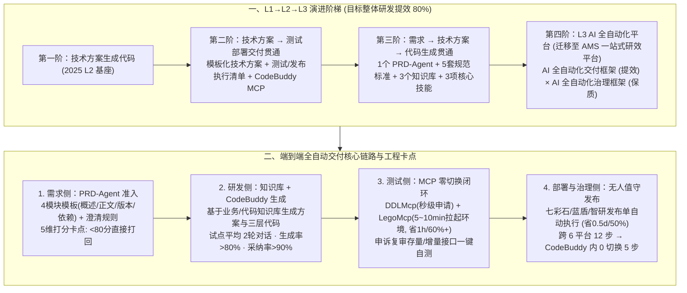

# 从提需求到部署发布，全 AI 全自动化后，研发效能全面跃升

## 1. TL;DR

1. **从 L2（人机协同）向 L3（全自动交付）的三段式跃迁**：针对审核业务研发链路中大量精力耗费在方案设计、评审、配环境与测试部署等非编码环节的痛点，团队规划了 **“技术方案生成代码 → 技术方案至部署交付贯通 → 需求至代码生成贯通 → L3 端到端全自动交付”** 的演进路线，终极目标驱动整体研发效能提升 **80%**。
2. **技术方案到部署交付（MCP + Skills 收敛 6 大平台至 CodeBuddy 单一闭环）**：通过建设 `LegoMcp/Skills`、`DDLMcp/Skills`、接口自动化测试 `Mcp/Skills` 并打通七彩石配置、蓝盾流水线与智研无人值守发布，将原本横跨 **6 个平台、12 个操作步骤** 的测试部署流程收敛至 CodeBuddy 内部 **0 平台切换、5 个步骤**（理想 2 步）；DDL 申请降至 **秒级**，Lego 测试环境拉起仅需 **5~10 分钟**（测试环境准备平均省 **1h / 60%+**，部署阶段平均省 **0.5d / 50%**）。
3. **需求到代码生成（1 个 PRD-Agent + 5 套规范标准 + 3 个知识库 + 3 项核心技能）**：制定含需求概述、正文、版本管理、外部依赖 4 大模块的标准化模板，并内置澄清规则与准入评分卡点（低于 **80 分** 自动打回）；在 6 个试点需求的三轮迭代中，需求与技术方案评分均稳定在 **80 分以上**，平均仅需 **2 轮** 对话，**代码行采纳率 > 90%、AI 代码生成率 > 80%**。
4. **L3 全自动化平台公式与“交付 + 治理”双轮驱动**：提炼核心公式 **`AI 全自动化交付 = LLM + Harness Engineering（工作流程 + 知识库 + Skills 管理）+ Business Engineering（业务 Skills + 知识库沉淀）`**，并推进将 **AI 全自动化交付框架** 与 **AI 全自动化治理框架**（全域日志/指标巡检与自愈）统一迁移至 **AMS 一站式研效平台**。

## 2. 问题定义与背景

### 2.1 为什么只做 AI Coding 无法实现研发效能的质变？
在审核业务团队 2025 年处于 L2（以“技术方案生成代码”为核心）阶段时发现：编码本身只占研发周期的一小部分，大量人工耗时与上下文切换浪费在 **上游（需求模糊反复拉齐、方案设计）** 与 **下游（跨七彩石改配置、提 DDL/DML 工单、跑蓝盾流水线、建 Lego 测试环境、申诉复审接口测试、智研发布单审批）** 等 6 个平台的割裂跳转中。

### 2.2 迈向 L3 全自动化交付的四大核心挑战
1. **交付流程标准化**：制定带工程卡点（评审、质量门禁、MR）与异常自动回滚能力的标准编排流；
2. **需求描述规范化与准入拦截**：通过 `PRD-Agent` 强制结构化编写、自动澄清与打分拦截；
3. **高质量双层知识库搭建**：构建 **审核业务知识库**（支撑方案生成）与 **审核代码知识库**（支撑控制器层/业务层/持久层代码精准生成）；
4. **核心 Skills 与 MCP 标准化复用**：封装技术方案生成、代码生成、代码 CR、DDL 申请、环境创建与接口自测技能。

## 3. 知识框架

## 4. 核心内容拆解

### 4.1 下游贯通：从技术方案到测试与部署交付（CodeBuddy + MCP 矩阵）

1. **三阶段模板化执行清单**：在技术方案中直接扩展出结构化的 **测试执行清单** 与 **发布执行清单**，交由 CodeBuddy 驱动执行：
   - **研发阶段**：严格遵循控制器层（Controller）、业务层（Service）、持久层（DAO）架构生成业务代码与单元测试并完成覆盖率验证；
   - **测试阶段**：通过封装 **七彩石配置、DDL/DML 工单、蓝盾流水线、Lego 环境创建** 等 MCP 工具，在 CodeBuddy 内部一键完成：
     - **DDL 秒级申请**：借助 `DDLSkill` 与 `DDLMcp` 将原本繁琐的数据库变更申请压缩至 **秒级以内**；
     - **Lego 测试环境一键拉起**：在 CodeBuddy 内 **5~10 分钟** 拉起完整测试环境，实现 **0 平台切换**；
     - **接口自动化测试（以审核申诉复审场景为例）**：采用“人工梳理结合 AI 辅助”识别存量与增量接口并生成测试用例，通过 `codebuddy mcp` 输入一句 Prompt 即可一键发起接口自测（作者亦诚实指出：纯 AI 端到端零人工生成完整测试用例尚有较大迭代空间）。
   - **部署阶段**：联动智研无人值守发布单，自动完成预发布配置检查与线上灰度发布。
2. **下游架构升级量化收益**：
   - **跨平台跳转归零**：从原先横跨 **6 个平台** 收敛为 CodeBuddy 内部一站式闭环；
   - **操作步骤腰斩**：从测试到部署由 **12 个步骤缩减至 5 个步骤**（理想状态可进一步压至 **2 个步骤**）；
   - **环境与发布耗时骤降**：测试环境创建/更新平均每次节约 **1 小时（提效 60%+）**，部署阶段平均每次节约 **0.5 人天（提效 50%）**。

### 4.2 上游贯通：从需求到代码生成（PRD-Agent 与质量门禁）

1. **需求的四模块结构化与五维评分拦截**：
   - **四模块标准模板**：强制约束 **需求概述、需求正文、版本管理、外部依赖** 四个部分；
   - **五维准入打分卡点**：对 **需求背景、价值衡量、解决方案、影响范围、需求正文** 进行量化评分，若不满足 **80 分** 准入线则由 `PRD-Agent` 直接打回并给出具体修正建议，从源头拦截“垃圾需求进、垃圾代码出”。
2. **能力沉淀与 OpenClaw / CodeBuddy 6 需求试点成果**：
   - 累计沉淀出 **1 个 PRD-Agent、5 套规范化标准、3 个知识库（含业务知识库与代码知识库）与 3 项核心技能**，并与 **TAPD** 深度集成。
   - 在审核业务挑选的 **6 个真实试点需求（经 3 轮迭代）** 中：需求评分与技术方案评分均稳定在 **80 分以上**，平均生成对话轮次仅 **2 轮**，**AI 代码生成率达 80% 以上，最终代码行采纳率达 90% 以上**。

### 4.3 L3 终局架构：AI 全自动化交付公式与双轮驱动平台

1. **L3 核心公式**：
   $$\text{AI 全自动化交付} = \text{LLM} + \text{Harness Engineering（工作流程 + 知识库 + Skills 管理）} + \text{Business Engineering（业务 Skills + 知识库沉淀）}$$
2. **双框架协同（迁移至 AMS 一站式研效平台）**：
   - **AI 全自动化交付框架（驱动效率）**：串联需求、设计、开发、测试、发布，内置需求评审、方案评审、质量门禁与 MR 四道工程卡点及卡点失败自修复机制；
   - **AI 全自动化治理框架（保障质量）**：覆盖运行时日志、监控指标、Spec 知识与中间产物的全域数据洞察，实现线上自动巡检自愈以及知识库/Skills 的自动回溯更新。

## 5. 数据速查表

| 指标 | 原文数值 | 语境 / 条件 |
| :--- | :--- | :--- |
| **L3 端到端全自动交付终极提效目标** | 整体研发效能提升 `80%` | 覆盖从提需求、方案设计、编码、测试到部署发布全链路 |
| **DDL 数据库变更申请耗时** | 降至 `秒级以内` | 通过建设 `DDLSkill` 与 `DDLMcp` 工具实现 |
| **Lego 测试环境一键拉起耗时** | `5 ~ 10 分钟`（`0` 平台切换） | 平均每次节约 `1 小时`（节约比例达 `60%+`） |
| **测试到部署跨平台数与操作步数收敛** | 跨 `6 个` 平台 → `1 个`（CodeBuddy 内）；`12 步 → 5 步`（理想 `2 步`） | 部署阶段平均节约 `0.5 人天`（节约比例达 `50%`） |
| **需求至代码生成沉淀资产规模** | `1 个` PRD-Agent、`5 套` 规范标准、`3 个` 知识库、`3 项` 核心技能 | 集成 TAPD 支撑审核业务快速接入 |
| **6 个试点需求三轮迭代核心指标** | 需求与方案评分 `> 80 分`、平均对话 `2 轮`、代码采纳率 `> 90%`、生成率 `> 80%` | 基于 OpenClaw / CodeBuddy 模式在审核业务的实测结果 |

## 6. 踩坑与教训 / 可迁移的设计原则

| 错误做法 | 失败表现或原因 | 原文应对（可迁移的设计原则） |
| :--- | :--- | :--- |
| **只盯着 IDE 内的代码补全，放任研发在 6 个运维/配置/流水线平台间手动切窗口** | 编码省下的时间全被配七彩石、提 DDL 工单、建测试环境和填发布单的上下文切换吃掉 | **用 MCP + Skills 将外围研发基建全部收进同一终端（CodeBuddy）**：把 6 平台 12 步操作压成单窗口 5 步，实现测试环境 5~10 分钟拉起与 DDL 秒级申请 |
| **把产品经理随手写的几句口语化模糊需求直接喂给编码 Agent** | 模型缺乏业务边界与上下游依赖上下文，生成的技术方案与代码严重偏离预期 | **前置 `PRD-Agent` 准入拦截（4 模块模板 + 5 维评分 `<80 分` 打回）**：强制先过需求澄清与打分门禁，再结合业务/代码双知识库生成方案，平均仅需 2 轮对话即可达成 `>90%` 采纳率 |
| **盲目宣称 AI 已能 100% 零人工生成复杂业务的全链路自动化测试用例** | 复杂存量与增量业务（如申诉复审）状态分支极多，纯靠 AI 盲生用例覆盖不全且易失真 | **实事求是采用“人工梳理骨架 + AI 辅助生成与 MCP 一键自测”**：承认端到端自动生成完整测试用例仍有差距，用人机协同守住测试质量底线 |
| **工作流与 Skills 散落在线下个人目录中，缺乏中心化版本管理与线上反馈闭环** | 团队成员各自为战难以规模化推广，且线上故障无法反哺更新离线 Spec 与 Skill | **“交付框架 + 治理框架”双轮驱动并迁入中心化研效平台（AMS）**：用治理框架采集运行时日志与监控指标，自动回溯更新 Spec 知识库与 Skills |

## 7. 记忆锚点

- **“跨 6 个平台 12 步 → CodeBuddy 内 0 切换 5 步；测试省 1 小时（60%+），部署省半天（50%）”**：把七彩石、DDL、蓝盾、Lego 环境和智研发布全部封装成 MCP/Skills 后的真实工程减负账单。
- **“1 个 PRD-Agent 守入口（<80 分打回），2 轮对话出代码，>80% 生成率 + >90% 采纳率”**：上游需求标准化与双知识库（业务 + 代码）协同带来的高确定性产出。

## 8. 复习卡片

1. 审核团队将 AI 研发演进划分为哪三个阶段，从 L2 迈向 L3 全自动化交付需要经历哪三段式能力阶梯？::划分为 L1（纯人工）、L2（人机协同）和 L3（全自动，目标整体提效 `80%`）三个阶段；三段式能力阶梯依次为：先夯实“技术方案生成代码”，再打通“技术方案至测试部署交付链路”，最后贯通“需求到代码生成并实现端到端全自动交付”。
2. 在“技术方案到部署交付”阶段，团队通过建设哪些 MCP/Skills 工具取得了怎样的量化提效成果？::建设了七彩石配置、`DDLMcp/Skills`（DDL 申请降至秒级）、蓝盾流水线、`LegoMcp/Skills`（`5~10 分钟` 一键拉起测试环境）与申诉复审接口自测工具；将跨 `6 个` 平台、`12 个` 步骤的操作收敛到 CodeBuddy 内部 `0` 平台切换、`5 个` 步骤，测试环境准备平均省 `1h`（`60%+`），部署阶段平均省 `0.5d`（`50%`）。
3. `PRD-Agent` 是如何对上游需求进行标准化约束与质量拦截的？::通过制定包含“需求概述、需求正文、版本管理、外部依赖”4 个部分的需求模板与澄清规则，并对“需求背景、价值衡量、解决方案、影响范围、需求正文”5 个维度设定标准打分规则，不满足评分标准（`< 80 分`）的需求将被直接打回并给出修正建议。
4. 在基于 OpenClaw / CodeBuddy 的 6 个试点需求三轮迭代中，取得了哪些核心效果指标？沉淀了哪些能力资产？::取得了需求评分 `80 分+`、技术方案评分 `80 分+`、平均生成对话仅 `2 轮`、AI 代码生成率 `80%+`、代码行采纳率 `90%+` 的成果；累计沉淀出 `1 个` PRD-Agent、`5 套` 规范化标准、`3 个` 知识库与 `3 项` 核心技能。
5. 作者提出的 L3 阶段“AI 全自动化交付”核心公式是什么？完整的 AI 全自动化平台由哪两套并行框架构成？::核心公式为：`AI 全自动化交付 = LLM + Harness Engineering（工作流程 + 知识库 + skills 管理）+ Business Engineering（skills + 知识库的沉淀）`；平台由“AI 全自动化交付框架（串联需求到发布并设评审/门禁卡点驱动效率）”与“AI 全自动化治理框架（全域日志/指标巡检与知识自动回溯保障质量）”双轮驱动构成，并规划整合迁移至 AMS 一站式研效平台。

## 9. 知识关联

- **本仓库主题索引**：[AI研发协同](../../20_topics/AI%E7%A0%94%E5%8F%91%E5%8D%8F%E5%90%8C.md) · [Agent工程循环](../../20_topics/Agent%E5%B7%A5%E7%A8%8B%E5%BE%AA%E7%8E%AF.md) · [Agent评测与反馈](../../20_topics/Agent%E8%AF%84%E6%B5%8B%E4%B8%8E%E5%8F%8D%E9%A6%88.md) · [异常监控与稳定性](../../20_topics/%E5%BC%82%E5%B8%B8%E7%9B%91%E6%8E%A7%E4%B8%8E%E7%A8%B3%E5%AE%9A%E6%80%A7.md)
- **候选双链概念**：[[PRD-Agent需求准入]] · [[L3全自动化交付]] · [[交付与治理双轮驱动]] · [[MCP研发工具链整合]] · [[Business-Engineering]]

## 10. 原文参考资料

1. 腾讯内部研发与运维工具链：CodeBuddy、OpenClaw、TAPD、七彩石配置中心、蓝盾 CI/CD 流水线、Lego 测试环境平台、智研无人值守发布系统、AMS 一站式研效平台。

> [!note]- 校对报告
> - **校对状态**：已按原文逐页核对通过（共 19 页 PDF，其中 p.8、p.12–13 为大幅架构图页）。
> - **核心数据与页码溯源**：
>   - L1/L2/L3 三阶段定义、2025 年处于 L2、整体研发效能提升 `80%` 目标与四大核心挑战（流程标准化、需求 4 部分模板与 5 维评分打回、业务+代码双知识库、Skills 沉淀）：见 `p.1–3`。
>   - 研发（控制器层/业务层/持久层）、测试（七彩石、DDL/DML、蓝盾、Lego 环境 `5~10 分钟` 拉起、DDL 秒级申请、申诉复审接口测试）、部署（智研无人值守）及收益数据（跨 `6 个` 平台 → CodeBuddy 内闭环、`12 步 → 5 步`［理想 `2 步`］、测试环境省 `1h / 60%+`、部署省 `0.5d / 50%`）：见 `p.4–7`。
>   - 沉淀 `1 个` PRD-Agent、`5 套` 规范化标准、`3 个` 知识库与 `3 项` 核心技能，以及 6 个试点需求三轮迭代效果（需求与方案评分 `80 分+`、平均对话 `2 轮`、代码采纳率 `90%+`、AI 生成率 `80%+`）：见 `p.9–15`。
>   - L3 核心公式（`LLM + Harness Engineering + Business Engineering`）、AI 全自动化交付框架 + AI 全自动化治理框架双轮驱动及迁移至 AMS 一站式研效平台规划：见 `p.17–18`。
