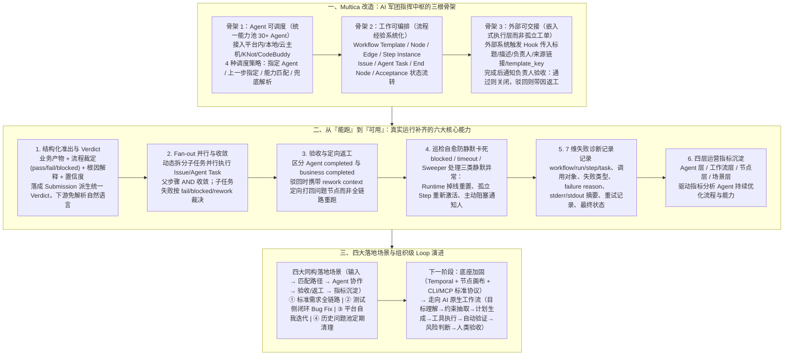

# 【揭秘】如何打造一支凌晨 3 点还在交付的 AI 军团

> **原文信息**：作者 `胡峻玮 & 姚广龙`，发布于 2026-07-10 02:36（广东），公众号「腾讯技术工程」。

---

## 1. TL;DR

1. **从「超级个体」到「超级组织」** —— 给每个岗位配 AI 只提升了单点效率，却因**推进依赖人在线（人下班 Agent 也下班）**、**旧角色边界压制 AI 扩大的能力**、**角色交接丢失关键上下文**三大卡点导致整条协作链路未变快；核心破局点是「组织级 Loop Engineering」，教一群单点能力不错的「实习生 Agent」围绕同一目标自动接力推进。
2. **三路径权衡与务实起点（路径 C）** —— 放弃一步登天的「端到端超级 Agent（路径 A，失控且缺乏干预点）」与无数据支撑的「直接拍脑袋设计 AI 原生流程（路径 B）」，第一阶段选择**路径 C（先把人类已验证过的流程 Agent 化）**，基于开源项目 **Multica** 改造指挥中枢，集中接入并管理 **30+ 个**来源各异的 Agent。
3. **三根基础骨架** —— ① **Agent 可调度**：统一纳管平台内、本地、云主机、KNot、CodeBuddy 等 Agent，支持「指定 Agent / 上一步指定 / 能力匹配 / 兜底解析」4 种调度策略；② **工作可编排**：补齐 `Workflow Template / Node / Edge / Step Instance / Acceptance` 等运行时；③ **外部可交接**：通过 Hook 与 `template_key` 承接需求/缺陷系统输入，验收通过关闭、驳回则定向返工。
4. **从「能跑」到「可用」的六大生产级能力** —— ① **结构化准出字段与 `Verdict`（`pass / fail / blocked` + 根因解释 + 置信度）** 消除自然语言传递不稳定；② **Fan-out 并行拆分与 AND 收敛**；③ **区分 `Agent completed` 与 `business completed` 的通知、验收与带 `rework context` 定向返工**；④ **`blocked / timeout / Sweeper` 巡检自愈**防静默卡死；⑤ **全链路 7 维失败诊断记录**；⑥ **Agent / 工作流 / 节点 / 场景四层指标沉淀**。
5. **四大落地场景与下一阶段 AI 原生演进** —— 已跑通**标准需求交付、测试侧闭环 Bug Fix、平台自我迭代（给自己干活）、定期清理历史问题池**四类场景；下一阶段引入 **Temporal** 引擎、Dynamic Config 节点画布与 Multica CLI/MCP 标准协议，并利用真实运行数据从「人类流程映射」走向「`目标理解 → 约束抽取 → 计划生成 → 工具执行 → 自动验证 → 风险判断 → 人类验收`」的 AI 原生工作流。

---

## 2. 核心问题与文章定位

### 2.1 为什么要写这篇？

过去一年，团队已经积累了评审需求、分发任务、改配置、修 Bug、写代码等大量单点能力不弱的 Agent（如同刚入职的优秀实习生），但一件完整工作并未自动变快。原因在于旧协作链路（`产品理解需求 → 评审 → 分发 → 研发实现 → 测试验证 → 负责人验收 → 发布/关闭`）依然存在三大结构性卡点：
1. **工作推进依赖人的在线状态**：「人下班，Agent 也下班」，Agent 的启动、衔接、推进和验收全部要等人看到、等人转述、等人唤醒。
2. **旧角色边界限制了 AI 放大的能力**：虽然研发、测试、运营、产品都能借助 AI 跨界多做一步，但旧流程仍把每个人压回原来的格子里只接自己那一段。
3. **关键上下文丢在角色交接里**：评审真正担心的风险、分发的判断依据、执行的边界条件、验收驳回的真实原因在人工转述中不断损耗，导致 Agent 无法连续接力。

### 2.2 三条演进路径的权衡

团队在动手前权衡了三条路径：
- **路径 A（造一个端到端的「超级 Agent」）**：让单一 Agent 包揽看需求、拆解、执行、验收——可控性、可观测性与责任边界极差，中间出错几乎无干预点。
- **路径 B（直接设计一套 AI 原生协作流程）**：不参考人类现有流程重排「目标 → 计划 → 执行 → 验证 → 验收」——在没有第一阶段真实运行数据前，极易沦为凭直觉拍脑袋。
- **路径 C（先把人类已验证过的流程 Agent 化，第一阶段选用）**：选边界清晰、人类跑通的工作，将节点背后的执行者换成 Agent，既容易对齐责任边界与业务验收，又能最快跑出真实协作边界问题并积累数据，为后续走向路径 B 铺路。

---

## 3. 知识框架

---

## 4. 核心内容拆解

### 4.1 技术底座：把开源 Multica 改造成多 Agent 协作指挥中枢

原生开源项目 **Multica**（`https://github.com/multica-ai/multica`）具备 `Agent / Issue / Runtime / Daemon / Agent Task / 工作空间` 等基础单点分发能力（`Issue → 分配给 Agent → Agent 执行 → 回写结果`），但无法表达多角色接力、并行、阻塞、外部验收与定向回退。团队为其补齐了**三根核心骨架**：

1. **第一根骨架：把分散 Agent 变成平台可调度的能力池**
   - 将散落在个人电脑、云主机、外部平台及专项业务方向的 **30+ 个 Agent**（涵盖平台内 Agent、本地 Agent、云主机 Agent、**KNot**、**CodeBuddy** 等）接入统一管理视图。
   - 实现从静态到动态的 **4 种调度策略**：**指定 Agent**、**上一步指定**、**能力匹配**、**兜底解析**。
2. **第二根骨架：把人的流程经验变成可运行工作流（工作可编排）**
   - 补齐 `Workflow Template`、`Node`、`Edge`、`Step Instance`、`Issue / Agent Task`、节点状态流转、`End Node`、`Acceptance` 等运行时对象。
   - 例如复杂流程可表达为：`评审 → 技术方案 → 配置变更 → 模板变更 → 代码变更 → 通知完成`，简单标准流程则复用同一套模板与 `Step Instance` 机制的节点子集，让「人知道下一步怎么走」变成「系统知道下一步怎么走」。
3. **第三根骨架：让真实工作进来，完成状态能出去（外部可交接）**
   - 不替代现有的需求、缺陷、验收、发布系统，而是通过 **Hook** 机制对接：当外部需求进入可执行状态后，触发 Hook 将**需求标题、描述、负责人、来源链接和 `template_key`** 推给平台；完成后通知负责人验收，使平台成为「Agent 执行层」而非孤立工单系统。

---

### 4.2 从「能跑」到「可用」：真实运行逼出的六大工程能力

> 核心原则：**「正向链路跑通只证明『能跑』，失败路径能处理才证明『可用』。」**

1. **应对 Agent 输出不稳定：结构化准出字段与 `Verdict`**
   - 传统程序节点输入输出稳定，而 Agent 自然语言输出易漏信息、状态模糊。
   - 系统强制使用结构化字段约束输出：**业务产物**（交付内容）+ **流程裁定**（`pass` / `fail` / `blocked`）+ **根因解释** + **置信度**。
   - 每次执行落成一次 `Submission` 并派生出统一的 **`Verdict` 状态**，下游节点直接消费 `Verdict` 和准出字段，彻底告别自然语言猜测。
2. **应对非线性复杂任务：Fan-out 并行与 AND 收敛**
   - 当一个需求同时涉及前端、后端、配置、模板、测试等多个方向时，上游节点拆出多个子任务，动态创建并行子步骤（各自生成 `Issue / Agent Task` 派给不同 Agent）；所有子步骤完成后父步骤执行 **AND 收敛**推进下一节点；子任务失败时按 `fail / blocked / rework` 策略裁定兄弟任务命运。
3. **应对「Agent 完成 ≠ 业务完成」：通知、验收（Acceptance）与定向返工（Rework）**
   - 严格区分 **`Agent completed`** 与 **`business completed`**：到达 `End Node` 后触发通知并进入 `Acceptance` 状态。
   - **定向返工而非全链路重跑**：负责人驳回时，系统携带驳回原因与 **`rework context`** 直接打回到真正出问题的指定节点重新生成任务，无需人工重头解释上下文。
4. **应对无人盯守时的静默卡死：`blocked`、`timeout` 与 `Sweeper` 巡检自愈**
   - 针对三类静默失败设计自动化自愈：
     - **Runtime 与 Task 异常**：掉线标记、长时间 `running` 重置、孤立任务重分发；
     - **调用链不一致**：活跃 `Step` 没有对应 `Agent Task` 时重新激活；
     - **Agent 主动阻塞**：暂停流程并通知相关责任人。
5. **应对长链路外部排障难：7 维结构化失败诊断**
   - 针对外部 Agent、CLI、MCP 工具、Runtime 或回调失败，拒绝笼统的 `"task failed"`，强制记录 7 项诊断信息：① 失败发生在哪个 `workflow / run / step / agent task`；② 调用了哪个 Agent 或外部工具；③ 失败类型；④ `failure reason`；⑤ `stderr / stdout` 摘要；⑥ 是否发生过重试；⑦ 最终状态（`fail`、`blocked` 或等待人工处理）。
6. **应对做完一批后的持续演进：四层指标体系沉淀**
   - 将每个 `Step`、`Agent Task`、`Verdict`、`Acceptance`、`Rework` 作为事件源，自动沉淀四层指标：
     - **Agent 层**（哪些 Agent 稳定）：调用次数、成功率、`blocked` 率、超时率；
     - **工作流层**（哪条链路有效）：完成率、一次通过率、平均耗时、返工率；
     - **节点层**（哪一步最容易卡）：`blocked` 节点分布、失败原因、验收驳回原因；
     - **场景层**（哪类工作适合进入）：场景通过率、人工介入率、采纳率。

---

### 4.3 四大真实落地场景：验证可迁移的通用协作模式

四类场景底层共享同一套结构：**`工作进入系统 → 匹配执行路径 → Agent 协作处理 → 结果通知/验收/返工 → 状态和指标沉淀`**：
1. **标准需求交付**：需求进入可执行状态后，依次由**评审 Agent**（判清晰度与合理性）→ **分发 Agent**（判模块与方向）→ **实现 Agent**（完成改动）接力，最后发通知进验收入口。
2. **Bug Fix（测试侧闭环）**：将跨角色流转压缩为测试侧闭环（`测试发现问题 → 提交 Bug → Agent 修复 → 状态回写 → 测试验收`），把研发从大量逐单处理中解放出来聚焦复杂边界与兜底。
3. **Agent 协作系统自我迭代（给自己干活）**：平台自身的问题、待办与能力缺口同样进入流水线（`发现问题 → 分析原因 → 设计方案 → 实施改动 → 执行验证 → 人工确认`），使系统具备自我进化能力。
4. **历史问题池（消化重要不紧急长尾积压）**：定期自动拉取长期挂起、排不上期的体验/效率/稳定性小问题进入评审与 Agent 处理，完成后通知负责人。

---

### 4.4 人的位置上移与下一阶段演进（走向 AI 原生工作流）

1. **人的位置从「处理单点任务」上移为「建设任务系统」的四个层面**：
   - **单条工作流里（控制面）**：人定目标、风险边界、验收标准与异常升级，Agent 做执行面；
   - **能力体系里（资产沉淀）**：把个人隐性经验沉淀为专项 Agent、Skill、工具、规则库、准出字段与验证方式；
   - **平台层面（通用机制抽象）**：建设 Fan-out、Acceptance、Rework、Sweeper、Hook、指标反馈面等可复用底座；
   - **组织层面（准入治理）**：判断哪些高频、低风险、可验证工作优先进入，哪些高风险模糊工作保留人工主导。
2. **从 Prompt Engineering 到组织级 Loop Engineering**：
   - 普通 Coding Agent 的 Loop 是 `修改代码 → 跑测试 → 看错误 → 再修复`；
   - **组织级工作的 Loop** 是 `工作事件进入 → 工作流接手 → Agent 协作执行 → 状态判断 → 验收或返工 → 指标沉淀 → 下一轮优化`。
3. **下一阶段三大演进方向**：
   - **把底座做稳做标准**：引入 **Temporal** 增强长任务执行与状态恢复（已进入测试验证阶段）；结合 **Dynamic Config** 将表单配置升级为**节点画布**；建设 **Multica CLI / MCP 标准协议**替代自然语言「对暗号」；标准化多源事件接入与状态同步。
   - **建设指标分析 Agent**：基于全链路观测面，由专门的**指标分析 Agent** 定期评估哪些 Agent 值得继续投入、哪些节点可合并或前置。
   - **从「人类流程 Agent 化」走向「AI 原生工作流」**：基于第一阶段沉淀的 `blocked` 分布与返工数据，剥离仅服务于人类交接的历史遗留节点，将传统人类流程（`需求评审 → 任务分发 → 具体实现 → 测试 → 验收`）重构为更契合 AI 协作特性的原生结构：**`目标理解 → 约束抽取 → 计划生成 → 工具执行 → 自动验证 → 风险判断 → 人类验收`**。

---

## 5. 数据速查表

| 指标 | 原文数值 | 语境 / 条件 |
| :--- | :--- | :--- |
| 旧协作模式的典型卡点数 | **3 处** | 推进依赖人在线状态、旧角色边界限制 AI 能力、角色交接丢失上下文 |
| 演进路径备选方案数 | **3 条（路径 A / B / C）** | 超级 Agent（A）、直接设计 AI 原生流程（B）、先把人类流程 Agent 化（C，第一阶段选用） |
| 平台已集中纳管的 Agent 数量 | **30+ 个** | 涵盖平台内、本地、云主机、KNot、CodeBuddy 等不同来源的 Agent |
| 统一能力池支持的调度策略数 | **4 种** | 指定 Agent、上一步指定、能力匹配、兜底解析 |
| 流程裁定（Verdict）核心状态 | **3 种（`pass / fail / blocked`）** | 配合业务产物、根因解释与置信度构成 Agent 节点结构化准出字段 |
| 巡检自愈（Sweeper）覆盖静默异常 | **3 类** | Runtime 与 Task 异常、调用链不一致（活跃 Step 无对应 Task）、Agent 主动阻塞 |
| 外部 Agent 失败诊断必记维度 | **7 项** | 所属层级 ID、调用对象、失败类型、failure reason、stderr/stdout 摘要、重试记录、最终状态 |
| 运行事件沉淀的指标层级 | **4 层** | Agent 层、工作流层、节点层、场景层 |
| 第一阶段已验证的真实工作场景 | **4 类** | 标准需求交付、测试侧 Bug Fix 闭环、平台自我迭代、历史问题池定期清理 |
| AI 原生工作流重构目标节点数 | **7 步** | `目标理解 → 约束抽取 → 计划生成 → 工具执行 → 自动验证 → 风险判断 → 人类验收` |

---

## 6. 踩坑与教训 / 可迁移的设计原则

| 错误做法 | 失败表现或原因 | 原文应对 |
| :--- | :--- | :--- |
| 只给每个岗位员工配备个人 AI 助手，不改造跨角色交接与触发流程 | 「人下班，Agent 也下班」，中间等待、人工转述与上下文丢失导致整条链路并未变快 | 从个人 Prompt 提效转向**组织级 Loop Engineering**，让工作事件触发后由系统带着上下文自动唤醒下一个 Agent 接力 |
| 一上来就试图打造包揽全流程的「端到端超级 Agent（路径 A）」或拍脑袋设计「AI 原生流程（路径 B）」 | 单一超级 Agent 缺乏可控性、可观测性与中途干预点；无真实运行数据支撑的 AI 原生流程沦为空想 | 第一阶段采取**路径 C（先把人类已验证过的流程 Agent 化）**，快速对齐责任边界跑出真实数据，再以此反推 AI 原生流程 |
| 让上下游 Agent 节点直接通过自然语言文本传递结果与状态 | 模型输出格式不稳定、易漏关键信息，或失败/阻塞表达模糊，导致下游无法稳定消费 | 强制**结构化准出字段 + `Verdict`（`pass/fail/blocked` + 根因解释 + 置信度）**，每次执行生成 `Submission` 供下游确定性消费 |
| 把涉及前端、后端、配置、测试的复杂需求塞给单个 Agent 串行处理 | 执行效率低下，且多方向上下文混杂导致执行结果极不稳定 | 引入 **Fan-out 并行拆分与 AND 收敛**，动态创建并行子步骤派给不同专项 Agent，收敛后再推进下一节点 |
| 将 `Agent completed`（Agent 回复做完了）直接等同于 `business completed`（业务完成） | 缺少人工或外部系统的最终验收闭环，且一旦发现问题需要人工重头解释上下文全链路重跑 | 增设 `End Node` 与 `Acceptance` 机制；验收驳回时携带驳回原因与 **`rework context` 定向打回指定问题节点**局部重做 |
| 仅关注正向链路跑通，忽视无人值守时的 Runtime 掉线或孤立任务 | 流程在半夜发生「静默卡死」（Task 长时间 running 或活跃 Step 无对应 Task），无人察觉 | 引入 **`blocked`、`timeout` 与 `Sweeper` 巡检自愈机制**，自动执行掉线标记、超时重置、孤立 Step 重新激活与阻塞通知 |

---

## 7. 记忆锚点

1. **三骨架 + 六能力口诀**：
   - **三根骨架**：**Agent 可调度**（30+ 能力池，4 种策略）、**工作可编排**（Template/Node/Step/Acceptance）、**外部可交接**（Hook + `template_key`）。
   - **六大可用能力**：**Verdict 准出**（拒猜自然语言）、**Fan-out 收敛**（拒塞单 Agent）、**Acceptance 定向返工**（区分执行完成与业务完成）、**Sweeper 自愈**（防静默卡死）、**7 维排障日志**（拒报笼统 failed）、**四层指标沉淀**（拒靠感觉优化）。
2. **三阶段进化阶梯**：**个人 Prompt 提效（超级个体）** → **路径 C：人类流程 Agent 化（Multica 指挥中枢）** → **路径 B：数据驱动的 7 步 AI 原生工作流（超级组织）**。

---

## 8. 复习卡片

1. 为什么给每个岗位都配上 AI（打造「超级个体」）之后，组织级工作的整体交付速度却没有发生质变？::因为旧协作模式存在三大卡点：① 工作推进仍依赖人的在线状态（等待人工查看、转述、分发和唤醒，「人下班 Agent 也下班」）；② 旧的角色分工边界把 AI 扩大的个人跨界能力重新压回原格子里；③ 评审风险、分发依据、边界条件和驳回原因等关键上下文在人工交接转述中大量丢失。
2. 在构建多 Agent 协作系统时，团队为什么没有直接选「路径 A（端到端超级 Agent）」或「路径 B（直接设计 AI 原生流程）」，而是先选了「路径 C」？::路径 A 的单一超级 Agent 可控性、可观测性与责任边界极差，出错时几乎无干预点；路径 B 在缺乏真实运行数据时只能靠拍脑袋凭直觉设计；路径 C（先把人类已验证过的流程 Agent 化）最务实，既能对齐现有责任边界与验收标准快速落地，又能逼出真实协作问题并积累数据，为后续走向路径 B 奠定基础。
3. 团队基于开源项目 Multica 改造 AI 军团指挥中枢时，补齐了哪「三根基础骨架」？::① Agent 可调度（统一接入平台内、本地、云主机、KNot、CodeBuddy 等 30+ 个 Agent，支持指定 Agent、上一步指定、能力匹配、兜底解析 4 种调度策略）；② 工作可编排（补齐 `Workflow Template / Node / Edge / Step Instance / Acceptance` 等运行时）；③ 外部可交接（通过 Hook 接收外部系统的需求/缺陷与 `template_key`，完成后通知负责人验收并支持定向返工）。
4. 为了解决 Agent 自然语言输出不稳定以及「Agent 说做完了不代表业务真做完了」的问题，系统设计了什么机制？::针对输出不稳定，强制使用结构化准出字段（业务产物 + `pass/fail/blocked` 流程裁定 + 根因解释 + 置信度）落成 `Submission` 并派生统一 `Verdict` 供下游消费；针对完成标准，严格区分 `Agent completed` 与 `business completed`，增设 `Acceptance` 验收节点，若驳回则携带 `rework context` 定向打回指定问题节点重做，而非全链路重跑。
5. 要让 AI 军团在凌晨 3 点无人盯守时稳定运行，系统是如何防止流程「静默卡死」的？::引入了 `blocked`、`timeout` 与 `Sweeper` 巡检自愈机制，专门处理三类静默异常：① Runtime 掉线标记、长时间 `running` 任务重置与孤立任务重分发；② 调用链不一致（活跃 `Step` 无对应 `Agent Task`）时重新激活；③ Agent 主动 `blocked` 时暂停流程并通知相关人员。
6. 什么是「组织级 Loop Engineering」，它与普通 Coding Agent 的 Loop 有什么本质区别？::普通 Coding Agent 的 Loop 是单点任务内的「修改代码 → 跑测试 → 看错误 → 再修复」；而组织级 Loop Engineering 是围绕跨角色完整交付构建的闭环系统：「工作事件进入 → 工作流接手 → Agent 协作执行 → 状态判断 → 验收或返工 → 四层指标沉淀 → 下一轮优化」。
7. 下一阶段团队计划如何加固底座，并怎样从「人类流程 Agent 化」演进到「AI 原生工作流」？::底座层面引入 Temporal 引擎、Dynamic Config 节点画布、Multica CLI/MCP 标准协议以及指标分析 Agent；在此基础上利用第一阶段沉淀的 `blocked` 与返工数据剥离人类交接遗留节点，将「评审→分发→实现→测试→验收」重构为「目标理解 → 约束抽取 → 计划生成 → 工具执行 → 自动验证 → 风险判断 → 人类验收」的 AI 原生结构。

---

## 9. 知识关联

- **已有主题**：[Agent工程循环](../../20_topics/Agent%E5%B7%A5%E7%A8%8B%E5%BE%AA%E7%8E%AF.md) · [Agent任务恢复](../../20_topics/Agent%E4%BB%BB%E5%8A%A1%E6%81%A2%E5%A4%8D.md) · [Harness与模型协同](../../20_topics/Harness%E4%B8%8E%E6%A8%A1%E5%9E%8B%E5%8D%8F%E5%90%8C.md) · [AI研发协同](../../20_topics/AI%E7%A0%94%E5%8F%91%E5%8D%8F%E5%90%8C.md)
- **候选新主题**：[[组织级LoopEngineering]] · [[多Agent工作流编排]] · [[超级组织与人机分工]]

---

## 10. 原文参考资料

1. **Multica 开源项目**（`https://github.com/multica-ai/multica`）：本文团队构建 AI 协作军团指挥中枢所选用的开源基础技术底座。
2. **Temporal 工作流引擎**：团队在下一阶段引入并进入测试验证阶段的长任务执行、状态恢复与失败重试引擎。
3. **KNot / CodeBuddy / MCP (Model Context Protocol)**：文中接入平台统一能力池的内部 Agent 来源及下一阶段标准化的工具与通信协议。

> [!note]- 校对报告
> - **校对状态**：已根据 `MD.md` 全文（共 23 页 PDF 转写文本）逐一核对。
> - **核心数据与事实页码溯源**：
>   - 凌晨 3 点四大自动推进场景、从「超级个体」到「超级组织」、组织级 Loop Engineering 定位：见 PDF 第 1–2 页。
>   - 旧协作链路 7 步流程与三大卡点（推进依赖人在线状态「人下班 Agent 也下班」、旧角色边界限制 AI 能力、关键上下文丢在角色交接里）：见 PDF 第 3–4 页。
>   - 三条演进路径权衡（路径 A 端到端超级 Agent、路径 B 直接设计 AI 原生流程、路径 C 先把人类验证过的流程 Agent 化）：见 PDF 第 4–5 页。
>   - Multica 底座改造与三根基础骨架（3.1 统一能力池接入平台内/本地/云主机/KNot/CodeBuddy 与 4 种调度策略；3.2 `Workflow Template/Node/Edge/Step Instance/Acceptance` 工作可编排；3.3 外部系统 Hook + `template_key` 可交接）：见 PDF 第 5–8 页。
>   - 从能跑到可用的六大能力（4.1 准出字段与 `Submission`/`Verdict` `pass/fail/blocked`；4.2 Fan-out 并行与 AND 收敛；4.3 `Agent completed` vs `business completed` 与带 `rework context` 定向返工；4.4 `blocked/timeout/Sweeper` 三类静默失败自愈表；4.5 7 维失败诊断记录；4.6 Agent/工作流/节点/场景四层指标表）及集中管理 30+ 个 Agent：见 PDF 第 9–14 页。
>   - 四大落地场景（5.1 标准需求、5.2 测试侧闭环 Bug Fix、5.3 平台自我迭代、5.4 历史问题池）与底层通用五步结构：见 PDF 第 14–17 页。
>   - 人的位置上移四层面、Prompt Engineering vs 组织级 Loop Engineering、下一阶段三大方向（Temporal、Dynamic Config 节点画布、Multica CLI/MCP 标准协议、指标分析 Agent、7 步 AI 原生工作流）：见 PDF 第 17–21 页。
