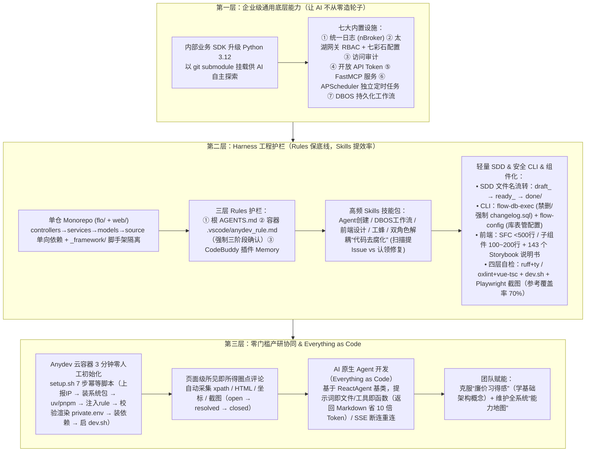

# 从Vibe Coding到AI原生研发团队：一套能落地的工程实践

## 1. TL;DR — 核心结论速览

1. **Vibe Coding 适合写“一次性玩具”，但企业级持续迭代必须靠“专业底座 + 工程护栏（Harness）”守住质量下限**：本文复盘了腾讯海外网络运营平台 **`Vibe Flowing`** 的 AI 原生研发实践——通过先由专业开发搭好企业级底座与护栏，成功让**不懂代码的网络运营同事也能自主完成“提需求 → AI 全栈编码/造 Agent → 容器内预览验收 → 提交 MR”的完整闭环**。
2. **三层架构赋能全员参与（基础设施 + 工程护栏 + 协同机制）**：
   - **第一层（企业级通用底座）**：将内部 Python 业务 SDK 升级至 **`Python 3.12`** 并以 `git submodule` 挂载供 AI 自主探索；内置统一日志、太湖网关 **RBAC 权限**、访问审计、开放 API、基于 **`FastMCP`** 的 MCP 服务、基于 **`APScheduler`** 的 `@cron_job` 独立进程定时任务、以及基于 **`DBOS`** 的持久化工作流（Durable Function）。
   - **第二层（十项 Harness 工程护栏）**：前后端单仓 **Monorepo**（后端严格向下分层 + `_framework/` 脚手架隔离）+ **三层 Rules**（`AGENTS.md` + `anydev_rule.md` + 插件 Memory）+ **预装 Skills**（含职责分离的“扫描提单 + 认领修复”双去腐化技能）+ **文档命名驱动的轻量 SDD**（`draft_ → ready_ → done/`）+ **安全留痕 CLI**（`flow-db-exec` 硬拦截删表删库并强制写 `changelog.sql`，`flow-config` 数据库表管配置）+ **前端 `500 行` 红线与 `143 个` Storybook 组件说明书** + **四层问题自检**（`ruff/ty/oxlint/vue-tsc` + `dev.sh` + `Playwright` 截图）。
   - **第三层（零门槛产研协同与 Everything as Code）**：基于 **Anydev 云研发容器** 通过 7 步幂等脚本在 **`3 分钟` 内零人工跑通全套环境**；页面内嵌**所见即所得圈点评论系统**（自动抓取 `xpath`/HTML/坐标/截图，按 `open → resolved → closed` 流转）；摒弃传统拖拽式智能体后台，让 AI 基于 `ReactAgent` 基类以 **Everything as Code** 方式端到端开发新 Agent（工具统一返回 Markdown 表格而非原始 JSON，**节省约 `10 倍` Token**）。
3. **三条实战避坑认知**：① **警惕“廉价习得感”**（要求团队理解分层、ORM、中间件、SSE 等基础概念以提高 Review 反馈质量）；② **给非开发者提供“能力地图”与 UI 词汇表**（消除重复提单与沟通损耗）；③ **放弃不稳定的 `RTK (Rust Token Killer)` 等命令行压缩代理**，靠架构集中与 Markdown 返回值治本省 Token。

---

## 2. 背景与核心矛盾：为什么个人 Vibe Coding 走不出“草台班子”？

### 2.1 玩具项目 vs 企业级持续演进系统的鸿沟
网络运营同事用 AI 编码工具写个单页查数据、画图表很容易，但团队规模化后立刻撞上两堵墙：
1. **重复造轮子与数据孤岛**：张三、李四各自用 AI 写页面调网管、CMDB、SNMP 接口，鉴权方式与数据口径五花八门；想同时关联分析专线流量趋势、丢包率与运营商质量，得开三四个页面来回切。即便用超链接列表聚合成导航页，很快也沦为没人敢动的“历史遗产”。
2. **底层基建拦路虎**：申请网管/CMDB/DB 权限流程漫长，接口文档残缺；一旦报错让 AI 在没有上下文的情况下盲目排查，烧掉海量 Token 仍问不到点子上。

> **核心破局思路**：不追求让 AI 连续跑一整天的高成本极限实验，而是**先由专业开发搭好“企业级底座 + Harness 护栏”，守住日常需求的质量下限并提升 Token 效率**，让非开发运营人员也能在轨道上安全开发（例如新增“出口流量按 AS 聚合的 Top 20 桑基图”或要求在 **`30 秒` 内输出结构化报告**的“专线质量分析 Agent”）。

---

## 3. 知识框架 — `Vibe Flowing` AI 原生研发三层十项实践全景图

---

## 4. 核心工程实践深度拆解

### 4.1 第一层：从玩具到企业级的七大通用底座

为了让 AI 只写纯业务逻辑而不陷入底层胶水代码，团队将老系统仅支持 `Python 3.6.8` 的内部业务 SDK（封装网管、CMDB、SNMP、七彩石、日志）全面升级至 **`Python 3.12`**，并以 **`git submodule`** 形式直接挂入仓库（AI 直接读源码即可调用，无需人工写接口文档），同时内置了 7 项开箱即用的标准设施：
1. **统一日志**：在 Rules 中写明一行 `from nBroker.lib.logger import log`，全仓统一签名。
2. **RBAC 页面与操作权限控制**：太湖网关注入身份，后端解码 `login_name` 查人事系统部门/组，权限规则落库，管理员名单走七彩石远程配置；AI 写新页面只需声明是否为受限资源。
3. **页面访问审计**：鉴权中间件自动将用户身份、路径、API Token 使用记录落库留痕。
4. **开放 API**：支持 `Bearer Token` 与自定义 Header，可配路径白名单与过期时间，非管理员仅见掩码。
5. **MCP 工具服务**：基于 **`FastMCP`** 封装专线分析、拓扑分析等核心能力并加入鉴权白名单。
6. **装饰器化定时任务**：基于 **`APScheduler`** 提供 `@cron_job` 装饰器，通过独立进程入口 **`run-cron`** 启动调度器（不阻塞线上 API），多副本下靠数据库抢占锁保证单次执行。
7. **长周期持久化工作流（Durable Function）**：基于 **`DBOS`** 实现支持人工待办、异步回调、可持续运行一个月以上且中断后能从历史状态精确恢复的工作流。

---

### 4.2 第二层：十项 Harness 工程实践——给 AI 立规矩、装眼睛、配工具

#### （1）单仓 Monorepo 与 `_framework/` 脚手架隔离
- 前后端同处一个 Git 仓库（后端 `flo/` + 前端 `web/`），AI 单次会话即可完成全栈改动。
- 后端强制单向分层：**`controllers`（API 层）$\to$ `services`（业务层）$\to$ `models`（数据层）$\to$ `source`（外部接口）**，严禁反向依赖或同层互调；且每个职能目录下均设 **`_framework/`** 子目录收纳调度与生命周期脚手架，让 AI 只写纯粹的业务函数。

#### （2）三层 `Rules`（保底线）+ 预装 `Skills`（提效率）

| 约束/能力层 | 载体位置与触发方式 | 核心管控内容与设计亮点 |
| :--- | :--- | :--- |
| **Rule 第 1 层** | 根目录 **`AGENTS.md`**（每次会话必读） | 工程规范手册：文件行数红线、分层规范、DB 变更流程、图表配色（如入流量绿色、出流量蓝色） |
| **Rule 第 2 层** | **`.vscode/anydev_rule.md`**（容器启动自动拷入 `.codebuddy/rules/`） | **面向非专业开发者的保护铁律**： ① **三阶段流程不可绕过**（`需求讨论 → 开发实现 → 确认提交`，哪怕改一个字也禁止跳过讨论） ② 技术名词先用白话解释，不让用户做选择题 ③ 自动管理 `dev-$用户名` 分支与冲突 ④ 主动提醒 `anydev` 账号无 `DELETE` 权限并建议软删除 |
| **Rule 第 3 层** | **`CodeBuddy` 内网版插件 Memory** | 按场景自动激活的细粒度记忆（如“时间字段统一用 `DATETIME`”、“改前端必跑 `type-check`”） |
| **预装 `Skills`** | 插件按场景自动匹配激活 | 覆盖 Agent 创建、DBOS 工作流、Changelog、前端设计、Vue3、工蜂、iWiki；**特别设计了 2 个职责分离的“代码去腐化 Skill”——一个专职扫描代码提 Issue，另一个专职认领 Issue 修代码，打破“既当裁判又当运动员”** |

#### （3）轻量 SDD（文件名即状态机）与安全留痕 CLI（`flow-db-exec` / `flow-config`）
- **极简 SDD（Spec Driven Development）**：不用繁重的外部项目管理工具，直接用 `features/` 和 `ai_docs/running/` 下的文件名前缀表达状态流转：**`draft_`（人机讨论迭代）$\to$ `ready_`（方案对齐确认，AI 单次读完即可开发）$\to$ `done/`（开发完成归档）**。
- **封装三大 CLI 工具替代危险临时脚本**：
  1. **`flow-db-exec`（数据库变更唯一入口）**：支持 `dry-run`、强制所有 SQL 先写入 `changelog.sql` 注明日期目的并同步主结构文件后按行号片段执行、要求时间字段统一用 **`DATETIME`（严禁 `BIGINT` 时间戳）**，并实行**四级风险管控**：
     - 加字段 / 加索引 / 按主键单行 `UPDATE` $\to$ **直接执行后告知**；
     - `ALTER` 改字段类型/名称/删字段 $\to$ **先讲方案，用户确认后执行**；
     - 不带主键的批量 `UPDATE` $\to$ **先跑 `SELECT COUNT(*)` 评估影响行数，确认后执行**；
     - `DROP / DELETE / TRUNCATE` $\to$ **代码硬拦截 + 数据库账号无权限双保险（改用软删除或人工执行）**。
  2. **`flow-config`（轻量业务配置管理）**：摒弃跨系统审批繁琐的远程配置中心，直接用项目内数据库表（统一走 `app_config` 模型，Key 按模块分层如 `threshold.surge_ratio`）+ CLI + 管理页维护非敏感阈值与开关，AI 可在同仓库直接读写生效。
  3. **`run-cron`**：独立进程跑定时任务。

#### （4）前端组件化（`143` 个 Storybook 说明书）与四层自检闭环
- **组件拆分红线**：Vue 单文件组件（SFC）严格控制在 **`500 行` 以内**（超过即拆），子组件 **`100～200 行`**，可复用逻辑 `composable` **`30～70 行`**；视图层采用“智能组件 + 展示组件”模式（每个数据卡片自己 fetch 和渲染）。
- **143 个 Storybook Stories 充当“AI 组件说明书”**：全仓积累了 **`143` 个** `.stories` 文件定义各组件状态与 `props` 组合，AI 写新页面前先看 Story 复用现有组件，杜绝重复造轮子。
- **四层自检让 AI“看见问题”**：① 静态检查即反馈（后端 `ruff + ty check`，前端 `oxlint + vue-tsc`，参考单测覆盖率目标 **`70%`**）$\to$ ② `AGENTS.md` 集中规则 $\to$ ③ `dev.sh` 由 AI 自主启停服务并查日志 $\to$ ④ `Playwright headless` 截图与接口交互自验。

---

### 4.3 第三层：Everything as Code 的 Agent 开发与 3 分钟 Anydev 容器协同

1. **AI 原生 Agent 开发（告别低代码拖拽后台，拥抱 `Everything as Code`）**：
   - 作者曾牵头做过比 Knot 更早的配置化拖拽智能体平台，但在 AI 编码能力跃升后彻底转向 **“代码即配置”**：提示词是代码文件、工具是代码函数、注册是装饰器，统一继承 **`ReactAgent` 基类**（内置模型配置、上下文注入、**支持断连重连与页面刷新续传的 SSE 流式输出**、会话持久化）。
   - **极其关键的省 Token 约定**：**Agent 工具函数的返回值尽量采用格式化好的 Markdown 字符串（如表格/摘要）而非原始 JSON**——一个格式化 Markdown 表格仅需约 **`200 token`**，而未经整理的原始 JSON 往往要消耗 **`10 倍`（`~2000 token`）**，且 AI 与人类阅读都更直观！
2. **`Anydev` 云容器 3 分钟零人工初始化（`scripts/system/setup.sh`）**：
   - 7 个独立、幂等、开启 `set -e`（失败即停并报清缺失变量名）的子脚本串联，**从创建容器到服务就绪 `< 3 分钟`**：
     `① 上报容器 IP/端口/分支到 DevOps 页面` $\to$ `② 安装系统依赖（dnf 带 3 次重试）` $\to$ `③ 安装 uv / pnpm / rtk 并立即 source` $\to$ `④ 将 .vscode/anydev_rule.md 注入 .codebuddy/rules/` $\to$ `⑤ 校验必填变量并通过 envsubst 渲染 private.env（防生成半残配置）` $\to$ `⑥ uv sync 与 pnpm install（放行 onlyBuiltDependencies）` $\to$ `⑦ 调用 dev.sh 启动前后端服务`。
3. **页面级圈点评论系统 + 能力地图 + 克服“廉价习得感”**：
   - 运营同事在页面任意位置圈点评论，系统自动记录页面路径、`xpath`、HTML 片段、坐标与截图，按 `open → resolved → closed` 流转；
   - AI 用几分钟自动生成全系统结构化 **“能力地图”**，消除非开发者的认知盲区；
   - 团队实测验证了 **`RTK (Rust Token Killer)`** 等命令行输出压缩代理发现效果一般且偶发压缩 Bug 与语义混淆，果断弃用，坚持用原生命令参数控制输出长度。

---

## 5. 数据速查表

| 指标 / 工程阈值 | 原文数值 / 设定 | 语境 / 条件 |
| :--- | :--- | :--- |
| **`Anydev` 云研发容器全自动初始化耗时** | **`3 分钟` 以内（`scripts/system/setup.sh` 共 `7` 个子步骤）** | 全程零人工介入，其中 `dnf` 装包设最多 **`3 次`**重试 |
| **专线质量分析 Agent 端到端验收标准示例** | **任意选一条专线，在 `30 秒` 内输出结构化分析报告** | 运营同事仅提业务目标，由 AI 自主探索仓库、写提示词、封工具并自测交付 |
| **内部业务 SDK Python 版本跨度** | **从固定 `Python 3.6.8` 升级至 `Python 3.12`** | 以 `git submodule` 方式挂入仓库供 AI 自主探索 |
| **前端 Vue 组件拆分行数红线** | **SFC `< 500 行` / 子组件 `100～200 行` / composable `30～70 行`** | 写入 `AGENTS.md`，缩小单次改动半径以便于人工与 AI 审查 |
| **全仓 Storybook 组件说明书数量** | **`143 个` story 文件** | 覆盖几乎所有前端组件，供 AI 开发前查阅复用并兼作自测 |
| **单元测试参考覆盖率目标** | **`70%`（作为参考值不硬阻断）** | 后端 `pytest + ruff + ty check`，前端 `vitest + oxlint + vue-tsc + Playwright` |
| **工具返回 Markdown 表格 vs 原始 JSON** | **格式化表格约 `200 token` vs 原始 JSON 约 `10 倍`（`~2000 token`）** | `ReactAgent` 工具沉淀核心约定，大幅降低 Token 消耗并提升可读性 |

---

## 6. 踩坑与教训 / 可迁移的设计原则

1. **让非开发同学直接用裸 Vibe Coding 各写各的业务页面，或把配置/智能体藏在外部管理后台 → 页面各自调接口沦为数据孤岛，且 AI 看不见后台配置每次都要人手把手喂上下文 → 坚持“单仓 Monorepo + 内部 SDK Submodule + 数据库表管业务配置（`flow-config`）+ Everything as Code 开发 Agent”**
   - **可迁移原则**：**凡是藏在图形化管理后台数据库里的配置，对 Coding Agent 而言都是“暗物质”**；把提示词、工具、定时任务、业务配置全面代码化并收拢进同一个 Monorepo，AI 才能发挥“搭积木”式的生态复利。
2. **放任 AI 自己写临时 Python 脚本去 `import db` 执行数据库变更或删数据 → 既不留痕又极易引发删库事故 → 封装唯一入口 CLI `flow-db-exec`，硬拦截 `DROP/DELETE/TRUNCATE`，强制先写 `changelog.sql` 再按行号执行，并对非主键更新强制先跑 `SELECT COUNT(*)`**
   - **可迁移原则**：对高危基础设施操作（DB 变更、发布、配置修改），**绝不让 AI 直接调底层驱动，必须套一层“带干跑（dry-run）、强制留痕、按风险分级拦截”的受控 CLI 壳**。
3. **代码仓库在 AI 高频提交下极速膨胀腐化，且让同一个 Agent 边查边改 → “既当裁判又当运动员”导致腐化治理流于形式 → 拆分为 2 个职责物理分离的“代码去腐化 Skill”（一个只管扫描建 Issue，另一个只管认领 Issue 修复）并高频小批量定期运行**
   - **可迁移原则**：AI 原生团队的仓库熵增速度是传统团队的数倍，必须把“巡检提单 Agent”与“修复合入 Agent”解耦成常态化的后台免疫系统。
4. **沉迷引入第三方命令行 Token 压缩代理（如 `RTK / Rust Token Killer`），却放任工具返回大坨原始 JSON → 外部压缩代理省不了几块钱还会引入截断 Bug 与语义混淆 → 砍掉不稳定代理，直接规定内部工具返回紧凑的 Markdown 表格（立省 10 倍 Token）并用 Storybook 控制组件粒度（`<500` 行）**
   - **可迁移原则**：最稳健的 Token 优化永远发生在**数据源头（工具返回 Markdown 化、组件小文件化、SDD 文档输入化）**，而非在黑盒传输链路上做有损文本压缩。
5. **非开发/初级同学长期依赖 AI 产生“我也会编程”的廉价习得感，或因不懂系统全貌而不敢提/重复提需求 → 只能给出“感觉不对你再看看”的无效反馈 → 要求全员掌握基础架构概念（分层/ORM/中间件/SSE）以提升 Review 质量，并由 AI 自动维护一份全系统“能力地图”**
   - **可迁移原则**：AI 产出的上限取决于人类反馈的精确度；赋能非技术角色时，“一份一页纸的系统能力地图 + 基础技术/UI 词汇对齐”比教他们写语法重要十倍。

---

## 7. 记忆锚点 — 一句话 / 一张图记住全文

- **一句话锚点**：**`Vibe Flowing` 把 AI 原生研发落地为“1 个全栈 Monorepo（含 Python 3.12 SDK Submodule 与 7 大底座）+ 3 层 Rules 与双去腐化 Skills + `draft_→ready_→done/` 文件名 SDD + `flow-db-exec` 安全 CLI + 143 个 Storybook 组件说明书 + 3 分钟 Anydev 容器与页面圈点评论”，让运营同学指哪打哪，让开发同学安心兜底。**
- **三层正向飞轮公式**：
  $$\text{7大通用底座 + 3分钟 Anydev 容器} \xrightarrow{\text{3层 Rules + SDD + 安全 CLI + 143 Stories}} \text{AI 守规矩高质产出 (Markdown省10x Token)} \xrightarrow{\text{页面圈点评论 + 能力地图}} \text{全员参与研发 & 运营}$$

---

## 8. 复习卡片（Spaced Repetition）

1. 为什么作者认为个人 Vibe Coding 做不出“能持续迭代的企业级系统”？`Vibe Flowing` 在底座层预先打通了哪 7 项通用能力？::因为个人 Vibe Coding 会导致重复造轮子、数据孤岛以及卡在底层权限申请与无上下文盲目排障上。7 项通用底层能力：① 统一日志、② 页面与操作级 RBAC 权限控制（太湖网关+七彩石）、③ 页面访问审计、④ 开放 API Token、⑤ 基于 `FastMCP` 的 MCP 工具、⑥ 基于 `APScheduler` 的独立进程定时任务、⑦ 基于 `DBOS` 的持久化工作流（Durable Function）。
2. `Vibe Flowing` 的三层 `Rules` 护栏分别放在哪里？其中面向统一研发容器的 `anydev_rule.md` 包含哪些保护非专业开发者的核心铁律？::三层 Rules：① 根目录 `AGENTS.md`（通用工程规范手册）、② `.vscode/anydev_rule.md`（容器启动自动拷入 `.codebuddy/rules/`）、③ `CodeBuddy` 内网版插件 Memory。`anydev_rule.md` 铁律：强制执行“需求讨论 → 开发实现 → 确认提交”三阶段确认（改一个字也不准跳过讨论）；技术名词先用白话解释；分支管理（`dev-$用户名`）对用户透明；禁止破坏性 Git 命令并在用户要求删数据时主动提醒改用软删除。
3. 文中是如何用极简的文件命名约定实现轻量 SDD（规格驱动开发）的？::不依赖外部重型工具，直接在 `features/` 和 `ai_docs/running/` 目录下通过文件名前缀表达状态流转：`draft_`（未确定方案，人机讨论迭代）→ `ready_`（方案对齐确认，AI 单次会话读完即拥有完整上下文开始开发）→ 开发完成后移入 `done/` 目录。
4. 数据库变更工具 `flow-db-exec` 做了哪三件核心保护措施？它对四类不同风险的 SQL 操作分别如何分级管控？::三件事：① 硬拦截高危关键字并与 DB 账号权限双保险；② 强制留痕（SQL 必先写入 `changelog.sql` 再按行号片段执行）；③ 格式化清晰输出（且时间字段统一用 `DATETIME` 禁 `BIGINT`）。四级管控：① 加字段/索引/主键单行 `UPDATE` 直接执行后告知；② `ALTER` 改类型/改名/删字段需先确认方案；③ 无主键批量 `UPDATE` 先跑 `SELECT COUNT(*)` 评估确认；④ `DROP/DELETE/TRUNCATE` 硬拦截。
5. 为什么作者放弃了早年主导的“管理后台拖拽配置式”智能体平台，转而采用 `Everything as Code` 的 AI 原生 Agent 研发方式？工具返回值有什么特殊约定？::因为后台配置对 AI 不可见，每次接新能力都要人手动搬运；而将提示词写成文件、工具写成函数、注册写成装饰器（基于 `ReactAgent` 基类与可断连重连的 SSE 流）放在同一 Monorepo 中，AI 就能自主探索复用现有 service 和组件端到端搭出新 Agent。工具返回值约定尽量返回**格式化好的 Markdown 字符串而非原始 JSON**，可节省约 **10 倍 Token**（如 `200 token` vs `2000 token`）。
6. `Anydev` 云研发容器是如何在 3 分钟内实现零人工初始化的？运营同事又是如何通过“页面级评论”提需求的？::通过 `scripts/system/setup.sh` 串联 7 个独立幂等且开启 `set -e` 的步骤（上报环境到 DevOps → 装系统依赖带 3 次重试 → 装 `uv/pnpm/rtk` → 注入 `anydev_rule.md` → 校验必填变量并用 `envsubst` 渲染 `private.env` → 装前后端依赖 → 启动 `dev.sh`）。运营同事可在页面任意位置圈点评论，系统自动记录路径、`xpath`、HTML 片段、坐标与截图，按 `open → resolved → closed` 流转交由 AI 开发与容器预览验收。

---

## 9. 知识关联

- **对应知识库主题笔记**：[AI研发协同](../../20_topics/AI%E7%A0%94%E5%8F%91%E5%8D%8F%E5%90%8C.md) · [Harness与模型协同](../../20_topics/Harness%E4%B8%8E%E6%A8%A1%E5%9E%8B%E5%8D%8F%E5%90%8C.md) · [问题澄清](../../20_topics/%E9%97%AE%E9%A2%98%E6%BE%84%E6%B8%85.md) · [Agent工程循环](../../20_topics/Agent%E5%B7%A5%E7%A8%8B%E5%BE%AA%E7%8E%AF.md) · [Agent长期记忆](../../20_topics/Agent%E9%95%BF%E6%9C%9F%E8%AE%B0%E5%BF%86.md) · [异常监控与稳定性](../../20_topics/%E5%BC%82%E5%B8%B8%E7%9B%91%E6%8E%A7%E4%B8%8E%E7%A8%B3%E5%AE%9A%E6%80%A7.md)
- **同批相关文章双链**：
  - [[AI_AI 读懂老项目]]（可对比前端组件拆分、Playwright 视觉回归与 `AGENTS.md` 规范沉淀在老项目与新平台中的共同实践）
  - [[AI_腾讯WorkBuddy Agent产品实践]]（可对比使用者视角下上下文工程、架构约束、反馈循环与熵管理四大组件的落地）
  - [[AI_Token 刺客案例]]（本文通过“工具返回 Markdown 替代 JSON 省 10 倍 Token”、“小组件 `<500` 行”、“CLI 替代临时脚本”从架构根源消除了多种 Token 刺客）

---

## 10. 原文参考资料

- **原文标题**：《从Vibe Coding到AI原生研发团队：一套能落地的工程实践》
- **作者**：masoncai（腾讯海外网络运营平台 `Vibe Flowing` 研发团队）
- **发布时间**：2026-07-21
- **提及技术栈与内部平台**：
  - **内部平台与工具**：`CodeBuddy`（及内网版插件 Memory）、`Anydev`（云研发容器）、`太湖网关`、`七彩石`（配置中心）、`工蜂`、`iWiki`、`Knot`、`rtk`
  - **开源框架与工具链**：`FastMCP`、`APScheduler`、`DBOS`（Durable Function）、`uv`、`pnpm`、`pytest`、`ruff`、`ty`、`vitest`、`oxlint`、`vue-tsc`、`Playwright`、`Storybook`、`RTK (Rust Token Killer)`

> [!note]- 校对报告
> - **原文页数核对**：全文共 30 页（第 30 页为公众号尾页与留言栏），核心正文贯穿 p.1–29。
> - **关键事实与页码映射**：
>   - `Vibe Flowing`（AI 原生海外网络运营平台）定位、裸 Vibe Coding 两大痛点（数据孤岛与底层权限/排障拦路虎）（p.1–4）。
>   - 两个跑通场景：场景一（Anydev 容器 `3 分钟` 全自动配置，运营提“出口流量按 AS 聚合 Top 20 桑基图”需求全自动开发预览）；场景二（专线质量分析 Agent，验收标准 `30 秒` 内输出结构化报告）（p.4–8）。
>   - 对接内部业务 SDK（从 `Python 3.6.8` 升级至 `Python 3.12`，以 `git submodule` 集成，`from nBroker.lib.logger import log`）与 7 大通用底层能力（日志、太湖网关 RBAC + 七彩石、页面访问审计、开放 API Token、`FastMCP`、`APScheduler` `@cron_job`、`DBOS` Durable Function）（p.8–10）。
>   - 单仓 Monorepo（`flo/` + `web/`，`controllers → services → models → source` 单向分层 + `_framework/` 子目录）、三层 Rules（`AGENTS.md` + `.vscode/anydev_rule.md` 强制三阶段确认与 `dev-$用户名` 分支 + CodeBuddy 插件 Memory）与预装 Skills（含 2 个职责分离的代码去腐化技能）（p.10–13）。
>   - TDD 与静态检查（`pytest/ruff/ty check` + `vitest/oxlint/vue-tsc/Playwright`，参考覆盖率目标 `70%`）、轻量 SDD（`features/` 与 `ai_docs/running/` 下 `draft_ → ready_ → done/`）、三大 CLI 工具（`flow-db-exec`、`flow-config`、`run-cron`）（p.13–16）。
>   - 前端组件化（Vue SFC `< 500 行`、子组件 `100~200 行`、composable `30~70 行`、`143 个` Storybook story 文件）、四层问题感知（静态检查、`AGENTS.md`、`dev.sh`、Playwright）、DB 变更四级风险管控表与强制 `DATETIME`（禁 `BIGINT`）（p.16–18）。
>   - AI 原生 Agent 工作流（`Everything as Code`、`ReactAgent` 基类、SSE 断连重连、工具返回 Markdown 字符串相比原始 JSON 省 `10 倍` Token 如 `200 token` vs `2000 token`）（p.19–21, p.27）。
>   - `Anydev` 统一研发环境 `scripts/system/setup.sh` 7 步幂等脚本（`< 3 分钟`，`dnf` 3 次重试，`envsubst` 校验渲染 `private.env`）、页面级圈点评论系统（`xpath`/HTML/坐标/截图，`open/resolved/closed`）、三大 Lessons（避免廉价习得感、能力地图、弃用不稳定的 `RTK` 压缩代理）与三层总结（p.21–29）。
> - **纠偏与自检说明**：正文、表格、Mermaid 图及复习卡片已严格剔除所有页码标注（`p.X` / `第X页`），所有配置路径、命令名与数值均 100% 忠实于原文。
