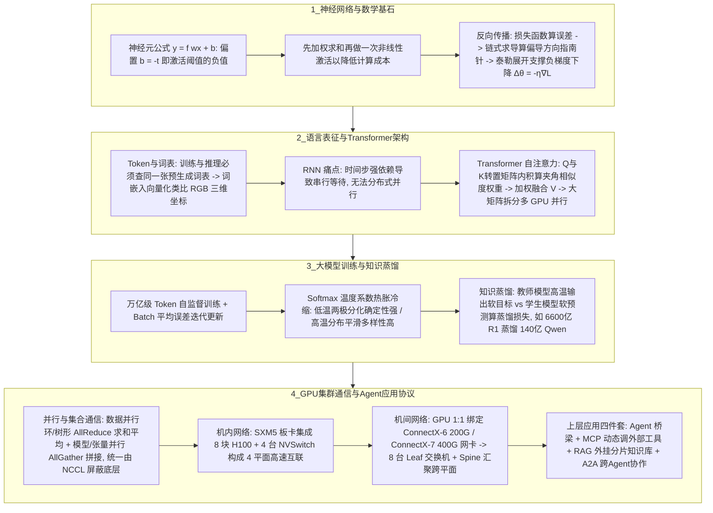

# AI大模型通俗总览

## 1. TL;DR

本文由一位资深网络工程师（白玉光）以跨界通俗视角，撰写了长达 58 页、横跨“**底层数学与神经网络原理 $\to$ 大模型分词、推理与训练机制 $\to$ GPU 分布式集群与多平面算力网络 $\to$ Agent / MCP / RAG / A2A 应用生态**”的全景式技术指南。核心脉络是：
1. **从神经元到梯度下降**：神经元通过线性加权与偏置（$y = f(wx+b)$，其中偏置 $b = -t$ 即激活阈值的负值）配合非线性激活函数加工信号；模型训练本质是通过损失函数计算误差，利用**链式求导法则**确定更新方向（指南针），并依托**泰勒展开**数学保证沿着负梯度方向小步更新（$\Delta\theta = -\eta \cdot \nabla_\theta L$）。
2. **从 Token、向量化到 Transformer 自注意力**：训练与推理必须查同一张预生成词表；自注意力机制通过矩阵乘法（$Q \cdot K^T$ 内积度量向量夹角相似度，再加权融合 $V$）一次性并行融合全局上下文，彻底突破了 RNN 必须按时间步串行等待的计算瓶颈。
3. **训练工程与知识蒸馏**：厘清了模型参数（如 GPT-3 的 `1750 亿`、DeepSeek-V3.2 突破 `6700 亿`）与超参数（层数、学习率、Batch 批量等）的边界；解析了 Softmax **温度系数（热胀冷缩）**如何生成“软目标/软预测”，支撑如 `DeepSeek-R1（6600 亿参数）` 蒸馏出 `DeepSeek-R1-Distill-Qwen-14B（140 亿参数）` 等 6 个开源小模型。
4. **AI 算力网络与 Agent 四大组件**：详解了数据并行（弃用中心化参数服务器，改用环形/树形 **AllReduce**）与模型/张量并行（**AllGather** 拼接）、**NCCL** 集合通信库、机内 **SXM5 8 卡 H100 + 4 台 NVSwitch 的 4 平面架构**、机间 **1:1 绑定 ConnectX-6（200Gbps，整机 1.6T）/ ConnectX-7（400Gbps）网卡 + 8 台 Leaf 接入交换机与 Spine 汇聚交换机的多平面轨道网络**；最后串联了弥补静态大模型局限的 **Agent、MCP（2025 年 12 月捐赠给 Linux 基金会 AAIF）、RAG（合理控制分片尺寸）与 Google A2A 协议（2025 年 4 月 9 日发布）**。

## 2. 问题定义与背景

### 2.1 跨学科理解大模型的认知鸿沟
对于非算法科班出身的工程师而言，大模型领域的概念（神经元、偏置、反向传播、梯度、Token、Embedding、自注意力、温度系数、知识蒸馏、AllReduce、多平面网络、MCP/A2A）往往被割裂在数学公式、深度学习框架、底层硬件网络与上层应用四个孤立学科中，缺乏一条从第一性原理贯穿到底层物理网卡与上层智能体协议的完整认知链条。

### 2.2 全文四大知识板块设计
作者将全文拆解为层层递进的四个部分：
1. **神经网络基础（第 1–4 章）**：正向传播、神经元线性与非线性、激活阈值与偏置、矩阵运算、损失函数、反向传播链式求导与梯度下降。
2. **大模型推理与训练（第 5–7 章）**：Token 分词与词表一致性、RGB 类比词向量、Softmax 概率采样、RNN 串行瓶颈与 Transformer 自注意力并行化、超参数与 Batch、温度系数与知识蒸馏。
3. **AI 算力与网络基础设施（第 8 章）**：GPU 并行计算、数据并行（AllReduce）与模型并行（AllGather）、NCCL、NVSwitch 机内 4 平面与 Leaf-Spine 机间 8 平面网络。
4. **大模型应用生态（第 9 章）**：静态参数局限性、Agent 感知与执行、MCP 工具协议、RAG 检索增强与 A2A 跨智能体通信。

## 3. 知识框架

## 4. 核心内容拆解

### 4.1 神经网络数学直觉：从神经元偏置到梯度下降
1. **为什么神经元公式 $y = f(wx + b)$ 里要加偏置 $b$，且“先加权综合、后激活变换”？**
   - **偏置 $b$ 的物理意义**：神经元将多路输入加权求和得到 $y'$ 后，需与内部激活阈值 $t$ 比较（仅当 $y' - t > 0$ 时才激活输出）。令 $b = -t$，则偏置 $b$ 直接刻画了**神经元被激活的难易程度**。
   - **计算成本考量**：若对每个输入先做非线性变换再综合，计算量极大；“先线性加权求和、最后只做一次非线性激活函数变换”能显著降低计算开销。
   - **参数规模演进**：权重（$w$）与偏置（$b$）共同构成模型的核心参数（此外模型文件还包含词表）。从早期网络演进至今，GPT-3 参数量达 **1,750 亿**，而最新发布的 **DeepSeek-V3.2 参数规模已突破 6,700 亿**。
2. **链式求导与梯度下降的数学分工**：
   - **损失函数（Loss Function）**：度量模型预测值与真实目标值之间的误差，训练的终极目标是让损失函数逼近 0。
   - **链式求导（指南针）**：因为深层网络是层层嵌套的复合函数（“套娃”），反向传播利用微积分链式求导法则从输出层逆向逐层计算每个参数的偏导数，为参数更新提供**方向指南针**。
   - **梯度下降与泰勒展开（步长依据）**：坊间“半山腰放球沿最快方向滚入谷底”的通俗说法背后有着严格的**一阶泰勒展开**数学支撑——在当前参数点附近，唯有沿着负梯度方向小步调整（$\Delta\theta = -\eta \cdot \nabla_\theta L$，$\eta$ 为学习率），才能保证损失函数值以最快速度持续下降。

### 4.2 分词词表、Transformer 自注意力与知识蒸馏
1. **为什么训练阶段和推理阶段绝不能使用各自独立的分词算法？**
   Token 并非临时随意切分，而是预先生成并固化在模型的**词表（Vocabulary）**中。模型训练的本质是学习词表中固定编号 Token 的语义与共现规律；若推理时不用“查同一本字典”的方式拆分，拆出的 Token 编号将与训练好的权重矩阵严重错位，导致模型彻底无法理解输入。
2. **从 RNN 串行死胡同到 Transformer 自注意力矩阵并行**：
   - **RNN 的致命缺陷**：通过将上一时间步输出塞回当前步输入来保留记忆，但强时间步依赖导致前一步没算完后一步就无法启动，**无法进行分布式并行计算**。
   - **Transformer（2017 年 Google *Attention Is All You Need*）的两步并行法**：
     1. 用输入矩阵乘以其转置矩阵（$Q \cdot K^T$，几何上向量内积反映空间夹角大小与亲疏程度），一次性算出句子中所有分词两两之间的影响力（注意力权重）；
     2. 基于注意力权重加权融合 $V$ 生成包含全局上下文的新词向量。
     由于全程转化为**大矩阵乘法**，可在数学上切分为多个小矩阵分摊到成百上千个 GPU 核心上并行计算（注：全量两两计算为**稠密自注意力**，按需裁剪计算范围则为**稀疏自注意力**）。
3. **温度系数（热胀冷缩）与知识蒸馏（Knowledge Distillation）**：
   - **温度系数（Temperature）**：嵌入在 Softmax 归一化公式中。低温（“冷缩”）使高概率 Token 概率更高、低概率更低，输出两极分化且确定性强；高温（“热胀”）拉平概率差距，让低概率 Token 也有机会被采样，增加创造性与多样性。
   - **软目标蒸馏机制**：为了让小模型用极少参数逼近大模型能力（模型压缩），训练时先调高教师模型（Teacher）的温度系数输出平滑的概率分布（称为**软目标 Soft Target**，保留了词与词之间的暗知识关联），再让小参数学生模型（Student）在相同温度下输出**软预测（Soft Prediction）**，通过最小化二者间的**蒸馏损失（软损失）**完成能力迁移。典型案例如 2025 年春节 DeepSeek 利用 **6,600 亿参数的 DeepSeek-R1** 蒸馏出 **6 个开源小模型**（如仅 **140 亿参数**的 `DeepSeek-R1-Distill-Qwen-14B`）。

### 4.3 AI 基础设施：分布式并行、NCCL 与多平面算力网络
1. **数据并行（AllReduce） vs 模型/张量并行（AllGather）**：
   - **数据并行（Data Parallelism）**：每张 GPU 存放完整模型副本、处理不同数据切片并各自算出梯度。早期依赖中心化的“参数服务器（Parameter Server）”汇总更新，极易成为通信瓶颈；现代训练全面改用去中心化的环形（Ring）或树形（Tree）拓扑执行 **AllReduce**（所有卡拿到全局梯度求和平均值）。
   - **模型并行 / 张量并行（Model / Tensor Parallelism）**：当单卡装不下超大模型时，将权重张量像拼图一样切分到多张 GPU（如 GPU0、GPU1、GPU2）上分别计算矩阵分块，再通过不改变数值、仅做张量拼接的 **Gather / AllGather** 将各卡局部结果拼回完整激活值传向下一层。
   - **NCCL（读作“NiKal”）**：英伟达提供的集合通信库，向上层开发者透明封装了 `allreduce()`、`allgather()` 等原语，屏蔽底层拓扑复杂性。
2. **机内 NVSwitch 4 平面与机间 Leaf-Spine 8 平面架构**：
   - **服务器内部（SXM5 4 平面架构）**：以 8 卡 H100 服务器为例，GPU 之间并非直接两两连线，而是与 **4 台 NVSwitch 专用交换芯片**共同预集成在一块 **SXM5 板卡**上；每块 GPU 同时上联全部 4 台 NVSwitch，构成无需人工接线的机内 **4 平面（多轨道）全互连单元**。
   - **跨服务器之间（网卡 1:1 绑定 + 8 台 Leaf + Spine 汇聚）**：跨机通信通过英伟达 **ConnectX 系列网卡**（A100 标配 **ConnectX-6，单口 200Gbps**，8 卡 1:1 绑定提供整机 **1.6T** 上行带宽；H100 标配 **ConnectX-7，单口 400Gbps**）。机房布线采用多平面（Multi-rail）设计：单机 8 张网卡分别上联至 **8 台不同的接入交换机（Leaf）**；当不同平面的 GPU 需要跨平面通信时，再通过更高层级的**汇聚交换机（Spine）**打通。

### 4.4 大模型应用层四剑客：Agent、MCP、RAG 与 A2A
由于训练好的大模型参数固定，存在“知识陈旧过时、无法直接操作外部系统、概率预测易产生幻觉”三大先天局限，工程界构建了四大外延体系：
1. **Agent（智能体）**：大模型的“感知器 + 肢体”，作为普通用户使用大模型的自然交互窗口。
2. **MCP（Model Context Protocol，模型上下文协议）**：取代早期与 OpenAI 强绑定的 `Function Calling`，定义了 Agent 与外部工具/动态数据源交互的统一通信标准。**2025 年 12 月**，其发明者 Anthropic 将 MCP 捐赠给 **Linux 基金会旗下组织 AAIF**，使其正式成为中立行业标准。
3. **RAG（检索增强生成）**：为大模型外挂“实时/私域知识存储卡”，无需重新训练即可注入新知识並抑制幻觉。工程核心在于**合理控制文档分片（Chunk）尺寸**——若不分片或分片过大，既会降低向量语义匹配精准度，又容易撑爆大模型的上下文 Token 窗口限制。
4. **A2A（Agent-to-Agent 协议）**：随着垂直 Agent 爆发，Google 于 **2025 年 4 月 9 日**正式发布 A2A 协议，打通不同智能体之间的跨组织发现、通信与协同调用。

## 5. 数据速查表

| 指标 / 实体 | 原文数值 / 规格 | 语境 / 条件 |
| :--- | :--- | :--- |
| **GPT-3 vs DeepSeek-V3.2 参数规模** | **1,750 亿** vs 突破 **6,700 亿** | 衡量深层神经网络中权重与偏置参数总量的演进 |
| **主流大模型预训练数据规模** | 突破 **万亿（Trillion）Tokens** | 区分于模型参数量的预训练语料 Token 规模 |
| **DeepSeek-R1 开源蒸馏案例** | **6,600 亿**参数教师模型 $\to$ 蒸馏出 **6 个**小模型 | 2025 年春节发布，其中 `DeepSeek-R1-Distill-Qwen-14B` 学生模型仅 **140 亿**参数 |
| **H100 SXM5 机内互联架构** | **8 块 H100 GPU + 4 台 NVSwitch**（**4 平面**设计） | 预集成在同一块 SXM5 板卡上，无需网络工程师手动接线 |
| **A100 / H100 机间通信网卡速率** | A100 配 **ConnectX-6 (200Gbps)** / H100 配 **ConnectX-7 (400Gbps)** | 网卡与 GPU 1:1 绑定；A100 8 卡整机对外提供 $8 \times 200\text{G} = \mathbf{1.6\text{T}}$ 上行带宽 |
| **机间多平面接入交换机数量** | 单机 8 张网卡分别上联 **8 台不同 Leaf 交换机** | 跨平面 GPU 通信通过上层 **Spine（汇聚交换机）** 打通 |
| **MCP 捐赠中立化时间** | **2025 年 12 月** | Anthropic 将 MCP 捐赠给 Linux 基金会旗下组织 **AAIF** |
| **Google A2A 协议发布时间** | **2025 年 4 月 9 日** | 解决多 Agent 之间的标准化通信与协同调用问题 |

## 6. 踩坑与教训 / 可迁移的设计原则

| 错误做法 | 失败表现或原因 | 原文应对（可迁移的设计原则） |
| :--- | :--- | :--- |
| **在模型训练阶段与在线推理阶段使用各自独立的分词算法切分 Token** | 推理拆出的分词不在原词表中或编号与训练期权重映射错位，模型完全丧失语义理解能力 | **训练/推理词表强一致性原则**：预先生成全局唯一词表（Vocabulary），训练样本与在线用户提问必须严格通过查询同一张词表完成分词与编号映射 |
| **在大规模数据并行训练中沿用中心化的参数服务器（Parameter Server）汇总梯度** | 所有 GPU 同时向单点参数服务器收发海量梯度，中心节点瞬间沦为整网通信死穴 | **去中心化集合通信（AllReduce）原则**：摒弃中心参数服务器，借助 NCCL 采用环形（Ring）或树形（Tree）拓扑执行分布式 AllReduce 梯度求和平均 |
| **在构建 RAG 外挂知识库时不切分文档，或将文档分片（Chunk）切得过大** | 大分片导致混杂无关信息、向量语义匹配精度下降，且多个召回分片拼接后极易超出大模型上下文窗口上限报错 | **RAG 分片粒度折中控制原则**：根据语义边界与模型 Context 容量合理控制分片尺寸，兼顾向量检索信噪比与上下文预算安全 |
| **混淆“模型参数”与“超参数”，或指望静态训练好的大模型直接回答实时动态私域问题** | 模型参数在训练结束后即冻结，无法感知训练截止日后的动态世界，强行提问必然诱发概率幻觉 | **静态大脑 + 动态外设（MCP + RAG）解耦原则**：模型权重只负责通用推理，实时动态数据通过 MCP 调外部工具获取，私域/最新知识通过 RAG 外挂检索注入 |

## 7. 记忆锚点

- **神经元与反向传播口诀**：“**偏置 $b$ 是负阈值（$-t$），先加权后激活省算力；损失算差距，链式求导指方向，泰勒展开保下降（$\Delta\theta = -\eta\nabla L$）。**”
- **算力通信与网络口诀**：“**数据并行 AllReduce（算平均），张量并行 AllGather（拼碎片），NCCL 读作 NiKal；机内 8 卡连 4 台 NVSwitch（SXM5 四平面），机间 8 网卡连 8 台 Leaf 上 Spine（ConnectX-6 200G / ConnectX-7 400G）。**”
- **应用层四剑客时间轴**：“**RAG 挂存储卡（控分片），Agent 当桥梁，A2A 联智能体（2025.04 Google），MCP 统工具链（2025.12 捐 Linux AAIF）。**”

## 8. 复习卡片

神经元公式 $y = f(wx + b)$ 中的偏置 $b$ 具有什么物理意义？为什么神经网络采用“先加权综合、再做一次非线性激活”的顺序？::偏置 $b$ 等于神经元激活阈值 $t$ 的相反数（$b = -t$），用来表示神经元被激活的难易程度；先做线性加权求和、最后只做一次非线性激活变换，相比对每个输入分别做非线性变换能大幅降低计算成本。
在神经网络反向传播中，“损失函数”、“链式求导”和“梯度下降（泰勒展开）”三者各自扮演什么角色？::1. 损失函数负责计算预测值与目标值的误差（目标是使其逼近 0）；2. 链式求导负责逆向逐层算出每个参数的偏导数，提供参数更新的“方向指南针”；3. 梯度下降依托一阶泰勒展开的数学证明，保证沿着负梯度方向小步调整（$\Delta\theta = -\eta \cdot \nabla_\theta L$）能使损失值以最快速度下降。
为什么 Transformer 能彻底解决 RNN 在处理长上下文时的计算性能瓶颈？::因为 RNN 必须把上一时间步的输出作为下一步的输入，强串行依赖导致无法分布式并行；而 Transformer 的自注意力机制通过输入矩阵与转置矩阵相乘（$Q \cdot K^T$ 算注意力权重并融合 $V$），将上下文融合转化为可拆分的矩阵乘法，从而能分摊到大量 GPU 核心上一次性并行计算。
Softmax 中的“温度系数（Temperature）”是如何工作的，它在“知识蒸馏”中起到了什么关键作用？::温度系数遵循“热胀冷缩”直觉：低温使高概率 Token 更突出（两极分化），高温使概率分布更平缓；在知识蒸馏中，通过调高温度系数让大模型（如 6600 亿参数的 DeepSeek-R1）输出平滑的“软目标”概率分布，与小模型（如 140 亿参数的 Qwen-14B）的“软预测”计算蒸馏损失，从而用极少参数学到大模型的暗知识。
在大模型分布式训练中，数据并行与模型（张量）并行分别使用什么 NCCL 集合通信原语？::数据并行（每张卡跑相同模型、不同数据）摒弃了易成瓶颈的中心化参数服务器，使用环/树形结构的 `AllReduce` 对所有卡的梯度求和取平均；模型/张量并行（将权重矩阵切分到不同卡）使用不做增减计算、仅做张量拼接的 `Gather / AllGather` 汇总各卡局部矩阵运算结果。
一台 8 卡 H100/A100 服务器的“机内互联”与“机间物理网络”是如何设计多平面拓扑的？::1. 机内互联：8 块 H100 与 4 台 NVSwitch 预先集成在同一块 SXM5 板卡上，每块 GPU 同时连 4 台 NVSwitch，构成 4 平面全互连；2. 机间互联：8 块 GPU 与 8 张 ConnectX 网卡（A100 用 200G 的 ConnectX-6 共 1.6T，H100 用 400G 的 ConnectX-7）1:1 绑定，8 张网卡分别上联 8 台不同的接入交换机（Leaf），跨平面通信再经上层汇聚交换机（Spine）打通。
MCP、RAG 与 A2A 分别解决了大模型应用落地中的什么问题？::1. MCP（模型上下文协议，2025 年 12 月由 Anthropic 捐赠给 Linux 基金会 AAIF）统一了 Agent 调用外部工具获取实时动态数据的标准；2. RAG（检索增强生成）充当外挂知识库，无需重新训练即可引入私域/最新知识以减少幻觉（需合理控制分片尺寸防撑爆上下文）；3. A2A（Google 于 2025 年 4 月 9 日发布）解决了不同 Agent 之间的跨智能体通信与协同调用。

## 9. 知识关联

- **本库通用主题**：[Agent工程循环](../../20_topics/Agent%E5%B7%A5%E7%A8%8B%E5%BE%AA%E7%8E%AF.md) · [检索与文档解析](../../20_topics/%E6%A3%80%E7%B4%A2%E4%B8%8E%E6%96%87%E6%A1%A3%E8%A7%A3%E6%9E%90.md) · [云网络系统研究](../../20_topics/%E4%BA%91%E7%BD%91%E7%BB%9C%E7%B3%BB%E7%BB%9F%E7%A0%94%E7%A9%B6.md) · [模型与开发工具发布](../../20_topics/%E6%A8%A1%E5%9E%8B%E4%B8%8E%E5%BC%80%E5%8F%91%E5%B7%A5%E5%85%B7%E5%8F%91%E5%B8%83.md) · [模型架构与训练](../../20_topics/%E6%A8%A1%E5%9E%8B%E6%9E%B6%E6%9E%84%E4%B8%8E%E8%AE%AD%E7%BB%83.md)
- **候选双链**：[[英伟达GPU选型科普]] · [[多轨道Leaf-Spine算力网络]] · [[知识蒸馏与软标签]] · [[MCP与A2A协议生态]]

## 10. 原文参考资料

- 原文标题：《这大概是我读过关于 AI 大模型最全面、好读又易懂的文章了》（作者：白玉光，发布于 2026-02-02）
- 关联里程碑文献与标准：
  - Google *Attention Is All You Need*（2017，提出 Transformer）
  - OpenAI Tokenizer 在线计算器（`https://platform.openai.com/tokenizer`）
  - DeepSeek-R1 蒸馏系列开源模型（2025 春节）、Google A2A 协议（2025-04-09）、Anthropic MCP 捐赠 Linux 基金会 AAIF（2025-12）。

> [!note]- 校对报告
> - **页码溯源汇总**：
>   - `p.1–11`：导读、三层神经网络与交换机双工网络对比、神经元加工信号、线性与非线性、激活函数阈值 $t$ 与偏置 $b = -t$（公式 $y = f(wx+b)$）、模型参数规模（GPT-3 1,750 亿，DeepSeek-V3.2 突破 6,700 亿）与词表/变量区分。
>   - `p.12–20`：神经网络矩阵运算、预测值与目标值、损失函数、反向传播复合函数“套娃”链式求导（方向指南针）、一阶泰勒展开证明负梯度下降（$\Delta\theta = -\eta \cdot \nabla_\theta L$）。
>   - `p.21–35`：Token 与预生成词表（训练与推理必须查同一词表）、词嵌入向量化（类比 Photoshop RGB 三原色三维向量）、Softmax 概率输出、RNN 串行计算瓶颈、2017 年 Google Transformer 自注意力两步矩阵乘法（输入矩阵乘转置矩阵算内积权重 + 融合 $V$）及稠密/稀疏自注意力。
>   - `p.36–43`：万亿 Token 训练数据、超参数（模型架构/层数/学习率）与 Batch 批量平均误差、过拟合与欠拟合、监督与自监督学习、Softmax 温度系数“热胀冷缩”、知识蒸馏软目标/软预测/蒸馏损失（2025 春节 6,600 亿参数 DeepSeek-R1 蒸馏出 6 个小模型，含 140 亿参数 `DeepSeek-R1-Distill-Qwen-14B`）。
>   - `p.43–52`：区块链 Hash 挖矿 vs AI 矩阵计算、数据并行（弃用中心化参数服务器，改用环/树形 AllReduce）与模型/张量并行（Gather/AllGather）、NCCL（读作 NiKal）、H100 SXM5 板卡（8 块 GPU + 4 台 NVSwitch 的 4 平面架构）、机间 1:1 绑定 ConnectX-6（200Gbps，A100 整机 1.6T）/ ConnectX-7（400Gbps）网卡 + 8 台 Leaf 交换机与 Spine 汇聚交换机。
>   - `p.53–58`：静态大模型局限、Agent 感知与执行、MCP（对比 Function Calling，2025 年 12 月捐赠给 Linux 基金会 AAIF）、RAG 检索增强与合理控制分片尺寸、Google 2025 年 4 月 9 日发布 A2A 协议。
> - **核验结论**：全文 58 页的核心概念、数学公式、硬件拓扑参数与行业时间线均完整提炼并严格对齐原文。
