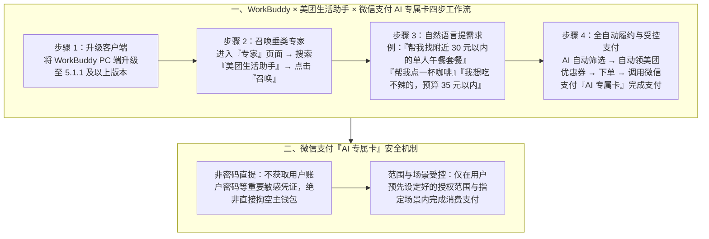

# AI 真的能帮你微信下单了！

> **原文信息**：发布于 2026-06-17 02:33（广东），公众号「腾讯技术工程」。

---

## 1. TL;DR

1. **核心突破：打通 Agent 交易闭环最后一公里** —— **微信支付**正式发布 **「AI 专属卡」**，腾讯办公智能体 **WorkBuddy** 率先接入；使 AI 不再局限于信息问答，而是首次在桌面端跑通「找外卖 → 选套餐 → 领优惠券 → 下单 → 微信支付」的完整消费闭环。
2. **四步极简启用流程** —— ① 将 **WorkBuddy PC 端**升级至 **`5.1.1` 及以上版本**；② 进入「专家」页面搜索并点击「召唤」**「美团生活助手」**；③ 用自然语言直接提需求（如「帮我找附近 30 元以内的单人午餐套餐」「我想吃不辣的，预算 35 元以内」）；④ AI 自动完成筛选、领券、下单并通过「AI 专属卡」完成支付。
3. **受控授权的资金安全边界** —— 微信支付「AI 专属卡」**绝非通过获取用户账户密码或敏感凭证直接提款（不是直接掏钱包）**，而是在用户预先设定好的额度与场景授权范围内、经用户允许的情况下代为完成指定消费。

---

## 2. 问题定义与背景

### 2.1 为什么要写这篇？

过去各类生活服务与桌面 Agent 即使能帮用户检索附近餐厅、对比外卖价格，一旦走到最后的「领券下单与支付」环节，由于缺乏安全可控的支付授权机制，仍然必须中断流程交由人类手动扫码或掏手机付款。本文宣布 **微信支付「AI 专属卡」** 正式上线并由 **WorkBuddy（PC 端 $\ge 5.1.1$）** 结合「美团生活助手」专家智能体率先落地，展示了在保障资金账户隔离与限定授权前提下的原生 AI 交易体验。

---

## 3. 知识框架

---

## 4. 核心内容拆解

### 4.1 四步上手「AI 微信下单」全流程

1. **版本准备**：将 **WorkBuddy PC 端**升级到 **`5.1.1` 及以上版本**。
2. **召唤专家 Agent**：打开 WorkBuddy，进入「专家」页面，搜索并找到 **「美团生活助手」**，点击「召唤」（绑定后输入 `帮我领美团优惠券` 还可触发彩蛋福利）。
3. **自然语言表达带约束的消费意图**：
   - 支持直接按位置、品类、口味偏好与预算上限发指令，文中给出的三个典型示例为：
     - `帮我找附近 30 元以内的单人午餐套餐。`
     - `帮我点一杯咖啡。`
     - `我想吃不辣的，预算 35 元以内。`
4. **筛选、领券、下单与支付一体完成**：AI 根据约束自动筛选商品、领取可用优惠券、生成订单，并在进入支付环节时调用绑定的微信支付「AI 专属卡」完成扣款。

---

### 4.2 微信支付「AI 专属卡」的安全边界设计

- **核心定位**：专为 AI Agent 代客下单场景设计的受控支付工具。
- **为什么不会「乱掏钱包」？**
  1. **凭证隔离**：AI 专属卡**不是**通过获取用户的微信支付主账户密码等核心敏感信息去直接提款；
  2. **限定范围授权**：必须在用户预先设定好的授权额度、指定场景范围内，且在用户允许的情况下，才能辅助完成购买和消费。

---

## 5. 数据速查表

| 指标 | 原文数值 | 语境 / 条件 |
| :--- | :--- | :--- |
| WorkBuddy PC 端最低版本要求 | **`5.1.1` 及以上版本** | 支持接入微信支付「AI 专属卡」与「美团生活助手」的客户端版本 |
| 率先接入的垂类专家智能体名称 | **「美团生活助手」** | 在 WorkBuddy「专家」页面搜索并点击「召唤」启用 |
| 自然语言点餐示例预算阈值 | **30 元以内（单人午餐套餐）/ 35 元以内（不辣）** | 文中演示带价格与口味约束的自然语言下单指令 |
| 完整操作链路步骤数 | **4 步** | 升级客户端 → 召唤美团生活助手 → 自然语言提需求 → AI 筛选/领券/下单/专属卡支付 |

---

## 6. 踩坑与教训 / 可迁移的设计原则

| 错误做法 | 失败表现或原因 | 原文应对 |
| :--- | :--- | :--- |
| 为了让 Agent 完成自动下单支付，要求用户将主支付账户密码或全局免密权限直接交给大模型 | 存在极高的资金盗刷与越权消费风险，用户根本不敢授权使用 | 推出**微信支付「AI 专属卡」**，不触碰用户账户密码，仅在用户预设的授权范围与指定消费场景内完成代付 |
| 在低版本 WorkBuddy 客户端中直接尝试语音或文字点外卖 | 缺少支付组件与专家技能入口支持 | 明确前置版本门槛（升级 WorkBuddy PC 端至 **`5.1.1` 及以上**），并通过「专家」页显式召唤「美团生活助手」 |

---

## 7. 记忆锚点

1. **三方联动组合**：「**微信支付 AI 专属卡（受控代付）+ WorkBuddy PC 5.1.1+（宿主入口）+ 美团生活助手（垂类专家）**」。
2. **安全定心丸**：「**不碰账户密码、不直接掏主钱包，只在设定好的授权范围与指定场景内买单**。」

---

## 8. 复习卡片

1. 微信支付「AI 专属卡」的核心作用是什么，首个率先接入该能力的 AI 产品与垂类专家是什么？::核心作用是在用户预设的授权范围与指定场景内，让 AI 能够替用户安全地完成订单支付；由腾讯办公智能体 WorkBuddy（需升级 PC 端至 `5.1.1` 及以上版本）率先接入，并结合「专家」页面中的「美团生活助手」打通了找外卖、选套餐、领券、下单到支付的全流程。
2. 在 WorkBuddy 中使用 AI 自动点外卖并完成微信支付需要哪四个步骤？::① 将 WorkBuddy PC 端升级到 `5.1.1` 及以上版本；② 进入「专家」页面搜索「美团生活助手」并点击「召唤」；③ 用自然语言提出带预算或口味的需求（如「帮我找附近 30 元以内的单人午餐套餐」）；④ AI 自动筛选、领券、下单并用「AI 专属卡」完成支付。
3. 微信支付「AI 专属卡」是如何保障用户资金安全、避免 AI「乱掏钱包」的？::它绝不是通过获取用户的账户密码等核心敏感信息去直接提款，而是与主钱包隔离，仅在用户预先设定好的额度范围、允许的指定消费场景下完成支付。
4. 绑定「AI 专属卡」并召唤「美团生活助手」后，用户在自然语言指令中可以附加哪些典型约束，文中提到的福利口令是什么？::可以直接附加地理位置、品类、口味偏好与预算上限（如「附近 30 元以内的单人午餐套餐」「不辣的，预算 35 元以内」）；在 WorkBuddy 输入「帮我领美团优惠券」可触发领券彩蛋。
5. 相比传统的对话式生活助手，WorkBuddy 接入「AI 专属卡」在 Agent 能力演进上有什么标志性意义？::将 Agent 从「只能回答问题、给推荐列表」的信息咨询阶段，推进到了「筛选 → 领券 → 下单 → 受控代付」的真实商业交易闭环阶段。

---

## 9. 知识关联

- **已有主题**：[模型与开发工具发布](../../20_topics/%E6%A8%A1%E5%9E%8B%E4%B8%8E%E5%BC%80%E5%8F%91%E5%B7%A5%E5%85%B7%E5%8F%91%E5%B8%83.md) · [桌面Agent与工作流](../../20_topics/%E6%A1%8C%E9%9D%A2Agent%E4%B8%8E%E5%B7%A5%E4%BD%9C%E6%B5%81.md) · [Agent安全与权限](../../20_topics/Agent%E5%AE%89%E5%85%A8%E4%B8%8E%E6%9D%83%E9%99%90.md)
- **候选新主题**：[[Agent受控支付与交易闭环]] · [[微信支付AI专属卡]]

---

## 10. 原文参考资料

1. **核心产品与组件**：微信支付「AI 专属卡」、腾讯 WorkBuddy PC 端（`v5.1.1+`）、「美团生活助手」专家智能体。

> [!note]- 校对报告
> - **校对状态**：已根据 `MD.md` 全文（共 6 页 PDF 转写文本，第 6 页为空白页）逐一核对。
> - **核心数据与事实页码溯源**：
>   - 微信支付正式发布「AI 专属卡」、WorkBuddy 率先接入、升级 WorkBuddy PC 端至 `5.1.1` 及以上版本、进入「专家」页面搜索并召唤「美团生活助手」：见 PDF 第 1 页。
>   - 三个自然语言点餐指令示例（30 元以内单人午餐套餐、点一杯咖啡、不辣且预算 35 元以内）及筛选/领券/下单/AI 专属卡支付闭环：见 PDF 第 2–3 页。
>   - 「AI 专属卡」安全机制说明（不获取账户密码直接提款，在设定好的范围内和允许情况下购买消费）及「帮我领美团优惠券」彩蛋口令：见 PDF 第 4 页。
