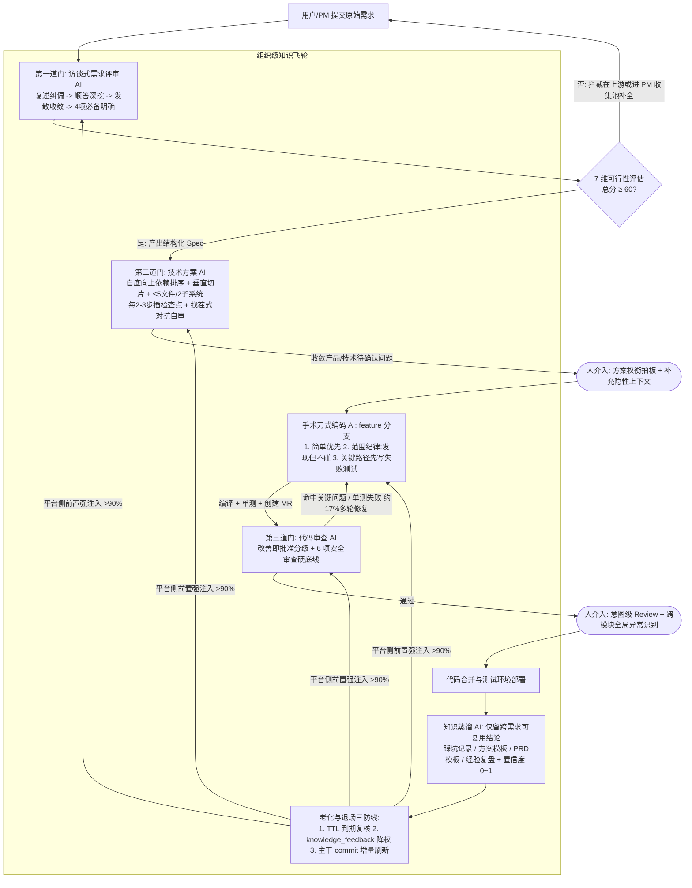

# 别只盯着 AI Coding，真正的变化发生在整个研发流程

## 1. TL;DR

本文基于腾讯内部 OK 平台端到端自动交付的运营实践指出：单点 AI Coding 提速已成红海（司内调研约 $85\%$ 团队停留在此），但研发交付真正的瓶颈在于**需求模糊引发的高速返工**以及跨部门交接中的**信息衰减与等待成本**（角色间等待常占交付周期的 $40\sim 60\%$）。作者主张从“零基思维”出发重建研发流程，用结构化 Spec 替代口头传递链，把“需求评审 → 仓库匹配 → 技术方案 → 编码 → Code Review → 部署”串成质量门禁驱动的端到端流水线。其核心机制包括：访谈式需求深挖与 7 维可行性评分门禁（$\ge 60$ 分放行）、按依赖自底向上且垂直切片的技术方案与对抗式找茬自审、手术刀式编码三纪律（简单优先、范围纪律“发现但不碰”、关键路径先写失败测试）、“改善即批准 + 6 项安全硬底线”的分级代码审查，以及“平台前置强注入（注入率 $>90\%$）+ 跨需求蒸馏 + 三道防线老化退场”的知识飞轮。在该模式下，人的角色从写代码的执行者升级为架构权衡决策者、隐性上下文供给者与意图级审查者，并按风险与复杂度将需求划入四象限分级治理。需注意，原文前文与结语的运营统计存在跨段不一致（端到端完成数 $172$ 条/$68\%$ vs $170$ 条/$66\%$；知识资产 $547$ 条 vs $491$ 条），不能合并为单一确定数值。

## 2. 核心概念

- **零基思维（Zero-Based Thinking）重构**：审视传统研发流程中的每个环节（如前后端分离、接口文档、需求评审会、联调周），追问“这个环节是因为人的局限而存在，还是因为问题本身需要它”；当 AI 能同时持有全链路上下文并用结构化 Spec 流转时，直接消除跨角色交接与等待，而非在旧流程里嵌插件。
- **发现但不碰（范围纪律）**：开发 AI 在 feature 分支编码时，必须且只能修改技术方案明确列出的文件；若在开发途中发现范围外值得改进的代码（如相邻函数命名不规范或可顺手重构），必须记录到变更摘要的“发现但不碰”部分，严禁自行顺手修改，以阻断顺手改出 Bug 和审查噪声。
- **改善即批准（Code Review 准则）**：针对人工审查常因风格偏好导致无谓返工的顽疾，规定只要变更确实改善了整体代码健康度即应通过；严格区分必须修复的阻塞性“关键问题”（含 6 项安全硬底线）与非阻塞“改进建议”，仅存在改进建议时审查结论（verdict）必须给“通过”。
- **前置强注入 vs 被动召回**：早期让 Agent 需要时自己查知识库（被动召回），但 AI“不知道自己不知道什么”，意识不到该查历史踩坑；改为调用 AI 前由平台根据需求类型、仓库、关键词直接把相关知识打包塞进 AI 入参（前置强注入），使知识注入率从不稳定状态提升到超过 $90\%$ 的确定性覆盖。

## 3. 知识框架

以下流程图按正文整理，展示 OK 平台从一句话需求到部署交付的质量门禁链路、人类介入节点与组织级知识飞轮：

## 4. 关键要点与机制详解

### 4.1 零基思维与流程重构：为什么单点 AI Coding 解决不了交付慢

**核心主张**：AI 擅长执行而人擅长判断，传统流程中的大量会议与联调等待本质上是在补偿“人际信息传递衰减”，只有用结构化 Spec 驱动端到端流水线，才能消除占交付周期 $40\sim 60\%$ 的角色间等待。

- **为什么不能直接把一句原始需求丢给 AI**
  - 以“用户反馈帖子列表加载太慢，需要优化一下”为例：直接喂给 AI 往往效果不及预期甚至需要回滚，不是因为 AI 不会写代码，而是每次对话都是“失忆”重新开始——它不知道帖子列表走哪个接口、下游查 MySQL 还是 ES、当月刚换过分页逻辑、慢查询日志指向没加索引的关联表。
  - 现实中人类开发者是先在脑子里把“加载慢”翻译成“关联查询缺索引 + N+1 问题”再喂给 AI。把研发全链条拆开，AI 与人的能力分工如下：

| 研发阶段 | AI 现在能做的（执行层） | 人还在做的（判断层） |
|---|---|---|
| **需求分析** | 整理需求文档 | 判断需求是否真实、优先级、与业务目标的对齐 |
| **方案设计** | 给架构建议、写设计文档 | 做 trade-off 判断：性能 vs 成本、速度 vs 稳定性 |
| **编码** | 核心能力，日常开发基本能 cover | 代码审查、确保符合团队规范 |
| **测试** | 生成单测、集成测试 | 设计测试策略、判断边界 case 是否覆盖 |
| **部署** | 写 CI/CD 配置 | 判断什么时候该发、什么时候该回滚 |
| **线上运维** | 监控告警、日志分析 | 判断告警是否真实、影响范围 |

- **信息衰减链与零基思维追问**
  - 传统需求从“用户说操作太麻烦 → 运营整理成简化流程 → PM 写成减少点击步骤 → 研发实现”每传递一次就衰减一次，为了对抗衰减才不得不开需求评审会、接口对齐会、设联调周。
  - 零基思维追问：前后端分离（一人难通两端）、接口文档（沟通成本高需书面契约）、需求评审会（传递链长需对齐）、联调阶段（节奏不同需凑一起跑通）都是因为**人做不到**才存在的。当 AI 同时持有前后端完整上下文、用结构化 Spec 替代口头传递时，每个环节等的是“质量门通过”而非“某个部门干完活”，跨角色等待直接消失。
  - ⚠️[材料缺失] 原文在“九阶段全链路”小节提示“整个流程九个阶段，每个阶段有明确的 AI 角色、输入、输出和质量门：”，但该处配图在转写文本 `MD.md` 中未展开文字；正文文字明确列出的核心链路为“需求评审 → 仓库匹配 → 技术方案 → 编码 → Code Review → 部署”（以及测试环境部署與知识蒸馏），本笔记不臆测补全未在文字中出现的其余阶段名称。

### 4.2 第一道门（需求评审与可行性评估）：把模糊拦截在开发之前

**核心主张**：AI 开发最大的失败模式是“需求模糊导致高速返工”，必须通过访谈式深挖帮提出者补齐规格，并用 7 维量化评分把注定卡死的需求拦在上游。

- **需求评审 AI 的访谈式四步深挖机制**
  1. 🔥 **先复述理解**：在任何追问前，先用自己的话复述需求核心意图让提出者确认是否理解偏——这是最高效的纠偏点，避免带着错误初始理解一路执行到底。
  2. **顺着回答继续挖**：不走预设机械清单，而是基于用户上一轮回答继续深挖新暴露的模糊点，模拟资深 PM 访谈。
  3. **对极模糊需求做发散收敛**：当描述模糊到无法判断意图时，列出 $2\sim 3$ 种“这个需求可能是想要什么”的合理解释供用户选择或补充，而非直接驳回。
  4. **区分“必须明确”与“建议明确”**：
     - **放行必要条件（4 项）**：做什么、为谁做、关键业务规则、验收标准。
     - **建议补充项（不强制）**：优先级、异常场景等。
  - 此外，平台为 PM 单独设计了独立于端到端流水线的“PM 需求收集池”（⚠️[材料缺失] 原文此处配图未转写为文本），让 PM 可先提交粗略想法，由 AI 补全至可开发质量。
- **可行性评估 7 维门禁（总分 $\ge 60$ 放行）**
  - 可行性评估 AI 按 7 个维度（$0\sim 100$ 分）加权打分，**总分 $\ge 60$ 分**才允许进入开发流水线，作为上游保护机制：

| 评估维度 | 权重占比 | 评估作用 |
|---|---:|---|
| **需求清晰度** | $20\%$ | 检验目标、规则与验收标准是否足以支撑实现 |
| **仓库匹配度** | $20\%$ | 检验目标代码仓库定位是否明确 |
| **改动范围** | $15\%$ | 评估涉及的文件与模块跨度 |
| **技术复杂度** | $15\%$ | 评估算法、架构与实现难度 |
| **外部依赖** | $10\%$ | 评估是否依赖跨仓库、新中间件或外部系统 |
| **风险等级** | $10\%$ | 评估对线上稳定、数据或安全的影响 |
| **交付形态** | $10\%$ | 评估是否需要灰度、数据迁移或特殊审批 |

### 4.3 第二道门（技术方案）：可验证施工图的六条硬纪律

**核心主张**：方案阶段改方向成本最低、开发完在代码审查才发现方向错误修复成本高数倍，因此技术方案必须满足可编译切片与对抗自审六条硬纪律。

1. **按依赖图自底向上排序，不按重要性排序**：实现步骤必须遵循 `数据库表 / 存储模型 → 协议 / 接口 → 业务逻辑 → 调用方 / 前端`。若按“从重要到次要”排序，开发 AI 执行时会频繁撞上“步骤 2 依赖步骤 5 才创建的东西”。
2. **垂直切片优先**：按一条完整功能路径切分（`建表 + 接口 + 最小可用逻辑 = 一个可验证切片`），而非“先把所有表建完、再把所有接口写完”。每个切片完成后系统都必须处于可编译、可验证状态。
3. **任务粒度控制**：单个实现步骤若预计触碰 **超过 5 个文件**，或跨 **2 个以上独立子系统**，必须拆成更细的子步骤；步骤标题中一旦出现“并且 / 同时”，往往意味着应拆成两步。
4. **插入阶段性检查点**：每 **$2\sim 3$ 个步骤**后明确写入验证节点（如“此处应能 `go build ./...` 通过”“此处接口应能跑通基本 CRUD”），给开发阶段 AI 提供阶段性验证锚点。
5. 🔥 **对自己的方案做一次对抗式找茬自审**：针对跨模块修改、编译器无法验证的属性（并发安全 / 幂等 / 不变量）以及不可逆变更，技术方案 AI 在确认前必须站在“假设作者过度自信”的视角自审：*这个方案最可能错在哪？有没有未言明的假设？未处理的边界？*
6. **待确认问题提前暴露**：将方案中不确定、需人拍板的点统一收敛到“待确认问题”，按“产品 / 技术”两类展示（支持选择题和开放题），用户在管理端逐题回答后再进入下一轮评审。

### 4.4 第三道门（手术刀式编码与改善即批准审查）：控制变更半径与返工空转

**核心主张**：针对 AI 写代码“写得出，但写得不对、写得过度”的最大痛点，用三条编码纪律约束实现过程，并用“改善即批准 + 6 项安全硬底线”平衡交付速度与质量底线。

- **手术刀式编码的三条硬纪律（编译 + 单测 + 创建 MR 通过才算开发结束）**
  1. **纪律一：简单优先，抵抗过度设计** — AI 比人更爱为只用一次的操作设计“通用框架”、为三行逻辑抽象“可扩展策略模式”。平台强制注入简单优先原则：*先写最简单、显而易见正确的版本；写完自问能不能更少行、抽象值不值；三行重复代码好过一个过早的抽象；只为当前需求写，不为臆想的未来需求过度设计*。注入该约束后，审查中架构过度复杂类问题出现频次**下降了约一半**。
  2. **纪律二：范围纪律，只碰该碰的（发现但不碰）** — 开发 AI 必须且只能改动方案列出的文件。针对 AI 极易“顺手清理”相邻代码命名或顺手重构从而引入 Bug 和审查噪声的问题，强制实行“**发现但不碰**”机制：范围外值得改进的点必须记录到变更摘要的“发现但不碰”章节，不得自行修改。
  3. **纪律三：关键路径先写测试，再实现** — 对新增判断分支、关键计算、状态流转、幂等逻辑，强制遵循“**先写一个会失败的测试 → 再实现使其通过**”，把验收标准固化为单测。真实运营中约 **$49$ 条需求（约 $17\%$）** 在自动开发阶段经历了超过 1 轮的代码审查 + 修复，其中相当一部分正是因为“`go build` 编译通过但单测失败”而在早期暴露了真实逻辑漏洞。
- **代码审查：改善即批准 vs 安全六项硬底线**
  - 为避免 Reviewer 因个人风格偏好阻塞合入（“90 分的代码今天上线，在很多场景下优于追求 95 分但多返工两轮、明天才上线”），审查标准严格分为两档：

| 问题档位 | 判定范围与具体条目 | 审查结论（Verdict）与处置动作 |
|---|---|---|
| **关键问题（阻塞性，必须修复）** | 1. 会导致 Bug、崩溃、安全漏洞、数据损坏、功能缺失、越权的问题 2. **命中以下 6 项安全硬底线中的任意一项**： 　① 用户维度操作的 `UID/UIN` 是否从登录态获取，而非信任入参（越权防护） 　② 新增接口是否正确接入鉴权中间件 　③ SQL 是否参数化，无字符串拼接 　④ 敏感信息是否硬编码进了代码或日志 　⑤ 外部入参是否在协议边界校验 　⑥ 资源访问是否校验归属，防止访问他人数据 | 给出**“建议修改后合入”**，必须修复后才能合入 |
| **改进建议（非阻塞性，建议优化）** | 命名、注释、代码风格、可选性能优化 | 仅存在改进建议时，verdict **必须为“通过”**，不阻塞上线 |

### 4.5 人机分工、知识飞轮与四象限能力边界

**核心主张**：端到端研发把人升级为决策者与知识供给者，通过“前置强注入—蒸馏—老化退场”飞轮把个人隐性经验沉淀为组织资产，并按可验证性划分四象限能力边界。

- **人不可替代的四个介入节点与意图级 Review**
  1. **决策与方案选型**：在可维护性 vs 性能、是否值得引入缓存等多路径间拍板权衡。
  2. **补充隐性上下文**：提供只存在于人脑中、未写进文档的架构背景、历史包袱、团队约定与业务边界（“给 AI 足够的背景信息，比反复调整 Prompt 更有效”）。
  3. **异常识别与全局干预**：识别局部正确但遗漏全局关联的问题。**真实反例**：舆情管理端的标签拆分需求，需求描述本身足够清晰，AI 顺利改完了前端显示和后端接口存储，但因缺乏系统全局视角，**遗漏了一个关联的巡检 Skill**（不改会产生入库 Bug），需靠人在代码审查时从“行级挑刺”升级到“意图级与跨模块交互审查”来发现补齐。
  4. **最终的价值判断**：决定“该实现什么”符合产品方向与用户价值。
- **组织级知识飞轮：注入、蒸馏与老化退场三道防线**
  - **四类知识蒸馏映射**：每次需求交付后触发知识蒸馏 AI，将“代码审查指出的问题 $\to$ 仓库踩坑记录”、“通过的技术方案骨架 $\to$ 技术方案模板”、“需求评审问答过程 $\to$ PRD 模板”、“端到端完整复盘 $\to$ 经验复盘”。
  - **蒸馏硬原则**：只保留跨需求可复用的结论，丢弃一次性业务细节；每条知识赋予置信度（$0\sim 1$），高置信度直接入库，低置信度进人工审核。
  - **防过期污染的三道退场防线**（防止飞轮变成“过期知识污染上下文”的垃圾循环）：
    1. **TTL（有效期）**：到期自动进入待复核队列，未复核则自动降低可信度。
    2. **Agent 反馈通道（`knowledge_feedback`）**：每个 AI 在工作中若发现注入的知识与实际代码/架构不符，在输出中填写 `knowledge_feedback`，平台据此自动降低该条知识置信度或触发人工复核。
    3. **随代码合入增量刷新**：代码仓库有新 commit 合入主干时，仓库架构分析 AI 自动做增量刷新，更新架构描述文档。
- **四象限能力分布与当前支持/不支持边界**

| 象限划分 | AI 承担比例与职责 | 人承担的职责 | 典型需求与当前清单 |
|---|---|---|---|
| **象限①：直接做（平台承接主体）** | AI $100\%$ 端到端自动完成 | 仅做最终验收确认 | **当前支持清单**：标准 RESTful/RPC 接口增删改查、已有架构上增改业务逻辑、配置项变更、明确定位的 Bug 修复、纯前端 UI/交互变更、单仓库内闭环改动 |
| **象限②：人机协同 · 风险侧** | AI 完成 $60\sim 80\%$ 编码（出代码 + MR） | 负责风险评审与审批流程推进 | 如需要 DBA 审批的简单 DDL 变更 |
| **象限③：人机协同 · 复杂度侧** | AI 完成 $50\sim 70\%$ 编码（按方案逐文件实现） | 负责前期架构决策与模块拆分 | 如涉及多文件改动的完整功能模块 |
| **象限④：暂不支持** | AI 仅辅助分析，不介入端到端 | 全程人工主导 | **当前不支持清单**：跨仓库/跨服务联动、大规模架构重构、接入新中间件（Kafka/ES/新 Redis 集群等）、数据库 Schema 重大变更、涉及资金/支付/核心安全链路改动、需数据迁移或灰度发布的交付形态 |

## 5. 数据速查表

> [!warning] 运营统计存在跨章节不一致
> ⚠️[原文疑点] 原文原文写安全中心项目空间 4 月至 6 月共提交 $254$ 条需求、AI 端到端完成 **$172$ 条（$68\%$）**，原文知识资产表合计 **$547$ 条**；但原文结语写“**$170$ 条**需求端到端自动交付、**$66\%$** 实现率、$51\%$ 在 2 小时内完成、**$491$ 条**知识资产在积累”。原文未解释两处统计的时间点或口径差异，下表分别保留两处原值。

| 指标 | 原文数值 | 语境 / 条件 |
|---|---|---|
| 端到端需求交付数与实现率（前文口径） | 提交 $254$ 条，端到端完成 $172$ 条（$68\%$） | 安全中心项目空间 2026 年 4 月下旬至 6 月运营数据；其余转人工 |
| 端到端需求交付数与实现率（结语口径） | $170$ 条端到端自动交付，实现率 $66\%$ | 文末结语汇总口径（⚠️与前文 $172$ 条 / $68\%$ 不一致） |
| 交付耗时对比基线 | 传统中位耗时 $3\sim 5$ 个工作日 vs OK 平台 $51\%$ 需求在 $2$ 小时内完成 | 常规简单需求从提出到合并代码（图注亦提及安全中心当前约 $30\%$ 需求可通过 OK 平台开发实现） |
| 可行性评估维度权重与放行门槛 | 7 维合计 $100\%$（清晰度 $20\%$、仓库匹配 $20\%$、范围 $15\%$、复杂度 $15\%$、外部依赖 $10\%$、风险 $10\%$、交付形态 $10\%$）；总分 $\ge 60$ 放行 | 第一道门上游拦截保护机制 |
| 技术方案拆步与检查点阈值 | 单步触碰 $>5$ 个文件或跨 $>2$ 个独立子系统必须拆分；每 $2\sim 3$ 步插入 1 个验证检查点 | 技术方案 AI 生成施工图的粒度纪律 |
| 注入“简单优先”后过度设计下降幅度 | 下降约一半 | 代码审查中“架构过度复杂”类问题出现频次对比 |
| 自动开发阶段多轮审查修复比例 | 约 $49$ 条需求（约 $17\%$）经历 $>1$ 轮代码审查 + 修复 | 相当一部分因 `go build` 通过但单测失败而在早期暴露问题 |
| 知识资产分布 | 合计 $547$ 条（技术方案模板 $223$、踩坑记录 $112$、经验复盘 $111$、PRD 模板 $101$）；近 7 天新增 $200+$ 条 | 文末结语另写“$491$ 条知识资产在积累”（⚠️两处口径不一致） |
| 前置强注入覆盖率与置信度区间 | 知识注入率 $>90\%$；知识置信度 $0\sim 1$ | 改为平台侧按需求类型、仓库、关键词前置打包塞入入参后 |
| 四象限 AI 编码占比 | 象限① $100\%$；象限②（风险侧）$60\sim 80\%$；象限③（复杂度侧）$50\sim 70\%$；象限④ 仅辅助分析 | 按风险与复杂度分级的人机协同边界 |
| 传统流程跨角色等待时间占比 | 占交付周期的 $40\sim 60\%$ | 作者团队对多个团队的调研反馈 |
| TAB 实验平台需求质量检查效果 | 研发周期从 $5$ 天缩短到 $2$ 天（$\downarrow 60\%$），额外发现 $30\%$ 遗漏影响点 | 原文转述 TAB 平台团队对外分享材料，用于在需求阶段引入 AI 质量检查的佐证 |
| 司内 AI 研效调研三层分布与收益 | 底层个人编码加速占约 $85\%$；中层全流程提效压缩研发周期 $60\sim 72\%$、需求理解效率提升约 $80\%$；顶层多角色协同目标为顶层 $3\%$ | 原文引用的司内 AI 研效项目调研数据 |

## 6. 踩坑与教训 / 可迁移的设计原则

### 常见踩坑与应对

| 错误做法 | 失败表现或原因 | 原文应对策略 |
|---|---|---|
| **需求没澄清就直接喂给编码 AI 开写** | AI 编码越快、在错误理解上跑得越远，等于在沙地上建楼，最终导致大面积返工甚至回滚 | 将需求评审设为第一道门：先复述理解纠偏、顺着回答深挖、对极模糊需求给 $2\sim 3$ 个选项，收齐 4 项必备条件且可行性 $\ge 60$ 分才放行 |
| **技术方案按“从重要到次要”排序或按水平分层开发** | 开发 AI 在步骤 2 撞上步骤 5 才创建的对象，或等所有表和接口全写完才发现无法跑通 | 强制按依赖图自底向上排序（存储 $\to$ 接口 $\to$ 逻辑 $\to$ 调用方），采用可独立编译验证的垂直切片，每 $2\sim 3$ 步设检查点 |
| **放任编码 AI 过度抽象或“顺手清理”相邻代码** | AI 为一次性逻辑造通用框架，或顺手改邻近函数命名/结构，平白引入新 Bug 与审查噪声 | 注入“简单优先”原则（三行重复好过过早抽象），严守范围纪律并启用“发现但不碰”机制 |
| **用追求完美的风格标准做 AI 代码审查** | Reviewer 反复纠结命名、注释与个人风格偏好，导致多轮无谓返工空转 | 实行“改善即批准”：严格区分阻塞性的关键问题（含 6 项安全硬底线）与非阻塞改进建议，仅含后者必须放行 |
| **让 Agent 自己决定何时去查知识库，且只沉淀不清理** | AI 不知道自己不知道什么（漏查历史踩坑）；而架构演进后过期知识留在库里反而污染上下文 | 改为平台侧前置强注入（$>90\%$），并用“TTL 到期复核 + `knowledge_feedback` 降权 + 主干 commit 增量刷新”三道防线淘汰过期知识 |

### 可迁移的设计原则

- **用结构化 Spec 消除跨角色“翻译税”**：在多 Agent 流水线中，上游需求评审产出的精炼 Spec 不是给人看的会议纪要，而是下游方案、编码、审查 AI 共用的唯一直通输入，用质量门交接替代跨部门拉会。
- **在变更代价最低的阶段做“对抗式找茬”**：在进入写代码之前，强制让方案 Agent 以“假设作者过度自信”的视角自查并发安全、幂等性、未言明假设与不可逆变更，把需要人拍板的模糊点提前暴露为选择题。

## 7. 记忆锚点

- **原文核心分工锚点**：“AI 擅长执行，人擅长判断；不确定的事提前暴露，不让模糊进入开发——流程是手段，解决问题才是目的。”
- **全链路治理口诀（助记改写）**：“需求先复述再追问，方案顺依赖切垂直，编码守简单不乱碰，审查抓安全放风格，知识强注入有退场。”

## 8. 复习卡片

为什么文章认为单点 AI Coding 提速无法解决团队交付慢，零基思维的核心追问是什么？::因为传统流程中跨角色等待常占交付周期的 $40\sim 60\%$，且每次口头传递都会造成信息衰减；零基思维追问“这个环节是因为人的局限而存在，还是因为问题本身需要它”，主张用全链路共享的结构化 Spec 直接消除交接摩擦而非加速旧会议。
OK 平台的需求评审 AI 为什么采用“访谈式四步法”而非固定检查清单，放行的四项必备条件是什么？::为了防止 AI 带着错误的初始理解闷头执行到底；四步法依次是先复述理解纠偏、顺着回答继续深挖、对极模糊需求给 $2\sim 3$ 种解释供选择、区分必须明确与建议明确，其中放行必备四项为“做什么、为谁做、关键业务规则、验收标准”。
技术方案 AI 为什么要强制“按依赖图自底向上排序”和“垂直切片优先”？::按“存储模型→协议接口→业务逻辑→调用方/前端”自底向上排序能避免前序步骤用到后续步骤才创建的对象；垂直切片（建表+接口+最小可用逻辑）配合每 $2\sim 3$ 步的检查点，能让每一步完成后都可编译验证，避免闷头跑到最后才暴露早期错误。
手术刀式编码的三条硬纪律分别解决 AI 写代码的什么顽疾？::“简单优先”遏制 AI 为一次性操作过度设计通用框架（使架构过度复杂问题下降约一半）；“范围纪律（发现但不碰）”阻止 AI 顺手重构方案外相邻代码而引入额外 Bug 与审查噪声；“关键路径先写失败测试再实现”解决 `go build` 编译通过但核心逻辑错误的隐蔽漏洞。
代码审查中的“改善即批准”如何区分阻塞与非阻塞问题，哪六项安全检查属于绝对硬底线？::只有导致 Bug、崩溃、安全漏洞、数据损坏、功能缺失、越权的关键问题才阻塞合入，命名、注释、风格等改进建议必须给“通过”；六项安全硬底线为登录态获取 UID/UIN、新接口接入鉴权中间件、SQL 参数化、敏感信息不硬编码入代码或日志、协议边界校验外部入参、校验资源归属。
在 AI 端到端研发流程中，人类工程师不可替代的四个介入节点是什么？::一是多种技术路径间的权衡拍板（如可维护性 vs 性能）；二是补充未写进文档的隐性系统背景与历史包袱；三是意图级 Review 与跨模块全局异常识别（如发现 AI 遗漏了关联巡检 Skill）；四是判断什么对用户真正有价值。
为什么知识飞轮要从“Agent 被动召回”改为“平台前置强注入”，知识蒸馏遵循什么原则？::因为 AI“不知道自己不知道什么”，不会主动去查历史踩坑，平台按需求类型、仓库和关键词前置强注入可将覆盖率提升至 $>90\%$；蒸馏时只保留跨需求可复用的结论、丢弃一次性业务细节，并按 $0\sim 1$ 置信度分流自动入库与人工审核。
知识飞轮通过哪三道防线防止过期知识污染 AI 上下文？::一是为每条知识设置 TTL（有效期），到期进待复核队列、未复核则降权；二是建立 Agent `knowledge_feedback` 反馈通道，发现知识与实际代码不符时自动降置信度或触发复核；三是主干合入新 commit 时自动增量刷新仓库架构描述。
OK 平台如何按风险与复杂度将需求划分为四个象限？::象限①（直接做）为单仓库 CRUD、明确 Bug、纯前端等低风险需求，AI $100\%$ 端到端完成；象限②（风险侧协同）AI 写 $60\sim 80\%$ 代码、人推 DBA 等审批；象限③（复杂度侧协同）人做前期架构拆解、AI 写 $50\sim 70\%$ 代码；象限④（暂不支持）涉及资金、核心安全、跨仓库复杂联动等，全程人工主导。

## 9. 知识关联

- **研发流程与规格驱动**：[[AI研发协同]]（[AI研发协同](../../20_topics/AI研发协同.md)）、[[问题澄清]]（[问题澄清](../../20_topics/问题澄清.md)）
- **门禁评测与知识沉淀**：[[Agent评测与反馈]]（[Agent评测与反馈](../../20_topics/Agent评测与反馈.md)）、[[决策知识结构化]]（[决策知识结构化](../../20_topics/决策知识结构化.md)）、[[Agent长期记忆]]（[Agent长期记忆](../../20_topics/Agent长期记忆.md)）、[[Harness与模型协同]]（[Harness与模型协同](../../20_topics/Harness与模型协同.md)）
- **本篇原始与转写材料**：[原始 PDF](RAW.pdf) · [逐页转写文本](MD.md)

## 10. 原文参考资料

原文基于腾讯内部安全中心项目空间在 OK 平台上的端到端自动交付运营实践（2026 年 4 月下旬至 6 月），文中提及的工具与参考来源包括：内部 OK 平台、CodeBuddy、Cursor、Claude Code、Copilot、TAB 实验平台团队对外分享材料，以及内部 AI 研效项目调研与 AI Meetup 闭门研讨会记录。原文未提供外部公开论文链接，上述内部调研与平台数据均按原文口径记录。

> [!note]- 校对报告
> **覆盖度**：基于 `MD.md` 与 `META.json` 完整覆盖 PDF 第 1–19 页全部技术正文（一、零基思维与人机分工/信息衰减 p.1–3；二、OK 平台运营数据与九阶段全链路 p.3–4；三、需求评审访谈四步法、PM 收集池与 7 维可行性门禁 p.5–6；四、技术方案六条硬纪律 p.6–8；五、手术刀式编码三纪律 p.8–9；六、改善即批准与 6 项安全硬底线 p.9–10；七、人不可替代的四个节点与意图级 Review p.10；八、知识飞轮四类资产、前置强注入、知识蒸馏与三道退场防线 p.11–14；九、四象限能力边界与支持/不支持清单 p.14–15；十、组织提效乘数效应、Spec 替代口头传递与质量门前置 p.15–17；十一、司内 AI 研效三层坐标调研 p.17–18；十二、未来组织形态演进趋势 p.18–19；十三、结语 p.19）。第 20 页公众号尾页与第 21 页空白页已核对排除。
>
> **一致性抽查**：
>
> | 核对项 | 笔记值 | 原文值与位置 | 结果 |
> |---|---|---|---|
> | 运营需求数（p.4 vs p.19） | p.4: 254 条中 172 条（68%）；p.19: 170 条（66%），51% 在 2 小时内完成 | p.4、p.19 | 一致（保留双口径冲突） |
> | 知识资产数（p.11 vs p.19） | p.11: 223+111+112+101=547 条（近 7 天 +200+）；p.19: 491 条 | p.11、p.19 | 一致（保留双口径冲突） |
> | 7 维可行性评分权重与门槛 | 20%+20%+15%+15%+10%+10%+10%=100%，总分 ≥60 放行 | p.6 | 一致 |
> | 方案粒度与检查点阈值 | >5 个文件或跨 >2 个独立子系统拆分；每 2~3 步设检查点 | p.7 | 一致 |
> | 自动开发多轮修复比例 | 约 49 条需求（约 17%）经历 >1 轮代码审查+修复 | p.9 | 一致 |
> | 知识前置强注入覆盖率 | >90%，置信度 0~1 | p.12 | 一致 |
> | 四象限 AI 编码比例 | 象限① 100%；象限② 60~80%；象限③ 50~70%；象限④ 仅辅助 | p.14 | 一致 |
> | 角色间等待占比与 TAB 数据 | 等待占 40~60%；TAB 周期 5 天→2 天（↓60%）、多发现 30% 遗漏 | p.16 | 一致 |
>
> **推断与异常**：① ⚠️[原文疑点] p.4（254 条中完成 172 条/68%）与 p.19（170 条/66%），以及 p.11（知识资产 547 条）与 p.19（491 条）存在跨段数值不一致，原文未解释统计时点或口径差异，笔记显式并列保留；② ⚠️[材料缺失] `MD.md` 中 p.4“九阶段全链路”、p.5 原因分布图、p.6“PM 需求收集池”及 p.11“四步飞轮”处原为图片，文本层仅保留引导句，笔记仅依据正文明确写出的阶段与机制整理，并在正文中标注说明。
>
> **日期与格式**：发布日期依据 PDF 第 1 页页眉 `Oct 9, 2026, 2:36 AM`，frontmatter `date` 记为 `2026-10-09`；全文保持唯一 H1，正文、数据表、图注与复习卡片均未标注页码或章节出处；复习卡片共 9 条，严格采用单行 `问题::答案` 格式；Mermaid 图表与文内命令（如 `go build ./...`）均未实际执行。
