# Linux 内核藏了 18 年的漏洞，这次 AI 比所有人先找到

## 1. TL;DR — 核心结论速览

1. **AI 首次在真实主流操作系统内核中跑通“未知漏洞发现 → 根因分析 → 提权与容器逃逸验证 → 跨发行版迁移”全链路**：腾讯 **TencentOS 安全团队**基于多智能体系统 **Corvus AI（科维斯 AI）** 发现了潜伏于 Linux 内核 **SCTP 协议栈长达 18 年以上（自 2008 年 `v2.6.25` 引入）** 的高危内存释放后重用（Use-After-Free, UAF）漏洞 **`CVE-2026-64564`（代号 SCTPhantom）**。
2. **极深隐蔽性与极简修复的强烈反差**：该漏洞隐藏在 SCTP 动态地址重配置（`ASCONF` / `DEL-IP`）处理路径中，仅当**同一个报文中同时出现 3 个特定参数且按特定顺序排列**时才会触发“释放当前正在使用的自身传输通道（transport）”并引发 UAF；由于组合条件极其苛刻，传统模糊测试（Fuzzing）与人工审计在 18 年间均未能触达，而最终合入 Linux 主线的修复补丁仅有 **6 行代码**（`torvalds/linux@9b2854f`）。
3. **从“触发崩溃”到“跨环境适配”的质变（3 小时自动迁移 29 处符号偏移）**：不同于以往 AI 基准测试仅停留在“用户态小程序、已知漏洞描述或仅触发 DoS 崩溃”，Corvus AI 在安全专家协同下不仅完成了本地普通用户提权至 `root` 及特定配置下的 Docker 容器逃逸验证，还在约 **3 小时内自动分析 TencentOS 与 Debian 默认内核的二进制差异，完成 29 个内核偏移量与符号的自动重定位适配**。
4. **负责任披露与快速闭环**：从 `7 月 12 日` 发现并生成 KASAN PoC，到 `7 月 23 日` 合入 Linux 主线仓库仅用 **11 天**；`8 月 4 日` 正式获分配 `CVE-2026-64564` 编号，TencentOS Server 当日同步发布安全公告与修复 RPM 包。此外，Corvus AI 还在 Open vSwitch 内核模块中独立从零挖掘并验证了另一枚高危漏洞 **`CVE-2026-64531`（OVSwrap）**。

---

## 2. 背景与行业坐标：AI 漏洞研究走到了哪一步？

### 2.1 现有 AI 漏洞能力的局限与本次突破的差异

在 `SCTPhantom` 之前，业界对 AI 在二进制与系统安全领域的能力边界普遍存在三点疑问：

| 对比维度 | 过往 AI 安全评测 / 早期演示（如 CyberGym、Mythos Preview 等） | 本次 Corvus AI（科维斯 AI）实战表现 |
| :--- | :--- | :--- |
| **目标复杂度** | 多集中于体量较小的**用户态组件**，或在基准测试中预先给定漏洞位置线索/历史描述 | 直接面向数千万行代码量级的**真实 Linux 内核网络协议栈（SCTP）与虚拟交换机模块（OVS）**，无先验线索 |
| **验证深度** | 往往止步于生成触发崩溃（Crash / DoS）的输入样本（例如 *Mythos Preview* 公开案例中主要停留在 DoS 阶段） | 贯通 **代码路径自主探索 → KASAN 崩溃复现 → 根因与可利用性分析 → 稳定本地提权（LPE）与容器逃逸验证** |
| **跨环境工程泛化** | 针对单一固定内核编译版本硬编码，换一个发行版或内核小版本即失效 | 具备**跨发行版二进制差异分析与自动重定位能力**（约 3 小时自动适配 29 个内核偏移与符号，从 TencentOS 迁移至 Debian） |

---

## 3. 知识框架 — Corvus AI 协同挖掘与负责任披露全链路

```mermaid
flowchart TD
    subgraph Mechanism["一、漏洞机理：SCTPhantom (CVE-2026-64564)"]
        M1["历史引入：2008 年 Linux v2.6.25<br/>潜伏超 18 年未被 Fuzzing / 人工发现"]
        M2["触发深水区：SCTP 协议栈 ASCONF 地址删除（DEL-IP）路径<br/>需同一报文中包含 3 个特定参数且按特定顺序排列"]
        M3["内存根因：错误处理地释放了 ASCONF 报文自身正在使用的 transport 结构<br/>后续流程继续解引用该指针 → 触发 Use-After-Free (UAF)"]
        M4["极简修复：torvalds/linux@9b2854f（仅 6 行代码）<br/>sctp: don't free the ASCONF's own transport in DEL-IP processing"]
        M1 --> M2 --> M3 --> M4
    end

    subgraph Pipeline["二、Corvus AI + 安全专家四阶协同验证"]
        P1["阶段 1：自主代码路径探索与 PoC 生成<br/>多智能体 Harness 深入状态机分支，构造触发 KASAN 告警的 PoC"]
        P2["阶段 2：根因定位与安全影响评估<br/>人机协同确认 UAF 生命周期、堆内存布局与影响边界"]
        P3["阶段 3：可利用性验证（LPE & 容器逃逸）<br/>验证普通用户提权至 root 及特定 Docker 配置下逃逸至宿主机"]
        P4["阶段 4：跨发行版自动化迁移（~3 小时）<br/>自动比对 TencentOS 与 Debian 内核差异，重定位 29 处偏移与符号"]
        P1 --> P2 --> P3 --> P4
    end

    subgraph Timeline["三、11 天主线修复与负责任披露时间线"]
        T1["7月12日：Corvus AI 发现漏洞并生成 KASAN PoC"]
        T2["7月14日：上报 Linux 内核安全团队，获 SCTP 维护者确认"]
        T3["7月15日–23日：完成多发行版影响面验证"]
        T4["7月23日：6 行修复补丁合入 Linux 主线 (9b2854f)"]
        T5["8月3日–4日：合入 Stable 分支，分配 CVE-2026-64564，TencentOS 发布修复 RPM"]
        T1 --> T2 --> T3 --> T4 --> T5
    end
```

---

## 4. 核心技术与案例拆解

### 4.1 为什么 `CVE-2026-64564`（SCTPhantom）能藏身 18 年？

1. **漫长的潜伏周期**：
   - 该漏洞最早于 **2008 年随 Linux 内核 `v2.6.25`** 的代码提交引入，在长达 **18 年以上**的时间里存在于所有主流 Linux 发行版内核源码树中。
2. **苛刻的状态机组合触发条件（为什么 Fuzzing 撞不到）**：
   - 漏洞位于 Linux 内核 **SCTP（流控制传输协议）** 的动态地址重配置（`ASCONF`）地址删除（`DEL-IP`）处理逻辑中。
   - 要走到触发漏洞的异常分支，攻击者或测试器不能只发送单一畸形字段，而是必须在**同一个控制报文中同时构造 3 个特定参数，并且这 3 个参数必须严格按照特定顺序排列**。
   - 在这种极端参数序列下，内核在执行 `DEL-IP` 删除地址关联的传输通道时，错误地将 **当前正在处理该 `ASCONF` 报文所依赖的自身 `sctp_transport` 对象** 提前释放（Free），而外层处理函数在后续逻辑中仍继续访问该指针，从而触发典型的 **Use-After-Free（释放后重用，UAF）**。
   - **传统方法的盲区**：随机变异的覆盖率引导 Fuzzing（如 syzkaller）极难在庞大报文空间中同时凑齐“3 个特定参数 + 严格特定顺序 + 前置关联状态”；而人工代码审计在面对跨函数、跨状态机的复杂网络协议栈时，也很容易忽略这种自引用对象被隐式释放的边角情况。
3. **6 行代码的精准修复**：
   - 2026 年 7 月 23 日合入 Linux 主线仓库的补丁提交标题即为：`sctp: don't free the ASCONF's own transport in DEL-IP processing`（Commit `9b2854f`），仅通过 **6 行代码**增加对当前 `ASCONF` 自身 `transport` 的判等保护，便彻底阻断了该 UAF 路径。

---

### 4.2 Corvus AI（科维斯 AI）的四阶段全链路推演

Corvus AI 并非单次调用的裸大模型，而是腾讯安全团队构建的**基于 Agent Harness 架构的多智能体内核安全研究系统**，其核心能力在于将大模型的语义推理与调试器、内核符号分析、动态验证环境深度闭环：

| 阶段 | 核心任务 | Corvus AI 与安全研究员的分工协同 |
| :--- | :--- | :--- |
| **1. 自主代码探索与 KASAN PoC 构造** | 从复杂协议栈源码中定位反常生命周期并触发崩溃 | Corvus AI 自主阅读并追踪 SCTP 状态机与内存释放路径，推导出“3 参数特定顺序”的约束条件，自动编写并迭代验证程序，成功在开启 KASAN（Kernel Address Sanitizer）的内核中捕获 UAF 报告 |
| **2. 根因分析与危害评级** | 确认该 UAF 究竟只是普通 Crash 还是具备高危控制流劫持潜力 | 研究员与 Corvus AI 共同审视被释放的 `sctp_transport` 结构体大小、字段含义及释放后的解引用时机，确认其具备完整的高危利用条件 |
| **3. 本地提权（LPE）与容器逃逸验证** | 在受控实验环境中验证真实安全边界冲击 | 为向社区证明其严重性而非仅报告理论崩溃，团队在受控环境中完成了从**普通低权限用户提权至 `root`**，并在特定已验证的 Docker 容器配置下实现了**从容器内部突破隔离控制宿主机** |
| **4. 跨发行版自动化迁移（Cross-Distro Adaptation）** | 验证不同 Linux 发行版默认内核的实际受影响程度 | 过去将针对 A 发行版编写的内核验证代码迁移到 B 发行版往往需要安全专家耗费数天手工逆向符号与结构偏移；**Corvus AI 仅用约 3 小时，自动对比分析 TencentOS 与 Debian 默认内核差异，自动定位并修正了 29 个关键内核偏移量与符号地址**，直接在 Debian 环境跑通验证 |

---

### 4.3 多发行版影响面与第二枚独立发现漏洞 `CVE-2026-64531`

#### （1）主流 Linux 发行版受影响情况验证
- **默认配置下直接受影响**：`TencentOS Server`、`Debian 13`、`Ubuntu 24.04`（在验证环境中均确认默认配置可受影响）。
- **需前置加载模块受影响**：`RHEL 9.8`、`Rocky Linux 9.8`（默认未自动加载 `sctp` 内核模块，但在业务或管理员加载启用 SCTP 模块后即受影响）。

#### （2）擦肩而过的“撞洞”案例：`CVE-2026-64531`（OVSwrap）
- 在同一研究周期内，Corvus AI 还在 Linux 内核的 **Open vSwitch（OVS）** 模块中，完全独立地从零完成了另一枚高危漏洞（代号 **`OVSwrap`**）的挖掘、根因分析与完整验证。
- 当团队向社区提交报告时，得知该漏洞恰好在数天前刚被另一位外部安全研究员抢先报告（最终编号为 **`CVE-2026-64531`**）。这一“独立撞洞”事件从侧面印证了 Corvus AI 的挖掘标的已完全进入全球顶尖人类内核安全研究员的同一深水区。

---

## 5. 数据速查表

| 指标 | 原文数值 | 语境 / 条件 |
| :--- | :--- | :--- |
| **主漏洞编号与代号** | **`CVE-2026-64564`（SCTPhantom）** | Linux 内核 SCTP 协议栈 `DEL-IP` 处理路径中的 Use-After-Free (UAF) 漏洞 |
| **漏洞潜伏时长与引入版本** | **超过 `18 年`（自 `2008 年` Linux `v2.6.25` 引入）** | 2008 年至 2026 年 7 月间长期存在于主流内核中 |
| **漏洞触发报文约束** | **单个报文中包含 `3` 个特定参数且按特定顺序排列** | 导致 `DEL-IP` 错误释放 `ASCONF` 报文正在使用的自身 `transport` |
| **主线修复补丁规模与 Commit** | **仅 `6 行` 代码（`torvalds/linux@9b2854f`）** | 补丁标题：`sctp: don't free the ASCONF's own transport in DEL-IP processing` |
| **跨发行版自动迁移耗时与修改量** | **约 `3 小时`，自动调整 `29` 个内核偏移量与符号** | Corvus AI 将验证程序从 TencentOS 自动迁移适配至 Debian 默认内核 |
| **从发现到合入主线总历时** | **`11 天`（7 月 12 日发现 → 7 月 23 日合入主线）** | 7 月 14 日获维护者确认，8 月 3 日入 Stable 分支，8 月 4 日分配 CVE 并发布修复包 |
| **验证受影响的主流发行版** | **TencentOS Server / Debian 13 / Ubuntu 24.04 / RHEL 9.8 / Rocky Linux 9.8** | 前三者默认配置直接受影响；RHEL/Rocky 9.8 需加载 SCTP 模块后受影响 |
| **同期独立发现的第二枚漏洞** | **`CVE-2026-64531`（代号 OVSwrap）** | 位于 Linux 内核 Open vSwitch 模块，由 Corvus AI 独立从零挖出并验证（与外部报告撞洞） |

---

## 6. 踩坑与教训 / 可迁移的设计原则

1. **过度依赖传统随机 Fuzzing 守护复杂协议栈 → 面对“多参数强顺序耦合 + 自引用状态释放”的深层状态机分支，Fuzzing 跑了 18 年仍无法撞开约束 → 引入具备代码语义理解与状态机推理能力的 Agent Harness（Corvus AI）定向探索深层路径**
   - **可迁移原则**：Fuzzing 擅长在浅层/中层状态空间做高频随机碰撞，而大模型 Agent 擅长通过阅读源码理解“只有当 A、B、C 按顺序同时出现才会走入某分支”的语义约束；**语义引导推理 + 动态符号/沙箱验证**是攻克深层逻辑/内存漏洞的新范式。
2. **将 AI 漏洞能力局限于“跑出 Crash 就结束” → 无法区分无害空指针崩溃与真正可危及宿主机安全的高危漏洞，也无法说服上游维护者快速响应 → 构建“Crash 复现 → 根因定位 → 影响边界验证 → 跨发行版自动适配”的人机协同闭环**
   - **可迁移原则**：在复杂系统工程（安全、排障、性能调优）中，AI 的价值不仅在于“抛出可疑线索”，更在于利用工具链完成高枯燥度的**跨环境差异比对与符号重定位**（如 3 小时自动适配 29 处偏移），把人类专家从繁琐的机械移植中解放出来。
3. **防御侧启示：看似极其微小的边界遗漏（6 行代码）在长生命周期内核中可潜伏近二十年 → 针对长期维护的核心基础设施，应主动使用防守方 AI Agent 对历史老代码开展系统性重审，并在生产环境中按最小权限原则管控非常用内核协议模块（如按需禁用未使用的 SCTP 模块）**
   - **可迁移原则**：当进攻侧与研究侧已经具备自动化深层代码推理能力时，防守侧必须同步升级“AI 辅助历史代码审计”与“极速补丁分发闭环”。

---

## 7. 记忆锚点 — 一句话 / 一张图记住全文

- **一句话锚点**：**潜伏 Linux 内核 18 年（`v2.6.25` 起）、需单报文“3 参数特定顺序”才触发的 SCTP 自引用释放 UAF 漏洞 `CVE-2026-64564`，被腾讯 `Corvus AI` 从零揪出并仅用 `3 小时自动重定位 29 处偏移` 完成跨发行版验证，最终由 `6 行代码（9b2854f）` 终结。**
- **关键数字记忆公式**：
  $$\text{18 年潜伏 (`v2.6.25`)} + \text{3 参数特定顺序 (`DEL-IP`)} \xrightarrow{\text{Corvus AI}} \text{3 小时迁 29 处偏移} \xrightarrow{\text{11 天响应}} \text{6 行补丁 (`9b2854f`)}$$

---

## 8. 复习卡片（Spaced Repetition）

1. `CVE-2026-64564`（代号 SCTPhantom）是什么类型的漏洞？它在 Linux 内核中潜伏了多久？::它是 Linux 内核 SCTP 协议栈中的高危内存释放后重用（Use-After-Free, UAF）漏洞，自 2008 年 Linux `v2.6.25` 引入以来潜伏了超过 18 年。
2. 为什么传统 Fuzzing 在 18 年间都没能发现 `CVE-2026-64564`？它的触发条件和底层根因是什么？::因为它位于 SCTP 的 `ASCONF` 地址删除（`DEL-IP`）处理路径中，要求同一个报文中必须同时出现 3 个特定参数且按特定顺序排列；在此条件下内核会错误释放正在处理该 `ASCONF` 报文所依赖的自身 `transport` 对象，后续继续解引用即触发 UAF。
3. Linux 主线内核是如何修复 `CVE-2026-64564` 的？补丁规模有多大？::通过提交 `torvalds/linux@9b2854f`（`sctp: don't free the ASCONF's own transport in DEL-IP processing`）进行修复，仅用了 6 行代码阻止在 `DEL-IP` 处理中释放 `ASCONF` 自身的 `transport`。
4. Corvus AI 在将漏洞验证程序从 TencentOS 迁移到 Debian 默认内核时展现了怎样的工程能力？::Corvus AI 自动对比分析了两个发行版内核的二进制与结构差异，仅用约 3 小时就自动完成 29 个内核偏移量与符号的定位调整并成功跑通验证。
5. 除了 `CVE-2026-64564` 之外，Corvus AI 在同一时期还独立从零挖掘并验证了哪一枚 Linux 内核漏洞？::独立挖掘并完成了 Linux 内核 Open vSwitch（OVS）模块中的 `CVE-2026-64531`（代号 `OVSwrap`）漏洞的根因分析与提权验证（仅比外部研究员向社区提交晚了数天）。

---

## 9. 知识关联

- **对应知识库主题笔记**：[Agent评测与反馈](../../20_topics/Agent%E8%AF%84%E6%B5%8B%E4%B8%8E%E5%8F%8D%E9%A6%88.md) · [操作系统与内存管理](../../20_topics/%E6%93%8D%E4%BD%9C%E7%B3%BB%E7%BB%9F%E4%B8%8E%E5%86%85%E5%AD%98%E7%AE%A1%E7%90%86.md) · [Agent安全与权限](../../20_topics/Agent%E5%AE%89%E5%85%A8%E4%B8%8E%E6%9D%83%E9%99%90.md)
- **同批相关文章双链**：
  - [[AI_LLM到Harness]]（可对比多智能体 Agent Harness 如何将工具执行、状态验证与长链路推理结合）
  - [[AI_DeepSeek Harness实测]]（可对比优质 Harness 对模型工程上限的放大效应）
  - [[AI_CubeSandbox 0.7.0]]（可结合容器隔离与内核安全边界理解高危内核漏洞对容器逃逸的威胁）

---

## 10. 原文参考资料

- **原文标题**：《Linux 内核藏了 18 年的漏洞，这次 AI 比所有人先找到》
- **作者与团队**：TencentOS 安全团队（腾讯 OS 安全团队）
- **发布时间**：2026-08-06
- **关联补丁与公告**：
  - **Linux 主线修复补丁**：`sctp: don't free the ASCONF's own transport in DEL-IP processing`（`torvalds/linux@9b2854f`，2026-07-23 合入）
  - **CVE 编号**：`CVE-2026-64564`（SCTPhantom）、`CVE-2026-64531`（OVSwrap）
  - **提及对比基准与系统**：`Corvus AI`（科维斯 AI）、`Mythos Preview`、`CyberGym`

> [!note]- 校对报告
> - **原文页数核对**：全文共 7 页（第 7 页为空白页），核心正文位于 p.1–6。
> - **关键事实与页码映射**：
>   - `CVE-2026-64564`（代号 `SCTPhantom`）自 2008 年 Linux `v2.6.25` 引入潜伏超 18 年，由腾讯 `Corvus AI`（科维斯 AI）发现，并于 2026 年 7 月 23 日通过 6 行代码补丁（`torvalds/linux@9b2854f`）修复（p.1–2）。
>   - 与 `Mythos Preview`（止步于 DoS）及 `CyberGym`（多为用户态或给定漏洞描述）的对比；Corvus AI 跑通从自主代码路径探索、KASAN PoC、根因分析到普通用户提权 `root` 与特定 Docker 配置下容器逃逸的全链路（p.2–3）。
>   - 漏洞机理：SCTP 协议栈 `DEL-IP`（`ASCONF`）处理路径中，同一报文出现 3 个特定参数且按特定顺序排列时，错误释放 `ASCONF` 自身正在使用的 `transport` 引发 UAF（p.3–4）。
>   - 跨发行版自动迁移：Corvus AI 在约 3 小时内自动分析 TencentOS 与 Debian 默认内核差异，调整 29 个内核偏移量与符号完成迁移；验证受影响环境包括 TencentOS Server、Debian 13、Ubuntu 24.04（默认配置受影响）及 RHEL 9.8、Rocky Linux 9.8（需预加载 SCTP 模块）（p.4–5）。
>   - 同期独立发现 Open vSwitch 内核模块漏洞 `CVE-2026-64531`（`OVSwrap`）（p.5）。
>   - 披露时间线：7月12日发现并生成 KASAN PoC → 7月14日维护者确认 → 7月15–23日多发行版验证 → 7月23日合入主线 `9b2854f` → 7月27日容器逃逸验证 → 8月3日合入 Stable → 8月4日分配 `CVE-2026-64564` 并发布 TencentOS 修复 RPM（p.5–6）。
> - **安全与合规自检**：严格遵循安全准则，仅总结原文公开的高层漏洞机理、修复原理与披露时间线，未包含任何攻击载荷或利用复现步骤；正文、表格、Mermaid 图及复习卡片已剔除所有页码标注（`p.X` / `第X页`）。
