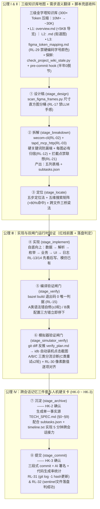

# AI 代码生成率 94%：我们用一个 Skill 跑通需求开发全流程

## 1. TL;DR — 核心结论速览

1. **AI 写业务代码总是“差一口气”的根源，是缺一套把“需求开发”流程化、原子化、可机器校验化的工程管道**：面对拥有 **`9000+` 个源文件、跨 `5～6` 层调用**的企业微信移动端大型代码库，作者团队没有盲目等待更大模型，而是打造了全流程研发技能包 **`mailplugin-feature-dev`**，将需求拆解耗时从 `1～2 小时` 压至 `5～10 分钟`、代码定位从 `30 分钟～2 小时` 压至 `5～15 分钟`，实现 **`94%` 的 AI 代码生成率**。
2. **四大第一性原理公理支撑 8 阶段严格流水线（`①设计稿 → ②拆解 → ③定位 → ④实现 → ⑤编译验证 → ⑥模拟器验证 → ⑦沉淀 → ⑧提交`）**：
   - **公理 Ⅰ（漏斗式缩小范围）**：结合 **`L1/L2/L3` 三级金字塔知识库**（由 `check_project_wiki_stale.py` + `pre-commit hook` 强制保鲜，半年改动 `1000+` 处零脱节）与 **五步定位法 + 五维搜索矩阵**，将定位 Token 消耗从全仓灌入的 **`~10M+` 压缩至 `~30K`（`300×` 压缩比，关键词命中率 `>80%`）**。
   - **公理 Ⅱ（判断留给 LLM，数据交给脚本）**：严禁通用 `web_fetch`（企微文档走 `wecom-cli`，TAPD 走 `tapd_mcp_http`），严禁 LLM 凭手感挑设计稿（必须先跑 `scan_figma_frames.py` 尺寸直方图），并用五个确定性规则（硬关键词表防漏端、设计稿三分类归宿、拦截点强制引用溯源、五维联想矩阵、`subtasks.json`）抹平“产品语言 → 代码指令”鸿沟。
   - **公理 Ⅲ（红线机制前置硬关卡）**：以 `red_lines.yaml` 为单一真源划分 **6 条 Critical 红线**（启动必载）与 **30+ 条 Standard 红线**（分阶段加载），触发即停并输出标准模板报告，且长耗时命令一律以 **Sentinel 哨兵文件落盘或 `git log -1` hash 更新** 为唯一成功判据。
   - **公理 Ⅳ（跨会话知识传承）**：构建 `TECH_SPEC.md`（永久）+ `subtasks.json`（跨会话）+ `timeline.txt`（会话内）三件套，配合 **4 道人机硬关卡（`HK-0` 至 `HK-3`）** 与 **编译 A/B 分流（限 3 轮）+ 模拟器 A/B/C 诊断（限 2 轮）+ `RL-30` 像素数值对齐**，让任何新会话 AI 或人类新人在 **5 分钟内无缝接力**。

---

## 2. 背景与核心痛点：为什么在 9000+ 文件的老大难移动端项目里 AI 频频翻车？

### 2.1 企业级移动端项目的六大真实障壁

| 痛点维度 | 真实工程现场表现 | 传统 AI Coding 翻车后果 |
| :--- | :--- | :--- |
| **1. 上下文塞不下** | 仓库含 **`9000+` 源文件**（仅 `Model` 模块就有 `686` 个 `.h`、`456` 个 `.mm`）、跨 `5～6` 层调用 | 单轮对话根本喂不进去，盲目 `find .` 直接撑爆窗口 |
| **2. 研发物料高度分散** | PRD 在 TAPD、设计稿在 Figma、协议在企微文档、UI 规范还得查 Figma Token | 通用 `web_fetch` 撞上鉴权只拿到空壳 HTML，信息严重残缺 |
| **3. 产研词汇体系割裂** | 产品说“邮件列表顶部小红条 / 点击入口”，代码里其实叫 `XYZMListTipsView` / `didSelectRowAtIndexPath:` | 直接 `grep "小红条"` 命中为 `0`；只 `grep "tips"` 又被 `800+` 处历史代码淹没 |
| **4. 模糊指令诱发越界** | 用户一句“按 PRD 改一下”，AI 跳过拆解直接动手改码 | 凭“一致性联想”乱改无关逻辑、漏掉 9 张设计稿中的 7 张 |
| **5. 诚信危机（自报完成）** | AI 信誓旦旦汇报“已完成”，结果连 `bazel build` 都没编译通过，或装机后 UI 严重错位 | 测试与复核负担全部转嫁给人类开发者 |
| **6. 跨会话彻底失忆** | 上次会话为什么这么改、改了哪些文件、有哪些不变式约束，开新窗口后全部归零 | Bug 修复或二期迭代每次都要重新读代码 `1+ 小时` |

---

## 3. 知识框架 — 8 阶段全流程流水线与四大公理架构全景图

---

## 4. 核心工程设计深度拆解

### 4.1 公理 Ⅰ：三级金字塔知识库 + 五步定位法（将 `10M+` Token 压至 `30K`）

#### （1）永不过时的三级金字塔知识库（`project_wiki`）
1. **`L1` 项目总览（`project_wiki/overview.md`，`< 5KB`）**：
   - AI 入场的“大堂导览”，仅用一张表列出所有一级模块（如 `MList/` 邮件列表、`RMail/` 邮件正文、`CMail/` 邮件撰写、`Model/` 领域模型与 DB）的一句话职责与 L2 文档指针，定位阶段默认预加载。
2. **`L2` 模块级街道地图（`project_wiki/<module>.md`）**：
   - 顶部带机器可读 HTML 注释元数据（`module_id`、`root_dirs`、`desc`），正文按 `Controller / ViewModel / View / Helper / Lab` 分组登记每个 `.h/.mm` 文件的一行职责，读 70 行即可建立模块完整拓扑。
3. **`L3` 领域语义桥（`figma_token_mapping.md` / `ui_components_wiki.md`）**：
   - 覆盖 **20+ 类** 设计到代码的精确映射规范：例如设计稿写 `Mobile/callout`，严禁 AI 目测硬编码 `[UIFont systemFontOfSize:15]`，必须按映射表译为 `[UILabel xyz_styledLabel:@"callout"]`；颜色 `Base/base_gray_100` 必须译为支持深色模式的 `XYZColor(base_gray_100)`（由红线 **`RL-29`** 强制卡点）。
4. **防漂移自维护机制（`check_project_wiki_stale.py`）**：
   - 该项目半年内净增 **`200+` 个文件**、改动 **`1000+` 处**，靠 `.review_cache.json` 记录每个文件上次审阅的 SHA 基线，一旦文件变更自动输出“新增 / 删除 / 大改”三色分诊清单（30 秒可扫完），并挂载为 **`pre-commit hook`（发现 stale 信号直接返回退出码 `1` 阻断提交）**，实现过去 **6 个月零脱节**（且顺带让新入职同学半天即可上手改 Bug）。

#### （2）五步漏斗定位法
| 步骤 | 输入给 LLM 的内容与 Token 量 | 执行工具与产出 | 核心设计门道 |
| :---: | :--- | :--- | :--- |
| **Step 1：意图消歧** | `L1 overview.md`（`~2K`）+ 用户原话 | 输出“该目标可能对应的 4 种技术解读” | 1 秒锁定目标一级模块（如 `MList`），绝不盲搜 |
| **Step 2：模块定位** | `L2 <module>.md` 目录树 + 解读结果 | 锁定 `2～3` 个候选文件路径（如 `XYZTipsView.h/.mm`） | **前两步只看目录和文件名，完全不读源码** |
| **Step 3：关键词搜索** | **不进 LLM（`0` Token）** | 脚本直接跑 `rg` 输出函数声明与行号 | 把搜索负载完全卸给确定性命令行 |
| **Step 4：调用链追踪** | 单个文件相关代码片段（`~10K`） | 结合“三桥梁法”输出完整跨文件调用链 | 针对通知（`postNotificationName:`）、KVO（`RACObserve`）、Delegate 跨文件溯源 |
| **Step 5：验证确认** | 目标函数实现（`~5K`）+ `L3` 映射表 | 最终改动点 + 修改理由 | 总 Token 从全仓 `~10M+` 降至 **`~30K`（压缩 `300×`）** |

---

### 4.2 公理 Ⅱ：需求语义翻译——用五道确定性规则消灭“产品→代码”翻车点

为什么以前用 AI 提效依然累？因为**开发者自己在脑子里充当了“PRD 翻译机”**。Skill 在「拆解」阶段用五条铁律让 AI 独立完成高可靠翻译：

1. **防翻车点 ①（范围错判）——用“硬关键词表”替代 LLM 语义直觉**：
   - PRD 常在讲后台配置的段落里夹一句“手机上看到的效果”，LLM 按段落主语极易漏掉移动端需求。
   - **解法**：制定四类强信号关键词表（平台词 `手机端/iOS/Android/App`、控件词 `Toast/弹窗/小红条/红点/角标/下拉刷新`、iOS 组件 `状态栏/Home Indicator/刘海`、页面词 `键盘展开/actionsheet`），**只要任一词命中即强制打上“移动端”标签拆出独立子项**，把范围漏判率压为 `0`。
2. **防翻车点 ②（设计稿漏项）——`RL-12` 每张图必须三选一归宿**：
   - 严禁 LLM 手工挑设计稿（**`RL-17`**：必须先跑 `scan_figma_frames.py` 基于 `iphone_sizes.json` 尺寸直方图分桶，LLM 仅补判 `UNCERTAIN` 项）。
   - **铁律 `RL-12`**：候选清单里每一张设计稿必须明确归入关联需求点（若归不进去，要么是筛选误纳需剔除，要么是漏拆了需求点），**严禁用“参考图”当万能垃圾桶**（曾拦截“9 张稿只做 2 张、漏掉 7 个独立页面”的事故）。
3. **防翻车点 ③（自作主张越界）——`RL-21` 拦截点清单强制三类引用溯源**：
   - 针对“点击 X 触发 Y”的交互拦截，强制输出四列核对表，且「依据来源」**只接受三种硬证据：① 设计稿 PNG 上的连接线/箭头（必带 `nodeId`）、② TAPD/企微文档直接原句引用、③ 用户消息原话**。
   - 凡是以“为了保持一致性”、“看起来属于同类功能”为由脑补出的拦截项，**一律直接删除不实施**。
4. **防翻车点 ④（搜不到代码词）——“五维搜索矩阵 + Glossary”交叉联想（命中率 `>80%`）**：
   - 区分 **“搜索时必须领域联想（6.5）”** 与 **“决策时严禁语义联想（6.4）”**（**“联想用于搜索，引用用于决策”**）。
   - 将产品口语（如“小红条”）沿 **5 个代码命名空间维度** 展开：`① iOS 平台标准事件（didSelectRowAtIndexPath:）`、`② 功能英文同义词（tips/banner/warning）`、`③ 项目 OC 命名习惯（show*/goto*/XYZMList*）`、`④ 协议代理（<XxxDelegate>）`、`⑤ 通知回调（XxxNotification/RACSignal）`，配合 L2 Wiki 与 Glossary 生成漏斗式 `rg` 命令，候选词命中率超 **`80%`**。
5. **防翻车点 ⑤（交接断层）——产出人类可读五列表 + 机器可读 `subtasks.json`**：
   - 包含 `id`、`title`、`type`、`data_source`（精确到 CGI 字段名）、`figma_node`（精确到 `153:74513`）、`depends_on`，成为贯穿实现、验证与跨会话接力的核心账本。

---

### 4.3 公理 Ⅲ & 运行时双闸门：红线前置、落盘判定与模拟器自动验收

#### （1）红线架构（`red_lines.yaml`）与“落盘判定成功”法则
- **两级红线**：**`6 条` Critical 红线**（启动即加载，如 `RL-02` 企微文档必走 `wecom-cli`、`RL-03` TAPD 必走 `tapd_mcp_http`、`RL-13/14` 先看后写模仿已有、`RL-15` 编译必过、`RL-16` 严禁跳阶段、`RL-31` commit 同步核验）+ **`30+ 条` Standard 红线**（按 `locate/design/breakdown/implement/verify/simulator_verify/commit/archive` 分阶段按需加载）。一旦触发立即停止并按 `⛔ 触发红线 RL-XX` 模板汇报。
- **落盘判定法则（`RL-31` / `RL-32`）**：长耗时命令或长 Commit 消息极易被终端置为后台任务或截断 `stdout`；Skill 规定**绝不相信 `stdout` 口头报喜，所有长跑命令以生成磁盘 `sentinel` 哨兵文件为唯一成功判据，`git commit` 以 `git log -1` 的 hash 实际更新为唯一判据**。

#### （2）闸门一：编译验证（`bazel build` + A/B 分类 + 3 轮硬上限）
- **A 类（可自修复）**：缺分号、未声明标识符、类型不匹配、枚举漏 `case`、`#import` 缺失 $\to$ 脚本直接附带报错行上下文代码，AI 调 `replace_in_file` 修复重编（**`RL-15` 硬上限最多 `3 轮`**，超 3 轮仍不过强制停下报告用户）。
- **B 类（需用户介入）**：`BUILD.bazel` 配置错误、链接器错误、三方 Framework 报错、报错文件不在本次改动集内 $\to$ **立即停下，严禁盲目乱改**。

#### （3）闸门二：模拟器运行时验证（`idb` 自动点击截图 + A/B/C 诊断 + `RL-30` 像素核对）
1. **从 `git diff` 反推 `verify_plan.md` 与 6 步 UI 反向溯源**：根据代码改动反推 UI 点击路径，用 `idb ui tap --udid $UDID` 逐步点击并截图保存 `01_launched.png`、`02_mail_tab.png` 等。
2. **预期失败时的 A/B/C 三类清晰分流**：
   - **A 类（真代码 Bug）**：期望 UI 未出现、字段值错、`assert/crash` $\to$ **本阶段严禁偷修代码，打回阶段 ④「实现」**；
   - **B 类（路径设计不通）**：被登录页/引导页拦住或需真机环境 $\to$ 修订 `verify_plan` 或说明跳过；
   - **C 类（脚本/渲染时序抖动）**：元素未加载完就 tap、坐标换算偏差 $\to$ **阶段内自动重试 `≤ 2 轮`**。
3. **`RL-30` 视觉数值对齐硬关卡**：对照 `ui_alignment_spec.md` 逐项核查容器高度（如 `container.height = 280`）、图标尺寸（`96×96`）、字号字重、行高与主色调；**只要存在 `≥ 1` 项未对齐，状态自动降级为 `❌ FAIL`**。
4. **`simulator_toolbox.md` 沉淀的五大运行时避坑死角**：
   - **边缘左滑返回失效**：`idb ui swipe` 是合成事件，无法触发 `UIScreenEdgePanGestureRecognizer` $\to$ 改找 `nav_back_arrow` 的 AX 无障碍标识点击；
   - **物理像素 vs 逻辑像素错位**：截图是物理像素，而 `idb ui tap` 接收逻辑像素 $\to$ 必须乘 `scale = logical_w / physical_w` 动态换算；
   - **卸载重装丢登录态**：`simctl uninstall` 会清空沙盒导致重新登录 $\to$ 改用同 bundle id 直接 `simctl install` 覆盖安装保留登录态；
   - **3D Touch 不支持** $\to$ 改走菜单按钮或 Debug 后门；
   - **zsh 下 Python f-string `!r` 报错**：zsh 将 `!r` 当作历史命令展开 $\to$ 改用 `repr(x)` 或独立 `.py` 脚本。

---

### 4.4 公理 Ⅳ：跨会话知识传承（`TECH_SPEC.md` 灵魂三件套 + 四道人机硬关卡）

1. **三尺度记忆文件分工**：
   - **`TECH_SPEC.md`（永久级单一事实源）**：含 `§0 AI 自检清单`、`§1 功能边界`、`§3 模块地图`、`§5 不变式（严禁改动的命名与边界）`、`§7 演进事件（BUG-N / ITER-N / REV-N）`、`§8 产物清单`、`§9 版本号（v1.0 → v2.0）`。新会话 AI 按 `§0→§1→§3→§5→§7` 顺序读完，**5 分钟即可完全恢复现场**。
   - **`subtasks.json`（跨会话级）**：记录每个子需求当前所处阶段与关联 Commit。
   - **`timeline.txt`（会话内级）**：记录 `start / human-correction / commit` 事件流水，用于自动渲染三段式 Commit Message。
2. **四道人机硬关卡（Hard Checkpoints：信任但不放任）**：
   - **`HK-0`（现场快报）**：接力入口进入后第一时间确认进度；
   - **`HK-1`（PENDING 条目确认）**：需求拆解翻译完成后人工确认范围；
   - **`HK-2`（沉淀确认）**：`TECH_SPEC.md` 落盘前人工点头；
   - **`HK-3`（提交确认）**：执行 `git commit` 前人工输入“提交 / go”。

---

## 5. 数据速查表

| 指标 / 阶段对比 | 原文数值 | 语境 / 条件 |
| :--- | :--- | :--- |
| **AI 代码生成率** | **`94%`** | 企业微信移动端插件需求开发全流程实战 |
| **项目源码文件规模与调用深度** | **`9000+` 个源文件 / 跨 `5～6` 层调用** | 其中仅 `Model` 模块即含 `686` 个 `.h`、`456` 个 `.mm` 文件 |
| **三级知识库 + 五步定位法 Token 压缩比** | **从全仓灌入的 `~10M+` 降至 `~30K`（`300×` 压缩比）** | Step 1 (`~2K`) + Step 2 (目录树) + Step 3 (`rg` 0 token) + Step 4 (`~10K`) + Step 5 (`~5K`) |
| **L1 总览文件体积上限** | **`< 5KB`（`project_wiki/overview.md`）** | 定位阶段默认 preload，零负担装入上下文 |
| **L3 Figma Token 映射覆盖规范类别** | **`20+` 类 UI 规范** | 配合 `RL-29` 严禁硬编码字号与颜色 |
| **知识库防漂移运行实效** | **半年净增 `200+` 文件、改动 `1000+` 处，连续 `6 个月` 零脱节** | 靠 `check_project_wiki_stale.py`（30 秒三色分诊）+ `pre-commit hook` 阻断；人类新人**半天**上手改 Bug |
| **五维搜索矩阵关键词命中率** | **`> 80%`** | 结合 L2 模块 Wiki 与项目 Glossary 展开候选词 |
| **红线体系规模** | **`6` 条 Critical 红线（全局常驻）+ `30+` 条 Standard 红线（分阶段加载）** | 以 `red_lines.yaml` 为单一真源 |
| **自动重试熔断上限** | **编译自修复最多 `3 轮`（`RL-15`）；模拟器 C 类重试最多 `2 轮`** | 超限立即停止并报告用户，严禁死循环硬试 |
| **各环节提效对比（传统 vs Skill）** | • 需求拆解：**`1～2 小时` $\to$ `5～10 分钟`** • 代码定位：**`30 分钟～2 小时` $\to$ `5～15 分钟`** • 实现耗时：**缩短 `30%～50%`** • Bug 修复接力：**重读代码 `1+ 小时` $\to$ `5 分钟` 恢复现场** | 近半年项目实战体感数据 |

---

## 6. 踩坑与教训 / 可迁移的设计原则

1. **把大仓库 `find .` 直接灌给大模型，或让模型直接 `grep "产品中文词"` → 要么 Token 破千万撑爆上下文，要么 `grep "小红条"` 0 命中、`grep "tips"` 800+ 处淹没 → 构建“`L1/L2/L3` 三级金字塔知识库 + `pre-commit` SHA 防漂移钩子 + 五维搜索矩阵”，实现 `300×` Token 压缩与 `>80%` 精准命中**
   - **可迁移原则**：**“先看地图（L1/L2 Wiki）缩到 2～3 个文件，再让脚本跑 `rg`，最后才读局部源码”**；且知识库必须绑定 Git `pre-commit hook` 阻断式同步，否则两周必过期。
2. **让开发者在脑子里把 PRD/Figma 翻译成开发指令再喂给 AI，或放任 LLM 凭语义直觉挑设计稿、猜拦截范围 → 人工翻译耗时 1～2 小时，而交给 LLM 直觉又会漏端、漏掉 9 张设计稿中的 7 张、或凭“一致性联想”乱改无关代码 → 将需求拆解彻底规则化（硬关键词表触发端标签 + `scan_figma_frames.py` 尺寸直方图分桶 + `RL-12` 每图必归宿 + `RL-21` 拦截点强制三类证据引用）**
   - **可迁移原则**：牢记 **“联想用于搜索，引用用于决策”**——找代码位置时要用领域词表做 5 维发散，但定需求范围与交互变更时必须有图有据、零脑补。
3. **轻信 AI 口头汇报“已修改并提交完成”，或用通用 `stdout` 判断长耗时命令成功 → 实际连 `bazel build` 都没过、长 Commit 被终端挂后台丢失、或 UI 布局严重走样 → 引入“双闸门验证（编译退出码 0 + 模拟器 `idb` 截图与 `RL-30` 像素数值核对）”与“Sentinel 哨兵文件 / `git log -1` 落盘判定法则”**
   - **可迁移原则**：在 Agent 工程中，**“一切未落盘的成功信号皆不可信，一切未分流的自动重试皆是死循环”**——把错误严格拆为“AI 可自修（A 类，限 2～3 轮）”与“环境/配置阻塞（B 类，立即停下问人）”。
4. **每次开新会话修 Bug 或做二期迭代都让 AI 从零读代码 → 历史设计决策与隐式不变式丢失，改好一个 Bug 破坏三个旧功能 → 用 Git 追踪的 `TECH_SPEC.md`（含 `§5 不变式` 与 `§7 演进时间线`）+ `subtasks.json` 实现 5 分钟跨会话无损接力**
   - **可迁移原则**：正如作者在文末的点睛总结——**`references/` 比 `tools/` 体量更大**；把“需求开发”显式建模为可版本化的 `TECH_SPEC.md` 与 `project_wiki`，哪怕将来换掉底层模型，依然是团队最宝贵的工程资产。

---

## 7. 记忆锚点 — 一句话 / 一张图记住全文

- **一句话锚点**：**企业微信 `94%` AI 代码生成率的秘密不在换模型，而在于用 `L1/L2/L3 三级自维护知识库 + 五维搜索矩阵` 把 `9000+` 文件定位从 `10M` 压到 `30K`（`300×`），用 `硬关键词 + 直方图筛稿 + 禁语义联想 (RL-21)` 消灭人工翻译，再用 `bazel 3轮编译 + idb 模拟器像素核对 (RL-30) + TECH_SPEC.md 跨会话接力` 跑通 8 阶段确定性流水线！**
- **五大工程铁律公式**：
  $$\text{94\% 生成率 Skill} = \text{8阶段流水线} \times \text{脚本兜底 (禁手感)} \times \text{YAML红线前置 (6+30条)} \times \text{Sentinel落盘判定} \times \texttt{TECH\_SPEC.md}\text{ 接力}$$

---

## 8. 复习卡片（Spaced Repetition）

1. 在 9000+ 源文件的移动端项目中，该 Skill 是如何通过“五步定位法”与“三级金字塔知识库”将单次定位的 Token 消耗从 `~10M+` 压缩到 `~30K`（300倍压缩）的？::三级知识库分为 `L1`（`<5KB` 的 `overview.md` 模块导览）、`L2`（模块级 `<module>.md` 文件职责登记表）、`L3`（`figma_token_mapping.md` 设计到代码映射桥）。五步定位法前 2 步只读 L1 和 L2 锁定 2～3 个候选文件（不读源码），第 3 步用 `rg` 脚本直接搜（不耗 LLM Token），第 4 步读约 `10K` 代码片追踪调用链，第 5 步读约 `5K` 函数实现并对照 L3 确认改动点。
2. 项目半年净增 200+ 文件、改动 1000+ 处，团队是如何保证 `project_wiki` 知识库在 6 个月内“零脱节”的？::通过核心脚本 `check_project_wiki_stale.py`：利用 `.review_cache.json` 记录每个文件上次审阅时的 SHA 基线，文件变化时自动生成“新增/删除/大改”三色分诊清单（30 秒可扫完），并将其配置为 `pre-commit hook`（存在未复核 stale 信号时返回退出码 `1` 直接阻断提交，强制开发者顺手同步 Wiki）。
3. 为什么作者强调“6.5 关键词搜索允许联想，而 6.4 交互拦截点严禁联想（联想用于搜索，引用用于决策）”？五维搜索矩阵包含哪五个维度？::因为产品词汇（如“小红条”）与代码命名（如 `XYZTipsView`）属于两套体系，搜索时必须结合 L2 Wiki 与 Glossary 沿 5 个维度扩展搜索词（① iOS 标准事件方法、② 功能英文同义词、③ OC 命名习惯前缀、④ 协议/代理、⑤ 通知/回调，命中率 `>80%`）；但在决定“点击 X 触发 Y”是否要写代码拦截时（`RL-21`），必须有设计稿箭头 `nodeId`、文档原句或用户原话三种硬引用之一，严禁凭语义联想越界乱改。
4. 在编译验证（阶段 ⑤）和模拟器验证（阶段 ⑥）中，Skill 是如何通过 A/B 及 A/B/C 分类防止 AI 陷入“越改越乱”的死循环的？::编译验证以 `bazel build` 退出码 `0` 为唯一判据（`RL-15`），将缺分号/未声明等归为 A 类（允许 AI 自修复，硬上限 `3 轮`），将 `BUILD.bazel`/链接器/三方库报错归为 B 类（立即停下找人）。模拟器验证将失败分为 A 类（真代码 Bug，不准就地偷改，打回实现阶段）、B 类（登录/无数据等路径不通，改计划或跳过）、C 类（元素未渲染/坐标等时序问题，阶段内重试 `≤ 2 轮`），并强制执行 `RL-30` 像素数值对齐。
5. 什么是 `RL-31` 和 `RL-32` 的“落盘判定成功”法则？为什么要这样设计？::在终端执行长耗时命令或带长文本的 `git commit` 时，命令常被终端置为后台任务、管道变异步或 `stdout` 被截断，导致 LLM 误判。因此 Skill 规定任何长跑命令不靠 `stdout` 报喜，必须以生成磁盘 `sentinel` 哨兵文件（`RL-32`）或 `git log -1` 的 commit hash 实际更新（`RL-31`）作为唯一成功判据。
6. `simulator_toolbox.md` 中记录了哪几个典型的 iOS 模拟器自动化验证“死角”及其替代方案？::① 边缘左滑返回失效（`idb ui swipe` 合成事件无法触发系统边缘手势，改用 `nav_back_arrow` 的 AX 标识点击）；② 截图物理像素与 `idb ui tap` 逻辑像素不一致（必须按 `scale = logical_w / physical_w` 动态换算）；③ `simctl uninstall` 会清空沙盒丢失登录态（改用同 bundle id 直接 `simctl install` 覆盖安装）；④ zsh 会把 Python f-string 中的 `!r` 当历史命令展开（改用 `repr(x)` 或独立 `.py` 文件）。
7. Skill 是如何通过“记忆三件套”和“四道人机硬关卡（HK）”让新会话 AI 在 5 分钟内无缝接力已有需求的？::三件套包括永久级单一事实源 `TECH_SPEC.md`（含 `§0` 自检清单、`§1` 功能边界、`§3` 模块地图、`§5` 不可动的不变式、`§7` Bug/迭代演进时间线）、跨会话子任务台账 `subtasks.json`、会话内事件流水 `timeline.txt`。同时在关键不可逆节点嵌入 `HK-0`（接力快报）、`HK-1`（拆解确认）、`HK-2`（沉淀确认）、`HK-3`（提交确认）四道人机硬关卡。

---

## 9. 知识关联

- **对应知识库主题笔记**：[AI研发协同](../../20_topics/AI%E7%A0%94%E5%8F%91%E5%8D%8F%E5%90%8C.md)
- **同批相关文章双链**：
  - [[AI_Agent团队知识底座]]（本文的 `L1/L2/L3 project_wiki` + `check_project_wiki_stale.py pre-commit hook` 是团队知识底座防腐化的教科书级实现）
  - [[AI_AI 读懂老项目]]（可对比如何通过结构化索引、组件映射与视觉回归测试让 AI 在大型存量项目中精准改码）
  - [[AI_SkillHub技能治理与发现]]（本文展示了 `skills/mailplugin-feature-dev/` 的完整 6 大目录结构，是符合 TRACE 高分标准的工业级复杂 Skill 典范）

---

## 10. 原文参考资料

- **原文标题**：《AI 代码生成率 94%：我们用一个 Skill 跑通需求开发全流程》
- **作者与团队**：gomezlai（腾讯企业微信团队）
- **发布时间**：2026-07-20
- **核心提及工具与内部组件**：
  - **Skill 工程包**：`skills/mailplugin-feature-dev/`（含 `SKILL.md`、`tools/` 下 18 个 Python/Shell 自动化脚本、`references/project_wiki/`、`red_lines.yaml`）
  - **研发与验证工具链**：`TAPD`（`tapd_mcp_http`）、企微文档（`wecom-cli`）、`Figma`（`fetch_figma_mcp.py` / `scan_figma_frames.py`）、`ripgrep (rg)`、`Bazel`（`bazel build`）、iOS 模拟器（`simctl` / `idb`）

> [!note]- 校对报告
> - **原文页数核对**：全文共 29 页（第 28–29 页为总结尾页与读者留言），核心技术正文贯穿 p.1–28。
> - **关键事实与页码映射**：
>   - `94%` AI 代码生成率、`9000+` 源文件、跨 `5~6` 层调用、六大真实痛点与 8 个语义化阶段表（`阶段·动作`命名法）（p.1–3）。
>   - 公理 Ⅰ 五步定位法（Step 1 `~2K` $\to$ Step 2 目录树 $\to$ Step 3 `rg` 不进 LLM $\to$ Step 4 `~10K` $\to$ Step 5 `~5K`）与三级金字塔知识库（`L1 overview.md <5KB`；`L2 <module>.md` 含 `Model` 模块 `686` 个 `.h`、`456` 个 `.mm`；`L3 figma_token_mapping.md` 覆盖 `20+` 类规范及 `RL-29` 禁硬编码字号颜色）（p.3–6）。
>   - 知识库防漂移自维护：半年净增 `200+` 文件、改动 `1000+` 处，通过 `check_project_wiki_stale.py`（`.review_cache.json` SHA 基线 + 30 秒三色分诊 + `pre-commit hook` 退出码 `1` 阻断）实现过去 `6 个月` 零脱节，并将定位 Token 从 `~10M+` 压至 `~30K`（`300×` 压缩比），新人半天上手（p.6–7）。
>   - 需求语义翻译五道关：① 强信号硬关键词表强制打“移动端”标签；② `RL-12` 每张设计稿必有归宿（曾拦截 9 张稿漏 7 张）；③ `RL-21` 拦截点强制三类证据引用（设计稿 `nodeId` 箭头/文档原句/用户原话，禁语义联想）；④ 五维搜索矩阵（iOS事件/功能同义词/OC前缀/协议代理/通知回调）+ L2 Wiki & Glossary 实现 `>80%` 命中率（区分“联想用于搜索，引用用于决策”）；⑤ 五列表格 + `subtasks.json`（p.7–15）。
>   - 公理 Ⅱ 脚本兜底：`RL-02`（`doc.weixin.qq.com` 必走 `wecom-cli`）、`RL-03`（TAPD 必走 `tapd_mcp_http`）、`RL-17`（`scan_figma_frames.py` 基于 `iphone_sizes.json` 直方图分桶，禁 LLM 手感）、`RL-31`（`git log -1` hash 更新判成功）与 `RL-32`（`sentinel` 文件落盘判成功）（p.16–17）。
>   - 公理 Ⅲ 红线机制（`red_lines.yaml`，`6` 条 Critical + `30+` 条 Standard）与运行时双闸门：编译验证（`bazel build` 退出码 0，A/B 分类，最多 `3` 轮自修复 `RL-15`）；模拟器验证（`verify_plan.md`、3 类跨文件桥梁法、`idb ui tap`、A/B/C 三类诊断 C 类重试 `≤ 2` 轮、`RL-30` `ui_alignment_spec.md` 像素核对、`simulator_toolbox.md` 五大死角）（p.17–22）。
>   - 公理 Ⅳ 跨会话传承三件套（`TECH_SPEC.md` `§0~§9`、`subtasks.json`、`timeline.txt`）、四道硬关卡（`HK-0 ~ HK-3`）、各环节提效对比表、五条普适原则与 `skills/mailplugin-feature-dev/` 完整目录树（`references/` 比 `tools/` 体量更大）（p.23–28）。
> - **纠偏与自检说明**：正文、表格、Mermaid 图及复习卡片已严格剔除所有页码标注（`p.X` / `第X页`），所有红线编号（`RL-02` 至 `RL-32`）、脚本文件名与提效数据均 100% 忠实于原文。
