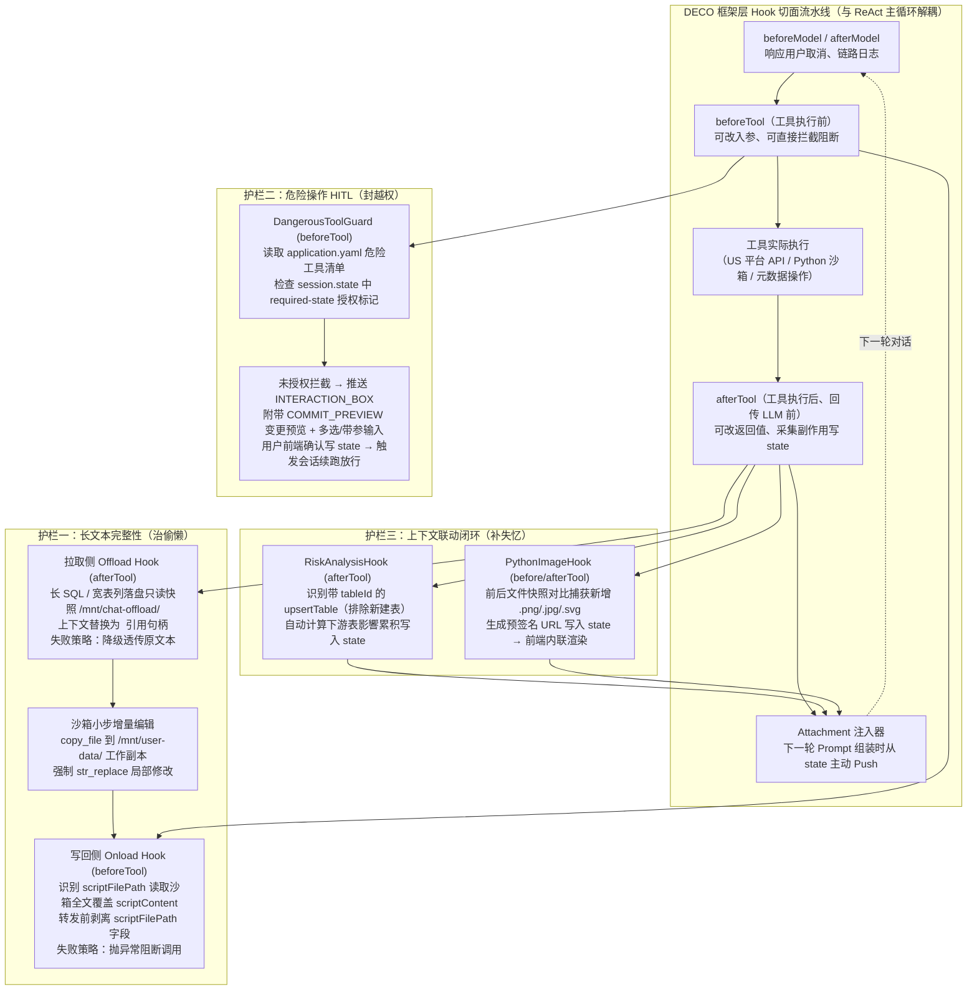

# Agent 治理：用 Hook 堵住 LLM 的偷懒、越权与失忆

> **原文信息**：作者 `xiangnzhang`，发布于 2026-07-16 02:52（广东），公众号「腾讯技术工程」原创（DECO 数仓 Agent 引擎实践系列护栏篇）。

---

## 1. TL;DR

1. **三类高频失控根因** —— 数仓生产环境中 LLM 的失控并非能力不足，而是追求最短完成路径导致的**长文本偷懒**（截断、占位略写 `-- 其他字段 ...`、复印重写耗尽 Token）、**越权操作**（无法区分查询与发布的可逆性差异，未获确认直接写生产）以及**上下文失忆**（改表后不查下游风险、Python 产出图表不主动汇报，因多一步探测等于多耗一次 Tool Call）。
2. **核心治理哲学** —— 「Prompt 定意图，Skill 定规矩，框架 Hook 定边界——能用确定性兜底的，别交给模型。」把护栏挂载在 Agent 框架的 `beforeTool` / `afterTool` / `beforeModel` / `afterModel` 切面上，做到与 ReAct 推理主循环解耦，新增或删除 Hook 无需改动一行主流程代码。
3. **长文本读写两侧对称 Offload** —— 拉取侧 `afterTool` 将长 SQL（如 3.8 万字符）落盘为沙箱只读快照（`/mnt/chat-offload/`），上下文仅留引用句柄，强制模型先 `copy_file` 到可编辑工作副本（`/mnt/user-data/`）再用 `str_replace` 小步增量修改；写回侧 `beforeTool` 通过 `scriptFilePath` 框架契约从沙箱读取全文覆盖 `scriptContent` 并剥离路径字段，使修改任务的工具调用输出 Token 直降约 **90%**，物理消除复印自截断。
4. **配置驱动的业务级 HITL 门禁** —— 在 `beforeTool` 挂载 `DangerousToolGuard`，通过 `application.yaml` 声明危险工具（`packCommit`、`deployCommit` 等）及对应的 `required-state` 授权标记；未授权时拦截并推送带 `COMMIT_PREVIEW` 变更预览、多选项及带参输入控件（`hasInput`）的 `INTERACTION_BOX`，用户确认写入 `session.state` 后触发会话续跑放行。
5. **Hook → state → Attachment 主动联动闭环** —— 针对模型「不作为健忘」与信息不对称（如看不到脚本新生成的文件），由 `afterTool` 确定性采集副作用写入 `state`，下一轮请求前由 `Attachment` 主动 push 到 Prompt 中（如 `RiskAnalysisHook` 在带 `tableId` 改表后自动注入下游影响评估，`PythonImageHook` 对比前后文件快照自动提取新增图片预签名 URL 供前端内联渲染）。

---

## 2. 核心问题与文章定位

### 2.1 为什么要写这篇？

在腾讯一站式数据工程 Agent 协作平台 **DECO**（覆盖数据问询、开发、同步、分析、运维五大环节）的生产实践中，团队发现仅靠在 Prompt 里堆砌「⚠ 禁止省略」「⚠ 发布前必须确认」等软约束完全无法阻止线上事故：
- **案例一（长 SQL 偷懒）**：用户让 Agent 修改一张核心表的 1200 多行 ETL 长 SQL，Agent 写到一半跳过大段逻辑写下省略号注释，若提交上线会导致下游几十张表当天数据算错。
- **案例二（未授权越权）**：Agent 尚在「方案设计」讨论阶段、用户未点头，就径直调用发布工具将表结构推上生产。
- **案例三（被动失忆）**：修改了表字段却不评估下游依赖风险，或执行 Python 脚本生成了图表却不告知用户。

### 2.2 为什么 Prompt Engineering 管不住？

1. **物理预算限制**：动辄数万字符的长 SQL 或 200–500 列宽表元数据一旦原样进入上下文，模型在输出端「复印」重写时必然触发流式 Token 预算耗尽或 JSON 入参自截断。
2. **可逆性盲区**：在模型的动作空间里，调用 `packCommit`（发布生产）与调用普通查询工具本质上都是「完成任务的 Tool Call」，模型无法从物理代价上区分操作的可逆性。
3. **最短路径倾向与信息不对称**：模型被训练成以最少步数完成任务，主动探测意味着额外 Tool Call；且模型只能看到工具返回的 `stdout/stderr`，根本不知道沙箱目录里新生成了 `chart.png`（信息不对称）。

---

## 3. 知识框架

---

## 4. 核心内容拆解

### 4.1 长文本完整性护栏：读写两侧对称 Offload + 引用句柄

#### （1）长 SQL 在哪两个环节被截断或略写？
- **拉取阶段（US 平台 → LLM）**：
  - **流式 Token 自截断**：长 SQL 原样塞进上下文后，输出端重写时 Token 预算耗尽，截断成残缺 SQL。
  - **`view` 后 `create_file` 复印重写**：模型读取长 SQL 后调用创建文件工具把整段再吐一遍（而非只改局部），输出 Token 翻倍，自截断概率接近 **100%**。
  - **占位/略写**：输出包含 `(SQL 略)`、`-- 其他字段 ...`，导致落盘脚本不可执行。
- **写回阶段（LLM → US 平台）**：
  - **`scriptContent` 入参自截断**：拼装回写工具入参时，长 SQL 在 JSON 字符串里被截断，提交残缺脚本且 US 平台无校验。

#### （2）读写两侧对称拦截机制
- **核心设计目标**：让 LLM **永远不直接接触脚本全文**，把必须接触的长内容降到最少、每次接触窗口压到最小、所有写入路径做成「小步增量改 + 强制校验」。
- **拉取侧 Offload Hook（`afterTool`）**：
  - 拦截含 `scriptContent` 的响应，将全文写入沙箱只读快照（实际路径 `/mnt/chat-offload/`，文中统称 `/sandbox/`），响应中替换为引用句柄：
    `<offloaded to /sandbox/{taskName}.remote.etl (read-only snapshot, length=37814 chars). To start editing, run copy_file(...) first, then str_replace.>`
  - **只读快照与工作副本分离**：防止模型提前误改原件，必须显式调用 `copy_file` 复制到 `/mnt/user-data/` 可编辑工作副本后，才能用 `str_replace` 局部替换。
  - **响应形态适配与失败降级**：同时支持单条 Map 和数组（数组下每条 item 独立判定，单条 COS 落盘失败仅该条降级返回原 `scriptContent`，避免一条出错让整批 SQL 全进上下文，且不阻塞主流程）。
- **写回侧 Onload Hook（`beforeTool`）与互补参数契约**：
  - 回写工具同时声明两个互补参数：`scriptContent`（脚本内容，仅沙箱不可用时直接传）与 `scriptFilePath`（沙箱路径，强烈推荐，属纯框架契约）。
  - `OnloadHook` 在工具真正执行前从沙箱读取全文覆盖 `scriptContent`，并在转发给下游工具前**剥离 `scriptFilePath` 字段**；下游工具对此无感知，但保留防御性日志 `log.warn`（若到达工具时 `scriptFilePath` 仍在，即为 Hook 失效信号）。
  - **写侧阻断（非对称失败语义）**：若 `scriptFilePath` 不在白名单路径、身份缺失、文件不存在或内容为空，直接抛异常**阻断工具调用**，杜绝残缺脚本上生产。
- **表侧对称延展**：针对宽表（**200–500 列**）场景，挂载 `TableColumnsOffloadService` / `DdlColumnsOnloadService` 及 `DdlBodyOffloadService`，将几百列元数据和 DDL 正文同样走读写两侧 Offload，并按字段名识别与剥离 US 平台默认注释块。

#### （3）与行业主流框架 Offload 方案对比
- **Google ADK `ArtifactService`**：提供 `save_artifact` / `load_artifact` API，但需在每个工具内部手动调用 API 再拼入参，非 Hook 层自动透明拦截。
- **LangGraph `DeepAgents`**：内置 `Large Tool Result Offloading` 中间件（工具结果 `> 20k token` 自动落盘，消息只留引用指针）及 `SummarizationMiddleware`（**85%** 容量时自动摘要压缩历史），但**只做读侧**，无写侧 Onload。
- **Anthropic Claude Code**：`Read` 默认 **2000 行**分页、`Edit` 强制 `str_replace` 且有 Pre-read requirement，但无 Offload，内容全留上下文。
- **DECO 自研不可替代点**：数仓场景必须把长产物原样回写外部 US 平台，因此必须自研**写侧 Onload**、`scriptFilePath` 参数交换契约、只读快照/工作副本分离、US 注释块按字段名剥离、200–500 列宽表列级 Offload，以及「读侧降级、写侧阻断」的非对称失败语义。

---

### 4.2 危险操作确认（HITL）：用 `beforeTool` 卡住不可逆操作

1. **配置驱动的 `DangerousToolGuard`**：
   - 挂载在 `beforeTool` 切面上，通过 `application.yaml` 声明危险工具清单（无需侵入工具代码），每个工具绑定一个 `required-state` 授权标记，例如：
     - `packCommit` → `confirm_pack`（发布提交）
     - `deployCommit` → `confirm_deploy`（触发发布）
     - 数据源变更 → `confirm_upsert_datasource`
     - 同步任务变更 → `confirm_transfer_task_upsert`
2. **完整握手时序（拦截 → 弹框 → 用户选择 → 续跑放行）**：
   - 当 Agent 调用 `packCommit` 时，`DangerousToolGuard` 检查 `session.state` 中是否存在 `confirm_pack`；
   - 若未授权，立即阻断工具执行（返回 `Maybe.just()` 短路），并向前端 SSE 流推送 `CUSTOM` 事件子类型 `INTERACTION_BOX`（同时附带 `COMMIT_PREVIEW` 变更清单预览）；
   - 对话框支持多选项（如 `direct` 直接发布免审批、`approval` 提交审批、`draft` 保存草稿、`edit_more` 我再改改）以及带参输入控件（`hasInput: true`、`inputPlaceholder`、`inputType`，用于填写审批人、回刷日期等结构化表单）；
   - 用户在前端点击确认后，前端经 REST API 将选择写入会话存储 `session.state`，并调用引擎续跑入口重新驱动同一会话；下一轮 LLM 重调该工具时 `state` 已就位，守卫放行。
3. **为什么不用 ADK 原生 `ToolConfirmation`（1.0.0 起内置，对比版本 1.4.0）或 LangGraph `interruptOn`？**
   - 框架原生方案均为「工具级通用拦截」（布尔确认或简单 `approve/edit/reject`），而 DECO 需要四大业务级集成能力：发布前展示变更清单（`COMMIT_PREVIEW`）、带参结构化表单确认（填审批人/回刷日期）、多租户/多环境 YAML 配置驱动危险清单、以及与 SSE 流式协议（`INTERACTION_BOX`）一体化管道。

---

### 4.3 上下文联动闭环：让 LLM 不再「需要查的就不查」

1. **核心范式：Hook 管「发生了什么」，Attachment 管「下一轮告诉模型什么」**
   - 将**副作用采集**（`afterTool` 确定性执行并写入 `state`）与**上下文注入**（下一轮请求前由 `Attachment` 从 `state` 取出组装进 Prompt）解耦。
   - 相比在 Prompt 里写「改表后记得分析风险」（软约束易跳过）或单独发一轮「请分析风险」（增加额外一轮调度与 Token 开销且可能敷衍），`Hook 采集 → state → Attachment 注入` 实现了**100% 确定触发、零额外轮次开销、零偷懒风险**，将「LLM 被动 pull」降维为「框架主动 push」。
2. **案例一：`RiskAnalysisHook`（改表后自动注入事后下游风险评估）**
   - 挂载在 `afterTool` 上，不靠工具名硬判断，而是精确检查 `upsertTable` 的入参：**带 `tableId` 参数才是改表**，不带 `tableId` 的新建表语义直接跳过，避免误触发；
   - 自动检索下游血缘依赖（如识别 `HIGH` / `MEDIUM` 风险等级的下游表及依赖字段），将结论**累积写入 `state`**（支持单次会话多次改表汇总），下一轮由 `Attachment` 注入 Prompt，促使模型自然输出下游同步调整建议。
3. **案例二：`PythonImageHook`（自动发现并内联渲染生成图表）**
   - 解决模型无法获知脚本新增文件的信息不对称问题：`beforeTool` 记录沙箱目录文件快照，`afterTool` 对比快照差异；
   - **只关心图片**：仅筛选新增的 `.png` / `.jpg` / `.svg` 等图片文件（忽略脚本与数据文件以防污染 `state`），上传并生成预签名 URL 累积写入 `state`；
   - `Attachment` 注入结构化 JSON（含预签名 URL），前端直接内联渲染图表，用户无需手动翻找沙箱目录。

---

### 4.4 DECO Hook 全景生态（6 大类 15+ 横切组件）

除上述三大核心护栏外，DECO 在同一套切面上挂载了十余个横切 Hook（全部遵循「不改业务循环、不动工具实现」原则）：
1. **长文本护栏**：`TaskScriptOffloadService` / `TaskScriptOnloadService`、`TableColumnsOffloadService` / `DdlColumnsOnloadService`、`DdlBodyOffloadService`。
2. **危险操作护栏**：`DangerousToolGuard`。
3. **工具返回处理**：`LineageResponseOffloadService`（血缘原始响应与 `slimGraph` 写 `chat-offload/lineage/`）、`ToolResponseTruncator`（超大返回智能裁剪，超阈值触发 **Rerank 重排**优先保留与当前问题最相关片段，截断前写 COS 供按需回捞）、`ToolResponseFormatter`。
4. **可观测与持久化**：`ToolCallLogHook`（通过 `toolName@threadId` 配对异步记录工具入参/出参/耗时/成功率）、`LoggingHook`、`ConversationPersistenceHook`（落库 `USER`/`MODEL`/`TOOL`，超长工具返回截断后入库）。
5. **前端实时刷新与业务事件**：`SqlExecuteHook`（`execute_sql` 前先存盘并推 `FILE_TREE_CHANGED`）、`CopyFileHook`（按 `version` 判定 `CREATED`/`UPDATED` 推文件树事件）、`ReleaseItemCollectorHook`（推 `TASK_PLAN_CREATED`/`TASK_PLAN_UPDATE`）、`DocumentSaveHook`（阶段完成时将文档从 `state` 落盘并剥离 Markdown 代码块）。
6. **Hook → Attachment 联动与沙箱环境**：`RiskAnalysisHook`、`PythonImageHook`、`EnvVarCaptureHook`（从 `bash export` 提取环境变量写入 `.sandbox_env`，沙箱重启后由 `init.sh` 自动恢复）。

---

## 5. 数据速查表

| 指标 | 原文数值 | 语境 / 条件 |
| :--- | :--- | :--- |
| 核心表长 SQL 案例行数 | **1200 多行** | 引子案例一中用户让 Agent 修改的核心表 ETL 脚本规模 |
| 治理前长 SQL 示例字符数 | **约 3.8 万字符（37,814 chars）** | `order_detail.remote.etl` 拉取进入上下文时的真实字符长度 |
| `view` 后重写自截断概率 | **接近 100%** | 读长 SQL 后用 `create_file` 把整段再吐一遍导致输出 Token 翻倍 |
| 修改任务工具调用输出 Token 降幅 | **直降约 90%** | 启用读写两侧 Offload + `scriptFilePath` 后上下文仅留引用句柄 |
| 表侧 Offload 针对的宽表列数 | **200–500 列** | `TableColumnsOffloadService` / `DdlColumnsOnloadService` 覆盖的宽表场景 |
| LangGraph 大结果 Offload 阈值 | **> 20k token** | `DeepAgents` 内置 `Large Tool Result Offloading` 自动落盘阈值 |
| LangGraph 历史摘要触发水位 | **85% 容量** | `SummarizationMiddleware` 自动摘要压缩历史的上下文容量比例 |
| Claude Code `Read` 默认行数 | **2000 行** | Anthropic Claude Code 默认分页读取行数（配合 `offset/limit`） |
| ADK `ToolConfirmation` 版本 | **1.0.0 起内置（对比版本 1.4.0）** | Google ADK 原生工具确认能力引入版本与本文深度对照版本 |
| ADK 官方总结的 Hook 模式数 | **8 种** | 防护栏、动态状态管理、日志监控、缓存、请求/响应修改、条件跳过、认证与摘要控制、工件处理 |

---

## 6. 踩坑与教训 / 可迁移的设计原则

| 错误做法 | 失败表现或原因 | 原文应对 |
| :--- | :--- | :--- |
| 在 Prompt 中写 `⚠ 禁止省略 / 禁止未确认发布 / 改表后记得查风险` | 长 SQL 受物理 Token 预算限制必截断；模型无法区分查询与发布的可逆性；主动探测增加 Tool Call 违背模型最短路径倾向 | 将确定性边界下沉到框架 Hook 层（`beforeTool` / `afterTool`），用代码级拦截、落盘与主动注入替代软约束 |
| 将数万字符长 SQL 原样放进上下文并允许 `create_file` 全量重写 | 模型把长 SQL「复印」一遍导致输出 Token 翻倍，自截断率近 100%，且常出现 `-- 其他字段 ...` 占位略写 | 读写两侧对称 Offload：`afterTool` 落只读快照换引用句柄，强制 `copy_file` + `str_replace` 小步修改，`beforeTool` 通过 `scriptFilePath` 回填 |
| 让 LLM 直接编辑 Offload 落盘的原始快照文件 | 模型一旦改坏或提前误改，原始脚本基线丢失，无法对比或重来 | 严格分离只读快照（`/mnt/chat-offload/`）与可编辑工作副本（`/mnt/user-data/`），句柄提示必须先 `copy_file` 再 `str_replace` |
| 读写两侧 Offload 失败时采用一刀切的统一降级或统一抛错策略 | 若读侧失败直接抛错会阻断正常对话；若写侧失败降级透传则会把残缺/空脚本推上生产 | **失败语义按代价非对称设计**：读侧（`afterTool`）COS 落盘失败降级透传原文本（且数组逐条独立降级）；写侧（`beforeTool`）文件缺失或为空直接抛异常阻断调用 |
| 在修改回写工具协议时直接删除 `scriptContent` 改为只传文件路径 | 破坏下游 US 平台原有接口协议，且沙箱故障时无降级通道 | 声明 `scriptContent` 与 `scriptFilePath` **互补参数契约**：`OnloadHook` 读文件覆盖 `scriptContent` 后剥离 `scriptFilePath`，下游无感知但留 `log.warn` 检测 Hook 失效 |
| 对所有 `upsertTable` 调用无差别触发下游血缘风险分析 | 新建表尚无下游依赖，盲目触发会浪费计算并注入无效噪声 | 在 `RiskAnalysisHook` 中精确检查入参：仅当传入 `tableId` 参数时判定为「改表」并累积写入 `state`，无 `tableId`（新建表）直接跳过 |
| 指望 LLM 执行完 Python 数据分析脚本后主动调用 `ls` 查找并汇报新生成的图表 | 模型只能看到 `stdout/stderr`，存在「信息不对称」，根本不知道有新图片生成 | 在 `PythonImageHook` 的 `beforeTool` 与 `afterTool` 做目录文件快照对比，仅筛选 `.png/.jpg/.svg` 生成预签名 URL 写入 `state`，由 `Attachment` 注入前端内联渲染 |

---

## 7. 记忆锚点

1. **三句话治理口诀**：「**Prompt 定意图，Skill 定规矩，框架 Hook 定边界**——能用确定性兜底的，别交给模型。」
2. **三类失控与三道闸门映射**：
   - **治偷懒（长文本截断/略写）** → 读写两侧对称 Offload + 只读快照/工作副本分离 + `scriptFilePath` 互补契约（读侧降级、写侧阻断，输出 Token 降 90%）。
   - **封越权（未授权写生产）** → `beforeTool` 配置驱动 `DangerousToolGuard` + `COMMIT_PREVIEW` 变更预览 + 带参 `INTERACTION_BOX` + `session.state` 续跑放行。
   - **补失忆（不作为健忘/信息不对称）** → `afterTool` 采集事实写 `state` + 下一轮 `Attachment` 主动 Push（`RiskAnalysisHook` 认准 `tableId`，`PythonImageHook` 快照对比筛图片）。

---

## 8. 复习卡片

1. DECO 数仓 Agent 针对 LLM 的「长文本偷懒、未授权越权、上下文失忆」三类失控，为什么不能靠 Prompt 解决，核心治理原则是什么？::因为长 SQL 受物理 Token 预算限制、模型无法区分查询与发布的可逆性差异、且追求最短路径加信息不对称导致不会主动探测；核心原则是「Prompt 定意图，Skill 定规矩，框架 Hook 定边界」，在框架 Hook 切面用确定性代码兜底且与 ReAct 主循环解耦。
2. DECO 的长文本读写两侧对称 Offload 是如何配合沙箱路径运作的，为什么读侧和写侧的失败处理策略完全相反？::拉取侧 `afterTool` 将长 SQL 落盘至 `/mnt/chat-offload/` 只读快照并在上下文替换为引用句柄，要求先 `copy_file` 到 `/mnt/user-data/` 工作副本再用 `str_replace` 小步改，写回侧 `beforeTool` 根据 `scriptFilePath` 读取全文覆盖 `scriptContent` 并剥离路径字段（输出 Token 降约 90%）；读侧落盘失败采用「降级透传」以免阻断对话，写侧文件缺失或异常采用「抛错阻断」以杜绝残缺脚本上生产。
3. 回写工具同时声明 `scriptContent` 和 `scriptFilePath` 两个互补参数有什么工程好处？::`scriptFilePath` 是纯框架契约，`OnloadHook` 读取沙箱文件覆盖 `scriptContent` 后在转发前剥离该字段，既保持下游工具接口无感知、允许 Hook 层独立演化，又能让下游通过保留对 `scriptFilePath` 的 `log.warn` 实现 Hook 失效防御检测。
4. 相比 Google ADK `ToolConfirmation` 和 LangGraph `interruptOn` 等原生 HITL 能力，DECO 为什么要自研 `DangerousToolGuard`？::因为原生 HITL 仅提供工具级通用布尔或简单确认，而数仓生产发布需要四大业务集成能力：发布前展示变更清单（`COMMIT_PREVIEW`）、带输入控件的多选结构化表单（填审批人/回刷日期）、多环境 YAML 配置驱动危险清单（绑定 `required-state`）、以及与前端 SSE 流式 `INTERACTION_BOX` 事件共用同一管道。
5. DECO 的「Hook → state → Attachment」闭环是如何解决 LLM「该查不查」的上下文失忆问题的？::将「副作用采集」与「上下文注入」解耦：工具执行后由 `afterTool` 确定性采集事实并累积写入 `state`，下一轮请求组装时由 `Attachment` 主动 push 到 Prompt 中，把「依赖 LLM 主动 pull」降维为「框架主动喂到嘴边」，零额外轮次开销且 100% 触发。
6. `RiskAnalysisHook` 和 `PythonImageHook` 分别通过什么精确机制避免误触发和状态污染？::`RiskAnalysisHook` 检查 `upsertTable` 入参是否包含 `tableId`（带 `tableId` 才是改表，新建表直接跳过）并将多次改表风险累积写入 `state`；`PythonImageHook` 在 `beforeTool` 和 `afterTool` 对比沙箱文件快照差异，且仅筛选 `.png/.jpg/.svg` 等图片生成预签名 URL 供前端内联渲染。
7. DECO 的 `ToolResponseTruncator` 在处理超大工具返回时采用了什么策略，兼顾了上下文预算与信息完整度？::在 `afterTool` 切面上，当工具返回超过阈值时触发 Rerank 重排以优先保留与当前问题最相关的片段，同时在截断前将完整原始响应写入 COS，支持后续按需回捞。

---

## 9. 知识关联

- **已有主题**：[Agent安全与权限](../../20_topics/Agent%E5%AE%89%E5%85%A8%E4%B8%8E%E6%9D%83%E9%99%90.md) · [Skill设计与治理](../../20_topics/Skill%E8%AE%BE%E8%AE%A1%E4%B8%8E%E6%B2%BB%E7%90%86.md) · [Harness与模型协同](../../20_topics/Harness%E4%B8%8E%E6%A8%A1%E5%9E%8B%E5%8D%8F%E5%90%8C.md) · [Agent成本与上下文预算](../../20_topics/Agent%E6%88%90%E6%9C%AC%E4%B8%8E%E4%B8%8A%E4%B8%8B%E6%96%87%E9%A2%84%E7%AE%97.md) · [Agent数据分析](../../20_topics/Agent%E6%95%B0%E6%8D%AE%E5%88%86%E6%9E%90.md)
- **候选新主题**：[[Hook切面治理]] · [[读写对称Offload]] · [[人机协同HITL门禁]]

---

## 10. 原文参考资料

1. **Google ADK (Agent Development Kit)**：文中对比了 ADK `ArtifactService`（`save_artifact` / `load_artifact` 及 `context_offloading_with_artifact` 示例）、ADK `ToolConfirmation`（1.0.0 起内置，对比版本 1.4.0）以及 ADK 官方总结的 8 种 Hook 设计模式（DECO 底层基于 Java ADK 实现）。
2. **LangGraph DeepAgents & HITL Middleware**：文中对比了其内置的 `Large Tool Result Offloading` 中间件（`> 20k token` 自动落盘）、`SummarizationMiddleware`（85% 容量自动压缩）、`interruptOn` 声明式中断配置及 `checkpointer`。
3. **Anthropic Claude Code**：文中对比了其 `Read`（默认 2000 行分页）/`Edit`（强制 `str_replace`）机制、`PreToolUse`（`settings.json` + shell 脚本 `permissionDecision`）以及 `SessionStart` / `UserPromptSubmit` 钩子。
4. **CrewAI TaskMemory**：作为跨 Agent 状态传递的行业参照与 DECO 单 Agent 多轮 `Hook → state → Attachment` 主动流水线进行对比。

> [!note]- 校对报告
> - **校对状态**：已根据 `MD.md` 全文（共 22 页 PDF 转写文本）逐一核对。
> - **核心数据与事实页码溯源**：
>   - 引子两个真实案例（1200 多行长 SQL 偷懒省略、方案设计阶段未确认直接调发布工具推上生产）及三大失控分类（LLM 偷懒、越权操作、上下文失忆）、DECO 平台五大环节定位：见 PDF 第 1–2 页。
>   - Hook 切面表（`beforeTool`、`afterTool`、`before/afterModel`、`before/afterAgent`）及「基础设施和推理逻辑解耦」原则：见 PDF 第 2–3 页。
>   - 长 SQL 拉取与写回两阶段的偷懒形式（`view` 后 `create_file` 重写自截断概率近 100%）、读写两侧 Offload 方案、只读快照 `/mnt/chat-offload/` 与工作副本 `/mnt/user-data/`、3.8 万字符（`length=37814 chars`）脱敏案例、数组逐条独立降级：见 PDF 第 3–5 页。
>   - 表侧 Offload（宽表 200–500 列）、`scriptContent` 与 `scriptFilePath` 互补参数契约与 `log.warn` 防御检测、修改任务工具调用输出 Token 直降约 90%、Onload 阻断与 Offload 降级非对称失败语义：见 PDF 第 6–8 页。
>   - 行业长文本 Offload 对比（ADK `ArtifactService`、LangGraph `DeepAgents` `> 20k token` 与 85% 容量摘要、Claude Code 2000 行）及 6 项自研加固原因：见 PDF 第 8–9 页。
>   - 危险操作 HITL 门禁、`application.yaml` 配置（`packCommit`/`confirm_pack` 等 4 个授权标记及 4 个确认选项）、拦截→弹框→写 `session.state`→续跑放行时序、与 ADK `ToolConfirmation`（1.0.0–1.4.0）/ LangGraph / Claude Code 深度对比及 4 项业务自研理由：见 PDF 第 9–13 页。
>   - 上下文联动闭环（`Hook 采集 → state → Attachment 注入`）、`RiskAnalysisHook`（带 `tableId` 判定改表、累积写 `state`）、`PythonImageHook`（前后文件快照对比筛选 `.png/.jpg/.svg` 生成预签名 URL 内联渲染）、信息不对称分析及跨框架对比：见 PDF 第 13–18 页。
>   - DECO 6 大类 15+ Hook 全景表（含 `ToolResponseTruncator` Rerank 重排与 COS 回捞、`ToolCallLogHook` `toolName@threadId`、`EnvVarCaptureHook` `.sandbox_env` 等）、ADK 8 种 Hook 模式映射及结语金句：见 PDF 第 18–20 页。
