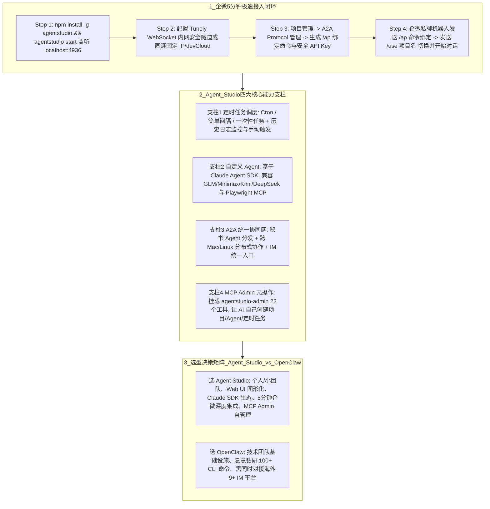

# Agent Studio 对比

## 1. TL;DR

本文介绍了作者基于 **Claude Agent SDK** 自研并开源（GPL v3）的本地个人 AI 工作台 **Agent Studio**，并与同期的开源爆款 **OpenClaw（原名 Clawdbot / Moltbot，102k Stars）** 进行了全方位对比。核心结论是：
1. **差异化定位**：OpenClaw 定位为“面向开发者与技术团队的全能消息平台网关（CLI 驱动，支持 100+ 命令与 9+ IM 平台）”；而 Agent Studio 定位为“**面向个人与小团队的图形化本地 Agent 工作台（Web UI 驱动，默认运行于 `localhost:4936`）**”，专为快速打造个人 Jarvis 及企业微信深度集成而设计。
2. **5 分钟接入企业微信闭环**：通过 `npm install -g agentstudio && agentstudio start` 启动后，借助司内 **Tunely (WebSocket) 隧道**（数据不出外网）与项目的 **A2A Protocol 管理**生成 `/ap <project> <tunnel-url>/a2a/<agent-id>/messages --api-key <key>` 命令，私聊发送给企微群机器人并通过 `/use 项目名` 即可在手机企微上全天候遥控本地电脑干活。
3. **四大核心杀手锏**：（1）**可视化定时任务**（支持 Cron、简单间隔与一次性任务）；（2）**基于 Claude Agent SDK 的自定义 Agent**（支持 Claude 及 GLM、Minimax、Kimi、DeepSeek 等国产模型，及 Playwright MCP 浏览器操控）；（3）**A2A 协议统一协同调度层**（支持秘书 Agent 路由、跨 Mac/Linux 开发机分布式协作、IM 统一网关）；（4）**`agentstudio-admin` 元操作能力（MCP Admin）**——内置 **22 个管理工具**，让 AI Agent 能够用自然语言自己创建项目、配置新 Agent 和设定定时任务（“让 AI 管理 AI 工作台本身”）。

## 2. 问题定义与背景

### 2.1 打造个人“钢铁侠 Jarvis”的两种路径
在多终端人机协同趋势下，开发者渴望在通勤、用餐等移动场景随时通过手机唤醒本地电脑上的 AI 助手处理代码、文件与数据分析。
- **OpenClaw（原名 clawdbot）路径**：通过自建 Agent 运行时与 WebSocket Gateway 打通 WhatsApp（Baileys 协议）、Telegram、Discord、iMessage（`imsg` CLI）、Mattermost、Slack、Signal、MS Teams、Line、Matrix 等 **9+ 个主流平台**，功能极其完备（100+ CLI 命令），但偏向 CLI 重度配置，且在国内办公高频使用的企业微信接入上仍需手动折腾 Channel。
- **Agent Studio 路径**：作者在日常使用 Claude Code 基础上，利用 **Claude Agent SDK** 手搓了一套带现代化 Web UI（含文件浏览器、可视化 Tool Use 追踪、多项目独立记忆）的本地工作台，将企微接入压缩至图形化 5 分钟操作。

## 3. 知识框架

## 4. 核心内容拆解

### 4.1 企业微信 5 分钟接入四步实操
1. **Step 1：启动服务与供应商配置**：执行 `npm install -g agentstudio` 与 `agentstudio start`（可通过 `agentstudio install` 注册为随系统启动的后台服务），访问 `http://localhost:4936/`。若本机已是 Claude Code 用户则 **0 门槛直接继承配置**；否则可在 `/settings/suppliers` 配置 Claude 或 **GLM、Minimax、Kimi、DeepSeek** 等国产模型作为默认供应商。
2. **Step 2：启用内网安全隧道**：若部署在固定 IP 或 devCloud 上可直连；若在个人办公本机，访问 `/settings/tunnel` 启用司内 **Tunely (WebSocket)** 隧道（如生成 `https://kongjie.tunnel`），确保企微回调本地 Agent 时**数据完全不出外网**。
3. **Step 3：生成 A2A 接入命令**：在 `/projects` 进入目标项目的 **“A2A Protocol 管理 $\to$ IM 接入”**，点击“生成接入命令”，系统自动创建 API 密钥并拼装出形如 `/ap my-project http://kongjie.tunnel/a2a/xxxx-agent-id/messages --api-key your-key` 的指令。
4. **Step 4：企微私聊绑定与多项目切换**：将 `agent studio` 机器人拉入企微群后通过推送通知找到并**私聊**它，发送上述 `/ap` 命令完成绑定，随后使用 `/use 项目名` 即可随时切换不同本地项目并下达研发、分析指令。

### 4.2 四大核心功能剖析
1. **可视化定时任务（Scheduled Tasks）**：支持三类调度语法——标准 **Cron 表达式**（如 `0 22 * * *`）、**简单周期表达式**（如“每 30 分钟”）、**一次性定时任务**（如 `2026/1/8 02:00:00`），典型场景包括每早 9 点生成项目进度日报、每 2 小时检查代码库提交 CR 意见、每周五归档会议纪要、每月 1 号生成业务分析报告，并提供执行状态监控与手动触发。
2. **基于 Claude Agent SDK 的自定义 Agent**：完整继承 Claude Code 的工具调用与流式输出能力，支持为不同场景定制专属 System Prompt、挂载特定 MCP 服务（如通过 `playwright mcp` 操作浏览器）、定制专属交互 UI 组件与预设模板。
3. **A2A（Agent-to-Agent）协议统一协同调度层**：
   - **秘书 Agent 模式**：由单一入口秘书 Agent 接收用户自然语言指令，自动按任务类型分发给后端多个垂直领域 Agent；
   - **跨设备分布式网络**：打通本地 Mac Agent 与远程 Linux 开发机/生产环境 Agent；
   - **IM 统一网关**：将企微、钉钉等 IM 消息统一路由至本地执行，数据 100% 留存本地。
4. **MCP Admin（`agentstudio-admin`）：让 AI 自我管理的“元操作能力”**：
   - 平台内置了名为 `agentstudio-admin` 的特殊 MCP 服务，封装了 **`list_projects`、`register_project`、`create_agent`、`add_mcp_server`、`create_scheduled_task` 等 22 个管理工具**。
   - 挂载给 Jarvis Agent 后，用户无需手动点击任何 Web UI 配置项，直接口头下令（如“帮我创建新项目 `my-blog`”、“每天晚上 10 点总结 Git 提交记录”、“创建一个专门处理 Python 代码的 Agent”），Jarvis 就会调用上述管理接口自动完成工作台自身的新增与编排。

## 5. 数据速查表

| 维度 / 指标 | Agent Studio | OpenClaw（原名 clawdbot / moltbot） |
| :--- | :--- | :--- |
| **核心定位与目标用户** | **本地 Agent 工作台**（面向个人、小团队） | **全能消息平台网关**（面向开发者、技术团队，GitHub **102k Stars**） |
| **技术底座与交互界面** | 基于 **Claude Agent SDK** / **Web UI 为主**（端口 `4936`） | 自建 Agent 运行时 / **CLI 为主**（**100+ CLI 命令**，可选 Web UI） |
| **企微接入耗时与方式** | **5 分钟**图形化一键生成 `/ap` 命令 + Tunely 隧道 | 需手动通过 CLI 配置 Channel |
| **支持 IM 平台范围** | 已深度集成**企业微信**（钉钉、飞书、Discord、Slack 开发中） | **9+ 个主流平台**（WhatsApp、Telegram、Discord、iMessage 等） |
| **MCP Admin 元操作能力** | **支持**（内置 `agentstudio-admin` 共 **22 个**管理工具） | **不支持** |
| **A2A 协议与数据隐私** | **统一网关 + IM 接入** / 数据 **100% 本地** | 多 Agent 路由 / 数据 **100% 本地** |
| **开源协议与仓库地址** | **GPL v3**（`https://github.com/okguitar/agentstudio`） | MIT 开源社区项目 |

## 6. 踩坑与教训 / 可迁移的设计原则

| 错误做法 | 失败表现或原因 | 原文应对（可迁移的设计原则） |
| :--- | :--- | :--- |
| **在办公内网本机启动 Agent 后直接用动态局域网 IP 绑定企业微信机器人** | 一旦办公电脑重连 Wi-Fi 或切换网络导致本机 IP 变更，企微机器人回调立即失联，必须频繁重新生成 `/ap` 命令绑定 | **内网 WebSocket 隧道固定域名原则**：非固定 IP 环境下优先启用 `Tunely (WebSocket)` 隧道绑定固定二级域名（且数据不出司内公网），一劳永逸消除 IP 漂移 |
| **在未验证 Web 工作台基础对话是否打通前，直接跳去排查 IM 隧道与企微机器人配置** | 遇到消息无响应时，无法区分是底层模型供应商 API Key 失效，还是隧道/企微回调链路不通 | **先本地 Web 验证、后外接 IM 通道原则**：在配置完 `/settings/suppliers` 后，务必先在本地 Web 页面发一条测试消息确认 Agent 运转正常，再执行隧道与 IM 绑定 |
| **所有工作台配置（新建项目、配 Cron 表达式、建子 Agent）都要求用户去后台表单手工填写** | 随着项目与定时任务增多，人工点选 UI 配置依然繁琐，违背了 Jarvis 全自然语言交互的初衷 | **Control-Plane as MCP（控制面工具化 / 元操作）原则**：将平台自身的增删改查管理 API 封装为 `agentstudio-admin` MCP 服务（22 个工具）反哺给主 Agent，实现“用一句话让 AI 管理 AI 平台自身” |

## 7. 记忆锚点

- **选型对比一句话**：“**多平台极客基建选 OpenClaw（102k 星、100+ CLI、9+ IM），五分钟企微 Jarvis 工作台选 Agent Studio（`localhost:4936`、Claude SDK、A2A 网关、22 个 MCP Admin 元工具自管理）。**”
- **企微接入四步指令链**：“**`agentstudio start` 启 4936 $\to$ `Tunely` 连隧道 $\to$ `/ap` 绑私聊 $\to$ `/use` 切项目。**”

## 8. 复习卡片

Agent Studio 与 OpenClaw（原名 clawdbot）在产品定位与底层技术架构上有何核心差异？::OpenClaw 定位为面向技术团队的“全能消息平台网关”，采用自建 Agent 运行时与 CLI 驱动（100+ 命令，支持 WhatsApp/Telegram 等 9+ 平台）；Agent Studio 定位为面向个人与小团队的“图形化本地 Agent 工作台”（默认监听 `localhost:4936`），基于官方 Claude Agent SDK 构建，主打 Web UI 可视化、企业微信 5 分钟接入、A2A 统一协同与 MCP Admin 元操作能力。
在办公本机（无固定公网 IP）部署 Agent Studio 时，如何通过 4 个步骤安全地接入企业微信？::1. 安装并启动 `agentstudio start`（配置 Claude 或 GLM/Kimi/DeepSeek 等供应商）；2. 在 `/settings/tunnel` 启用司内 Tunely (WebSocket) 隧道以保证数据不出外网且域名固定；3. 在项目管理的“A2A Protocol 管理 -> IM 接入”中一键生成带 API Key 的 `/ap` 绑定命令；4. 在企微私聊 `agent studio` 机器人发送 `/ap` 命令绑定，并用 `/use 项目名` 切换项目对话。
什么是 Agent Studio 的“元操作能力（MCP Admin）”，它是如何实现的？::指“让 AI Agent 自己管理 Agent Studio 工作台本身”的能力；平台内置了名为 `agentstudio-admin` 的特殊 MCP 服务（包含 `register_project`、`create_agent`、`create_scheduled_task` 等 22 个管理工具），挂载后用户只需通过自然语言下令，Jarvis 即可自动创建新项目、定制子 Agent 或配置定时任务。
A2A（Agent-to-Agent）协议在 Agent Studio 中支撑了哪三类核心协同场景？::1. 秘书 Agent 模式（单一入口秘书接收任务并自动分发给后端多个垂直领域 Agent）；2. 分布式 Agent 网络（打通本地 Mac 与远程 Linux 开发机/生产环境的跨设备协作）；3. IM 统一接入网关（将企微、钉钉等移动端消息路由至本地 Agent 执行，数据完全留在本地）。
Agent Studio 的定时任务模块支持哪三种调度规则配置？::1. 标准 Cron 表达式（如 `0 22 * * *`）；2. 简单周期表达式（如“每 30 分钟”）；3. 一次性定时任务（如指定具体日期时间 `2026/1/8 02:00:00`），并支持执行日志监控与手动立即触发。

## 9. 知识关联

- **本库通用主题**：[Harness与模型协同](../../20_topics/Harness%E4%B8%8E%E6%A8%A1%E5%9E%8B%E5%8D%8F%E5%90%8C.md) · [桌面Agent与工作流](../../20_topics/%E6%A1%8C%E9%9D%A2Agent%E4%B8%8E%E5%B7%A5%E4%BD%9C%E6%B5%81.md)
- **候选双链**：[[OpenClaw架构与多Agent]] · [[Clawdbot产品入口]] · [[Claude-Agent-SDK与MCP协议]] · [[A2A跨智能体协同网关]]

## 10. 原文参考资料

- 原文标题：《打造 Jarvis，OpenClaw 很野，但 Agent Studio 简直变态》（作者：kong，发布于 2026-01-30）
- 开源仓库地址：
  - Agent Studio 主仓库（GPL v3）：`https://github.com/okguitar/agentstudio`
  - IM 接入与隧道分发服务参考：`https://github.com/jeffkit/as-dispatch/tree/feature/im-integration`

> [!note]- 校对报告
> - **页码溯源汇总**：
>   - `p.1–2`：Jarvis 愿景与 OpenClaw（原名 clawdbot，102k stars，100+ CLI 命令，支持 WhatsApp/Telegram/Discord/iMessage/Mattermost 等 9+ 平台）特性盘点。
>   - `p.2–10`：Agent Studio 5 分钟接入企业微信完整四步流程（`npm install -g agentstudio`、端口 `4936`、支持 GLM/Minimax/Kimi/DeepSeek、Tunely WebSocket 隧道、A2A Protocol 生成 `/ap` 命令、企微私聊绑定与 `/use` 切换项目）。
>   - `p.11–15`：Web 工作台特性与四大核心功能——（1）定时任务（Cron / 简单表达式 / 一次性任务）；（2）基于 Claude Agent SDK 的自定义 Agent；（3）A2A 协议三大场景（秘书 Agent、跨机分布式网络、IM 统一接入）；（4）`agentstudio-admin` MCP Admin 元操作能力（22 个管理工具）。
>   - `p.15–19`：Agent Studio vs OpenClaw 11 维对比表、`agentstudio install` 系统服务安装、GPL v3 开源地址及评论区问答（确认 `clawdbot -> moltbot -> openclaw` 改名历程及支持 `playwright mcp` 操作浏览器）。
> - **核验结论**：全文所有命令、端口号、工具数量与对比维度均与原文逐页核对一致。
