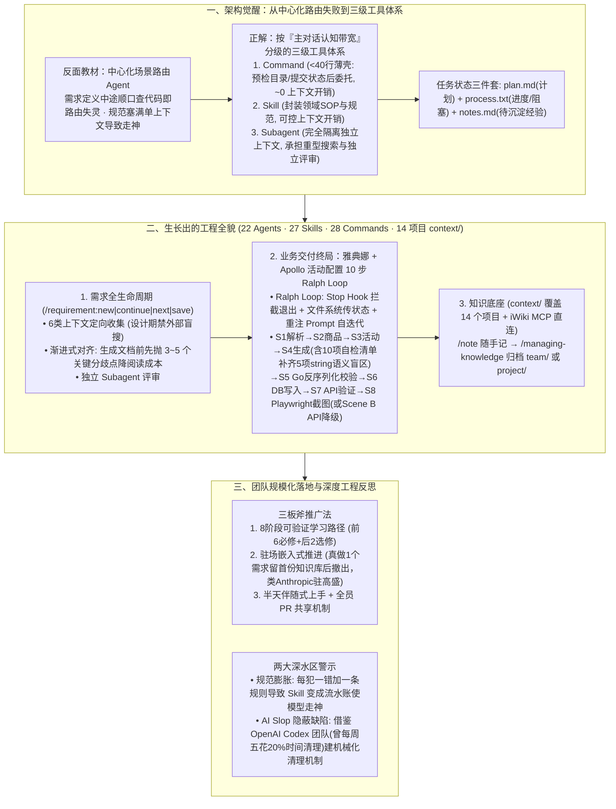

# 认知重建之后，步入Agentic Engineering的工程革命

## 1. TL;DR

1. **核心定义与公式：`代码输出质量 = AI 能力 × 上下文质量`**：引用 Andrej Karpathy（2026.02）提出的 **Agentic Engineering**（99% 时间协调监督智能体 + 可精进的严谨工程学科），指出其并非 Vibe Coding 的对立面而是工程化演进——保留“让 AI 做事”的杠杆，补上架构、规范、质量与可维护性短板；竞争力的终局指标是 **“每个 Token 转化为多少有效工程产出”**。
2. **推翻“中心化场景路由 Agent”，确立 `Command → Skill → Subagent` 三级认知带宽分配体系**：作者在踩过“用传统 DDD 设计厚重中间层”与“中心化场景路由 Agent 在跨场景对话中彻底失灵”两个大坑后，重构为：**Command（`< 40 行` 薄壳，几乎零上下文开销）→ Skill（按需加载领域知识，可控开销）→ Subagent（完全隔离上下文，处理重型搜索与独立评审）**，并沉淀出 `plan.md + process.txt + notes.md` 文档三件套，靠“高频使用对抗文档腐化”。
3. **体系全貌（22 个 Agent、27 个 Skill、28 个命令、覆盖 14 个项目的 `context/` 知识底座）**：需求全生命周期采用 **“六源强制上下文收集（设计期禁用盲目外部搜索）+ 先抛 3~5 个关键分歧渐进确认 + 多视角 Subagent 评审”**；在复杂业务“雅典娜活动配置”中，通过 **Ralph Loop（Stop Hook 拦截退出并重注 Prompt，靠文件系统传状态）** 自动跑完 `S1~S10` 十步闭环，配合 **三层递进验证 + S4 阶段 10 项自检清单（补齐 L1 Go 反序列化查不出的 5 项字符串语义错误）** 与 Playwright / API 双模降级验证。
4. **从个人复利走向团队工程革命（驻场赋能 + 伴随式上手 + PR 共享）**：建立 **8 阶段渐进式学习路径（前 6 必修 + 后 2 选修）**，采用类似 Anthropic 驻场高盛的 **“真做一个需求沉淀首份 `context/project/` 后撤出”** 嵌入式推广与 **半天伴随式上手**；检验团队文化转型的唯一标准是——**“当某个同事离开时，他积累的知识全在 `context/` 里，新人和 AI 可以直接复用”**（同时警惕规则过多导致走神的“规范膨胀”与 OpenAI Codex 团队周均耗费 `20%` 时间清理的 `AI slop`）。

## 2. 问题定义与背景

### 2.1 从 Vibe Coding 的幻灭到 Agentic Engineering 的觉醒
2025 年 2 月 Andrej Karpathy 提出 `Vibe Coding`（完全交给感觉、不看代码），一年后的 **2026 年 2 月** 他正式提出 **`Agentic Engineering`**：
- **为什么叫 Agentic？** 因为工程师 **99% 的时间** 不再亲自敲代码，而是协调并监督智能体；
- **为什么叫 Engineering？** 因为让系统稳定交付绝非靠运气，而是一门涵盖编排、持久记忆、确定性护栏与验证闭环的硬核工程学科（正如 LangChain Harrison Chase 所言：系统越 Agentic，越需要新型基础设施支撑）。

### 2.2 演进路上踩过的两个致命架构大坑
1. **第一个坑：用传统软件工程（DDD 领域驱动设计）思维过度设计 Agent 体系**
   - 初期本能地设计了繁复的抽象层与向量数据库索引，结果发现向量库里的理解滞后于代码演进，而纯 Markdown 文档形态（人和 AI 读同一份文件）配合“高频使用即时更新”反而天然免疫腐化。
2. **第二个坑：中心化“场景路由 Agent”在真实混合对话中彻底崩盘**
   - 最初设计了一个入口 Router Agent，先判断用户属于“需求定义”还是“代码实现”再加载对应规范；结果一个下午作者在做“需求定义”中途顺嘴说了一句“顺便看看相关代码的现有实现”，静态路由瞬间错乱失灵——证明**真实研发是跨场景高频流转的，必须按“认知带宽占用”改用平台原生的三级扩展机制**。

## 3. 知识框架

## 4. 核心内容拆解

### 4.1 工具设计规范、SOP 六条工具化标准与三级带宽隔离

1. **每一个工具都都在回答同一个问题：“这个任务值得占用多少主对话的认知带宽？”**
   - **Command（命令层，几乎零上下文开销）**：如 `/requirement:new` 不到 **40 行**，只做“预检目录、预检 Git 提交状态、委托给对应 Skill”三件事；同一领域的 7 个命令共享同一个 Skill 的领域知识，改一条规则只需改一处。
   - **Skill（技能层，可控上下文开销）**：承载领域 SOP 与规则；遵循 **“规范是外部施加的约束，工具是内化的能力”**——能写成确定性脚本/工具校验的，绝不只写自然语言规范。
   - **Subagent（子代理层，完全隔离上下文）**：把耗时耗 Token 的代码库探索、多维度评审隔离在独立子会话中，只把精炼结论返回主会话。
2. **SOP 迭代标准化与“是否应该工具化”的判定边界**：
   - 具备高频重复、输入输出确定、规则可程序化等 6 条特征的必须做成工具；而**一次性约束、高度灵活的探索任务、需要人类价值判断的决策**则绝不工具化，保留在规则或交互层。

### 4.2 研发与业务双闭环：需求全生命周期与 10 步 `Ralph Loop` 活动配置

1. **需求全生命周期（`/requirement:new | continue | next | save`）的三大支柱**：
   - **支柱一：定向六源上下文收集（严禁盲目全仓搜索）**：强制按序收集项目概览、相关模块代码、接口契约、SOP 最佳实践、历史踩坑经验，且在设计阶段**明确禁用外部泛搜索**以防噪音污染。
   - **支柱二：渐进式分歧暴露**：不在一上来就甩出几千字长文档让人通读找错，而是在生成文档前先提炼 **3~5 个核心分歧点与不确定项** 供人类拍板，将人工审查成本降低一个数量级。
   - **支柱三：上下文搜索 + 渐进式输出 + 独立评审三者缺一不可**。
2. **从“研发工具”跨向“业务工具”：基于 `Ralph Loop` 的 10 步活动配置引擎（`config-gen-engine`）**
   - **业务复杂性**：配一个营销活动（如“每日签到送 5 积分持续一个月”）需横跨 **商品配置、雅典娜平台活动配置、Apollo 控制台玩法规则（`When → Then`）与 GameEngine 数据库**。
   - **Ralph Loop 自迭代机制**：利用平台 `Stop Hook` 拦截 Agent 退出动作，检查文件系统中的步骤状态文件；若未全部通关，则阻止退出并将原始 Prompt 重新作为新用户消息注入，从而在**不依赖单次超长上下文**的前提下驱动 Agent 跑完 **S1~S10 十个步骤**（`S1 需求解析 → S2 商品创建 → S3 活动创建 → S4 配置生成 → S5 Go 校验 → S6 DB 写入 → S7 API 验证 → S8 前端 Playwright 验证 → S9~S10 归档汇总`）。
   - **三层递进验证与 S4 阶段的“10 项自检清单”巧思**：
     - 团队发现：S5 阶段的 Go 强类型反序列化校验（L1）只能抓出 JSON 语法错误、类型不匹配（`string vs number`）与字段遗漏（Roundtrip Diff），但**完全查不出 `When` 条件前缀拼错、日期格式错误、`task_id` 跨表不一致**——因为这些字段在 Go 结构体里全都是 `string` 类型！
     - 因此在 S4 生成阶段专门植入 **10 项自检清单（其中 5 项显式标注“S5 无法检测，必须在 S4 自检拦截”）**。
   - **S8 跨环境验证与双模降级**：本地 MCP 写的是 `127.0.0.1:8002` 本地库，而雅典娜前端默认连远程测试服；团队评估 6 种方案后打通本地验证链路，先调 `act_list / goods_get` 等接口校验 `goods_id` 映射并由 **Playwright 分别对商品列表、活动列表、活动详情页截图留证**；若环境未装 Playwright 或登录失败，自动切换至 **Scene B（纯 HTTP API 断言降级验证）**。

### 4.3 团队推广三板斧与“两个月演进”的深度反思

1. **让团队真正用起来的三板斧**：
   - **8 阶段渐进式学习路径**：前 6 阶段必修（从装好 CLI 跑通一次闭环到写 1 个自定义命令、建 1 个最小 `SKILL.md`），后 2 阶段选修，每阶段均以**可验证的动手动作**而非“看完文档”为通关标准。
   - **Anthropic 驻场高盛式“嵌入式推进”**：不搞空洞宣讲，直接选 1 个真实需求与项目负责人一起用 Agentic 流程做完，顺手把该项目的架构约束沉淀进 `context/project/{project}/` 后撤出，伴随式上手人工成本**不超过半天**。
   - **PR 共享复利**：任何人踩到一个坑（如 AI 在某服务上老犯同一个错），用 `/note` 记录并提 PR 合入 `context/`（目前已覆盖 **14 个项目**），实现“一人踩坑、全员免疫”。
2. **两大坦诚反思（规范膨胀与 AI Slop）**：
   - **警惕“规范膨胀”**：每次 AI 犯错就本能地往 `resources/` 里加一条边角规则，几周后引导性建议膨胀成事无巨细的操作手册，反而导致 Agent 注意力分散“走神”——必须定期做规则瘦身与工具化下沉。
   - **正视“AI Slop（AI 垃圾/隐蔽缺陷）”**：AI 会在看似完美的代码或需求文档中掩盖微妙的并发隐患或逻辑漏洞；OpenAI Codex 团队曾每周五花 **20% 的时间** 人工清理 AI Slop 后改为机械化持续清理，这是每个 Agentic 团队必须补齐的自动化巡检短板。

## 5. 数据速查表

| 指标 | 原文数值 | 语境 / 条件 |
| :--- | :--- | :--- |
| **Agentic Engineering 时间分配定义** | `99%` 的时间协调并监督智能体（不到 `1%` 直接手写代码） | Andrej Karpathy（2026 年 2 月推文）提出的定义 |
| **薄壳 Command 代码行数上限** | `< 40 行`（如 `/requirement:new`） | 仅做目录预检、提交状态预检与委托 Skill，几乎零上下文开销 |
| **渐进式需求确认暴露分歧点数** | 每次提炼 `3~5 个` 关键分歧或不确定项 | 在生成完整长文档前先让人类确认，大幅降低通读审查成本 |
| **工程系统当前总资产规模** | `22 个` Agent、`27 个` Skill、`28 个` 命令、`14 个` 项目知识库 | 另含 `6 份` 工具规范文档，历经两个月从单个 `AGENTS.md` 生长而成 |
| **活动配置 `Ralph Loop` 执行步数** | `10 个` 步骤（`S1` 至 `S10`） | 从自然语言解析、建商品/活动、Go 校验、写 DB 到 Playwright/API 验证 |
| **S4 配置生成自检清单规格** | 共 `10 项` 自检项（其中 `5 项` 明确标注“S5 Go 校验无法检测”） | 专门拦截 `When` 前缀、日期格式、`task_id` 一致性等 `string` 类型语义错误 |
| **团队学习路径与伴随式上手成本** | `8 个` 阶段（前 `6` 必修 + 后 `2` 选修）；伴随上手人工成本 `< 0.5 天` | 首周目标仅要求用完整流程跑通 `1 个` 小需求 |
| **OpenAI Codex 团队清理 AI Slop 投入** | 每周五花费 `20%` 的时间（后改为机械化持续清理） | 对照说明建立系统性代码/文档隐蔽缺陷清理机制的必要性 |

## 6. 踩坑与教训 / 可迁移的设计原则

| 错误做法 | 失败表现或原因 | 原文应对（可迁移的设计原则） |
| :--- | :--- | :--- |
| **在顶层设计一个中心化的“场景路由 Agent”来接管所有对话分发** | 研发过程天然存在跨场景穿插（如聊需求时顺便查代码实现），中心路由瞬间迷失且把多场景规则混塞进同一上下文导致崩溃 | **推翻运行时场景路由，改用 `Command → Skill → Subagent` 三级带宽隔离**：用 `<40 行` Command 做确定性入口，Skill 管领域 SOP，Subagent 隔离重型任务 |
| **把项目知识存进黑盒向量数据库，脱离日常研发文档流** | 代码改了而向量库里还是旧认知，人看不见 AI 的记忆，且传统孤立 Wiki 写了没人看迅速腐化 | **“人机同源 Markdown（`context/`）+ 高频使用对抗腐化”**：人和 AI 读写同一份 Git 追踪的文档，用 `/note` 与 PR 机制在每次需求交付中顺手更新知识库 |
| **在复杂配置生成中完全依赖强类型语言的反序列化校验（如 Go `json.Unmarshal`）** | 凡是定义为 `string` 类型的业务规则字段（如 `When` 表达式、日期格式、跨表关联 `task_id`），任何错误字符串都能通过反序列化 | **分层递进验证（生成期语义自检清单 + 编译期强类型校验 + 运行时 UI/API 双模验证）**：在 S4 显式列出 S5 查不出的 5 项字符串语义规则强制自检 |
| **每次 Agent 犯一个小错就往 Skill 里追加一条自然语言规则（规范膨胀）** | 几周后 Skill 变成塞满边角 Case 的冗长手册，模型阅读时注意力稀释反而更容易“走神”漏掉核心指令 | **坚持“最小约束”与“工具内化优于外部说教”**：能收进确定性校验脚本的绝不写长篇规则，定期按 SOP 修剪冗余指令 |
| **想在团队推 Agentic 研发时一上来先拉全员开大会讲 22 个 Agent、27 个 Skill 的宏大架构** | 没接触过的新手被复杂概念吓退，听完课回到工位依然不知道第一步敲什么命令 | **驻场真做 1 个需求（嵌入式推进）+ 从唯一入口 `/requirement:new` 开始**：像 Anthropic 驻场高盛一样帮项目组跑通首个需求并留下 `context/project/`，首周只求跑通 1 个闭环 |

## 7. 记忆锚点

- **“`代码输出质量 = AI 能力 × 上下文质量`；竞争力看‘每个 Token 转化为多少有效工程产出’”**：全文的北极星认知——模型能力已溢出，工程团队的地基不是堆砌多 Agent 角色，而是扎实沉淀 `context/` 知识底座。
- **“Command 零带宽（<40 行）、Skill 控带宽、Subagent 隔带宽；S4 十项自检补齐 S5 五项 String 盲区；Ralph Loop 靠文件传状态跑通十步配置”**：从失败路由中长出来的硬核工程骨架。
- **“人走知识留：当同事离职时，他的经验全在 `context/` 里供新人与 AI 直接调用”**：衡量 Agentic Engineering 工程革命是否真正成功的黄金标准。

## 8. 复习卡片

1. Andrej Karpathy 提出的 `Agentic Engineering` 的核心定义是什么？作者认为它与 `Vibe Coding` 是什么关系？::Karpathy 定义其为：`99%` 的时间不再直接手写代码而是协调监督智能体（Agentic），且它是一门有深度的可精进工程学科（Engineering）；作者认为它不是 Vibe Coding 的对立面，而是 Vibe Coding 的工程化演进——保留“让 AI 做事”的杠杆效应，同时补齐架构、规范、质量门禁与可维护性。
2. 为什么作者早期设计的“中心化场景路由 Agent”失败了，最终演进出的“三级工具体系”是如何分配主对话认知带宽的？::因为真实研发中用户会在“需求定义”中途随时穿插“查看现有代码实现”，静态场景路由无法应对高频跨场景切换且易造成上下文污染；最终演进出的三级体系按认知带宽分级：`Command`（`< 40 行` 薄壳，几乎不占上下文）→ `Skill`（按需加载领域 SOP，占用可控上下文）→ `Subagent`（完全隔离独立上下文，处理重型搜索与评审）。
3. 在“雅典娜活动配置（`config-gen-engine`）”案例中，什么是 `Ralph Loop`？为什么在 S5 Go 反序列化校验之外，还必须在 S4 生成阶段设置 10 项自检清单？::`Ralph Loop` 利用平台 `Stop Hook` 拦截退出动作，通过文件系统传递步骤状态并将原始 Prompt 重新注入，驱动 Agent 自迭代跑完 `S1~S10` 十个步骤；因为 S5 的 Go 强类型校验（L1）只能发现语法错误、类型不匹配和字段遗漏，而 `When` 条件前缀、日期格式、跨表 `task_id` 一致性等在结构体中均为 `string` 类型（任何值都能通过反序列化），因此必须在 S4 用 10 项自检清单专门拦截这 5 项语义盲区。
4. 在需求全生命周期管理中，系统是如何降低人类工程师的文档审查负担并保证评审质量的？::通过三项机制：① 定向收集 6 类上下文（设计期禁用盲目外部搜索）；② 渐进式输出——在生成长篇完整文档之前，先将 `3~5 个` 关键分歧点和不确定项暴露给人类确认，把“通读全文找问题”降维成“做几道选择题”；③ 引入独立上下文的 Subagent 进行多视角评审。
5. 作者在两个月演进后反思了哪两个核心踩坑教训？团队推广 Agentic Engineering 最有效的三板斧是什么？::两个踩坑教训是：① **规范膨胀**（每次犯错就加规则导致 Skill 变成流水账，模型注意力分散走神）；② **AI Slop 隐蔽缺陷**（AI 用看似合理的代码/文档掩盖并发或逻辑漏洞，需借鉴 OpenAI Codex 团队建立持续清理机制）。推广三板斧是：8 阶段可验证学习路径、驻场嵌入式推进（真做 1 个需求沉淀首份 `context/project/` 后撤出）与半天伴随式上手 + PR 共享机制。

## 9. 知识关联

- **本仓库主题索引**：[Agent工程循环](../../20_topics/Agent%E5%B7%A5%E7%A8%8B%E5%BE%AA%E7%8E%AF.md) · [Agent任务恢复](../../20_topics/Agent%E4%BB%BB%E5%8A%A1%E6%81%A2%E5%A4%8D.md) · [Agent长期记忆](../../20_topics/Agent%E9%95%BF%E6%9C%9F%E8%AE%B0%E5%BF%86.md) · [AI研发协同](../../20_topics/AI%E7%A0%94%E5%8F%91%E5%8D%8F%E5%90%8C.md) · [Agent评测与反馈](../../20_topics/Agent%E8%AF%84%E6%B5%8B%E4%B8%8E%E5%8F%8D%E9%A6%88.md)
- **候选双链概念**：[[Agentic-Engineering演进]] · [[三级认知带宽工具体系]] · [[Ralph-Loop自迭代机制]] · [[规范膨胀反模式]] · [[AI-Slop清理机制]]

## 10. 原文参考资料

1. Andrej Karpathy: *Vibe Coding* (2025-02) & *Agentic Engineering* (2026-02 推文)。
2. Harrison Chase (LangChain): *What is an AI Agent?*；Anthropic: *Building Effective AI Agents*；OpenAI: *Harness engineering: leveraging Codex in an agent-first world*。
3. 社区平行演进对照项目：`everything-claude-code`、Nicholas Carlini 多 Agent 编译器构建实验。

> [!note]- 校对报告
> - **校对状态**：已按原文逐章核对通过（共 52 页 PDF）。
> - **核心数据与页码溯源**：
>   - Karpathy `Agentic Engineering` 两个理由（`99%` 时间协调监督智能体 + 可精进的工程学科）、Harrison Chase 观点、`everything-claude-code` 十个月平行演进对照：见 `p.1–5`。
>   - 第一个坑（传统 DDD 设计思维 vs `plan.md + process.txt + notes.md` 文档形态高频使用对抗腐化）与第二个坑（中心化场景路由 Agent 在需求定义中途查代码时失灵）：见 `p.6–15`。
>   - SOP 六条工具化判定标准、`/requirement:new` `< 40 行` 薄壳、`Command / Skill / Agent` 三级认知带宽隔离：见 `p.16–20`。
>   - 体系全貌：需求全生命周期（6 类上下文收集、设计期禁外部搜索、提前暴露 `3–5 个` 关键分歧点）、`/note` 与 `context/` 覆盖 `14 个` 项目（含 `6 份` 工具规范）、总规模 `22 个` Agent + `27 个` Skill + `28 个` 命令：见 `p.21–26, p.45`。
>   - 雅典娜 + Apollo + GameEngine 活动配置案例（`Ralph Loop` Stop Hook 拦截重注、10 步闭环 `S1~S10`、`config-gen-engine` 三层验证、S4 `10 项` 自检清单中 `5 项` 标注 S5 无法检测、`127.0.0.1:8002` 本地隔离与评估 `6 种` 方案、Playwright 截图留证与 Scene B API 降级验证）：见 `p.27–34`。
>   - 团队推广（8 阶段学习路径［前 6 必修 + 后 2 选修］、首周完成 1 个小需求、类 Anthropic 驻场高盛嵌入式推进、`< 0.5 天` 伴随式上手、PR 共享机制、`代码输出质量 = AI 能力 × 上下文质量`）：见 `p.35–41`。
>   - 反思与终局（规范膨胀导致走神、OpenAI Codex 团队每周五花 `20%` 时间清理 `AI slop`、“每个 token 转化为多少有效工程产出”、Carlini `16 个` Agent 编译器实验对比）：见 `p.42–50`。
