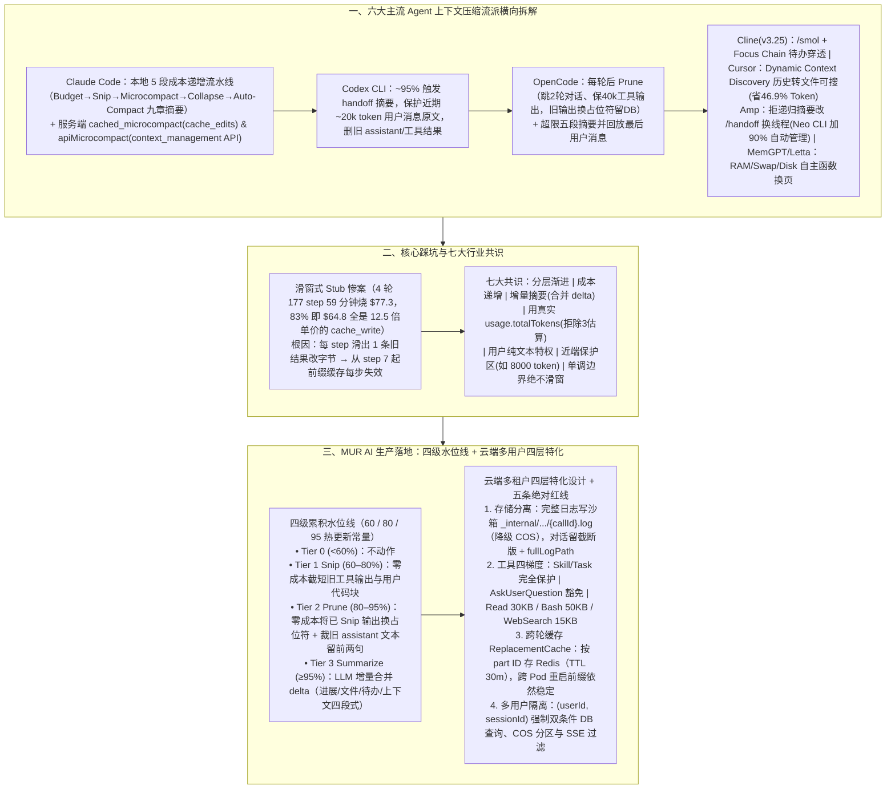

# 横向拆解 Claude Code、Codex 等六大 Agent 上下文压缩策略后，我们做了第 7 个

> **原文信息**：作者 `mervynyang`，发布于 2026-06-08 02:36（广东），公众号「腾讯技术工程」原创。

---

## 1. TL;DR

1. **第一代「撑不住才全量压缩」的五宗罪与核心哲学跃迁** —— 第一代压缩存在**悬崖式触发**（到上限才一口气压，触发时注意力已崩）、**全量摘要丢细节**（丢变量名/函数签名/堆栈）、**`text.length / 3` 估算粗糙**（中英混合误差 **30%–50%**）、**不区分信息价值**（5000 行 `grep` 与关键诊断同等对待）、**用户贴的代码被一刀切**五大痛点；上下文压缩的真正目的从来不是省钱，而是**保护模型注意力（在上下文超过 70% 恶化前当好「信号工程师」）**。
2. **横向拆解六大主流 Agent 压缩流派** —— ① **Claude Code**：本地成本递增五段流水线（`Budget Reduction → Snip → Microcompact → Context Collapse → Auto-Compact 九章节结构化摘要`）+ 服务端 `cached_microcompact`（`cache_edits`）与 `apiMicrocompact`（`context-management-2025-06-27`）保缓存命中；② **Codex CLI**：95% 容量触发 handoff 摘要，保护近期约 **20k token** 用户消息一字不动，物理删旧 assistant/工具结果；③ **OpenCode**：每轮响应后轻量 `Prune`（跳最近 2 轮对话、保最近 **40k token** 工具输出，旧输出标 `[Old tool result content cleared]` 但数据库保留）+ 超限时五段式摘要并回放最后一条用户指令；④ **Cline（v3.25）**：`/smol` 手动与 `Auto-Compact` 双模式 + `Focus Chain` 待办穿透；⑤ **Cursor**：自动压缩 + `Dynamic Context Discovery`（历史变可搜索文件，A/B 测试减少 **46.9%** 总 Token）；⑥ **Amp & MemGPT/Letta**：Amp 拒做递归压缩改用 `/handoff` 换线程（2026 Neo CLI 妥协加入 90% 自动管理）；Letta（v0.16.7，22.5k stars）将上下文当 RAM/磁盘由 Agent 自主函数换入换出。
3. **血泪教训：滑窗式 Stub 替换 = 每步 Prompt Cache 失效** —— 团队曾在一个 **4 轮、177 step、59 分钟**的真实会话中烧掉 **`$77.3`**，其中 **83%（`$64.8`）全是 `cache_write`**（单价是 `cache_read` 的 **12.5 倍**）！根因是在 step-loop 中用滑窗「保留最近 N 条工具结果」，导致每走 1 个 step 就有 1 条旧结果滑出窗口变成 stub，从 step 7 起前缀字节每步改变、缓存彻底死亡（`cacheWrite` 飙至约 12 万/step）；铁律：**stub 决策必须单调推进（只能大跳、绝不滑窗，一旦标为 stub 永久固定）**。
4. **MUR AI「四级水位线 + 增量摘要」方案** —— 基于 LLM API 返回的精确 `usage.totalTokens` 触发，四级累积递进：
   - **Tier 0（`< 60%`）**：不干预；
   - **Tier 1 `Snip`（`60%–80%`）**：纯本地零成本截短旧工具输出与用户代码块（永远不动用户纯文本与保护区如最近 **8000 token**）；
   - **Tier 2 `Prune`（`80%–95%`）**：纯本地将已 Snip 工具输出替换为 `[Content compacted to save space]`、裁旧 assistant 文本仅留前两句；
   - **Tier 3 `Summarize`（`≥ 95%`）**：兜底调用 LLM 对「上次摘要之后～保护区之前」的 `delta` 做**四段式（进展/文件/待办/上下文）增量合并摘要**，避免全量重写的语义漂移。
5. **云端多租户 Agent 专属的四层加固** —— ① **存储分离**：完整输出写沙箱 `_internal/truncated-outputs/{callId}.log`（失败降级 COS），对话只留截断版 + `fullLogPath` 供前端按需拉取审计；② **工具四梯度差异化**：`PROTECTED_TOOLS`（`Skill/Task` 绝对不动）、微压缩豁免（`Task/AskUserQuestion`）、白名单可压（`bash/read/grep/websearch`）及差异化落盘上限（**Read `30KB` / Bash `50KB` / WebSearch `15KB`**）；③ **跨轮 Redis 缓存 `ReplacementCache`**（`msgOptCache:{sessionId}`，TTL **30 分钟**，防止 Pod 重启或切实例后重算导致缓存全废与模型鬼打墙）；④ **`(userId, sessionId)` 多租户硬隔离**。

---

## 2. 问题定义与背景

### 2.1 为什么要写这篇？

在构建面向用研场景的云端多用户智能体 **MUR AI** 时，团队发现第一代「等上下文塞满才一口气调 LLM 全量摘要」的粗糙做法不仅导致信息严重丢失，还会在实施不当（如滑窗替换）时引爆天文数字般的 `cache_write` 账单；而本地单机 CLI 工具（如 Claude Code、Codex）又无需考虑云端场景下的**浏览器重连恢复、跨 Pod 流量漂移一致性、数十 MB 工具日志事后审计、以及多租户数据隔离**。本文首先横向解剖了业界 6 大标杆产品的上下文压缩源码与策略，提炼出 7 条行业共识，随后完整公开了 MUR AI 的「四级水位线 + 云端四层加固」生产架构。

---

## 3. 知识框架

---

## 4. 核心内容拆解

### 4.1 六大主流 Agent 压缩方案核心机制对比

| 产品 | 触发与分级策略 | 核心保留与裁剪细节 | 独特工程亮点 |
| :--- | :--- | :--- | :--- |
| **Claude Code** (Anthropic) | **本地 5 段递增流水线**：① `Budget Reduction` → ② `Snip` → ③ `Microcompact` → ④ `Context Collapse` → ⑤ `Auto-Compact`（前 4 步零 API 调用） | 兜底生成固定 **9 个章节**结构化摘要（用户意图、主要请求、技术概念、文件与代码段、错误与修复、问题解决过程、用户消息、待办任务、下一步） | **服务端零字节改动**：通过 `cached_microcompact`（发 `cache_edits` 指令在服务端已缓存前缀上抠掉旧 tool 结果）和 `apiMicrocompact`（调 `context-management-2025-06-27` API）使客户端字节不变、Prompt Cache 永不失效 |
| **Codex CLI** (OpenAI) | 约 **95% 容量**触发 handoff 摘要 | 物理删除所有旧 assistant 回复和工具结果；**原样保留近期约 20k token 内的用户消息**，更早用户消息蒸馏进摘要 | 将压缩视为「同事间的工作交接」：相信用户说的话最准确，模型说的可以重写 |
| **OpenCode** | **两步走**：每次响应后自动轻量 `Prune`；超模型输入上限时触发重量 `Summary` | `Prune` 跳过最近 **2 轮**用户对话、保护最近 **40k token** 工具输出，更老工具输出换为 `[Old tool result content cleared]`；`Summary` 产五段式摘要 | 原始数据仍留在数据库中（可逆隐藏）；摘要完成后**自动回放用户最后一条消息**，让模型从最近指令继续而非从摘要继续 |
| **Cline** (v3.25+) | 手动 `/smol`（`/compact`）+ 接近上限自动 `Auto-Compact` | 同一任务内接续，不切会话 | 默认开启 **`Focus Chain`**，待办列表可穿越压缩存活作为进度锚点 |
| **Cursor** | 超窗口自动压缩旧消息 + 提示开新对话 | 2026 新增 **`Dynamic Context Discovery`**：将聊天历史转为可搜索文件供 Agent 回头检索原始细节 | 官方 A/B 测试显示减少了 **46.9%** 的总 Token 消耗（社区已知高优 bug：压缩后偶发遗忘刚做的编辑） |
| **Amp** & **MemGPT / Letta** | **Amp**：拒做递归压缩，用 `/handoff` 开新线程（Neo CLI 新增 **90%** 自动管理）；**Letta**：OS 级内存分层 | **Amp** 支持 `@@` 引用其他线程与 `threads: map`；**Letta**（v0.16.7，22.5k stars）分为 `Main Context (RAM)`、`Recall Memory (Swap)`、`Archival Memory (Disk)` | Letta 由 Agent 自己调 `conversation_search` / `archival_memory_search` 决定换入换出，而非被动截断 |

---

### 4.2 第二代实施大坑：为什么「滑窗式 Stub 替换」会让账单爆炸？

- **真实事故复盘（2026-05-13 补）**：
  - 团队曾跑了一个 **4 轮、177 step、耗时 59 分钟**的真实 Task，竟然烧掉了 **`$77.3`**，其中高达 **83%（`$64.8`）全部是 `cache_write`**（要知道 `cache_write` 的单价是 `cache_read` 的 **12.5 倍**！）。
  - **Langfuse 逐 Step 根因定位**：当时规则写的是「在 step-loop 里每步重算，保留最近 $N$ 条 tool 结果，更老的替换成 stub」。结果从 `step 7` 开始，每完成 1 个 step（新增 2 条消息），就有 1 条原本被保留的旧 tool 结果滑出窗口被改成 stub（`#stub` 每步 `+1`，`lastStubIdx` 每步 `+2`）——**因为中间那个位置的字节变了，从该位置往后的整段 Prompt 前缀对服务端 Prompt Cache 全部失效！** 导致 `cacheRead` 永远卡在 `102,795` 不动，而 `cacheWrite` 一路飙升到约 **12 万 tokens/step**，后面 50 多个 step 每一步都在为「窗口又挪了一格」重新买单。
- **核心架构铁律——单调边界，绝不滑窗**：
  - **stub 决策必须单调推进（只能大跳，不能滑窗）**：一个消息 Part 一旦被标成 stub（或一旦决定保留/截断），其对应位置的字节必须在后续所有 turn、所有 step 中保持稳定，绝不因为「又老了一步」而在每步重算替换。

---

### 4.3 MUR AI 落地方案：四级累积水位线 + 云端四层特化 + 五条红线

#### （1）四级累积水位线（基于真实 `usage.totalTokens` 触发，绝不用 `text.length / 3` 触发）
- 为什么不用 `text.length / 3` 判断触发？实测中文字符在 BPE 中占 `1.5–2 token`，中英代码混合下字符估算比真实值低 **30%–50%**（曾出现估算显示 70%、实际已达 92% 下一轮直接溢出的事故）；故触发判断强制用 LLM API 返回的精确 `usage.totalTokens`，仅内部排序（「先裁哪个工具输出」）用估算值。
- **Tier 0（`< 60%`）**：什么都不做，保护模型原始注意力。
- **Tier 1 `Snip`（`60%–80%`，预防性维护，零 LLM 成本）**：
  - 截短老的工具输出（如 5000 token `grep` 仅留前几行 + 工具名 + `"还有 X 条结果被省略"`）；
  - 截短用户消息里的 Markdown 代码块（如 200 行代码仅留文件名注释 + 前几行 + 总行数标注），**用户纯文本指令永远不动**。
- **Tier 2 `Prune`（`80%–95%`，强力释压，零 LLM 成本）**：
  - 将 Tier 1 已截短的工具输出进一步替换为纯占位符 `[Content compacted to save space]`（Snip 保留了「我查过某文件」的元信息，Prune 则是彻底擦除，故先 Snip 再 Prune）；
  - 裁掉旧的 assistant 文本（仅保留前两句 + `[truncated]`），整体下调截断阈值。
- **Tier 3 `Summarize`（`≥ 95%`，兜底增量摘要，调 LLM）**：
  - 累积先执行完 Tier 1 和 Tier 2 免费砍掉大块噪声后，找出「**上次摘要之后 ～ 保护区（如最近 8000 token）之前**」的消息作为 `delta`；
  - 将 `上次摘要 + delta` 喂给 LLM 生成合并后的**四段式结构化摘要（进展 / 文件 / 待办 / 上下文）**，替换旧摘要并删除 `delta` 消息（避免全量摘要反复重写导致语义漂移与同一文件前后矛盾）。

#### （2）云端多用户场景额外叠加的四层架构
1. **存储分离（模型工作记忆与用户审计解耦）**：调用 `persistTruncatedOutput` 将数十 MB 的完整工具输出写入沙箱 `_internal/truncated-outputs/{callId}.log`（沙箱写失败降级直传 COS），对话 metadata 附带 `fullLogPath`，前端展示时调 `sandbox-file` API 现取现读。
2. **工具四梯度差异化治理**：
   - **完全保护**：`PROTECTED_TOOLS = ['Skill', 'Task']`（任何 Tier 都不动）；
   - **微压缩豁免**：`Task` / `AskUserQuestion`（保护用户回答不被抹掉）；
   - **白名单可压**：`bash` / `read` / `grep` / `websearch` 等无状态读取工具；
   - **差异化单次落盘上限**：**Read `30KB`、Bash `50KB`、WebSearch `15KB`**。
3. **跨轮 Redis 缓存 `ReplacementCache`（防 Pod 重启/切实例导致前缀缓存崩溃）**：
   - 将每一轮的截断决策按 `part ID` 存入 Redis（key 为 `msgOptCache:{sessionId}`，**TTL 30 分钟**，读取时经 `isValidReplacementEntry()` 校验）；下一轮无论路由到哪个 Pod，已决定过怎么压的 Part 直接复用原结果，确保消息序列前缀跨实例绝对一致。
4. **多租户 `(userId, sessionId)` 二元组硬隔离**：DB 查询强制带 `WHERE userId = ? AND sessionId = ?`，COS 路径按 `user_sessions/{userId}/sessions/{sessionId}/_internal/...` 分区，SSE 压缩事件（含触发 Tier、真实 Token 率、Snip/Prune 数量、预估节省 Token、`ReplacementCache` 命中数）严格按 `sessionId` 过滤。

#### （3）任何 Tier 绝不可触碰的五条红线
1. **保护区内的所有消息**（如最近 `8000 token`）；
2. **用户消息的纯文本部分**；
3. **`PROTECTED_TOOLS`（`Skill` / `Task`）的输出**；
4. **`MICRO_COMPACTION_EXEMPT`（`Task` / `AskUserQuestion`）的输出**；
5. **带 `compactionProtected` 业务扩展标记的 Part**（宁可让上下文真爆出来，也绝不破例压红线内容导致模型行为漂移）。

---

## 5. 数据速查表

| 指标 | 原文数值 | 语境 / 条件 |
| :--- | :--- | :--- |
| 横向拆解的主流 Agent 数量 | **6 家 + 自研第 7 个（MUR AI）** | Claude Code、Codex CLI、OpenCode、Cline、Cursor、Amp（及 MemGPT/Letta） |
| `text.length / 3` 字符估算误差 | **30%–50% 误差** | 中文字符在 BPE 占 `1.5–2 token`，曾出现估算 70% 实际已 92% 的溢出险情 |
| Claude Code 结构化摘要章节数 | **固定 9 个章节** | 用户意图、主要请求、技术概念、文件与代码段、错误与修复、解决过程、用户消息、待办、下一步 |
| Codex CLI 与 OpenCode 近端保护窗口 | **Codex 保近期约 `20k token` 用户消息 / OpenCode 跳 2 轮对话并保最近 `40k token` 工具输出** | Codex 在约 **95%** 容量触发；Amp Neo CLI 在 **90%** 容量触发 |
| Cursor 动态上下文发现节省率 | **A/B 测试减少 46.9% 总 Token 消耗** | `Dynamic Context Discovery` 将聊天历史转为可搜索文件 |
| 滑窗式 Stub 缓存失效真实账单事故 | **4 轮、177 step、59 分钟烧掉 `$77.3`，其中 83%（`$64.8`）全是 `cache_write`** | `cache_write` 单价是 `cache_read` 的 **12.5 倍**；从 step 7 起 `cacheWrite` 飙至约 **12 万/step** |
| MUR AI 四级水位线阈值与保护区 | **Tier 0 `<60%` / Tier 1 `60%–80%` / Tier 2 `80%–95%` / Tier 3 `≥95%`；保护区示例 `8000 token`** | 阈值支持远程配置热更新，调至 `1.0` 可随时禁用对应 Tier |
| 工具单次输出差异化落盘上限 | **Read `30KB` / Bash `50KB` / WebSearch `15KB`** | 完整日志写沙箱 `_internal/truncated-outputs/{callId}.log` 或降级 COS |
| 跨轮缓存 `ReplacementCache` 配置 | **Redis key `msgOptCache:{sessionId}`，TTL `30 分钟`** | 按 `part ID` 持久化截断决策，保障跨 Pod 重启前缀一致 |
| 模型注意力明显恶化的上下文水位 | **上下文塞到 70% 以上** | 中段失忆与指令漂移（Context Rot）明显加剧的经验阈值 |

---

## 6. 踩坑与教训 / 可迁移的设计原则

| 错误做法 | 失败表现或原因 | 原文应对 |
| :--- | :--- | :--- |
| 平时对上下文膨胀不管不问，等逼近 100% 窗口上限时才一次性全量调用 LLM 摘要 | 触发前模型早已因超过 70% 水位而注意力溃散；全量摘要将几十轮压成几百字，丢失关键变量名、函数签名与堆栈 | 采用**四级累积水位线（60% Snip → 80% Prune → 95% 增量 Summarize）**持续做小幅预防性维护，且只对新增 `delta` 做增量合并摘要 |
| 在 step-loop 中用滑动窗口「保留最近 N 条工具结果，滑出窗口的替换为 stub」 | 每走一步就有 1 条旧结果字节改变，导致从该位置往后的整段 Prompt Cache 每步失效，引发 12.5 倍单价的 `cache_write` 爆炸（59 分钟烧 `$77.3`） | 严守**单调边界原则（只大跳、不滑窗）**：Part 一旦做出截断决策即永久固定，或使用服务端 `cache_edits` / `context_management` API |
| 用 `text.length / 3` 粗略估算 Token 用量来决定何时触发压缩 | 中英代码混合场景下估算值比真实 BPE Token 低 30%–50%，以为在 70% 安全区实际已达 92% 导致下一轮直接爆窗 | 触发判断强制使用 LLM API 每次免费返回的精确 **`usage.totalTokens`**，字符估算仅用于内部裁剪优先级排序 |
| 在云端多实例环境下将压缩截断决策仅保存在单机进程内存中 | 实例重启或负载均衡切到新 Pod 后，新进程重新计算各 Part 截断方式导致历史长相改变，Prompt Cache 全废且模型发生鬼打墙 | 引入基于 Redis 的 **`ReplacementCache`（按 `part ID` 缓存决策，TTL 30 分钟）**，确保跨进程、跨 Pod 前缀绝对一致 |
| 对所有工具输出和用户消息一刀切压缩 | 把 `Skill/Task` 的关键会话状态或 `AskUserQuestion` 的用户回答裁掉，导致 Agent 瞬间失忆忘了要改什么 | 设立**五条绝对红线**与**四梯度工具分类**（保护区、用户纯文本、`Skill/Task`、`AskUserQuestion`、`compactionProtected` 任何级别绝不触碰） |

---

## 7. 记忆锚点

1. **核心金句**：「**上下文压缩的目标从来不是省 Token（省钱是顺带的），而是保护模型的注意力——一个合格的压缩系统应该是一个信号工程师**。」
2. **血泪账单公式**：「滑窗式 Stub 替换 = 每步改 1 个旧位置字节 = 每步 Prompt Cache 失效 = 12.5 倍单价 `cache_write` 爆炸（177 step 烧 `$77.3`） $\implies$ **Stub 决策必须单调推进 + Redis `ReplacementCache` 跨轮锁死**。」
3. **四级水位线数字**：**`<60%`（Tier 0 不动）→ `60%–80%`（Tier 1 本地 Snip）→ `80%–95%`（Tier 2 本地 Prune）→ `≥95%`（Tier 3 LLM 增量合并 `delta` 四段摘要）**。

---

## 8. 复习卡片

1. 第一代「撑不住才动手」的上下文压缩有哪五大痛点，上下文压缩的根本目标是什么？::五大痛点是：① 悬崖式触发（触发时模型早已因过载走神）；② 全量摘要丢失变量名/函数签名/堆栈等细节；③ `text.length / 3` 估算在中英混合下有 30%–50% 误差；④ 不区分信息价值；⑤ 一刀切压掉用户贴的代码。压缩的根本目标不是省钱，而是在上下文超过 70% 导致注意力恶化（Context Rot）前充当「信号工程师」，保护模型的注意力。
2. Claude Code、Codex CLI 和 OpenCode 在上下文压缩策略上各有什么最具代表性的设计？::Claude Code 采用本地 5 段成本递增流水线（前 4 步零 API 成本，第 5 步生成 9 章节结构化摘要），并利用服务端 `cache_edits`（`cached_microcompact`）和 `context_management` API 实现客户端零字节改动以保住 Prompt Cache；Codex CLI 在 95% 容量时将压缩视为工作交接，原样保留近期约 20k token 的用户消息，物理删除旧 assistant 和工具输出；OpenCode 每轮后做轻量可逆 `Prune`（数据库保留原数据，保护最近 40k 工具输出），超限时生成五段式摘要并自动回放最后一条用户消息。
3. 为什么「滑窗式 Stub 替换（每步保留最近 N 条工具结果）」会在真实案例中 59 分钟烧掉 `$77.3`，正确的原则是什么？::因为在 step-loop 中每推进 1 个 step，就有 1 条原本保留的旧工具结果滑出窗口被替换为 stub，导致该位置字节改变、其后的整段前缀对服务端 Prompt Cache 彻底失效，使单价为 `cache_read` 12.5 倍的 `cache_write` 每步高达约 12 万 tokens（占总账单 83% 即 `$64.8`）。正确原则是「单调边界，绝不滑窗」——一个 Part 一旦做出截断/stub 决策，在后续所有 step 中必须保持字节固定不变。
4. MUR AI 的「四级水位线」是如何按成本递增运作的，为什么 Tier 3 采用「增量摘要」而非「全量摘要」？::四级水位线基于精确的 `usage.totalTokens` 累积触发：Tier 0（`<60%`）不动；Tier 1 `Snip`（`60%–80%`）零成本截短旧工具输出与用户代码块；Tier 2 `Prune`（`80%–95%`）零成本将已 Snip 工具输出换成占位符并裁短旧 assistant 文本；Tier 3 `Summarize`（`≥95%`）仅将「上次摘要之后～保护区之前」的 `delta` 与上次摘要合并为四段式结构化摘要，既省单次输入成本，又避免了全量反复重写带来的语义漂移与同一文件描述矛盾。
5. 作为跑在云端服务多用户的 Agent，MUR AI 在四级水位线之上额外设计了哪四层能力来解决 CLI 工具无需面对的问题？::① 存储分离：完整输出落盘至沙箱 `_internal/truncated-outputs/{callId}.log`（或降级 COS），对话只留截断版与 `fullLogPath` 供前端审计；② 工具四梯度差异化：区分完全保护、微压缩豁免与可压白名单，并设差异化落盘上限（Read 30KB / Bash 50KB / WebSearch 15KB）；③ 跨轮缓存 `ReplacementCache`：按 `part ID` 将截断决策存入 Redis（TTL 30 分钟），防止 Pod 重启或切实例后重算导致缓存失效与模型鬼打墙；④ 多用户隔离：DB、COS 与 SSE 事件严格按 `(userId, sessionId)` 二元组隔离。
6. 在 MUR AI 的上下文压缩系统中，哪五类「红线内容」在任何 Tier 下都绝对不能触碰？::① 近端保护区内的所有消息（如最近 8000 token，维持短期连贯性）；② 用户消息的纯文本部分（代表任务意图来源）；③ `PROTECTED_TOOLS`（`Skill`、`Task`）的输出；④ `MICRO_COMPACTION_EXEMPT`（`Task`、`AskUserQuestion`）的输出；⑤ 带有业务侧显式指定的 `compactionProtected` 标记的 Part。

---

## 9. 知识关联

- **已有主题**：[Agent成本与上下文预算](../../20_topics/Agent%E6%88%90%E6%9C%AC%E4%B8%8E%E4%B8%8A%E4%B8%8B%E6%96%87%E9%A2%84%E7%AE%97.md) · [Agent工程循环](../../20_topics/Agent%E5%B7%A5%E7%A8%8B%E5%BE%AA%E7%8E%AF.md) · [Agent长期记忆](../../20_topics/Agent%E9%95%BF%E6%9C%9F%E8%AE%B0%E5%BF%86.md) · [异常监控与稳定性](../../20_topics/%E5%BC%82%E5%B8%B8%E7%9B%91%E6%8E%A7%E4%B8%8E%E7%A8%B3%E5%AE%9A%E6%80%A7.md)
- **候选新主题**：[[四级水位线上下文压缩]] · [[单调边界与ReplacementCache]] · [[云端多租户Agent状态隔离]]

---

## 10. 原文参考资料

1. **六大主流 Agent 与记忆框架参考**：Anthropic *Effective context engineering for AI agents* & *Compaction (Claude API `context-management-2025-06-27`)*、OpenAI Codex CLI、OpenCode、Cline（v3.25 `Focus Chain`）、Cursor（`Dynamic Context Discovery`）、Sourcegraph Amp（`/handoff` & Neo CLI）、MemGPT / Letta（v0.16.7）、Mem0、Microsoft Agent Framework Compaction。
2. **社区深度拆解文章**：Justin3go *Shedding Heavy Memories: Context Compaction in Codex, Claude Code, and OpenCode*；badlogic *Context Compaction Research: Claude Code, Codex CLI, OpenCode, Amp*。

> [!note]- 校对报告
> - **校对状态**：已根据 `MD.md` 全文（共 14 页 PDF 转写文本）逐一核对。
> - **核心数据与事实页码溯源**：
>   - 六大产品策略汇总表、MUR AI 云端多用户用研 Agent 定位、第一代压缩五条痛点（悬崖式触发、全量摘要丢细节、`text.length / 3` 估算误差 30%–50%、不区分信息价值、用户内容一刀切）：见 PDF 第 1–2 页。
>   - 第二代各家拆解：Claude Code（本地 5 段流水线、固定 9 个章节结构化摘要、`cached_microcompact` `cache_edits`、`apiMicrocompact` `context-management-2025-06-27`）、Codex CLI（95% 容量触发、保护近期约 20k token 用户消息）、OpenCode（Prune 跳过最近 2 轮对话并保护最近 40k token 工具输出、五段式摘要并回放最后一条消息）、Cline（v3.25 `/smol` 与 `Focus Chain`）、Cursor（2026 `Dynamic Context Discovery` A/B 测试减少 46.9% 总 Token）、Amp（`/handoff` 与 Neo CLI 90% 自动管理）、MemGPT/Letta（RAM/Swap/Disk，v0.16.7，22.5k stars）：见 PDF 第 3–5 页。
>   - 2026-05-13 补充滑窗式 stub 替换陷阱：4 轮、177 step、59 分钟烧掉 `$77.3`，其中 83%（`$64.8`）全是 `cache_write`（单价是 `cache_read` 的 12.5 倍），Langfuse step 5–58 表格数据与单调边界原则：见 PDF 第 5–6 页。
>   - 7 条共识原则（含最近 8000 token 保护区示例）与四级水位线（Tier 0 `<60%`、Tier 1 Snip `60–80%`、Tier 2 Prune `80–95%`、Tier 3 Summarize `≥95%` 四段式增量合并 `delta`）：见 PDF 第 6–8 页。
>   - 云端四层特化设计：存储分离（`_internal/truncated-outputs/{callId}.log` 与 `fullLogPath`）、工具四梯度（`PROTECTED_TOOLS = ['Skill', 'Task']`、微压缩豁免 `Task / AskUserQuestion`、Read 30KB / Bash 50KB / WebSearch 15KB）、跨轮缓存 `ReplacementCache`（Redis `msgOptCache:{sessionId}`，TTL 30 分钟）、`(userId, sessionId)` 多用户隔离：见 PDF 第 8–10 页。
>   - 关键决策问答（60/80/95 阈值、中英混合 BPE 1.5–2 token）、五条不可触碰红线表、SSE 可观测性字段、以及上下文超 70% 注意力恶化（Context Rot）总结：见 PDF 第 10–12 页。
