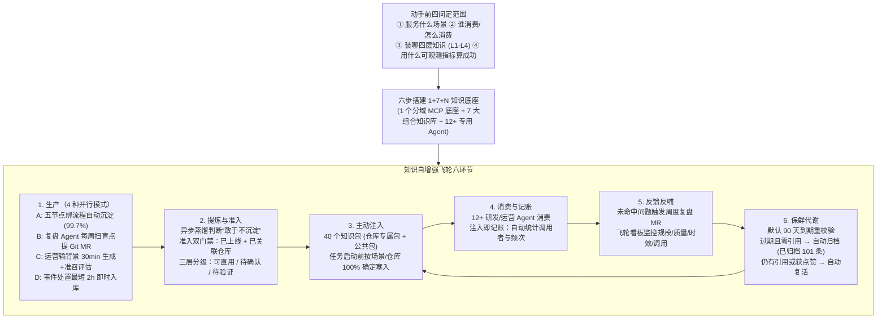

# Agent 的上限，可能不在模型，而在团队知识

## 1. TL;DR

当 Agent 成为团队一线生产力后，传统“人写 → 人找 → 人读”的文档仓库暴露出三大摩擦：**从 2000 篇模糊长文中捞不准那两三篇（检索精度低）、整篇塞入既烧 Token 又干扰注意力（注入效率低）、只进不出的过时内容误导决策（腐败失真）**。腾讯安全中心团队提出将知识库从静态“仓库”重构为动态**“供给系统”**，遵循**人机共读**原则，通过六步法落地了 **`1 + 7 + N` 架构**（1 个按业务域拆分的 MCP 能力底座、7 个文档/结构化/RAG 组合知识库、12+ 个专用 Agent 消费者）。核心工程机制是：**把知识生产绑死在研发/运营必经节点上（99.7% 自动沉淀）、设置“已上线 + 已关联仓库”准入双门禁、采用 90 天有效期保鲜与“零引用归档 + 有引用/点赞自动复活”、并在任务启动前由平台按场景打包知识包主动注入且“注入即记账”**，最终形成“生产 → 提炼 → 注入 → 消费 → 反馈 → 保鲜”六环自增强飞轮。

## 2. 核心概念

### 传统知识仓库 vs. AI 时代知识供给系统

| 对比维度 | 传统知识管理模式（仓库思维） | AI 时代知识底座（供给系统思维） | 为什么要做这一转变？ |
|---|---|---|---|
| **生产方式** | **人写人读**：靠行政要求或 KPI 催促员工写文档 | **流程自动生产 + Agent 消费 + 人做决策纠偏** | 靠人主动写一定失败；绑在必经流程节点上才能让知识成为零额外负担的副产品 |
| **内容形态** | **纯自然语言长文档**：语义边界模糊，只考虑人顺序通读 | **人机共读结构化卡片**（带适用条件、核心结论、应做/不应做，Markdown/YAML/JSON） | 结构化卡片让 Agent 检索准、局部注入省 Token；同时人看得懂才好维护、不易腐败 |
| **分发逻辑** | **被动搜索**：靠 Agent 临时决定是否搜索（不确定是否调用） | **平台按场景主动注入 + 注入即记账**（40 个仓库专属包与公共包，100% 确定到达） | 消除 Agent“漏搜/瞎搜”的不确定性，并自动追踪每条知识被谁用了几次 |
| **生命周期** | **静态存储、只进不出**：三个月即沦为低信噪比垃圾场 | **飞轮自增强**：准入双门禁 + 三层质量分级 + 90 天保鲜 + 自动退场与复活兜底 | 淘汰零引用过期噪声，同时防止有价值的常青知识被一刀切误杀 |

### 四层知识盘点模型（L1–L4）与三种存储形态组合

- **知识四层盘点模型**：
  - **L1 公共基础**：全团队通用的开发规范、编码约定（如日志、存储、RPC、鉴权等 `100+` 代码示例）。
  - **L2 业务领域**：按业务线组织的领域知识（平台文档、接入指南、业务架构）。
  - **L3 场景策略**：特定场景的决策规则与策略（如风控处置标准 `200+` 条、管控 Prompt 模板）。
  - **L4 事件增量**：从日常事件中实时提炼的新规则与踩坑卡片（如冲塔事件处置后沉淀的新标准、需求上线后自动提炼的卡片，案例团队 6 月单月新增 `716` 条）。
- **三种知识库形态组合使用（拒绝单一向量库包打天下）**：
  1. **文档型（如 iWiki + 新人专区 + 复盘长文）**：适合篇幅较长的背景知识、教程与架构说明。
  2. **结构化存储（Git / MySQL 存储 Markdown/YAML/JSON，渲染知识卡片）**：适合规则明确、需精确匹配且要求人机共读好维护的内容。
  3. **RAG 向量型（如 TRAG 向量检索）**：适合知识量大、以语义模糊匹配为主的场景。

## 3. 知识框架

## 4. 关键要点与机制详解

### 4.1 动手前四问与 MCP 分域架构（Step 1–Step 3）

**核心主张：做不好知识底座多数不是技术问题而是没想清楚目标；底层工具能力必须按业务域拆分为多个独立 MCP Server，严禁把所有工具堆进单个 Server。**

- **四问定边界（以端到端研发交付平台为例）**：
  1. **服务什么场景？** 锚定具体业务痛点（如从需求评审、技术方案、编码、Code Review 到上线的端到端交付），而非空喊“建知识库”。
  2. **谁来消费、怎么消费？** `12` 个研发 Agent 是第一消费者，研发工程师是审核者与纠偏者，新人通过知识库学习历史决策；必须用一套**人机共读**的结构化卡片同时服务人和 Agent。
  3. **装什么？** 按 `L1 公共基础 → L2 业务领域 → L3 场景策略 → L4 事件增量` 四层盘点，与代码仓库绑定。
  4. **怎么算成功？** 建立可观测指标（注入命中率、画像覆盖率、盲搜下降率、返工下降率、对话采纳率；案例目标为交付从天级压到小时级、代码审查从 `2～4 轮` 降至 `1.1 轮`、自动沉淀占比 `> 99%`）。
- **工具层“中台优先 + 按业务域拆分 MCP Server”**：
  - 优先复用现有中台，通过 MCP 适配层把底层数据库查询、日志检索、模型调用封装为标准化工具。
  - 🔥 **为什么要拆多个 MCP Server？** 大模型对单 Server 工具数量有上限，工具过多既浪费每轮 Schema Token，又会导致跨业务污染；按业务域拆成独立 MCP Server 后，各 Agent 只按需挂载自己需要的那组工具。

### 4.2 四种并行生产模式与“敢于不沉淀”（Step 4）

**核心主张：靠人主动写一定失败；必须把知识生产变成业务必经流程的自动副产品，并用异步蒸馏跳过无价值需求。**

| 生产模式 | 触发机制与运转链路 | 时效 / 占比数据（案例报告） |
|---|---|---|
| **模式 A：绑定流程自动沉淀（主力）** | 绑死在研发/运营的 5 个必经节点（提测通过、上线完成、事件关闭等），代码/流程跑过去知识自动留存并归属到对应责任人 | 占团队沉淀总量的 **`99.7%`**，成员几乎零额外工作感知 |
| **模式 B：复盘 Agent 驱动更新（用即积累）** | 如问答机器人 `O3 Buddy` 的复盘 Agent 每周扫描会话记录，遇到回答不了或未命中的盲点自动提交 `Git MR` 补知识 | `O3 Buddy` 6 月月均 `1,097` 条对话，采纳率达 **`92%`** |
| **模式 C：Agent 自动生成 + 准召评估** | 运营输入事件背景，Agent 自动转化为结构化知识卡片并执行准召评估 | 知识上线周期从**天级压缩至 `30 分钟`** |
| **模式 D：运营处置即时沉淀** | 处置新风险事件的同时提取规则，下一个同类事件 Agent 立即调用 | 最短 **`2 小时`** 完成入库生效 |

- **降噪关键——“敢于不沉淀”**：许多常规需求做完并没有值得沉淀的新知识；系统通过**异步蒸馏判断**主动跳过无增量价值的任务，确保知识库的**密度优先于体量**。

### 4.3 准入双门禁、90 天代谢复活与主动注入记账（Step 5–Step 6）

**核心主张：用“双门禁 + 90 天零引用归档/有引用复活”防止知识库沦为垃圾场，用“启动前知识包主动注入 + 注入即记账”消灭搜索不确定性。**

- **准入与保鲜四机制（Step 5）**：
  1. 🔥 **准入双门禁**：只有同时满足 **“已上线 + 已关联仓库”** 的知识才能正式转正进入 Agent 引用池；未上线或未关联仓库的一律暂存，防止半成品和作废方案污染 Agent。
  2. **三层质量分级**：按可信度自动划分为 **`可直接使用` / `待确认` / `待验证`**。
  3. **默认 90 天有效期保鲜**：到期触发重校验；在治理工作台中将“待审核、即将过期、待完善”条目集中呈现给知识 Owner，人工只做高价值复核。
  4. **自动退场 + 复活兜底**：到期且**零引用**的知识自动归档退场；但若**仍有被调用引用或被用户点赞**，系统自动触发**复活**，防止误杀常青核心知识（运行数月已自动归档 `101` 条、清理候选 `11` 条，过期治理完成率 **`90.2%`**）。
- **按场景主动注入与“注入即记账”（Step 6）**：
  - 不等 Agent 自己去搜，平台在 Agent 任务启动前，根据当前场景与目标仓库，将对应的**知识包**（已建 `40` 个，分为**仓库专属包**与**公共包**）100% 确定性地打包塞入上下文（例如需求评审 Agent 只订阅需求模板与历史踩坑，舆情 Agent 只订阅判定标准与 bad case）。
  - **注入即记账**：每次注入自动记录“哪条知识被哪个 Agent 在何时使用了多少次”，驱动四维飞轮运营看板（知识规模、质量、时效、AI 调用效果）与知识贡献榜（可直接写入员工绩效自评）。

## 5. 数据速查表

| 指标 | 原文数值 | 语境 / 条件 |
|---|---|---|
| 底座架构与知识包规模 | `1 + 7 + N`（`1` 个 MCP 底座、`7` 大知识库、`12+` 个专用 Agent）；`40` 个知识包 | 腾讯安全中心团队 AI 端到端研发与运营平台实践 |
| L1 与 L3 存量示例规模 | L1 通用代码示例 `100+` 个；L3 风控处置标准 `200+` 条 | 知识盘点章节披露的层级规模 |
| 流程自动沉淀占比 | **`99.7%`** | 由流程节点与 AI 自动沉淀、无需人工手写文档的比例 |
| 模式 C 与模式 D 入库时效 | 模式 C：天级降至 **`30 分钟`**；模式 D：最短 **`2 小时`** 入库 | 运营事件自动转结构化知识与即时沉淀时效 |
| 知识保鲜周期与治理完成率 | 默认有效期 **`90 天`**；已归档 `101` 条、清理候选 `11` 条，过期治理完成率 **`90.2%`** | 运行数月后的系统自动代谢数据 |
| 知识月新增爬坡序列 | 5 月 `86` 条 → 6 月 `716` 条 → 7 月前 9 天 `154` 条 | 团队知识底座持续运转月度增量 |
| 覆盖人群与 Agent 月均调用量 | `69` 人参与端到端研发（占部门 `57.5%`），`O3 Buddy` 月活 `50` 人，贡献者 `80+` 人；Agent 月均调用 **`2,000+` 次**（`OK 840` + `O3 Buddy 1,097`，采纳率 **`92%`**） | 6 月团队内部运营看板统计 |
| 业务交付与提效结果（团队自报） | 需求交付：天级 → **小时级**；代码审查轮次：`2～4 轮` → **`1.1 轮`**（耗时 `30min～2h` → 平均 **`3.4 分钟`**）；新人上手：`30 天` → **`10 天`**；风险事件日处置量：`400 条` → **`1,200 条`**（取消舆情通宵班） | 团队内部实践前后对比报告值 |

## 6. 踩坑与教训 / 可迁移的设计原则

### 四条知识库建设反模式（错误做法 → 失败表现或原因 → 原文应对）

1. **反模式一：把“给人看的知识”和“给 Agent 看的知识”做成两套，或强压 KPI 逼人写文档**：
   - **错误做法**：单独维护一套只有机器能读的晦涩配置，或靠行政命令摊派写文档 KPI。
   - **失败表现或原因**：人看不懂的卡片很快因没人维护而腐败；被 KPI 逼出来的文档质量极低、凑数严重。
   - **原文应对**：坚持**人机共读**（一套结构化卡片同时服务人与 Agent），并将沉淀绑在研发/运营必经流程节点上自动完成（`99.7%` 自动沉淀），辅以可写进自评的知识贡献榜正向激励。
2. **反模式二：只进不出、无准入门禁导致知识库无限膨胀**：
   - **错误做法**：需求还在草稿阶段或未关联代码仓就放进检索池，且永不清理旧文档。
   - **失败表现或原因**：三个月内知识库就被半成品与过期规则淹没，信噪比暴跌并误导 Agent 决策。
   - **原文应对**：入口设**“已上线 + 已关联仓库”双门禁**（不满足一律暂存），过程设**异步蒸馏“敢于不沉淀”**，出口设 **90 天有效期 + 零引用自动归档 + 有引用/点赞自动复活**。
3. **反模式三：把所有工具堆进单个 MCP Server，且完全指望 Agent 自己搜索知识**：
   - **错误做法**：一个大一统 MCP Server 暴露几十上百个跨业务工具，任务启动时不给知识包，等 Agent 想起来再去搜。
   - **失败表现或原因**：单 Server 工具过多撑爆上下文并造成跨业务串味；Agent 经常忘记搜索或搜不准。
   - **原文应对**：按业务域拆分为多个独立 MCP Server 按需挂载；任务启动前由平台按场景与仓库**主动注入知识包（100% 确定到达）**并自动记账。
4. **反模式四：隐性知识锁在专家脑中，离职即带走全部 Know-how**：
   - **错误做法**：缺乏故障复盘与交接萃取机制，依赖“问对人才能拿到答案”。
   - **原文应对**：建立故障复盘专项（如沉淀 `11+` 篇故障复盘作为错题本）、换岗交接清单与专家萃取机制，实现知识平权。

### 可迁移的设计原则（直接复用 vs. 因地制宜清单）

- **可直接跨团队复用的骨架**：动手前四问定目标、必经节点绑流程自动沉淀、“已上线+关联仓库”准入双门禁、三层质量分级（可直用/待确认/待验证）、有效期退场+引用复活机制、知识包主动注入、注入即记账。
- **需按自身业务定制的参数**：具体触发的 5 个流程节点、知识卡片的具体 YAML/Markdown 字段结构、MCP Server 的业务域切分粒度，以及保鲜周期（案例默认 `90 天`，需按业务知识实际折旧速度调整）。

## 7. 记忆锚点

1. **核心理念锚点**：「传统知识库是“仓库”（追求存得多），AI 时代的知识底座是“供给系统”（追求产得出、找得准、喂得进、淘汰得掉）。」
2. **六步与飞轮口诀（助记改写）**：「四问定范围，四层盘家底（L1-L4），三库组合建（文档/结构化/RAG），MCP 按域拆；五节点自动产（99.7%），双门禁卡准入（上线+关联仓），90 天零引用退场、有引用复活，知识包主动注、注入即记账。」

## 8. 复习卡片

AI 时代 Agent 消费团队知识时，真正卡住它的两个核心摩擦是什么？为什么要坚持“人机共读”原则？::两个核心摩擦是“检索精度”（纯自然语言长文语义边界模糊，难从 2000 篇中捞准两三篇）和“注入效率”（整篇塞入既贵又干扰注意力）；坚持“人机共读”（带适用条件、核心结论、应做/不应做的结构化卡片）是因为既能让 Agent 精准检索和局部注入，又能让人看懂并持续维护，避免两套知识割裂腐败。
作者提出的“四层知识盘点模型（L1–L4）”和“三种知识库组合形态”分别是什么？::四层模型是 L1 公共基础（通用规范与代码样例）、L2 业务领域（平台文档与架构）、L3 场景策略（风控标准与 Prompt 模板）、L4 事件增量（日常事件与上线提炼的新卡片）；三种组合形态是文档型（存长背景与教程）、结构化存储（Git/MySQL 存精确匹配的规则卡片）和 RAG 向量型（存海量语义匹配内容）。
为什么底层工具平台不能把所有工具堆在一个 MCP Server 里？::因为大模型对单个 MCP Server 的工具数量有上限，工具过多不仅会增加每轮上下文 Token 消耗，还会造成不同业务域之间的混杂干扰；应按业务域拆分为多个独立的 MCP Server，让各 Agent 只按需接入所需工具组。
团队是如何做到 99.7% 的知识由流程自动沉淀而无需人工特意写文档的？还有哪三种并行生产模式？::主力模式 A 是将知识沉淀绑死在研发/运营的 5 个必经节点（如提测通过、上线完成、事件关闭）上，并配合异步蒸馏判断“敢于不沉淀”无增量需求；另外三种是模式 B（复盘 Agent 每周扫描会话未命中盲点自动提 Git MR）、模式 C（运营输入背景由 Agent 30 分钟内生成结构化知识并做准召评估）和模式 D（事件处置时最短 2 小时即时沉淀规则入库）。
知识进入 Agent 正式引用池需要通过什么“准入双门禁”？90 天有效期保鲜机制如何防止误杀高价值知识？::准入双门禁是“已上线 + 已关联代码仓库”（未满足的一律暂存）；保鲜机制默认 90 天到期重校验，对“过期且零引用”的知识自动归档退场，但对“仍有引用调用或被用户点赞”的知识自动触发复活。
在知识分发环节，“平台主动注入”相比“让 Agent 自己搜索”有什么优势？什么是“注入即记账”？::主动注入是在 Agent 启动任务前，由平台按当前场景与目标仓库将订阅的“知识包”（分仓库专属包与公共包）打包塞入上下文，实现 100% 确定到达；“注入即记账”是指系统在注入时自动记录每条知识被哪个 Agent 使用及使用次数，无需人工填报即可驱动飞轮看板与贡献榜。

## 9. 知识关联

### 本库主题入口与已有关联笔记

- [Agent长期记忆](../../20_topics/Agent%E9%95%BF%E6%9C%9F%E8%AE%B0%E5%BF%86.md)：四层知识盘点、准入双门禁、90 天有效期保鲜与主动注入飞轮。
- [检索与文档解析](../../20_topics/%E6%A3%80%E7%B4%A2%E4%B8%8E%E6%96%87%E6%A1%A3%E8%A7%A3%E6%9E%90.md)：文档型、结构化卡片与 RAG 向量检索的三库组合选型。
- [决策知识结构化](../../20_topics/%E5%86%B3%E7%AD%96%E7%9F%A5%E8%AF%86%E7%BB%93%E6%9E%84%E5%8C%96.md)：人机共读卡片设计与隐性专家经验显性化萃取。
- [AI研发协同](../../20_topics/AI%E7%A0%94%E5%8F%91%E5%8D%8F%E5%90%8C.md)：研发五节点自动沉淀、O3 Buddy 复盘提 MR 与新人三阶段培养提速。

### 候选双链（供 Obsidian 知识库导航）

- **本库知识与记忆系列**：[[团队记忆实践]]、[[AI Coding团队经验系统]]、[[Agent自进化飞轮]]、[[WorkBuddy 多人协作]]、[[上下文工程]]

## 10. 原文参考资料

- **本目录归档文件**：[RAW.pdf](RAW.pdf)｜[MD.md](MD.md)
- **原文提及的内部系统与协议**：腾讯安全中心 AI 端到端研发平台、综合问题问答机器人 `O3 Buddy`、`OK`、iWiki、TRAG、MCP（Model Context Protocol）

> [!note]- 校对报告
> - **覆盖度核验**：已完整通读 `MD.md`（共 12 页，p.1–10 为技术正文，p.11 为公众号阅读量与留言入口，p.12 为空白尾页）并核对 `META.json` 记录。完整覆盖重建知识库两大痛点（检索精度、注入效率）与人机共读原则、三大范式转变、动手前四问、六步搭建法（L1–L4 四层盘点与 `1+7+N` 结构、三类存储组合、MCP 按业务域拆分、A/B/C/D 四种并行生产模式、双门禁+三层分级+90 天退场复活治理、40 个知识包主动注入与记账）、六环自增强飞轮与三项巧劲（用即积累、注入即记账、敢于不沉淀）、四条反模式及团队落地量化成效。
> - **关键数据逐项核对**：
>   1. **架构与盘点规模**（p.1, p.3–4, p.6）：文档基数示例 `2000` 篇；`12` 个（后文扩展为 `12+` 个）专用 Agent；L1 代码示例 `100+`、L3 风控标准 `200+` 条、L4 在 6 月新增 `716` 条；`1+7+N` 架构；`40` 个知识包。
>   2. **生产与治理指标**（p.3, p.5, p.8, p.10）：流程自动沉淀占比 `99.7%`（目标 `>99%`）；模式 C 周期降至 `30 分钟`，模式 D 最短 `2 小时`入库；默认有效期 `90 天`，已归档 `101` 条、清理候选 `11` 条，过期治理完成率 `90.2%`；知识月增速：5 月 `86` 条 → 6 月 `716` 条 → 7 月前 9 天 `154` 条。
>   3. **消费与业务成效指标**（p.3, p.8, p.10）：`69` 人参与端到端研发（占部门 `57.5%`），`O3 Buddy` 月活 `50` 人，贡献者 `80+` 人；Agent 月均调用 `2,000+` 次（`OK 840` + `O3 Buddy 1,097`，采纳率 `92%`）；故障复盘 `11+` 篇；新人上手从 `30 天` 压至 `10 天`；代码审查轮次从 `2-4 轮` 降至 `1.1 轮`、耗时从 `30 分钟～2 小时` 降至平均 `3.4 分钟`；风险事件日处置量从 `400 条` 涨至 `1,200 条`。
> - **事实边界与局限说明**：所有提效数字均为安全中心团队案例自述，原文未提供独立对照组实验，笔记已明确标注其语境与可迁移/需定制的边界。
> - **格式自检**：全文仅 1 个 H1 标题；正文、表格、Mermaid 图与复习卡片均无页码/章节出处标注；复习卡片共 6 条，严格采用单行 `问题::答案` 格式。
