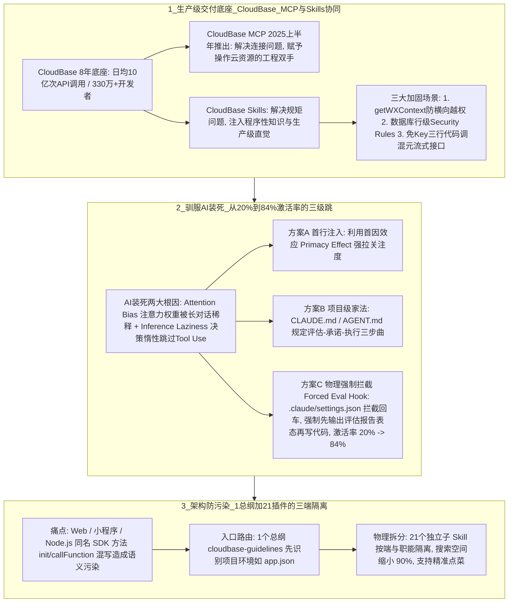

# Agent技能与生产交付

## 1. TL;DR

本文围绕腾讯云开发（CloudBase）团队将 **8 年 Serverless 云端经验（支撑日均 10 亿次 API 调用、服务超 330 万开发者）** 封装为 **CloudBase Skills** 的实战复盘，系统回答了两个核心工程问题：
1. **如何让 AI 写的代码不再“死在本地（localhost）”，直接达到生产级上线标准？** 通过“**MCP（提供操作云端的工程双手） + Skills（注入懂规矩的岗位操作手册/程序性知识）**”黄金组合，在身份认证（用 `cloud.getWXContext()` 原生上下文替代前端传参防横向越权）、数据安全（下沉 `auth.uid == doc._openid` 数据库行级安全规则防接口裸奔）、大模型调用（云端托管 Key + 3 行代码流式调用防硬编码泄露）三大场景守住工程下限。
2. **如何解决 AI“有 Skill 却装死不用（默认主动调用率仅 20%）”与“三端语法混写”的顽疾？** 剖析了 Transformer **注意力权重稀释**与**推理决策惰性**两大根因，提出“首行注入、项目级 `CLAUDE.md/AGENT.md` 家法、以及编辑器 **Forced Eval Hook（强制拦截先写评估报告再写代码）**”三套方案，将技能激活率从 **20% 暴力拉升至 84%**；同时采用 **“1 个总纲（`cloudbase-guidelines`）+ 21 个独立子 Skill”** 的三端物理隔离架构，将搜索空间缩小 **90%**，彻底根除 Web、小程序与 Node.js 的语义污染。

## 2. 问题定义与背景

### 2.1 Vibe Coding 的“本地舒适区”困境
当前开发者沉迷于 Vibe Coding 在本地 `localhost` 快速生成漂亮 UI 原型的快感，但一旦进入真实上线环节就会遭遇断层：AI 缺乏对真实后端底座的感知，写出的代码往往是“Demo 级局部最优解”——信任前端传来的 `userId`、数据库接口裸奔、把大模型 API Key 硬编码在前端，导致代码“只能活在本地，一上线全是安全漏洞”。

### 2.2 Agent Skills 开放规范与渐进式加载机制
- **演进历程**：Skills 最早由 Anthropic 于 **2025 年 10 月**在 Claude Code 中推出，并于 **2025 年 12 月**正式成为开放规范（`agentskills.io`），获 Claude、Cursor、VS Code、GitHub Copilot、OpenCode 等主流工具兼容支持。
- **标准目录结构**：以包含元数据（`name`、`description`）与核心指令的 `SKILL.md` 为中心，按需捆绑 `scripts/`（可执行代码）、`references/`（参考文档）与 `assets/`（模板资源），本质是为高智商但零经验的“实习生 AI”注入**程序性知识（Procedural Knowledge，即岗位 SOP）**。
- **渐进式加载（Progressive Disclosure）三阶段**：
  1. **Discovery（发现）**：启动时仅加载每个 Skill 的 `name` 与 `description`，极小化上下文占用；
  2. **Activation（激活）**：当用户任务与描述语义匹配时，才按需将完整 `SKILL.md` 读入上下文；
  3. **Execution（执行）**：遵循指令执行任务，并动态按需读取 `references` 或运行 `scripts`。

## 3. 知识框架

## 4. 核心内容拆解

### 4.1 CloudBase Skills 注入生产级标准的三大典型场景
通过 `npx skills add tencentcloudbase/skills` 安装后（CodeBuddy IDE 已内置），Skills 会强制扭转 AI 的脆弱编码习惯：
1. **场景一：身份认证——拒绝“相信前端输入”，根除横向越权**
   - **实习生 AI（Before）**：直接从前端请求参数解构 `const { openid } = event.params` 并查询数据库，攻击者只需抓包篡改 ID 即可横向越权读取任意用户隐私。
   - **专家 AI（After，加载 `auth-wechat` Skill）**：强制弃用前端传参，改用云底座不可伪造的原生上下文 `const { OPENID } = cloud.getWXContext()`。
2. **场景二：数据安全——从“接口裸奔”到数据库入口“行级安全规则”**
   - **实习生 AI（Before）**：直接暴露数据库 CRUD 接口，完全依赖业务层代码逻辑做权限判断，一旦业务代码写出 Bug 数据库即处于裸奔态。
   - **专家 AI（After）**：引导 AI 将权限校验下沉至数据库物理入口，直接配置底座 **Security Rules（安全规则）**，如为集合定义 `auth.uid == doc._openid`，即使业务代码有漏洞也能在底层物理沙箱拦截越权修改。
3. **场景三：AI 大模型集成——消灭前端 Hardcoded Key，三行代码流式闭环**
   - **实习生 AI（Before）**：将 API Key 硬编码在前端代码中，并手写冗长脆弱的流式解析逻辑。
   - **专家 AI（After）**：将 API Key 托管于云端环境变量实现前端“零泄露”，并通过底层 SDK 原生调用（`wx.cloud.extend.AI.createModel("hunyuan-exp")` $\to$ `model.streamText({ model: "hunyuan-turbos-latest", ... })` $\to$ `for await (const text of res.textStream)`）几行代码稳健处理流式输出。

### 4.2 MCP vs Skills：为什么是 AI 编程的“黄金组合”？
- **CloudBase MCP（2025 年上半年推出，“工程双手”）**：解决“**连接与权限**”问题，让 AI 能在 Cursor、Claude Desktop、VS Code 中直接查询云端状态、创建资源、拉取日志。
- **CloudBase Skills（后发制人，“岗位手册”）**：解决“**懂规矩与工程直觉**”问题。仅有 MCP 的 AI 就像“力气大但鲁莽的实习生”，在生产环境盲目调工具极不安全；叠加注入了程序性知识的 Skills 后，AI 才真正进化为“**懂规矩、有权限**”的资深云开发专家——“**AI 提供逻辑的上限，Skills 守住工程的下限，CloudBase 承载物理底座。**”

### 4.3 驯服 AI“装死不调 Skill”：从 20% 到 84% 激活率的实战复盘
1. **为什么配好了 Skill，AI 却视而不见（默认激活率仅 ~20%）？**
   - **注意力权重稀释（Attention Bias）**：在 Transformer 自注意力计算中，随着多轮对话深入，用户当前业务需求 Prompt 的权重越来越高，作为背景板的外部 Skills 描述权重被严重稀释。
   - **推理决策惰性（Inference Laziness）**：调用 Skill 是一次额外的 Tool Use；模型在路径评估时，若认为靠预训练脑海里的旧知识（通常是 Localhost 模式）就能糊弄出一段“看似正确”的代码，就会为节省推理开销直接跳过查手册。
2. **三套递进式硬核工程解法**：
   - **方案 A：首行注入（利用首因效应 Primacy Effect）**：在每次提问最开头强行加上一句调用指令，利用模型对序列最前端 Token 的高关注度拉升激活率（最土但稳，缺点是需每次手打）。
   - **方案 B：项目级“家法”（System Rules，`CLAUDE.md` / `AGENT.md`）**：在项目根目录写入强制工作流规则（`0. 必须先读 cloudbase-guidelines` $\to$ `1. 评估可用 Skills` $\to$ `2. 在输出中显式陈述调用理由与承诺` $\to$ `3. 禁止跳过规矩直接写代码`）。缺点是在超长上下文后期仍可能被遗忘。
   - **方案 C：自动化“强制物理拦截”（Forced Eval Hook，激活率从 20% 跃升至 84%）**：借鉴技术专家 Scott Spence 的实测方案，利用编辑器 Hook 机制（如 `.claude/settings.json`）充当中间件，在用户按下回车的瞬间自动拦截并改写 Prompt，**强制 AI 在输出任何代码前必须先白纸黑字打印一段“Skill 评估报告”**（逐一回答：当前有哪些 Skill 可用？针对本需求是否需要调用？理由是什么？）。一旦模型在输出开头写下“我需要调用某工具”的书面承诺，自回归生成的后续 Token 就会严格兑现该承诺，彻底根除决策惰性。

### 4.4 架构复盘：为什么必须采用“1 个总纲 + 21 个独立插件”？
- **痛点（“端不分”与语义污染）**：Web、微信小程序、Node.js 的 CloudBase SDK 方法名高度相似（如都有 `init`、`callFunction`）。若将所有文档塞进一个单体“全家桶” Skill，AI 在写小程序代码时会频繁混入 Web 端 SDK 语法，且庞大的手册会稀释专项任务（如微信支付）的注意力。
- **解法（“环境即边界 Environment as Boundary”——总纲路由 + 三端隔离）**：
  设计 **1 个总纲入口（`cloudbase-guidelines`）+ 21 个按端与职能拆分的独立子 Skill**。总纲充当语义路由器，先根据项目特征（如检测到 `app.json` 即判定为小程序环境）锁定端边界，再按需仅挂载对应端的子 Skill。
- **收益**：直接屏蔽跨端干扰项，将 AI 的检索与推理**搜索空间缩小 90%**，同时支持开发者在 AI 逻辑混乱时直接点名调用特定子 Skill（如 `调用 auth-web 检查手机号登录`）进行局部精准纠偏。

## 5. 数据速查表

| 指标 / 维度 | 原文数值 | 语境 / 条件 |
| :--- | :--- | :--- |
| **CloudBase 底座服务规模** | 日均 **10 亿次** API 调用 / 服务超 **330 万**开发者 | 自 2018 年起推出的 Serverless 全栈云底座经验沉淀 |
| **Agent Skills 推出与标准化时间** | **2025 年 10 月**推出 $\to$ **2025 年 12 月**成为开放规范 | Anthropic 首发于 Claude Code，后开放为 `agentskills.io` 标准 |
| **无干预下 AI 主动调用 Skill 激活率** | 约 **20%** | 回归测试中因注意力稀释与推理决策惰性导致的“装死”比例 |
| **引入 Forced Eval Hook 后激活率** | **84%**（从 **20%** 大幅拉升） | 参考 Scott Spence 实测，通过 `.claude/settings.json` 强制先输出评估报告表态 |
| **CloudBase Skills 分布式架构规模** | **1 个总纲**（`cloudbase-guidelines`）+ **21 个独立 Skill** | 按 Web、小程序、Node.js 三端物理隔离与职能拆分 |
| **总纲路由对搜索空间的压缩率** | 搜索空间缩小 **90%** | 判定项目环境（如 `app.json`）后仅挂载对应端插件，屏蔽异端语法干扰 |
| **一键安装命令** | `npx skills add tencentcloudbase/skills` | CodeBuddy IDE 在连接 CloudBase 后会自动下载至项目中 |

## 6. 踩坑与教训 / 可迁移的设计原则

| 错误做法 | 失败表现或原因 | 原文应对（可迁移的设计原则） |
| :--- | :--- | :--- |
| **把 Web、小程序、Node.js 多端文档全塞进一个单体“全家桶” Skill** | 同名方法（如 `init`、`callFunction`）产生严重“语义污染”，AI 在小程序里写出 Web SDK 语法，导致代码无法上线 | **环境即边界（1 总纲 + N 子插件三端物理隔离）原则**：用轻量级总纲 Skill（`cloudbase-guidelines`）先探测项目环境特征，再按端挂载独立子 Skill，缩小 90% 搜索空间 |
| **仅把 Skills 放进目录，指望大模型凭自觉在多轮长对话中主动翻阅调用** | 受 Attention Bias（业务 Prompt 稀释背景权重）与 Inference Laziness（觉得预训练旧知识够用就跳过 Tool Use）影响，主动激活率仅 20% | **Forced Eval Hook 强制表态拦截原则**：通过编辑器 Hook（`.claude/settings.json`）在提问入口注入中间件，强迫 AI 写代码前必须先输出“可用 Skill 评估与调用承诺报告”，利用自回归一致性将激活率拉升至 84% |
| **纵容 AI 按预训练直觉写后端鉴权、数据库操作与大模型调用代码** | 前端传 `userId` 招致横向越权、数据库无规则裸奔、前端硬编码泄露大模型 API Key | **底座原生互信与安全下沉原则**：通过 Skill 强制约束使用不可伪造的原生上下文（`cloud.getWXContext()`）、数据库入口行级安全规则（`auth.uid == doc._openid`）及云端托管凭证 |

## 7. 记忆锚点

- **三层分工金句**：“**AI 提供逻辑的上限，Skills 守住工程的下限（岗位手册），MCP 提供工程的双手（安全连接），CloudBase 承载物理底座。**”
- **驯服 AI 装死三板斧**：“**首行咒语抓首因，根目录家法立规矩，Hook 拦截逼表态（激活率 20% 飙至 84%）。**”
- **防语义污染架构**：“**1 个总纲探环境，21 个插件分三端，搜索空间砍九成。**”

## 8. 复习卡片

为什么 Vibe Coding 生成的代码常常“死在本地（localhost）”，难以直接用于生产环境？::因为 AI 缺乏对真实后端生产底座的感知，倾向于生成“Demo 级局部最优解”（如相信前端传参导致横向越权、直接暴露数据库接口裸奔、在前端硬编码 API Key），缺少生产级的安全与架构约束。
CloudBase Skills 在身份认证、数据库安全与大模型接入三个场景中分别强制注入了什么生产级规范？::1. 身份认证：禁止相信前端传来的 `openid`，强制调用不可伪造的底座原生上下文 `cloud.getWXContext()`；2. 数据库安全：将校验下沉至数据库入口的安全规则（Security Rules，如 `auth.uid == doc._openid`）实现行级物理隔离；3. 大模型接入：API Key 托管在云端环境变量实现前端零泄露，并用底层 SDK 三行代码完成流式调用。
在 AI 原生开发生态中，MCP 与 Agent Skills 的定位有何本质区别与互补关系？::MCP（模型上下文协议）解决的是“连接与权限”问题，相当于给 AI 装上操作云资源的“工程双手”；Skills 解决的是“程序性知识（SOP）与工程规范”问题，相当于给 AI 发一本懂规矩的“岗位手册”，两者结合让 AI 从“鲁莽的实习生”进化为“懂规矩、有权限的专家”。
为什么配置好 Skills 后，AI 在不加干预时的主动调用率只有 20% 左右？::源于大模型底层的两个机制：1. 注意力权重稀释（Attention Bias）：对话越深，业务需求权重越高，背景中 Skills 的权重被稀释；2. 决策惰性（Inference Laziness）：模型认为靠预训练旧知识就能写出“看似正确”的代码，为节省推理成本而跳过 Tool Use。
如何通过工程手段将 AI 的 Skill 激活率从 20% 提升到 84%？::采用“自动化强制拦截（Forced Eval Hook）”：通过配置编辑器的 Hook（如 `.claude/settings.json`）在按下回车时拦截改写 Prompt，强制 AI 在输出任何代码前必须先白纸黑字输出一段“可用 Skill 评估报告”并明确表态承诺要调用的 Skill，从而打破决策惰性。
为什么 CloudBase Skills 要设计成“1 个总纲（`cloudbase-guidelines`）+ 21 个独立子 Skill”而不是一个大而全的技能包？::因为 Web、小程序和 Node.js 的 SDK 方法名极度相似（如 `init`、`callFunction`），合在一起会导致严重的跨端“语义污染”与注意力稀释；通过 1 个总纲先识别项目环境（如 `app.json`）再按需加载对应端的独立子 Skill，可将搜索空间缩小 90%，并支持开发者精准点名调用。

## 9. 知识关联

- **本库通用主题**：[Harness与模型协同](../../20_topics/Harness%E4%B8%8E%E6%A8%A1%E5%9E%8B%E5%8D%8F%E5%90%8C.md) · [AI研发协同](../../20_topics/AI%E7%A0%94%E5%8F%91%E5%8D%8F%E5%90%8C.md) · [Skill设计与治理](../../20_topics/Skill%E8%AE%BE%E8%AE%A1%E4%B8%8E%E6%B2%BB%E7%90%86.md)
- **候选双链**：[[从具体问题开发Skills]] · [[渐进式披露与上下文管理]] · [[Forced-Eval-Hook技能激活]] · [[Serverless行级安全规则]]

## 10. 原文参考资料

- 原文标题：《AI 编程的下半场来了？学会用 Agent Skill 解决编程的痛点问题》（作者：bookerzhao，发布于 2026-03-02）
- 核心开源仓库与参考链接：
  - Agent Skills 开放规范：`https://agentskills.io/`
  - CloudBase Skills 仓库：`https://github.com/TencentCloudBase/Skills`（安装命令：`npx skills add tencentcloudbase/skills`）
  - CloudBase MCP 仓库：`https://github.com/TencentCloudBase/CloudBase-MCP`
  - Scott Spence 实测研究：*How to Make Claude Code Skills Activate Reliably*（`https://scottspence.com/posts/how-to-make-claude-code-skills-activate-reliably`）

> [!note]- 校对报告
> - **页码溯源汇总**：
>   - `p.1–4`：Vibe Coding 本地舒适区痛点、Anthropic 2025 年 10 月推出 Skills 与 2025 年 12 月开放规范、标准目录结构、渐进式加载（Discovery / Activation / Execution）三阶段。
>   - `p.5–12`：CloudBase 8 年经验（日均 10 亿次 API 调用、330 万+开发者）及三大生产级加固场景（`cloud.getWXContext()` 防横向越权、`auth.uid == doc._openid` 数据库安全规则、云端托管 Key 三行代码调 `hunyuan-turbos-latest` 流式输出）。
>   - `p.13–17`：“环境即边界（总纲路由，三端隔离）”理念、CloudBase MCP（2025 年上半年推出，“工程双手”）与 CloudBase Skills（“岗位手册”）黄金组合对比、CodeBuddy IDE 内置支持。
>   - `p.18–22`：AI 装死两大根因（Attention Bias 注意力权重稀释、Inference Laziness 决策惰性，默认激活率仅 20%）、三套硬核解法（方案 A 首行注入首因效应、方案 B `CLAUDE.md/AGENT.md` 家法、方案 3 Scott Spence 的 Forced Eval Hook 将激活率从 20% 拉升至 84%）、“1 个总纲 + 21 个独立 Skill”架构缩小 90% 搜索空间、核心名词解释与参考链接。
> - **核验结论**：全文所有量化指标、代码示例逻辑与架构设计原则均与原文完全吻合。
