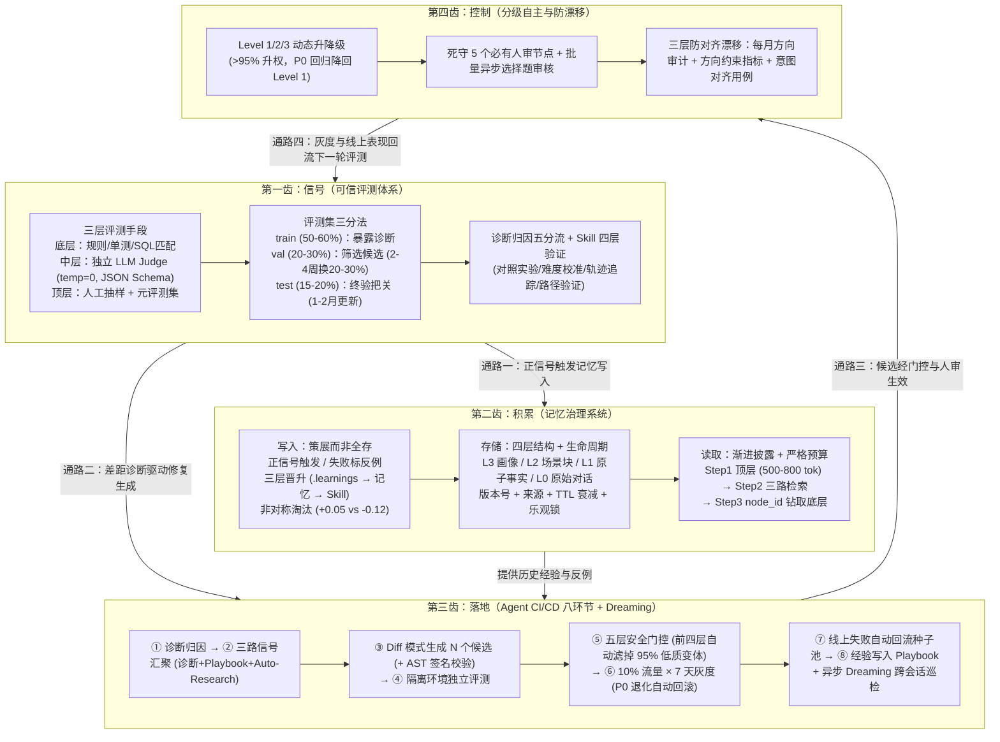

# 一篇讲透 Agent 自进化飞轮怎么搭：评测 → 记忆 → 落地 → 控制

## 1. TL;DR

大多数团队虽各自建设了评测、向量记忆和 Skill 自动生成，却因**环节间的数据通路断裂**而无法产生复利。本文提出一套聚焦于 **Harness 层（记忆、Skill、Prompt、工具配置与工作流）** 的“四齿自进化飞轮”工程体系：① **评测（信号源）**承担方向指引、质量门控与经验筛选三重职责，通过底层规则/中层独立 Judge/顶层元评测集分层校验，以及 `train / val / test` 评测集三分法防止过拟合与弱评估器偏差；② **记忆（积累）**以“治理而非存储”为核心，采用正信号策展写入、反例独立标记、三层晋升与非对称淘汰（坏经验淘汰速度是好经验强化的 `2.4 倍`），配合四层存储与严格 Token 预算按需钻取；③ **落地（Agent CI/CD）**通过八环节链路（三路信号汇聚、Diff 模式生成、隔离环境评测、五层门控、10%×7 天灰度自动回滚、回流与 Playbook 沉淀）及异步 **Dreaming** 巡检把改进安全推上线；④ **控制（人机协作）**通过三级渐进放权、死守五个必有人审的刚性节点及每月方向性审计对抗“对齐漂移”。

## 2. 核心概念

### “自进化”三层定位：为什么 Harness 层是当前主战场？

| 进化层级 | 修改对象 | 作用范围与持久性 | 成本、风险与工程定位（据原文） |
|---|---|---|---|
| **第一层：Artifacts 迭代** | 当前任务的输出产物（如用 Self-Refine 让代码多改几稿） | **仅限单次任务**：任务结束 Agent 本身无任何改变，下次遇到同类问题不会更快 | 属于“打草稿”而非真正进化；技术已成熟（Test-time Compute Scaling），非本文重点 |
| **第二层：Harness 自改进** | **记忆、Skill 文件、Prompt、工具配置、工作流**（持久化至文件或数据库） | **跨会话持续生效**：改一次后续所有任务受益（例如写一条日期格式转换 Skill） | **即时、可控、高性价比（本文主战场）**：改完立刻生效、无需重训模型，改错可一键回滚；落地案例报告迭代次数 `-70%`、Token `-80%+` |
| **第三层：Model 进化** | 模型权重参数本身（通过 Agent RL、自对弈微调写入权重） | **持久性最强**：模型自身“学会”该能力 | 成本最高、训练周期长、不可逆风险大（如 `MiniMax M2.7` 等仍在探索），距普通团队日常生产落地尚有距离 |

### 核心概念辨析

- **Playbook（进化流水线专属经验库） vs. Agent 通用长期记忆**：
  - **Agent 通用长期记忆**：服务于“Agent 怎么做业务任务”（存用户画像、领域事实、任务反例与操作 Skill）。
  - **Playbook**：服务于“怎么改 Agent”（记录每一轮自进化实验尝试了哪些修复方向、哪些有效、哪些踩坑无效），供下一轮生成修复候选时参考以避免原地打转。
- **同步评测进化 vs. 异步 Dreaming（做梦式进化）**：
  - **同步评测**：单次任务结束后立即评判好坏、归因修复，像“每次作业批改”，解决单任务明显错误。
  - **Dreaming（源自 Anthropic 2026.5）**：在空闲时异步扫描最近 N 天的大批历史会话轨迹，寻找跨会话反复出现的小毛病、低效绕路或高频外部查询的知识缺口，像“期中总结”，仅输出带优先级的结构化修订建议供人审阅，不直接修改系统。
- **对齐漂移（Alignment Drift）**：即便每次微小的 Prompt/Skill 修改都通过了局部无回归门控，多轮迭代累积后整体行为仍可能偏离人类初始意图（例如因评估器隐性偏好详细回答，导致 Agent 演化得越来越啰嗦，偏离“准确且简洁”的初衷）。

## 3. 知识框架

## 4. 关键要点与机制详解

### 4.1 第一齿（信号）：破解七大评测难题、三分法防泄漏与 Skill 四层增量验证

**核心主张：评测的可信度 > 系统的复杂度；在自进化闭环中，失真的评估器会产生系统性错误正反馈，诱导 Agent 将错误经验写入记忆与 Skill，加速开往悬崖。**

- **评测面临的七大核心难题**：
  1. **弱评估器（最致命）**：LLM Judge 常有偏好长文本、偏好特定编号列表格式、偏好编造数据表面正确性的系统性偏差，会诱导 Agent 进化得越来越冗长。
  2. **只评最终答案漏掉过程维度**：忽略“中间幻觉但碰巧答对”“工具调用冗余耗 5 倍 Token”“靠死记硬背碰巧答对”。
  3. **评估粒度与成本博弈**：粗粒度（整任务成败）无法定位错在哪；细粒度（每步 Step/Tool Call）一轮需数百至上千次 LLM 调用。解法：**日常用粗粒度快速筛，仅对失败 Case 做细粒度深度归因**。
  4. **开放式任务难量化**：写作、规划无唯一标准答案。解法：**用成对偏好排序（A vs B 谁更好）代替绝对打分**，或采用**“AI 初筛过滤 + 人工复核有争议的 `10%～20%`”**。
  5. **评测集漂移**：评测集半年不更新，线上分布已变卻在旧集刷高分。
  6. **预算不公平**：靠 `Best-of-N` 采样或多次重试砸出高分（消耗 3 倍 Token 换 10% 提升不算进化，必须在**相同 Token 预算**下对比）。
  7. **全量评测成本过高**：每次小改都跑全集吃不消，需拆为“每次改动跑核心轻量回归 + 定期跑全量评测”。
- **四大工程建设机制**：
  1. **三层评估器架构與四条防偏铁律**：
     - 底层：零成本、100% 客观的**规则与自动化校验**（代码编译、测试通过、SQL 结果比对、格式与耗时检查）。
     - 中层：**LLM-as-Judge + 对照实验**，严守四条铁律——**① 生成模型与评估模型分离；② Judge `temperature = 0`；③ 用 Pydantic / JSON Schema 强制结构化输出；④ 分维度独立评估（禁止一次调用同时评正确性+完整性+格式+效率）**。
     - 顶层：**人工随机抽样复核 + 元评测集（几十条明确标注“绝对正确/绝对错误”的极端样本）**，定期检验评估器自身是否漂移。
  2. **评测集 `train / val / test` 三分法与动态换血**：
     - `train` 集（`50%～60%`）：仅用于诊断失败模式，诊断信息可暴露给修复生成 LLM，持续追加线上新失败样本。
     - `val` 集（`20%～30%`）：仅用于筛选候选变体是否优于基线，**严禁暴露给生成修复方案的 LLM**，每 `2～4 周` 更新一批（替换 `20%～30%` 旧样本）。
     - `test` 集（`15%～20%`）：上线前最终独立把关，每 `1～2 月` 更新一次；三集按问题类型分层抽样。
  3. **诊断归因后的五路分流与止损铁律**：
     - 系统性问题 → 触发 Skill/Prompt 更新并记入 Playbook；
     - 偶发个例 → 标为“教训/反例”写入记忆系统；
     - 能力缺失 → 触发工具补充或 Auto-Research；
     - 回归问题 → 立即回滚上一版本、标记 `blocked` 并交人工排查；
     - 全部通过 → 合入进入灰度，正例加入“金标集”。
     - 🔥 **止损铁律**：若某场景**连续 `3 轮` 失败率 `80%+` 不下降**，必须立刻停下检查**工具实现层**（API 参数错误、服务端异常、数据未返回），切勿在配置层空转（原文曾遇 20+ 轮无效配置迭代，最终发现根因在工具 Bug）。
  4. **证明 Skill 增量价值的四层验证漏斗**：
     - **第一层（有无 Skill 对照实验）**：若无 Skill 时模型本来就能做对，该 Skill 贡献为零、纯属浪费上下文。
     - **第二层（难度梯度校准）**：选取模型在“无 Skill 时对一部分、错一部分”的中高难度 Case。
     - **第三层（运行轨迹追踪 Trace-level Eval）**：检查 Tool Calls 与推理链是否真正执行了 Skill 定义的步骤（防 Skill 占着窗口却被模型无视）。
     - **第四层（校验路径验证）**：确认模型没有跳过 Skill 要求的关键校验步骤（如格式校验）而仅靠运气碰巧答对。

### 4.2 第二齿（积累）：把记忆当成“带版本控制的治理系统”而非向量垃圾桶

**核心主张：不治理的记忆不如没有记忆；通过“正信号策展写入 + 三层晋升 + 非对称淘汰 + 四层按需钻取 + 严格预算”才能消除检索噪声与记忆污染。**

- **写入环（策展而非全存）**：
  1. **正信号触发与反例专存**：仅在用户确认、评测通过或任务成功时写入长期记忆；失败任务提取经验必须显式标记为**“反例 / 陷阱（什么不能做及原因）”**。
  2. **三层晋升机制（源自 `self-improving-agent` Skill）**：层级 1 临时记录（如 `.learnings/` 低门槛防漏记）→ 层级 2 经多次验证升级为可复用记忆 → 层级 3 提炼升级为正式 Skill。
  3. **非对称淘汰设计**：好经验单次强化权重为 **`+0.05`**，坏经验单次扣减淘汰权重为 **`-0.12`**（淘汰速度是强化速度的 **`2.4 倍`**），因为一条错误记忆的污染伤害远大于一条正确记忆的收益。
- **存储环（四层架构 + 生命周期治理）**：
  - 打破“原始对话直接塞向量库”的单层模式，拆分为 **`L0 原始对话 → L1 原子事实（Facts） → L2 场景块（Scenario） → L3 用户画像/技能前言（Profile/Persona）`**。
  - 每条记忆附带**版本号 + 来源标记**（会话 ID / 触发人 / 写入原因），支持沿时间线更新/合并/分裂、基于 TTL 与低频/负反馈的主动遗忘，以及“后入优先 + 高冲突人工仲裁 + 乐观锁防并发”。
- **读取环（渐进披露 + 严格预算 + 文件系统化/符号压缩）**：
  - **三步按需钻取**：Step 1 会话启动默认只注入顶层 `Persona + Skill 前言`（约 `500～800 token`）→ Step 2 任务到来时**三路并行检索**（语义向量 + 全文关键词 + 精确匹配）融合重排取中层 `Facts` 与 `Scenario` → Step 3 仅当执行困惑或需核对证据时才通过 `node_id` 回溯 `L0 原始对话`。
  - **严格 Token 预算**：`Skill ≤ 2000 token`、`Facts ≤ 800 token`、`Profile ≤ 500 token`；**单条记忆 `≤ 200 token`**，每次**最多注入 `6 条`**，并按任务复杂度（Pain-aware）动态伸缩。
  - **两项高价值工程技巧**：① 将记忆建模为**文件系统**，让 Agent 直接用最擅长的 `ls / grep / cat` 检索管理（Anthropic Dreaming 2026.5 验证比专用 API 更有效）；② **符号化压缩**：用 Mermaid 编码任务状态并将完整日志卸载到外部，按需用 `node_id` 检索，实测 **Token 节省超 `60%`**。

### 4.3 第三齿（落地）：Agent CI/CD 八环节流水线与异步 Dreaming

**核心主张：自动化 ≠ 全自动；必须用“三路信号汇聚 + Diff 补丁生成 + AST 签名校验 + 隔离评测 + 五层门控 + 10%×7 天自动回滚灰度”构建 Agent CI/CD。**

| 环节序号与名称 | 核心输入与执行机制 | 关键约束與失败防护 |
|---|---|---|
| **① 诊断归因** | 将失败 Case 按模式聚类，定位到具体环节（Prompt/Skill/API/数据） | 细化到具体正则或参数级（防粗归因触发大面积重写） |
| **② 信号汇聚** | 汇聚**本轮评测诊断 + 历史 Playbook + Auto-Research 外部论文/开源方案** | 依靠 Auto-Research 打破手写方向耗尽后的平台期停滞 |
| **③ 生成候选** | 注入 API 规范与历史决策背景，生成 $N$ 个候选修复 | 🔥 **强制用 Diff 模式**（禁全文重写）；跨 Skill 联动修改需做 **AST 签名验证**防接口失配 |
| **④ 独立评测** | 每个候选在**独立隔离环境**中跑评测集，产出独立评分与诊断 | 严禁多候选共用同一环境互相污染配置；控制候选数 $N$ 以控成本 |
| **⑤ 安全门控** | 依次经过：**语法检查 → 回归检测 → 统计显著性 → Playbook 一致性 → 人工确认** | 前四层全自动过滤掉 **`95%` 低质变体**，人只做最后 `5%` 的高价值选择题 |
| **⑥ 灰度发布** | **`10%` 流量 × `7 天`观测期**，监控成功率、Token 消耗、延迟、用户反馈 | 任一指标出现 P0 级退化立即触发**无人值守自动一键回滚** |
| **⑦ 监控回流** | 灰度与线上新发现的失败样本自动导入下一轮进化种子池 | 让上线成为下一轮进化的起点而非一次性活动 |
| **⑧ 经验沉淀** | 将本轮尝试方向、成败结果与原因写入 **Playbook**；每次变更记录版本号/Diff/来源/评测分 | 配合异步 **Dreaming**（每天/每周空闲扫描跨会话慢变量产出修订建议）形成双轨进化 |

### 4.4 第四齿（控制）：分级自主模型、五个刚性人工节点与三层防漂移

- **三级自主模型与动态升降级**：
  - `Level 1`（人工逐条确认）→ `Level 2`（自动上线 + 人工事后抽检）→ `Level 3`（高度自主）；
  - **升级条件**：连续稳定运行（如 3 个月）、评测通过率持续 **`> 95%`**、连续多周期无回归且抽检无问题；
  - **降级触发**：一旦出现 P0 回归，**自动降回 `Level 1`** 直至修复；
  - **不可逆红线**：**安全边界、拒答逻辑、付费相关变更永远禁止升入 `Level 3`**。
- **永远不能交给 Agent 的五个刚性节点**：
  1. **规则级记忆写入前**（会被全局无条件遵循，写错一条长期污染全局，每次人工审仅需几秒）；
  2. **Prompt / Skill 更新的最终确认**（尤其是安全边界与权限控制，Agent 绝不能修改自己的权限配置文件）；
  3. **评测发现回归时的业务决策**（回滚版本选择、优先级与冻结范围需评估业务影响面）；
  4. **新领域冷启动的初始经验种子**（人必须手推第一圈：提供首批 50–100 条评测 Case、初始核心 Skill 与安全红线）；
  5. **安全边界本身的设定与调整**（防 Agent 逐步自我扩权）。
- **破解“审核疲劳”与“对齐漂移”**：
  - **防审核疲劳三招**：前四层自动门控滤掉 `95%` 垃圾请求 + **批量异步呈现**（附通过率提升、影响面、2–3 个输入输出对比示例与 AI 推荐理由，让人一次做 5 道选择题而非被 50 次弹窗打断）+ 渐进放权。
  - **防对齐漂移三招**：① **每月半天人工方向性审计**（审视 Skill 库扩张方向、记忆分布与输出风格演变）；② **设置方向性约束指标告警**（监控平均输出长度、工具调用次数、拒答率上下限）；③ **在评测集中显式加入“意图对齐”用例**（专项测简洁性、格式规范、语气）。

## 5. 数据速查表

| 指标 | 原文数值 | 语境 / 条件 |
|---|---|---|
| Harness 层进化实测收益（引用案例） | 迭代次数减少 `70%`、Token 消耗降低 `80%+`；Memory 符号化压缩节省 Token 超 `60%` | 原文引用的业界已验证落地案例；工单自动修复案例解决率从 `< 30%` 提升至近 `90%` |
| 评测集 `train / val / test` 比例建议 | `train 50%～60%` / `val 20%～30%` / `test 15%～20%` | 按问题类型分层抽样；`val` 每 `2～4 周` 替换 `20%～30%` 旧样本，`test` 每 `1～2 月` 更新一次 |
| 配置层止损转查工具层的阈值 | 连续 `3 轮` 失败率 `80%+` 不下降 | 触发后立即停止改 Prompt/Skill，转查底层 API 参数、服务端异常与数据链路 |
| 记忆非对称淘汰权重 | 好经验强化 `+0.05` vs 坏经验淘汰 `-0.12`（淘汰速度为强化的 `2.4 倍`） | 防止错误记忆在集群内扩散污染 |
| 记忆读取分层 Token 预算建议 | 顶层初始注入 `500～800 token`；预算上限：`Skill ≤ 2000`、`Facts ≤ 800`、`Profile ≤ 500`；单条 `≤ 200 token`，最多注入 `6 条` | 渐进披露三步读取模型的预算控制参考值 |
| 安全门控过滤率与灰度发布标准 | 前四层自动门控过滤 `95%` 低质变体；灰度采用 `10% 流量 × 7 天` | 灰度监控成功率、Token、延迟、反馈，遇 P0 退化自动一键回滚 |
| 自主等级升级阈值 | 评测通过率持续 `> 95%`，连续稳定运行（如 `3 个月`）无 P0 回归 | 满足后可从 Level 1 升至 Level 2；出现 P0 回归自动降回 Level 1 |
| 四阶段从零落地路线（周期与人工占比） | Phase 1：`1～2 周`（`50～100` 条 Case，人工占 `80%`）→ Phase 2：`2～4 周`（人工占 `40%`）→ Phase 3：`1～2 月`（人工占 `15%`）→ Phase 4：持续探索（人工占 `5%`） | 作者给出的从零搭建自进化飞轮路线建议 |

## 6. 踩坑与教训 / 可迁移的设计原则

### 踩坑与教训（错误做法 → 失败表现或原因 → 原文应对）

1. **所有环节共用同一份半年不更新的评测集，或把 `val` 集暴露给修复生成模型**：
   - **错误做法**：诊断、筛选候选和上线把关共用一份静态测试集。
   - **失败表现或原因**：多轮迭代后系统在旧集上严重过拟合（甚至直接“记住”答案），报表全绿但面对线上真实新问题直接崩溃。
   - **原文应对**：严格执行 `train / val / test` 三分法隔离，只把 `train` 诊断暴露给修复生成器，并按 2–4 周（`val`）和 1–2 月（`test`）节奏回流线上新失败样本替换旧样本。
2. **工具层存在 Bug 却在 Prompt / Skill 配置层盲目死磕**：
   - **错误做法**：看到评测分低就一轮接一轮让 LLM 重写 Skill，连续迭代 20 多轮毫无起色。
   - **失败表现或原因**：根因其实是底层工具 API 参数写错或服务端未返回数据，配置层怎么改都无法修复代码层硬伤。
   - **原文应对**：设立熔断纪律——同一场景连续 3 轮失败率 `80%+` 不下降，立即暂停自进化流水线，人工排查工具实现与数据链路。
3. **让 LLM 全文重写 Skill 或单侧修改存在上下游依赖的 Skill**：
   - **错误做法**：在自动修复环节让模型直接输出完整的新版 `SKILL.md`，或只改了上游 Skill A 的输出格式而未同步下游 Skill B。
   - **失败表现或原因**：全文重写极易抹掉上次人工精心调好的分支逻辑且无法 Review/精准回滚；单侧修改则会破坏邻接 Skill 的输入解析，造成隐蔽回归。
   - **原文应对**：强制使用 **Diff 模式**输出补丁，并对多文件联动修改增加 **AST 签名验证**。
4. **未经过滤直接把每天 50 个候选弹窗推给人实时审批**：
   - **错误做法**：只要生成了修改候选就立刻弹窗让人批，其中 90% 以上是低质变体。
   - **失败表现或原因**：三天后人类产生严重“审核疲劳”，不看内容直接点通过，造成“有人审了”的虚假安全感。
   - **原文应对**：先用四层自动门控（语法/回归/显著性/Playbook）滤掉 `95%` 低质变体，再将剩余少量高质量候选附带对比数据打包为每日/每周期的**批量异步选择题**。

### 可迁移的设计原则

- **先手动推通 Phase 1（50–100 条 Case + Markdown 记忆），再建自动化基础设施**：静止的飞轮需要人工推第一圈；如果在人工占 80% 的最小闭环里都无法验证“评测能发现真问题、记忆和修改能带来真提升”，直接搭建 Phase 3 的全自动平台只会加速制造垃圾。
- **优先选用天然业务指标 + 短反馈链路场景破局**：工单自动修复、内容推荐 CTR 等自带真实线上反馈且 5 轮迭代内可见效的场景最易跑通飞轮；若一个场景需要跑 20 轮才见效，团队往往在中途就会放弃。

## 7. 记忆锚点

1. **四齿比喻锚点**：「评测是眼睛（给信号），记忆是大脑（做策展治理），落地工程化是手脚（跑八步 Agent CI/CD），人机协作是方向盘和刹车（守五节点、防对齐漂移）——决定飞轮转不转的不是单个组件多先进，而是连接它们的四条数据箭头有没有接通。」
2. **核心数字口诀（助记改写）**：「三分评测 6-2-2（train/val/test），连败三轮八成停查工具；记忆强化 +0.05、淘汰 -0.12（快 2.4 倍），单次最多注 6 条（≤200 tok）；门控滤掉 95%，10% 灰度跑 7 天，五个刚性节点人把关。」

## 8. 复习卡片

作者将 Agent“自进化”划分为哪三个层次？为什么当前工程主战场选在第二层（Harness 层）？::划分为 Artifacts 迭代（仅改单次输出，属打草稿）、Harness 自改进（持久化修改记忆、Skill、Prompt、工具配置或工作流，跨会话生效）和 Model 进化（微调模型权重）；选 Harness 层是因为它即时生效、无需重训模型且改错可一键回滚，投入产出比最高。
在自进化飞轮中，评测除了传统的“质量门控”外还新增了哪两重职责？为什么弱评估器偏差会致命？::新增了“方向指引（告诉系统往哪改）”和“经验筛选（判断结果是否值得写入长期记忆）”两重职责；因为信号直接流入记忆与 Skill 更新链路，若评估器有偏好长文本或特定格式的系统性偏差，会诱导 Agent 持续学习错误经验并污染后续所有任务。
评测集 `train`、`val`、`test` 三分法的职责、推荐比例和更新节奏分别是什么？::`train`（50%–60%）仅用于诊断失败模式并可暴露给修复生成器，持续追加线上新失败；`val`（20%–30%）用于筛选候选变体，严禁暴露给生成器，每 2–4 周替换 20%–30% 旧样本；`test`（15%–20%）用于上线前最终独立把关，每 1–2 月更新一次。
如何验证一条新生成的 Skill 具有真实的增量价值而非“碰巧存在”？::需通过四层验证：① 有/无 Skill 对照实验（确认模型无 Skill 时不会做）；② 难度校准（选模型无 Skill 时对一部分错一部分的 Case）；③ 轨迹追踪（确认 Tool Calls 与推理链确实执行了 Skill 步骤）；④ 路径验证（确认未跳过关键校验步骤碰巧答对）。
记忆系统在写入、存储和读取三个环节各自的核心治理机制是什么？::写入环采用“正信号触发 + 失败标为反例 + 三层晋升 + 非对称淘汰（好经验 +0.05 vs 坏经验 -0.12，快 2.4 倍）”；存储环采用 L0–L3 四层架构并维护版本号、来源、TTL 衰减与冲突解决；读取环采用三步按需钻取与严格预算（单条 ≤200 token，最多注入 6 条）。
从“评测发现问题”到“改进安全生效”的 Agent CI/CD 八个环节是什么？为什么修复必须用 Diff 模式？::八个环节是：① 诊断归因 → ② 三路信号汇聚（诊断+Playbook+Auto-Research）→ ③ Diff 模式生成候选 → ④ 隔离环境独立评测 → ⑤ 五层安全门控 → ⑥ 10%×7 天灰度发布（P0 自动回滚）→ ⑦ 监控回流 → ⑧ Playbook 经验沉淀；用 Diff 模式是为了防止全文重写抹掉无关正确逻辑、便于人工 Review 并支持按补丁精准回滚。
异步 Dreaming（做梦式进化）与同步评测各自解决什么问题？::同步评测针对单次任务快速反馈；Dreaming 在空闲时异步扫描多轮历史轨迹，专门捕捉单次评测看不到的跨会话反复失败模式、低效绕路和高频外部查询知识缺口，并输出修订建议供人工审阅后送入进化流水线。
无论 Agent 自主等级（Level）多高，哪五个关键节点永远必须有人把关？如何防止长期迭代中的“对齐漂移”？::五个刚性节点是：① 规则级记忆写入前；② Prompt/Skill 更新最终确认（尤其安全与权限）；③ 评测发现回归时的处置决策；④ 新领域冷启动种子注入；⑤ 安全边界设定与调整。防对齐漂移需靠每月人工方向性审计、监控输出长度/调用次数/拒答率等方向性约束指标，以及在评测集中显式加入意图对齐用例。

## 9. 知识关联

### 本库主题入口与已有关联笔记

- [Agent工程循环](../../20_topics/Agent%E5%B7%A5%E7%A8%8B%E5%BE%AA%E7%8E%AF.md)：评测 → 记忆 → 落地 → 控制四齿飞轮与八步 Agent CI/CD 闭环。
- [Agent长期记忆](../../20_topics/Agent%E9%95%BF%E6%9C%9F%E8%AE%B0%E5%BF%86.md)：记忆策展写入、三层晋升、非对称淘汰、四层架构与渐进披露预算。
- [Agent评测与反馈](../../20_topics/Agent%E8%AF%84%E6%B5%8B%E4%B8%8E%E5%8F%8D%E9%A6%88.md)：三层评估器、`train/val/test` 隔离、元评测集与 Skill 四层轨迹验证。
- [Harness与模型协同](../../20_topics/Harness%E4%B8%8E%E6%A8%A1%E5%9E%8B%E5%8D%8F%E5%90%8C.md)：Artifacts / Harness / Model 三层改进边界。
- [Agent成本与上下文预算](../../20_topics/Agent%E6%88%90%E6%9C%AC%E4%B8%8E%E4%B8%8A%E4%B8%8B%E6%96%87%E9%A2%84%E7%AE%97.md)：预算对等评测、分层评测控本与记忆读取 Token 配额。

### 候选双链（供 Obsidian 知识库导航）

- **本库关联笔记**：[[AI Coding 深水区]]、[[团队记忆实践]]、[[自进化Agent路线图]]、[[LLM到Harness]]、[[上下文工程]]
- **核心机制与理论**：[[Anthropic Dreaming]]、[[LLM-as-a-Judge]]、[[对齐漂移 Alignment Drift]]、[[SkillOS]]

## 10. 原文参考资料

- **本目录归档文件**：[RAW.pdf](RAW.pdf)｜[MD.md](MD.md)
- **原文提及的报告、课程与开源项目**：
  - 核心参考：Anthropic 递归自改进报告与 *Dreaming* 机制（2026.5）、Anthropic *When AI builds itself*（2026.6）、斯坦福 `CS329A` 课程
  - 框架与基准：`EvoAgentX`、`Hermes Agent`（56K+ Star）、`self-improving-agent` Skill（SkillHub）、`SkillOS`、`LongMemEval`、`MiniMax M2.7`

> [!note]- 校对报告
> - **覆盖度核验**：已完整通读 `MD.md`（共 32 页，p.1–30 为开篇与五章正文，p.31 为收束总结与公众号信息，p.32 为空白尾页）并核对 `META.json` 记录。完整覆盖自进化三层区分（Artifacts/Harness/Model）、第一齿评测（三重职责、七大难题、三层评测器、三分法、五路归因分流、Skill 四层验证）、第二齿记忆（三环十难点、策展写入、三层晋升、非对称淘汰、四层存储、三步读取与严格预算、文件系统化与 Mermaid 符号压缩）、第三齿落地（八环节链路、三路信号汇聚、Diff 模式与 AST 校验、10%×7 天灰度、Playbook、异步 Dreaming）、第四齿控制（三级自主模型、五个刚性人工节点、三层防审核疲劳、三层防对齐漂移）及第五章四条数据通路与 Phase 1–4 落地路线。
> - **关键数据逐项核对**：
>   1. **收益与权重数据**（p.3, p.14, p.16, p.29）：Harness 层案例迭代次数减少 `70%`、Token 消耗降低 `80%+`；Mermaid 符号化压缩节省 Token 超 `60%`；工单自动修复解决率从 `< 30%` 升至近 `90%`（5 轮迭代内见效）；非对称淘汰权重为好经验 `+0.05` vs 坏经验 `-0.12`（`2.4` 倍）。
>   2. **评测与记忆预算参数**（p.9–10, p.16）：`train 50-60% / val 20-30% / test 15-20%`；`val` 每 `2-4 周` 更新替换 `20-30%`，`test` 每 `1-2 月` 更新；连续 `3 轮` 失败率 `80%+` 停查工具层；顶层注入 `500-800 token`，预算上限 `Skill ≤ 2000`、`Facts ≤ 800`、`Profile ≤ 500`，单条 `≤ 200 token`，最多注入 `6 条`。
>   3. **门控、灰度与阶段规划**（p.18, p.20, p.23, p.25, p.29–30）：前四层门控过滤 `95%` 低质变体；灰度 `10% 流量 × 7 天`；升级条件为通过率 `> 95%`、连续 `3 个月` 稳定无回归；Phase 1（`1-2 周`，`50-100` 条 Case，人工 `80%`）、Phase 2（`2-4 周`，人工 `40%`）、Phase 3（`1-2 月`，人工 `15%`）、Phase 4（持续探索，人工 `5%`）。
> - **格式自检**：全文仅 1 个 H1 标题；正文、表格、Mermaid 图与复习卡片均无页码/章节出处标注；复习卡片共 8 条，严格采用单行 `问题::答案` 格式。
