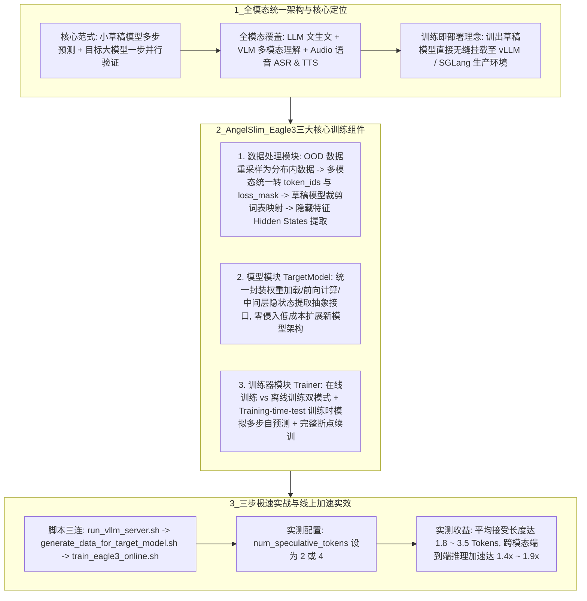

# AngelSlim Eagle3

## 1. TL;DR

本文介绍了腾讯混元团队开源的全模态大模型压缩算法工具包 **AngelSlim**（`Tencent/AngelSlim`）围绕 **Eagle3 投机采样（Speculative Decoding）训练范式** 的重磅升级。针对长上下文、高并发与多模态场景下解码受限于显存带宽与算力冗余的瓶颈，AngelSlim 以 **“Eagle3 训练即部署（无缝对接 vLLM / SGLang）”** 为核心，构建了**业界首个原生覆盖大语言（LLM）、视觉语言（VLM）与语音（Audio ASR & TTS）的全模态投机采样草稿模型训练框架**。通过标准化**数据处理（分布外重采样、多模态统一 `token_ids/loss_mask`、草稿词表裁剪映射、隐藏特征提取）**、**统一 `TargetModel` 抽象接口**与**支持在线/离线双模式及 Training-time-test（训练时测试）的训练器**，在 `num_speculative_tokens = 2 或 4` 下实现了 **1.8–3.5 的平均接受长度** 与 **1.4–1.9 倍的端到端无损推理加速**。

## 2. 问题定义与背景

### 2.1 单纯压缩或堆硬件的边际递减与投机采样破局
随着大模型进入规模化落地深水区，自回归解码（Decode）阶段受制于显存带宽（Memory-bound），大量算力单元处于闲置等待状态，单纯依赖权重量化压缩或堆叠高端硬件已逼近边际收益。
**投机采样（Speculative Decoding）** 通过 **“轻量级草稿模型（Draft Model）多步串行生成候选 Token + 目标大模型（Target Model）单步并行验证是否接受”** 的范式，在不损失任何目标模型输出分布质量的前提下，充分利用大模型解码阶段的冗余算力实现并行解码加速。

### 2.2 为什么需要全模态、面向部署的 Eagle3 训练框架？
此前社区的投机采样研究多局限于纯文本 LLM，且“实验训练代码”与“生产推理引擎（vLLM/SGLang）”严重脱节；而在真实的视觉理解（VLM）与语音识别/合成（ASR/TTS）场景中，如何统一异构模态的输入表征、在有限显存或磁盘条件下高效训练 Eagle3 草稿头并直接上线部署，是亟待解决的工程空白。

## 3. 知识框架



## 4. 核心内容拆解

### 4.1 三大核心训练组件深度解析
1. **数据处理模块（Data Processing Module）**：
   - **a. 分布外数据重采样（Data Resampling）**：草稿模型必须高度拟合目标模型自身的输出分布才能获得高接受率。针对分布外（OOD）开源数据集，先调用目标模型重新采样生成**分布内（In-distribution）数据集**（注：若已有目标模型的 SFT 数据或自生成数据，可跳过此步）。
   - **b. 多模态标准化与词表裁剪**：
     - 将文本、图像、音频等异构多模态输入统一转化为标准化的 `token_ids` 与 `loss_mask`；
     - **草稿模型裁剪词表映射（Vocabulary Pruning Mapping）**：为降低草稿模型输出头计算量，将全量词表裁剪为高频子词表并建立映射关系。
   - **c. 隐藏特征提取（Hidden Feature Extraction）**：根据处理好的 `token_ids` 提取目标模型对应的中间层/顶层隐状态（Hidden States）供草稿模型学习。
2. **模型模块（统一的 `TargetModel` 抽象接口）**：
   - 抽象封装了模型加载与权重管理、前向计算、中间层/隐状态特征提取等标准方法；
   - **零侵入扩展**：接入任何新模型架构或新模态后端时，开发者只需实现 `TargetModel` 定义的抽象方法即可完成注册，**完全无需修改训练器或 Eagle3 核心算法代码**。
3. **训练器模块（Trainer Module）**：
   - **在线训练 vs 离线训练双模式**：核心区别在于**是否预先生成并落盘全量数据的 `hidden_states`**。
     - **在线训练（Online Training）**：边跑目标模型边提取隐状态训练草稿模型，省磁盘，适合**小尺寸模型或显存充裕**的场景；
     - **离线训练（Offline Training）**：预先提取全量隐状态落盘，省显存，适合**大尺寸目标模型、低显存但高磁盘空间**的机器。
   - **训练时测试（Training-time-test）**：针对 Eagle3 多步自回归递推的特点，在训练阶段直接模拟 Eagle3 草稿模型的多步生成过程，让模型在训练期就能“看到并学习使用自己前几步的预测输出”，消除训练（Teacher Forcing）与推理（多步自回归）之间的曝光偏差（Exposure Bias）。
   - **原生断点续训**：完整保存并恢复草稿模型参数、Optimizer / LR Scheduler 状态及训练进度。

### 4.2 三步快速启动工作流与实测性能
1. **三步命令启动在线训练**：
   ```bash
   # 1. 启动 vLLM 服务（用于数据重采样，若已有分布内数据可跳过 1、2 步）
   bash scripts/speculative/run_vllm_server.sh
   # 2. 生成目标模型分布内训练数据
   bash scripts/speculative/generate_data_for_target_model.sh
   # 3. 启动 Eagle3 在线训练
   bash scripts/speculative/train_eagle3_online.sh
   ```
2. **全场景评测表现**：在 vLLM 框架下横跨代码、数学、指令跟随、文本生成、多模态理解（VLM）及语音（ASR & TTS）任务实测，当设置投机步数 `num_speculative_tokens = 2 或 4` 时，训练出的 Eagle3 草稿模型**平均接受长度（Acceptance Length）达 `1.8 – 3.5`**，实现 **1.4 – 1.9 倍**（宣传标题典型值 **1.8 倍**）的端到端推理提速。

## 5. 数据速查表

| 指标 / 参数 | 原文数值 | 语境 / 条件 |
| :--- | :--- | :--- |
| **端到端推理加速比** | **1.4x – 1.9x**（标题典型值 **1.8 倍**） | 横跨 LLM、VLM、Audio（ASR & TTS）在 vLLM/SGLang 下的实测加速范围 |
| **投机采样平均接受长度** | **1.8 – 3.5 Tokens** | 在 `num_speculative_tokens = 2 or 4` 配置下的单步验证平均接受 Token 数 |
| **投机采样步数配置 (`num_speculative_tokens`)** | `2` 或 `4` | vLLM 部署评测时的草稿模型前瞻预测步数 |
| **支持模态矩阵** | **LLM · VLM · Audio (ASR) · Audio (TTS)** | 全模态共享同一套 `TargetModel` 接口与 Eagle3 训练器 |
| **开源项目地址** | `https://github.com/Tencent/AngelSlim` | 腾讯混元团队开源的全模态大模型压缩算法工具包 |

## 6. 踩坑与教训 / 可迁移的设计原则

| 错误做法 | 失败表现或原因 | 原文应对（可迁移的设计原则） |
| :--- | :--- | :--- |
| **直接拿分布外（OOD）通用开源数据集去训练投机采样草稿模型** | 草稿模型学到的词分布与目标大模型真实输出分布不一致，导致线上验证阶段大量候选 Token 被拒绝，接受长度极低 | **目标模型自采样对齐分布（Data Resampling）原则**：若无现成同分布 SFT 数据，先用 vLLM 启动目标模型对原始数据集重采样，用生成的分布内数据训练草稿模型 |
| **训练 Eagle3 时仅做单步 Teacher Forcing（只喂真实 Ground Truth 隐状态）** | 上线推理时草稿模型需要连续多步依赖自己前一步的预测特征，误差迅速累积导致第 2~4 步预测质量崩塌 | **Training-time-test（训练时多步自回归模拟）原则**：在训练循环中直接模拟 Eagle3 的多步生成过程，让草稿模型在训练期就学会适应并修正自身预测特征的偏差 |
| **在显存受限的机器上硬跑超大目标模型的在线 Eagle3 训练，或在磁盘受限机器上跑全量离线提取** | 前者直接触发 GPU OOM；后者因全量中间层 Hidden States 体积庞大直接撑爆本地磁盘 | **在线/离线双模式按硬件资源解耦原则**：显存充足或小模型选在线训练（实时算 Hidden States 免落盘）；大模型或低显存高磁盘机器选离线训练（预提取落盘省显存） |
| **为 LLM、VLM、ASR、TTS 各写一套孤立的投机采样训练框架** | 多模态重复造轮子，且每次接入新架构都要重写底层训练循环 | **前端标准化（统一 `token_ids + loss_mask`）+ 后端 `TargetModel` 接口抽象原则**：将模态差异收敛在预处理与 `TargetModel` 几个抽象方法内，实现全模态共享核心训练器 |

## 7. 记忆锚点

- **AngelSlim Eagle3 核心公式**：“**全模态（LLM/VLM/ASR/TTS） + 训练即部署（vLLM/SGLang） + 投机 2~4 步 = 接受长度 1.8~3.5，推理提速 1.4~1.9 倍。**”
- **训练器三板斧**：“**OOD 先重采样 + 词表裁剪降开销 + Training-time-test 模拟多步防偏差 + 在线/离线看显存磁盘。**”

## 8. 复习卡片

什么是投机采样（Speculative Decoding），它为什么能在不损失生成质量的前提下加速大模型推理？::投机采样采用“轻量级草稿模型（Draft Model）多步串行生成候选 Token + 目标大模型（Target Model）单步并行验证是否接受”的机制；因为它将原本受显存带宽限制的多次大模型串行前向解码转化为单次并行验证，充分利用了大模型解码阶段的算力冗余，且拒绝采样保证了输出分布与原模型严格一致。
AngelSlim 的 Eagle3 训练框架是如何实现“全模态（LLM、VLM、语音 ASR/TTS）”统一训练与低成本扩展新模型的？::1. 在数据处理层：将文本、图像、音频等不同模态输入统一标准化为 `token_ids` 和 `loss_mask`，并支持草稿模型词表裁剪映射；2. 在模型层：定义统一的 `TargetModel` 抽象接口（封装权重管理、前向计算与隐状态特征提取），接入新模型只需实现这几个抽象方法而无需改动核心训练器。
AngelSlim 训练器提供的“在线训练（Online）”和“离线训练（Offline）”两种模式有何区别，分别适用于什么硬件场景？::两者的核心区别在于是否预先生成并落盘保存全量数据的 `hidden_states`（隐藏特征）：在线训练实时计算隐状态，适合小尺寸模型或 GPU 显存充足的场景；离线训练预先提取并存盘隐状态，适合大尺寸目标模型、低显存但高磁盘空间的机器。
什么是 Eagle3 训练中的“训练时测试（Training-time-test）”，它解决了什么问题？::指在训练阶段直接模拟 Eagle3 草稿模型的多步生成过程，让模型在训练时就能看到并学习使用自己前几步生成的预测特征，从而消除单步训练与多步自回归推理之间的偏差，提高第 2~4 步候选 Token 的接受率。
使用 AngelSlim 训练的 Eagle3 模型在 vLLM 部署评测中取得了怎样的量化指标？::在设置 `num_speculative_tokens = 2 或 4` 的条件下，跨代码、数学、指令跟随及多模态理解等任务，模型的平均接受长度（Acceptance Length）可达 1.8–3.5，最高可实现 1.4–1.9 倍（典型值 1.8 倍）的推理加速。

## 9. 知识关联

- **本库通用主题**：[大模型推理与算子优化](../../20_topics/%E5%A4%A7%E6%A8%A1%E5%9E%8B%E6%8E%A8%E7%90%86%E4%B8%8E%E7%AE%97%E5%AD%90%E4%BC%98%E5%8C%96.md) · [模型与开发工具发布](../../20_topics/%E6%A8%A1%E5%9E%8B%E4%B8%8E%E5%BC%80%E5%8F%91%E5%B7%A5%E5%85%B7%E5%8F%91%E5%B8%83.md)
- **候选双链**：[[投机采样EAGLE与Medusa演进]] · [[HPC-Ops高性能算子]] · [[vLLM与SGLang推理框架]] · [[混元翻译的端侧量化]]

## 10. 原文参考资料

- 原文标题：《腾讯 AngelSlim 重磅升级！面向全模态的大模型压缩算法工具包，推理速度飙升 1.8 倍！》（作者：腾讯技术工程 / 腾讯混元团队，发布于 2026-01-13）
- 开源仓库地址：`https://github.com/Tencent/AngelSlim`

> [!note]- 校对报告
> - **页码溯源汇总**：
>   - `p.1–2`：大模型解码算力与显存带宽瓶颈、投机采样原理、AngelSlim 围绕 Eagle3 投机采样升级（支持 LLM / VLM / 语音 ASR & TTS 全模态，无缝部署于 vLLM/SGLang，加速 1.4–1.9 倍，标题峰值 1.8 倍）及 GitHub 地址。
>   - `p.2–4`：三大核心训练组件——（1）数据处理模块（分布外数据重采样、统一 `token_ids` 与 `loss_mask`、草稿模型裁剪词表映射、隐藏特征提取）；（2）模型模块（统一 `TargetModel` 接口）；（3）训练器模块（在线训练 vs 离线训练是否预存 `hidden_states`、`training-time-test` 训练时多步模拟、断点续训）。
>   - `p.4–5`：三步脚本快速启动（`run_vllm_server.sh` $\to$ `generate_data_for_target_model.sh` $\to$ `train_eagle3_online.sh`）与 vLLM 实测结果（`num_speculative_tokens = 2 or 4`，接受长度 `1.8–3.5`，加速 `1.4–1.9` 倍）。
> - **核验结论**：全文所有组件职责、脚本命令与性能指标均与原文逐页核对一致。
