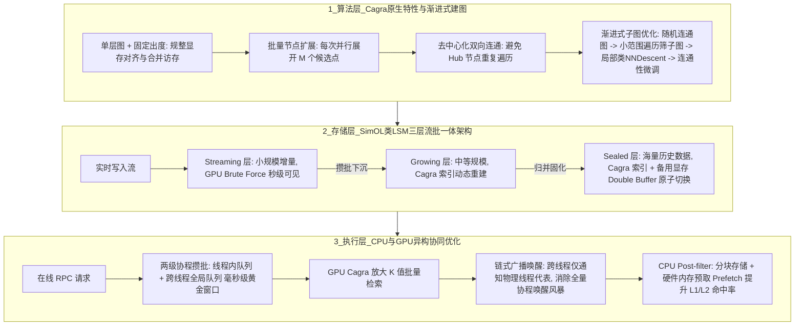

# Cagra向量检索实践

## 1. TL;DR

本文分享了微信基础架构 AI Infra 团队在分布式向量检索系统 **SimOL** 中引入英伟达 **Cagra**（CUDA Accelerated Graph-based Retrieval Algorithm，RAPIDS `cuVS` 核心图索引算法）并落地微信视频号推荐召回的工程实践。针对 GPU 高并发、高吞吐但内存受限且讨厌分支跳转的硬件特性，团队从四个维度完成了生产级改造：
1. **图构建优化**：提出“渐进式子图优化”替代原论文吃满大块锁页内存（Pinned Memory）的全局 NNDescent，将千万级高维向量建图耗时缩短至 CPU HNSW 的 **1/30 以下**（从数十分钟降至几分钟）。
2. **流批一体架构**：设计类 LSM-Tree 的三层索引架构（Streaming GPU 暴力检索层 + Growing/Sealed Cagra 图索引层）与显存双缓冲（Double Buffer）无感切换，实现实时写入秒级可见。
3. **CPU/GPU 协同过滤**：弃用破坏 GPU 访存连续性的 Pre-filter，改用 GPU 放大 $K$ 值召回 + CPU 分块预取（Chunked + Prefetch）Post-filter，单机 QPS 提升 **约 25%**。
4. **两级协程攒批与链式广播唤醒**：在毫秒级“黄金聚合窗口”内完成线程内与跨线程两级 Batch 聚合，并用链式广播取代全量跨线程协程唤醒，单机吞吐提升 **65%**。最终在视频号推荐召回场景实现同等 QPS 与更高召回率下**计算资源成本降低超 50%、索引构建成本降低约 70%**。

## 2. 问题定义与背景

### 2.1 CPU HNSW 在大规模推荐召回中的瓶颈
在微信视频号等超大规模推荐系统的实时召回链路中，随着多模态表征维度升高、候选集规模扩大以及带复杂属性过滤（Filter）的查询激增，传统基于 CPU 的图索引（如 HNSW）面临严峻挑战：
- **建图极慢且算力昂贵**：千万级高维向量的 HNSW 图构建往往耗时数十分钟乃至数小时，消耗海量 CPU 核时，难以支撑高频流式更新。
- **GPU 直接移植 HNSW 水土不服**：HNSW 依赖多层跳表结构、动态度数与单点贪心串行游走，高度依赖中心枢纽节点（Hubs），在 GPU 上会导致严重的线程束分化（Warp Divergence）、非合并访存（Uncoalesced Memory Access）与算力空转。

### 2.2 为什么需要面向 GPU 原生设计的 Cagra？
要充分发挥 GPU 数千个流处理器的并行计算能力与高显存带宽，向量索引算法必须从数据结构到底层调度彻底摒弃“CPU 串行跳表思维”，转向“**定长对齐、无层单图、批量并发扩展**”的 GPU 原生范式——这正是英伟达 Cagra 算法的核心出发点。

## 3. 知识框架

## 4. 核心内容拆解

### 4.1 Cagra 与 HNSW 的核心架构差异
1. **单层图结构（Single-layer Graph） vs 多层跳表**：Cagra 砍掉了 HNSW 的多层结构，仅维护单层扁平图，避免了跨层跳转带来的不规则内存访问。
2. **固定出度（Fixed Out-degree） vs 动态度数**：每个节点严格保留固定数量的邻居边，使邻接表在显存中呈现完美的二维定长数组布局，极大提升了 GPU 全局显存合并访问（Coalesced Access）效率与线程束调度规整度。
3. **批量并行扩展（Batch Expansion） vs 单步贪心扩展**：检索时每次迭代并行取出 $M$ 个未访问候选节点同时计算距离并展开邻居，天然契合 GPU SIMT（单指令多线程）并行模型。
4. **去 Hub 化的连通性与遍历效率平衡**：CPU 图算法常依赖高度数中心节点（Hubs）加速路由，但在 GPU 批量并行扩展下，中心节点会导致大量线程重复访问相同邻居、浪费并行度。Cagra 通过反向图合并与两跳剪枝（2-hop Pruning），让节点扩展均匀发散，在保证强连通性的同时最大化单次 Batch 扩展的有效覆盖率。

### 4.2 建图优化：渐进式子图优化（Progressive Subgraph Optimization）
- **原论文方案的容器化困境**：Cagra 原论文建图流程（先用 `NNDescent` 构建高出度初始图 $\to$ 反向图合并 $\to$ 两跳剪枝裁至固定度数）极度依赖海量锁页内存（Pinned Memory）以支撑主机与显存的高速交换，在容器化生产环境（内存配额严格受限）中极易触发 OOM 或降级失败。
- **微信 SimOL 的“渐进式子图优化”方案**：
  1. 先以极低开销构建一张基础**随机连通图**；
  2. 在图上执行小范围遍历，筛选出局部高相关**候选子图**；
  3. 仅在局部子图范围内运行类 NNDescent 迭代优化；
  4. 最后执行全局连通性微调。
- **收益**：在大幅削减锁页内存与显存峰值占用的前提下，保持了与完整 NNDescent 持平的召回率，并将千万级高维向量的建图时间缩短至 CPU HNSW 的 **1/30 以下**（从数十分钟乃至数小时压缩至仅需几分钟）。

### 4.3 流批一体：SimOL 类 LSM-Tree 三层索引架构
由于 Cagra 属于静态图索引（不支持高效的单点原地动态增删），为满足推荐系统实时流式写入与“秒级可见”诉求，SimOL 借鉴 LSM-Tree 思想构建了三层异构架构：
1. **Streaming 层（实时流式层）**：承接最新写入的增量向量，数据量较小，直接利用 **GPU Brute Force（暴力穷举检索）** 处理，无需建图即可实现写入后**秒级可见**且召回率 100%。
2. **Growing 层（成长层）**：当 Streaming 层数据累积到阈值后下沉至此，构建中等规模的 Cagra 图索引，并在后台周期性吸收增量数据重构建图。
3. **Sealed 层（封闭层）**：存放海量历史全量/准全量向量，构建大规模 Cagra 索引。
- **Double Buffer 零抖动切换**：在后台完成新索引构建后，利用预留的备用显存空间（Double Buffer）完成热加载与指针原子切换，彻底消除索引重建期间的在线查询毛刺。

### 4.4 CPU/GPU 协同与高并发调度优化
1. **Post-filter + CPU 分块预取（Chunked Storage + Memory Prefetch）**：
   - **为什么不用 Pre-filter？** 在 GPU 图遍历中途实时校验业务过滤条件（Bitset/属性匹配），会导致严重的分支分化、额外显存占用以及随过滤率剧烈波动的长尾耗时。
   - **SimOL 的协同策略**：在 GPU 侧纯粹执行无分支的高速 Cagra 检索，通过适度**放大召回 $K$ 值**拿到候选集；随后交由 CPU 执行 Post-filter。针对 CPU 随机访问候选向量属性带来的 Cache Miss 瓶颈，采用**分块连续存储（Chunked Storage）+ 硬件指令级内存预取（Prefetch）**，显著拉升 CPU L1/L2 Cache 命中率，单机 QPS 提升 **约 25%**。
2. **两级协程攒批（Two-level Batch Aggregation）与链式广播唤醒（Chained Broadcast Wakeup）**：
   - **矛盾**：在线推荐 RPC 请求是离散、单条到达的，而 GPU Cagra 只有在大 Batch 并发下才能吃满算力。
   - **两级聚合**：设计毫秒级“黄金聚合窗口（Golden Aggregation Window）”，先在工作线程本地完成**一级无锁聚合**，再汇总至**二级跨线程全局队列**统一提交 GPU 执行，兼顾高吞吐与低锁竞争。
   - **链式广播唤醒**：当 GPU 完成一个大 Batch 推理返回结果时，若由提交线程直接跨线程逐个唤醒数百个等待中的业务协程，会引发严重的跨核中断与锁竞争（CPU `System` 态时间飙升）。SimOL 改为**链式广播唤醒**——跨线程仅通知目标物理线程的“代表协程”，再由各物理线程在本地核内唤醒归属自己的协程，将跨线程通知次数从“总协程数”骤降至“物理线程数”，带动单机整体吞吐暴涨 **65%**。

## 5. 数据速查表

| 指标 | 原文数值 | 语境 / 条件 |
| :--- | :--- | :--- |
| **千万级高维向量建图耗时** | 缩短至 CPU HNSW 的 **< 1/30** | 从原本的数十分钟/数小时降至**几分钟**（基于渐进式子图优化） |
| **Post-filter 分块预取优化收益** | 单机 QPS 提升 **~25%** | GPU 放大 $K$ 值 + CPU 分块存储与硬件内存预取（提升 L1/L2 Cache 命中率） |
| **两级攒批 + 链式广播唤醒收益** | 单机吞吐提升 **+65%** | 毫秒级黄金窗口聚合 + 跨线程通知次数从“协程总数”降为“物理线程数” |
| **视频号推荐召回计算资源成本** | 降低 **> 50%** | 相比原方案，在同等 QPS 与更高召回率下实现的算力成本节省 |
| **视频号推荐召回索引构建成本** | 降低 **~70%** | 生产环境全链路索引构建综合资源成本对比 |
| **Streaming 层实时数据可见性** | **秒级可见** | 基于类 LSM-Tree 架构，增量写入采用 GPU Brute Force 检索 |

## 6. 踩坑与教训 / 可迁移的设计原则

| 错误做法 | 失败表现或原因 | 原文应对（可迁移的设计原则） |
| :--- | :--- | :--- |
| **直接照搬 Cagra 原论文的全局 NNDescent 建图流程上线容器环境** | 原方案重度依赖大块主机锁页内存（Pinned Memory），在内存受限的在线容器中频繁 OOM 或无法分配资源 | **渐进式局部子图近似原则**：用“随机连通图 $\to$ 小范围遍历筛子图 $\to$ 子图局部优化 $\to$ 连通性微调”替代全局暴力迭代，以极小内存代价逼近全局最优图质量 |
| **在 GPU 图遍历核函数内部内联执行复杂业务属性过滤（Pre-filter）** | 破坏 GPU 线程束规整度（Warp Divergence），增加显存开销，且遇到高过滤率查询时搜索步数暴增、长尾延迟失控 | **异构算力扬长避短（GPU 算距离 + CPU 预取过滤）原则**：让 GPU 专注定长规整的批量距离计算（适度放大 Top-$K$），将分支密集型的过滤逻辑剥离至 CPU 并配合内存 Prefetch 隐藏访存延迟 |
| **单条 RPC 到达即刻调用 GPU Kernel，或在大 Batch 完成后跨线程逐个唤醒全部协程** | 单条请求无法打满 GPU 算力；而全量跨线程唤醒引发核间锁争用与上下文切换风暴，CPU System 态开销成为新瓶颈 | **两级窗口攒批与两段式本核唤醒原则**：入口侧用“线程本地 + 全局队列”两级毫秒窗口攒批喂饱 GPU；出口侧将跨线程通信收敛为“物理线程级通知 + 线程内局部唤醒” |
| **试图在静态 GPU 图索引上直接做单条实时插入，或全量重建时原地覆盖显存** | 破坏固定出度与内存对齐，或者在全量切换瞬间造成线上检索服务中断与延迟毛刺 | **类 LSM 分层消纳 + Double Buffer 切换原则**：用 GPU Brute Force 兜底小规模实时流，后台异步合并至 Cagra 静态层，并通过备用显存双缓冲实现零停机切换 |

## 7. 记忆锚点

- **Cagra 四大微架构特征**：“**单层无跳表、出度定长齐、批量并发扩、去 Hub 均匀散。**”
- **SimOL 四大工程杀手锏**：
  1. **建图省内存**：渐进式子图优化（建图快 **30 倍**）；
  2. **实时秒可见**：LSM 三层架构（Streaming 暴力扫 + Growing/Sealed 图检索 + Double Buffer）；
  3. **过滤不卡核**：GPU 放大 $K$ + CPU 预取 Post-filter（QPS **+25%**）；
  4. **高并发不炸锁**：两级黄金窗口攒批 + 链式广播唤醒（吞吐 **+65%**）。

## 8. 复习卡片

相比 CPU 上主流的 HNSW 算法，英伟达 Cagra 算法针对 GPU 做了哪三项核心结构改造？::1. 采用单层图替代多层跳表；2. 强制每个节点固定出度以保证显存对齐与合并访问；3. 检索时采用批量并行扩展（每次展开 M 个候选点）替代单步串行贪心扩展。
为什么 Cagra 在建图时要刻意避免依赖 CPU 图算法常见的“中心枢纽节点（Hubs）”？::因为在 GPU 批量并行扩展（Batch Expansion）模式下，高度数中心节点会导致大量并行线程重复遍历相同的邻居节点，造成有效扩展范围收缩与并行算力浪费，因此需要通过反向图合并与两跳剪枝让节点均匀发散。
微信团队为什么没有直接使用 Cagra 原论文的 NNDescent 建图方案，而是自研了“渐进式子图优化”？::原论文方案依赖海量锁页内存（Pinned Memory），在容器化生产环境中难以落地；渐进式子图优化通过“随机连通图 -> 小范围遍历筛选子图 -> 局部类 NNDescent 优化 -> 连通性微调”，在大幅降低内存占用的同时保持了召回率，并将千万级高维向量建图耗时降至 CPU HNSW 的 1/30 以下。
SimOL 系统如何解决静态 Cagra 索引无法支持实时流式写入秒级可见的问题？::设计了类 LSM-Tree 的三层索引架构：最新小批量实时数据进入 Streaming 层并用 GPU Brute Force（暴力检索）实现秒级可见；随后异步下沉至 Growing 层与 Sealed 层构建 Cagra 图索引，并利用备用显存 Double Buffer 实现无缝切换。
在带属性过滤的向量检索中，SimOL 为什么选择 Post-filter 而非 Pre-filter，又是如何优化 CPU 侧瓶颈的？::因为 Pre-filter 会膨胀 GPU 显存并引发严重的分支分化与耗时波动；SimOL 采用 GPU 放大 K 值召回 + CPU Post-filter，并通过分块连续存储（Chunked Storage）与硬件内存预取（Memory Prefetch）提高 CPU L1/L2 Cache 命中率，使单机 QPS 提升约 25%。
什么是“链式广播唤醒”，它解决了 GPU 异步 Batch 推理中的什么痛点？::当多个线程的协程被聚合成一个 GPU 大 Batch 执行完毕后，若直接跨线程唤醒所有协程会产生剧烈的核间通信与 System 态锁竞争；链式广播唤醒改为跨线程仅通知目标物理线程的单个代表协程，再由该物理线程在核内依次唤醒本地协程，将跨线程通知数从“总协程数”降至“物理线程数”，配合两级攒批使单机吞吐提升 65%。

## 9. 知识关联

- **本库通用主题**：[检索与文档解析](../../20_topics/%E6%A3%80%E7%B4%A2%E4%B8%8E%E6%96%87%E6%A1%A3%E8%A7%A3%E6%9E%90.md) · [云网络系统研究](../../20_topics/%E4%BA%91%E7%BD%91%E7%BB%9C%E7%B3%BB%E7%BB%9F%E7%A0%94%E7%A9%B6.md) · [推荐系统与多模态评测](../../20_topics/%E6%8E%A8%E8%8D%90%E7%B3%BB%E7%BB%9F%E4%B8%8E%E5%A4%9A%E6%A8%A1%E6%80%81%E8%AF%84%E6%B5%8B.md)
- **候选双链**：[[HNSW与图向量检索]] · [[LSM-Tree存储架构]] · [[GPU合并访存与线程束分化]] · [[高并发RPC攒批与协程调度]]

## 10. 原文参考资料

- 原文标题：《Cagra 向量检索在微信推荐系统的实践》（作者：yessitkong，微信基础架构 AI Infra 团队，发布于 2026-03-20）
- 核心关联技术：NVIDIA RAPIDS `cuVS` / Cagra 论文（*CAGRA: Highly Parallel Graph Construction and Approximate Nearest Neighbor Search for GPUs*）。

> [!note]- 校对报告
> - **页码溯源汇总**：
>   - `p.1–2`：推荐召回背景、Cagra 与 HNSW 的三大核心差异（单层图、固定出度、批量扩展）及去中心化双向连通建图原理。
>   - `p.2`：生产环境 Pinned Memory 瓶颈与“渐进式子图优化”四步法，千万级高维向量建图耗时缩短至 CPU HNSW 的 1/30 以下（几分钟内完成）。
>   - `p.2–3`：SimOL 类 LSM-Tree 三层流批一体架构（Streaming 层 GPU Brute Force 秒级可见、Growing 层、Sealed 层）及备用显存 Double Buffer 零停机切换。
>   - `p.3–4`：Post-filter 替代 Pre-filter、CPU 分块存储 + 内存预取（单机 QPS 提升约 25%）、两级协程攒批与链式广播唤醒（单机吞吐提升 65%）。
>   - `p.4–6`：微信视频号推荐召回线上收益（同等 QPS 与更高召回率下计算资源成本降低超 50%，索引构建成本降低约 70%）与未来展望。
> - **核验结论**：全文所有量化数据、架构层级与优化机制均与原文严格对齐，无事实偏差。
