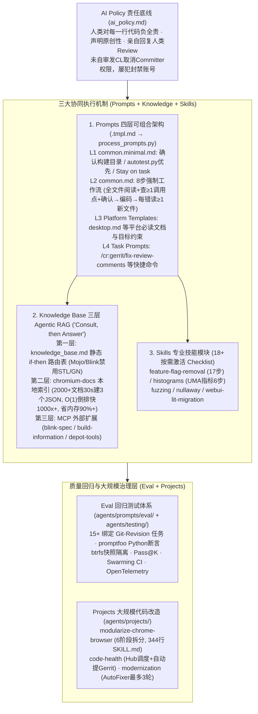

# 深入解析 Chromium 的 AI Coding 开发体系

## 1. TL;DR

1. **责任红线与工程底座**：面对超 **3,500 万行** C++ 代码的巨型单体仓库，Chromium 在 `chromium/src/agents/` 下构建了兼容 Gemini CLI、Claude Code 与 GitHub Copilot 的统一 AI Coding 体系；其首要基石是 `ai_policy.md` 确立的 **“人类负全责”** 底线——未充分自审直接发 Review 将被取消 Committer 权限、屡犯封号，且人类必须亲自回复他人对 AI 代码的 Review 意见。
2. **四层可组合提示词架构（Prompts）**：通过 `.tmpl.md` 模板与 `process_prompts.py`（自动剥离 HTML 注释并配合 `PRESUBMIT` 校验）维护四层提示词：**Layer 1 `common.minimal.md`**（构建前确认目录、优先用 `tools/autotest.py`、JNI 规范）、**Layer 2 `common.md`**（强制 **8 步工作流**：全文件阅读 + 检查至少 1 处调用点 + 与开发者确认后才写代码，修复编译错误禁止盲目猜测）、**Layer 3 平台模板**（如 `desktop.md`）与 **Layer 4 快捷命令**（`/cr:*`）。
3. **18+ 专业 Skills 与三层 Agentic RAG 知识库**：将移除 Feature Flag（**17 个步骤**）、添加 UMA 指标等高频复杂任务封装为 **18+ 个** 按需激活的 `SKILL.md` Checklist；知识检索摒弃传统向量数据库，采用 **“Consult, then Answer” 三层 Agentic RAG**——第一层 `knowledge_base.md` 静态 `if-then` 路由表、第二层 `chromium-docs` 本地混合索引（約 `30 秒` 索引 **2,000+ 篇** `.md` 文档生成 3 个 JSON 文件，倒排索引提速 **1,000 倍以上**、内存降低 **90% 以上**）、第三层 MCP 外部源（`blink-spec`、`build-information`、`depot-tools`）。
4. **CI 级 Eval 回归测试与大规模改造 Projects**：建立 `agents/prompts/eval/`（**15+ 个** 绑定 `Git-Revision` 的基准任务）与 `agents/testing/` 并行测试框架（基于 `promptfoo`、`btrfs` 快照秒级隔离、`Pass@K` 机制、Swarming 分片与 OpenTelemetry 采集），防止提示词修改导致 Agent 退化；同时通过 `agents/projects/`（如 `modularize-chrome-browser`、`code-health`、`modernization` 的 `AutoFixer` 最多 **3 轮** 自动修复循环）推进跨模块大规模治理。

## 2. 问题定义与背景

### 2.1 超大规模代码库落地 AI Coding 的三大挑战
Chromium 拥有超过 **3,500 万行** 代码，其架构复杂度、专属基础设施与工程规范使通用大模型直接上手时频频碰壁：
- **专属规范与自研基础设施壁垒**：Chromium 内部广泛使用 Mojo 跨进程通信（`.mojom`）、Blink 专属容器与内存管理（强制使用 `blink::Vector`、`blink::String` 及 Oilpan GC 的 `Member<>` / `Persistent<>`，严禁混用标准库 STL）、GN 构建系统以及 `depot_tools`（`git cl`），通用模型的预训练知识极易写出违规代码。
- **盲目修改与巨型构建耗时**：若 AI 不事先阅读完整上下文与调用方就直接改代码，或动辄全量运行 `autoninja` 编译整个 `chrome` 目标，会导致大量猜测性修复（Speculative Fixes）与数十分钟的无效编译等待。
- **提示词演进缺乏回归验证**：系统提示词（如 `common.md`）一旦调整，如何证明新提示词在修复测试、生成 Fuzz 测试、重构类结构等十余种核心场景下没有引发行为退化？

### 2.2 核心解法：一条底线 + 四大机制 + 双层演进保障
Chromium 自 **2025 年 7 月 10 日** 创建 `chromium/src/agents/` 目录以来，依托长达 **11 年**（自 2015 年起累计 **6,445 次提交**）沉淀的高质量源码内建文档，构建了 **AI Policy（底线）+ Prompts（四层工作流）+ Skills（18+ 专项技能）+ Knowledge Base（三层 Agentic RAG）** 的协同体系，并辅以 **Eval（15+ 回归测试套件）** 与 **Projects（三大自动化治理工程）**。

## 3. 知识框架

## 4. 核心内容拆解

### 4.1 AI Policy：明确人与 AI 的责任边界（`ai_policy.md`）

1. **人类是唯一责任主体**：AI 只是辅助工具而非代码作者；无论代码由谁生成，提交 CL（ChangeList）的人类工程师对每一行代码的正确性、安全性与可维护性负 100% 责任。
2. **严厉的违规惩戒机制**：开发者在将 AI 生成的代码发送给他人 Review 之前，**必须亲自完成全面自审与验证**；若把未经消化的低质 AI 代码直接甩给 Reviewer，**初犯将被取消 Committer 权限，屡犯将直接封禁账号**。
3. **原创性声明与人际沟通红线**：借用外部代码必须声明来源；当其他人类工程师对 AI 辅助创建的 CL 或 Bug 提出评论时，**必须由人类开发者本人亲自思考并回复**，严禁让 AI 自动敷衍回复人类同僚。

### 4.2 Prompts：四层可组合提示词架构

Chromium 利用 Gemini CLI 等工具支持的 `@path/to/file.md` 文件导入语法，在 `GEMINI.md` 中组装四层提示词，并通过 `.tmpl.md` 模板文件维护（编写时可加详尽的 HTML 注释说明设计意图，执行 `process_prompts.py` 生成最终 `.md` 时自动剥离注释以节省 Token，且由 `PRESUBMIT` 钩子强制校验同步）：

1. **第一层：`common.minimal.md`（最小核心底线）**
   - **构建与测试铁律**：构建前必须先向开发者确认构建目录（如 `out/Default`）；运行测试时优先使用轻量封装脚本 `tools/autotest.py`，而非直接盲跑耗时的底层 `autoninja`；遵循“小步构建、局部验证”原则。
   - **行为约束与规范**：严格遵守 `Stay on task`（只改任务要求的代码，禁止顺手做无关重构）；涉及 Android JNI 时必须使用 `@CalledByNative` 与 `@NativeMethods` 注解；提交前强制执行 `git cl format` 与 `git cl presubmit`。
2. **第二层：`common.md`（标准 8 步工程工作流）**
   - **Step 1 深度理解与前置确认（最关键设计）**：修改任何文件前，AI **必须完整阅读目标文件全文（而非仅看片段）**，并**至少查找 1 处该接口的调用方（Callsite）**以理解上下文契约，随后向开发者陈述理解并获得确认后，才允许动手写代码。
   - **Step 2~4 编码、补充测试与构建**：按确认方案修改代码、编写对应单元测试并触发增量构建。
   - **Step 5 严禁猜测性修复（No Speculative Fixes）**：当编译失败时，**每遇到一个编译错误，AI 必须至少阅读 1 个此前未读过的相关头文件或实现文件**来查明真实签名与依赖，严禁在不读新文件的情况下盲目猜改重试。
   - **Step 6~8 运行测试、分析失败并迭代收敛**。
3. **第三层：`Templates`（平台与领域模板）**
   - 例如桌面端开发模板 `desktop.md`，会在 `common.md` 基础上强制要求 AI 先阅读 `//docs/chrome_browser_design_principles.md` 与 `//docs/ui/views/overview.md`，并指定核心构建与测试目标（`chrome`、`unit_tests`、`browser_tests`、`interactive_ui_tests`）。
4. **第四层：`Task Prompts`（`.gemini/commands/` 快捷斜杠命令）**
   - 封装高频研发动作供开发者一键调用：`/cr:gerrit/fix-review-comments`（自动拉取并修复 Gerrit 评审意见）、`/cr:test/gen-gtests`（生成单元测试）、`/cr:gerrit/cl-description`（生成标准 CL 描述）、`/cr:git/pre-upload-checklist`（上传前预检）、`/cr:test/disable-test`（按规范禁用不稳定测试）。

### 4.3 Skills：18+ 个按需激活的专业任务 Checklist

与定义“通用工作流”的 Prompts 不同，`agents/skills/` 下的 **18+ 个 Skill** 负责告诉 AI **“如何一步不落地完成某项特定专业任务”**：
- **代表性 Skill 清单**：
  - `feature-flag-removal`：将移除一个 Feature Flag 拆解为 **17 个严格步骤**（涵盖清理 `about_flags.cc`、`flag_descriptions.h/.cc`、`flag-metadata.json`、`enums.xml` 及所有分支调用代码），防止遗漏死代码。
  - `histograms`：指导添加或修改 UMA 监控指标（确定如 `SplitView.Activated` 名称 → 定位 `tools/metrics/histograms/metadata/` → 更新 `histograms.xml` 与 `enums.xml` → 设置 **3 个月后** 过期时间 → 填写 **至少 2 个 owner**）。
  - 其他高频技能：`fuzzing`（编写 `FUZZ_TEST`）、`nullaway`（Java 空指针静态分析修复）、`webui-lit-migration`（WebUI 向 Lit 框架迁移）等。

### 4.4 Knowledge Base：三层 Agentic RAG 架构（“Consult, then Answer”）

Chromium 没有采用传统的向量数据库切片检索（Chunk-based Vector RAG），而是基于源码树内跨越 11 年沉淀的 **2,000+ 篇** Markdown 文档，构建了由 AI 自主驱动的 **三层 Agentic RAG**：

1. **第一层：`knowledge_base.md`（静态 `if-then` 强制路由表）**
   - 将最核心的领域红线编写成显式条件路由表：
     - 触及 `.mojom` 文件 → 强制先读 Mojo 安全与 IPC 文档；
     - 触及多线程/异步任务 → 强制先读 `docs/threading_and_tasks.md` 与 `docs/callback.md`；
     - 触及 `third_party/blink/` → 强制使用 WTF 容器（`blink::Vector`、`blink::String`）与 Oilpan 垃圾回收指针（`Member<>`、`Persistent<>`），**严禁使用 C++ 标准库 STL 容器**；
     - 触及 `BUILD.gn` → 强制先读 `docs/imported/gn/style_guide.md`。
2. **第二层：`chromium-docs` Skill（本地轻量混合检索引擎，2026 年 1 月由微软工程师贡献）**
   - **两阶段索引构建（`chromium_docs.py --build-index`）**：扫描全仓 **2,000+ 个 `.md` 文件**，约 **30 秒** 生成 3 个本地 JSON 索引文件：
     - `doc_index.json`：提取每个文档的 H1/H2 标题、前 `300 字符` 摘要、最多 `20 个` 关键词及 **13 个** 预定义分类标签；
     - `keyword_index.json`：关键词到文档路径的倒排索引，将查询复杂度降为 **O(1)**，相比每次全盘扫描提速 **1,000 倍以上**，且惰性加载使内存占用降低 **90% 以上**；
     - `category_index.json`：按 13 个领域分类组织的文档目录。
   - **加权相关性打分公式**：查询时对候选文档按匹配位置赋予不同权重——**标题匹配 `×4.0`**、**文件路径匹配 `×2.5`**、**提取关键词匹配 `×2.0`**、**正文内容匹配 `×1.0~1.5`**，返回最相关的文档路径后由 AI 直接读取原始全文（无切片上下文丢失，但文档变更后需手动重跑 `--build-index`）。
3. **第三层：MCP 扩展（实时外部知识源）**
   - `blink-spec`（通过 GitHub API 实时查询 W3C / CSS 标准规范的 Issue 与讨论）、`build-information`（查询当前构建配置与状态）、`depot-tools`（获取 `depot_tools` 命令帮助）。

### 4.5 Eval 回归测试套件与 Projects 大规模代码改造

1. **Eval：AI Agent 的“单元测试”（`agents/prompts/eval/` + `agents/testing/`）**
   - **15+ 个代表性评测任务**：涵盖 `adapt_builder`（参照已有 LUCI builder 建新配置）、`add_browser_test_coverage`、`add_gtest_coverage`、`class_refactor`、`fix_broken_test`、`fuzzing`、`cl-description`、`feature_flags_add`、`find_function / search_class`、`build_file / build_target` 等。
   - **用例结构（`prompt.md` + `eval.promptfoo.yaml`）**：每个用例绑定特定 `Git-Revision` 保证 100% 可复现；利用 `promptfoo` 自定义 Python 断言精确校验三个维度：**文件变更列表**（`check_files_changed`）、**文件内容增删断言**（`check_file_content`，如必须含 `FUZZ_TEST`、禁止含旧接口 `LLVMFuzzerTestOneInput`）、**工具调用参数正则**（`check_tool_used_with_args_match`，如校验调用了 `autoninja` 与 `out/fuzz`）。
   - **CI 级执行引擎（`agents/testing/`）**：由 `eval_prompts.py` 调度、`gemini_provider.py` 驱动 Gemini CLI、`workers.py` 利用 **`btrfs` 快照（或 `gclient-new-workdir`）秒级创建独立 WorkDir** 实现并发隔离；支持适应 LLM 非确定性的 **`Pass@K` 机制**、Swarming 分片并行、Docker 沙箱、ResultDB 与 Skia Perf 看板，并通过 OpenTelemetry 采集 Token 用量与工具轨迹。
2. **Projects：生产级大规模代码改造（`agents/projects/`）**
   - 与解决单点任务的 Skill 不同，Projects 面向跨模块长期治理，包含完整的 `SKILL.md + 参考文档 + Python 发现/验证脚本 + 自动化流水线`：
     - `bedrock/modularize-chrome-browser`：将 `chrome/browser/` 巨型单体目标拆分为独立模块（含盘点文件 → 选构建模式 → 生成 `BUILD.gn` → 更新父级 BUILD → 修复 include 错误 → 验证提交 **6 阶段流程**，仅 `SKILL.md` 就达 **344 行**）。
     - `code-health/`：含 Hub 调度中心与子任务（`histogram-cleanup` 清理过期指标、`lint-sync` 添加枚举同步守卫），由 AI 自动发现候选项 → 置信度评估 → 创建分支 → 修改验证 → 自动提交 Gerrit。
     - `modernization/`：通过 Python 框架 `AutoFixer` 将编译/测试错误自动喂给 Gemini 修复并重试，**最多执行 3 轮自愈循环**。

## 5. 数据速查表

| 指标 | 原文数值 | 语境 / 条件 |
| :--- | :--- | :--- |
| **Chromium 代码库规模** | `3,500 万行以上`（35M+ lines） | 以 C++ 为主的超大规模单体仓库 |
| **源码内建文档积累跨度** | `11 年`（自 2015 年起），累计 `6,445 次提交` | 支撑三层 Agentic RAG 的权威文档底座 |
| **`agents/` 目录创建时间** | `2025 年 7 月 10 日` | Chromium 官方 AI Coding 基础设施启动时间 |
| **`chromium-docs` 核心 Skill 提交时间** | `2026 年 1 月`（微软工程师提交） | 本地文档索引与混合检索引擎上线时间 |
| **Prompts 架构层级与核心工作流步数** | `4 层`组合架构，`common.md` 含 `8 步`工作流 | L1 最小核心、L2 标准 8 步、L3 平台模板、L4 快捷命令 |
| **Step 1 / Step 5 强制阅读约束** | 改前查 `≥ 1 处`调用点；每处编译错误读 `≥ 1 个`新文件 | 防止盲目修改与猜测性修复（No Speculative Fixes） |
| **专业 Skills 模块数量** | `18+ 个` | 按需激活的专项任务 Checklist（如 `feature-flag-removal` 含 `17 步`） |
| **UMA 指标规范约束（`histograms` Skill）** | 默认过期时间 `3 个月后`，至少配置 `2 个 owner` | 新建监控指标时的强制元数据要求 |
| **`chromium-docs` 索引文档规模与耗时** | `2,000+ 个` `.md` 文件，建索引耗时 `~30 秒` | 生成 `doc_index.json`、`keyword_index.json`、`category_index.json` |
| **单篇文档元数据提取上限** | 摘要前 `300 字符`、关键词 `≤ 20 个`、共 `13 个` 分类 | `doc_index.json` 轻量元数据切分规格 |
| **倒排索引检索提速与内存节省** | 速度提升 `1,000 倍以上`（O(1) 查找），内存降低 `90% 以上` | 相比每次全量扫描源码树文档的性能收益 |
| **`chromium-docs` 检索加权打分系数** | 标题 `×4.0`、路径 `×2.5`、关键词 `×2.0`、正文 `×1.0~1.5` | 本地混合检索的相关性排序权重 |
| **Eval 回归测试套件规模** | `15+ 个` 独立评估任务子目录 | 位于 `agents/prompts/eval/`，绑定 `Git-Revision` 与 `promptfoo` 断言 |
| **Projects 大规模改造工程参数** | 共 `3 个` 项目；模块化 `SKILL.md` 达 `344 行`（`6 阶段`）；`AutoFixer` 最多 `3 轮` 循环 | 位于 `agents/projects/` 的生产级长周期代码治理工程 |

## 6. 踩坑与教训 / 可迁移的设计原则

| 错误做法 | 失败表现或原因 | 原文应对（可迁移的设计原则） |
| :--- | :--- | :--- |
| **未充分自审直接把 AI 生成的代码发给同僚 Review** | 将验证成本转嫁给 Reviewer，污染代码库质量并浪费团队精力 | **确立“人类 100% 负责”与权限熔断机制（`ai_policy.md`）**：提交前必须完成人工自审，违规取消 Committer 权限、屡犯封号；人类必须亲自回复他人 Review 意见 |
| **只看代码片段就动手改，遇到编译报错盲目猜改重试** | 在 3,500 万行代码库中破坏调用方契约，或陷入无休止的“改错—编译失败”死循环 | **8 步工作流硬约束（`common.md`）**：编码前必须读目标文件全文 + 查 `≥ 1 处` Callsite + 向开发者确认；每遇到一个编译错误必须先读 `≥ 1 个` 新文件查明原因 |
| **直接在正式提示词文件中写长篇维护说明注释** | 维护者注释被一并送入 LLM 上下文，白白消耗每次对话的 Token 预算 | **模板与产物分离（`.tmpl.md` + `process_prompts.py`）**：在 `.tmpl.md` 中写 HTML 注释供人类维护，脚本自动剥离注释生成 `.md` 并用 `PRESUBMIT` 强校验 |
| **直接把高层产品需求（如“实现页面分屏”）扔给 AI 让其自主包揽** | 实测表明 AI 无法在巨型代码库中自主完成跨模块架构级 CL 拆解 | **人类主导架构拆解（拆分为 6 个独立 CL）+ AI 逐个击破**：人类先将需求拆解为 Feature Flag、布局模型、控制器、UI 入口、UMA 指标、测试 6 个 CL，再由 AI 结合 Prompts/Skills/KB 逐个实现 |
| **照搬传统向量切片 RAG（Vector Chunking）检索工程文档** | 代码规范与架构文档被切成碎片后丢失完整上下文，且每次文档随代码提交更新都需重新 Embedding | **“Consult, then Answer” 三层 Agentic RAG**：用静态 `if-then` 路由表 + 轻量 JSON 倒排索引定位源码树中的原始 `.md` 文件，由 AI 直接按需读取完整原文档 |
| **修改系统提示词后仅靠人工肉眼试跑一两个 Case** | 提示词微调可能修复了 A 场景却导致 B 场景（如 Fuzz 测试或 GTest 生成）隐蔽退化 | **构建绑定 Git-Revision 的 Promptfoo 回归测试套件**：用 `btrfs` 快照隔离并发运行 15+ 评测用例，用 Python 断言自动校验改动文件、必含/禁含代码与构建工具调用参数 |

## 7. 记忆锚点

- **“一条底线、四层 Prompt、三层 RAG、双层保障”**：`ai_policy.md` 守住人类追责底线 → 四层可组合 Prompts 定义“怎么做（8 步工作流）” → 三层 Agentic RAG 解决“去哪找权威规范” + 18+ Skills 解决“特定任务 17 步不遗漏” → 15+ Eval 用例与 3 大 Projects 保障持续演进与规模化治理。
- **“读全文、查调用、先确认；遇报错、读新档、禁盲猜”**：`common.md` 8 步工作流中最具迁移价值的两条硬约束，直接掐断 Agent 在大型 C++ 仓库中“盲人摸象”与“死循环猜改”的顽疾。
- **“11 年 6,445 次提交的文档复利”**：Chromium 的 Agentic RAG 之所以无需复杂向量库就能高效运转，根本原因在于源码树内历经 11 年持续沉淀的 `2,000+ 篇` 高质量 Markdown 文档——**文档工程的深度决定了 AI Coding 的上限**。

## 8. 复习卡片

1. Chromium 的 `ai_policy.md` 对人类开发者与 AI 的责任边界做出了怎样的规定，违反规定会面临什么处罚？::人类开发者对每一行代码负 100% 全责（AI 只是工具而非作者）；发送 Review 前必须亲自完成自审，违规将被取消 Committer 权限，屡犯直接封禁账号；同时人类必须亲自回复其他工程师对 AI 相关 CL 或 Bug 的评论。
2. Chromium 的四层 Prompts 架构分别是什么，如何兼顾人类可维护性与 LLM 的 Token 效率？::四层依次为 `common.minimal.md`（最小核心底线）、`common.md`（标准 8 步工作流）、`Templates`（如 `desktop.md` 平台模板）与 `Task Prompts`（`/cr:*` 快捷命令）；通过 `.tmpl.md` 编写含 HTML 注释的维护说明，再用 `process_prompts.py` 自动剥离注释生成 `.md` 并配合 `PRESUBMIT` 检查。
3. 在 `common.md` 的 8 步工作流中，Step 1（理解）和 Step 5（修复编译错误）有哪些防止 AI 盲目修改的强制规定？::Step 1 规定修改前必须阅读目标文件完整全文、至少检查 1 处调用点（Callsite）并向开发者陈述理解获得确认后才可编码；Step 5 规定禁止猜测性修复（No Speculative Fixes），每遇到一个编译错误必须至少阅读 1 个此前未读过的相关文件来查明原因。
4. Chromium 的三层 Agentic RAG 知识库由哪三层组成，它与传统向量 RAG 的核心理念差异是什么？::第一层为 `knowledge_base.md` 静态 `if-then` 路由表，第二层为 `chromium-docs` 本地 JSON 倒排与分类检索引擎，第三层为 MCP 外部扩展（`blink-spec`、`build-information`、`depot-tools`）；核心理念是从“被动向量切片检索”转向 AI 主动查阅源码树原始完整文档的“Consult, then Answer”。
5. `chromium-docs` 本地检索引擎是如何构建索引并进行相关性打分的，相比全盘扫描有哪些性能提升？::`chromium_docs.py` 用约 30 秒扫描 `2,000+` 个 `.md` 文件生成 `doc_index.json`、`keyword_index.json`、`category_index.json`；查询时按标题 `×4.0`、路径 `×2.5`、关键词 `×2.0`、正文 `×1.0~1.5` 加权打分；O(1) 倒排索引使检索提速 `1,000 倍以上`，内存占用降低 `90% 以上`。
6. 在 Chromium 的 Blink 渲染引擎目录下写代码时，`knowledge_base.md` 会触发哪些关键的容器与内存管理规范？::强制要求使用 Blink 专属的 WTF 容器（如 `blink::Vector`、`blink::String`）以及 Oilpan 垃圾回收体系的智能指针（`Member<>`、`Persistent<>`），严禁混用 C++ 标准库 STL 容器。
7. Chromium 的 `agents/prompts/eval/` 与 `agents/testing/` 是如何对系统提示词进行自动化回归测试的？::使用 15+ 个绑定特定 `Git-Revision` 的典型任务，通过 `btrfs` 快照秒级创建隔离的工作目录并发执行，采用 `Pass@K` 机制应对非确定性，并基于 `promptfoo` 的自定义 Python 断言自动检查改动文件列表、文件内容必含/禁含项以及构建命令调用参数。
8. Chromium 中 `agents/skills/` 与 `agents/projects/` 的定位有什么本质区别？::Skills 面向单个具体开发任务（如 17 步移除一个 Feature Flag），由 AI 辅助、人类确认；Projects 面向跨模块大规模长期工程治理（如拆分整个 `chrome/browser/` 单体目标、代码健康度巡检自动提 Gerrit、`AutoFixer` 最多 3 轮自动修复循环），包含发现脚本、验证流水线与高度自动化闭环。

## 9. 知识关联

- **本仓库主题索引**：[Harness与模型协同](../../20_topics/Harness%E4%B8%8E%E6%A8%A1%E5%9E%8B%E5%8D%8F%E5%90%8C.md)
- **候选双链概念**：[[Agentic-RAG]] · [[四层提示词架构]] · [[Promptfoo回归评测]] · [[Skill与Project分级治理]] · [[AI代码责任边界]]

## 10. 原文参考资料

1. Chromium Source Repository：`chromium/src/agents/`（含 `ai_policy.md`、`prompts/`、`skills/`、`projects/`、`testing/` 目录体系，创建于 2025 年 7 月 10 日）。
2. Chromium Documentation Tree：`//docs/chrome_browser_design_principles.md`、`//docs/ui/views/overview.md`、`//docs/threading_and_tasks.md`、`//docs/callback.md`、`//docs/imported/gn/style_guide.md`、`//docs/metrics/uma/README.md`（自 2015 年起累计 6,445 次提交的源码树文档体系）。
3. Promptfoo LLM Evaluation Framework（文内第 6 章 `eval.promptfoo.yaml` 与 `gemini_provider.py` 使用的自动化评测断言框架）。

> [!note]- 校对报告
> - **校对状态**：已按原文逐章核对通过（共 17 页 PDF）。
> - **核心数据与页码溯源**：
>   - `3,500 万+` 行 C++ 代码、支持 Gemini CLI / Claude Code / GitHub Copilot、`ai_policy.md` 责任红线（取消 Committer 权限、封号、原创性声明、人类亲自回复评论）：见 `p.1–2`。
>   - 四层 Prompts 架构（`.tmpl.md` + `process_prompts.py` + `PRESUBMIT`、L1 `common.minimal.md` 优先 `tools/autotest.py` / JNI 注解 / `git cl format & presubmit`、L2 `common.md` 8 步工作流 [Step 1 读全文 + 查 `≥1` 调用点 + 确认，Step 5 每错读 `≥1` 新文件禁盲猜]、L3 `desktop.md`、L4 `/cr:*` 命令）：见 `p.2–5`。
>   - `18+` 个 Skills（`feature-flag-removal` 17 步、`fuzzing`、`histograms`、`nullaway`、`webui-lit-migration`）：见 `p.5–7`。
>   - 三层 Agentic RAG（第一层 `knowledge_base.md` 静态路由 [Mojo、线程/Callback、Blink WTF 容器 `blink::Vector`/`blink::String` 与 Oilpan `Member<>`/`Persistent<>` 禁 STL、GN]；第二层 `chromium-docs` 约 `30 秒` 索引 `2,000+` 篇文档生成 3 个 JSON [前 `300 字符`、`≤20` 关键词、`13` 分类、O(1) 倒排快 `1,000 倍+`、省内存 `90%+`、权重 `4.0 / 2.5 / 2.0 / 1.0~1.5`]；第三层 MCP `blink-spec` / `build-information` / `depot-tools`；与传统 RAG 对比表）：见 `p.7–10`。
>   - Eval 评测体系（`15 个` 子目录任务、`prompt.md` + `eval.promptfoo.yaml` 三类 Python 断言、`agents/testing/` 四大组件、`btrfs` 快照隔离、`Pass@K`、Swarming / Docker / ResultDB / Skia Perf / OpenTelemetry）：见 `p.10–12`。
>   - Projects 大规模改造（`bedrock/modularize-chrome-browser` 6 阶段 / `344 行` SKILL.md、`code-health/` Hub 调度自动提 Gerrit、`modernization/` `AutoFixer` 最多 `3 轮` 循环）：见 `p.12–13`。
>   - 页面分屏 6 个 CL 实战推演（`kSplitView`、`BrowserView`、`SplitViewController`、UI 入口、UMA 指标 `3 个月` 过期 + `≥2 owner`、Browser Tests）及文档沉淀历史（2015 年起 `11 年` `6,445 次` 提交、`2025-07-10` 创建 `agents/`、`2026-01` 微软工程师提交 `chromium-docs`）：见 `p.13–16`。
