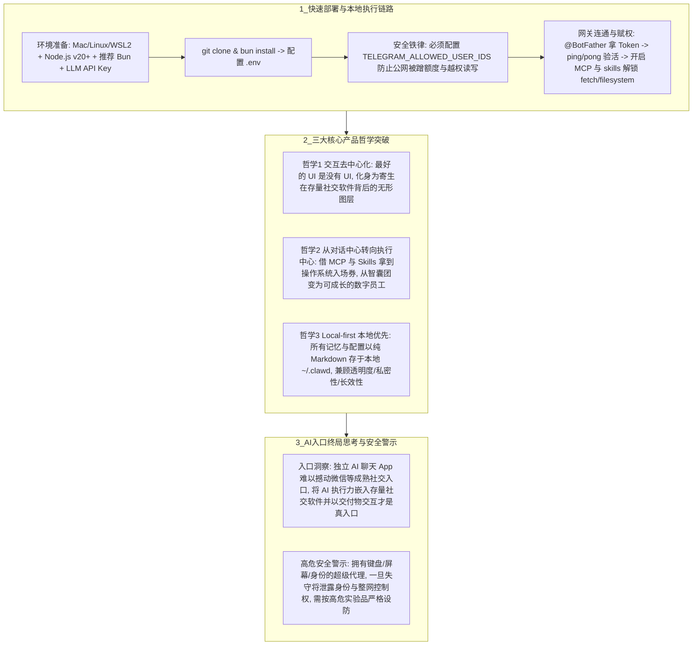

# Clawdbot产品入口

## 1. TL;DR

本文从快速部署实操与产品经理视角，深度解读了由 Peter Steinberger 发起、一夜爆火的本地优先（Local-first）个人 AI 智能体开源项目 **Clawdbot**（因 Anthropic 认为名称易与 Claude Code 混淆而先后改名为 **Moltbot** 与 **OpenClaw**）。核心结论是：Clawdbot 虽然在底层算法上没有惊世骇俗的突破，但在产品形态上回答了“什么是真正的 AI 入口”——**通过“去中心化无 UI（寄生于 Telegram/Slack/iMessage/微信等存量高频社交软件） + 从对话中心转向执行中心（依托 MCP 与 Skills 操控本地终端/文件/浏览器） + Local-first 全 Markdown 本地记忆存储（数据即主权，记忆即资产）”**，让 AI 从需要用户专门跳出工作流去访问的“对话框目的地”，进化为无处不在的操作系统后台“数字员工图层”。

## 2. 问题定义与背景

### 2.1 项目背景与命名演进
- **起源与更名**：由开源开发者 **Peter Steinberger** 发起，定位为 Personal AI Assistant（被北美社区称为“住在电脑里的贾维斯”）。由于 Anthropic 认为 `Clawdbot` 这一名称过于接近 Claude / Claude Code 容易引发市场误解，应要求改名为 **Moltbot**（注：后续进一步定名为 **OpenClaw**）。
- **传统 Web 端 AI 产品的三大摩擦**：
  1. **交互割裂**：把用户关在独立的网页或 App“对话框”里，用户必须中断当前工作流去迁就 AI；
  2. **有脑无手**：局限于“你问我答”的智囊团角色，无法直接触达本地文件系统、终端与浏览器完成闭环交付；
  3. **云端黑盒记忆**：用户记忆封闭存储在厂商云端数据库中，既不透明又引发严重的政企与个人数据隐私焦虑。

## 3. 知识框架

## 4. 核心内容拆解

### 4.1 快速部署与“解锁手脚”四步实操
1. **核心环境准备**：支持 Mac / Linux / WSL2；由于项目基于 TypeScript 开发，需安装 **Node.js v20+**，且项目作者极力推荐使用 **Bun**（`bun install` / `bun run dev`）以获得更快的运行速度；准备 Anthropic（Claude）、OpenAI 或 Gemini 的 API Key。
2. **通讯网关配置（推荐从最简单的 Telegram 入手）**：
   - 在 Telegram 联系 `@BotFather` 创建机器人获取 `TELEGRAM_BOT_TOKEN`；
   - 在项目根目录 `.env` 中填入模型 Key（如 `ANTHROPIC_API_KEY`）、`TELEGRAM_BOT_TOKEN` 以及**至关重要的白名单 `TELEGRAM_ALLOWED_USER_IDS`**；
   - 启动 `bun run dev` 后向机器人发送 `ping`，收到 `pong` 即代表本地机器与手机 IM 隧道打通（iMessage 与 WhatsApp 则需依赖 `clawd-gateway` 或特定 Mac 环境）。
3. **解锁“手脚”（MCP 与 Skills 扩展）与本地存储机制**：
   - Clawdbot 躯干本身不带重度业务功能，其执行力来自 `skills` 目录与 **MCP（Model Context Protocol）** 工具（如开启 `fetch`、`filesystem` 后，即可在手机上下令：*“帮我列出桌面上所有包含 'Confidential' 字样的文件”*）。
   - **本地记忆目录**：所有会话记忆与运行日志默认以纯文本/Markdown 存储在本地隐藏目录 **`~/.clawd`**（或对应工作区）下；若想让 Agent 彻底“失忆”，直接删除该文件夹即可。

### 4.2 三大产品层面深度思考
1. **交互的“去中心化”：最好的 UI 是没有 UI**
   - 传统 AI 应用强迫用户点击进入一个独立的“目的地 App”；Clawdbot 反其道而行之，不提供独立客户端，而是将自己退化为一个操作系统后台进程，寄生在用户每天高频打开的 Telegram、Slack、iMessage 等社交软件中。
   - **产品启示**：未来的 AI 入口不应是一个孤立的 App，而是一个无处不在的“**系统图层**”，通过零界面切换消弭人类调用 AI 的心理摩擦。
2. **从“对话中心”转向“执行中心”**
   - 接入 MCP 与可动态升级的 Skills 库（`clawdhub.com`）后，AI 拿到了操作系统的“入场券”——能直接在终端跑 `git status`、读写本地文件夹、通过浏览器插件自动填报销单。
   - **产品启示**：AI 从“只动嘴的智囊团”进化为“能交付结果的数字员工”，其护城河不再仅取决于单次模型有多聪明，而在于所连接的本地工具生态广度与持续进化的长期成长性。
3. **“Local-first（本地优先）”：数据即主权，记忆即资产**
   - 将全部记忆与配置以 **Markdown 格式**明文落盘在用户本地设备，带来三大结构性优势：
     - **透明度**：用户可以像翻阅普通笔记一样随时审查和编辑 AI 的“思考与记忆过程”；
     - **私密性**：从产品架构根源上规避了企业与个人最敏感的云端数据隐私合规争议；
     - **长效性**：随着本地跨周期交互数据的持续累积，Agent 会成为越用越懂用户工作与生活习惯的私有资产。
4. **对国内 AI 入口之争的启示**：
   用户对微信等极简成熟的社交产品存在极强的路径依赖，独立的对话式 AI 入口（如豆包类独立 App）在相当长时期内难以替代社交软件本身；反之，**将强悍的 AI 执行能力无缝嵌入现有的国民级社交入口，并以“直接返回任务交付物”的方式服务用户**，才是更具爆发力的 AI 入口形态。

## 5. 数据速查表

| 指标 / 配置项 | 原文数值 / 规范 | 语境 / 条件 |
| :--- | :--- | :--- |
| **项目发起人与更名路径** | **Peter Steinberger** / `Clawdbot` $\to$ `Moltbot`（后为 `OpenClaw`） | 因 Anthropic 认为原名易被误解为 Claude Code 延展产品而更名 |
| **运行环境最低要求** | **Node.js v20+**（推荐搭配 **Bun** 运行时） | 支持 Mac / Linux / WSL2，基于 TypeScript 开发 |
| **必配防蹭网安全环境变量** | `TELEGRAM_ALLOWED_USER_IDS` | 在 `.env` 中锁定允许交互的账号 ID，防止外人盗刷 API 额度或读写服务器 |
| **连通性验证心跳指令** | 发送 `ping` $\to$ 回复 `pong` | 验证手机 IM 与本地 `bun run dev` 网关隧道是否打通 |
| **本地记忆与日志隐藏目录** | `~/.clawd`（全部以 **Markdown** 格式存储） | 删除该目录即可一键清空全部历史记忆（令 Agent“失忆”） |
| **官方生态入口矩阵** | 官网 `clawd.bot` / 文档 `docs.clawd.bot` / 市场 `clawdhub.com` | 开源仓库：`https://github.com/clawdbot/clawdbot` |

## 6. 踩坑与教训 / 可迁移的设计原则

| 错误做法 | 失败表现或原因 | 原文应对（可迁移的设计原则） |
| :--- | :--- | :--- |
| **在云服务器或公网环境中运行 Clawdbot 却未配置 `TELEGRAM_ALLOWED_USER_IDS`** | 任何搜到该 Telegram Bot 的外部用户都能直接发指令耗尽你的 Anthropic/OpenAI API 额度，甚至通过 `filesystem` 技能窃取、篡改服务器文件 | **IM 入口强身份白名单原则**：任何绑定本地高权限执行环境的 IM 机器人，启动前必须在 `.env` 中硬性锁定授权用户 ID 白名单 |
| **将高权限本地 Agent 当作普通成熟消费级软件随意授权全盘读写** | Clawdbot 本质上是同时拥有“键盘、屏幕和用户身份”的超级代理，一旦遭遇提示词注入或配置失守，泄露的不仅是数据，还有身份凭证与整网控制权 | **高危实验品最小权限隔离原则**：在安全机制与使用习惯成熟前，将其视为高危实验品，严格限制敏感目录与系统身份权限 |
| **做 AI 产品时执着于逼迫用户下载独立 App、跳出原有工作流去对话框里聊天** | 迁移心智成本极高，且纯问答无法闭环解决真实生产力任务 | **无 UI 寄生 + 交付物导向 + Local-first 原则**：寄生于用户最高频的存量通讯工具，用 MCP/Skills 直接交付执行结果，并用本地 Markdown 归档记忆资产 |

## 7. 记忆锚点

- **Clawdbot 三大产品支柱**：“**交互无 UI（寄生存量 IM 当图层）、重心在执行（MCP+Skills 当数字员工）、记忆存本地（`~/.clawd` Markdown 握紧数据主权）。**”
- **部署防坑三要素**：“**Node 二十配 Bun 跑，`.env` 必锁 `ALLOWED_USER_IDS`，删 `~/.clawd` 一键失忆。**”

## 8. 复习卡片

为什么开源项目 Clawdbot 会改名为 Moltbot（以及后来的 OpenClaw）？::因为该项目由 Peter Steinberger 发起，而 Anthropic 认为“Clawdbot”这个名字太容易被市场误解为 Anthropic 官方 Claude / Claude Code 的延展产品，因此要求创始人更名。
在部署 Clawdbot 并接入 Telegram 机器人时，为什么在 `.env` 中配置 `TELEGRAM_ALLOWED_USER_IDS` 是绝对不能省略的步骤？::因为 Clawdbot 具备直接读写本地文件和执行终端命令的高权限，且后端绑定了付费 LLM API Key；若不设置 `TELEGRAM_ALLOWED_USER_IDS` 限制访问者身份，任何人都能通过该机器人耗尽你的 API 额度甚至控制你的服务器文件。
Clawdbot 的所有记忆和配置是如何存储的？这种“Local-first（本地优先）”设计带来了哪三个产品优势？::全部以明文 Markdown 格式存储在本地隐藏目录（如 `~/.clawd`）中；带来三大优势：1. 透明度（可像翻笔记一样随时查看 AI 的思考与记忆，删目录即可失忆）；2. 私密性（天然规避云端数据库的隐私争议）；3. 长效性（本地长期积累的数据使其越来越懂用户习惯，真正实现“数据即主权，记忆即资产”）。
作者从产品经理视角总结出 Clawdbot 在 AI 交互范式上的哪两个核心转变？::1. 交互的“去中心化”（最好的 UI 是没有 UI）：不再把用户关在独立 App 的对话框里，而是退化为后台进程寄生于 Telegram/Slack/微信等存量通讯工具中，成为无处不在的“图层”；2. 从“对话中心”转向“执行中心”：通过接入 MCP 与 Skills 获得操作系统入场券，从只负责问答的“智囊团”变成直接交付结果的“数字员工”。
为什么说在安全机制尚未完全成熟前，必须将 Clawdbot 这类工具视为“高危实验品”？::因为它本质上是一个同时拥有“键盘、屏幕和用户身份”的高权限代理；一旦配置失误或边界失守，它泄露的将不只是静态数据，而是用户的身份凭证、操作权以及整个网络的控制权。

## 9. 知识关联

- **本库通用主题**：[Harness与模型协同](../../20_topics/Harness%E4%B8%8E%E6%A8%A1%E5%9E%8B%E5%8D%8F%E5%90%8C.md) · [Agent长期记忆](../../20_topics/Agent%E9%95%BF%E6%9C%9F%E8%AE%B0%E5%BF%86.md) · [AI研发协同](../../20_topics/AI%E7%A0%94%E5%8F%91%E5%8D%8F%E5%90%8C.md) · [桌面Agent与工作流](../../20_topics/%E6%A1%8C%E9%9D%A2Agent%E4%B8%8E%E5%B7%A5%E4%BD%9C%E6%B5%81.md)
- **候选双链**：[[OpenClaw架构与多Agent]] · [[OpenClaw安全体检]] · [[Agent Studio 对比]] · [[Local-first软件架构]]

## 10. 原文参考资料

- 原文标题：《一夜爆火，Clawdbot 是否才是真正的 AI 入口产品？》（作者：nevil，发布于 2026-01-27）
- 官方链接（发文时域名）：`https://clawd.bot`、`https://github.com/clawdbot/clawdbot`、`https://docs.clawd.bot`、`https://clawdhub.com`

> [!note]- 校对报告
> - **页码溯源汇总**：
>   - `p.1–2`：Clawdbot 导语、因 Anthropic 要求改名为 Moltbot 说明、创始人 Peter Steinberger 及 Local-first“住在电脑里的贾维斯”定位。
>   - `p.3–4`：环境准备（Node.js v20+、Bun、LLM API Key、Telegram）、克隆安装与 `.env` 配置（`ANTHROPIC_API_KEY`、`TELEGRAM_BOT_TOKEN`、`TELEGRAM_ALLOWED_USER_IDS`）、`ping/pong` 验证、通过 MCP 与 `skills` 开启 `fetch/filesystem`、以及三条避坑指南（`~/.clawd` 记忆文件夹删除即失忆、网络畅通、安全白名单）。
>   - `p.5–6`：三大产品思考（1. 交互去中心化：最好的 UI 是没有 UI；2. 从对话中心转向执行中心；3. Local-first：Markdown 本地存储实现透明度、私密性与长效性）、对微信等存量社交入口集成的判断、高危实验品安全警示及附录链接。
> - **核验结论**：全文所有命令、环境变量与产品论点均与原文逐页核对一致。
