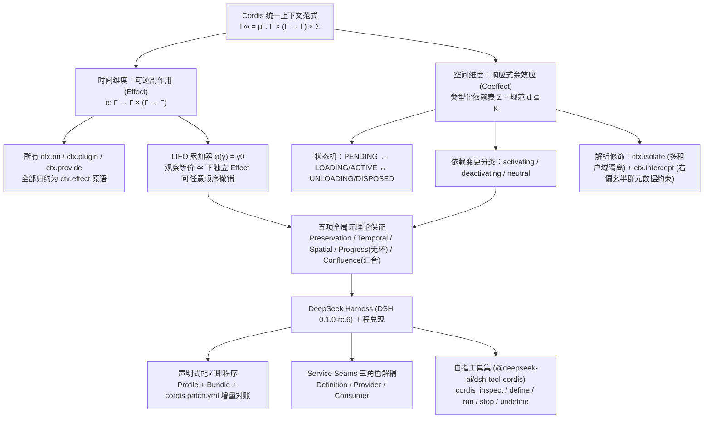
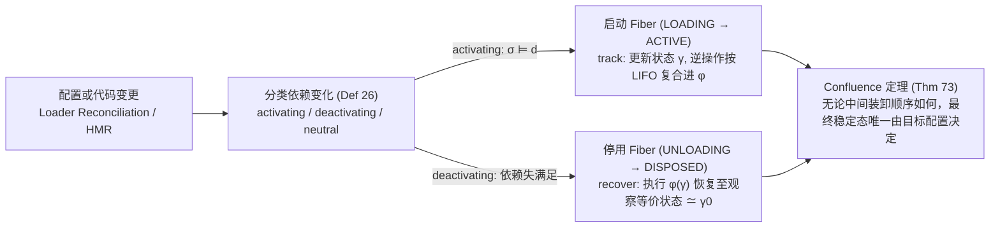

# DeepSeek Harness 背后的“心脏”：Cordis 到底是什么

## 1. TL;DR

Cordis 是由 Shigma（梦梦，Koishi 创始人）编写的通用插件元框架（Meta-framework），在 DeepSeek Harness（DSH `0.1.0-rc.6`，基于 `@deepseek-ai/cordis` `4.0.1`）中充当“一切皆插件”的运行时底座。传统模块化只解决代码组织，而传统 DI 容器假设“一旦绑定永久存在”；Cordis 则通过**可逆副作用（Reversible Effect，`ctx.effect`）**与**响应式余效应（Reactive Coeffect，`inject` 服务注入）**两大核心机制，将“安全卸载回滚”和“依赖动态启停重连”从开发者的自觉纪律提升为框架级结构保证。北京大学与 DeepSeek-AI 联合发表的 88 页配套论文将其形式化为“时空可组合性（Spatiotemporal Composability）”编程范式，证明了保型（Preservation）、全局时间/空间可组合性、无环前提下的进展终止（Progress）以及汇合性（Confluence，即最终稳定态仅由目标配置决定而与装卸顺序无关），使 DSH 得以实现免重启配置热替换、无需手动标注边界的事务性 HMR，以及通过 `cordis_define`/`cordis_run` 现场改装自身运行时的自指演化能力。

## 2. 核心概念

### 核心术语与形式化定义

- **Meta-framework（元框架）**：不预设业务领域（可用于 IM 机器人 Koishi，也可用于 Agent 运行时 DSH），专门规定“副作用如何组合、依赖如何解析、谁在什么时候活着”的底层运行时框架。
- **Fiber（纤维 / 插件实例生命周期）**：Cordis 4 为每个已加载插件实例维护的运行时状态机與效果边界，包含 `PENDING`、`LOADING`、`ACTIVE`、`FAILED`、`UNLOADING`、`DISPOSED` 六种状态，并持有逆操作累加器（accumulator）与已承诺依赖视图（committed view）。
- **Reversible Effect（可逆效应，`ctx.effect`）**：描述“计算对环境做了什么”并配对携带逆操作。形式化为 $e : \Gamma \to \Gamma \times (\Gamma \to \Gamma)$，在效应上下文 $\partial\Gamma = (\gamma, \phi)$ 中按 LIFO 顺序将逆操作累积进 $\phi$；Cordis 中提供服务、挂载子插件、注册事件监听全部归约为 `ctx.effect` 这一个原语。
- **Reactive Coeffect（响应式余效应，`inject`）**：描述“计算对环境要求什么”。将 IoC 容器形式化为类型化部分函数 $\Sigma$（每个键 $k$ 映射到静态类型 $V_k$），把上下文变化对组件依赖规范 $d \subseteq K$ 的影响分为 `activating`（由不满足变满足，触发启动）、`deactivating`（由满足变不满足，触发卸载回滚）和 `neutral`（无关）。
- **观察等价（Observational Equivalence，$\simeq$）**：恢复不要求内存堆布局或生成式 ID 字面回到过去，而是“任何通过 coeffect 观察的观察者都无法区分恢复后状态与初始状态”。

### 系统对比：Cordis 与八类既有系统的时空组合边界

| 系统 / 范式 | 时间维（卸载与清理） | 空间维（依赖声明与解析） | 与 Cordis 的核心差距 |
|---|---|---|---|
| **传统 DI 容器**（Spring / NestJS） | 无生命周期自动回滚；`OnModuleDestroy` 将创建与清理分离在两处 | 运行时查找（常需类型转换或 `any`），依赖关系散落代码 | 假设“绑定即永久”，服务下线无法自动卸载并重建消费方 |
| **React Hooks**（`useEffect`） | 支持返回 cleanup，但靠调用顺序在隐藏状态登记 | 静态依赖数组仅在渲染时比较值，无运行时依赖解析 | 绑死在 UI 渲染树上，无法推广为通用组件动态装卸与服务重连 |
| **OSGi** | Bundle 可动态安装卸载，服务可动态注册注销 | Consumer 通过注册表绑定 Provider | 有动态机制但无**响应式语义**：服务消失时消费方只拿到失效引用，不会自动回滚重载 |
| **VS Code 扩展宿主** | 无法运行时热卸载单个扩展（前 100 热门扩展中 87 个含代码，禁用/卸载需重启宿主） | `extensionDependencies` 仅 7 个热门扩展使用，`exports` 为未检查的 `any` | 插件只向固定扩展点贡献，缺乏类型化插件间依赖与单组件热卸载路径 |
| **微服务 / 容器（K8s）** | 进程级重启即清理状态 | 编排器级服务发现 | **粒度错配**：重启丢弃全部进程内状态（耗时秒至分钟级），跨地址空间只能走网络而非函数调用 |
| **Monadic Effect**（ZIO / Effect-TS） | 靠 Monad 类型嵌入追踪 | 解释器一次性装配需求 $R$ | 必须把整个程序写进 Effect 类型；服务撤走时已执行操作留在原地，无逆向恢复 |
| **代数效应**（Effekt / Koka） | 静态类型层词法作用域纪律 | 静态解析 | 目的不同：代数效应为了“模块化解释（一操作多 handler）”，Cordis 为了“运行时追踪与逆转” |
| **Webpack / Vite HMR** | 需开发者手动标注 `module.hot.accept` 边界，漏标即整页刷新 | 模块导入图 | 替换边界靠人工声明；Cordis 靠 Fiber 天然界定全部效果边界，无需 `accept` 且支持失败回滚 |

## 3. 知识框架



## 4. 关键要点与机制详解

### 4.1 五个基础概念与插件树生命周期（Plugin / Context / Fiber / Effect / Service / Event / Schema）

**核心主张：Cordis 把“谁在什么时候活着、卸载时如何不留残余”收束进一棵由 `ctx` 派生的 Fiber 树，使所有上下文变更天然可追踪、可逆转。**

- **遇到什么问题**：模块化拆文件后，仍然面临四件事——新功能怎么安装、不同环境怎么配置、下线时定时器/监听器/连接由谁清理（清理不净即内存泄漏）、依赖的服务未启动或中途被替换时消费方如何应对。
- **采用什么机制**：
  1. **三种插件形态与“配置即组合”**：插件只描述对系统的贡献（支持函数形态 `export function apply(ctx)`、对象形态 `{ name, apply }`、类形态 `class MyService extends Service`），应用长什么样完全由 `cordis.yml` 决定。
  2. **树状派生上下文（`Context`）**：`ctx.plugin(child)` 会派生出一个继承父级能力的子上下文。卸载严格按树层级进行：**父插件卸载时递归卸载所有子插件；子插件单独卸载不影响兄弟和父级**。
  3. **六状态 Fiber 状态机**：每个插件实例对应一个 Fiber，状态流转为：
     - `PENDING`（已声明，但 `inject` 的服务尚未就绪）
     - `LOADING` / `ACTIVE`（`apply` 正在执行 / 已完成）
     - `FAILED`（`apply` 抛异常或 Schema 配置校验失败）
     - `UNLOADING` / `DISPOSED`（清理中 / 已拆除）
  4. **可逆原语 `ctx.effect`**：主体在加载时执行，返回的 `disposer` 函数在卸载时自动执行。内置的 `ctx.on()`、`ctx.plugin()`、`ctx.provide()` 底层全部是 `ctx.effect` 的特例。插件作者只需遵守一条铁律：**凡是自己创建、Cordis 不管的外部资源（连接、定时器等），一律包进 `ctx.effect()`**。
  5. **响应式服务注入（`Service` & `inject`）与 `isolate` / `intercept`**：
     - 消费方通过 `export const inject = ['greeter']` 声明依赖，Fiber 会停留在 `PENDING` 直到依赖全部就绪；当提供方被卸载（如 MCP 崩溃、LLM 限流下线）时，所有依赖它的插件自动卸载并回滚 Effect，新提供方就绪后自动重载，无需手写重连代码。
     - `ctx.isolate(key, realm)` 让不同作用域将同一服务键解析到独立实例（派生新上下文，回收直接丢弃）；`ctx.intercept(key, meta)` 为依赖访问附加外层约束元数据（如沙箱策略给 `shell` 附加限制）。
  6. **五种类型化事件分发模式**：通过 TypeScript `declare module '@deepseek-ai/cordis' { interface Events { ... } }` 获得全链路类型安全，支持 `emit`（同步广播不等待）、`parallel`（并发等待）、`serial`（顺序执行，首个非空返回胜出短路）、`bail`（`serial` 同步版）和 `waterfall`（环绕中间件链，接收 `(input, next)`）。
  7. **Schema 校验与稳定 `id` 声明**：使用 `schemastery` 在调用 `apply` 前校验配置（非法则直接报错进入 `FAILED`，绝不半启动）；配置项带稳定 `id` 才能让 Loader 区分“增量修改”与“删了重加”；DSH Loader 还支持 `!!js` 运行时求值表达式（在依赖就绪后求值）。

```ts
// 1. 可逆副作用与响应式注入标准写法
import { Service, Schema, type Context } from '@deepseek-ai/cordis'

export const name = 'example-plugin'
export const inject = ['greeter']

export interface Config {
  greeting: string
  targets: string[]
}
export const Config: Schema<Config> = Schema.object({
  greeting: Schema.string().default('Hello'),
  targets: Schema.array(String).default(['world']),
})

export function apply(ctx: Context, config: Config) {
  // 凡自建外部资源均包入 ctx.effect，卸载时自动执行返回函数
  ctx.effect(() => {
    const conn = createConnection()
    return () => conn.close()
  })

  // waterfall 决策链：只观察不拦截的监听器必须 return next()
  ctx.on('some/decision', async (input, next) => {
    if (!hasPermission(input)) return { denied: true } // 不调 next() = 否决短路
    return next() // 调 next() = 放行下游
  })
}
```

### 4.2 DeepSeek Harness（DSH）中的工程落地：从 20 行启动器到自指运行时

**核心主张：DSH 将 Agent 的所有能力拆解为可替换的 Cordis 服务槽位（Seams），并通过自指工具集允许 Agent 在运行时巡检和现场改装自己。**

- **极简启动与三层配置叠加（Boot & Profile / Bundle / Patch）**：
  - DSH 启动器 `boot()` 仅约 20 行代码：创建根 `Context` → 注入引导路径 `dshHomePath` → 挂载 `Loader` → `mountRootInclude` 挂载配置树 → `loader.await()` 等待整棵树稳定 → `assertEntriesActivated` 审计确保无半死不活条目。
  - **配置组装顺序**：`$DSH_HOME/profiles/<名字>` 下的 `dsh.profile.bundles`（如核心包 `@deepseek-ai/dsh-base` 将 `timer`、`hmr`、`llm`、`session`、`agent`、`jobs` 等几十个插件一次性 `insert` 进空根）→ 用户级 `cordis.patch.yml` → 启动命令 `--patch` 临时覆盖层。部署方按 `id` 覆盖一行即可替换或 `disabled` 任意内置组件。
- **能力接缝（Capability Seams）与三角色解耦**：
  - 每项能力由 **Service Definition**（稳定类型契约）、**Service Provider**（可独立替换的实现）和 **Consumer**（业务使用方）三角色组成。
  - **DSH 核心槽位表**：

| 类别 | 槽位（`ctx.<key>`） | 用途 | 现有可替换提供方（Providers） |
|---|---|---|---|
| **执行** | `shell` / `codeRuntime` / `subprocess`, `terminals` / `lsp` | Bash 执行、代码执行、子进程与持久 PTY、LSP 导航 | `bash-local`, `bash-sandbox`, `pwsh-local`, `E2B` / `code-runtime-worker` / `subprocess-local`, `terminal-bash` / `lsp-local` |
| **模型与智能** | `llm` / `agents`, `agentLoop`, `agentDefaultModel` / `agentPresets` / `subagents` | LLM 适配器注册表、Agent 循环驱动、会话预设、子 Agent | `llm-deepseek`, `llm-pi-ai`, `llm-replay` / `agent-loop` / `subagent-spawn/fork-in-process`, `ACP`, `Codex`, `Claude Code` |
| **数据与环境** | `sessions`, `sessionPersistence`, `sessionQuery` / `storage`, `attachments`, `spillStore` / `fs` / `web` | 会话日志与检索、通用存储与溢出存储、文件系统、Web 抓取与搜索 | `session-persistence-jsonl/-sqlite` / `storage-json/-sqlite` / `fs-local`, `fs-sandbox`, `fs-e2b` / `web-search-deepseek/exa/perplexity` |
| **治理与编排** | `tools` / `approval`, `permissionPresets`, `sandboxPolicy` / `goals`, `jobs`, `workflowEngine`, `planMode` | 工具管道、审批与沙箱策略、长期目标与后台工作流 | 所有 `dsh-tool-*` / `approval`, `sandbox-policy` / `dsh-goal`, `dsh-jobs-local`, `workflow-worker-thread` |
| **自指与前端** | `dynamicCordisRunner`, `cordisInspect` / `slots`, `clientModules`, `theme`, `locale` | 动态包宿主与运行时巡检、前端 UI 槽位与客户端插件图 | `cordis-host-runner` / `dsh-client-ui-*` 系列（浏览器内运行独立 Cordis 客户端运行时） |

- **自指工具集（`@deepseek-ai/dsh-tool-cordis`）与双半插件**：
  - 提供五个工具：`cordis_inspect`（只读巡检当前进程活跃服务、各 Fiber 状态、已注册工具及 `ctx.<key>` 契约）、`cordis_define`（现场定义可含“宿主半 + 浏览器半”的动态插件包，只记录不执行）、`cordis_run`（将宿主半放入 `node:vm` 执行，将浏览器半推送至打开的网页，二者通过 `host.call` 做 RPC）、`cordis_stop` 与 `cordis_undefine`（停止并卸载动态包）。
  - 🔥 **安全边界铁律**：原文明确指出，**DSH 动态插件与 `bash` 同权，`node:vm` 沙箱仅隔离全局作用域，绝不构成安全边界**。

### 4.3 配套论文形式化理论：时空可组合性演算与五项元理论性质

**核心主张：通过把编译期的 Effect 与 Coeffect 提升为运行时机制，并在观察等价 $\simeq$ 下分离“可交换的 Effect”与“顺序敏感的 Coeffect”，Cordis 将“正确卸载、正确重接线、增量对账收敛”证明为数学定理。**



- **为什么两个交错运行的组件可以单独卸载其中一个？**
  - 当组件 A 之后还有 B、C 的 Effect 执行时，直接撤销 A 面对的是已被移动过的状态。论文定义了**独立性（Independence，Corollary 21 & Theorem 40）**：若两个 Effect 的变换可交换且互不干扰对方产出的逆（例如读写不同注册表键 $k$ 的操作天然独立），且恢复定义为**观察等价 $\simeq$**（Definition 33 & Theorem 42，不要求 `malloc`/`free` 堆布局或自增 ID 字面相等，只要所有 Coeffect 观察者看不出区别即可），则任意单个组件均可随时单独卸载，其贡献归零且不影响邻居。
  - 反之，对顺序敏感的操作（如中间件链）不满足独立性，必须由 `ctx.on(event, listener, { prepend })` 或 `waterfall` 显式维护顺序。
- **全局动态组合演算的五项元理论性质**：
  1. **Preservation（保型）**：每次状态迁移均保持系统良构，状态机不会走到非法状态。
  2. **Temporal Composability（全局时间可组合性，Corollary 62）**：撤掉任意一个 Fiber，其对共享环境的贡献归零，周围 Fiber 状态保持原样。
  3. **Spatial Composability（全局空间可组合性，Theorem 63）**：提供方离开前，所有依赖它的消费方 Fiber 必然先被停用，无需手动编排卸载顺序。
  4. **Progress（进展与终止，Theorem 66）**：**前提是依赖优先关系 $\prec$（提供-声明图）无环**；在此前提下，只要未达静止态（quiescent）就必有规则可应用（无死锁），且目标视图翻转次数有上界，配置迁移必然终止。这也是 Cordis 拒绝循环依赖的数学原因。
  5. **Confluence（汇合性，Theorem 73）**：系统的最终稳定状态仅由目标配置决定，与中间加载、卸载的先后顺序无关。这直接支撑了 Loader 按 `id` 做任意顺序的增量配置对账（Reconciliation）。
- **无 `accept` 边界的三阶段事务性 HMR 与系统边界延伸**：
  - **HMR 三阶段**：① 依赖图不动点分类模块 `accept`/`decline`（环路默认 `decline`）→ ② 沿 entry 传递依赖树检测过期条目 → ③ **事务性重载**：备份模块缓存，逐个 `dispose` 旧 Fiber、挂载新 Fiber；任一步失败则恢复缓存并用旧模块重建，绝不处于半重载状态。因 Fiber 本身界定了组件全部效果边界，开发者无需像 Webpack/Vite 那样手写 `module.hot.accept`。
  - **系统边界、补偿与服务多路复用**：外部程序可读写的位置在“边界外”，可通过 `ctx.intercept` 包装成自带逆的受限操作（reify，用访问开销换可恢复性）；对发邮件、扣款等真正不可逆操作采用 LIFO **应用级补偿（Compensation，如退款）**；对高频切换服务采用常驻 **Service Broker（服务代理）** 多路复用多个 Provider（如 DSH 的 `llm` 注册表），实现热更新零重载扰动、负载均衡与灰度切换。

## 5. 数据速查表

| 指标 | 原文数值 | 语境 / 条件 |
|---|---|---|
| DSH 与 Cordis 源码版本 | DSH `0.1.0-rc.6` / `@deepseek-ai/cordis` `4.0.1` | 本文源码剖析基准版本；对比 Koishi（`@koishijs/core` `4.18.11`）当时仍依赖 `cordis: ^3.18.1`（3.x） |
| 配套论文篇幅与署名 | `88 页` 预印本 | 《A Programming Paradigm for Spatiotemporal Composability》，北京大学与 DeepSeek-AI 合著（Yifan Shi, Wei Zhang, Tianyi Cui） |
| VS Code 热门扩展反例统计 | 前 `100` 个热门扩展中 `87` 个含可执行代码，仅 `7` 个使用 `extensionDependencies` | 论文实测：87% 热门扩展禁用或卸载需重启整个扩展宿主；依赖因返回 `any` 几乎无人使用 |
| DSH 启动器核心代码量与本地改动 | 启动函数约 `20 行`；DSH vendor 进仓库仅做约 `18 处` 本地修改 | Cordis 核心仅几千行 TypeScript；18 处修改集中于生命周期加固、配置加载事务化、表达式延迟求值 |
| DSH 社区插件数量 | `174` 个插件 | 截至 2026 年 8 月 GitHub `awesome-dsh-plugin`（`#dsh-plugin`）收录、可通过 `dsh plugin add` 安装的数量 |
| Koishi 与 Cordis 生态包规模 | `@koishijs` 官方 `155` 包（含插件 `112`、适配器 `19`）；社区 `koishi-plugin-*` 约 `3951` 包；`@cordisjs` 官方 `101` 包 | 截至 2026 年 8 月 npm registry 枚举实测 |
| npm 年下载量与 GitHub Star | `koishi` 年下载约 `34 万`、`cordis` 约 `51 万`（周均约 `1 万`）；Star 分别约 `5800` 与 `2400` | 截至 2026 年 8 月 `api.npmjs.org` 与 GitHub 实测数据 |

## 6. 踩坑与教训 / 可迁移的设计原则

### 踩坑与教训（错误做法 → 失败表现或原因 → 原文应对）

1. **在 `waterfall` 事件监听器中只做观察/日志却忘记调用 `next()`**：
   - **错误做法**：编写审计或日志插件监听 `tools/pre-execute`、`approval/request` 等 `waterfall` 事件时，执行完记录逻辑直接返回。
   - **失败表现或原因**：在 `waterfall` 环绕中间件语义中，不调用 `next()` 等同于否决短路，会无声吞掉下游所有默认执行行为。
   - **原文应对**：遵守 DSH 明文纪律——只负责观察和记录的 `waterfall` 监听器必须在末尾 `return next()`。
2. **插件已挂载但毫无反应，盲目排查业务代码逻辑**：
   - **错误做法**：看到插件未输出日志就以为 `apply` 内部逻辑写错或框架故障。
   - **失败表现或原因**：插件通过 `inject` 声明的某个依赖服务尚未就绪，导致该插件的 Fiber 一直停留在 `PENDING` 等待态，`apply` 根本尚未执行。
   - **原文应对**：使用 `cordis_inspect` 巡检各 Fiber 状态，检查其 `inject` 依赖项是否已激活。
3. **编写 `cordis.yml` 配置条目时不写稳定 `id`**：
   - **错误做法**：配置列表中只写 `- name: './greeter.ts'` 而不声明 `id`。
   - **失败表现或原因**：不带 `id` 的条目每次读取都会分配新 `id`，配置文件的任何微调都会被 Loader 当作“先彻底删除旧插件、再重新加载新插件”，失去精准增量对账能力。
   - **原文应对**：为配置条目显式声明稳定 `id: greeter`，使 Loader 能按字段差异执行最小化对账。
4. **插件自己创建的连接或原生定时器未包入 `ctx.effect()`**：
   - **错误做法**：在 `apply(ctx)` 中直接调用第三方库建立长连接或原生句柄，指望插件卸载时自动释放。
   - **失败表现或原因**：Cordis 内置 API（`ctx.on`、`ctx.plugin`、`ctx.provide`）会自动回滚，但框架不知道插件私自创建的外部资源，热重载或卸载时会造成连接与内存泄漏。
   - **原文应对**：遵循铁律——凡是自己创建、Cordis 不管的资源，一律包进 `ctx.effect(() => { ...; return () => cleanup() })`。
5. **把 DSH 动态插件的 `node:vm` 当成安全隔离沙箱**：
   - **错误做法**：认为 `cordis_run` 在 `node:vm` 中运行动态插件就可以防御恶意代码或越权操作。
   - **失败表现或原因**：`node:vm` 仅隔离全局对象作用域，动态插件实际上与 `bash` 拥有同等宿主权限。
   - **原文应对**：将动态插件视为与 `bash` 同权的高权限操作，真正需要安全隔离时必须走外部沙箱策略（`sandboxPolicy` / 容器 / E2B）。

### 可迁移的设计原则

- **将“创建”与“清理”强制绑定在同一词法位置（局部性原则）**：不要设计分离的 `activate()` 和 `deactivate()` 钩子；让每个状态变更函数直接返回其逆操作（`e: Γ → Γ × (Γ → Γ)`），由运行时按 LIFO 组合逆操作，才能从根源上消除卸载泄漏。
- **高频切换的底层能力优先采用“三角色 + Service Broker”模式**：将能力拆为不变的 `Definition`、可替换的 `Provider` 与解耦的 `Consumer`；若需要零抖动热切换或灰度分流，在中间插入常驻 `Service Broker`，避免切换 Provider 时触发上层所有 Consumer 级联卸载重载。
- **区分可交换状态与顺序敏感链**：注册表类操作（工具注册、命令绑定）设计为不同键上的独立操作以支持任意顺序热插拔；权限、审批、限流等顺序敏感逻辑则显式收敛到 `waterfall` 决策链中。

## 7. 记忆锚点

1. **核心定位锚点**：「传统 DI 回答“谁创建谁”，Cordis 回答“谁在什么时候活着”；它把“正确卸载、正确接线”从开发者要守的纪律，变成了框架级定理。」
2. **五大机制口诀（助记改写）**：「`ctx` 派生插件树，六态 `Fiber` 管生死；`effect` 携逆保卸载，`inject` 响应等依赖；`Confluence` 兜底随便装，配置即程序免重启。」

## 8. 复习卡片

Cordis 作为插件元框架（Meta-framework），解决了模块化拆文件无法解决的哪四个问题？::解决了新功能如何安装、同一功能在不同环境如何配置、功能下线时定时器/监听器/连接如何完整清理（卸载）、以及依赖的服务未就绪或中途被替换时如何自动协调（协作）这四个问题。
Cordis 4 中一个插件实例（Fiber）包含哪六个生命周期状态？::包含 `PENDING`（等待 `inject` 依赖就绪）、`LOADING`（`apply` 执行中）、`ACTIVE`（已激活）、`FAILED`（抛异常或 Schema 校验失败）、`UNLOADING`（清理中）和 `DISPOSED`（已拆除）。
为什么说 Cordis 中所有通过上下文（`ctx`）进行的操作都能自动追踪和恢复？::因为论文与实现将提供服务（`ctx.provide`）、挂载子插件（`ctx.plugin`）、注册监听器（`ctx.on`）全部归约为 `ctx.effect` 这一个原语；每次变更在更新状态 $\gamma$ 的同时将逆操作按 LIFO 顺序复合进累加器 $\phi$，卸载时执行 $\phi(\gamma)$ 即可恢复。
Cordis 的响应式依赖注入（`inject`）与传统 DI 容器（如 Spring/NestJS）的核心区别是什么？::传统 DI 假设“一旦绑定服务永久存在”；Cordis 假设“服务可随时出现或消失”，將依赖变化分为 `activating`、`deactivating` 和 `neutral`——依赖未就绪时消费方保持 `PENDING`，提供方卸载时消费方自动卸载回滚，新提供方就绪后自动重载。
在 Cordis 配套论文中，为什么将状态恢复定义为“观察等价（$\simeq$）”而非“字面相等”？::因为真实系统中内存释放（`free`）不会还原堆布局、生成式 ID 重建后也会改变；只要通过 Coeffect 观察的任何观察者无法区分恢复后状态与初始状态即视为观察等价，这一让步使可逆性在真实系统中成立，并让不同键上的操作满足可交换独立性。
Cordis 论文证明的五项全局元理论性质分别是什么？其中 Progress（进展终止）依赖什么前提？::五项性质分别是 Preservation（保型）、Temporal composability（单 Fiber 卸载贡献归零）、Spatial composability（提供方离开前先停用消费方）、Progress（迁移无死锁且有限步终止）和 Confluence（最终稳定态仅由目标配置决定，与中间装卸顺序无关）；其中 Progress 的前提是依赖优先关系 $\prec$ 必须无环。
为什么 Cordis 的 HMR（模块热替换）不需要像 Webpack 或 Vite 那样手动标注 `module.hot.accept` 边界？::因为每个组件实例的 Fiber 本身就精确界定了该组件全部副作用的边界；HMR 只需事务性地 `dispose` 旧 Fiber 并挂载新 Fiber（若任一步失败则恢复模块缓存并用旧模块重建），天然不会进入半重载状态。
DSH 中的自指工具集（`@deepseek-ai/dsh-tool-cordis`）包含哪五个工具？其安全边界是什么？::包含 `cordis_inspect`（只读巡检）、`cordis_define`（定义动态包）、`cordis_run`（在 `node:vm` 运行宿主半并推送浏览器半）、`cordis_stop` 和 `cordis_undefine`；其安全边界是动态插件与 `bash` 同权，`node:vm` 仅隔离全局作用域而不构成安全边界。
在 DSH 中编写 `waterfall` 事件监听器时，为什么只做日志记录的插件必须调用 `next()`？::因为 `waterfall` 是环绕中间件链，不调用 `next()` 在语义上代表直接否决并短路返回，会无声吞掉下游所有默认行为。

## 9. 知识关联

### 本库主题入口与已有关联笔记

- [Harness与模型协同](../../20_topics/Harness%E4%B8%8E%E6%A8%A1%E5%9E%8B%E5%8D%8F%E5%90%8C.md)：DSH“一切皆插件”的运行时接缝（Seams）、配置即组合与自指工具集。
- [Agent安全与权限](../../20_topics/Agent%E5%AE%89%E5%85%A8%E4%B8%8E%E6%9D%83%E9%99%90.md)：`waterfall` 审批决策链、`ctx.intercept` 沙箱策略注入及动态插件与 `bash` 同权的安全边界。

### 候选双链（供 Obsidian 知识库导航）

- **DeepSeek Harness 系列**：[[Kuikly远程控制DSH]]、[[DeepSeek Harness观测]]、[[DeepSeek Harness实测]]、[[DeepSeek Harness架构]]、[[LLM到Harness]]
- **编程语言理论与架构**：[[可逆效应 Reversible Effect]]、[[响应式余效应 Reactive Coeffect]]、[[控制反转与依赖注入 DI]]、[[模块热替换 HMR]]

## 10. 原文参考资料

- **本目录归档文件**：[RAW.pdf](RAW.pdf)｜[MD.md](MD.md)
- **原文列出的论文、文档与仓库参考**：
  - 配套论文：*A Programming Paradigm for Spatiotemporal Composability*（Yifan Shi, Wei Zhang, Tianyi Cui，北京大学 & DeepSeek-AI，`cordiverse/paper`，88 页预印本）
  - 核心仓库与文档：`cordiverse/cordis`（上游仓库）、`deepseek-ai/deepseek-harness`（DSH 仓库）、DSH 官方文档《Cordis 入门（`cordis-primer.zh.md`）》与《Cordis 教程（`cordis-tutorial`）》
  - 关联生态：`koishi.chat`（`koishijs/koishi`）、`awesome-dsh-plugin`（GitHub `#dsh-plugin` 话题）、腾讯媒体研究院 Shigma 专访（`BV1AQ4y157S8`，2023-11-28）

> [!note]- 校对报告
> - **覆盖度核验**：已完整通读 `MD.md`（共 31 页，p.1–29 为技术正文与参考资料，p.30 为公众号账号与留言入口，p.31 为空白尾页）并核对 `META.json` 页图核验记录。完整覆盖模块化的四个问题、Shigma 与 Koishi/Cordis 演进史、五个核心概念与七个小节（Plugin/Context/Fiber/Effect/Service/Event/Schema）、DSH `0.1.0-rc.6` 启动流程与 Profile/Bundle/Patch、完整服务槽位表与三角色模式、自指工具集与双半插件、88 页论文的时空组合理论与五项元理论性质、八类系统横向对比及生态实测数据。
> - **关键数据与公式逐项核对**：
>   1. **版本信息**（p.2, p.9, p.28）：Koishi 首个正式版 `2020 年 1 月`；`cordis` 登上 npm 为 `2022 年 4 月`，`2023 年底` 进入 3.x，`2024 年 11 月` 首个 4.0 预发布；DSH 版本 `0.1.0-rc.6` 依赖 `@deepseek-ai/cordis` `4.0.1`；`@koishijs/core` `4.18.11` 仍依赖 `cordis: ^3.18.1`。
>   2. **形式化定义与定理编号**（p.17–22）：Effect 类型 $e : \Gamma \to \Gamma \times (\Gamma \to \Gamma)$，效应上下文 $\partial\Gamma = (\gamma, \phi)$，健全性不变量 $\phi(\gamma) = \gamma_0$；精确恢复（Theorem 7, 16）、独立 Effect 任意顺序撤销（Corollary 21）、不同键操作独立（Theorem 40）、观察等价 $\simeq$（Definition 33, Theorem 42）、依赖规范分类（Definition 26）、递归上下文 $\Gamma_\infty = \mu\Gamma.\ \Gamma \times (\Gamma \to \Gamma) \times \Sigma$；全局元理论性质：Preservation、Temporal composability（Corollary 62）、Spatial composability（Theorem 63）、Progress（Theorem 66，前提为依赖优先关系 $\prec$ 无环）、Confluence（Theorem 73）。
>   3. **生态与实测统计**（p.14, p.17, p.27–29）：VS Code 前 `100` 热门扩展中 `87` 个含代码、仅 `7` 个用 `extensionDependencies`；`awesome-dsh-plugin` 截至 2026-08 收录 `174` 个插件；`@koishijs` 官方 `155` 包（插件 `112`、适配器 `19`），社区 `koishi-plugin-*` 约 `3951` 包，`@cordisjs` 官方 `101` 包；近一年 npm 下载 `koishi` 约 `34 万`、`cordis` 约 `51 万`（周均约 `1 万`），GitHub Star 分别约 `5800` 与 `2400`；DSH vendor 进仓库做了约 `18 处` 本地修改。
> - **事实边界与局限说明**：文中生态数字与版本状态均为原文在 2026 年 8–9 月时点的记录；动态插件明确标注“与 bash 同权，`node:vm` 不是安全边界”；第 4.5 节中的“惊艳方向”（如灰度切换、专家池、分层记忆）在正文中明确定位为基于现有扩展槽位的可行设计方向而非已内置成品。
> - **格式自检**：全文仅 1 个 H1 标题；正文、表格、Mermaid 图与复习卡片均无页码/章节出处标注；复习卡片共 9 条，严格采用单行 `问题::答案` 格式。
