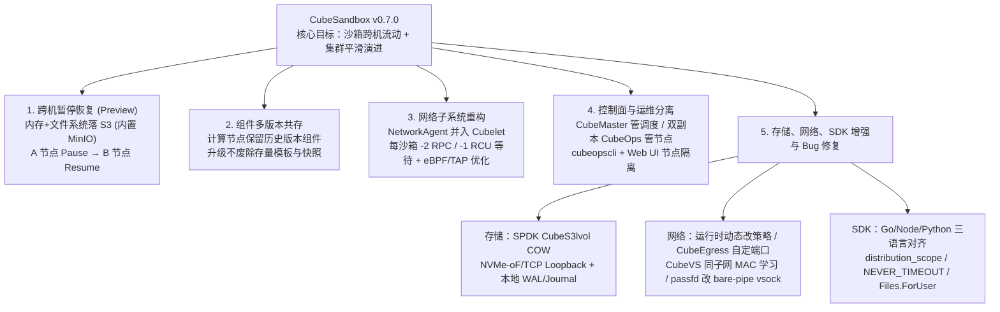

# CubeSandbox v0.7.0 发布：沙箱跨机流动，集群平滑演进

## 1. TL;DR

CubeSandbox 是腾讯云开源的基于 RustVMM 与 KVM 的硬件隔离安全沙箱（兼容 E2B SDK，单沙箱创建 `< 60ms`、内存开销 `< 5MB`）。继 v0.6.0 接入 Kubernetes 与 Volume 框架后，**v0.7.0** 聚焦解决生产集群中最棘手的两个耦合痛点：“暂停的沙箱与快照死绑单台宿主机”以及“运行时组件一升级，存量模板与快照全部作废”。本版本通过四大核心机制完成解耦：① 基于 S3 对象存储实现**跨机暂停恢复**（预览版）；② 计算节点保留历史版本实现**组件多版本共存**；③ 将 `NetworkAgent` 合并入 `Cubelet` 并优化 eBPF/TAP 链路（每个沙箱减少 2 次 RPC 与 1 次 RCU 等待）；④ 将节点运维能力从 `CubeMaster` 拆分至独立双副本组件 **`CubeOps`**。同时新增基于 SPDK 的 `CubeS3lvol` 远程写时复制块设备、补齐 Go/Node/Python 三语言 SDK，并明确了后续 v0.7.1/v0.8.0 的高可用与跨机故障自愈路线图。

## 2. 核心概念

### 核心组件与新增架构原语

- **CubeSandbox**：基于 RustVMM 与 KVM 构建的高性能硬件隔离沙箱服务，对外兼容 E2B SDK。
- **CubeMaster vs. CubeOps**：
  - **CubeMaster**：集群控制面组件，v0.7.0 起专注于**沙箱调度**（计划在后续版本进一步分离模板制作管理）。
  - **CubeOps**：v0.7.0 从 `CubeMaster` 独立拆分出的**节点管理与运维组件**，默认双副本部署，配套 `cubeopscli` 与 Web UI 节点隔离/操作审计能力。
- **Cubelet（合并原 NetworkAgent）**：运行在计算节点上的代理组件；v0.7.0 将原先独立的 `NetworkAgent` 整体合并进 `Cubelet`，消除进程间网络创建的 RPC 开销。
- **CubeS3lvol COW**：基于 SPDK 构建、以 S3 对象存储为后端的远程写时复制（Copy-on-Write）块设备，采用“本地写时分配 + 异步落盘 S3 + 本地 WAL/Journal 保证崩溃一致性”，并通过 `NVMe-oF/TCP Loopback` 导出给宿主机，支持快照/克隆与跨节点导入导出。

### 架构演进对比：v0.6.0 vs. v0.7.0

| 维度 | v0.6.0 状态与生产痛点 | v0.7.0 架构机制 | 解决的实际工程问题 |
|---|---|---|---|
| **沙箱状态与宿主机关系** | `pause/resume` 与快照强绑定原宿主机，节点检修只能干等或丢弃沙箱 | 基于 S3（默认内置 MinIO）将沙箱内存与文件系统状态落盘共享对象存储（预览版） | 支持在 A 节点暂停、B 节点恢复，或跨同步节点用同一快照拉起新沙箱，支撑节点排空与 Agent 训练弹性调度 |
| **组件升级与存量资产** | 升级运行时组件会导致老模板和快照版本不匹配而集体作废，需停业重烤 | 计算节点支持多版本组件并存，内核与 guest 镜像改为从固定 `kernel-release-*` / `guest-image-*` 独立拉取 | 升级与存量模板/快照解耦，修 Bug 升级不再打断已有实例的 `pause/resume` |
| **网络冷启动链路** | `Cubelet` 需跨进程调用独立 `NetworkAgent`，高并发拉起时 RPC、RCU 等待与 TAP 分配成瓶颈 | `NetworkAgent` 合并入 `Cubelet`，优化 eBPF 策略下发与高并发 TAP 设备生命周期 | 每沙箱创建少 2 次 RPC、少 1 次 RCU 等待，批量拉起百级沙箱时冷启动耗时显著下降 |
| **控制面与运维职责** | 调度与节点管理耦合在 `CubeMaster`，使用 `cubemastercli node` 子命令 | 拆分出双副本 `CubeOps` 接管节点管理，改用 `cubeopscli` 并提供 Web UI 节点隔离 | 磁盘异常节点可在 Web UI 一键隔离（存量沙箱继续跑，新沙箱调度到别处），职责边界清晰 |

## 3. 知识框架

## 4. 关键要点与机制详解

### 4.1 跨机暂停恢复与 SPDK `CubeS3lvol` 存储底座

**核心主张：将沙箱的内存、文件系统与块设备状态通过 S3 共享后端解耦出单台物理机，是实现节点无损排空与大规模 Agent 训练负载均衡的前提。**

- **遇到什么问题**：在 v0.6.0 中，沙箱的 `pause/resume` 和快照创建只能留在最初的那台机器上。一旦某台计算节点需要下线检修，上面挂着的暂停沙箱要么干等本机恢复，要么直接丢弃；Agent 强化学习训练等频繁暂停恢复的场景也无法根据实时负载跨机调度。
- **采用什么机制**：
  1. **S3 状态共享（预览版）**：将沙箱的内存与文件系统状态持久化到共享 S3 对象存储（默认内置 MinIO 开箱即用，也可指定外部对象存储），支持 A 节点暂停、B 节点恢复，以及在任意已同步节点上基于同一快照拉起新沙箱。
  2. **SPDK `CubeS3lvol` COW 块设备**：新增以 S3 为后端的远程写时复制块设备——写入时在本地分配块并异步落盘 S3，通过本地 `WAL + journal` 保障崩溃一致性，再经 `NVMe-oF/TCP Loopback` 导出给宿主机，原生支持快照/克隆与跨节点导入导出。
  3. **私有 HTTP 镜像源支持**：允许直接将内网私有 HTTP 镜像仓库作为模板来源，无需再专门搭建 HTTPS。
- **代价或边界**：跨机暂停恢复在 v0.7.0 中明确标记为**预览版（Preview）**；原文未披露跨机恢复的具体耗时、网络挂载状态约束或 S3 带宽瓶颈，生产落地前需结合自身工作负载实测。

### 4.2 组件多版本共存与产物独立发布：打破“升级即重烤模板”魔咒

**核心主张：让计算节点同时保留历史版本运行时组件，使集群软件升级与存量快照/模板生命周期彻底解耦。**

- **遇到什么问题**：跨机流动带来一个连带难题——不同时间、不同节点构建的模板和快照依赖特定版本的运行时组件；过去只要集群升级修 Bug，存量模板和快照就会因版本不匹配而集体作废，业务必须停机重新烤制模板。
- **采用什么机制**：
  1. **计算节点多版本并存**：计算节点保留历史版本组件，老模板与老快照继续由对应版本的组件承载，升级不中断存量实例的 `pause/resume`。
  2. **内核与 Guest 镜像独立发布**：发版时直接从固定的 `kernel-release-*` 和 `guest-image-*` 拉取预构建产物，不再每次重新编译。
- **代价或边界**：原文未列出跨版本共存的具体兼容跨度矩阵与回滚操作步骤，不应将其简单等同于“任意跨代版本组合均无条件兼容”。

### 4.3 网络链路瘦身与控制面 `CubeOps` 拆分

**核心主张：高并发冷启动靠“砍掉进程间 RPC 与 RCU 等待”，生产高可用运维靠“调度（CubeMaster）与节点管理（CubeOps）职责分离”。**

- **网络子系统三项优化**：
  1. **进程合并减开销**：将原独立的 `NetworkAgent` 整体并入 `Cubelet`，消除沙箱创建链路上的跨进程调用；优化 eBPF 网络策略下发路径与高并发 TAP 设备分配稳定性。单请求同时拉起上百个沙箱时，**每个沙箱减少 2 次 RPC 调用、减少 1 次 RCU 等待**，消除随批量线性叠加的排队延迟。
  2. **运行时动态策略与转发增强**：支持沙箱运行时动态更新网络策略（无需重建沙箱）；`CubeEgress` 七层转发支持自定义端口；`CubeProxy` 支持自定义管理端口并新增明文 gRPC ingress；`CubeVS` 引入同子网 MAC 地址学习以避开非 hairpin 通信黑洞；`passfd` 改用 `bare-pipe vsock` 直连以提升业务进程 IO 效率。
- **控制面与运维分离（`CubeOps`）**：
  - 将节点管理能力从 `CubeMaster` 迁移至默认双副本部署的 `CubeOps`。
  - 🔥 **命令行变更**：使用 `cubeopscli` 取代原先 `cubemastercli` 的 `node` 子命令；Web UI 同步提供**节点隔离 / 解除隔离**和节点操作记录查看（例如发现某节点磁盘异常时，在 Web UI 一键隔离该节点，存量沙箱继续运行，新沙箱自动调度至其他节点）。

### 4.4 三语言 SDK 对齐、高频 Bug 修复与 Roadmap 边界

| 模块分类 | v0.7.0 具体交付内容 |
|---|---|
| **三语言 SDK 拉齐（Go / Node / Python）** | ① 补齐 Go 与 Node SDK 的 Volume CRUD 及 `volumeMounts` 挂载（此前仅 Python 支持）；② 补齐构建期别名与现有模板别名管理两个阶段（覆盖三语言）；③ 语言专属增强：**Python SDK** 支持 `distribution_scope`（显式指定沙箱放置节点或区域），**Node SDK** 支持运行时设置 `NEVER_TIMEOUT`，**Go SDK** 新增按用户身份隔离的文件视图 `Files.ForUser` |
| **生产高频 Bug 修复（附 PR 编号）** | ① 暂停/恢复状态不一致、僵尸进程与删除异常（`PR #978 / #985 / #1137 / #1274`）；② 快照性能问题（`PR #1300 / #1504`）；③ 并发创建沙箱时的模板缓存数据竞争（`PR #1366`）；④ 节点重启场景下 TAP 设备恢复异常（`PR #930 / #987 / #1207`） |
| **后续 Roadmap（尚未在 v0.7.0 交付）** | 近期（`v0.7.1` 或 `v0.8.0`）：① 控制链路全路径高可用（模板制作管理从 `CubeMaster` 分离，`CLM` `cube-lifecycle-manager` 支持多副本部署）；② 沙箱异常恢复（自动检测恢复 VM Crash、shim 卡死、网络分区，支持配置重启/回滚快照/报错策略，支持节点故障跨节点恢复）及资源感知调度、亲和/反亲和、带迁移节点排空 |

## 5. 数据速查表

| 指标 | 原文数值 | 语境 / 条件 |
|---|---|---|
| CubeSandbox 基础性能指标 | 创建耗时 `< 60ms`，内存开销 `< 5MB` | 基于 RustVMM 与 KVM 的硬件隔离沙箱，兼容 E2B SDK |
| 网络子系统合并后单沙箱节省开销 | 每沙箱少 `2 次` RPC、少 `1 次` RCU 等待 | `NetworkAgent` 合并入 `Cubelet` 后，高并发批量拉起百级沙箱场景 |
| `CubeOps` 默认部署副本数 | 默认 `2 副本`（双副本） | v0.7.0 从 `CubeMaster` 拆分出的独立节点管理组件 |
| 生产稳定性修复关联 PR | 僵尸进程/删除异常：`#978, #985, #1137, #1274`；快照性能：`#1300, #1504`；模板缓存竞争：`#1366`；TAP 恢复：`#930, #987, #1207` | v0.7.0 Changelog 披露的重点稳定性修复 |

## 6. 踩坑与教训 / 可迁移的设计原则

### 踩坑与教训（错误做法 → 失败表现或原因 → 原文应对）

1. **沙箱快照与运行时组件版本硬绑定**：
   - **错误做法**：计算节点只保留单一最新版本的运行时组件，且每次发版重新编译内核与 guest 镜像。
   - **失败表现或原因**：一旦为了修 Bug 升级集群，此前制作的所有沙箱模板和暂停快照全部因版本不匹配而作废，生产业务被迫停机重做资产。
   - **原文应对**：计算节点保留历史版本组件实现多版本共存，并将内核与 guest 镜像改为从固定 `kernel-release-*` / `guest-image-*` 独立拉取。
2. **在沙箱冷启动热路径上保留多余的本机跨进程 RPC**：
   - **错误做法**：将网络配置拆成独立的 `NetworkAgent` 守护进程，由 `Cubelet` 通过 RPC 调用并在每次配置时等待内核 RCU 同步。
   - **失败表现或原因**：单个请求并发拉起上百个沙箱时，每个沙箱多出的 2 次 RPC 和 1 次 RCU 等待会随并发度成比例叠加，拖慢冷启动并引发 TAP 设备分配不稳定。
   - **原文应对**：将 `NetworkAgent` 合并进 `Cubelet` 进程内，重构 TAP 生命周期并优化 eBPF 策略下发路径。
3. **升级 v0.7.0 后继续调用旧版 `cubemastercli node` 命令或误把 Roadmap 当已交付能力**：
   - **错误做法**：运维脚本仍使用 `cubemastercli` 管理节点，或认为 v0.7.0 已具备节点宕机自动跨机拉起与 `CLM` 多副本高可用。
   - **失败表现或原因**：节点管理已迁出 `CubeMaster`；而 `CLM` 多副本、模板管理分离及 VM Crash/节点故障自动跨机恢复属于 `v0.7.1 / v0.8.0` 的 Coming Soon 计划。
   - **原文应对**：切换运维命令至 `cubeopscli`（或 Web UI 节点隔离），并在生产规划中严格区分 v0.7.0 已交付特性与后续版本 Roadmap。

### 可迁移的设计原则

- **有状态沙箱/容器的“计算与状态分离 + 本地写缓存”模式**：在需要毫秒级启动又要求跨机迁移的沙箱系统中，利用本地 SPDK + WAL/Journal 承接低延迟写入，后台异步落盘 S3 并通过 `NVMe-oF/TCP Loopback` 暴露标准块设备，可兼顾本地 IO 性能与跨节点状态流动。
- **控制面拆分遵循“高频调度与低频节点运维隔离”**：将面向业务请求的沙箱调度（`CubeMaster`）与面向基础设施的节点隔离/排空（`CubeOps`）拆分为独立组件，避免节点异常处置干扰核心调度链路。

## 7. 记忆锚点

1. **版本主线锚点**：「v0.6.0 进 K8s，v0.7.0 解耦单机与升级：S3 托底跨机 pause/resume，多版本并存保住老快照，NetworkAgent 并入 Cubelet 砍掉 2 次 RPC + 1 次 RCU，CubeOps 双副本接管节点运维。」

## 8. 复习卡片

CubeSandbox v0.7.0 是如何实现沙箱“在 A 节点暂停、在 B 节点恢复”的？该能力当前处于什么阶段？::基于 S3 对象存储（默认内置 MinIO）将沙箱的内存与文件系统状态落盘到共享对象存储，从而支持跨节点恢复或基于同一快照拉起新沙箱；该能力在 v0.7.0 中处于预览版（Preview）阶段。
为什么 v0.7.0 要引入“组件多版本共存”？它解决了什么生产运维痛点？::因为跨机流动和长期运营中，不同时间构建的模板与快照依赖不同版本的运行时组件；让计算节点保留历史版本组件并固定拉取 `kernel-release-*` / `guest-image-*`，可避免组件升级导致存量模板和快照集体作废。
v0.7.0 对沙箱网络子系统做了哪些重构来加速高并发冷启动？::将原本独立的 `NetworkAgent` 合并进 `Cubelet`，优化 eBPF 网络策略下发路径并重构 TAP 设备生命周期，使每个沙箱创建减少 2 次 RPC 调用和 1 次 RCU 等待。
v0.7.0 中 `CubeOps` 与 `CubeMaster` 的职责是如何划分的？相关 CLI 命令有何变化？::调度归 `CubeMaster`，节点管理等运维能力迁移至默认双副本部署的 `CubeOps`（支持 Web UI 节点隔离/解除隔离）；CLI 上用 `cubeopscli` 取代了原先 `cubemastercli` 的 `node` 子命令。
v0.7.0 新增的 `CubeS3lvol COW` 是如何工作的？::它是基于 SPDK、以 S3 为后端的远程写时复制块设备，采用本地写时分配、异步落盘 S3，通过本地 WAL + journal 保证崩溃一致性，并经 `NVMe-oF/TCP Loopback` 导出给宿主机，支持快照/克隆与跨节点导入导出。
v0.7.0 在 Python、Node 和 Go 三语言 SDK 上各自新增了什么专属能力？::在补齐三语言 Volume CRUD、`volumeMounts` 与模板别名管理的基础上，Python SDK 新增 `distribution_scope`（指定节点/区域），Node SDK 支持运行时设置 `NEVER_TIMEOUT`，Go SDK 新增按用户隔离的文件视图 `Files.ForUser`。
哪些高可用与恢复能力属于原文明确列在 v0.7.1 / v0.8.0 Roadmap 中、尚未在 v0.7.0 交付的计划？::包括模板制作管理从 `CubeMaster` 分离、`CLM`（`cube-lifecycle-manager`）多副本部署，以及 VM Crash / shim 卡死 / 节点故障后的沙箱自动跨节点异常恢复与带迁移的节点排空。

## 9. 知识关联

### 本库主题入口与已有关联笔记

- [分布式计算与数据管道](../../20_topics/%E5%88%86%E5%B8%83%E5%BC%8F%E8%AE%A1%E7%AE%97%E4%B8%8E%E6%95%B0%E6%8D%AE%E7%AE%A1%E9%81%93.md)：分布式沙箱集群调度、SPDK + S3 存储块设备与控制面高可用演进。
- [Agent安全与权限](../../20_topics/Agent%E5%AE%89%E5%85%A8%E4%B8%8E%E6%9D%83%E9%99%90.md)：基于 RustVMM + KVM 的 Agent 代码执行硬件隔离沙箱与动态网络策略。
- [模型与开发工具发布](../../20_topics/%E6%A8%A1%E5%9E%8B%E4%B8%8E%E5%BC%80%E5%8F%91%E5%B7%A5%E5%85%B7%E5%8F%91%E5%B8%83.md)：腾讯云开源基础设施版本迭代与组件解耦实践。
- [云网络系统研究](../../20_topics/%E4%BA%91%E7%BD%91%E7%BB%9C%E7%B3%BB%E7%BB%9F%E7%A0%94%E7%A9%B6.md)：eBPF 策略下发、TAP 生命周期、CubeVS MAC 学习与 `bare-pipe vsock`。
- [异常监控与稳定性](../../20_topics/%E5%BC%82%E5%B8%B8%E7%9B%91%E6%8E%A7%E4%B8%8E%E7%A8%B3%E5%AE%9A%E6%80%A7.md)：节点在线隔离排空、僵尸进程清理与并发缓存竞争修复。

### 候选双链（供 Obsidian 知识库导航）

- **沙箱与虚拟化技术**：[[CubeSandbox]]、[[RustVMM 与 KVM]]、[[E2B Sandbox]]、[[SPDK 与 NVMe-oF]]
- **Agent 运行时关联**：[[LLM到Harness]]、[[Cordis与DSH运行时]]

## 10. 原文参考资料

- **本目录归档文件**：[RAW.pdf](RAW.pdf)｜[MD.md](MD.md)
- **原文提供的开源仓库与文档链接**：
  - CubeSandbox v0.7.0 完整 Changelog：`https://github.com/TencentCloud/CubeSandbox/blob/master/docs/zh/changelog/v0.7.0.md`
  - CubeSandbox 开源仓库地址：`https://github.com/TencentCloud/CubeSandbox`

> [!note]- 校对报告
> - **覆盖度核验**：已完整通读 `MD.md`（共 4 页，p.1–3 为版本特性与 Roadmap 正文，p.4 包含底部项目简介卡片 `60ms` / `5MB` 与公众号留言区）并核对 `META.json` 记录。完整覆盖四大核心特性（跨机暂停恢复、组件多版本共存、网络子系统重构、控制面与运维分离）、三语言 SDK 能力拉齐、SPDK `CubeS3lvol` COW 块设备、网络策略动态化、高频 Bug 修复 PR 列表及 Coming Soon 路线图。
> - **关键数据与技术细节逐项核对**：
>   1. **核心机制与数值**（p.1–2, p.4）：跨机暂停恢复基于 S3 后端（默认内置 MinIO），标注为预览版；`NetworkAgent` 合并入 `Cubelet`，每沙箱减少 `2 次` RPC、`1 次` RCU 等待；`CubeOps` 默认双副本部署，CLI 由 `cubemastercli` 的 `node` 子命令改为 `cubeopscli`；底部简介标注 `60ms` 内创建硬件隔离沙箱、内存开销控制在 `5MB` 以内。
>   2. **扩展特性与 PR 编号**（p.2–3）：Python `distribution_scope`、Node `NEVER_TIMEOUT`、Go `Files.ForUser`；SPDK `CubeS3lvol COW` + `NVMe-oF/TCP Loopback` + 本地 `WAL + journal`；`CubeEgress`、`CubeProxy`、`CubeVS`、`passfd`（`bare-pipe vsock`）、`kernel-release-*` / `guest-image-*`；Bug 修复 PR `#978 / #985 / #1137 / #1274`、`#1300 / #1504`、`#1366`、`#930 / #987 / #1207`。
>   3. **路线图边界**（p.3）：`v0.7.1` 或 `0.8.0` 推进模板制作管理从 `CubeMaster` 分离、`CLM` 多副本部署及节点故障沙箱跨节点异常恢复，笔记已严格区分已交付能力与后续计划。
> - **格式自检**：全文仅 1 个 H1 标题；正文、表格、Mermaid 图与复习卡片均无页码/章节出处标注；复习卡片共 7 条，严格采用单行 `问题::答案` 格式。
