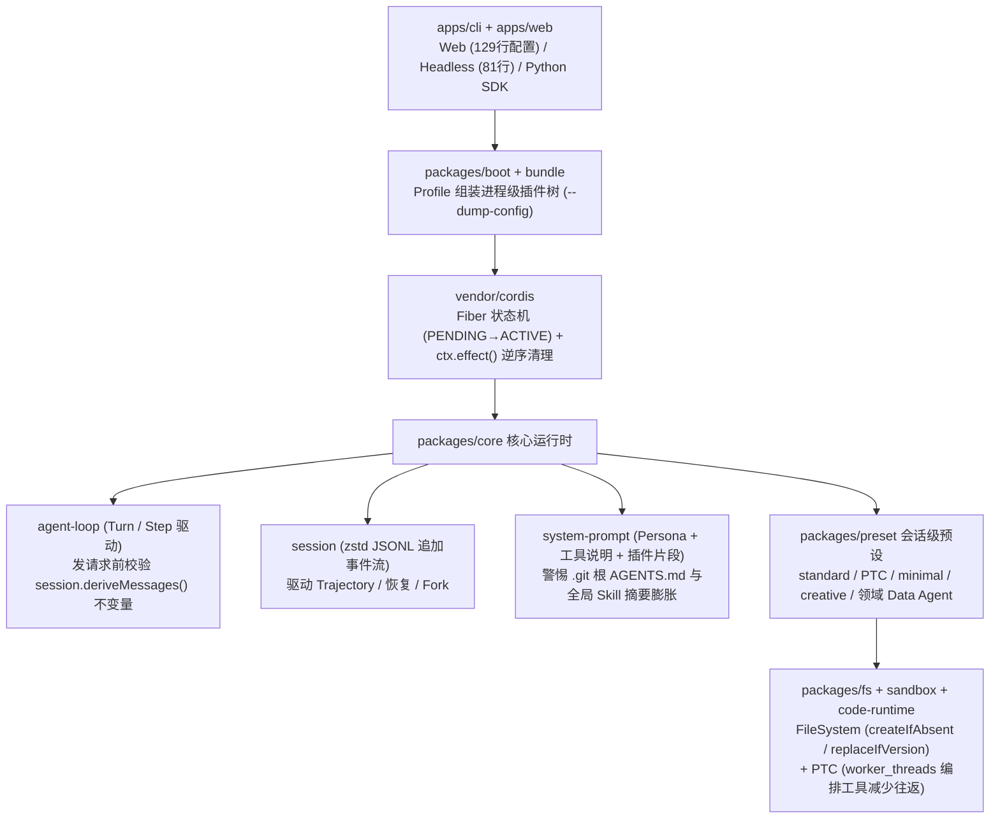

# DeepSeek Harness 实测｜模型之外的那一半，到底带来了什么

## 1. TL;DR

本文是腾讯元宝团队产品经理在 **DeepSeek Harness（DSH，Developer Preview）** 开源首日完成的本机全链路实测与源码拆解。作者跑通了 Web、Headless、Python SDK 与 `--dump-config` 四条入口，剖析了默认配置下“仅回复 `PONG` 首包即消耗 `13,467` input token”的上下文来源（`.git` 根规则注入 + `27` 条用户 Skill 摘要），并通过两组对照实验揭示了 Harness 对模型行为的塑造作用：① 固定 **`kimi-k3`** 模型在两道包含公开/隐藏测试的编程题上对比 **DSH `minimal`** 与 **Kimi Code CLI `0.35.0`**（两边均 `15/15` 全过，但 Kimi Code 偏向并行读 + 整文件写，DSH `minimal` 步数更碎却更容易冻住前缀与完整审计日志）；② 固定 **`deepseek-v4-pro`** 让两套 Harness 各做一款带零依赖 Node.js 后端的“跳一跳”游戏（长成了 2D 信息页 vs 2.5D 舞台两种形态，且**两边均出现“模型自测全过、真实浏览器画面失败”**）。源码走读进一步提炼出 DSH 最核心的五项工程设计：Cordis 可逆生命周期、Profile/Preset 进程与会话二级装配、`session.deriveMessages()` 日志重建不变量、FileSystem `Capability Seam` 并发版本控制，以及基于 `worker_threads` 的 PTC（Code Mode）。

## 2. 核心概念

### 核心运行时概念辨析

- **`Profile`（进程级启动配置） vs. `Preset`（会话级 Agent 组合）**：
  - **`Profile`**（位于 `packages/boot/app-boot/src/profile.ts`）：决定**整个进程**启动时挂载哪棵插件树（从空列表叠 `bundle`，再应用 `profile`、`home` 和命令行 `patch`）。例如本机实测 `Web` profile 组装出 `129 行` 插件配置，而 `Headless` 为 `81 行`；可通过 `dsh --profile web --dump-config` 用同一套 patch 算法直接打印最终插件树。
  - **`Preset`**（位于 `packages/preset/agent-presets/src/`）：决定**单个会话**能看见哪些工具、系统提示词片段和投影单元。同一进程内可同时运行 `standard`（标准编码，约 25 项工具）、`PTC`（支持写 TS 组合多步工具调用）、`minimal`（极简，仅保留 `persistent bash` 与 `str_replace_editor`）或 `creative`（创造模式，含运行时自检与插件实验）等预设。
- **`Trajectory`（轨迹视图）与日志重建不变量（Log-Reconstruction Invariant）**：
  - DSH 会话以 `zstd` 压缩的追加式 JSONL（`session event log`）保存，每条事件具有统一外壳 `{"type": "...", "seq": 31, "time": ..., "data": {}}`。
  - 每次向模型发请求前，`invariant.ts` 强制校验当前即将发送的 `options.messages` 是否严格等于从日志推导出的 `session.deriveMessages()`（不相等直接报错 `log-reconstruction desync`），从而保证**模型看见的一切必然已写进日志**，使 Trajectory、会话恢复、分叉（Fork）与 UI 共享唯一真相源。
- **PTC（Programmatic Tool Calling / Code Mode）**：位于 `packages/code-runtime/`，允许模型编写一段 TypeScript 在 `worker_threads` 中组合多次工具调用，把中间数据留在运行环境中以减少模型上下文往返；工具请求仍通过消息通道回到宿主走统一的 `pre-execute → 审批 → 调度 → post-execute` 流水线。

### 横向对比：DeepSeek Harness vs. Kimi Code CLI (`0.35.0`)

| 对比维度 | DeepSeek Harness (Developer Preview) | Kimi Code CLI (`0.35.0`) |
|---|---|---|
| **官方核心定位** | 可重新组装的开放 Agent Runtime（造 Agent 的脚手架） | 开箱即用的成熟终端 Coding Agent |
| **主要使用入口** | Web、Headless、Python SDK（自带捆绑运行时）、ACP、JSON-RPC | TUI、`-p`（非交互）、ACP、Web（支持单文件分发无需系统 Node） |
| **Agent Loop 地位** | `ReactLoopAgent` 本身注册为 **Cordis 插件**，连循环方式都可替换 | v2 引擎 DI 中的 `Agent-scope Service`，源码开放但属固定引擎主干 |
| **会话日志与可观测** | `Session Event` + **日志重建不变量** + `Trajectory` 实时展示 Token/Cache/请求头 | `wire.jsonl` 记录边界事件、`stream-json`（本轮实测未返回 token usage）、`kimi vis` |
| **工具与环境抽象** | `Preset` 控工具面；将 `FileSystem`、子进程、`sandbox` 拆为可替换服务（Seam） | `Agent Profile` 控工具范围；通过 `KAOS` 抽象本地与 SSH 环境 |
| **默认模型与权限** | 默认 `DeepSeek V4 Flash`（支持 `pi-ai` 多 Provider），权限 `workspace-write + ask` | 默认 Kimi（支持兼容 Provider），支持常规审批、`yolo`、`auto` |

## 3. 知识框架



## 4. 关键要点与机制详解

### 4.1 上下文从哪来：为什么 4 个字母的 `PONG` 任务首包吃掉 `13,467` Token？

**核心主张：默认 Harness 会自动注入系统提示、全量工具 Schema、最近 `.git` 仓库规则与全局用户 Skill 摘要；做严谨模型评测或领域 Agent 时，必须用独立目录与 `minimal composition` 冻结前缀。**

- **遇到什么问题**：作者用 DSH Headless 默认配置执行极短指令“回复 `PONG`”，发现首轮请求竟包含约 **`13,467` 个 input token**；在另一写文件任务（产生 `61` 条事件：含 `turn/start`、3 个 `step/start`、2 次 `tool call/result` 等）的后续 step 中也出现了约 `1.3 万` `cache-read token`。
- **根因拆解（通过 `request/header` 与 `request/context` 事件还原）**：
  1. 测试目录位于一个大仓库内部，DSH 自动沿最近的 `.git` 找到仓库根并注入了 `AGENTS.md` / `CLAUDE.md`；
  2. 自动扫描并注入了用户全局技能目录里的 **`27` 条 Skill 摘要**；
  3. 标准模式默认挂载约 `25` 项工具的完整描述。
- **原文工程对策**：
  1. **评测与敏感项目隔离**：换用独立 Git 根目录，并显式设置独立的 `DSH_HOME` 与 `DSH_AGENTS_HOME` 环境变量，斩断全局规则与 Skill 污染。
  2. **使用 Python SDK `minimal composition` 冻结前缀**：将 persona 固定为一句 `You are a helpful software engineer assistant.`，关掉 workspace prompt、Skills 与 compaction，只保留 `persistent bash` 与 `str_replace_editor` 两个工具。
  3. **领域 Agent 做减法（Data Agent 案例）**：社区分享的 Data Agent 通过 Preset 只保留 `read`、`edit`、`write` 并用 `sqlcmd` 替换 `bash`，让模型围着数据库执行结果转，既省 Token 又降低工具选择干扰。

### 4.2 两组横向对照实测：同一模型换 Harness 后发生了什么？

#### 实验一：同一 `kimi-k3` 跑两道编程题（依赖批次规划 & 会话事件投影）

- **实验设置**：固定 `kimi-k3` API、相同 Prompt、全新 Git 工作区与空技能目录；每题含 `7` 个公开测试 + `8` 个对模型隐藏的验收测试（共 `15` 项）；DSH 采用 `minimal` 工具面，Kimi Code 采用 `0.35.0` 默认工具面，每题单次运行。
- **核心发现**：四条轨迹全部 `15/15` 通过，耗时互有胜负（依赖规划 Kimi Code `48.9s` vs DSH `112.2s`；会话投影 DSH `111.3s` vs Kimi Code `123.1s`），但**执行路径截然不同**——Kimi Code 首轮并行读取 README/源码/测试后直接整文件 `Write` 再用 `Bash` 验证（依赖规划仅 `5` 次工具调用）；DSH `minimal` 则在 `persistent bash` 与 `str_replace_editor` 间小步往返（`11` 次工具调用），换取了极易冻结的前缀与完整的请求/Token/Cache 日志（两题 input token 分别为 `7,593` / `5,082`，cache-read token 为 `22,515` / `18,632`）。

#### 实验二：同一 `deepseek-v4-pro` 各做一款带后端的“跳一跳”游戏

- **任务要求**：支持鼠标/触摸/空格蓄力起跳、平台碰撞、Perfect 奖励与连击，配套零依赖 Node.js 后端（排行榜、统计、JSON 持久化、输入校验、路径防护与确定性测试接口）。
- **产物与过程对比**：
  - **DSH**：分三段 Session 完成（首次中断后成功续接补齐约 `880 行` 游戏逻辑与浏览器 smoke test），合计约 **`25 分钟`、`85 个 step`、`96 次`工具调用**，交付 **`19 项`后端测试**，采用固定物理步长、seeded PRNG 与原子写入，界面长成“2D 横向画布 + 右侧排行榜与操作说明区”。
  - **Kimi Code**：初次生成约 `14 分 30 秒`，算上两轮修复合计约 **`21 分钟`**，交付 **`17 项`后端测试**，界面长成“全屏 2.5D 方块舞台”。
- 🔥 **共同暴露的关键盲点（自测全绿 vs. 真实浏览器失败）**：
  - 两套 Harness 在模型自己写的自动化测试中均显示通过，但在真实浏览器打开时双双翻车：**DSH 的 `canvas backing store` 尺寸计算错误导致画面只剩一片天空**；**Kimi Code 先遇到函数归属错误，随后又因 CSS 覆盖了 `hidden` 属性导致遮罩层异常**（将真实浏览器报错反馈回 `V4 Pro` 后均成功修复并补上回归检查）。
  - **结论**：**Agent 写的测试极易与它写的实现共用同一个认知盲点**；无论 Harness 轨迹多完整，前端/交互产物最终必须经过独立真实浏览器、外部验收与人眼试玩。

### 4.3 源码五处核心设计拆解（`deepseek-harness` TypeScript Monorepo）

1. **Cordis 可逆生命周期（`vendor/cordis/src/context.ts`, `fiber.ts`, `service.ts`）**：插件通过 `inject` 声明依赖，未就绪时停在 `PENDING`，就绪后进 `ACTIVE`；所有服务、监听器与定时器均通过 `ctx.effect()` 连同 `disposer` 登记，卸载时逆序清理（注：外部文件、已发网络消息不会自动回滚，DI 也不替代恶意代码沙箱）。
2. **`Profile` 与 `Preset` 分离控制进程与会话（`packages/boot/` & `packages/preset/`）**：`Profile` 用同一套 patch 算法组装进程插件树并支撑 `--dump-config`；`Preset` 在单进程内按会话隔离可见工具、提示词与投影单元。
3. **日志重建硬不变量（`packages/core/agent-loop/src/agent.ts`, `invariant.ts`）**：

```ts
// 发请求前强制核对内存 messages 与 session 事件日志推导结果完全一致
const expected = session.deriveMessages()
if (JSON.stringify(options.messages) !== JSON.stringify(expected)) {
  fail('log-reconstruction desync')
}
```

4. **`Capability Seam` 与并发乐观锁（`packages/fs/fs/src/types.ts`）**：将 `FileSystem` 接口（含 `opaque target` 与 `version`）与 `fs-local` / `fs-sandbox` 实现解耦，更换远程沙箱时上层 `read / write / str-replace-editor` 无需改动；写入原生支持 **`createIfAbsent`** 与 **`replaceIfVersion`**，若模型读完文件后文件被外部修改，Provider 直接拒绝陈旧覆盖，将并发安全下沉到工具底层。
5. **PTC 代码编排模式（`packages/code-runtime/`）**：模型生成 TypeScript 组合多次工具调用，在 `worker_threads` 中运行并通过消息通道回调宿主统一工具流水线，把中间数据留在运行环境以省去多轮上下文往返（注：`worker_threads` 仍非完整安全边界）。

## 5. 数据速查表

| 指标 | 原文数值 | 语境 / 条件 |
|---|---|---|
| DSH 启动 Node 版本要求 | `^22.19.0 \|\| >=24` | 官方最快启动命令 `npx @deepseek-ai/dsh web` |
| 默认 Profile 插件配置行数 | Web：`129 行`；Headless：`81 行` | 默认模型 `DeepSeek V4 Flash`，默认权限 `workspace-write + ask`；标准模式约 `25 项` 工具 |
| 本地写文件任务事件数 | `61` 条事件 | 含 `turn/start`、3 个 `step/start`、2 次 `tool call/result` 等，后续 step 约 `1.3 万` cache-read token |
| “回复 PONG” 极短任务首包开销 | 约 **`13,467`** input token | Headless 默认配置：因处于大仓库内自动注入 `.git` 根 `AGENTS.md`/`CLAUDE.md` 及用户目录 `27` 条 Skill 摘要 |
| 社区长任务用户自述案例 | 案例 1：`89 步` 完成 ML 竞赛管理；案例 2：约 `87.6 分钟`、花费约 `18 元` 完成微信接入 | 知乎早期内测用户反馈（非受控基准） |
| `kimi-k3` 编程对照题 1（依赖规划） | DSH minimal：`15/15`、`112.2 秒`、`9 step`、`11 次`工具调用（Input `7,593` / Cache `22,515`）；Kimi Code：`15/15`、`48.9 秒`、`4 条`消息、`5 次`工具调用 | 7 公开 + 8 隐藏测试，单次本机运行 |
| `kimi-k3` 编程对照题 2（会话投影） | DSH minimal：`15/15`、`111.3 秒`、`7 step`、`7 次`工具调用（Input `5,082` / Cache `18,632`）；Kimi Code：`15/15`、`123.1 秒`、`5 条`消息、`6 次`工具调用 | 7 公开 + 8 隐藏测试，单次本机运行 |
| `deepseek-v4-pro` 跳一跳游戏对照 | DSH：三段 Session 合计约 **`25 分钟`**、`85 step`、`96 次`工具调用、交付 **`19 项`**后端测试（中途续接补齐约 `880 行`）；Kimi Code：初次约 `14 分 30 秒`、含两轮修复约 **`21 分钟`**、交付 **`17 项`**后端测试 | 同一模型、同一 Prompt 与 VISTA 风格三维验收（代码测试 + 真实浏览器行为 + 画面） |

## 6. 踩坑与教训 / 可迁移的设计原则

### 踩坑与教训（错误做法 → 失败表现或原因 → 原文应对）

1. **在包含 `.git` 的大仓库内且保留非空全局技能目录直接跑模型评测**：
   - **错误做法**：直接在日常工作大仓库子目录下用默认配置跑 Agent 基准测试。
   - **失败表现或原因**：DSH 会顺着最近的 `.git` 自动注入仓库级 `AGENTS.md` / `CLAUDE.md` 并扫描全局目录中的 27 条 Skill 摘要，导致哪怕只发 4 个字母 `PONG`，首轮也白白吃掉 `13,467` input token 并污染评测基线。
   - **原文应对**：评测与敏感项目一律使用独立 Git 根，显式指定独立的 `DSH_HOME` 与 `DSH_AGENTS_HOME`，并使用 Python SDK 的 `minimal composition` 冻结系统前缀与工具集。
2. **盲目采信 Agent 自写的测试全绿报告，跳过真实浏览器渲染验收**：
   - **错误做法**：在 Web/小游戏生成任务中，看到后端单测（19 项 / 17 项）全部通过就认为交付可用。
   - **失败表现或原因**：Agent 编写的测试与实现代码共享同一思维盲点——DSH 版因 `canvas backing store` 尺寸错误导致浏览器画面只剩天空，Kimi Code 版因 CSS 覆盖 `hidden` 属性导致遮罩层无法隐藏。
   - **原文应对**：参考 VISTA 验收范式，同时强制执行“确定性代码测试 + 真实浏览器运行态检查 + 人眼试玩”三重验收。

### 可迁移的设计原则（评估自建 Harness 的灵魂三问）

原文在结尾提出任何团队设计自有 Agent Harness 时都应核对的三个可验证问题：
1. **运行时最终加载了什么，能不能用一条命令（如 `--dump-config`）同构打印出来？**
2. **模型实际看见了什么，能不能从持久化事件日志（如 `session.deriveMessages()` 不变量）100% 完整重建？**
3. **换掉底层文件系统、沙箱或模型 Provider 时，上层有多少工具代码必须跟着改（是否通过 `Capability Seam` 解耦并下沉了 `createIfAbsent` / `replaceIfVersion` 并发控制）？**

## 7. 记忆锚点

1. **核心洞察锚点**：「插件真正有生产价值的地方，往往落在删掉什么、替换什么（用 Preset 把 Agent 收窄）；而 Agent 自己写的测试极易与实现共用盲点，必须靠真实浏览器与外部验收兜底。」
2. **源码三设计口诀（助记改写）**：「`Profile` 管进程、`Preset` 管会话；`deriveMessages()` 锁死日志与上下文同步；`FileSystem Seam` 带 `replaceIfVersion` 防陈旧覆盖，`PTC` 进 `worker_threads` 省工具往返。」

## 8. 复习卡片

DeepSeek Harness 中的 `Profile` 和 `Preset` 在作用范围与职责上有什么区别？::`Profile` 控制进程级插件树组装（如 Web 129 行配置与 Headless 81 行配置是两棵不同插件树，可用 `--dump-config` 打印）；`Preset` 控制单个会话可见的工具、提示词片段与投影单元，使同一进程内可同时运行 `standard`、`minimal`、`PTC` 或收窄工具面的领域 Agent（如用 `sqlcmd` 替换 `bash` 的 Data Agent）。
为什么在 DSH 默认配置下只发一句“回复 PONG”，首包就会消耗约 13,467 个 input token？评测时应如何规避？::因为测试目录位于大仓库内，DSH 自动沿最近 `.git` 注入了 `AGENTS.md`/`CLAUDE.md`，扫描加载了用户技能目录里的 27 条 Skill 摘要，并附带了约 25 个默认工具的 Schema；规避方法是使用独立 Git 根、显式设置独立的 `DSH_HOME` 与 `DSH_AGENTS_HOME`，并采用 `minimal composition` 冻结前缀。
DSH 是如何在源码层面保证 `Trajectory`（轨迹视图）看到的内容与模型实际收到的请求严格一致的？::每次向模型发送请求前，`agent-loop/src/invariant.ts` 会调用 `session.deriveMessages()` 从追加式 session 事件日志重建消息列表，并与即将发送的 `options.messages` 做严格相等校验（不一致直接抛 `log-reconstruction desync`），从而强制保证模型看见的一切必已写入日志。
在固定 `kimi-k3` 模型的两道编程对照题中，DSH `minimal` 与 Kimi Code CLI 的执行路径呈现出什么差异？::两者四条轨迹均 `15/15` 全过，但 Kimi Code 凭借丰富的默认工具采取“首轮并行读文件 → 整文件 Write → Bash 验证”的少步策略（依赖规划仅 5 次调用）；DSH `minimal` 则在 `persistent bash` 与 `str_replace_editor` 间多步小幅迭代（11 次调用），换取了更容易冻住的模型前缀和完整的请求/Token/Cache 事件日志。
在固定 `deepseek-v4-pro` 的“跳一跳”游戏实测中，两套 Harness 共同暴露出的最大验收教训是什么？::两边都出现了“模型自测全部通过、但真实浏览器打开失败”的现象（DSH 因 `canvas backing store` 尺寸错误画面只剩天空，Kimi Code 因函数归属错误和 CSS 覆盖 `hidden` 属性导致遮罩异常），证明 Agent 自写的测试极易与实现共用盲点，必须引入独立真实浏览器与外部验收。
DSH 的文件系统层（`Capability Seam`）是如何实现环境解耦与并发安全写入的？::它先定义抽象的 `FileSystem`、`opaque target` 与 `version` 契约，再由 `fs-local` 或 `fs-sandbox` 实现，使切换远程沙箱时上层编辑工具无需修改；同时写入接口原生提供 `createIfAbsent` 与 `replaceIfVersion`，当模型读完文件后文件已被外部修改时直接拒绝陈旧覆盖。
DSH 的 PTC（Programmatic Tool Calling / Code Mode）解决了什么效率问题？其安全边界是什么？::它允许模型编写 TypeScript 在 `worker_threads` 中组合多次工具调用，把中间数据留在运行环境中而不必每步都塞回模型上下文，同时工具请求仍经消息通道回宿主走统一的审批与调度流水线；但 `worker_threads` 仍不是完整的安全隔离边界，执行模型生成代码需额外沙箱隔离。

## 9. 知识关联

### 本库主题入口与已有关联笔记

- [Harness与模型协同](../../20_topics/Harness%E4%B8%8E%E6%A8%A1%E5%9E%8B%E5%8D%8F%E5%90%8C.md)：DSH 与 Kimi Code 运行时开放边界对比、Profile/Preset 二级装配与 Capability Seam。
- [Agent评测与反馈](../../20_topics/Agent%E8%AF%84%E6%B5%8B%E4%B8%8E%E5%8F%8D%E9%A6%88.md)：同模型跨 Harness 对照实验设计、隐藏验收测试与真实浏览器 VISTA 验收。
- [Agent成本与上下文预算](../../20_topics/Agent%E6%88%90%E6%9C%AC%E4%B8%8E%E4%B8%8A%E4%B8%8B%E6%96%87%E9%A2%84%E7%AE%97.md)：`PONG` 首包 1.3 万 Token 根因排查、全局 Skill 摘要膨胀与 PTC 减少上下文往返。
- [Agent工程循环](../../20_topics/Agent%E5%B7%A5%E7%A8%8B%E5%BE%AA%E7%8E%AF.md)：`zstd` JSONL 事件流、`deriveMessages()` 日志重建不变量与中断续接。

### 候选双链（供 Obsidian 知识库导航）

- **DeepSeek Harness 专题系列**：[[Cordis与DSH运行时]]、[[DeepSeek Harness架构]]、[[DeepSeek Harness观测]]、[[Kuikly远程控制DSH]]、[[LLM到Harness]]
- **对照系统与基准**：[[Kimi Code CLI]]、[[VISTA 视觉 Web Benchmark]]

## 10. 原文参考资料

- **本目录归档文件**：[RAW.pdf](RAW.pdf)｜[MD.md](MD.md)
- **原文列出的官方源码、论文与评测参考**：
  - 官方仓库与文档：DeepSeek Harness 源码、中文架构文档、Python SDK 最小 Agent 指南、Cordis 源码、《时空可组合性》论文、DeepSeek V4 Pro 0813 模型卡、Kimi Code CLI 源码
  - 社区反馈与方法参考：知乎《如何评价在 8 月 13 日发布的 DeepSeek Harness》下的段小草、卜寒兮、Kitt（Data Agent Preset）、Adam Platin（89 步竞赛任务）、瓜子脸帅哥（87.6 分钟接入微信）等实测分享，以及 *VISTA* 视觉 Web App Benchmark

> [!note]- 校对报告
> - **覆盖度核验**：已完整通读 `MD.md`（共 13 页，p.1–12 为实测正文、源码拆解与资料汇总，p.13 为阅读量与留言尾页）并核对 `META.json` 记录。完整覆盖社区两派预期对比、Trajectory 与 Preset 价值、本机四入口跑通与 `PONG` 首包 `13,467` token 根因排查、四种预设（标准/PTC/极简/创造）、DSH 与 Kimi Code CLI 架构表及同一 `kimi-k3` 两道编程题对照、同一 `deepseek-v4-pro` 跳一跳游戏对照与真实浏览器缺陷、多模型冒烟（Kimi K3 / GPT-5.6 Sol / Claude Opus 4.8）、源码目录结构与五项核心机制（Cordis 可逆生命周期、Profile/Preset、`deriveMessages()` 不变量、FileSystem `Capability Seam`、PTC `worker_threads`）及灵魂三问。
> - **关键数据逐项核对**：
>   1. **环境与基础开销**（p.3–5）：Node 要求 `^22.19.0 || >=24`；Web 配置 `129` 行、Headless `81` 行，默认模型 `DeepSeek V4 Flash`，权限 `workspace-write + ask`，标准模式约 `25` 项工具；本地写文件任务产生 `61` 条事件（示例 `seq: 31, time: 1786632922876`），后续 step 约 `1.3 万` cache-read token；`PONG` 任务首轮约 `13,467` input token（扫到 `27` 条 Skill 摘要）；社区案例：`89` 步 ML 竞赛、`87.6` 分钟 / `18` 元接入微信。
>   2. **两组对照实验数据**（p.6–9）：编程题每题 `7` 公开 + `8` 隐藏 = `15` 测试；依赖规划：DSH minimal `15/15`、`112.2 秒`、`9 step`、`11` 次调用（Input `7,593` / Cache `22,515`），Kimi Code `15/15`、`48.9 秒`、`4` 条消息、`5` 次调用；会话投影：DSH minimal `15/15`、`111.3 秒`、`7 step`、`7` 次调用（Input `5,082` / Cache `18,632`），Kimi Code `15/15`、`123.1 秒`、`5` 条消息、`6` 次调用；跳一跳（`deepseek-v4-pro`）：DSH 三段 session 约 `25 分钟`、`85 step`、`96` 次工具调用、`19` 项后端测试、续接补齐约 `880` 行；Kimi Code 初次约 `14 分 30 秒`、含两轮修复约 `21 分钟`、`17` 项后端测试。
> - **事实边界与局限说明**：保留了原文“DSH 仍处 Developer Preview，所有数字来自 2026-08-14 单次本机运行，不作产品排名或成本比较（Kimi Code stream-json 未返回 token usage）”以及图 1 为图像模型生成概念图而非产品界面的说明。
> - **格式自检**：全文仅 1 个 H1 标题；正文、表格、Mermaid 图与复习卡片均无页码/章节出处标注；复习卡片共 7 条，严格采用单行 `问题::答案` 格式。
