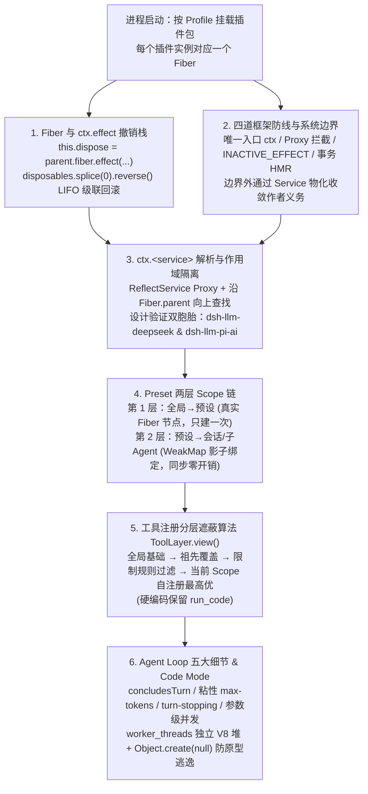
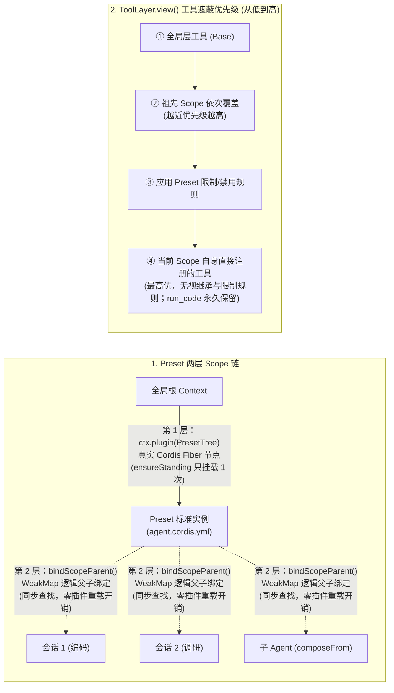

# DeepSeek Harness 拆解：一套能拼装的 Agent 架构

## 1. TL;DR

本文由微信小店前端工程师从源码与配套论文双视角深度拆解了 **DeepSeek Harness（DSH）**“一切皆插件（everything is a plugin）”背后的六大核心工程实现，并与 OpenAI **Codex** 的关键架构决策进行了逐项对照。全文主线围绕**“时间可组合性（卸载 = 完整逆转副作用）”**展开：① **Fiber 与 `ctx.effect` 撤销栈**将插件本身建模为父 Fiber 上的一个可逆 Effect（扭曲复合 $\partial^2\Gamma$），实现 LIFO 级联卸载、幂等销毁与失败原子回滚；② **四条框架级约束与系统边界划分**明确区分边界内可恢复操作与边界外（`id_\Gamma`）需靠服务物化（Reify）/暂缓（Withholding）/补偿（Compensation）处理的操作；③ **`Proxy + Fiber 链`**实现无中心注册表的服务动态寻址与天然作用域隔离；④ **`Agent Loop` 五处精巧扩展点**（`concludesTurn`、粘性 `max-tokens`、`agent/turn-stopping` 拦截、参数级动态并发判定 `isConcurrencySafe(args)` 与四段独立工具流水线）；⑤ **`Preset` 两层 Scope 链**通过“真实 Fiber 节点 + `WeakMap` 影子路由表”让多个会话零加载开销共享同一预设实例；⑥ **Code Mode（`worker_threads`）与工具分层遮蔽算法**在把 Worker 当敌对边界防御原型链污染的同时，按 `全局 → 祖先 → 限制规则 → 当前 Scope 自注册（最高优）` 实时计算工具可见性。

## 2. 核心概念

### 三种插件/扩展形态对比：传统 DI vs. Pi Extension vs. Cordis

| 对比维度 | 传统 DI 容器（Spring / NestJS） | 轻量钩子扩展（如 Pi Agent `Extension`） | Cordis 元框架（DSH 底座，`@deepseek-ai/cordis`） |
|---|---|---|---|
| **核心抽象** | 对象创建容器 + 手写生命周期注解 | 在固定扩展点上通过 TS 钩子塞逻辑 | 带依赖声明、Fiber 状态机与可逆副作用（`effect`）的组件 |
| **依赖管理与重载** | 启动时绑定一次；LLM Provider 热替换无法自动重启依赖它的 `ToolRegistry` | 无依赖注入、无插件间依赖管理（加载顺序即优先级） | 响应式 Coeffect：`inject` 未就绪停在 `PENDING`，提供方替换自动触发 `_unload()` + `_reload()` |
| **卸载与热替换** | 要么不管（泄漏），要么靠作者手写 `OnModuleDestroy`（与创建分离） | **不支持卸载** | 所有上下文修改归约为 `ctx.effect`，卸载时按 LIFO 逆序级联回滚，支持事务性 HMR |

### 核心理论与源码原语

- **时间可组合性（Temporal Composability）与空间可组合性（Spatial Composability）**：
  - **时间可组合性**：卸载组件时，其对共享环境所做的所有修改（事件注册、服务提供、子插件、定时器）必须被完整、安全地逆转，从而**无需重启进程（不丢进程内 Cache、连接与半成品计算）即可实现类似杀死进程的清理隔离**。
  - **空间可组合性**：依赖变化时，相关组件自动激活或停用。
- **系统边界（System Boundary：Inside vs. Outside）与获取/发射两阶段**：
  - **边界内（Inside）**：系统独占修改且可恢复的位置（如私有 scratch 文件、本系统独占内存），记录在 $\Gamma$ 中可自动 `recover`。
  - **边界外（Outside）**：公共文件、其他进程可写位置、`globalThis` 全局变量或已发出的网络数据，表现为恒等映射 $\text{id}_\Gamma$，框架不追踪也不保证自动恢复。
  - **获取（Acquisition）与发射（Emission）**：`open / malloc / fork` 属获取阶段（边界内可逆）；`write / send` 数据离开系统属发射阶段（边界外不可逆），只能靠 **Withholding（暂缓发射直到状态确定）**、**Compensation（LIFO 补偿动作，如删文件/退款）** 或 **服务物化（Coeffect Reification，封装进 `ctx.database` 等受限可逆服务）** 把边界向外推。

## 3. 知识框架

## 4. 关键要点与机制详解

### 4.1 Fiber 与 `ctx.effect`：为什么“一个子插件本身就是父 Fiber 上的一个 Effect”？

**核心主张：通过将子插件的生命周期直接注册为父 Fiber 的一个 `effect`（扭曲复合 $\partial^2\Gamma$），配合幂等锁与异步迭代器中断守卫，Cordis 让级联卸载与失败原子回滚无需维护任何外部依赖清理表。**

- **遇到什么问题**：在 VS Code 等传统扩展模型中，`activate` 与 `deactivate` 分离在两处（违背关注点局部性），且无法在运行时单独热卸载某个扩展；在自进化 Agent 场景下，若 Agent 现场给自己装入一个有缺陷的新插件导致初始化半途崩溃，残留的半初始化状态会直接污染甚至废掉宿主进程。
- **采用什么机制**：
  1. **Runtime 复用与 Fiber 六态状态机**：调用 `ctx.plugin(plugin, config)` 时，先按回调函数身份查找是否已有 `Runtime` 记录（同一插件多次挂载共享一条 `Runtime`），再新建 `Fiber` 实例塞入 `runtime.fibers`，经历 `PENDING → LOADING → ACTIVE`（或 `FAILED` / `UNLOADING` / `DISPOSED`）。
  2. **递归扭曲复合（Twisted Composition，$\partial^2\Gamma$）**：在 `Fiber` 构造函数末尾，子插件的销毁逻辑直接通过 `this.dispose = parent.fiber.effect(() => { /* 注册 */ return async () => { /* 注销 */ } })` 挂在父 Fiber 上；卸载时执行 `disposables.splice(0).reverse().forEach(dispose => dispose())`，天然按栈的后进先出（LIFO）顺序把子插件及其注册的定时器、监听器、HTTP 路由一并拆干净。
  3. **两项工程可靠性保障**：
     - **幂等保护（Idempotency）**：`dispose()` 首次调用即将 `armed` 标志置为 `false`，后续重复调用直接返回，防止在从未产生过该效应的状态上二次应用逆操作。
     - **异步迭代器中途截断与失败原子性**：`ctx.effect` 支持返回异步迭代器逐段 `yield disposer`；每步执行前检查 `guard`，一旦卸载或初始化中途抛错进入 `FAILED`，立即停止后续步骤并逆序执行已累积的那一半逆操作，绝不残留半初始化状态。

### 4.2 框架的四条硬约束、系统边界与为什么 TS/JS 是最佳载体？

**核心主张：框架保证“登记的逆一定被结构化调用（结构性）”，而“逆是否写对”通过服务物化（Service Reification）从全体插件作者收敛到少数底层服务实现者身上（语义性）。**

| 保障层次 | 负责主体 | 具体实现机制与代码约束 |
|---|---|---|
| **1. 路径强制（唯一入口）** | 框架 API 设计 | 所有框架能力（`ctx.on`、`ctx.provide`、`ctx.plugin`、`ctx.use`）只有 `ctx` 一个入口，且内部全是 `ctx.effect` 封装 |
| **2. 属性读写拦截** | 框架 Proxy | `const self = new Proxy<this>(this, ReflectService.handler)`，连 `ctx.foo = x` 直接赋值也会被拦截记录 |
| **3. 时间状态机强制** | 框架 Fiber 状态机 | `ctx.effect()` 首行执行 `this.assertActive()`，在已卸载 Fiber 上注册副作用直接抛 `CordisError INACTIVE_EFFECT` |
| **4. 模块级事务回滚** | 框架 HMR (Algorithm 10) | 新代码 `import` 失败（如语法错误）时通过 `backup/restore` 整体回滚至旧版本，绝不进入半重载态 |
| **5. 逆的语义正确性** | **作者义务（Obligation）** | 运行时不验证 $g(\delta)=\gamma$ 见证；恢复标准定义为**观察等价**（任何 Coeffect 观察者无法区分恢复前后状态，不要求堆布局物理还原） |
| **6. 边界外资源纳管** | **服务物化（Service Reification）** | 将数据库连接、文件句柄、子进程封装进 `ctx.database`、`ctx.assets` 等 Service 内部，由少数服务实现者写好逆，普通插件只调高层接口 |

- **为什么这套设计在 TypeScript / JavaScript 中落地最直接？**
  1. **原型链动态挂载与切断**：静态编译语言类布局在编译期固定且加载后难以卸载类型元数据（如 Swift）；JS 原型系统允许 Agent 动态造新工具挂上原型链、卸载时直接从原型链切断。
  2. **Proxy 透明动态路由 + TS `Module Augmentation`**：写下 `ctx.tool` 时由 Proxy 完成动态寻址与权限检查，配合声明合并让动态插件兼具类型安全与运行时演进；JS 程序化模块注册表还支持卸载模块并交由 GC 回收。

### 4.3 `ctx.<service>` 解析链、设计验证双胞胎与 `Agent Loop` 五处精巧设计

- **无中心注册表的 `Proxy + Fiber` 向上查找链**：
  - 系统里没有专门的“服务注册中心类”。`Service` 基类构造时调用 `self.ctx.reflect.provide(name, self, check)`（内部包在 `ctx.fiber.effect` 中往当前 `fiber.store` 写入记录并唤醒等待方）。
  - 访问 `ctx.tools` 或 `ctx.llm` 时，Proxy 的 `get` 陷阱沿着 `let fiber = ctx.fiber; while(true) { ... fiber = fiber.parent.fiber }` 向上查找：若命中 `fiber.store?.[prop]` 则返回；若在 `fiber.inject` 中但未就绪则抛 `'service not active'`；若到根仍无则抛 `'unknown service'`。
  - **天然作用域隔离**：**子 Fiber 能看到父 Fiber 注册的服务，父 Fiber 绝看不到子 Fiber 的服务**。
  - **“设计验证双胞胎”实例**：DSH 定义统一的 `packages/llm/llm` 接口，同时挂载 `dsh-llm-deepseek`（自家模型直连）与 `dsh-llm-pi-ai`（封装 `@earendil-works/pi-ai` 支持近 **40 家**模型厂商，注：此 `pi-ai` 库与 Pi Agent Harness 无关，仅撞名），两套独立实现证明了接口契约的通用性。
- **`Agent Loop` 源码中的五处关键工程设计**：
  1. **工具主动终结轮次（`concludesTurn: true`）**：工具执行结果可携带 `concludesTurn: true` 标记直接声明本轮结束，无需再耗费一次模型采样让模型说“好了”。
  2. **粘性 `max-tokens` 截断状态**：`if (turnEnds === null || turnEnds.kind !== 'max-tokens') turnEnds = stepEnd`——只要某一步因撑满输出上限被截断，哪怕后续步骤正常完成，整轮最终上报的结束原因依然锁定为 `max-tokens`，防止截断信号被掩盖。
  3. **轮次关闭前最后拦截钩子（`agent/turn-stopping`）**：真正结束前广播该事件，任何插件均可调用 `agent.steer(...)` 塞入新消息让循环继续跑，将“何时真正收尾”的决定权外置。
  4. 🔥 **基于实际参数的动态并发安全判定（非静态白名单）**：
     - 每次调用前执行 `tool.isConcurrencySafe(exec.arguments) === true ? { kind: 'parallel' } : { kind: 'exclusive' }`（例如读文件永远并行安全，写文件仅当目标路径不冲突时才并行安全）。
     - 组队执行时若中途混入一个当下判定为 `exclusive` 的调用，立即截断当前并行批次；且最终结果严格**按模型原始给出的调用顺序提交**，与实际执行完成快慢无关。
  5. **四段式独立工具执行管道**：`tools/pre-execute`（`waterfall` 事件，供拦截或审批）→ 内置防护检查（如同一工具带相同参数连续调用过多提醒）→ 执行工具体 → `tools/post-execute`（结果后处理）。

### 4.4 `Preset` 两层 Scope 链、Code Mode (`worker_threads`) 与工具分层遮蔽算法

- **`Preset` 为什么要拆成“真实 Fiber 节点 + WeakMap 影子路由表”两层？**
  - **第 1 层（全局 → 预设）**：通过改名自 `Include` 的 `PresetTree` 插件挂载 `agent.cordis.yml`（禁用写回配置、模块解析固定基于系统 `baseUrl`、并校验是否有插件未激活或服务泄漏出预设作用域，有则整体回滚），在 Cordis 树上生成**真实 Fiber 节点**，且每份预设通过 `ensureStanding()` **只构建一次实例**。
  - **第 2 层（预设 → 会话 / 子 Agent）**：通过 `this.bindings.set(agentKey, bindScopeParent(agentKey, standing.key))` 在一张 **`WeakMap`** 中记录逻辑父子关系，不在 Cordis 树上新开节点。任意多个会话或子 Agent（`composeFrom(childCtx, parentCtx)`）只需一次同步表查找即可复用同一份已加载好的预设实例；当前生效预设通过倒序扫描 `session.events` 中最新一条 `agent-preset/selected` 事件动态决定；多根目录合并时先出现的 `id` 优先。
- **Code Mode 为什么放弃 `node:vm` 改选 `node:worker_threads`？**
  - **选型原因**：同进程的 `node:vm` 原型链极易逃逸到主环境，且死循环（热循环）无法从外部真正打断；改用独立的 `node:worker_threads` 拥有真正独立的 V8 堆，并可通过 `resourceLimits.maxOldGenerationSizeMb` 限制堆内存，配合**事件循环利用率轮询（计 CPU 时间）+ `setTimeout`（兜底总耗时）**双超时强制终止。
  - **执行与“把 Worker 当敌对另一方”的防御细节**：先用 `stripTypeScriptTypes(prefix + program + suffix)` 剥除 TS 类型并保持原行列号不变，再装入 `new AsyncFunction(...bindingNames, ...errorClassNames, 'console', code)` 支持顶层 `await`；工具调用通过 `{ type: 'call', id, global: 'tools', name, args }` 消息发回宿主，**进入与普通结构化调用完全相同的 `TOOL_RUNTIME_SCHEDULER` 队列与四段式流水线**；两端手动校验消息字段，宿主查找绑定用 `Object.hasOwn()`，暴露的 `tools` 命名空间以 `Object.create(null)` 起手配合 `Object.defineProperty` 挂载，严防 `__proto__` 或 `constructor` 原型链投毒。
- **工具注册的分层遮蔽算法（`ToolLayer.view()`）**：
  - 实时计算可见工具的四步顺序：**① 加载全局层工具 → ② 按祖先 Scope 由远及近依次覆盖同名工具 → ③ 应用限制规则（筛除被禁用的继承工具）→ ④ 当前 Scope 自己直接注册的工具最后覆盖（优先级高于继承与限制规则）**。
  - 🔥 **硬编码保留名**：`run_code` 被硬编码保留，任何插件调用 `register()` 试图注册或覆盖 `run_code` 都会直接抛错，以防与 Code Mode 入口冲突。

### 4.5 DeepSeek Harness vs. OpenAI Codex 五大工程决策对比

| 工程决策维度 | OpenAI Codex | DeepSeek Harness (DSH) |
|---|---|---|
| **1. 核心循环可替换性** | 驱动“采样-执行-反馈”的核心循环焊死在内核中，不可作为独立单元替换 | `ReactLoopAgent` 注册为插件工厂（只允许注册一次），理论上可整条替换为其他循环实现 |
| **2. 沙箱所处位置** | 将 Linux `bwrap/Landlock`、macOS `Seatbelt` 直接编译进核心执行路径 | 沙箱做成能力插件（Linux 下通过独立原生 Node 扩展调 `Landlock`），走统一服务注册路径，可无感替换 |
| **3. 代码拆分粒度与地位** | Rust 代码拆为约上百个 `crate`，全部服务于同一个不可替换的核心循环 | TS 代码拆为 **200 多个 package**，包括循环本身在内的所有模块处于同一可替换层级 |
| **4. 代码编排工具隔离选型** | 选用独立的 **V8 isolate**（工具挂在全局 `tools` 对象上） | 选用 **`node:worker_threads`**（权衡新建 isolate vs 新建工作线程开销及 Node 原生生态） |
| **5. 工具暴露方式粒度** | 工具自身声明静态标记（`DIRECT / DEFERRED / CODE_MODE / Hidden`） | 运行时由 `ToolLayer.view()` 沿 Scope 链实时动态计算，同一工具在不同会话可见性可完全不同 |

## 5. 数据速查表

| 指标 | 原文数值 | 语境 / 条件 |
|---|---|---|
| `dsh-llm-pi-ai` 支持模型厂商数 | 近 **`40 家`**可选模型厂商 | 基于第三方库 `@earendil-works/pi-ai` 协议转换，与 `dsh-llm-deepseek` 构成“设计验证双胞胎” |
| DSH 与 Codex 仓库模块拆分规模 | DSH：**`200 多个`** TypeScript 包；Codex：约**上百个** Rust `crate` | 源码模块化粒度对比 |
| GitHub `#dsh-plugin` 生态仓库数 | **`1,000+` 个**（作者检索时 API 统计为 **`1,008` 个**） | 2026-08-14 撰文时统计（含 `dsh-web-ui` 922⭐、`modlens` 857⭐、`awesome-dsh-plugins` 507⭐、`dsh-TUI` 487⭐ 等） |

## 6. 踩坑与教训 / 可迁移的设计原则

### 踩坑与教训（错误做法 → 失败表现或原因 → 原文应对）

1. **在 `ctx.effect` 之外直接修改全局变量或公共文件（跨越系统边界）**：
   - **错误做法**：在插件代码中直接写 `globalThis.foo = ...`、做 monkey-patch 或直接写多进程共享的公共文件。
   - **失败表现或原因**：这些位置处于 Cordis 的“系统边界之外（Outside，表现为 $\text{id}_\Gamma$）”，框架无法追踪也无法在插件卸载时恢复，会造成永久状态污染。
   - **原文应对**：通过 `ctx` 唯一入口修改上下文；对外部数据库、文件句柄等边界外资源，通过 **Service 物化（Coeffect Reification）** 封装进 `ctx.database` / `ctx.assets` 等服务内部，由服务提供者统一实现可逆操作或补偿逻辑。
2. **用同进程 `node:vm` 跑大模型生成的工具编排代码，或用普通对象暴露 `tools` 命名空间**：
   - **错误做法**：在宿主同一 V8 进程内用 `node:vm` 跑模型代码，且直接把宿主函数挂在普通 `{}` 对象上传入。
   - **失败表现或原因**：模型代码可通过 `__proto__` 或 `constructor` 顺着原型链逃逸到宿主主环境，且 `while(true)` 热循环无法从外部打断。
   - **原文应对**：改用独立 V8 堆的 `node:worker_threads`（配堆内存上限 + CPU 利用率轮询与总耗时双超时强杀），将 Worker 视为敌对边界，用 `Object.create(null)` + `Object.defineProperty` 构造无原型链命名空间，并用 `Object.hasOwn()` 校验消息调用。
3. **高估预览版 HMR 的稳定性**：
   - **原文实测教训**：作者在编写文中示例时钟插件测试 HMR 时曾直接把 Web UI 搞崩，说明虽然理论和备份回滚机制完备，早期预览版的 HMR 工程稳定性仍有待打磨。

### 可迁移的设计原则

- **高频复用重型配置树采用“真实实例单次挂载 + WeakMap 逻辑绑定”二层架构**：当一个系统需要让成百上千个会话或子 Agent 复用同一套插件与工具集合时，切忌每个会话重新解析 YAML 并实例化插件；在底层只挂载一次真实组件树（`ensureStanding`），会话层用 `WeakMap` 维护轻量逻辑父子指针，即可实现同步零开销派生。
- **工具并发安全应从“工具级静态标签”升级为“参数级动态函数 `isConcurrencySafe(args)`”**：同一个写文件或数据库工具，操作不同文件/表时可安全并行，操作同一路径时必须互斥；在调度器组队前传入当次实际参数动态问询，才能在保证安全的前提下压榨最大并行度。

## 7. 记忆锚点

1. **核心架构锚点**：「子插件本身就是父 Fiber 上的一个 `effect`（`disposables.splice(0).reverse()` 退栈级联清理）；`Proxy + Fiber 链` 实现无中心服务查找与天然单向可见；`Preset` 用“真实 Fiber + WeakMap 影子表”实现一次挂载、多会话零开销复用。」

## 8. 复习卡片

为什么说在 Cordis 中“卸载一个父插件会自动逆序级联卸载它下面所有的子插件，而不需要单独维护依赖清理表”？::因为在 `Fiber` 构造函数末尾，子插件的销毁逻辑直接通过 `this.dispose = parent.fiber.effect(...)` 注册为父 Fiber 上的一个副作用（即扭曲复合 $\partial^2\Gamma$）；当父 Fiber 卸载执行 `disposables.splice(0).reverse()` 时，会按后进先出（LIFO）栈顺序自动触发子 Fiber 的销毁与回滚。
Cordis 框架通过哪四条机制强制保证 `effect` 被追踪和执行？什么情况属于框架不保证的“系统边界之外”？::四条机制是：① `ctx` 为唯一 API 入口；② `Context` 被 `Proxy` 包装拦截属性读写；③ 状态机在已卸载 Fiber 上调 `effect` 直接抛 `INACTIVE_EFFECT`；④ HMR 模块加载失败时通过 `backup/restore` 事务性整体回滚。直接修改 `globalThis`、公共文件或已发射出去的网络数据属于系统边界之外（$\text{id}_\Gamma$），且逆函数本身的语义正确性属于作者义务。
在 DSH 中访问 `ctx.tools` 或 `ctx.llm` 时，底层是如何找到对应服务实现的？为什么它能天然实现作用域隔离？::根上下文被 `Proxy`（`ReflectService.handler`）包裹，属性读取会沿着当前 `ctx.fiber` 顺着 `fiber.parent.fiber` 一直向父级查找 `fiber.store?.[prop]`；因此子 Fiber 能看到父 Fiber 注册的服务，而父 Fiber 绝看不到子 Fiber 的服务，挂载层级直接决定了可见范围。
DSH 的 `Agent Loop` 在轮次结束条件、截断状态保持和工具并发调度上有哪些特殊设计？::① 工具结果可带 `concludesTurn: true` 主动结束本轮，且结束前广播 `agent/turn-stopping` 允许插件通过 `agent.steer()` 续命；② `max-tokens` 状态具有粘性，一旦某步被截断，后续正常步骤不会覆盖该截断结束原因；③ 并发调度不靠静态白名单，而是每次传入实际参数调用 `tool.isConcurrencySafe(exec.arguments)` 动态判定并行或互斥，并按原始调用顺序回填结果。
DSH 的 `Preset` 为什么要把 Scope 链拆成“真实上下文派生”和“WeakMap 逻辑绑定”两层？::第一层从全局到预设通过 `PresetTree` 在 Cordis 树上创建真实 Fiber 节点，确保每份预设的标准实例只加载解析一次（`ensureStanding`）；第二层从预设到具体会话或子 Agent 仅在 `WeakMap` 中记录逻辑上级绑定（`bindScopeParent`），使成百上千个会话和子 Agent 能以同步零开销复用同一份插件与工具实例。
为什么 DSH 的 Code Mode 选择 `node:worker_threads` 而非 `node:vm`？它如何防止 Worker 内的模型代码污染宿主？::因为同进程的 `node:vm` 原型链可逃逸且死循环无法从外部打断；`worker_threads` 拥有独立 V8 堆，支持设置堆内存上限及“CPU 利用率轮询 + 总耗时 `setTimeout`”双超时强杀。宿主将 Worker 视为敌对边界，通过消息通道通信，用 `Object.create(null)` + `Object.defineProperty` 构造无原型链的 `tools` 命名空间，并用 `Object.hasOwn()` 校验属性。
DSH 的工具分层遮蔽算法（`ToolLayer.view()`）是如何计算当前 Agent 可见工具的？哪个工具名被硬编码保留？::按四步顺序计算：① 加载全局层工具作为基础 → ② 由远及近让祖先 Scope 依次覆盖同名条目 → ③ 应用限制规则过滤被禁用的继承工具 → ④ 用当前 Scope 自己直接注册的工具做最终覆盖（优先级最高，无视继承与限制规则）。其中 `run_code` 被硬编码保留，严禁任何插件注册或覆盖。

## 9. 知识关联

### 本库主题入口与已有关联笔记

- [Harness与模型协同](../../20_topics/Harness%E4%B8%8E%E6%A8%A1%E5%9E%8B%E5%8D%8F%E5%90%8C.md)：Cordis Fiber/Effect 源码剖析、Preset 二层 Scope 链、工具分层遮蔽算法与 DSH vs Codex 五维对比。
- [Agent安全与权限](../../20_topics/Agent%E5%AE%89%E5%85%A8%E4%B8%8E%E6%9D%83%E9%99%90.md)：Code Mode `worker_threads` 敌对边界原型链防护、系统边界内/外划分与 `tools/pre-execute` 拦截管道。

### 候选双链（供 Obsidian 知识库导航）

- **DeepSeek Harness 专题系列**：[[Cordis与DSH运行时]]、[[DeepSeek Harness实测]]、[[DeepSeek Harness观测]]、[[Kuikly远程控制DSH]]、[[LLM到Harness]]
- **核心对标系统**：[[Codex CLI 与 App Server]]、[[Pi Agent]]、[[Koishi]]

## 10. 原文参考资料

- **本目录归档文件**：[RAW.pdf](RAW.pdf)｜[MD.md](MD.md)
- **原文列出的参考资料与社区生态索引**：
  - 核心参考：《为什么用 Cordis 做 AI Agent 运行时：从 QQ 机器人框架到 DeepSeek Harness》（CSDN）、《DeepSeek Harness 背后的秘密，Cordis 的设计哲学深度解读》（知乎）、Cordis 88 页设计论文（*A Programming Paradigm for Spatiotemporal Composability*）
  - 插件生态索引（`github.com/topics/dsh-plugin`）：`deepseek-ai/deepseek-harness`、`awesome-dsh-plugin/awesome-dsh-plugin`、`AdamPlatin123/awesome-dsh-plugins`、`0xsline/awesome-deepseek-harness`、`Electricitysheep/dsh-handbook`

> [!note]- 校对报告
> - **覆盖度核验**：已完整通读 `MD.md`（共 19 页，p.1–18 为九章架构拆解正文、全链路串讲与生态推荐，p.19 为阅读量与留言尾页）并核对 `META.json` 记录。完整覆盖为什么选 Cordis（对比传统 DI 与 Pi Extension、时间与空间可组合性）、Fiber 六状态机与 `ctx.effect` LIFO 退栈（含扭曲复合 $\partial^2\Gamma$、幂等 `armed`、迭代器 `guard`、失败原子性与级联清理）、四条框架约束与系统边界（Inside/Outside、获取/发射两阶段、Service 物化、观察等价及 TS/JS 优势）、`ctx.<service>` Proxy + Fiber 链查找与“设计验证双胞胎”、Agent Loop 五处细节、`Preset` 两层 Scope 链（`PresetTree` + `WeakMap`）、Code Mode `worker_threads` 隔离与原型防逃逸、工具分层遮蔽算法（`ToolLayer.view()` 与 `run_code` 保留）及与 Codex 的五点工程对比。
> - **关键数据与代码细节逐项核对**：
>   1. **源码标识与原语**（p.3–4, p.6–13）：Fiber 六状态 `PENDING / LOADING / ACTIVE / FAILED / DISPOSED / UNLOADING`；扭曲复合记号 `∂²Γ`；已卸载 Fiber 注册抛 `CordisError INACTIVE_EFFECT`；HMR 回滚对应论文 `Algorithm 10`；`dsh-llm-deepseek` 与 `dsh-llm-pi-ai`（封装 `@earendil-works/pi-ai`，支持近 `40` 家厂商）；Loop 细节含 `concludesTurn: true`、粘性 `max-tokens`、`agent/turn-stopping` + `agent.steer(...)`、`isConcurrencySafe(exec.arguments)`、`tools/pre-execute` 与 `tools/post-execute`；Preset 含 `PresetTree`、`ensureStanding()`、`bindScopeParent`（`WeakMap`）、`composeFrom`、`agent-preset/selected`；Code Mode 含 `node:worker_threads`、`stripTypeScriptTypes`、`resourceLimits.maxOldGenerationSizeMb`、`Object.hasOwn()`、`Object.create(null)`；保留工具名 `RUN_CODE_NAME`（`run_code`）。
>   2. **对比与生态数据**（p.13, p.16–18）：Codex 约上百个 Rust `crate` vs DSH `200 多个` TS 包；作者测试示例时钟插件时曾搞崩 UI（p.16 P.S.）；`#dsh-plugin` 话题下 API 统计 `1008` 个仓库（正文称 `1000+`）。
> - **事实边界与局限说明**：文中对 DSH 与 Codex 的对比均限定为作者在 2026-08-14 对当时源码版本的分析；未在本地运行文中代码。
> - **格式自检**：全文仅 1 个 H1 标题；正文、表格、Mermaid 图与复习卡片均无页码/章节出处标注；复习卡片共 7 条，严格采用单行 `问题::答案` 格式。
