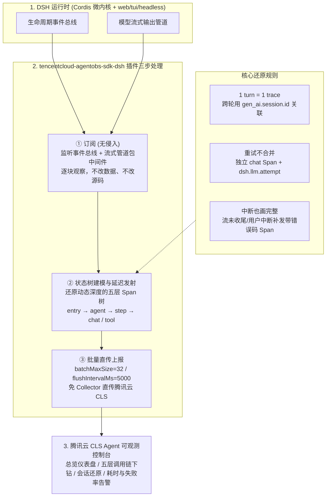

# DeepSeek Harness 规模化踩坑实录：耗时、成本、失败到底该怎么查

## 1. TL;DR

DeepSeek Harness（DSH）虽自带浏览器会话轨迹视图、`$DSH_HOME/sessions/` 下的 `zstd` 压缩 JSONL 事件流落盘及工具调用检索，但其作用域仅限“本机、单会话、实时按时间平铺的事件序列”，一旦规模化部署就无法回答“耗时卡在模型推理还是工具执行、Token 成本集中在哪些会话/模型、几天前的失败或中断发生在哪一步”。为此，腾讯云 Agent 可观测推出了原生插件 **`tencentcloud-agentobs-sdk-dsh`**：通过**无侵入订阅生命周期与流式中间件 → 内存状态树建模 + 延迟发射还原为符合 OpenTelemetry GenAI 语义约定的五层调用树（`entry / agent / step / chat / tool`）→ 免 Collector 批量直传腾讯云 CLS**，实现了跨会话横向关联（`gen_ai.session.id`）、模型重试独立拆分（`dsh.llm.attempt`）与异常中断补齐错误 Span，支撑生产级耗时分位、成本排行与失败根因下钻。

## 2. 核心概念

### DSH 运行原语与五层 Span 映射

- **`turn`（单次用户任务） vs. `step`（ReAct 循环轮次）**：
  - **`turn`**：对应一次完整的用户任务请求，在可观测系统中映射为**一条独立的 Trace**（多轮对话之间通过 `gen_ai.session.id` 横向关联，避免长会话产生无限膨胀的巨型单条 Trace）。
  - **`step`**：`turn` 内部每一轮“模型推理 → 工具调用 → 观察结果”的循环；由于循环轮数与工具调用路径由模型在运行时动态决定，执行前无法预知树形深度。
- **五层调用树（5-Layer Span Hierarchy）**：
  1. **`entry`（入口/Turn 层）**：承载整次用户任务的端到端耗时、根状态与会话标识。
  2. **`agent`（智能体执行体层）**：标识当前承担任务的 Agent 实例与配置。
  3. **`step`（推理轮次层）**：挂载在 `agent` 下，度量单轮 ReAct 循环的耗时与状态。
  4. **`chat`（模型调用层）**：挂载在 `step` 下，记录单次 LLM 推理的输入/输出 Token、首 Token 延迟（TTFT）、模型名、结束原因；**每次真实重试均生成独立 `chat` Span 并以 `dsh.llm.attempt` 标记序号**。
  5. **`tool`（工具调用层）**：挂载在 `step` 下，记录工具名称、参数、返回结果、耗时与执行错误。

### 观测能力对比：DSH 原生观测 vs. 腾讯云 Agent 可观测插件

| 维度 | DSH 原生自带观测能力 | `tencentcloud-agentobs-sdk-dsh` 插件方案 |
|---|---|---|
| **数据形态与存储位置** | 浏览器按轮次表格 + 本机 `$DSH_HOME/sessions/` 下的 `zstd` 压缩 JSONL 平铺事件流 | 还原为带父子关系与精确时间区间的五层 OpenTelemetry GenAI Span 树，批量直传云端 CLS |
| **分析作用域** | 本机、单会话、实时调试 | 跨会话、跨机器汇聚、长期留存、全局 P50/P90/P95/P99 分位统计与 Top10 排行 |
| **重试与异常中断表现** | 散落在时间线事件中，难以直接聚合重试开销或识别未收尾流 | 每次重试独立建 `chat` Span（`dsh.llm.attempt`）；流未收尾、`step` 早于工具结束、用户中断均自动补发带错误码的 Span |
| **运维与告警能力** | 仅支持单会话内全文检索，无告警 | 支持 Traces / Spans / Sessions 三视角筛选，支持对耗时、失败率配置自动告警 |

## 3. 知识框架



## 4. 关键要点与机制详解

### 4.1 为什么“状态树 + 延迟发射”能解决动态 ReAct 循环的链路还原？

**核心主张：Agent 的执行深度在运行前不可知，且流式输出、并发工具与中途中断会导致事件乱序或缺失闭环；必须在插件内维护运行时状态树并延迟发射 Span，才能构造父子关系严密、时间区间完整的五层调用树。**

- **遇到什么问题**：
  1. DSH 的事件流是按发生时间顺序追加的一维序列，而调用链要求明确的父子层级与起止时间戳。
  2. 模型调用采用流式传输（Streaming），只有当流式 chunk 逐块返回完毕才能算出总输出 Token 与完整响应耗时。
  3. 生产中常发生“流未正常收尾”“`step` 先于工具执行结束”或“用户主动中断任务”，若只按正常结束事件生成 Span，异常样本就会在监控中“静默蒸发”。
- **采用什么机制**：
  1. **中间件逐块观察 + 状态树挂载**：插件挂载在 DSH 的 Cordis 能力插件层（`web / tui / headless` 三种形态共用），在不修改 DSH 源码、不改变业务数据的前提下，用中间件观察模型流式 chunk 并在内存状态树中维护当前活跃的 `entry → agent → step → chat / tool` 节点。
  2. **延迟发射与异常补齐**：待节点正常收尾时计算完整耗时与 Token 属性发射入队；若检测到流异常中断、`step` 提前结束或用户取消，状态树主动为未闭合节点补发携带对应错误码的 Span。
  3. **重试拆解与会话解耦**：每次触发底层 LLM 重试时，不将其混入单次调用耗时，而是生成独立的 `chat` Span 并标记 `dsh.llm.attempt` 序号；每次用户 `turn` 生成独立 Trace，通过 OpenTelemetry 标准属性 `gen_ai.session.id` 串联同一会话的多轮交互。

### 4.2 工具操作与接入规程（命令速查、配置参数与避坑）

#### （1）前提条件与版本注意

- 已开通腾讯云日志服务（CLS），获取具备日志写入权限的访问凭证（**推荐使用 CAM 子账号或临时密钥**）及日志主题 ID（在 CLS 控制台左侧选 `Agent 可观测` → `应用接入` → 选 `DeepSeek Harness` 创建应用后，在详情页复制 `{应用名称}-trace-topic` 的主题 ID）。
- DSH 版本要求：`>= 0.1.0-rc.6 < 0.2.0`。
- ⚠️ **Node.js 版本要求原文存在两处不一致**：原文第五章开篇概述写要求 `Node.js >= 22.19.0`，而紧随其后的“前提条件”小节写 `Node.js 为 18.0.0 或更高`（详见文末校对报告，实际部署建议优先满足较高版本 `>= 22.19.0` 以防兼容报错）。

#### （2）命令速查表

| 操作场景 | 执行命令 | 关键说明与注意事项 |
|---|---|---|
| **1. 全局安装 DSH CLI** | `npm install -g @deepseek-ai/dsh` | 若已安装对应版本可跳过 |
| **2. 为三种 Profile 安装插件** 🔥 | `dsh plugin --profile web add tencentcloud-agentobs-sdk-dsh`<br/>`dsh plugin --profile headless add tencentcloud-agentobs-sdk-dsh`<br/>`dsh plugin --profile harness add tencentcloud-agentobs-sdk-dsh` | 🔥 **安装或更新插件后，必须重启 DSH 服务才能生效** |
| **3. 修复 `pnpm v9+` 忽略构建脚本报错** 🔥 | `cd ~/.dsh/profiles/web`<br/>`echo "enable-scripts=true" >> .npmrc`<br/>`pnpm install` | 针对 `[ERR_PNPM_IGNORED_BUILDS] Ignored build scripts: protobufjs@6.11.6` 报错；`headless` 与 `harness` 目录同理执行一次即可 |
| **4. 环境变量注入并启动（推荐）** | `export CLS_ENDPOINT=ap-guangzhou.cls.tencentcs.com`<br/>`export CLS_TOPIC_ID=your-topic-id`<br/>`export CLS_SECRET_ID=your-secret-id`<br/>`export CLS_SECRET_KEY=your-secret-key`<br/>`export CLS_SERVICE_NAME=dsh-agent`<br/>`dsh --profile web` | 推荐通过环境变量或密钥管理工具注入凭证，严禁将真实 `SecretId` / `SecretKey` 提交进代码仓库 |
| **5. 关闭敏感内容捕获** 🔥 | `export OTEL_INSTRUMENTATION_GENAI_CAPTURE_MESSAGE_CONTENT=false`<br/>`dsh --profile web` | 默认 `captureContent: true` 会上报 Prompt、Response 和 Tool 参数/结果；生产涉密环境需显式关闭 |
| **6. 卸载插件** | `dsh plugin --profile web remove tencentcloud-agentobs-sdk-dsh`（其余 profile 同理） | 移除对应 profile 下的可观测插件 |

#### （3）配置文件方式（`cordis.patch.yml`）与完整参数表

若不使用环境变量，可编辑 `$DSH_HOME/profiles/<profile>/cordis.patch.yml`（默认路径为 `~/.dsh/profiles/<profile>/cordis.patch.yml`，**注意：显式插件配置优先级高于环境变量**）：

```yaml
- id: cls-observability
  config:
    endpoint: ap-guangzhou.cls.tencentcs.com
    topicId: your-topic-id
    secretId: your-secret-id
    secretKey: your-secret-key
    serviceName: dsh-agent
    captureContent: true
    batchMaxSize: 32
    flushIntervalMs: 5000
    debug: false
```

## 5. 数据速查表

| 配置项 / 指标 | 原文默认值 / 数值 | 语境 / 条件与作用说明 |
|---|---|---|
| 支持的 DSH 版本区间 | `>= 0.1.0-rc.6 < 0.2.0` | `tencentcloud-agentobs-sdk-dsh` 正式版兼容范围 |
| Node.js 版本要求（原文两处表述） | 概述写 `>= 22.19.0`；前提条件写 `>= 18.0.0` | 原文同页存在前后表述不一致 |
| `enabled` | 默认 `true` | 设为 `false` 可禁用采集但不卸载插件 |
| `serviceName` | 默认 `deepseek-harness` | 服务名（可通过 `CLS_SERVICE_NAME` 覆盖，用于区分实例或业务） |
| `captureContent` | 默认 `true` | 是否捕获 prompts / responses / tool arguments & results（可通过 `OTEL_INSTRUMENTATION_GENAI_CAPTURE_MESSAGE_CONTENT=false` 关闭） |
| `contentMaxChars` | 默认 `128000` | 单个内容属性的最大字符数截断阈值 |
| `batchMaxSize` | 默认 `32` | 每批上报的最大 Span 数量 |
| `maxQueueSize` | 默认 `2048` | 内存上报队列上限，**超出上限时丢弃最旧的 Span** |
| `flushIntervalMs` | 默认 `5000`（毫秒） | 定时刷新上报间隔（5 秒） |
| `retryTimes` / `debug` | `retryTimes = 3` / `debug = false` | 上报失败重试次数 / 是否启用调试日志 |

## 6. 踩坑与教训 / 可迁移的设计原则

### 踩坑与教训（错误做法 → 失败表现或原因 → 原文应对）

1. **`pnpm v9+` 环境下安装插件时 `protobufjs` 构建脚本被静默拦截**：
   - **错误做法**：在 pnpm v9+ 默认安全策略下直接安装插件，忽略构建警告。
   - **失败表现或原因**：抛出 `[ERR_PNPM_IGNORED_BUILDS] Ignored build scripts: protobufjs@6.11.6`，导致依赖未能完成构建、插件无法正常工作。
   - **原文应对**：进入对应 `~/.dsh/profiles/<profile>` 目录，执行 `echo "enable-scripts=true" >> .npmrc && pnpm install`（每个 profile 只需执行一次）。
2. **安装或修改配置后未重启 DSH，或被 `cordis.patch.yml` 覆盖了环境变量**：
   - **错误做法**：热安装插件后直接测试，或在 `cordis.patch.yml` 中留有旧配置却试图用环境变量覆盖。
   - **失败表现或原因**：插件未加载生效，或因**显式插件配置优先于环境变量**而继续连往错误的 `topicId`。
   - **原文应对**：安装/更新插件后务必重启 DSH 服务；排查配置不生效时先检查 `cordis.patch.yml` 是否硬编码覆盖了环境变量。
3. **生产环境未评估隐私合规便保留默认 `captureContent: true`**：
   - **错误做法**：直接按默认配置上线处理含敏感代码或用户隐私的任务。
   - **失败表现或原因**：默认设置会将完整的 Prompt、Response 及工具调用参数与返回值（单属性最高 `128,000` 字符）附在 Span 中上报云端日志主题。
   - **原文应对**：在涉密或合规敏感场景下，将 `captureContent` 设为 `false` 或配置 `export OTEL_INSTRUMENTATION_GENAI_CAPTURE_MESSAGE_CONTENT=false`。

### 可迁移的设计原则

- **长会话 Agent 切忌“整个 Session 塞进一条 Trace”**：应采用“**1 次 `turn` = 1 条独立 Trace，跨轮通过 `gen_ai.session.id` 横向关联**”的设计，既保证单次任务调用树清晰紧凑，又支持在控制台按 Session ID 聚合整场多轮对话的累计时长、Trace 数与总成本。
- **可观测采集必须单独记录每次底层重试与未闭合中断**：若把 LLM 限流重试合并进单次成功调用，会掩盖真实的 TTFT 劣化与重试成本；若不为中断/未收尾流补发错误 Span，监控大盘的成功率就会因“幸存者偏差”而虚高。

## 7. 记忆锚点

1. **五层调用树与三大设计原则锚点**：「`entry → agent → step → chat / tool` 五层树：一次 `turn` 一条 Trace（`gen_ai.session.id` 横联），重试不合并（`dsh.llm.attempt` 标序），中断也画完整（未收尾补错误码 Span）。」

## 8. 复习卡片

为什么 DSH 原生自带的会话轨迹视图和 JSONL 事件流不足以支撑规模化团队运维？::因为原生能力的作用域仅限本机、单会话和实时调试，事件按时间平铺且缺少跨会话/跨机器的父子调用关系与各层耗时占比统计，无法直接统计全局耗时分位、成本排行或回溯多日前的远程失败。
腾讯云 DSH 可观测插件将一次任务的执行过程还原为哪五层 Span 结构？::从顶到底依次为 `entry`（对应一次用户任务 `turn`）、`agent`（执行体）、`step`（单轮推理-工具-观察循环），以及挂载在 `step` 下的 `chat`（模型调用）和 `tool`（工具调用）。
插件在处理多轮长对话、模型调用重试和异常中断时分别采用了什么 Span 建模规则？::① 每次用户 `turn` 生成一条独立 Trace，多轮对话通过 `gen_ai.session.id` 横向关联；② 每次真实模型重试生成独立的 `chat` Span 并用 `dsh.llm.attempt` 标记序号；③ 流未收尾、`step` 早于工具结束或用户中断时均主动补发带错误码的 Span。
在 `pnpm v9+` 环境下安装 `tencentcloud-agentobs-sdk-dsh` 遇到 `Ignored build scripts: protobufjs` 报错该如何解决？::进入对应 `~/.dsh/profiles/<profile>` 目录，执行 `echo "enable-scripts=true" >> .npmrc` 后再运行 `pnpm install`，且安装完成后需重启 DSH 服务。
插件默认是否会上报 Prompt 和工具返回内容？如何关闭内容捕获？::默认 `captureContent: true` 会捕获 prompts、responses 以及 tool arguments/results（单属性最大 `128000` 字符）；可通过设置环境变量 `OTEL_INSTRUMENTATION_GENAI_CAPTURE_MESSAGE_CONTENT=false` 或在插件配置中设 `captureContent: false` 关闭。
插件的内存上报队列上限（`maxQueueSize`）、单批大小（`batchMaxSize`）和刷新间隔（`flushIntervalMs`）默认值分别是多少？队列超限时如何处理？::默认 `maxQueueSize = 2048`、`batchMaxSize = 32`、`flushIntervalMs = 5000`（5 秒）；当待上报 Span 超过 `2048` 上限时，会丢弃最旧的 Span。

## 9. 知识关联

### 本库主题入口与已有关联笔记

- [异常监控与稳定性](../../20_topics/%E5%BC%82%E5%B8%B8%E7%9B%91%E6%8E%A7%E4%B8%8E%E7%A8%B3%E5%AE%9A%E6%80%A7.md)：五层 OpenTelemetry GenAI Span 建模、中断补齐、根因定位与失败率告警。
- [Agent成本与上下文预算](../../20_topics/Agent%E6%88%90%E6%9C%AC%E4%B8%8E%E4%B8%8A%E4%B8%8B%E6%96%87%E9%A2%84%E7%AE%97.md)：按会话、模型与单次调用下钻统计 Input/Output Token 消耗排行。
- [Harness与模型协同](../../20_topics/Harness%E4%B8%8E%E6%A8%A1%E5%9E%8B%E5%8D%8F%E5%90%8C.md)：基于 Cordis 微内核事件总线与流式管道的无侵入可观测插件挂载。

### 候选双链（供 Obsidian 知识库导航）

- **DeepSeek Harness 系列**：[[Cordis与DSH运行时]]、[[Kuikly远程控制DSH]]、[[DeepSeek Harness实测]]、[[DeepSeek Harness架构]]
- **可观测性与成本治理**：[[Multi-Agent降本]]、[[OpenTelemetry GenAI 语义约定]]

## 10. 原文参考资料

- **本目录归档文件**：[RAW.pdf](RAW.pdf)｜[MD.md](MD.md)
- **原文提供的仓库与文档链接**：
  - 插件开源仓库：`https://github.com/TencentCloud/tencentcloud-agentobs-sdk-dsh`
  - 腾讯云 Agent 可观测接入 Skill：`https://skillhub.cn/skills/tencentcloud-cls-agent-obs`
  - Agent 可观测应用详情文档：`https://cloud.tencent.com/document/product/614/133517`
  - 接入 AI Coding Agent 数据（Onesuite-Pilot）：`https://cloud.tencent.com/document/product/614/135910`
  - 使用 Langfuse SDK 上报 Trace 数据到 CLS：`https://cloud.tencent.com/document/product/614/133518`

> [!note]- 校对报告
> - **覆盖度核验**：已完整通读 `MD.md`（共 12 页，p.1–10 为技术正文与接入配置说明，p.11 为公众号账号与留言入口，p.12 为空白尾页）并核对 `META.json` 记录。完整覆盖 DSH 运行原理（Cordis 微内核、`turn` 与 `step`）、DSH 原生三项观测能力（会话轨迹、`$DSH_HOME/sessions/` zstd JSONL、工具检索）及其局限、插件“订阅-建模-上报”三步机制、五层 Span 树与三项还原规则、控制台观测维度、Skill/手动两种接入流程、pnpm v9+ 构建修复、完整配置表及生态扩展。
> - **关键数据与原文矛盾点核对**：
>   1. **版本要求矛盾**（p.5）：第 5 页第五章导语写“当前版本支持 `DSH >= 0.1.0-rc.6 < 0.2.0`，要求 `Node.js >= 22.19.0`”，而同页下方“前提条件”列表写“插件运行环境的 `Node.js 为 18.0.0 或更高`”。笔记在正文与速查表中均如实保留并提示了这一处原文冲突。
>   2. **配置默认参数**（p.7–9）：`enabled=true`、`serviceName=deepseek-harness`（示例配置为 `dsh-agent`）、`captureContent=true`、`contentMaxChars=128000`、`batchMaxSize=32`、`maxQueueSize=2048`、`flushIntervalMs=5000`、`retryTimes=3`、`debug=false`；关闭内容捕获环境变量为 `OTEL_INSTRUMENTATION_GENAI_CAPTURE_MESSAGE_CONTENT=false`。
> - **安全与边界说明**：未在本地环境执行文中安装命令或上报日志；明确提示凭证需通过环境变量/密钥管理工具注入且注意 `captureContent` 的敏感数据采集范围。
> - **格式自检**：全文仅 1 个 H1 标题；正文、表格、Mermaid 图与复习卡片均无页码/章节出处标注；复习卡片共 6 条，严格采用单行 `问题::答案` 格式。
