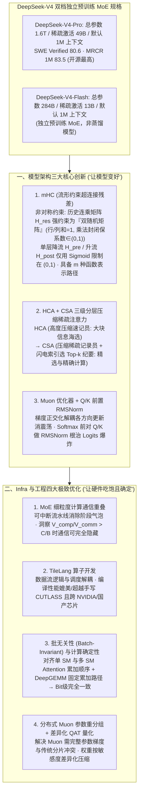

# 读完这篇，你就搞懂 DeepSeek v4 了

## 1. TL;DR

1. **双档独立预训练 MoE 原生标配 1M 上下文**：DeepSeek于 2026 年 4 月 24 日开源 **DeepSeek-V4-Pro**（总参数 **1.6T**、稀疏激活 **49B**、默认 **1M 上下文**）与 **DeepSeek-V4-Flash**（总参数 **284B**、稀疏激活 **13B**、默认 **1M 上下文**，非蒸馏而是独立预训练 MoE）；在 SWE Verified 取得 **80.6%**、长文档跨段推理 **MRCR 1M 取得 83.5（开源最高）**，直击 30 轮 Agent 会话、整仓代码重构（300 文件/15 万行约 `80~120 万 Token`）与 500 页长文档痛点。
2. **架构三大创新（mHC + HCA/CSA + Muon）**：① **mHC（流形约束超连接残差）** 将多通道残差映射矩阵 $H_{\text{res}}$ 约束为 **双随机矩阵**（行和与列和均为 1，利用乘法封闭性将任意深层历史系数严格锁在 `(0, 1)` 内根除梯度消失/爆炸），而对单层 $H_{\text{pre}}/H_{\text{post}}$ 仅做 Sigmoid 软约束；② **HCA（高度压缩注意力）+ CSA（压缩稀疏注意力）** 构建“内容海选 → 内容精选 → 稀疏采样与精确计算”三级流水线；③ **Muon 优化器（梯度正交化）+ 注意力前 Q/K RMSNorm** 彻底消除训练震荡与 Logits 爆炸。
3. **Infra 四大硬核突破**：① **MoE 极细粒度计算通信重叠**（洞察当模型 $\frac{V_{\text{comp}}}{V_{\text{comm}}} > \frac{C}{B}$ 时通信可被计算 100% 隐藏，硬件选型不必盲目堆高带宽）；② 采用数据流与调度解耦的 **TileLang** 编写 mHC/CSA/HCA 算子，性能比肩甚至超越手写 CUTLASS/cuBLAS 且原生跨 NVIDIA 与国产芯片移植；③ **批无关性（Batch-Invariant）与计算确定性**（对齐单 SM 与多 SM Attention Kernel 累加顺序 + 开源 **DeepGEMM** 库，保证同一 Token 无论落在何种 Batch 下均实现 **比特级完全一致**）；④ 混合精度 QAT 与适配 Muon 完整梯度需求的分布式参数重分组。

## 2. 问题定义与背景

### 2.1 为什么在 Agent 时代 128K 上下文彻底不够用了？
在 OpenClaw 与 Hermes 等持久记忆智能体普及后，传统 `128K` 窗口在三大真实场景下频频捉襟见肘：
- **场景一：Coding Agent 多轮循环轻松吃掉近百万 Token**：一个跑 **30 轮** 的 Coding Agent，每轮塞入用户指令（数百 Token）+ 读取 3~4 个源文件（数千至数万 Token）+ Shell 执行输出（数千 Token）+ 自身 Reasoning Trace（数千 Token），30 轮下来数十万 Token 起步（此前 V3.2 被迫在新消息到来时丢弃 Thinking History 正是因为窗口装不下）。
- **场景二：整仓库级代码重构与跨文件一致性检查**：一个含 **300 个文件、15 万行代码** 的中型 Python 项目，Tokenize 后约为 **80~120 万 Token**。传统向量 RAG 检索一旦漏掉一个调用点就会引入 Bug，而 1M 上下文允许“把整个代码仓一口气扔进去”（支撑 V4 在 **SWE Verified 拿到 80.6**）。
- **场景三：超长专业文档跨段落推理**：200 页法律合同、500 页学术综述或季度财报四附件单篇即达 **50~80 万 Token**，切块摘要会严重丢失前后逻辑关联（V4-Pro 在 **MRCR 1M 拿到 83.5** 开源最高分）。

### 2.2 迈向 1.6T 参数与 1M 上下文的三座大山
1. **层间信号退化**：网络做得更深更宽后，传统单通道残差连接易发生特征干扰与深层梯度爆炸/消失；
2. **平方级算力与显存墙**：标准 Transformer 在 Prefill 阶段计算复杂度为 $O(L^2)$（序列长度 $L$ 扩大 `8 倍`，计算量暴增 **`64 倍`**），Decode 阶段 KV Cache 显存与带宽随 $L$ 线性膨胀；
3. **超大规模训练震荡与推理非确定性**：万亿参数下 Attention Logits 极易爆炸，且通用 `cuBLAS` 动态改变矩阵累加顺序导致不同 Batch Size 下输出比特漂移。

## 3. 知识框架

## 4. 核心内容拆解

### 4.1 架构创新一：mHC（Manifold-Constrained Hyper-Connections，多流约束残差）

1. **从标准残差（单井电梯）到 Hyper-Connections（多井电梯）的隐患**：
   - 标准残差 $h_{l+1} = h_l + F(h_l)$ 就像 100 层大楼只有一条共用电梯井，上下楼与运货信号挤在一起互相干扰；字节提出的 Hyper-Connections（HC）虽扩充为 $m$ 条并行通道并引入可学习调度矩阵，但在百层网络中，历史层系数是残差映射矩阵 $H_{\text{res}}$ **跨层连乘**的结果——一旦无约束连乘，极易引发数值爆炸或坍缩为零。
2. **mHC 的“非对称约束”精髓（双随机矩阵流形约束）**：
   - **对跨层连乘的高风险矩阵 $H_{\text{res}}$ 施加强约束**：将其限制在 **双随机矩阵（Doubly Stochastic Matrix）** 流形集合 $\mathcal{M}$ 上（即矩阵所有元素非负，且**每一行的和等于 1、每一列的和也等于 1**）。由于**双随机矩阵具有乘法封闭性**（任意多个双随机矩阵相乘的结果依然是双随机矩阵），使得任意深层展开后每一历史层的贡献系数永远严格保持在 `(0, 1)` 区间内，从数学根源上消灭了深层残差梯度消失与爆炸。
   - **对仅影响当层的低风险矩阵 $H_{\text{pre}}$（降流）与 $H_{\text{post}}$（升流）保持灵活**：仅通过 `Sigmoid` 函数将其约束在 `(0, 1)` 区间即可，无需双随机限制。
   - **表达能力跃升**：矩阵半可分秩分析证明，相比标准残差单一固定的函数表示路径，mHC 理论上可提供通道数 **$m$ 种函数表示路径**。

### 4.2 架构创新二：HCA + CSA 三级长上下文注意力与 Muon 优化器

1. **HCA（高度压缩注意力）+ CSA（压缩稀疏注意力）协同流水线**：
   - **CSA（像站在会议外围综合相邻两组发言的“会议记录员”）**：第一步将相邻块隐状态通过可学习投影矩阵压缩为“纪要”表示；第二步采用与 DeepSeek-V3.2 DSA 一致的 **闪电索引机制（Lightning Indexer）**，快速计算当前 Token 与全部纪要的关联得分并选出 **Top-$k$ 份高关联纪要**；第三步仅对选中的纪要执行精确注意力计算。
   - **HCA（像负责更大范围单场会议的“速记员”）**：压缩粒度比 CSA 更大且不跨相邻小会重叠，计算时共享 KV。
   - **三级漏斗实战配合**：先用 **HCA 做大块信息“海选”** → 再在命中区域用 **CSA 闪电索引做“内容精选”** → 最后执行 **稀疏采样与精确计算**，在 1M 上下文下大幅削减 Prefill FLOPs 与 Decode KV Cache 搬运量（文中同时对比了 Kimi/Qwen 通过核函数先算 $K \cdot V$ 将复杂度从 $O(L^2)$ 降至 $O(L)$ 的混合线性注意力路线）。
2. **Muon 优化器与前置 Q/K RMSNorm 稳定万亿参数训练**：
   - **Muon 梯度正交化**：如同解耦拧魔方的左右手，在训练中对参数梯度做正交化变换，使各正交方向独立更新、互不牵扯，显著减少训练震荡并加速收敛。
   - **Softmax 前置 Q/K RMSNorm**：如同给 10 人会议中音量大 100 倍的人加装自动麦克风增益控制，在计算 $QK^T$ 点积之前先对 $Q$ 和 $K$ 进行 `RMSNorm` 归一化，从源头杜绝少数异常大值引发的 **Logits 爆炸** 与 Softmax 极化。

### 4.3 Infra 创新：细粒度重叠、TileLang、批无关性（Batch-Invariant）与分布式 Muon

1. **MoE 更细粒度的计算通信重叠与硬件选型洞察**：
   - 打破传统按整阶段对齐的粗粒度重叠，引入可随时中断交接的细粒度流水线消除气泡。
   - **定量硬件选型准则**：设硬件算力与通信带宽之比为定值 $\frac{C}{B}$，MoE 模块计算量与通信量之比为定值 $\frac{V_{\text{comp}}}{V_{\text{comm}}}$；只要满足 **$\frac{V_{\text{comp}}}{V_{\text{comm}}} > \frac{C}{B}$**，通信开销即可在理论上被计算 **100% 完全隐藏**——因此部署 MoE 无需盲目采购天价超高带宽网络，够用即可。
2. **TileLang 高层算子抽象**：将“数据流计算逻辑”与“硬件调度策略”解耦，使复杂的 mHC、CSA、HCA 算子无需手写数千行晦涩 CUDA，编译出的 Kernel 性能即可对齐甚至超越手写 `CUTLASS / cuBLAS`，且同一套代码可跨 NVIDIA 与国产算力芯片编译。
3. **批无关性（Batch-Invariant）与比特级计算确定性（Determinism）**：
   - **痛点**：由于浮点数加法不满足结合律（$(a+b)+c \neq a+(b+c)$），通用 `cuBLAS` 会根据当前 Batch 大小动态切换 GEMM 切分与累加路径，导致同一个请求在 `Batch=1` 与 `Batch=16` 下输出的 Token Logits 发生比特级漂移（就像点 50% 糖奶茶因拼单人数不同变成 49% 或 51% 糖）。
   - **DeepSeek 的解法**：① 在 Attention 侧，强制对齐“单序列单 SM 满载计算”与“单序列多 SM 协同计算”两种 Kernel 的内部归约累加顺序；② 在矩阵乘法侧，弃用批相关的 `cuBLAS`，改用自研开源的 **DeepGEMM** 锁定固定累加路径，确保任何 Token 无论落在哪个 Batch 中都实现 **Bit 级 100% 一致**。
4. **分布式 Muon 参数重分组与差异化 QAT**：针对 Muon 优化器必须一次性拿到**完整参数矩阵梯度**才能做正交化、而传统分布式训练将参数切碎分片到多机的天然冲突，重新设计了参数分组与通信分配机制；并结合量化感知训练（QAT），对不敏感大权重（如棉被抽真空）极限压缩，对敏感权重（如高档衣服叠放）保留高精度。

## 5. 数据速查表

| 指标 | 原文数值 | 语境 / 条件 |
| :--- | :--- | :--- |
| **DeepSeek-V4 开源发布日期** | `2026 年 4 月 24 日` | 技术报告《DeepSeek-V4: Towards Highly Efficient Million-Token Context Intelligence》 |
| **DeepSeek-V4-Pro 模型规格** | 总参数 `1.6T`，稀疏激活 `49B`，默认 `1M` 上下文 | 旗舰档独立预训练 MoE 模型 |
| **DeepSeek-V4-Flash 模型规格** | 总参数 `284B`，稀疏激活 `13B`，默认 `1M` 上下文 | 高效档独立预训练 MoE（非蒸馏模型），服务端不区分长/短模型 |
| **SWE Verified 编程基准得分** | `80.6` | 得益于 1M 上下文可一次性读入整仓代码（300 文件 / 15 万行约 `80~120 万 Token`） |
| **MRCR 1M 超长上下文推理得分** | `83.5`（开源最高） | 测试 200 页合同 / 500 页综述（`50~80 万 Token`）上的跨段落原始材料推理 |
| **标准 Attention 复杂度膨胀倍数** | 序列长度 $L$ 提升 `8×`，Prefill FLOPs 暴增 `64×` | 标准 $O(L^2)$ 注意力在超长上下文下的算力墙 |
| **mHC 残差矩阵约束区间** | $H_{\text{res}}$ 行和=1、列和=1（双随机矩阵）；历史层系数 $\in (0, 1)$ | $H_{\text{pre}} / H_{\text{post}}$ 通过 Sigmoid 限制在 `(0, 1)`；提供 $m$ 种函数表示路径 |
| **MoE 通信完全隐藏的理论条件** | $\frac{V_{\text{comp}}}{V_{\text{comm}}} > \frac{C}{B}$ | 当模型计算/通信量比值大于硬件算力/带宽比值时，通信气泡可被完全消除 |

## 6. 踩坑与教训 / 可迁移的设计原则

| 错误做法 | 失败表现或原因 | 原文应对（可迁移的设计原则） |
| :--- | :--- | :--- |
| **在百层超深网络中直接引入无约束的多通道可学习残差矩阵（朴素 HC）** | 跨层展开后历史层系数是残差矩阵 $H_{\text{res}}$ 的百次连乘，微小的特征值偏离 1 就会导致剧烈的梯度爆炸或消失 | **mHC 非对称流形约束**：仅对跨层连乘的高风险矩阵 $H_{\text{res}}$ 施加“双随机矩阵”强约束（利用乘法封闭性锁死系数在 `(0,1)`），对单层升降流矩阵仅用 Sigmoid 软约束 |
| **在 1M 超长上下文下对所有 Token 一视同仁跑全量稠密或单一粒度注意力** | Prefill $O(L^2)$ 算力与 Decode KV 带宽直接崩盘 | **HCA + CSA 三级漏斗（海选 → 精选 → 精算）**：先用大粒度 HCA 定位高关联大块，再用 CSA 闪电索引挑出 Top-$k$ 纪要，最后局部精确计算 |
| **在万亿参数训练中直接计算 $QK^T$ 送入 Softmax，并沿用传统一阶耦合梯度更新** | 少数维度异常大值引发 Logits 爆炸导致训练崩溃，且各方向梯度耦合震荡收敛慢 | **注意力前 Q/K RMSNorm + Muon 梯度正交化 + 分布式参数重分组**：在 Softmax 前给 Q/K 加装“自动增益控制”，并重构分布式参数分组使 Muon 能获取完整矩阵梯度做正交化 |
| **在推理服务中直接使用通用 `cuBLAS` 并混跑不同大小的动态 Batch** | `cuBLAS` 随 Batch 大小动态改变浮点累加顺序，导致同一条 Prompt 在不同并发下输出结果不一致（难以复现 Bug 与评测） | **Batch-Invariant（批无关性）设计**：对齐单/多 SM Attention 归约顺序，并用自研 **DeepGEMM** 锁定固定累加拓扑，实现跨 Batch 比特级 100% 一致 |

## 7. 记忆锚点

- **“1.6T/49B（Pro）与 284B/13B（Flash）双独立 MoE，全系原生 1M 上下文”**：SWE Verified `80.6`、MRCR 1M `83.5`，彻底终结 Agent 跑 30 轮就断片和 300 文件代码仓无法整库重构的历史。
- **“mHC 双随机锁死连乘不炸、HCA+CSA 三级海选精选、Muon 正交化拧魔方、Q/K RMSNorm 防大嗓门破音”**：四句话精准概括 V4 模型架构与训练的四大支柱。
- **“TileLang 跨芯编译、$\frac{V_{\text{comp}}}{V_{\text{comm}}} > \frac{C}{B}$ 藏通信、DeepGEMM 锁死 50% 糖奶茶的批无关比特确定性”**：DeepSeek 把算法与底层硬件耦合打磨到极致的三大 Infra 杀手锏。

## 8. 复习卡片

1. DeepSeek-V4-Pro 和 DeepSeek-V4-Flash 的参数规模分别是多少？关于这两档模型有哪些常见误解需要澄清？::V4-Pro 为总参数 `1.6T`、稀疏激活 `49B`；V4-Flash 为总参数 `284B`、稀疏激活 `13B`；两个常见误解澄清：① Flash 不是 Pro 的蒸馏模型，两者都是独立预训练的 MoE；② `1M 上下文` 不是需要单独开启的特殊模式，而是两档模型的默认标配。
2. 为什么作者列举了“Agent 30 轮任务”、“整仓代码重构”和“长文档推理”三个场景来说明 1M 上下文的刚需性？::① 30 轮 Coding Agent 每轮累积源文件、终端输出与思考链，轻松消耗数十万至百万 Token；② 中型项目（300 文件/15 万行代码）约 `80~120 万 Token`，1M 窗口支持整仓直接塞入而不漏调用点（支撑 V4 在 SWE Verified 拿 `80.6`）；③ 200~500 页合同/综述达 `50~80 万 Token`，直接跨段推理避免了切块摘要的逻辑丢失（MRCR 1M 拿 `83.5`）。
3. 什么是 mHC（流形约束超连接残差），它为什么采用“非对称约束”把 $H_{\text{res}}$ 限制为双随机矩阵？::mHC 是对多通道残差连接的改进；因为在深层网络展开式中，历史每一层的系数都是残差映射矩阵 $H_{\text{res}}$ 跨层连乘的结果（高风险），而每层前后的降流 $H_{\text{pre}}$ 和升流 $H_{\text{post}}$ 只与当层相关（低风险）；利用“双随机矩阵（行和与列和均为 1 的非负矩阵）乘法封闭性”，可确保连乘后的系数永远在 `(0,1)` 之间以根除梯度消失/爆炸，而对 $H_{\text{pre}}/H_{\text{post}}$ 仅需 Sigmoid 软约束。
4. DeepSeek-V4 中的 HCA（高度压缩注意力）与 CSA（压缩稀疏注意力）是如何配合处理 1M 超长上下文的？::采用“内容海选 → 内容精选 → 稀疏采样与精确计算”的三级协同流程：先用压缩粒度更大的 HCA（如速记员）定位上下文中高关联的“大块信息”，再在这些大块内通过 CSA（如记录员）与闪电索引机制选出关联度最高的 Top-$k$ 份纪要进行精确注意力计算。
5. DeepSeek-V4 在训练稳定性上引入了哪两项关键机制？如何解决 Muon 优化器与传统分布式训练的冲突？::① 引入 Muon 优化器对梯度做正交化，解耦各方向更新以加速收敛；② 在注意力计算前先对 Q 和 K 做 RMSNorm，防止点积过大引发 Logits 爆炸。针对 Muon 必须获取完整参数梯度而传统分布式训练将参数切碎分片的冲突，V4 重新设计了参数分组与跨机分配方式使其高效共存。
6. 什么是推理与训练中的“批无关性（Batch-Invariant）”，DeepSeek-V4 是如何克服浮点非结合律实现比特级确定性的？::批无关性指无论 Batch 如何切分或并发大小如何变化，同一个 Token 的输出结果在 Bit 级别上 100% 完全一致；由于浮点加法不满足结合律且通用 `cuBLAS` 会随 Batch 动态改变累加顺序，V4 通过对齐单 SM 与多 SM Attention Kernel 的内部计算顺序，并使用自研开源的 `DeepGEMM` 锁定固定矩阵乘累加路径来实现批无关性。

## 9. 知识关联

- **本仓库主题索引**：[模型架构与训练](../../20_topics/%E6%A8%A1%E5%9E%8B%E6%9E%B6%E6%9E%84%E4%B8%8E%E8%AE%AD%E7%BB%83.md) · [Agent成本与上下文预算](../../20_topics/Agent%E6%88%90%E6%9C%AC%E4%B8%8E%E4%B8%8A%E4%B8%8B%E6%96%87%E9%A2%84%E7%AE%97.md) · [大模型推理与算子优化](../../20_topics/%E5%A4%A7%E6%A8%A1%E5%9E%8B%E6%8E%A8%E7%90%86%E4%B8%8E%E7%AE%97%E5%AD%90%E4%BC%98%E5%8C%96.md)
- **候选双链概念**：[[mHC流形约束超连接]] · [[CSA与HCA压缩稀疏注意力]] · [[Muon正交梯度优化器]] · [[TileLang算子编译]] · [[批无关性Batch-Invariant]]

## 10. 原文参考资料

1. DeepSeek Technical Report (2026.04.24)：*DeepSeek-V4: Towards Highly Efficient Million-Token Context Intelligence*。
2. 相关开源算子与工具栈：`TileLang`、`DeepGEMM`。

> [!note]- 校对报告
> - **校对状态**：已按原文逐页核对通过（共 15 页 PDF）。
> - **核心数据与页码溯源**：
>   - `2026 年 4 月 24 日` 发布开源、技术报告标题、`DeepSeek-V4-Pro`（`1.6T` 参数 / 稀疏激活 `49B` / `1M` 上下文）与 `DeepSeek-V4-Flash`（`284B` 参数 / 稀疏激活 `13B` / `1M` 上下文）、独立预训练非蒸馏澄清：见 `p.1`。
>   - 1M 上下文三大刚需场景（30 轮 Coding Agent、300 文件 / 15 万行代码 = `80~120 万 token` 且 SWE Verified 拿 `80.6`、200 页合同 / 500 页综述 = `50~80 万 token` 且 MRCR 1M 拿 `83.5` 开源最高）及 $L$ 提升 `8×` 导致 Prefill FLOPs 提升 `64×`：见 `p.2–3`。
>   - 标准残差、Hyper-Connections 与 mHC（双随机矩阵约束 $H_{\text{res}}$、乘法封闭性保持历史层系数 $\in (0,1)$、$H_{\text{pre}}/H_{\text{post}}$ Sigmoid 约束、$m$ 种函数表示路径及对比 Kimi Attn-Res）：见 `p.4–6`。
>   - CSA（压缩稀疏注意力 + 闪电索引选 Top-$k$ 纪要）与 HCA（高度压缩注意力）三层协同，以及对比 Kimi/Qwen 混合线性注意力：见 `p.7–10`。
>   - Muon 优化器梯度正交化、Q/K 前置 RMSNorm 防 Logits 爆炸、MoE 细粒度计算通信重叠（$\frac{V_{\text{comp}}}{V_{\text{comm}}} > \frac{C}{B}$）、TileLang 跨芯片算子开发、批无关性（Batch-Invariant）与 `DeepGEMM`、分布式 Muon 参数重分组与 QAT：见 `p.10–14`。
